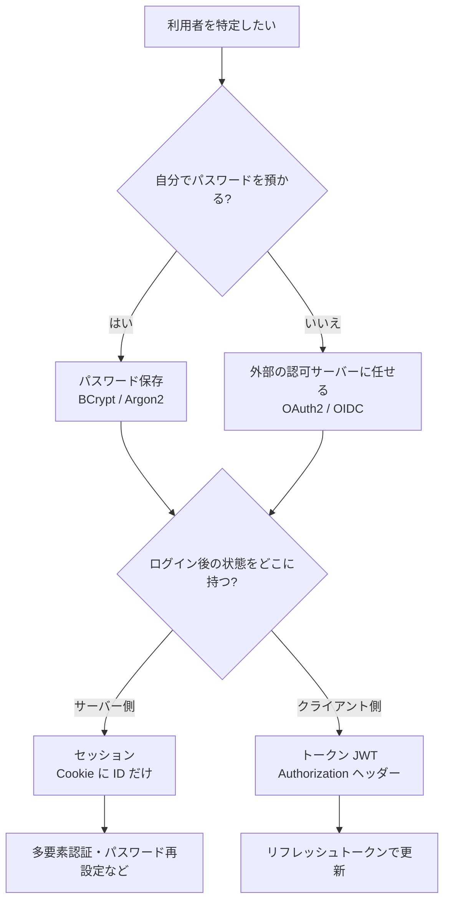
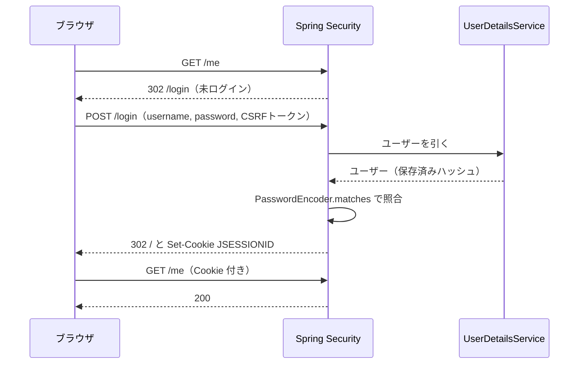
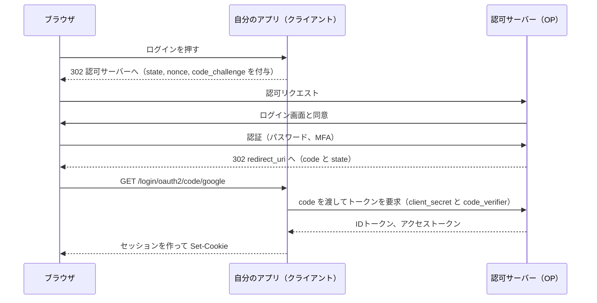
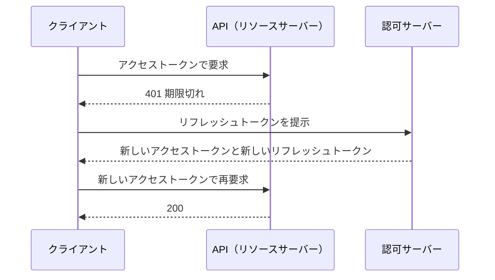

# 付録 ログイン型認証の概観

<div class="goal-box" markdown>

この付録でできるようになること

- QuickVote の匿名セッションと、ログイン型の認証の違いを、守る条件の違いとして説明できる
- パスワード保存・フォームログイン・セッションとJWT・OAuth2/OIDC・リフレッシュトークンの役割を、図で説明できる
- Spring Security の `oauth2Login` と `oauth2ResourceServer` の違いを言える
- ログイン機能が入ったコードを、AIの出力であっても読んでレビューできる

</div>

この教材では、ログイン型の認証を作りません。QuickVote は会員登録のいらない匿名サービスだからです。ただ、現場の Spring のコードにはほぼ必ずログインが含まれます。この付録は、作らなくても読めるようになるための地図です。

!!! note "確認したこと"
    以降の実行結果は、Spring Boot 4.1.2（Spring Security 7.1.2）の小さな実験プロジェクト（`code/labs/appendix-login-auth/`）でコンパイルと実行をして得たものです。ハッシュの値やトークンは実行のたびに変わります。

## 1. 先に整理：QuickVote の匿名セッションとの違い

| 観点 | QuickVote（匿名セッション） | ログイン型 |
| --- | --- | --- |
| 「同じ人」の根拠 | Cookie `QV_VISITOR` を持っていること | パスワードなどの資格情報を示せること |
| 利用主体の作り方 | 初回アクセスで乱数トークンを発行（`SecureRandom` 32バイト） | 登録（アカウント作成）で作る |
| サーバーが保存するもの | トークンの SHA-256 ハッシュ（`visitors`） | パスワードの遅いハッシュ、メールアドレスなど |
| 端末を変える／Cookieを消す | 権限を失う（仕様として決めている） | ログインし直せば取り戻せる |
| 約束する強さ | 「この端末のこのブラウザの人」 | 「このアカウントの持ち主」 |
| セッション | `HttpSession` を使わない（STATELESS） | セッション（Cookie）またはトークン（JWT）が普通 |
| 攻撃面 | トークンの推測、Cookie の盗用 | 上に加えて、パスワードの総当たり・漏洩・使い回し、パスワード再設定、外部IdP |

ログイン型は、失ったアカウントを取り戻せる代わりに、取り戻すための仕組みがすべて攻撃面になる方式です。QuickVote が匿名を選んだのは、守る範囲を小さくできるからです（[第30章](../part06/ch30-authz-design.md)・[第32章](../part06/ch32-anonymous-session.md)）。

!!! tip "Spring Security の「匿名認証」とは別物"
    Spring Security には `AnonymousAuthenticationToken`（誰とも特定できなかった状態）があります。QuickVote の訪問者は Cookie で特定できているので、別の扱いになります。

## 2. ログイン機能の部品の地図



下の各節が、この図の各ノードに対応します。

## 3. パスワードの保存

**パスワードそのものは保存しません。保存するのは「遅いハッシュ」です。**

| やり方 | 評価 | 理由 |
| --- | --- | --- |
| 平文で保存 | 禁止 | DB が漏れたら全員のパスワードが漏れる |
| 暗号化して保存 | 避ける | 鍵が漏れれば復元される。サービスが復元できる設計自体が不要 |
| SHA-256 など速いハッシュ | 不十分 | 1秒に何十億回も試せる。総当たりに弱い |
| BCrypt・Argon2 など遅いハッシュ＋ソルト | 採用 | わざと遅く（計算量を調整可能に）作られている |

Spring Security は `PasswordEncoder` という共通の入口を用意しています。

```java title="code/labs/appendix-login-auth/src/main/java/com/example/loginauth/PasswordLab.java（抜粋）"
PasswordEncoder bcrypt = new BCryptPasswordEncoder();
String h1 = bcrypt.encode(raw);
String h2 = bcrypt.encode(raw);
bcrypt.matches(raw, h1);                 // true。比較は必ず matches で行う

PasswordEncoder argon2 = Argon2PasswordEncoder.defaultsForSpringSecurity_v5_8();
PasswordEncoder delegating = PasswordEncoderFactories.createDelegatingPasswordEncoder();
```

実行結果です（値は毎回変わります）。

```text
bcrypt #1 = $2a$10$utAkZGnBZ99brwYMjzruHeOsGuiyXJ8se/AMUEQpr3c9k6.erVFzu
bcrypt #2 = $2a$10$im4sR9bRQoWn6QOtDSsoGujeT.Pq5.b1ERHGVBLtTGV1zNS/EJraK
同じ入力でも毎回違う（ソルトが入る）: true
argon2    = $argon2id$v=19$m=16384,t=2,p=1$uvBnpdYMtPazsolVc1V+4g$K37yO/FdNJzd...
delegating = {bcrypt}$2a$10$aJLF8.nFu2Wa69OAJB392eB7FSbZrk3UEmnavfKK4q6cR1iGxqP1e
80 文字: 拒否 (password cannot be more than 72 bytes)
```

同じパスワードでも、ハッシュは毎回違います。`$2a$10$` に続く部分にソルト（ランダムな値）が入っているためです。ソルトがあると、同じパスワードを使っている人を見分けられず、事前に計算した表（レインボーテーブル）も使えません。`$2a$10$` の `10` はコストで、上げるほど計算が遅くなります。ログインの速さと攻撃への強さを引き換えにする値です。

Argon2 は、メモリ量（`m`）、反復回数（`t`）、並列度（`p`）をハッシュ文字列自体に持ちます。Spring Security で使うには別の暗号ライブラリ（Bouncy Castle）が必要で、Boot の管理外なのでバージョンを自分で書きます。

BCrypt は72バイトを超える入力を拒否します（Spring Security 7.1.2 で実測）。長いパスフレーズが通らないので、パスワードの長さの上限を決めておく必要があります。

先頭に `{bcrypt}` が付いているのが `DelegatingPasswordEncoder` の出力です。ハッシュ方式の目印を含めて保存するので、将来 Argon2 に移行しても、既存の利用者のハッシュを読み続けられます。

!!! danger "レビューで見るポイント"
    - `passwordEncoder.encode(...)` を通さず保存している、`equals` でハッシュ同士を比べている
    - `NoOpPasswordEncoder`（平文のまま。学習用の遺物）が Bean にある
    - ログインの失敗理由を「ユーザーが存在しません」「パスワードが違います」と分けて返している（ユーザーの有無を漏らす。QuickVote が存在しない投票と参加していない投票をどちらも404にしたのと同じ考え方）
    - 総当たり対策（[第35章](../part06/ch35-rate-limiting.md)）がない

## 4. フォームログインとセッション

Spring Security の標準は「ログインフォーム → セッション」です。

```java title="code/labs/appendix-login-auth/.../FormLoginConfig.java（抜粋）"
http
    .authorizeHttpRequests(a -> a
        .requestMatchers("/login", "/error").permitAll()
        .anyRequest().authenticated())
    .formLogin(Customizer.withDefaults())        // GET /login の画面、POST /login の処理
    .logout(Customizer.withDefaults())           // POST /logout
    .sessionManagement(s -> s.maximumSessions(1));
```



実験プロジェクトで、この流れの各段階を確かめました（MockMvc）。

| 操作 | 結果 |
| --- | --- |
| 未ログインで `GET /me` | 302 `Location=/login` |
| 正しい資格情報で `POST /login` | 302 `Location=/`、セッションが作られる |
| 誤った資格情報で `POST /login` | 302 `Location=/login?error` |
| CSRFトークンなしで `POST /login` | 403 |

セッションはサーバーが持ちます。Cookie `JSESSIONID` はセッションIDという引換券にすぎず、この点は QuickVote の `QV_VISITOR` と似ています。違うのは、ログインしたユーザーという中身がサーバーのメモリにあることです。そのため複数台にすると、別のサーバーに当たったときに未ログインになり、セッションの置き場所が問題になります。共有ストア（Spring Session と Redis／DB）を使うか、リクエストを固定のサーバーに振り分ける必要があります（[第38章](../part07/ch38-multi-instance.md)）。

Cookie はブラウザが自動で添えるので、CSRF 対策は必須です（[第34章](../part06/ch34-browser-boundary.md)）。ログインフォームでさえ CSRF トークンを要求します。なお、ログイン成功時にセッションIDを新しくする（セッション固定化攻撃の対策）のは、Spring Security の既定の動作です。

## 5. セッションとJWT：どちらも万能ではない

JWT（JSON Web Token）は、署名つきの JSON を文字列にしたトークンです。`ヘッダー.ペイロード.署名` の形で、3つをドットでつなぎます。

!!! note "用語：JWT"
    サーバーが秘密鍵で署名した、利用者の情報（誰か、いつまで有効か、権限）を含む文字列です。受け取った側は署名を検証するだけで、発行元に問い合わせずに中身を信用できます。署名であって暗号化ではないので、中身は誰でも読めます。

実験で、発行・読み取り・改ざん・期限切れを試しました。

```text
parts = 3
header  = {"alg":"HS256"}
payload = {"sub":"user-42","exp":1794070421,"iat":1794069521,"scope":"read"}
検証: sub=user-42
改ざん: 拒否 -> BadJwtException
期限切れ: 拒否 -> JwtValidationException
```

`payload` は Base64URL を戻すだけで平文として読めました。そのため、パスワードや個人情報は載せません。一方、`sub` を `admin` に書き換えると、署名が合わず拒否されました。

| 観点 | セッション（Cookie + サーバー保存） | JWT（署名つきトークン） |
| --- | --- | --- |
| 状態の置き場所 | サーバー（メモリ／Redis／DB） | クライアント（トークン自体） |
| 即時の失効（ログアウト・乗っ取り対応） | 簡単（サーバーの記録を消す） | 難しい（期限まで有効。失効リストを作ると状態が必要になる） |
| 複数台 | 共有ストアが必要 | 署名鍵を共有すれば不要 |
| ブラウザでの保管 | Cookie（HttpOnly で JavaScript から隠せる） | `localStorage` は XSS で盗まれやすい。Cookie に入れるなら CSRF 対策が要る |
| サイズ | IDだけで小さい | 大きくなりがち（毎リクエスト送る） |
| 向く場面 | ブラウザの画面を持つ自社Webアプリ | 別のサービスへ渡すAPI、モバイル、サービス間 |

!!! warning "よくある誤解"
    「JWT はステートレスだからスケールする」という説明は、半分だけ正しいものです。ログアウトや権限の取り消しを正しく実装すると、失効リストや鍵のローテーションといったサーバー側の状態が必要になるからです。セッションのほうが単純で安全な場面は多いので、JWT を使うこと自体を目的にはしません。

QuickVote の訪問者トークンは JWT ではなく、不透明なトークン（ランダムな文字列）をDBで照合する方式です。分類としてはセッションに近く、中身が見えず、DB の行を消せば即座に失効できます。

### JWT を受け取る側（リソースサーバー）

`oauth2ResourceServer` は Bearer トークンを検証するだけで、ログイン画面は持ちません。

```java title="code/labs/appendix-login-auth/.../ResourceServerConfig.java（抜粋）"
http
    .sessionManagement(s -> s.sessionCreationPolicy(SessionCreationPolicy.STATELESS))
    .csrf(c -> c.disable())     // Cookie を使わない API なので前提が違う（無条件に無効化してよいわけではない）
    .authorizeHttpRequests(a -> a
        .requestMatchers("/api/admin/**").hasAuthority("SCOPE_admin")
        .requestMatchers("/api/**").hasAuthority("SCOPE_read")
        .anyRequest().denyAll())
    .oauth2ResourceServer(o -> o.jwt(Customizer.withDefaults()));
```

| リクエスト | 結果 |
| --- | --- |
| トークンなし | 401（`WWW-Authenticate: Bearer`） |
| 壊れたトークン | 401（`error="invalid_token"`、`Malformed token`） |
| `scope=read` で `/api/hello` | 200 |
| `scope=read` で `/api/admin/ping` | 403（認証はできたが権限がない） |

401（誰か分からない）と 403（分かったが許されない）の使い分けは、QuickVote の権限表と同じ考え方です。

## 6. OAuth2 と OIDC：ログインを外部に任せる

「Googleでログイン」は、パスワードを自分で預からない選択です。混同しやすい言葉を次の表にまとめます。

| 用語 | 役割 |
| --- | --- |
| OAuth 2.0 | 「ある資源へのアクセスを委譲する」ための枠組み。アクセストークンを発行する |
| OIDC（OpenID Connect） | OAuth 2.0 の上に作られたログイン（認証）の規格。IDトークン（JWT）で「誰か」を伝える |
| 認可サーバー（OP） | 利用者をログインさせてトークンを発行する側（Google、社内の IdP など） |
| クライアント | 認可サーバーに頼ってログインを済ませる自分のアプリ |
| リソースサーバー | トークンを見てAPIを守る側 |

OAuth 2.0 自体はログインの標準ではなく、ログインに使うのは OIDC です。



この流れでパスワードを入力するのは認可サーバーの画面で、自分のアプリはパスワードを見ません。ブラウザに渡るのは使い捨ての `code` だけで、トークンはアプリのサーバーが認可サーバーから直接受け取ります。`state` は CSRF 対策、`nonce` は ID トークンの使い回しの対策、`code_challenge`（PKCE）は `code` を横取りされても使えなくする対策です。

Spring Security では `oauth2Login` を書くだけで、この流れのクライアント側が動きます。

```java title="code/labs/appendix-login-auth/.../OAuth2LoginConfig.java（抜粋）"
http
    .authorizeHttpRequests(a -> a
        .requestMatchers("/login/**", "/oauth2/**", "/error").permitAll()
        .anyRequest().authenticated())
    .oauth2Login(Customizer.withDefaults());
```

```properties
spring.security.oauth2.client.registration.google.client-id=dummy-client-id
spring.security.oauth2.client.registration.google.client-secret=dummy-secret
spring.security.oauth2.client.registration.google.scope=openid,profile,email
```

実際に `/oauth2/authorization/google` へアクセスして、リダイレクトを観察しました（ダミーの値なので、実在の Google には渡りません）。

```text
302 -> accounts.google.com/o/oauth2/v2/auth
  response_type = code
  client_id     = dummy-client-id
  scope         = openid%20profile%20email
  state         = MmOVu8-I...
  redirect_uri  = http://localhost/login/oauth2/code/google
  nonce         = 09f01e0l...
  code_challenge = kUHLdW_S...
  code_challenge_method = S256
```

`state`・`nonce`・`code_challenge`（PKCE）が自動で付いています。未ログインで `/me` に行くと `/oauth2/authorization/google` へ 302 されることも確認しました。

### `oauth2Login` と `oauth2ResourceServer` の違い

| | `oauth2Login` | `oauth2ResourceServer` |
| --- | --- | --- |
| 自分の立場 | クライアント（ログインを外部に頼む） | リソースサーバー（APIを守る） |
| 主な利用者 | ブラウザで操作する人 | 他のアプリ、モバイル、SPA が送るトークン |
| 受け取るもの | `code` → IDトークン | `Authorization: Bearer …` |
| ログイン画面 | 外部の認可サーバーにある | 持たない |
| ログイン後の状態 | 自分のセッション（Cookie） | なし（毎回トークンを検証） |
| スターター | `spring-boot-starter-security-oauth2-client` | `spring-boot-starter-security-oauth2-resource-server` |

!!! warning "外部に任せても、自分のユーザー管理は消えない"
    IdP が教えてくれるのは、`sub`（IdP内で一意の利用者ID）とメールアドレスなどの属性です。自分のアプリには、その `sub` に紐づく自分側のユーザー行（権限、設定、作成した投票など）が必要です。メールアドレスは変更されることがあるので主キーにせず、`sub` と発行元（`iss`）の組を一意キーにします。

認可サーバー自体を自前で作ることも可能で、Spring Authorization Server は Spring Security 本体に統合されています（公式の移行ガイドの記述。この付録では動かしていません）。

## 7. リフレッシュトークン

アクセストークンは短命（例：15分）にします。盗まれても被害が時間で限られ、JWT の失効しにくさも補えるからです。ただ、短命のままでは頻繁にログインし直しになるので、長命のリフレッシュトークンを使って新しいアクセストークンを受け取ります。



| 設計の論点 | 一般的な対応 |
| --- | --- |
| リフレッシュトークンの保管 | ブラウザなら HttpOnly の Cookie など。`localStorage` は避ける |
| 盗まれたとき | 使うたびに新しいものに入れ替え（ローテーション）、古いものが再度使われたら全体を失効 |
| 即時失効 | 認可サーバーがリフレッシュトークンを記録しているので、そこで止められる |
| 有効期間 | 数日〜数週間。使われなければ失効 |

リフレッシュトークンはパスワードに近い強さを持つので、パスワードと同じくらい慎重に扱います。

## 8. 多要素認証（MFA）の存在

パスワードだけに頼ると、漏洩や使い回しで突破されます。そこで、次の種類のうち2種類以上を組み合わせます。

| 種類 | 例 |
| --- | --- |
| 知っているもの | パスワード、PIN |
| 持っているもの | スマホのワンタイムコード（TOTP）、セキュリティキー |
| 自分自身 | 指紋、顔 |

最近は、パスワード自体を使わないパスキー（WebAuthn）が広がっています。Spring Initializr には「WebAuthn for Spring Security」の依存があり、Spring Security 側にも対応する仕組みがあります（この付録では動かしていません）。

**MFA は自作しません。** 実装を誤りやすいので、認可サーバー（IdP）に任せるのが現実的です。QuickVote のような匿名サービスは、そもそも守る対象の価値が低いので、MFA は不要です。

## 9. QuickVote にログインを足すなら

足す場合の設計メモです。実装はしません。

| 決めること | 案 |
| --- | --- |
| 匿名 → ログインの橋渡し | `visitors` に `user_id`（NULL可）を足し、ログイン時に紐づける。匿名で作った投票を引き継げる |
| 権限の根拠 | これまで通り「投票ごとの参加者表」。ログインは誰を特定するかを変えるだけ |
| 失ったとき | Cookie を消しても、ログインで同じ `user_id` に戻れる |
| 新しく守る条件 | パスワード保存、総当たり対策、再設定のなりすまし対策、メール確認 |
| 外部IdP | 自前のパスワードより、OIDC に任せるほうが守る範囲が小さい |

「認証・識別・認可を分ける」という第30章の整理が、そのまま使えます。ログインを足しても、認可（何を許すか）の表は変わりません。

## 10. ログイン機能のレビュー観点

1. パスワードは `PasswordEncoder` で遅いハッシュにしているか。`NoOpPasswordEncoder` は無いか
2. ログイン失敗のメッセージが、ユーザーの有無を漏らしていないか
3. ログインに試行回数制限があるか
4. フォームログインなら CSRF を有効にしているか。無効化するなら、その根拠（Cookie を使わない）は成り立つか
5. セッションなら、複数台での扱い（共有ストア）は決まっているか
6. JWT なら、有効期間は短いか。失効の手段はあるか。ペイロードに機密を載せていないか
7. 署名アルゴリズムは固定されているか（`alg` を信用していないか）
8. `client-secret` や署名鍵が Git に入っていないか（[第15章](../part02/ch15-configuration.md)）
9. OIDC のユーザーを、メールアドレスではなく `sub` で識別しているか
10. ログに、パスワード・トークン・Cookie が出ていないか（[第43章](../part09/ch43-logging.md)）

## 11. 演習

??? question "確認問題1：なぜ毎回ハッシュが違うのか"
    同じパスワード `abc` を2回 `bcrypt.encode` したら、違う文字列になりました。それでも `matches` が `true` になるのはなぜですか。

??? success "解答"
    ハッシュ文字列の中にソルトが含まれているからです。`matches` はその文字列からソルトとコストを取り出し、入力されたパスワードを同じ条件でハッシュし直して比べます。毎回違うのは、`encode` のたびに新しいソルトを作るためです。

??? question "確認問題2：401と403"
    有効な JWT（`scope=read`）で管理者用APIを呼ぶと何が返りますか。理由も答えてください。

??? success "解答"
    403 です。トークンは有効なので、誰かは分かっています（認証済み）。しかし必要な `SCOPE_admin` がないので、許されません（認可の失敗）。トークンがない・壊れている場合は 401 です。

??? question "応用：どちらを選ぶか"
    次の3つについて、セッションとJWTのどちらが向くかを理由つきで答えてください。(a) 自社のWebアプリ（画面あり、1サービス） (b) スマホアプリ向けのAPI (c) 管理画面で「今すぐこのユーザーを締め出したい」要件

??? success "解答"
    (a) セッション。ブラウザ前提で、HttpOnly の Cookie に ID だけを置け、実装が単純です。(b) JWT（短命＋リフレッシュトークン）が向きます。Cookie を前提にできないためです。(c) セッション、または JWT なら短い有効期間と失効の仕組み。即時の締め出しは、サーバー側に記録を持つ方式のほうが簡単です。

??? question "説明問題：現場でこう聞かれる"
    「`oauth2Login` と `oauth2ResourceServer` は何が違いますか？」200字程度で答えてください。

??? success "解答"
    例：`oauth2Login` は、自分のアプリが OAuth2/OIDC のクライアントとなり、ログインを外部の認可サーバーに任せる設定です。成功するとアプリ側のセッションができます。`oauth2ResourceServer` は、自分が API として、送られてきた Bearer トークン（JWT など）を検証するだけの設定で、ログイン画面もセッションも持ちません。ブラウザの人を迎えるか、トークンを持った呼び出しを守るかの違いです。
