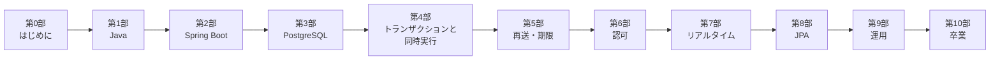

---
hide:
  - navigation
  - toc
---

# ゼロからプロへ Java × Spring Boot バックエンド

**フロントエンドのプロが、バックエンドもプロとして担当できるようになるための教材です。**

Java 25 / Spring Boot 4.1 / Spring Security 7 / PostgreSQL 18 を使い、
「動くコード」ではなく **「壊れないサービス」** を作れるところまで連れていきます。

## この教材が目指すところ

この教材は「Javaの文法を覚える教材」ではありません。

> **サーバーが守るべき約束を決め、実装し、わざと壊して確かめる教材です。**

たとえば、次の質問にあなたは答えられるでしょうか。

- 残り1枠の投票ルームに、2人が**同時に**参加ボタンを押したら、何人入れてしまうか？
- 保存に成功したのに通信が切れて、スマホが**同じリクエストを再送**してきたら？
- URLのIDを1つ書き換えるだけで、**他人のデータが見えて**しまわないか？
- リアルタイム通知の接続が切れていた間の出来事を、**取りこぼさずに**届けられるか？

フロントエンドでは「サーバーがうまくやってくれる」前提で済んでいたことです。
この教材を終えるころには、あなたが **「うまくやる側」** になっています。

## 読み終えたときにできること

-   :material-language-java:{ .lg .middle } **Javaを読み書きできる**

    ---

    TypeScriptの知識を土台に、型・null・例外・コレクション・スレッドの考え方を身につける。

-   :material-leaf:{ .lg .middle } **Spring Bootの中身が分かる**

    ---

    DIコンテナ、リクエストの流れ、`@Transactional` の正体まで。「なぜ動くか」を説明できる。

-   :material-database-lock:{ .lg .middle } **データを正しく守れる**

    ---

    SQL、制約、トランザクション、ロック、冪等性。同時アクセスや再送でも壊れない。

-   :material-shield-account:{ .lg .middle } **権限を設計できる**

    ---

    会員登録なしの匿名セッション、招待、Cookie、CSRF、レート制限まで、自分で設計して守る。

-   :material-access-point:{ .lg .middle } **リアルタイム通知を作れる**

    ---

    SSEと再接続、イベント履歴、2台構成。「切れても取りこぼさない」通知を作る。

-   :material-chart-line:{ .lg .middle } **公開後も責任を持てる**

    ---

    Docker、ログ、メトリクス、負荷、リリースと復旧。動かし続けるための技術。

## 通しの題材：即席投票ボード「QuickVote」

教材全体を通して、ひとつのアプリを少しずつ育てます。

**QuickVote** は、会議や飲み会で「今この場で決める」ための、会員登録不要の投票サービスです。
主催者が投票を作り、参加者は8文字の参加コードで加わり、得票はリアルタイムに伸びていきます。

小さなアプリですが、バックエンドの難所がぎっしり詰まっています。

| 機能 | その裏で学ぶこと |
| --- | --- |
| 登録なしで参加できる | 匿名セッション、Cookie、認可の設計 |
| 参加者は最大50人、選択肢は最大10件 | トランザクション、ロック、同時実行 |
| 1人1票（押し直しは上書き） | 一意性制約、UPSERT |
| 電波が悪くて押し直しても二重登録しない | 冪等性（Idempotency-Key） |
| 得票がリアルタイムに伸びる | SSE、イベント履歴、再接続、複数台構成 |
| 締切を過ぎたら投票できない、7日後に消える | 時刻の設計、定期処理 |
| 参加コードの総当たりを防ぐ | レート制限、エントロピー |

## 学び方

- **順番に進めてください。** 後半の章は前半の知識を前提にしています。
- **手を動かしてください。** ほとんどの章に「動かしてみる」と「壊してみる」があります。読むだけでは身につきません。
- **動画は「順番が大事な概念」だけ**に用意しています。音が出せないときのために、動画の要点は本文にも書いてあります。
- 目安は**約200時間**。働きながら週8〜10時間なら、半年ほどの道のりです。

[第0部から始める :material-arrow-right:](part00/index.md){ .md-button .md-button--primary }
[TypeScript ↔ Java 対応表を見る](appendix/ts-java.md){ .md-button }

## この教材の前提

| 項目 | バージョン |
| --- | --- |
| Java | 25（LTS） |
| Spring Boot | 4.1.2 |
| Spring Framework / Security | 7.x |
| PostgreSQL | 18 |
| ビルドツール | Maven（Maven Wrapper） |

!!! info "対象読者"
    フロントエンド（React / TypeScript など）の実務経験があり、バックエンドを専門にしてこなかったエンジニアを想定しています。
    変数・関数・HTTP・SQLの基本・Gitの使い方は説明しません。その代わり、Java・Spring・サーバー特有の考え方は、初めて見る前提で丁寧に説明します。

## この教材の作り方

この教材は、フロントエンドエンジニアの作者がバックエンドを学ぶために、AI（Claude と Codex）と一緒に作りました。章の構成、文章、図、動画の多くは AI が下書きし、作者が方針を決めて手を入れています。本文のコードと題材アプリは実際に動かして確かめていて、題材アプリには260件の自動テストがあります。

一方で、バックエンドの専門家による確認はまだ受けていません。誤りや古い情報に気付いたら、[GitHub の Issue](https://github.com/y-endo/spring-boot-for-frontend-engineers/issues) で教えてもらえると助かります。

## クレジットとライセンス

- 解説動画の音声：VOICEVOX:冥鳴ひまり
- 動画の字幕フォント：[Noto Sans JP](https://fonts.google.com/noto/specimen/Noto+Sans+JP)（SIL Open Font License 1.1）
- 本文・図・動画・サンプルコードは [クリエイティブ・コモンズ 表示 4.0 国際（CC BY 4.0）](https://creativecommons.org/licenses/by/4.0/deed.ja) で公開しています。出典を示せば、改変や商用利用も自由です。
