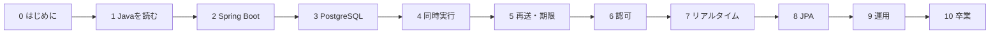
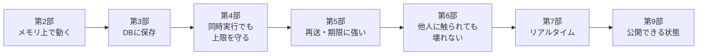
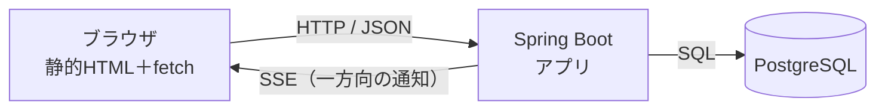
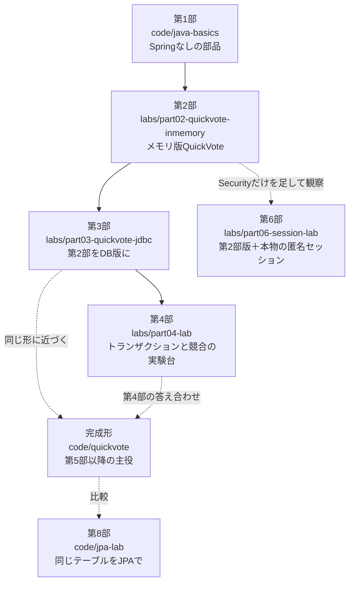

# 第0章 この教材の歩き方

<div class="goal-box" markdown>

この章でできるようになること

- この教材が目指す「合格の状態」を、自分の言葉で説明できる
- 4段階の到達水準（再現・説明・検証・変更）のうち、今どこにいるかを言える
- AIと学ぶときの3原則を、実際の手順として使える
- ページ内の記号（用語ボックス、「動かしてみる」など）の意味が分かる
- 通しの題材 QuickVote の完成形を説明できる

</div>

## 1. これは「Javaを覚える教材」ではない

この教材は、Javaの文法を一周する教材ではありません。

**サーバーが守るべき約束を決め、実装し、壊して確かめる教材**です。

フロントエンドでは、画面が崩れれば誰かがすぐ気づきます。サーバーでは、投票が1票多く数えられても、定員が1人超えても、画面には何も出ません。間違いに気づけるのは、約束を決めて確かめた人だけです。

そのため、この教材が最後に目指す状態は、次の一文で表します。

> データ・権限・期限・同時実行について守る条件を定義し、Java/Springで実装し、再送や障害を含むテストで確かめ、運用時に異常を発見して復旧する方法を説明できる。AIが書いたコードも、同じ基準でレビューできる。

この一文を動詞ごとに分けると、次のようになります。

| 動詞 | 具体的には |
| --- | --- |
| 定義する | 「参加者は最大50人」「同じ人は1票」「締切後は拒否」を文章と表で言い切る |
| 実装する | その条件をJava/Springのコードと、DBの制約で表す |
| 確かめる | 正常系だけでなく、同時に押された、通信が切れた、再送された、を含めてテストする |
| 異常を発見する | ログとメトリクスから「おかしい」と気づく |
| 復旧する | 戻し方・直し方を、手順として説明できる |
| AIの生成物をレビューする | 「動く」ではなく「約束を守れているか」で読む |

!!! note "用語：不変条件（ふへんじょうけん）"
    処理の前後で必ず成り立っていなければならない条件です。たとえば「参加者数は50以下」。
    この教材では「守るべき約束」と呼びます。

### なぜ「AIが書くのに学ぶのか」

コードの大半はAIが書ける時代ですが、それでも学ぶ理由は、**AIが約束を知らない**からです。

AIに「投票APIを作って」と頼むと、普通に動くコードが出てきます。ところが、50人目と51人目が同時に参加したらどうなるか、応答が消えて再送されたらどうなるかは、頼んだ人が指定しない限り、たいてい考慮されません。

約束を決めるのは人間の仕事で、約束が守られているかを確かめるにはコードを読める必要があります。この教材は、その「読める・確かめられる」状態を作ります。

## 2. 到達水準：4つの段階

同じ章でも理解の深さには段階があるので、この教材では次の4段階で進み具合を測ります。

| 段階 | 状態 | 確認の仕方 |
| --- | --- | --- |
| ① 再現できる | 教材どおりの手順で、同じ結果が出せる | 実行して、出力が一致する |
| ② 説明できる | なぜその結果になるかを、他人に説明できる | 「現場でこう聞かれる」に答える |
| ③ 検証できる | 条件を変えて、保証が保たれるか調べられる | 反例を作り、テストで確かめる |
| ④ 変更できる | 見たことのない仕様変更にも、保証を保ったまま対応できる | 演習の応用問題、卒業制作 |

各部の終わりの目安は③（検証できる）で、卒業（第48章）では主要な領域で④（変更できる）を目指します。まずは①で十分です。動かして出力を見るだけでも、読むより記憶に残ります。

!!! tip "フロントエンドで例えると"
    CSSの `flex` を「使える」のと、「`min-width: auto` が原因でなぜはみ出すのかを説明できる」のとでは、深さが違います。
    ①は前者にあたり、②③はその先、④は「まだ誰も書いていないレイアウトを、壊さずに作れる」状態です。

## 3. 扱わないもの

範囲を絞ることも教材の品質のうちです。次のものは扱いません。

| 扱わないもの | 理由 |
| --- | --- |
| Kubernetes、クラウドの各種マネージドサービス | 運用基盤の話。第9部でDockerまでに絞る |
| マイクロサービス、メッセージング基盤（Kafka等） | 単体のサービスを正しく作れてから |
| WebFlux（リアクティブ） | MVCのほうが、DB・トランザクション・スレッドの関係が追いやすい |
| ログイン型認証の実装（パスワード、OAuth2/OIDC） | 付録で「読めるように」概観のみ。本編は匿名セッションで認可を学ぶ |
| 決済、メール送信、ファイルアップロード | 題材の本質から外れる |
| フロントエンドの実装 | 読者の専門分野。教材が用意する静的クライアントを使う |

その代わり、次は必ず扱います。

- トランザクションと同時実行（競合、ロック）
- 冪等性（再送されても二重に登録しない）
- 認可の設計（誰に何を許すか）
- 期限と時刻、定期処理
- ログに何を残し、何を残さないか
- JPA（第8部。SQLで基本を固めたあとに、読める・使い分けられる水準まで）

## 4. 全体の地図と学習時間

この教材は11の部でできています。上から順に、1つ前の部の成果の上に積み上がります。



| 部 | 主な内容 | 時間の目安 |
| --- | --- | --- |
| 0 はじめに | 歩き方、環境構築 | 4時間 |
| 1 TypeScript脳で読むJava | 型、record、null、例外、コレクション、値の落とし穴、JUnit、スレッド | 28時間 |
| 2 Spring Bootの心臓部 | DIコンテナ、リクエストの旅、JSON、検証、設定、APIテスト | 28時間 |
| 3 PostgreSQLに正しく保存する | Flyway、制約設計、JdbcClient、インデックス、Testcontainers | 24時間 |
| 4 トランザクションと同時実行 | `@Transactional`、プール、ロック、並行性テスト | 30時間 |
| 5 再送・期限・定期処理 | 冪等性、Clock、スケジューラ | 14時間 |
| 6 匿名利用者と認可 | Spring Security、Cookie、招待、CSRF/CORS、レート制限 | 24時間 |
| 7 リアルタイム通知 | SSE、Last-Event-ID、2台構成 | 14時間 |
| 8 JPAを理解して使い分ける | 永続コンテキスト、N+1、使い分け | 12時間 |
| 9 運用 | Docker、ログ、メトリクス、負荷、リリース | 14時間 |
| 10 卒業 | AIレビュー、卒業制作 | 10時間 |
| 合計 | | 約200時間 |

週10時間なら約5か月、週20時間なら約2.5か月かかります。部によって、速く進むところも遅くなるところもあります。**第4部は、いちばん時間をかけてよい場所**です。

!!! warning "1日で終わらせようとしない"
    同時実行やトランザクションは、読んだだけでは身につきません。「なぜ壊れるか」を自分の目で確かめるために、実際に壊す時間が必要です。
    1日に1〜2章進めて間に1晩挟むくらいが、定着しやすいペースです。

## 5. AIとの付き合い方：3つの原則

この教材は、AIを使って学ぶことを前提にしています。使ってかまいませんが、次の3原則を守ります。

1. 予測してから聞く
2. 生成物は動かして観察する
3. 説明できないコードは採用しない

### 原則1：予測してから聞く

答えを先に見ると「分かった気」になります。自分の予測が外れたときに、いちばん多くを学べます。

教材には、実行前に結果を考える「予測カード」がたびたび出てきます。AIに質問するときも同じようにします。

!!! example "やってみる：予測メモ"
    AIに聞く前に、次の3行をメモします。数十秒で済みます。

    ```text
    私の予想：（結果がどうなると思うか）
    理由：（なぜそう思うか。曖昧でよい）
    確かめ方：（何を実行すれば分かるか）
    ```

    予想が当たれば自信になり、外れればそこが今日いちばん学べる場所です。

### 原則2：生成物は動かして観察する

AIが出したコードは、読む前に実行します。出力、ログ、DBの状態、HTTPの応答を見ます。読むだけだと、人間の目は「それらしい」ものを正しいと感じてしまうからです。実行して出た事実は、AIの自信とは無関係です。

第8章では、AIが書いたという想定の得票率計算が、テストで「合計101%」になると分かる様子を見ます。自分のコードでも同じことを繰り返します。

### 原則3：説明できないコードは採用しない

テストが通っても、なぜ通るのか説明できないコードは、リポジトリに入れません。

目安は「このコードの各行が何を守っているか、同僚に5分で説明できるか」です。説明できない行があれば、次のどれかをします。

- AIに「この行を消したら何が壊れるか」を聞き、実際に消して確かめる
- 教材の該当章に戻る
- その部分だけ、自分で書き直す

!!! warning "よくある間違い"
    「AIが書いたから大丈夫だろう」と、レビューを省くことです。
    逆に、「AIは信用できないから全部自分で書く」のも、同じくらい非効率です。
    **AIは速い下書き係、人間は約束を決める人兼検査官**と、役割を分けてください。

## 6. 各ページの記号の読み方

ページの中には、決まった形の囲みが出てきます。意味を覚えておくと、読み飛ばしが楽になります。

| 見た目 | 意味 |
| --- | --- |
| 章頭の点線の囲み | 「この章でできるようになること」。章末で全部できたか確認する |
| 「用語：○○」の囲み | 初めて出てきたJava・サーバー用語の短い解説。2回目以降は繰り返さない |
| 「フロントエンドで例えると」 | 読者の既存知識との対比。似ている点と違う点の両方を書く |
| 「動かしてみる」 | 実際に実行する手順と、期待される出力 |
| 「よくある間違い」 | 初心者が踏みやすい落とし穴 |
| 「本番で事故になるパターン」 | 動くのに、運用で壊れるもの |
| 「確認問題」「演習」 | 折りたたまれた問い。答えは `解答` を開く |
| `=== "TypeScript"` のタブ | 同じことを、TypeScriptとJavaで並べて見せる |
| 「この時点の保証」 | 未完成のコードがまだ守れていないことの明示 |

また、例え話には必ず「この例えが外れる点」を添えます。例えは理解の入り口ですが、外れる点を知らないとかえって誤解するからです。

教材全体で使う中心の例えは、あとで1つずつ登場します。

| 概念 | 例え |
| --- | --- |
| Webアプリの層 | レストラン（ホール、厨房、食材庫） |
| スレッド | 店員 |
| DIコンテナ | 劇団の配役表 |
| トランザクション | 銀行振込 |
| プロキシ | 本人の前に立つ秘書 |
| コネクションプール | 貸出用の傘立て |

## 7. 通しの題材：QuickVote


この教材では、1つのアプリを育てていきます。名前は **QuickVote（即席投票ボード）** です。

会議や飲み会で「今この場で決める」ための、会員登録不要の匿名投票サービスです。

### 何ができるアプリか

- 主催者が投票を作る
- 参加者は、8文字の参加コード（またはそれを埋め込んだQR）で参加する
- 参加者は選択肢を追加できる（主催者の設定で可否を決める）
- 1人1票。投票し直すと上書きされる
- 得票が、リアルタイムに棒グラフで伸びる
- 主催者は、共同主催者を招く一度限りの招待リンクを発行できる
- 締切時刻を過ぎると投票は拒否され、作成から7日で物理的に削除される

### 守るべき約束（これが本題です）

機能一覧より、こちらが本題です。QuickVoteは小さく見えますが、守るべき約束がたくさんあります。

| 約束 | 難しさがどこにあるか |
| --- | --- |
| 参加者は最大50人 | 49人目と50人目、50人目と51人目が同時に来たら？ |
| 選択肢は最大10件 | 同じく、同時に追加されたら？ |
| 1人1票 | 連打、複数タブ、同時送信 |
| 選択肢の追加は二重登録しない | 保存成功後に応答だけが消えて再送されたら？ |
| 招待リンクは一度限り | 2人が同時に開いたら？ |
| 参加コードは当てられない | 総当たりされたら？ |
| 締切後は拒否 | 締切の「ちょうどその瞬間」は？ |
| 得票率は合計100% | 1/3ずつ、を丸めたら？（第7章で扱います） |
| 他人の投票は覗けない | URLのIDを書き換えられたら？ |
| ログに選択肢の本文を残さない | 障害調査と、秘密保持の両立 |

この教材のゴールは、この表の右側の問いにすべて答えられるようになることです。

### アプリの育ち方



次の第1部では、まだSpringを使いません。投票の状態（受付中・終了）、得票率の計算、時刻の扱いなど、QuickVoteの部品だけをJavaで書きます。

### 構成のイメージ



フロントエンドは、ビルド不要の静的クライアント（HTML＋`fetch`＋`EventSource`）を教材が用意します。読者の専門分野に、教材の時間は使いません。

## 8. コードの置き場所と進め方

| 場所 | 内容 |
| --- | --- |
| `code/java-basics/` | 第1部の実験コード。`java ファイル名.java` で単体実行できる |
| `code/labs/` | 各章・各部の実験プロジェクト（下の系譜図） |
| `code/quickvote/` | QuickVoteの完成形（リファレンス実装）。テスト260件つき |
| `code/jpa-lab/` | 第8部のJPA比較実験 |

### ラボの系譜：どの部で、何を触るのか

この教材の学び方は、途中で「自分で育てる」から「完成形を読み、壊して確かめる」へ切り替わります。迷わないように、全体の系譜を先に見ておきます。



| 部 | 主に触るもの | 学び方 |
| --- | --- | --- |
| 第1部 | `code/java-basics/` | 1ファイルずつ動かす |
| 第2部 | `labs/part02-quickvote-inmemory/` | 自分で育てる（メモリ上のMapで動く版） |
| 第3部 | `labs/part03-quickvote-jdbc/` | 自分で育てる（第2部のRepositoryをSQLに差し替え） |
| 第4部 | `labs/part04-lab/` と完成形 | 小さな実験台で競合を起こし、完成形の書き方で直す |
| 第5・7・9部 | 完成形 `code/quickvote/` と章ごとの `labs/chNN-*` | 完成形を読み、動かし、わざと壊して確かめる |
| 第6部 | `labs/part06-session-lab/`、`labs/ch30〜35-*` と完成形 | 第2部版にSecurityだけを足して、仕組みを1つずつ観察する |
| 第8部 | `code/jpa-lab/` | 同じテーブルをJPAで書き、SQLを比べる |
| 第10部 | `labs/ch47-review/` | 欠陥入りのコードをレビューする |

!!! info "なぜ途中から「完成形を読む」に変わるのか"
    第5部以降の論点（冪等性、認可、SSEの再接続、運用）は、DB・トランザクション・Security・通知がそろって初めて意味を持ちます。全部を学習者が一から積み上げると、論点よりも配線作業に時間を取られます。
    そこで、プロが書いてレビューを通した完成形を教科書のコードとして読み、自分の手で壊してテストが赤くなるのを確かめる学び方に切り替えます。これは、AIが書いたコードを読んでレビューするという、卒業後の仕事の練習にもなります。

標準的な1章の進め方は次のとおりです。

1. 冒頭の「できるようになること」を読む
2. 問いかけの場面を読み、自分の予想をメモする
3. コードを実行し、出力を見る
4. 壊してみる
5. 章末の「まとめ3点セット」と演習で確かめる

「3点セット」は、次の3つです。

- 一言で言うと：例えを使わず、技術用語で正確に
- 現場でこう聞かれる：レビューや面談で出る質問
- 自分のサービスならどこに当たるか：自分のアプリに置き換える練習

---

## まとめ：3点セット

!!! abstract "この章の3点セット"
    **① 一言で言うと**
    この教材は、サーバーが守るべき約束（不変条件）を定義し、実装し、テストで確かめ、運用で異常を見つけるまでを、QuickVoteを育てながら学ぶ。

    **② 現場でこう聞かれる**
    「AIが書いたコードを、どうやってレビューしていますか？」
    → 実行して観察し、約束（上限・権限・再送・期限）を反例で試し、説明できない行は採用しない。

    **③ 自分のサービスならどこに当たるか**
    自分が作りたいサービスの「守るべき約束」を、3つ書き出してみる（例：人数の上限、二重登録の禁止、期限）。第48章で使います。

## 演習

??? question "確認問題1：不変条件を見つける"
    次の機能から、「守るべき約束（不変条件）」を2つ以上書き出してください。

    > 「ワークショップに参加登録できる。定員は20人。キャンセルもできる。」

??? success "解答"
    例：

    - 登録済み人数は、いつも20人以下である（同時に申し込まれても）
    - 同じ人が二重に登録されない（連打・再送されても）
    - キャンセルした人は、人数に数えない
    - 締切後は、新規登録できない

    「同時に」「再送されても」という条件が付いているのは、1人でゆっくり操作しているだけでは破れない約束を探すためです。

??? question "確認問題2：予測してから聞く"
    今日、AIに何かを質問するとします。「予測メモ」の3行（予想・理由・確かめ方）を、実際に1つ書いてみてください。

??? success "解答"
    正解はありません。次の2点が書けていれば合格です。

    - 予想が、「たぶん動く」ではなく具体的な結果（例：「3票ずつ入れると、合計99%と表示される」）になっている
    - 確かめ方が、実行コマンドやテストなど、観察可能な行動になっている

??? question "説明問題：現場でこう聞かれる"
    「なぜ、正常に動くのにレビューで落とされたのですか？」と新人に聞かれたとします。200字程度で答えてください。

??? success "解答"
    例：動作確認は、1人が1回、順番に操作した場合しか見ていません。サーバーは、同時に操作されたり、通信が切れて再送されたり、他人が別のIDを指定したりします。レビューでは「その条件でも約束（上限・一意性・権限）が守られるか」を見ます。守られない可能性が残っているなら、正常に動いていても、いずれ事故になりかねません。
