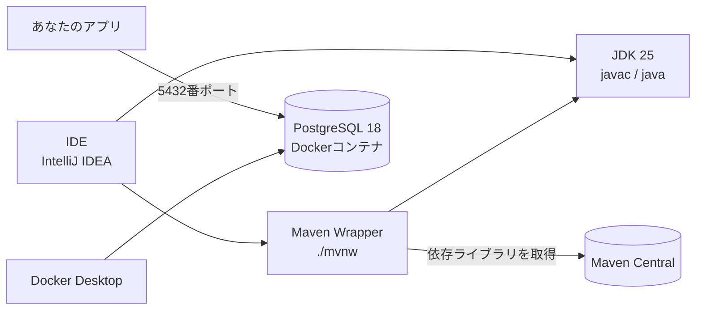

# 第1章 開発環境を整える

<div class="goal-box" markdown>

この章でできるようになること

- JDK 25 を入れ、`java -version` と `javac -version` で確認できる
- IntelliJ IDEA（またはVS Code）で、Javaファイルを実行できる
- Maven Wrapper（`./mvnw`）で、プロジェクトをビルド・テストできる
- Docker で PostgreSQL 18 を起動し、`SELECT 1` で接続を確認できる
- Windowsで詰まりやすい場所（JAVA_HOME、WSL2、ポート競合、文字コードなど）を自力で切り分けられる

</div>

## 1. 2つの「できた」を目指す

この章のゴールは、次の2つだけです。

| ゴール | 確認方法 |
| --- | --- |
| Hello が動いた | `java Hello.java` で `Hello, QuickVote` と表示される |
| DBにつながった | PostgreSQLで `SELECT 1` が `1` を返す |

この2つが通れば、第1部から第3部までの実験はほぼ動きます。ここが通らないまま進むと、あとで「Javaの問題なのか、環境の問題なのか」を切り分けられなくなります。

### 登場する道具



| 道具 | 役割 | フロントエンドでの対応物 |
| --- | --- | --- |
| JDK | コンパイラ（`javac`）と実行環境（`java`）のセット | Node.js ＋ TypeScriptコンパイラ |
| Maven | ビルドと依存管理 | npm ＋ ビルドスクリプト |
| Maven Wrapper（`mvnw`） | プロジェクトが指定した版のMavenを、自動で用意して実行する | `npx` や `corepack` で版を固定する感覚 |
| IntelliJ IDEA | Javaの統合開発環境 | VS Code ＋ 拡張機能 |
| Docker Desktop | PostgreSQLをコンテナで動かす | `docker compose` で依存サービスを立てる、あのDocker |

!!! note "用語：JDK（Java Development Kit）"
    Javaでの開発に必要な道具一式です。コンパイラ `javac`、実行コマンド `java`、標準ライブラリなどが入っています。
    実行するだけの JRE という言葉も見かけますが、現在は JDK だけを入れれば十分です。

!!! note "用語：LTS（長期サポート版）"
    Javaは半年ごとに新しい版が出ます。そのうち、長期間サポートされる版が LTS です。Java 25 は LTS で、この教材の基準です。

## 2. JDK 25 を入れる

JDK には複数の配布元があります。この教材では、無料で広く使われている Eclipse Temurin を使います。

=== "Windows"

    PowerShell で次を実行します。

    ```powershell
    winget install EclipseAdoptium.Temurin.25.JDK
    ```

    インストール後、PowerShell を開き直して確認します。

    ```powershell
    java -version
    javac -version
    ```

    期待される出力です（バージョンの細かい数字は異なってかまいません）。

    ```text
    openjdk version "25.0.5" 2026-10-20 LTS
    OpenJDK Runtime Environment Temurin-25.0.5+8 (build 25.0.5+8-LTS)
    OpenJDK 64-Bit Server VM Temurin-25.0.5+8 (build 25.0.5+8-LTS, mixed mode, sharing)
    javac 25.0.5
    ```

=== "macOS"

    Homebrew を使う場合です。

    ```bash
    brew install --cask temurin@25
    ```

    確認します。

    ```bash
    java -version
    javac -version
    /usr/libexec/java_home -v 25
    ```

    `java_home` は、インストール済みの JDK 25 の場所を表示します。

!!! warning "よくある間違い：`java` は動くのに `javac` が動かない"
    古い JRE だけが先に PATH に入っていると、`java -version` は通っても `javac` が見つからないことがあります。
    `javac -version` も必ず確認してください。

### JAVA_HOME を設定する

`JAVA_HOME` は「今使うJDKの場所」を指す環境変数です。Maven などはこれを見てJDKを探します。

=== "Windows"

    ```powershell
    # 確認
    echo $env:JAVA_HOME

    # 設定（ユーザー環境変数。JDKの実際のフォルダ名に合わせる）
    [Environment]::SetEnvironmentVariable(
      "JAVA_HOME",
      "C:\Program Files\Eclipse Adoptium\jdk-25.0.5.8-hotspot",
      "User")
    ```

    設定後はターミナルを開き直します。インストーラーが自動で設定する場合もあるので、先に `echo` で確認します。

=== "macOS"

    ```bash
    # ~/.zshrc に追記
    export JAVA_HOME=$(/usr/libexec/java_home -v 25)
    ```

    `source ~/.zshrc` で反映します。

## 3. 動かしてみる①：Hello

QuickVoteの最初の一歩として、挨拶を表示します。次のファイルを作ります。

```java title="Hello.java"
void main() {
    IO.println("Hello, QuickVote");
}
```

!!! example "動かしてみる"
    ```bash
    java Hello.java
    ```

    ```text
    Hello, QuickVote
    ```

これだけです。`public static void main(String[] args)` も、`class` もいりません。Java 25 では、1つのファイルに `void main()` だけを書いて実行できます（コンパクトソースファイル）。

!!! note "用語：コンパクトソースファイル"
    クラス宣言なしで、`void main()` だけを書いたJavaファイルです。学習や小さなツール向けに導入された書き方で、Java 25 で正式機能になりました。
    実務のコード（Springなど）は通常のクラスで書きます。第2章で、なぜ普段は長い書き方が必要なのかを説明します。

ここで、最初に詰まりやすい点を1つ体験します。

!!! warning "表示が文字化けする、`?` になる（Windows）"
    Windowsのコンソールは、既定の文字コードが Shift_JIS 系（MS932）です。Java 25 はコンソールの文字コードに合わせて出力するので、日本語は表示できますが、`〜`（波ダッシュ）のような一部の文字が `?` になることがあります。
    実行時に `-Dstdout.encoding=UTF-8` を付けるか、Windows Terminal で `chcp 65001` を実行してから試してください。
    ソースファイルの保存形式は、**必ず UTF-8 にします**。

## 4. IDE を入れる

エディタは何を使ってもJavaは書けます。ただし、プロキシ・Bean・ライブラリ内部へのジャンプやデバッガが必要になる第2部以降は、Javaに強いIDEのほうがずっと楽です。

この教材では IntelliJ IDEA をすすめます。2025.3以降は製品が1本に統合され、無料の範囲でもJava開発ができます。ライセンスの条件は変わることがあるので、インストール時の画面を確認してください。

=== "IntelliJ IDEA（推奨）"

    1. JetBrains の公式サイトから IntelliJ IDEA をダウンロードしてインストールする
    2. 起動して、`File > Open` で `code/java-basics` フォルダを開く
    3. `ch02/Hello.java` を開く。行番号の横に緑の ▶ が出るので、クリックして `Run` を選ぶ
    4. 下の `Run` ウィンドウに `Hello, QuickVote` が出れば成功

    JDK が見つからないと言われたら、`File > Project Structure > Project` で SDK に JDK 25 を指定します。

    VS Code から移ってきた人は、`Settings > Plugins` から「VS Code Keymap」を入れると、ショートカットが VS Code 風になります。移行の負担が減ります。

=== "VS Code（代替）"

    1. VS Code に拡張機能「Extension Pack for Java」を入れる
    2. `code/java-basics` フォルダを開く
    3. `ch02/Hello.java` を開くと、`main` の上に `Run` が表示されるので、クリックする
    4. 下のターミナルに `Hello, QuickVote` が出れば成功

    JDK は、拡張機能が見つけたものを使います。`Java: Configure Java Runtime` コマンドで、JDK 25 が選ばれていることを確認します。

    ただし、第2部以降のSpring固有の支援（Bean一覧、プロキシの確認など）は、IntelliJ のほうが充実しています。

!!! tip "どちらを選んでも、教材の手順は変わらない"
    教材の手順は、基本的にターミナルのコマンドで書きます。IDEの操作は便利機能として使い、コマンドでも同じことができる状態を保ってください。
    あとで CI（自動ビルド）で動かすときは、IDEなしでコマンドだけで動く必要があるからです。

## 5. 動かしてみる②：Maven Wrapper

第8章以降、複数ファイルのプロジェクトは Maven でビルドします。ただし、Maven 自体をインストールする必要はありません。プロジェクトに同梱の Maven Wrapper（`mvnw`）が、必要な版を自動でダウンロードして使います。

!!! note "用語：Maven Wrapper"
    プロジェクトに同梱された小さなスクリプトです。初回に、指定された版のMavenをダウンロードしてキャッシュし、以後それを使います。
    「このプロジェクトは Maven 3.9.16 で動く」を、リポジトリ自身が持つ仕組みです。Node の `.nvmrc` に近い役割ですが、指定した版を自動で取ってくるところまで行います。

第8章のプロジェクトで試します。

=== "Windows（PowerShell）"

    ```powershell
    cd code\java-basics\ch08-junit
    .\mvnw.cmd -v
    ```

=== "macOS / Linux / Git Bash"

    ```bash
    cd code/java-basics/ch08-junit
    ./mvnw -v
    ```

!!! example "動かしてみる"
    初回は Maven 本体のダウンロードが入るので、数十秒かかります。

    ```text
    Apache Maven 3.9.16 (2bdd9fddda4b155ebf8000e807eb73fd829a51d5)
    Maven home: C:\Users\（ユーザー名）\.m2\wrapper\dists\apache-maven-3.9.16\56ba1f9f
    Java version: 25.0.5, vendor: Eclipse Adoptium, runtime: C:\Program Files\Eclipse Adoptium\jdk-25.0.5.8-hotspot
    Default locale: ja_JP, platform encoding: UTF-8
    OS name: "windows 10", version: "10.0", arch: "amd64", family: "windows"
    ```

    確認するのは、`Maven home` が `.m2\wrapper` の下にあることと、`Java version` が 25 であることの2点です。

`.m2` フォルダは、ダウンロードしたライブラリのキャッシュです。`node_modules` と違い、プロジェクトごとではなくユーザーごとに1つだけあります。

テストも実行できます。

```bash
./mvnw test          # Windows PowerShell では .\mvnw.cmd test
```

最後に `BUILD SUCCESS` が出れば成功です（第8章で中身を読みます）。

## 6. Docker で PostgreSQL を起動する

DBは、自分のPCに直接インストールせず、Docker のコンテナで動かします。使い捨てにでき、バージョンをそろえやすいからです。

### Docker Desktop を入れる

=== "Windows"

    1. Docker Desktop をインストールする（`winget install Docker.DockerDesktop` でも入る）
    2. 初回は、WSL 2（Windows上でLinuxを動かす機能）の有効化を求められる。指示に従って有効化し、PCを再起動する
    3. Docker Desktop を起動し、左下が緑（Running）になるのを待つ

    ```powershell
    docker version
    ```

    `Client` と `Server` の両方が表示されれば成功です。`Server` が出ない場合は、Docker Desktop が起動していません。

=== "macOS"

    1. Docker Desktop をインストールして起動する
    2. 確認する

    ```bash
    docker version
    ```

!!! note "用語：コンテナ"
    アプリとその依存を、他と隔離して動かす仕組みです。仮想マシンより軽く、コマンド1つで起動・削除できます。
    今は「PostgreSQLが入った使い捨ての箱」と考えれば十分です。

### PostgreSQL 18 を起動する

```bash
docker run --name qv-postgres \
  -e POSTGRES_USER=quickvote \
  -e POSTGRES_PASSWORD=quickvote \
  -e POSTGRES_DB=quickvote \
  -p 5432:5432 \
  -v qv-pgdata:/var/lib/postgresql \
  -d postgres:18
```

PowerShell では、行末の `\` を `` ` ``（バッククォート）に置き換えるか、1行につなげて書きます。

| 指定 | 意味 |
| --- | --- |
| `--name qv-postgres` | コンテナの名前 |
| `-e POSTGRES_...` | 初期ユーザー、パスワード、DB名。手元の学習用の値。本番では使わない |
| `-p 5432:5432` | PCの5432番ポートを、コンテナの5432番につなぐ |
| `-v qv-pgdata:/var/lib/postgresql` | データを名前付きボリュームに保存し、コンテナを消しても残す |
| `-d` | バックグラウンドで動かす |

!!! warning "PostgreSQL 18では、ボリュームの置き場所が変わった"
    18以降のイメージでは、データの標準の保存先が `/var/lib/postgresql/18/docker` になり、ボリュームは `/var/lib/postgresql` に付けるのが正しい形になりました。
    ネット上の古い記事にある `-v ...:/var/lib/postgresql/data` は、18では正しい置き場所ではありません。

### 動かしてみる③：SELECT 1

```bash
docker exec -it qv-postgres psql -U quickvote -d quickvote -c "SELECT 1"
```

期待される出力：

```text
 ?column? 
----------
        1
(1 row)
```

`1` が返れば、DBにつながっています。コンテナが起動し、PostgreSQLが応答し、認証も通っています。

うまくいかないときは、ログを見ます。

```bash
docker logs qv-postgres
```

起動直後は数秒かかるので、すぐ失敗したら少し待って再実行してください。

### 止める・消す

```bash
docker stop qv-postgres       # 止める（データは残る）
docker start qv-postgres      # また起動する
docker rm -f qv-postgres      # コンテナを消す（ボリュームは残る）
docker volume rm qv-pgdata    # データも消す
```

!!! tip "フロントエンドで例えると"
    `docker run` は、`npm run dev` を「依存サービスごと」起動するようなものです。
    違うのはデータの寿命です。コンテナを消してもボリュームにデータが残るので、DBが空にならなくても驚かないでください。まっさらに戻したいときは、ボリュームも消します。

!!! note "なぜここでSpringを動かさないのか"
    SpringからDBにつなぐのは第10章以降です（DB保存は第17章）。ここでは、DBそのものが動くことだけを確認します。
    Springがつながらないときに、「Springの設定が悪いのか、DBが動いていないのか」を切り分ける土台になります。

## 7. ターミナルとコマンドの書き方

教材のコマンドは、基本的に bash の書き方（`./mvnw`、行末の `\`）で書きます。Windowsでは、次のどれで実行してもかまいません。違いを知っておくと、コピペで詰まりません。

| 環境 | 特徴 | この教材での扱い |
| --- | --- | --- |
| PowerShell 7（Windows Terminal） | Windows標準の流れ。`.\mvnw.cmd` を使う | 主。コマンドは PowerShell 用の書き方も併記する |
| Git Bash | Git for Windows に付属。bash 風で `./mvnw` がそのまま動く | 使ってよい。教材のbashのコマンドをそのまま実行できる |
| WSL 2（Ubuntuなど） | Windows上のLinux | 必須ではない。Docker Desktop の内部では使われている |
| コマンドプロンプト（cmd） | 古い。機能が少ない | 避ける |

書き方の違いで、よくつまずくのは次の点です。

| やりたいこと | bash（macOS / Git Bash） | PowerShell |
| --- | --- | --- |
| 現在のフォルダのスクリプトを実行 | `./mvnw test` | `.\mvnw.cmd test` |
| 環境変数を見る | `echo $JAVA_HOME` | `echo $env:JAVA_HOME` |
| コマンドを複数行に分ける | 行末に `\` | 行末に `` ` ``（バッククォート） |
| 文字列の引用 | `'...'` と `"..."` | `'...'`（変数展開なし）と `"..."`（変数展開あり） |
| パスの区切り | `/` | `\`（`/` も多くの場面で通る） |
| ファイルの先頭だけ見る | `head -n 5 file` | `Get-Content file -TotalCount 5` |

!!! warning "`-Dtest='PercentagesTest#oneVoteEach'` が PowerShell で動かない"
    PowerShell は、`-D` で始まる引数や、`#` を含む引数を、そのまま渡さないことがあります。うまくいかないときは、引数全体を `'...'` で囲むか、`--%`（これ以降の解釈を止める記号）を使います。
    ```powershell
    .\mvnw.cmd test '-Dtest=PercentagesTest#oneVoteEach'
    ```

!!! tip "WSL 2 の中で開発するべきか"
    **必須ではありません。** この教材は、Windows上のIntelliJとPowerShellで完結できます。
    WSL 2 の中にプロジェクトを置くと、LinuxとWindowsの両方からファイルが見えて混乱しやすく、ファイルの読み書きが遅くなる場合もあります。経験があって、Linux環境のほうが慣れているなら、選んでもかまいません。

## 8. 教材のコードを手元に置く

教材のコードは、`code/` フォルダにあります。**半角英数字だけで、空白を含まないパス**に置きます（日本語のユーザー名の下の `Documents` などは避ける）。

```powershell
mkdir C:\dev
cd C:\dev
git clone （教材のリポジトリのURL） java-study
```

Git の基本は説明しません。1つだけ、Windowsで注意する点があります。

!!! note "改行コード（CRLF と LF）"
    Windowsは改行を `CRLF`、macOS/Linux は `LF` で表します。シェルスクリプト（`mvnw`）が `CRLF` になっていると、macOS/Linux やコンテナの中で動かなくなります。
    リポジトリに `.gitattributes` を置いて `* text=auto eol=lf` と指定するか、Gitの `core.autocrlf` の設定を確認します。教材のコードでは、実行可能なシェルスクリプトを `LF` に保つ前提です。

### IntelliJ で Maven プロジェクトを開く

第8章の `ch08-junit` は、Mavenのプロジェクトです。IntelliJ では、次のように開きます。

1. `File > Open` で、`ch08-junit` フォルダ（または、その中の `pom.xml`）を選ぶ
2. 「プロジェクトを信頼しますか」と聞かれたら、自分で取得したコードなので、信頼する
3. 右側の Maven ツールウィンドウに、依存ライブラリが読み込まれる（初回は時間がかかる）。読み込みが終わるまで待つ
4. `src/test/java` の中のテストクラスを開き、メソッドの左の緑の ▶ をクリックして実行する

メニューの名前は、IntelliJ のバージョンで少し変わります。見当たらなければ、画面右上の検索（`Shift` を2回押す）で「Maven」「Reload」などを探します。

うまく読み込まれないときは、次を確認します。

- 右下に「Maven projects need to be imported（または Load Maven Changes）」と出ていたら、押す
- `File > Project Structure` で、プロジェクトのSDKが JDK 25 になっている
- `pom.xml` を変更したら、Maven ツールウィンドウの Reload を押す

### 最初に見直す、IDEの設定

| 設定 | おすすめ | 理由 |
| --- | --- | --- |
| ファイルのエンコーディング | UTF-8 | 日本語を含むソースが、環境で文字化けしない |
| 改行コード | LF | 環境ごとの差をなくす |
| 自動インポートの整理 | 有効 | `import` を手で書かない |
| 保存時の自動整形 | 好みで | チームで揃っていれば、無理に変えない |

!!! tip "IDEの設定は、チームの設定が優先"
    実務では、プロジェクトに `.editorconfig` などの設定ファイルが置かれ、整形のルールが揃えられることが多いです。自分の好みより、**プロジェクトの設定に従う**のが基本です。

## 9. Windowsでつまずく所

よくあるつまずきを、症状から原因を引ける表にまとめます。

| 症状 | 原因 | 対処 |
| --- | --- | --- |
| `java` は動くのに `mvnw` が「JAVA_HOME が正しくない」と言う | `JAVA_HOME` が未設定、または古いJDKやJREを指している | `echo $env:JAVA_HOME` で確認し、JDK 25 のフォルダに設定。ターミナルを開き直す |
| `javac` が見つからない | PATH に `bin` が入っていない、またはJREだけの環境 | JDK を入れ直す。`where.exe javac` で場所を確認 |
| `docker version` で Server が出ない | Docker Desktop が起動していない | Docker Desktop を起動し、緑になるまで待つ |
| Docker Desktop が起動しない、WSL の警告 | WSL 2 が無効、または仮想化がBIOSで無効 | `wsl --install` を実行し、再起動。BIOS/UEFI で仮想化（VT-x/SVM）を有効にする |
| `bind: address already in use`（5432） | PCに既にPostgreSQL等が5432を使っている | `-p 5433:5432` に変える（以後、接続先ポートも5433にする）。`netstat -ano \| findstr 5432` で使用中のプロセスを確認 |
| 日本語が `?` や記号になる | コンソールの文字コードがMS932 | `-Dstdout.encoding=UTF-8` を付ける、または `chcp 65001`。ソースはUTF-8で保存 |
| 日本語を含むパスでビルドが失敗する | ユーザー名やフォルダ名に日本語・全角文字がある | `C:\dev\java-study` のような半角英数字だけのパスに置く |
| パスに空白があって失敗する | `Program Files` や `My Documents` など | 可能なら空白のないフォルダに置く。コマンドではパスを `"..."` で囲む |
| `このシステムではスクリプトの実行が無効` | PowerShell の実行ポリシー | `Set-ExecutionPolicy -Scope CurrentUser RemoteSigned` を実行する（ユーザー範囲のみ） |
| `mvnw` が `Permission denied`（macOS/Linux） | 実行権限がない | `chmod +x mvnw` |
| 初回の `mvnw` が進まない | 会社のプロキシやVPNでダウンロードが止まる | `~/.m2/settings.xml` にプロキシ設定を入れる、またはVPNを切る |

!!! danger "パスワードの扱い"
    この章で使った `quickvote` というパスワードは、**手元の学習用に限った値**です。
    同じ値をインターネットに公開するサーバーで使うわけにはいきません。第15章で、秘密をコードに書かない方法を学びます。

## 10. 環境チェックリスト

次の項目がすべて「はい」になれば、第1部に進めます。

- [ ] `java -version` が `25` を表示する
- [ ] `javac -version` が `25` を表示する
- [ ] `java Hello.java` で `Hello, QuickVote` が表示される
- [ ] IntelliJ IDEA（またはVS Code）から、`Hello.java` を実行できる
- [ ] `./mvnw -v`（`.\mvnw.cmd -v`）が、Java 25 を使うと表示する
- [ ] `docker version` で Client と Server の両方が表示される
- [ ] `docker run ... postgres:18` でコンテナが起動している（`docker ps` に出る）
- [ ] `psql` で `SELECT 1` が `1` を返す
- [ ] 作業フォルダのパスが、半角英数字だけで、空白を含まない

---

## まとめ：3点セット

!!! abstract "この章の3点セット"
    **① 一言で言うと**
    Javaの開発環境は、JDK（コンパイラと実行環境）、ビルドツール（Maven Wrapperで版を固定）、DB（Dockerコンテナ）の3つを、コマンドで再現できる形で揃えることで成り立つ。

    **② 現場でこう聞かれる**
    「新しいメンバーが、リポジトリをクローンしてすぐビルドできるようにするには？」
    → JDKの版を明示し、Maven Wrapperをコミットし、DBは `docker compose` などで1コマンドで起動できるようにする。「自分のPCでは動く」を減らす。

    **③ 自分のサービスならどこに当たるか**
    自分のサービスが動くために必要な外部プロセス（DB、キャッシュなど）を書き出し、それぞれが1コマンドで起動できるか確認する。

## 演習

??? question "確認問題1：JAVA_HOME"
    `java -version` は25と表示するのに、`./mvnw -v` は「Java version: 17」と表示しました。考えられる原因は何ですか。

??? success "解答"
    `mvnw` は、`java` コマンドではなく `JAVA_HOME` 環境変数が指すJDKを優先して使います。
    `JAVA_HOME` が古い JDK 17 を指している可能性が高いです。`JAVA_HOME` を JDK 25 のフォルダに直し、ターミナルを開き直します。
    PATH 上の `java` と `JAVA_HOME` は別物です。両方を確認する習慣をつけてください。

??? question "確認問題2：ポート競合"
    `docker run` が「address already in use」で失敗しました。どう対処しますか。そのとき、`psql` の接続コマンドはどう変わりますか。

??? success "解答"
    `-p 5433:5432` のように、PC側のポートを変えます。コンテナ内部のポートは5432のままです。
    `docker exec` で `psql` を実行する場合は、コンテナの中で実行するので、**接続コマンドは変わりません**。
    一方、PC上のアプリ（のちのSpring Boot）から接続するときは、接続先のポートを5433にします。

??? question "応用：コンテナを消したらデータはどうなる？"
    `docker rm -f qv-postgres` のあとに、同じ `docker run` をもう一度実行しました。以前作ったテーブルは残っていますか。残っていないとしたら、何が違えば残りますか。

??? success "解答"
    `-v qv-pgdata:/var/lib/postgresql` を付けていたなら、データはボリュームに残っているので、テーブルも残ります。
    ボリュームを付けずに起動していた場合は、コンテナを消すとデータも消えます。
    つまり、データの寿命は「コンテナ」ではなく「ボリューム」で決まります。

??? question "説明問題：現場でこう聞かれる"
    「なぜ、Mavenをインストールせずに `mvnw` を使うのですか？」200字程度で答えてください。

??? success "解答"
    例：プロジェクトが要求するMavenの版を、リポジトリ自身が持てるからです。各自のPCにインストールされたMavenの版がばらばらだと、「自分の環境ではビルドできるのに、他の人やCIでは失敗する」ことが起きます。`mvnw` を使えば、誰がどこで実行しても、同じ版のMavenが自動で用意され、ビルドの再現性が上がります。
