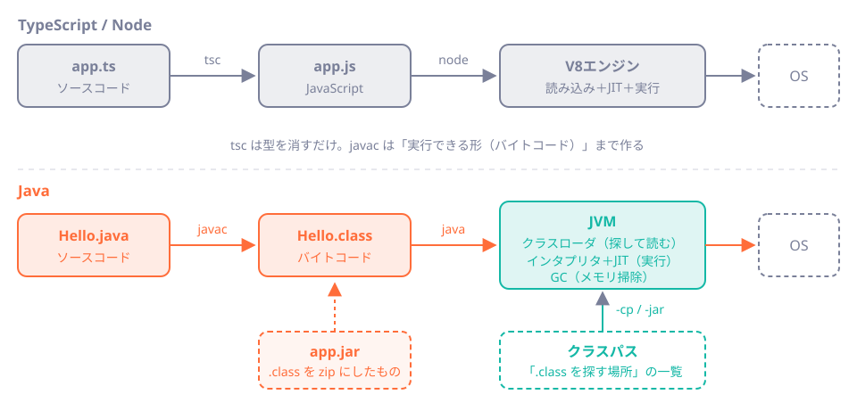

# 第2章 Javaが動くまで：JVM・コンパイル・main

<div class="goal-box" markdown>

この章でできるようになること

- `java Hello.java` の裏で起きていること（コンパイル、クラスの読み込み、実行）を、図で説明できる
- `javac`、`.class`、JVM、jar、クラスパスを、Node/TypeScriptの用語に対応づけて言える
- エラーが「コンパイル時」「起動時」「実行時」のどこで起きたか、メッセージから区別できる
- `public static void main(String[] args)` の各単語が、何を意味するか大まかに言える

</div>

## 1. 問いかけ：たった3行で、何が動いたのか

第1章で、次のファイルを動かしました。

```java title="ch02/Hello.java"
void main() {
    IO.println("Hello, QuickVote");
}
```

```bash
java Hello.java
```

```text
Hello, QuickVote
```

TypeScriptなら、`tsc` でJavaScriptに変換して `node` で動かしますが、Javaでは `java` コマンド1つで動きました。間では何が起きているのでしょうか。

`java Hello.java` は、次の3つを自動でまとめて行っています。

1. ソースコードをコンパイルする（`.java` → `.class`）
2. `.class` をJVMが読み込む
3. `main` を実行する

この章では、これを一つずつ手で分解して確かめます。

## 2. 全体像：TypeScriptの流れと並べる



図の内容を、先に表で対応づけておきます。

| TypeScript / Node | Java | 違い |
| --- | --- | --- |
| `app.ts` | `Hello.java` | ソースコード |
| `tsc` | `javac` | TypeScriptは型を消してJavaScriptにするだけ。`javac` はバイトコード（実行できる形）まで作る |
| `app.js` | `Hello.class` | 中間成果物。Javaの `.class` は人間には読めない |
| `node` ＋ V8 | `java` ＋ JVM | 実行エンジン |
| npmパッケージ、バンドル | `.jar` | 配布の単位。実体は `.class` をまとめたzip |
| `node_modules` を探す規則 | クラスパス | 「`.class` をどこから探すか」の指定 |
| `package.json` の `scripts` | `pom.xml`（Maven） | ビルド手順と依存の記述（第10章） |

!!! note "用語：JVM（Java Virtual Machine）"
    `.class` を読み込んで実行する、Javaの実行エンジンです。「仮想」マシンと呼ぶのは、OSの違いを隠して、WindowsでもMacでもLinuxでも同じ `.class` を同じように動かせるからです。
    Node.js の V8 が JavaScript を実行するのと同じ役割です。

!!! note "用語：バイトコード"
    JVMが理解する、機械語に近い命令の列です。`.class` ファイルの中身がこれです。
    CPUが直接実行する機械語ではなく、JVMが（必要に応じて機械語に変換しながら）実行します。

## 3. 動かしてみる①：手で3段階に分ける

`java Hello.java` が1回でしていることを、コンパイルと実行に分けて手で行い、最後にできたクラスファイルの中身を見ます。`code/java-basics/ch02` で実行します。

!!! example "動かしてみる"
    ① コンパイルする

    ```bash
    javac -d out Hello.java
    ```

    `-d out` は出力先フォルダの指定です。画面には何も出ず、静かに終わります。`out` の中を見ます。

    ```bash
    ls out
    ```

    ```text
    Hello.class
    ```

    ② JVM で実行する

    ```bash
    java -cp out Hello
    ```

    ```text
    Hello, QuickVote
    ```

    `-cp out` は「クラスパスは `out`」という指定です。`Hello` はクラス名なので、ファイル名と違って `.class` は付けません。

`Hello.class` の中身を見てみます。

```bash
javap -c -cp out Hello
```

```text
Compiled from "Hello.java"
final class Hello {
  Hello();
    Code:
       0: aload_0
       1: invokespecial #1                  // Method java/lang/Object."<init>":()V
       4: return

  void main();
    Code:
       0: ldc           #7                  // String Hello, QuickVote
       2: invokestatic  #9                  // Method java/lang/IO.println:(Ljava/lang/Object;)V
       5: return
}
```

読むのは次の2点だけで十分です。`Hello` というクラスができていて、`void main()` はそのクラスのメソッドになっています（コンパクトソースファイルは、裏でクラスに包まれます）。`main` の中身は、`ldc`（文字列定数をスタックに積む）、`invokestatic`（`IO.println` を呼ぶ）、`return` のたった3命令です。

先頭のバイト列も見てみましょう。

```bash
head -c 16 out/Hello.class | od -An -tx1
```

```text
 ca fe ba be 00 00 00 45 00 16 0a 00 02 00 03 07
```

先頭の `ca fe ba be`（通称 CAFE BABE）は、`.class` ファイルの目印です。その後ろの `00 45` は10進数で69で、これが「Java 25 でコンパイルした」ことを示すバージョン番号です。

!!! tip "Javaのバージョン番号の見分け方"
    クラスファイルのバージョンは、Java 8 が52、17 が61、21 が65、25 が69です。
    新しいJavaでコンパイルした `.class` を古いJVMで動かすと、`UnsupportedClassVersionError` で止まります。
    逆（古い `.class` を新しいJVMで動かす）は、ほぼ動きます。

### `java Hello.java` は、実はもう1段階ある

`java Hello.java` は、メモリ上でコンパイルしてそのまま実行します（ソースファイル起動）。`.class` ファイルは作らないので便利ですが、毎回コンパイルが走るぶん少し遅くなります。

| 方法 | 所要時間（筆者の環境） |
| --- | --- |
| `java -cp out Hello`（コンパイル済み） | 約 0.07 秒 |
| `java Hello.java`（毎回コンパイル） | 約 0.46 秒 |

数字は環境で変わります。実運用では、事前にコンパイルした `.class`（や jar）を動かします。ソースファイル起動は、学習と小さな道具のための近道です。

## 4. なぜ「JVM」という一段を挟むのか

JVMは、Hello を動かすだけでも多くの仕事をしています。

```bash
java -Xlog:class+load:file=classes.txt -cp out Hello
wc -l classes.txt          # 行数＝読み込まれたクラスの数
```

```text
443 classes.txt
```

「Hello」を1行出すだけで、443個のクラスが読み込まれました（標準ライブラリの土台で、ほとんどは共有キャッシュから読まれます）。これが、JVMの起動が Node に比べて少し重く感じる理由の一つです。

このような仕組みになっているのは、サーバーアプリケーションにとって次の利点が大きいからです。

| 仕組み | 何をしてくれるか |
| --- | --- |
| JIT コンパイル | 動かしながら、よく通るコードを機械語に変換し、最適化する。長く動かすほど速くなる |
| GC（ガベージコレクション） | 使われなくなったオブジェクトのメモリを、自動で回収する |
| クラスローダ | 必要になった時点で `.class` を探して読み込む |
| スレッド管理 | OSのスレッドを使い、複数の処理を同時に動かす（第9章） |

!!! note "用語：JIT（Just-In-Time）コンパイル"
    実行中に、頻繁に呼ばれるバイトコードを機械語へ変換して、速くする仕組みです。V8 にも同じ仕組みがあります。
    違いが出るのは用途です。Javaは、何日も動き続けるサーバーで力を発揮する設計で、起動直後は遅く、温まると速くなります。

!!! note "用語：GC（ガベージコレクション）"
    もう誰も参照していないオブジェクトを探して、メモリを回収する仕組みです。JavaScript にもあります。
    ただしサーバーでは、GC のために処理が一瞬止まったり、メモリ設定を間違えて落ちたりします。第9部（運用）で扱います。

JVMが動いている環境の情報も、コードから確かめられます。メモリの大きさもその1つです。

```java title="ch02/WhereAmI.java"
void main() {
    IO.println("java.version   = " + System.getProperty("java.version"));
    IO.println("java.vendor    = " + System.getProperty("java.vendor"));
    IO.println("os.name        = " + System.getProperty("os.name"));
    IO.println("user.timezone  = " + java.time.ZoneId.systemDefault());
    IO.println("file.encoding  = " + System.getProperty("file.encoding"));
    IO.println("stdout.encoding= " + System.getProperty("stdout.encoding"));
    IO.println("processors     = " + Runtime.getRuntime().availableProcessors());
    IO.println("max heap (MB)  = " + Runtime.getRuntime().maxMemory() / 1024 / 1024);
}
```

```text
java.version   = 25.0.5
java.vendor    = Eclipse Adoptium
os.name        = Windows 10
user.timezone  = Asia/Tokyo
file.encoding  = UTF-8
stdout.encoding= MS932
processors     = 16
max heap (MB)  = 8172
```

見どころは3つです。

- `user.timezone`：JVMのタイムゾーンは環境で変わる。第7章で、これが原因の事故を扱います
- `stdout.encoding` が `MS932`：Windowsコンソールの文字コード。第1章の「文字化け」の理由
- `max heap`：ヒープ（オブジェクトを置く領域）の上限。既定では搭載メモリの4分の1になります。コンテナでは別の注意が必要です（第42章）

## 5. 動かしてみる②：複数ファイルとクラスパス

アプリは、1つのファイルでは済みません。2つのファイルでやってみます。

```java title="ch02/app/Tally.java"
class Tally {
    static int total(int[] votes) {
        int sum = 0;
        for (int v : votes) {
            sum += v;
        }
        return sum;
    }
}
```

```java title="ch02/app/Main.java"
void main() {
    int[] votes = {5, 3, 2};
    IO.println("合計票数 = " + Tally.total(votes));
}
```

Java 25 では、同じフォルダなら、`java Main.java` と書くだけで `Tally.java` も一緒にコンパイルされます。

```bash
cd ch02/app
java Main.java
```

```text
合計票数 = 10
```

では、これも「コンパイル → 実行」に分けます。

```bash
javac -d out Main.java Tally.java
java -cp out Main
```

```text
合計票数 = 10
```

### クラスパスを間違える

クラスパスは、JVMが `.class` を探す場所の一覧です。間違えるとどうなるか、見ます。

```bash
java -cp nothing Main
```

```text
エラー: メイン・クラスMainを検出およびロードできませんでした
原因: java.lang.ClassNotFoundException: Main
```

JVMは、`nothing` フォルダの中を探しましたが、`Main.class` が見つかりませんでした。

もう1つ、起動はできたのに途中で必要なクラスが消えている場合を試します。

```bash
rm out/Tally.class
java -cp out Main
```

```text
Exception in thread "main" java.lang.NoClassDefFoundError: Tally
	at Main.main(Main.java:3)
Caused by: java.lang.ClassNotFoundException: Tally
	at java.base/jdk.internal.loader.BuiltinClassLoader.loadClass(BuiltinClassLoader.java:580)
	at java.base/java.lang.ClassLoader.loadClass(ClassLoader.java:490)
	... 1 more
```

`Main` は見つかって動き出したのに、`Tally` を使う場面で「見つからない」と言われました。**クラスは、必要になった時点で初めて探されます**（遅延読み込み）。

| エラー | 起きる場面 | よくある原因 |
| --- | --- | --- |
| `ClassNotFoundException` | 起動時や、名前でクラスを探した時 | クラスパスの指定ミス、クラス名の綴り |
| `NoClassDefFoundError` | 動いている途中で、必要なクラスが見つからない時 | 依存ライブラリ（jar）の入れ忘れ、版の食い違い |

!!! tip "フロントエンドで例えると"
    `Cannot find module 'xxx'` に近いエラーで、`node_modules` にパッケージが入っていない場合のJava版です。
    違いは、Javaが起動時にすべてを解決しないことです。実行の途中で初めて気づく場合があります。

### jar：`.class` を1つにまとめる

配布するときは、`.class` をzipにまとめた jar を作ります。

```bash
jar --create --file quickvote.jar --main-class Main -C out .
jar tf quickvote.jar
java -jar quickvote.jar
```

```text
META-INF/
META-INF/MANIFEST.MF
Main.class
Tally.class
合計票数 = 10
```

`--main-class Main` は、「このjarを `java -jar` で動かすとき、どのクラスの `main` から始めるか」を `MANIFEST.MF`（メタ情報）に書き込む指定です。

```bash
unzip -p quickvote.jar META-INF/MANIFEST.MF
```

```text
Manifest-Version: 1.0
Created-By: 25.0.5 (Eclipse Adoptium)
Main-Class: Main
```

!!! note "用語：jar（Java ARchive）"
    `.class` ファイルや資源をまとめた、zip形式のファイルです。`unzip` で中身を見られます。
    ライブラリ（Jackson、Springなど）も、jarで配布されます。第10章で、Spring Bootがこれらを1つにまとめた「実行可能jar」を作って動かします（中身は第42章で見ます）。

ここで第2部への予告をしておきます。ライブラリが数十個になると、`-cp a.jar:b.jar:...` を手で書くのは無理です。これを自動化するのが Maven で、`pom.xml` に依存を書くと、必要なjarを取得してクラスパスに並べてくれます。Spring Boot はさらに、全部入りの jar を作り、`java -jar app.jar` だけで動くようにします。

## 6. 壊してみる：エラーは3段階に分かれる

`Hello.java` を、わざと壊します。

```java title="ch02/TypeError.java"
void main() {
    int votes = "three";
    IO.println(votes);
}
```

```bash
java TypeError.java
```

```text
TypeError.java:2: エラー: 不適合な型: Stringをintに変換できません:
    int votes = "three";
                ^
エラー1個
エラー: コンパイルが失敗しました
```

実行する前に止まりました。これが、TypeScriptの `tsc` エラーに相当するコンパイルエラーです。

エラーは、次の3段階のどこかで起きます。メッセージの形で段階を見分けられるようにしてください。

| 段階 | 起きるとき | 見分け方 | 例 |
| --- | --- | --- | --- |
| ① コンパイル時 | `javac` 実行中 | `ファイル名:行番号: エラー:` と、`^` で位置を示す | 型の不一致、綴り間違い、未定義の変数 |
| ② 起動時 | JVMが `.class` を探す・読み込む | `ClassNotFoundException`、`NoClassDefFoundError`、`UnsupportedClassVersionError` | クラスパスの間違い、Javaの版違い |
| ③ 実行時 | `main` が動き出したあと | `Exception in thread "main" ...`＋スタックトレース | `NullPointerException`、ゼロ除算（第5章） |

**早く見つかるほど安い**のが原則です。Javaの型システムは、①で見つけられる間違いをできるだけ増やす設計になっています。第3章以降の「型」は、そのための道具です。

!!! warning "TypeScriptとの違い：型は実行時にも残る"
    TypeScriptの型は、コンパイルで消えます。実行時のJavaScriptには型の情報がないので、JSONの中身が型どおりかは保証されません。
    Javaの型は、`.class` にも残り、実行時にもJVMが確認します。たとえば、`Integer` と思って取り出した値が `String` だったら、`ClassCastException` で止まります（第6章）。

## 7. 「public static void main」の呪文を解く

`Hello.java` は短かったですが、Javaの教科書や古いコードでは、こう書かれています。

```java title="ch02/HelloClassic.java"
public class HelloClassic {
    public static void main(String[] args) {
        System.out.println("Hello, QuickVote");
    }
}
```

```bash
java HelloClassic.java
```

```text
Hello, QuickVote
```

同じ結果です。AIが出すコードや既存のコードは、ほぼこの形をしています。読めるように、1語ずつ見ます。

| 単語 | 意味 |
| --- | --- |
| `public class HelloClassic` | `HelloClassic` というクラスを宣言する。`public` は「どこからでも見える」。ファイル名とクラス名が一致する決まり（`public` の場合） |
| `public` | JVMが外から呼べるように |
| `static` | オブジェクトを作らなくても呼べるメソッド。JVMが、まだ何もない状態で最初に呼ぶので必要だった |
| `void` | 戻り値なし |
| `main` | 名前が固定。JVMが探す入口 |
| `String[] args` | コマンドライン引数（`process.argv` に相当） |
| `System.out.println(...)` | 標準出力への出力（`console.log`）。`IO.println` は同じ役割の新しい短縮形 |

Java 25 は、「`static` は不要」「`String[] args` も不要」「クラスで包まなくてもよい」と、短く書けるようにしました。**やっていることは変わりません。**

!!! note "今は分からなくていい"
    `class`、`static`、`public` が何を意味するかは、第3章で扱います。今は「`main` が入口で、その外側を包んでいるものがある」ことだけ覚えておけば十分です。

!!! warning "Springでは `main` をほとんど書かない"
    Spring Boot のアプリにも `main` はありますが、たった1行です（第10章）。実際の仕事は、Springが起動後に行います。
    それでも、「入口は `main`」「JVMが最初に呼ぶ」という事実は変わりません。

## 8. 現場で：最初に確認する5つのこと

アプリが動かない、あるいは「手元では動くのにサーバーで動かない」とき、最初に次を確認します。

1. どのJavaで動いているか：`java -version`、`JAVA_HOME`、起動ログの `Java version`
2. どの jar / クラスパスで動いているか：予想外の古い版のライブラリが混ざっていないか
3. どのタイムゾーン・文字コードで動いているか：`WhereAmI.java` のような出力で見る
4. メモリの上限：ヒープの最大値、コンテナのメモリ制限
5. エラーが3段階のどこか：コンパイル、起動、実行時

AIが出したコードを実行して失敗したときも、最初にエラーを①②③に分類すると、原因に近づけます。

---

## まとめ：3点セット

!!! abstract "この章の3点セット"
    **① 一言で言うと**
    Javaのソース（`.java`）は `javac` でバイトコード（`.class`）にコンパイルされ、JVMがクラスパスから必要なクラスを読み込んで実行する。配布は `.class` をまとめた jar で行う。

    **② 現場でこう聞かれる**
    「`ClassNotFoundException` と `NoClassDefFoundError` の違いは？」
    → 前者は名前でクラスを探して見つからない例外。後者は、コンパイル時には存在したクラスが、実行時に見つからないときのエラー。どちらも、クラスパス（依存jar）の問題を疑う。

    **③ 自分のサービスならどこに当たるか**
    自分のサービスを動かす `java -jar ...` のコマンドを書いてみる。どのJava、どのjar、どのタイムゾーン・文字コード・メモリ上限で動くかを、書き出せるか。

## 演習

??? question "確認問題1：予測してから実行（Predict）"
    `Hello.java` を `javac -d out Hello.java` でコンパイルしたとき、`out` フォルダには何個のファイルができるでしょう。予測してから実行してください。`Hello.java` に `record Point(int x, int y) {}` を1つ追加すると、どうなりますか。

??? success "解答"
    最初は `Hello.class` の1個です。`record Point` を同じファイルに追加すると、`Hello.class` と `Hello$Point.class` の2個になります（Hello の内側のクラスとして生成されます）。1つのクラスは、1つの `.class` になるのが原則です。

??? question "確認問題2：エラーの分類"
    次の3つのメッセージは、それぞれコンパイル時・起動時・実行時のどれですか。

    1. `Hello.java:3: エラー: シンボルを見つけられません`
    2. `エラー: メイン・クラスHelloを検出およびロードできませんでした`
    3. `Exception in thread "main" java.lang.ArithmeticException: / by zero`

??? success "解答"
    1. コンパイル時（`javac`。行番号付き、`エラー:` で始まる）
    2. 起動時（クラスパスの問題）
    3. 実行時（`main` が動き出したあとの例外）

??? question "応用：jar に入れる"
    `ch02/app` の2ファイルを jar にまとめ、別のフォルダで `java -jar` で実行してください。`--main-class` を付けずに jar を作ると、`java -jar` の実行はどうなりますか。

??? success "解答"
    `--main-class` なしで作ると、`MANIFEST.MF` に `Main-Class` が入りません。`java -jar` は「`quickvote.jarにメイン・マニフェスト属性がありません`」（英語環境では `no main manifest attribute`）というメッセージで失敗します。
    その場合は、`java -cp quickvote.jar Main` と、クラス名を指定すれば実行できます。

??? question "説明問題：現場でこう聞かれる"
    「TypeScriptの `tsc` と Java の `javac` は、何が違いますか？」200字程度で答えてください。

??? success "解答"
    例：`tsc` は型を確認して型情報を取り除き、JavaScriptに変換するだけです。実行時には型が残りません。`javac` は型を確認したうえで、JVMが実行できるバイトコード（`.class`）を作り、型の情報もクラスファイルに残します。実行時にもJVMが型を使って確認します。そのため、Javaではコンパイル時の型チェックと、実行時の型の整合性の両方が働きます。
