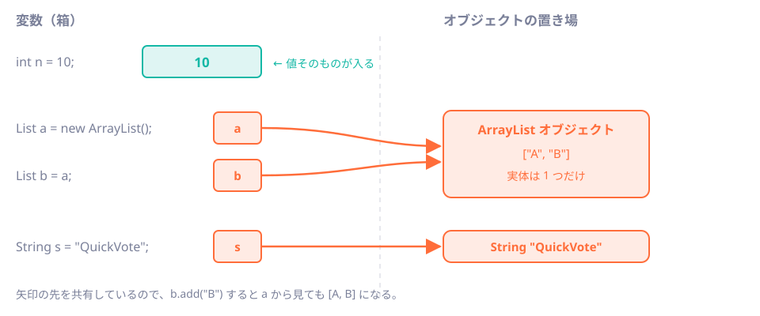

# 第3章 型の世界：名前で決まる型

<div class="goal-box" markdown>

この章でできるようになること

- TypeScriptの「構造的型付け」と、Javaの「名前的型付け」の違いを、コードで説明できる
- プリミティブ型と参照型の違い、値渡しの意味、`final` が保証する範囲を説明できる
- class・interface・継承・アクセス修飾子を、TypeScriptと対比して読める
- パッケージとimportの規則を説明し、アクセスエラーのメッセージを読める

</div>

## 1. 問いかけ：「鴨のように鳴けば鴨」は通じるか

TypeScriptでは、次のコードがコンパイルできます。

```ts
interface Quacker { quack(): string }

class Robot {                      // Quacker とは書いていない
  quack() { return "ピー、ガー" }
}

function listen(q: Quacker) { console.log(q.quack()) }
listen(new Robot())                // OK：形が合っているから
```

`Robot` は `Quacker` を名乗っていませんが、`quack(): string` を持っているので、TypeScriptは通します。形（構造）が合えば同じ型として扱う、構造的型付けです。

同じことをJavaで書いてみます。

```java title="ch03/DuckLicenseBroken.java"
interface Quacker {
    String quack();
}

class Duck implements Quacker {
    public String quack() { return "ガーガー"; }
}

class Robot {                       // quack() は持っているが、Quacker を「名乗って」いない
    public String quack() { return "ピー、ガー"; }
}

void listen(Quacker q) {
    IO.println(q.quack());
}

void main() {
    listen(new Duck());
    listen(new Robot());            // TypeScript なら通る。Java はここでコンパイルエラー
}
```

!!! question "予測カード"
    `java DuckLicenseBroken.java` を実行すると、どうなるでしょう。

    1. `ガーガー` と `ピー、ガー` が出る
    2. `ガーガー` だけ出て、2回目で例外が出る
    3. 何も実行されず、コンパイルエラーになる

実行します。

```text
DuckLicenseBroken.java:19: エラー: クラス DuckLicenseBrokenのメソッド listenは指定された型に適用できません。
    listen(new Robot());            // TypeScript なら通る。Java はここでコンパイルエラー
    ^
  期待値: Quacker
  検出値:    DuckLicenseBroken.Robot
  理由: 引数の不一致: DuckLicenseBroken.RobotをQuackerに変換できません:
エラー1個
エラー: コンパイルが失敗しました
```

答えは 3 です。`Duck` の `quack()` が実行される前に、コンパイルの段階で止まります。

!!! note "メッセージの `DuckLicenseBroken.Robot` は何？"
    コンパイルされるとき、ファイルの中のクラスは、ファイル名のクラスの内側に置かれます（コンパクトソースファイルの仕様）。`Robot` が `DuckLicenseBroken.Robot` と表示されるのはそのためです。通常の `class` 宣言なら、`Robot` とだけ表示されます。

## 2. 名前的型付け：免許証がなければ鴨ではない

Javaで `Robot` を `Quacker` として使うには、宣言の中で名乗る必要があります。

```java title="ch03/DuckLicense.java（抜粋）"
class Robot implements Quacker {    // 「Quackerです」と名乗る（免許を取る）
    public String quack() { return "ピー、ガー"; }
}
```

```text
ガーガー
ピー、ガー
```


TypeScriptとJavaの違いを表にまとめます。

| | TypeScript | Java |
| --- | --- | --- |
| 型の同一性を決めるもの | 形（メンバーが合うか） | 名前（`implements` / `extends` で宣言したか） |
| 呼び名 | 構造的型付け | 名前的型付け |
| 例え | 鴨のように歩き、鳴けば鴨 | 鴨の免許証がなければ、鴨ではない |
| 長所 | 手軽。既存のオブジェクトにも後から型を当てられる | 意図しない一致を防げる。型の関係がコードに明示される |
| 短所 | 偶然、形が一致しただけのものが通ってしまう | 毎回「名乗る」手間がかかる |

!!! tip "フロントエンドで例えると"
    TypeScriptで「ブランド型」を使ったことがあれば、それに近い感覚です。
    ```ts
    type UserId = string & { readonly __brand: "UserId" }
    type PollId = string & { readonly __brand: "PollId" }
    ```
    `UserId` と `PollId` は、どちらも中身は文字列ですが、取り違えたらコンパイルエラーにしたい。そのために型に名前を付けています。
    Javaでは、これが最初から標準です。名前を付けることが特別な工夫ではなく、普通の書き方になっている点が違います。

この例えには外れる点もあります。免許証の例えは「型の関係は宣言で決まる」ことをよく表していますが、実際の `implements` は審査（試験）に通った証ではなく、自分で名乗っているだけです。名乗ったからには約束したメソッドを全部実装しないとコンパイルエラーになります。免許の審査に当たるのは、この部分だけです。

### 名前的型付けが効く場面

QuickVoteでは、ID の取り違えが事故のもとになります。

```java
record PollId(long value) {}
record ParticipantId(long value) {}

void vote(PollId pollId, ParticipantId who) { /* ... */ }

// vote(participantId, pollId);   // ← 順番を間違えるとコンパイルエラー
```

`long` を2つ並べた `vote(long, long)` だと、順番を間違えても通ってしまいます。型に名前を付けておけば、間違いを実行前に見つけられます。recordの詳しい書き方は第4章で説明します。

## 3. プリミティブと参照：変数の箱には何が入るか

Javaの型は、大きく2種類に分かれます。

| 種類 | 例 | 変数の箱に入るもの |
| --- | --- | --- |
| プリミティブ型（基本型） | `int`、`long`、`double`、`boolean`、`char` | 値そのもの |
| 参照型 | `String`、`List`、自分で作る `class` / `record`、`Integer` など | オブジェクトへの矢印（参照） |



JavaScriptでも数値は値、オブジェクトは参照として扱うので、感覚はほぼ同じです。違いは次の3点です。

1. 数値の型が複数あります。JavaScriptの `number` に当たる型が、`int`（約±21億）、`long`（約±922京）、`double`（浮動小数点）、`BigDecimal`（正確な小数）と複数あり、どれを使うかは設計の判断になります（第7章）
2. プリミティブには `null` が入りません。`int` は必ず値を持つので、「値がない」を表したいときは `Integer`（参照型）を使います
3. `String` は参照型ですが、変更できません。`s.toUpperCase()` は元の文字列を変えず、新しい文字列を返します

### 動かしてみる：値渡しと参照

```java title="ch03/PrimitivesAndRefs.java（抜粋）"
class Counter {
    int count;          // プリミティブのフィールド：何も入れなければ 0
    Integer boxed;      // 参照型のフィールド：何も入れなければ null
    String label;       // 同上
}

void addOne(int n)           { n = n + 1; }                 // 呼び出し元には影響しない
void addItem(List<String> l) { l.add("追加された"); }         // 参照が指す先を変更する
void replace(List<String> l) { l = new ArrayList<>(); l.add("別物"); }  // 手元の参照を差し替えるだけ
```

!!! question "予測カード"
    `main` で次を順に実行します。最後の `list` は、何になるでしょうか。

    ```java
    List<String> list = new ArrayList<>();
    addItem(list);
    replace(list);
    IO.println(list);
    ```

    1. `[追加された]`
    2. `[別物]`
    3. `[追加された, 別物]`

```text
int=0, Integer=null, String=null
addOne 後の n = 10
addItem 後の list = [追加された]
replace 後の list = [追加された]
```

答えは 1 です。この結果から、Javaの値渡しの仕組みが分かります。

!!! note "用語：値渡し（pass by value）"
    メソッドを呼ぶとき、引数の値のコピーが渡されます。プリミティブ型なら数値のコピー、参照型なら矢印のコピーです。
    `addItem` はコピーされた矢印をたどって、同じ `ArrayList` に追加します。そのため呼び出し元からも変更が見えます。
    `replace` は手元の矢印を別のオブジェクトに付け替えるだけで、呼び出し元の矢印は変わりません。
    Javaに「参照渡し」はなく、すべて参照の値渡しです。JavaScriptのオブジェクトの渡し方とほぼ同じです。

### 別名（エイリアス）という罠

```java
List<String> a = new ArrayList<>(List.of("A"));
List<String> b = a;                 // コピーではなく、同じオブジェクトを指す別名
b.add("B");
IO.println("a = " + a + " / b = " + b + " / 同一? " + (a == b));
```

```text
a = [A, B] / b = [A, B] / 同一? true
```

`b = a` でコピーされるのは中身ではなく矢印です。a と b は同じ1つのオブジェクトを指しています。

### `final` と `var`

```java
final List<String> fixed = new ArrayList<>();
fixed.add("中身は変えられる");
IO.println("final の中身 = " + fixed);
// fixed = new ArrayList<>();       // ← これはコンパイルエラー
```

```text
final の中身 = [中身は変えられる]
```

`final` が禁止するのは、変数への再代入だけです。TypeScriptの `const` と同じで、指す先のオブジェクトの中身は変えられます。`readonly` がプロパティの再代入しか禁止しないのと同じ話で、不変（immutable）とは別物です。

`var` は、型を省略できる書き方です。

```java
var votes = 3;                       // int に確定
var names = new ArrayList<String>(); // ArrayList<String> に確定
// votes = "three";                  // ← コンパイルエラー
```

!!! warning "よくある間違い：`var` は動的型ではない"
    JavaScriptの `var` とは別物です。コンパイラが右辺から型を推論し、その型に固定するだけです（TypeScriptの `const x = 3` が `number` と推論されるのと同じ）。
    ローカル変数でしか使えず、右辺から型が読み取れるときに使います。メソッドの引数や戻り値、フィールドには使えません。

## 4. class：データと振る舞いのまとまり

TypeScriptのclassとほぼ同じように読めます。ここでは違う点を中心に見ます。

=== "TypeScript"

    ```ts
    class Poll {
      private votes = 0
      constructor(readonly title: string) {}
      vote() { this.votes++ }
      get count() { return this.votes }
    }
    ```

=== "Java"

    ```java
    public class Poll {
        private final String title;         // フィールド宣言が必須（型も必須）
        private int voteCount;

        public Poll(String title) {         // コンストラクタ：クラス名と同じ名前
            this.title = title;
        }

        public void vote() { voteCount++; }
        public int voteCount() { return voteCount; }
    }
    ```

| 項目 | TypeScript | Java |
| --- | --- | --- |
| フィールド | コンストラクタ引数で一括宣言できる | 必ず宣言する。型も必須 |
| コンストラクタ | `constructor(...)` | クラス名と同じ名前のメソッド（戻り値の型なし） |
| `private` | コンパイル時だけ（実行時は見える） | 実行時にも強制される（標準の方法では外から触れない） |
| getter/setter | `get` / `set` 構文がある | 構文はない。慣習として `getXxx()` / `setXxx()`、またはrecordの `xxx()` |
| 複数のクラスを1ファイルに | 自由 | `public` クラスはファイル名と一致する1つだけ |

### アクセス修飾子：4段階

Javaには、クラスやメンバーを見せる範囲を決める修飾子が4段階あります。

| 修飾子 | 見える範囲 |
| --- | --- |
| `private` | そのクラスの中だけ |
| （なし）＝パッケージプライベート | 同じパッケージの中だけ |
| `protected` | 同じパッケージ、または子クラス |
| `public` | どこからでも |

TypeScriptの `private` / `protected` / `public` に、「（なし）」が加わっています。修飾子を書かないのは `public` の省略ではなく、同じパッケージにだけ見せるという別の意味です。

## 5. パッケージとimport：フォルダと名前の対応

!!! note "用語：パッケージ"
    クラスをグループにまとめる名前空間です。ドット区切りの名前（`com.example.quickvote.poll`）で表し、フォルダ構造と一致させます。
    TypeScriptのモジュール（ファイルパスでimport）に近い役割ですが、Javaはファイルパスではなく、クラスの完全な名前でimportします。

QuickVoteの構成を使って、実際に試します。`ch03/pkgdemo` の構成は次のとおりです。

```text
pkgdemo/
└── com/example/quickvote/
    ├── App.java
    ├── BrokenApp.java
    └── poll/
        └── Poll.java
```

```java title="ch03/pkgdemo/com/example/quickvote/poll/Poll.java"
package com.example.quickvote.poll;       // (1)!

public class Poll {
    private final String title;          // このクラスの中からだけ見える
    private int voteCount;

    public Poll(String title) {          // どこからでも new できる
        this.title = title;
    }

    public String title() {              // 外部に公開する入口
        return title;
    }

    public int voteCount() { return voteCount; }

    public void vote() { voteCount++; }

    void resetForTest() {                // 修飾子なし＝同じパッケージからだけ見える
        voteCount = 0;
    }

    protected String describe() {        // 同じパッケージ、または子クラスから見える
        return title + "（" + voteCount + "票）";
    }
}
```

1. 1行目の `package` は、このファイルが属するパッケージを宣言する。フォルダ構造と一致させる必要があり、ずれるとコンパイルエラーになる

別のパッケージから使う側は次のとおりです。

```java title="ch03/pkgdemo/com/example/quickvote/App.java"
package com.example.quickvote;

import com.example.quickvote.poll.Poll;   // 別パッケージのクラスを使うには import が必要

public class App {
    void main() {
        Poll poll = new Poll("ランチどこ行く？");
        poll.vote();
        poll.vote();
        IO.println(poll.title() + " : " + poll.voteCount() + "票");
    }
}
```

```bash
cd pkgdemo
java com/example/quickvote/App.java
```

```text
ランチどこ行く？ : 2票
```

次に、見えないはずのものに触ってみます。

```java title="ch03/pkgdemo/com/example/quickvote/BrokenApp.java（main の中）"
Poll poll = new Poll("ランチどこ行く？");
IO.println(poll.title);           // private
poll.resetForTest();              // package-private（別パッケージ）
IO.println(poll.describe());      // protected（子クラスではない）
```

```text
com\example\quickvote\BrokenApp.java:8: エラー: titleはPollでprivateアクセスされます
        IO.println(poll.title);           // private
                       ^
com\example\quickvote\BrokenApp.java:9: エラー: PollのresetForTest()はpublicではありません。パッケージ外からはアクセスできません
        poll.resetForTest();              // package-private（別パッケージ）
            ^
com\example\quickvote\BrokenApp.java:10: エラー: describe()はPollでprotectedアクセスされます
        IO.println(poll.describe());      // protected（子クラスではない）
                       ^
エラー3個
エラー: コンパイルが失敗しました
```

3つとも実行前に止まりました。見せたくないものを型システムが守ってくれることが分かります。

!!! tip "現場で見る慣習"
    Spring のコードは、パッケージを機能ごとに切ることが多いです（`poll`、`participant`、`vote` ...）。QuickVoteも `com.example.quickvote.poll` のように切ります。パッケージプライベートを使えば「このパッケージの外には見せない」部品を作れるので、設計の意図を型で表せます。

## 6. interface と継承

### interface：約束だけを書く

```java title="ch03/Inheritance.java（抜粋）"
interface Notifier {
    void send(String message);

    default void sendAll(String... messages) {      // interface にも標準実装（default）を書ける
        for (String m : messages) {
            send(m);
        }
    }
}

class ConsoleNotifier implements Notifier {
    @Override
    public void send(String message) {
        IO.println("[console] " + message);
    }
}
```

`interface` は、「このメソッドを持っていること」という約束です。実装は、`class` が `implements` で名乗って書きます。第2部以降、Springのコードで何度も出てくる形です。

### 継承：`extends`

```java
class PrefixedNotifier extends ConsoleNotifier {    // class は 1 つだけ継承できる
    private final String prefix;

    PrefixedNotifier(String prefix) {
        this.prefix = prefix;
    }

    @Override
    public void send(String message) {
        super.send(prefix + message);               // 親の実装を呼ぶ
    }
}

void main() {
    Notifier n = new PrefixedNotifier("QuickVote: ");   // 変数の型は interface、実体は子クラス
    n.sendAll("投票が作られました", "締切まで残り5分");
    IO.println("実体のクラス = " + n.getClass().getSimpleName());
    IO.println("ConsoleNotifier でもある? " + (n instanceof ConsoleNotifier));
}
```

```text
[console] QuickVote: 投票が作られました
[console] QuickVote: 締切まで残り5分
実体のクラス = PrefixedNotifier
ConsoleNotifier でもある? true
```

注目するのは次の行です。

```java
Notifier n = new PrefixedNotifier("QuickVote: ");
```

変数の型（`Notifier`）と実体の型（`PrefixedNotifier`）が違っています。呼ぶ側（`n.sendAll(...)`）は `Notifier` としか知らないので、実体を差し替えても呼ぶ側のコードは変わりません。これをポリモーフィズムと呼びます。

!!! tip "フロントエンドで例えると"
    Reactで、`<Button onClick={handler} />` の `handler` が本番では実APIを呼び、テストではモックに差し替わるのと同じ発想です。
    呼ぶ側が「約束（型）」だけに依存しているので、実体を取り替えられます。第11章のDIは、この仕組みを使います。

### `@Override` を付ける理由

`@Override` は、「親（またはinterface）のメソッドを上書きするつもり」という宣言です。綴りを間違えたときに、コンパイラが気づいてくれます。

```java title="ch03/OverrideTypo.java（抜粋）"
class Child extends Base {
    @Override
    public void sned(String message) { ... }   // typo
}
```

```text
OverrideTypo.java:6: エラー: メソッドはスーパータイプのメソッドをオーバーライドまたは実装しません
    @Override
    ^
エラー1個
```

`@Override` がなければ、`sned` は新しいメソッドとみなされ、親の `send` は上書きされません。エラーも出ないまま、静かに動かなくなるところでした。そのため、現場では `@Override` を必ず付ける習慣になっています。

!!! note "用語：アノテーション"
    `@Override` のように、コードに付ける注釈の仕組みです。コンパイラやフレームワークが読み取って、動作を変えます。
    Springはこれを多用します（`@Service`、`@GetMapping` など。第10章以降）。TypeScriptのデコレータに近いものですが、Javaのアノテーションはそれ自体では何もしない目印で、読み取る側が処理をします。

### 継承より「組み合わせ」

継承では、親にできるクラスが1つだけです。何でも継承で表そうとすると、設計が硬くなります。現場では、interface で約束を決めて、実装を別のオブジェクトに任せる（組み合わせる）やり方が主流です。

- `extends` は、本当に「〜は〜の一種」と言える場合にだけ使う
- それ以外は、`interface` と、必要なオブジェクトを持つ（フィールドにする）形にする

## 7. 現場で：AIが書いたコードを読むときの型の目線

AIが出した Java コードを読むときは、型の面で次の点を見ます。

| 見るもの | 疑う理由 |
| --- | --- |
| `Object` や `Map<String, Object>` | TypeScriptの `any` と同じで、型の保護が効かなくなる。専用の `record` にできないか |
| `long` を2つ以上並べた引数 | ID の取り違えが起きる。`PollId` のような型を作れないか |
| `public` だらけのフィールド | 外から勝手に書き換えられる。`private` にして、操作をメソッドにする |
| 何でも `interface` + 実装クラス1つ | 本当に差し替えるのか。AIは「とりあえず interface」を作りがち（第11章） |
| 継承が3段以上 | 組み合わせに直せないか |
| `var` の乱用 | 右辺から型が読み取れない場所では、型を書いたほうが読みやすい |

---

## まとめ：3点セット

!!! abstract "この章の3点セット"
    **① 一言で言うと**
    Javaの型は名前的型付けで、`implements` / `extends` で宣言した関係だけが型の関係になる。変数にはプリミティブなら値、参照型なら参照が入り、メソッド引数は常に値渡し（参照型は参照の値渡し）。`final` は再代入を禁止するが、中身の不変は保証しない。

    **② 現場でこう聞かれる**
    「`final` を付けたのに、`List` の中身が変わっています。どうしてですか？」
    → `final` は変数の再代入禁止であり、指す先のオブジェクトの不変性とは別。不変にしたいなら、不変コレクション（`List.copyOf`）を使う（第4章・第6章）。

    **③ 自分のサービスならどこに当たるか**
    自分のサービスで「取り違えると事故になるID」を3つ挙げる。それぞれを `long` のままにしておくか、型を作るか。

## 演習

??? question "確認問題1：構造的型付けと名前的型付け"
    次のTypeScriptは通りますが、同じ形のJavaは通りません。なぜか、1文で説明してください。また、Javaを通すには何を足しますか。

    ```ts
    interface HasTitle { title: string }
    const poll = { title: "ランチ", votes: 3 }
    function show(x: HasTitle) {}
    show(poll)
    ```

??? success "解答"
    TypeScriptは形（`title: string` を持っているか）で判定しますが、Javaは `implements` で宣言した関係かどうかで判定するからです。
    Javaでは、`record Poll(String title, int votes) implements HasTitle {}` のように、`HasTitle` を実装すると宣言する必要があります。

??? question "確認問題2：値渡し"
    次を実行すると何が表示されますか。予測してから、`java` で実行して確かめてください。

    ```java
    void rename(StringBuilder sb) {
        sb.append("!");
        sb = new StringBuilder("別物");
        sb.append("?");
    }

    void main() {
        var s = new StringBuilder("hi");
        rename(s);
        IO.println(s);
    }
    ```

??? success "解答"
    `hi!` と表示されます。
    `sb.append("!")` は、渡された参照が指す同じオブジェクトを変更するので、呼び出し元から見えます。`sb = new StringBuilder("別物")` は手元の矢印を付け替えるだけで、呼び出し元の `s` は変わりません。

??? question "確認問題3：アクセス修飾子"
    `Poll` クラスの `voteCount` を `private` にしたのに、同じパッケージの別クラスから `poll.voteCount` と書いて読めました。何が起きていますか。

??? success "解答"
    実際には読めません（`private` はクラスの外から読めず、コンパイルエラーになります）。
    読めたのだとしたら、(1) その `voteCount` が `private` ではなくパッケージプライベートになっている、または (2) `voteCount` という名前のメソッドを `voteCount()` と呼んでいるのを見間違えている、のどちらかです。`poll.voteCount`（フィールド）と `poll.voteCount()`（メソッド）は別物です。

??? question "応用：QuickVoteの型を作る"
    `PollId`、`ParticipantId`、`OptionId` を `record` で作り、`vote(PollId, ParticipantId, OptionId)` というメソッドを宣言してください。引数の順番を入れ替えて呼ぶと、何が起きますか。

??? success "解答"
    ```java
    record PollId(long value) {}
    record ParticipantId(long value) {}
    record OptionId(long value) {}

    void vote(PollId p, ParticipantId who, OptionId o) {}

    void main() {
        vote(new PollId(1), new ParticipantId(2), new OptionId(3));   // OK
        // vote(new ParticipantId(2), new PollId(1), new OptionId(3)); // コンパイルエラー
    }
    ```
    順番を入れ替えると、コンパイルエラーになります。`long` が3つだったら、実行時まで気づけません。

??? question "説明問題：現場でこう聞かれる"
    「Javaには参照渡しがない、と聞きました。メソッドの中でオブジェクトを変更すると呼び出し元に影響するのはなぜですか？」200字程度で答えてください。

??? success "解答"
    例：Javaは常に値渡しで、参照型の変数にはオブジェクトそのものではなく、オブジェクトへの参照が入っています。メソッドには、その参照のコピーが渡されます。コピーされた参照は同じオブジェクトを指しているので、中身を変更すれば呼び出し元からも見えます。一方、メソッド内で参照を別のオブジェクトに付け替えても、呼び出し元の参照は変わりません。
