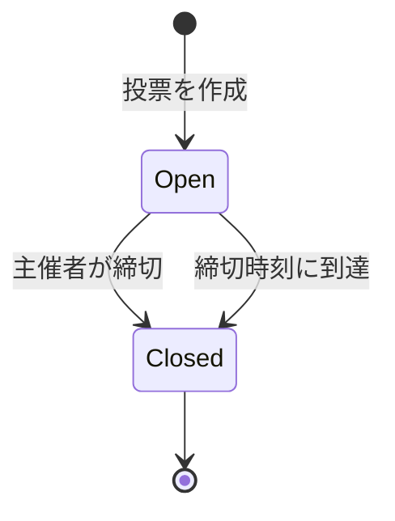

# 第4章 データの形：record・enum・sealed・switch

<div class="goal-box" markdown>

この章でできるようになること

- `record` で、値を運ぶだけのデータを短く書ける（検証つき）
- `enum` と `sealed interface` を使い分け、TypeScriptの判別可能ユニオンをJavaで書ける
- `switch` 式の網羅チェックで、「ケースの書き忘れ」をコンパイルエラーにできる
- `record` や `final` でも、中身の `List` は変えられるという落とし穴を避けられる

</div>

## 1. 問いかけ：状態を「文字列」にしていないか

QuickVoteの投票には、「受付中」と「終了」の状態があります。TypeScriptで書くなら、たとえば次のようになります。

```ts
type PollState =
  | { kind: "open"; closesAt: string }
  | { kind: "closed"; closedAt: string; reason: "DEADLINE" | "HOST_CLOSED" }
```

これは判別可能ユニオン（`kind` で見分けるユニオン型）です。`kind` で絞り込むと、`closesAt` や `reason` を型の上で安全に使えます。

では、同じことがJavaでもできるでしょうか。昔のJavaでは、できませんでした。代わりに、次のような書き方をしていました。

```java
class Poll {
    String status;          // "OPEN" か "CLOSED" のつもり
    Instant closesAt;       // 受付中のときだけ使う（終了なら null のはず）
    Instant closedAt;       // 終了のときだけ使う（受付中なら null のはず）
    String closeReason;     // 同上
}
```

コメントが「つもり」「はず」だらけです。`status` が `"OPEN"` なのに `closedAt` が入っていても、コンパイラは止めてくれません。

現在のJavaには、これを型で表す道具がそろっています。この章では、`record`、`enum`、`sealed interface`、`switch` を順に見ていきます。

## 2. record：データを運ぶ入れ物

### 最小の形

```java title="ch04/Records.java（抜粋）"
record Option(String label) {
    Option {                                            // (1)!
        if (label == null || label.isBlank()) {
            throw new IllegalArgumentException("選択肢の名前は必須です");
        }
        label = label.strip();                          // (2)!
    }
}
```

1. コンパクトコンストラクタ。引数リストを省略して書く、`record` 専用のコンストラクタで、検証や正規化を書く場所になる
2. 検証のあとで値を整え（前後の空白を除く）、そのままフィールドに代入される

`record` は、データを運ぶだけのクラスを1行で書くための構文です。宣言すると、Javaが次のものを自動で作ります。

| 自動で作られるもの | 例 |
| --- | --- |
| フィールド（`private final`） | `label` |
| コンストラクタ | `new Option("カレー")` |
| 取り出しメソッド（アクセサ） | `option.label()`（`getLabel()` ではなく、フィールド名と同じ） |
| `equals` / `hashCode` | 全フィールドが等しければ等しい |
| `toString` | `Option[label=カレー]` |

動かしてみます。

```java
var a = new Option("  カレー ");
var b = new Option("カレー");
IO.println("toString = " + a);
IO.println("a.label() = [" + a.label() + "]");
IO.println("equals   = " + a.equals(b) + " / hashCode 一致 = " + (a.hashCode() == b.hashCode()));
```

```text
toString = Option[label=カレー]
a.label() = [カレー]
equals   = true / hashCode 一致 = true
```

前後の空白が取り除かれ、`a` と `b` は値として等しいと判断されました。検証も確かめます。

```java
try {
    new Option("   ");
} catch (IllegalArgumentException e) {
    IO.println("検証エラー = " + e.getMessage());
}
```

```text
検証エラー = 選択肢の名前は必須です
```

!!! tip "フロントエンドで例えると"
    TypeScriptの `type Option = { readonly label: string }` に近いですが、2つ違いがあります。
    ① コンストラクタに検証を書けます。不正な値の Option は、そもそも作れないようにできます
    ② `equals` は値で比較されます。TypeScriptの `===` はオブジェクトの同一性を比べるので `{a:1} === {a:1}` は `false` ですが、`record` は `equals` で値が等しいかを判断します（第7章）

### 罠：record でも、中の List は変えられる

!!! question "予測カード"
    次のコードを実行したとき、`poll.options().size()` は何件になるでしょう。

    ```java
    record Poll(String title, List<Option> options) {}

    var source = new ArrayList<>(List.of(new Option("カレー"), new Option("ラーメン")));
    var poll = new Poll("ランチ", source);
    source.add(new Option("勝手に追加"));
    poll.options().add(new Option("外からも追加"));
    ```

    1. 2件
    2. 3件
    3. 4件

```text
Poll の選択肢 = 4 件
```

答えは 4件です。`record` のフィールドは `final` ですが、第3章で見たとおり、`final` が禁止するのは再代入だけです。

最初の `source.add(...)` で `poll` の中身が変わるのは、コンストラクタに渡した `List` をそのまま保持しているからです。2つ目の `poll.options().add(...)` が通るのは、アクセサが返すのも同じ `List` だからで、外から追加できてしまいます。

`record` が保証するのは、各フィールドの参照が変わらないことだけです。中身まで不変にするのは、書く側の仕事になります。

### 対策：防御的コピー

```java
record SafePoll(String title, List<Option> options) {
    SafePoll {
        options = List.copyOf(options);                 // 不変のコピーに置き換える
    }
}
```

```text
SafePoll の選択肢 = 2 件
外からの追加は UnsupportedOperationException
```

`List.copyOf` が返すのは、元のリストとは独立した、変更できないリストです。元のリストをあとから変えても `SafePoll` には影響せず、外から `add` しようとすると `UnsupportedOperationException` になります。

!!! warning "よくある間違い"
    「`record` にしたから不変」と思い込むことです。AIが書いたコードをレビューするときは、`record` の中に `List` や `Map`、`Date` のような変更できるオブジェクトが入っていないかをまず見ます。
    入っていたら、コンストラクタで `List.copyOf(...)` / `Map.copyOf(...)` を使っているかを確認します。

### record を使いこなす：変更・省略・分解

TypeScriptでは、オブジェクトの一部を変えたコピーをスプレッド構文で作ります。`record` にはこれに当たる構文がないので、自分で書きます。

=== "TypeScript"

    ```ts
    type Option = { readonly label: string; readonly votes: number }

    const a: Option = { label: "カレー", votes: 0 }
    const b: Option = { ...a, votes: 3 }          // 一部だけ変えたコピー
    ```

=== "Java"

    ```java title="ch04/RecordExtras.java（抜粋）"
    record Option(String label, int votes) {
        Option {
            if (votes < 0) throw new IllegalArgumentException("票数は0以上です: " + votes);
        }

        Option(String label) {                        // (1)!
            this(label, 0);
        }

        static Option of(String label) {              // (2)!
            return new Option(label);
        }

        Option withVotes(int newVotes) {              // (3)!
            return new Option(label, newVotes);
        }
    }
    ```

    1. 補助コンストラクタ。票数を省略したときは0にする。TypeScriptの既定引数に当たるが、Javaにはその機能がないので、コンストラクタを増やして表す
    2. 静的ファクトリメソッド。`new` の代わりに、名前で意図を表せる
    3. 「変更」は、新しいオブジェクトを作ることで表す。`record` は不変なので、元の `a` は変わらない

```java
Option a = Option.of("カレー");
Option b = a.withVotes(3);
IO.println(a + " / " + b);
```

```text
Option[label=カレー, votes=0] / Option[label=カレー, votes=3]
```

`b` を作るときも、コンパクトコンストラクタの検証が毎回働きます。`a.withVotes(-1)` は、不正な `Option` ができる前に例外で止まります。

```text
検証: 票数は0以上です: -1
```

分解（TypeScriptの `const { label, votes } = option` に当たるもの）は、パターンマッチの中でだけ使えます。

```java
String describe(Object o) {
    if (o instanceof Option(String label, int votes) && votes > 0) {     // instanceof でも分解できる
        return label + " は " + votes + " 票";
    }
    return "その他";
}
```

```text
その他 / カレー は 3 票 / その他
```

出力の1つ目は `a`（票数0）、3つ目は文字列で、どちらも「その他」になっています。条件に合って中身が取り出されたのは、`b`（票数3）だけです。

!!! note "TypeScriptから来た人が戸惑う点"
    - 既定引数や省略可能なプロパティがない：補助コンストラクタや静的ファクトリで表す
    - `{ ...a, x: 1 }` がない：`withXxx` メソッドを自分で書く（項目が多いと冗長になる。多すぎるなら設計を見直す合図）
    - 構造が同じでも別の型：`record Point(int x, int y)` と `record Pos(int x, int y)` は互換性がない（名前的型付け）
    - `record` は他のクラスを `extends` できない（`interface` の `implements` はできる）
    - `record` は `null` を禁止しない：`new Option(null, 0)` は通る。検証はコンパクトコンストラクタに書く

### record と通常のクラスの使い分け

| | `record` | 通常の `class` |
| --- | --- | --- |
| 向いているもの | 値を運ぶだけ（DTO、値オブジェクト、状態のケース） | 状態が変わるもの、振る舞いが中心のもの |
| 可変か | 不変（フィールドは `final`） | 自由 |
| `equals` / `hashCode` | 全フィールドで自動 | 自分で書く |
| 継承 | できない | できる |
| 典型例 | `PollId`、`Option`、リクエストのJSON | JPAの Entity、可変な部品 |

## 3. enum：選択肢が決まっているとき

`enum` は、取りうる値が固定されているときに使います。

```java title="ch04/Enums.java"
enum Role {
    HOST(true), MEMBER(false);

    private final boolean canClose;

    Role(boolean canClose) { this.canClose = canClose; }

    boolean canClose() { return canClose; }
}

String label(Role role) {
    return switch (role) {                // enum も default なしで網羅チェックされる
        case HOST   -> "主催者";
        case MEMBER -> "参加者";
    };
}
```

```java
for (Role r : Role.values()) {
    IO.println(r + " (" + label(r) + ") 締切を操作できる? " + r.canClose() + " / ordinal=" + r.ordinal());
}
IO.println("valueOf(\"HOST\") = " + Role.valueOf("HOST"));
IO.println("== で比較できる: " + (Role.valueOf("MEMBER") == Role.MEMBER));
try {
    Role.valueOf("host");             // 大文字小文字は区別される
} catch (IllegalArgumentException e) {
    IO.println("valueOf(\"host\") → " + e.getMessage());
}
```

```text
HOST (主催者) 締切を操作できる? true / ordinal=0
MEMBER (参加者) 締切を操作できる? false / ordinal=1
valueOf("HOST") = HOST
== で比較できる: true
valueOf("host") → No enum constant Enums.Role.host
```

TypeScriptの `type Role = "HOST" | "MEMBER"`（文字列のユニオン）に近いのですが、Javaの `enum` はクラスです。そのため、フィールドやメソッドを持てて（`canClose` のように、値ごとの振る舞いを持たせられます）、`values()` で全値を取り出せます。`enum` の値は実行中に1つずつしか存在しないので、`==` で比較することもできます。

!!! warning "永続化・JSONでの落とし穴"
    - `ordinal()`（宣言順の番号）を DB や JSON に保存しない。宣言の順序を入れ替えると、保存した番号の意味が変わってしまう。保存するなら `name()`（文字列）を使う
    - `valueOf` は、知らない文字列だと例外を投げる。外部から来た文字列を `valueOf` するときは、例外を受け止める処理が要る（第13章）

!!! note "enum と sealed の使い分け"
    | | `enum` | `sealed interface` + `record` |
    | --- | --- | --- |
    | 各値が持つデータ | 全値で同じ形 | ケースごとに違う形を持てる |
    | 例 | `Role`（HOST/MEMBER）、`CloseReason` | `PollState`（`Open` は `closesAt`、`Closed` は `closedAt` と `reason`） |

## 4. sealed + record：判別可能ユニオン

ここからが本題です。冒頭の `PollState` をJavaで書きます。

=== "TypeScript"

    ```ts
    type PollState =
      | { kind: "open"; closesAt: string }
      | { kind: "closed"; closedAt: string; reason: "DEADLINE" | "HOST_CLOSED" }

    function describe(s: PollState): string {
      switch (s.kind) {
        case "open":   return `受付中（締切 ${s.closesAt}）`
        case "closed": return `終了（${s.reason}）`
        default: {
          const _exhaustive: never = s   // 網羅漏れを検出するための定石
          return _exhaustive
        }
      }
    }
    ```

=== "Java"

    ```java title="ch04/PollStates.java（抜粋）"
    enum CloseReason { DEADLINE, HOST_CLOSED }

    sealed interface PollState permits Open, Closed {}                  // (1)!
    record Open(Instant closesAt) implements PollState {}               // (2)!
    record Closed(Instant closedAt, CloseReason reason) implements PollState {}

    String describe(PollState state) {
        return switch (state) {                                         // (3)!
            case Open o   -> "受付中（締切 " + o.closesAt() + "）";
            case Closed c -> "終了（" + c.reason() + " / " + c.closedAt() + "）";
        };
    }
    ```

    1. `sealed` は、この interface を実装できるのは `permits` に書いたものだけ、という宣言。つまり `Open` と `Closed` 以外は存在しない
    2. 各ケースは `record` で、ケースごとに違う形のデータを持てる
    3. `switch` 式。`default` を書かない。全ケースを書かないとコンパイルエラーになる

両者の対応は次のとおりです。

| TypeScript | Java |
| --- | --- |
| ユニオン型 `A \| B` | `sealed interface X permits A, B` |
| 各ケースのオブジェクト型 | 各ケースの `record` |
| `kind` による絞り込み | `switch` の `case Open o ->`（型パターン） |
| `never` による網羅チェック | `default` を書かない `switch` 式そのもの |

TypeScriptでは、網羅チェックのために `never` を使う工夫が要ります。Javaの `sealed` では、これが言語の機能として組み込まれています。

!!! note "用語：sealed（シールド）"
    継承・実装できるクラスを限定する機能で、閉じたユニオンを作れます。
    `permits` に並べた型以外は `implements` できません。そのため、コンパイラは「ケースはこれで全部」と分かり、`switch` の網羅チェックができます。

!!! note "用語：パターンマッチング"
    値の型や形を調べて、同時に変数に取り出す仕組みです。`case Open o ->` は「`state` が `Open` なら、それを `o` として取り出す」という意味になります。
    TypeScriptの絞り込み（`if (s.kind === "open")` のあとで `s.closesAt` が使えること）と同じ目的です。

## 5. switch 式を使いこなす

### 動かしてみる

```java title="ch04/PollStates.java（続き）"
PollState close(PollState state, Instant now, CloseReason reason) {
    return switch (state) {
        case Open _   -> new Closed(now, reason);        // (1)!
        case Closed c -> throw new IllegalStateException("すでに終了しています: " + c.closedAt());
    };
}

boolean canVote(PollState state, Instant now) {
    return switch (state) {
        case Open(Instant closesAt) when now.isBefore(closesAt) -> true;   // (2)!
        case Open _   -> false;                          // 締切時刻を過ぎている
        case Closed _ -> false;
    };
}
```

1. 値を使わないときは、変数名の代わりに `_` と書ける
2. レコードパターンで、`Open` の中身（`closesAt`）をその場で取り出している。`when` は追加条件（ガード）で、締切前のときだけ `true` になる

```java
void main() {
    var t0 = Instant.parse("2026-11-08T10:00:00Z");
    PollState s = new Open(t0.plusSeconds(600));

    IO.println(describe(s));
    IO.println("10:05 に投票できる? " + canVote(s, t0.plusSeconds(300)));
    IO.println("10:11 に投票できる? " + canVote(s, t0.plusSeconds(660)));

    s = close(s, t0.plusSeconds(120), CloseReason.HOST_CLOSED);
    IO.println(describe(s));
    IO.println("終了後に投票できる? " + canVote(s, t0.plusSeconds(130)));

    try {
        close(s, t0.plusSeconds(200), CloseReason.HOST_CLOSED);
    } catch (IllegalStateException e) {
        IO.println("2回目の close = " + e.getMessage());
    }
}
```

```text
受付中（締切 2026-11-08T10:10:00Z）
10:05 に投票できる? true
10:11 に投票できる? false
終了（HOST_CLOSED / 2026-11-08T10:02:00Z）
終了後に投票できる? false
2回目の close = すでに終了しています: 2026-11-08T10:02:00Z
```

状態遷移を図にします。



`Closed` から `Open` に戻る矢印はありません。コードでも、`Closed` に `close` を呼ぶと例外になります。不正な遷移を、型と例外で防いでいます。

### 壊してみる：ケースを増やす

この章でいちばん試してほしいのが、次の実験です。状態に「開始前（`Scheduled`）」を追加し、`switch` を直さずに放置します。

```java title="ch04/PollStatesBroken.java"
sealed interface PollState permits Open, Closed, Scheduled {}      // 「開始前」の状態を追加した
record Open(Instant closesAt) implements PollState {}
record Closed(Instant closedAt) implements PollState {}
record Scheduled(Instant opensAt) implements PollState {}

String describe(PollState state) {
    return switch (state) {                              // Scheduled の分岐を書き忘れている
        case Open o   -> "受付中";
        case Closed c -> "終了";
    };
}
```

```text
PollStatesBroken.java:9: エラー: switch式がすべての可能な入力値をカバーしていません
    return switch (state) {                              // Scheduled の分岐を書き忘れている
           ^
エラー1個
エラー: コンパイルが失敗しました
```

コンパイルが止まりました。状態を増やした時点で、その状態を処理していない `switch` がすべてエラーとして洗い出されます。

もし `status` を文字列で持っていたら、次のようになります。

```java
if (poll.status.equals("OPEN")) { ... }
else if (poll.status.equals("CLOSED")) { ... }
// "SCHEDULED" の分岐を書き忘れても、コンパイラは何も言わない
```

想定外の状態が実行時に来て初めて、バグに気づくことになります。しかも、それは本番でのことになりがちです。

!!! danger "本番で事故になるパターン：`default` で握りつぶす"
    `sealed` の `switch` に `default ->` を書くと、網羅チェックが無効になります。新しいケースを足してもコンパイルエラーにならず、`default` の挙動に黙って流れ込みます。
    AIは「安全のために」`default -> ...` を足すことがよくあります。`sealed` や `enum` の `switch` に `default` を見つけたら、本当に必要かを疑ってください。

## 6. 設計の考え方：不正な状態を作れなくする

冒頭の「つもり」「はず」だらけの `Poll` クラスと、`sealed` を使った設計を比べます。

| | `String status` + nullable な項目 | `sealed interface` + `record` |
| --- | --- | --- |
| 「受付中なのに `closedAt` がある」 | 作れてしまう | 作れない（`Open` には `closedAt` がない） |
| 「終了なのに `reason` が null」 | 作れてしまう | 作れない（`Closed` の `reason` は必須） |
| 新しい状態を足したとき | どこを直すか分からない | `switch` がコンパイルエラーで教えてくれる |
| ルールの置き場所 | あちこちの `if` | 型の定義と `switch` |

この章の設計の芯は、不正な状態を型で作れなくすることです。テストで確かめるより、そもそも作れないようにするほうが確実で、手間も少なく済みます。

この考え方は、QuickVoteで何度も使います。第28章では、締切の判定をこの `PollState` に組み込み、`Clock` を使ったテストで確かめます。

## 7. この章の対応表：TypeScriptの型をJavaで書く

最後に、TypeScriptの型の書き方がJavaでどうなるかを、表にまとめておきます。

| やりたいこと | TypeScript | Java |
| --- | --- | --- |
| 値を運ぶ入れ物 | `type Option = { readonly label: string }` | `record Option(String label) {}` |
| 文字列の選択肢 | `type Role = "HOST" \| "MEMBER"` | `enum Role { HOST, MEMBER }` |
| ケースごとに形が違う型 | 判別可能ユニオン（`kind` で見分ける） | `sealed interface` ＋ `record` |
| 網羅チェック | `default` で `never` に代入する | `default` なしの `switch` 式（コンパイラが保証） |
| 型で絞り込み | `if (s.kind === "open")` | `switch` の `case Open o ->`、`instanceof Open o` |
| 一部を変えたコピー | `{ ...a, votes: 3 }` | `a.withVotes(3)`（自分で書く） |
| 読み取り専用 | `readonly` / `Readonly<T>` | `final`／`record`（ただし中身の不変は別） |
| 不正な値を弾く | 実行時の検証関数（型は消える） | コンパクトコンストラクタ（作れなくする） |

!!! tip "考え方の違い"
    TypeScriptの型はコンパイル時に消えます。実行時に不正な値が来ても型は守ってくれないので、`zod` のような検証が要ります。
    Javaの `record` は、実行時にコンストラクタで検証できます。そのため、不正な値のオブジェクトは存在しないという強い保証を、型に持たせられます。

## 8. 現場で

| 場面 | 判断 |
| --- | --- |
| リクエスト・レスポンスのデータ（DTO） | `record` が標準（第13章） |
| 値オブジェクト（`PollId`、`JoinCode` など） | `record`。検証はコンパクトコンストラクタに |
| 状態、種類が固定 | `enum`（ケースごとに形が同じ）／ `sealed`（ケースごとに形が違う） |
| JPAの Entity | `record` は使えない（第39章）。可変で、引数なしコンストラクタが必要なため |
| 古い記事・コードで見る `@Data`、`@Getter`（Lombok） | `record` が登場する前の道具。新しく書くなら `record` を優先する |

!!! tip "AIが書いたコードを読むとき"
    - `String status` / `int type` のような「文字列・数値で状態を表す」書き方 → `enum` / `sealed` にできないか
    - `record` に `List` / `Map` → `List.copyOf` しているか
    - `sealed` / `enum` の `switch` に `default` → 本当に必要か
    - `ordinal()` をDBに保存していないか

---

## まとめ：3点セット

!!! abstract "この章の3点セット"
    **① 一言で言うと**
    `record` は検証つきの値の入れ物（ただし浅い不変）、`enum` は同じ形の固定値、`sealed interface` ＋ `record` は形が違う固定ケース（判別可能ユニオン）。`default` なしの `switch` 式で、網羅漏れがコンパイルエラーになる。

    **② 現場でこう聞かれる**
    「`record` なのに、なぜ外から `List` を書き換えられたのですか？」
    → `record` が不変にするのはフィールドの再代入だけ。`List` の中身は別問題で、コンストラクタで `List.copyOf` して防御的にコピーする必要がある。

    **③ 自分のサービスならどこに当たるか**
    自分のサービスで「状態」を持つもの（注文、予約、招待など）を1つ選び、状態とその遷移を図に描く。状態ごとに持つデータは違うか。違うなら `sealed` で書けるか。

## 演習

??? question "確認問題1：record の動作"
    次の2つの結果を予測してから実行してください。

    ```java
    record Point(int x, int y) {}

    void main() {
        IO.println(new Point(1, 2).equals(new Point(1, 2)));
        IO.println(new Point(1, 2) == new Point(1, 2));
    }
    ```

??? success "解答"
    `true` と `false` です。
    `equals` は全フィールドが等しいかを比べる（`record` が自動で作る）ので `true` になります。`==` は同一のオブジェクトか（矢印が同じか）を比べるため、`new` を2回呼んで作った別々のオブジェクトは `false` です。`==` と `equals` の違いは、第7章で詳しく扱います。

??? question "確認問題2：sealed の網羅チェック"
    `PollState` に `Archived(Instant archivedAt)` を足すと、第4章のコードで、どの関数がコンパイルエラーになりますか。実際に足して確かめてください。

??? success "解答"
    `describe`、`close`、`canVote` の3つの `switch` が、どれも「すべての可能な入力値をカバーしていません」というエラーになります。
    どの関数を直さなければならないかを、コンパイラが一覧にしてくれます。`default` を書いていたら、エラーにならず、`Archived` が意図しない分岐に落ちます。

??? question "確認問題3：防御的コピー"
    `SafePoll` の `options()` が返す `List` は変更できません。では、`List<Option>` の中の `Option` 自体を書き換えることはできますか。

??? success "解答"
    `Option` が `record` なので、できません。`record` のフィールドは `final` で、`label` は変更できない `String` だからです。
    不変性は、入れ物（`List`）と中身（`Option`）の両方が不変であって初めて保たれます。中身が変更可能なクラス（`StringBuilder` を持つなど）なら、`List.copyOf` だけでは足りません（浅いコピーだからです）。

??? question "応用：QuickVoteの小さな変更"
    `PollState` に「`Cancelled`（主催者が取り消した）」を追加し、`describe` と `canVote` を直してください。`close` は `Cancelled` に対してどう振る舞うべきか、決めて実装してください。

??? success "解答"
    例：

    ```java
    record Cancelled(Instant cancelledAt) implements PollState {}

    // describe: case Cancelled c -> "取り消し済み（" + c.cancelledAt() + "）";
    // canVote : case Cancelled _ -> false;
    // close   : case Cancelled _ -> throw new IllegalStateException("取り消し済みの投票は終了できません");
    ```

    `close` の扱いに正解はありませんが、決めた理由を言えることが大切です。取り消し済みならすでに終わっているので、例外にするのが自然です。

??? question "説明問題：現場でこう聞かれる"
    「状態を文字列ではなく `sealed interface` で表すと、何がうれしいのですか？」200字程度で答えてください。

??? success "解答"
    例：状態ごとに持つデータの形を型で表せるので、「受付中なのに終了時刻がある」ような不正な状態を、そもそも作れなくできます。また、状態を追加したとき、`default` なしの `switch` 式が、処理を書き忘れた場所をコンパイルエラーとして洗い出してくれます。実行時の想定外の状態でバグが出る代わりにコンパイル時に見つかるので、修正が安く済みます。
