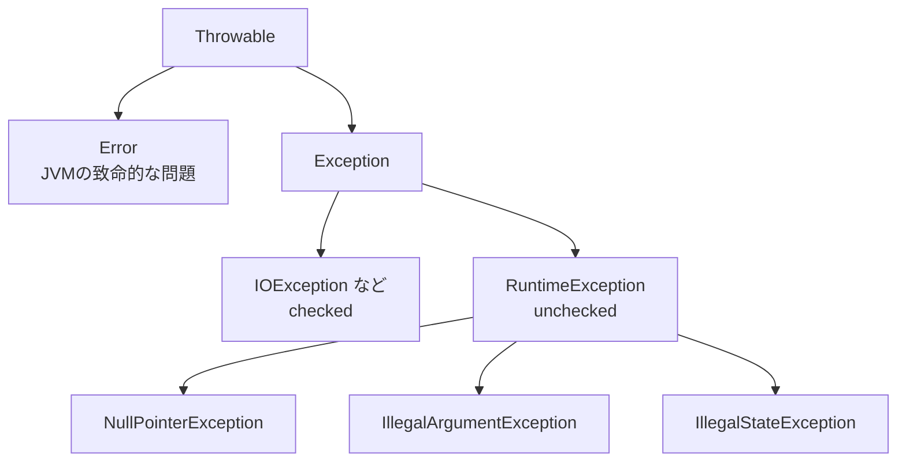

# 第5章 nullと例外

<div class="goal-box" markdown>

この章でできるようになること

- `NullPointerException`（NPE）のメッセージを読み、原因の行と値を特定できる
- `@Nullable`（JSpecify）と `Optional` の役割と、使ってよい場所・悪い場所を説明できる
- checked例外とunchecked例外の違いを説明し、どちらを使うか判断できる
- `try-with-resources` が何を保証するか説明できる
- 例外を握りつぶすコードと、スタックトレースの `Caused by` を、レビューで指摘・読解できる

</div>

## 1. 問いかけ：TypeScriptの `?.` はJavaにあるか

TypeScriptでは、`strictNullChecks` を有効にすれば、`null` になりうる値が型に現れます。

```ts
function ownerLength(poll: { owner: { name: string } | null }): number | undefined {
  return poll.owner?.name.length      // ?. で安全にたどる
}
```

Javaには `?.` も、`string | null` のような型もありません。どの参照型の変数にも `null` が入りえて、型を見ただけでは判断できません。その結果、Javaで最も有名なエラーであるNullPointerException（NPE）が起きます。

この章の前半では null との付き合い方を、後半では例外との付き合い方を扱います。2つは「想定外の事態をどう表し、どう扱うか」という同じテーマでつながっています。

## 2. NPEを起こして、読む

まず、わざとNPEを起こします。

```java title="ch05/NpeDemo.java（抜粋）"
record Owner(String name) {}
record Poll(String title, Owner owner) {}

void main() {
    Map<String, Poll> store = new HashMap<>();
    store.put("AB12CD34", new Poll("ランチ", null));      // owner が null の投票

    // (1) 存在しないキー → get は null を返す
    try {
        Poll p = store.get("ZZZZZZZZ");
        IO.println(p.title());
    } catch (NullPointerException e) {
        IO.println("(1) " + e.getMessage());
    }

    // (2) 途中の値が null
    try {
        Poll p = store.get("AB12CD34");
        IO.println(p.owner().name().length());
    } catch (NullPointerException e) {
        IO.println("(2) " + e.getMessage());
    }
}
```

!!! question "予測カード"
    (2) では、`p.owner().name().length()` のどこで例外になるでしょうか。

    1. `p` が `null`
    2. `p.owner()` が `null`
    3. `p.owner().name()` が `null`

```text
(1) Cannot invoke "NpeDemo$Poll.title()" because "p" is null
(2) Cannot invoke "NpeDemo$Owner.name()" because the return value of "NpeDemo$Poll.owner()" is null
```

答えは 2（`owner()` の戻り値が `null`）です。

最近のJavaのNPEメッセージには、何が `null` で、何をしようとして失敗したかが書かれています。読み方は次のとおりです。

| 部分 | 意味 |
| --- | --- |
| `Cannot invoke "NpeDemo$Poll.title()"` | `title()` を呼ぼうとした |
| `because "p" is null` | 呼ぼうとした相手の変数 `p` が `null` だった |
| `because the return value of "NpeDemo$Poll.owner()" is null` | `owner()` の戻り値が `null` だった（連鎖した呼び出しでも特定できる） |

!!! note "メッセージに `<local2>` と出るときは"
    変数名が `"<local2>"` のように出る場合は、コンパイル時にデバッグ情報（`-g`）が付いていません。`java Xxx.java` のソースファイル起動では、こうなります。
    `javac -g` でコンパイルするか、Mavenでビルド（既定でデバッグ情報が入る）すれば、上のように変数名が出ます。

(3) も見てみましょう。`null` の扱いは、コレクションの実装ごとに違います。

```java
Map.of("a", 1).get(null);        // NPE
store.get(null);                  // HashMap は null をキーに許すので、null が返るだけ
```

```text
(3) Map.of(...).get(null) は NPE
(3) HashMap.get(null) = null
```

`Map.of` のような不変コレクションは `null` を一切受け付けませんが、`HashMap` は受け付けます。同じ `Map` でも実装によって挙動が違うので、覚えておいてください。

### NPEの発生源は、だいたい決まっている

| 発生源 | 例 |
| --- | --- |
| `Map.get` が `null` を返す | 存在しないキーを引いた |
| 初期化していないフィールド | `String label;` を代入し忘れた（既定値は `null`） |
| メソッドが `null` を返す | 「見つからない」を `null` で表すメソッド |
| 外部データ | JSONにフィールドがない、DBがNULL（第13章） |
| 自動アンボクシング | `Integer` が `null` のとき、`int` に代入すると NPE |

!!! tip "フロントエンドで例えると"
    `Cannot read properties of undefined (reading 'name')` と同じ種類のエラーです。
    TypeScriptなら型が先に教えてくれたはずの問題に、Javaでは実行して初めて気づく、という違いがあります。この差を埋める道具が、次に見る `@Nullable` と `Optional` です。

## 3. nullを型で表す：`@Nullable`

Javaの標準の型システムには、「`null` になりうる」を表す仕組みがありません。そこで現在は、注釈（アノテーション）で表すのが標準的な方法になっています。

業界で共通化された注釈の仕様に JSpecify（ジェイスペシファイ）があり、Spring Framework 7 と Spring Boot 4 はこれを採用しています。

```java title="ch05/NullableDemo.java"
import org.jspecify.annotations.Nullable;

record Poll(String title, @Nullable String description) {}

String shout(String s) {
    return s.toUpperCase();
}

void main() {
    var p = new Poll("ランチ", null);
    IO.println(p.description() == null ? "(説明なし)" : shout(p.description()));
}
```

```bash
java -cp jspecify-1.0.0.jar NullableDemo.java     # 注釈の jar（ch05 フォルダに同梱）をクラスパスに載せる
```

```text
(説明なし)
```

`-cp` で jar を渡しているのは、第2章で見たクラスパスそのものです。Mavenのプロジェクトなら、`pom.xml` に依存を書くだけで、この指定が自動になります。

TypeScriptの `description: string | null` に当たるのが、`@Nullable String description` です。

| | TypeScript | Java（JSpecify） |
| --- | --- | --- |
| `null` を許す | `string \| null` | `@Nullable String` |
| 何も書かない | `null` 不可 | （慣習として）`null` 不可。ただし、強制されない |
| チェックするのは | `tsc` | IntelliJ や、NullAway などの追加ツール |

!!! warning "重要：`javac` は `@Nullable` を検査しない"
    注釈を付けても、`javac` 自身はチェックしません。上のコードで `shout(null)` と書いても、コンパイルは通ります。
    チェックするのは、IntelliJ の警告や、NullAway などの静的解析ツールです。つまり「null になりうるか」の表明は、ツールとレビューで守るものです。
    Spring などのライブラリAPIに付いた `@Nullable` を IntelliJ が読んで警告してくれるのは、日常で役に立つ点です。

実務での約束事は、次の3つです。

1. 既定では null を入れないものとして扱います。`null` になりうるのは、`@Nullable` が付いたものだけです
2. コレクションは `null` を返さず、空を返します（`List.of()`）。「空のリスト」と「`null`」の両方がありうると、呼び出し側が混乱するからです
3. 境界でチェックします。外から来た値は、入り口で `Objects.requireNonNull(x, "x")` や `record` のコンパクトコンストラクタで検証します

## 4. Optional：「見つからないかも」を戻り値で表す

`Optional<T>` は、値があるかないかを表す入れ物です。

```java title="ch05/OptionalDemo.java（抜粋）"
Optional<Poll> findByCode(String code) {               // 「無いかもしれない」を戻り値の型で表す
    return polls.stream().filter(p -> p.code().equals(code)).findFirst();
}

IO.println("見つかる   : " + findByCode("AB12CD34").map(Poll::title).orElse("なし"));
IO.println("見つからない: " + findByCode("NOTFOUND").map(Poll::title).orElse("なし"));
```

```text
見つかる   : ランチ
見つからない: なし
```

見つからなければ `null` を返す代わりに、`Optional.empty()` を返します。呼び出し側は `Optional` を受け取るので、空の場合を処理しないと次に進めません。

### `orElse` と `orElseGet` の違い

```java
IO.println("--- orElse は引数を必ず評価する ---");
findByCode("AB12CD34").map(Poll::title).orElse(expensiveDefault());
IO.println("--- orElseGet は必要なときだけ ---");
findByCode("AB12CD34").map(Poll::title).orElseGet(this::expensiveDefault);
```

```text
--- orElse は引数を必ず評価する ---
  (expensiveDefault が呼ばれた)
--- orElseGet は必要なときだけ ---
```

値があっても、`orElse(...)` の引数は必ず計算されます。引数が重い処理（DBアクセスなど）なら、`orElseGet`（ラムダで渡す）を使います。

### 見つからなければ例外にする

```java
findByCode("NOTFOUND").orElseThrow(() -> new IllegalStateException("投票が見つかりません: NOTFOUND"));
```

```text
投票が見つかりません: NOTFOUND
```

Spring では、「見つからなければ404」にするときに、この形をよく使います（第14章）。

### Optional の使ってよい場所

!!! warning "Optional は「メソッドの戻り値」専用"
    | 場所 | 判断 |
    | --- | --- |
    | メソッドの戻り値 | OK。これが本来の用途 |
    | メソッドの引数 | 避ける。呼び出し側が `Optional.of(...)` と包むのが面倒なので、オーバーロードで分ける |
    | フィールド | 避ける。シリアライズや、フレームワークとの相性が悪い |
    | コレクションの要素（`List<Optional<T>>`） | 避ける |
    | `Optional` 自体が `null` | 論外。`null` を避けるための型が `null` になってしまう |

    また、`Optional.of(null)` は即座にNPEになります。`null` かもしれない値を包むなら、`Optional.ofNullable(...)` を使います。

```java
Optional.of((String) null);                    // NullPointerException
Optional.ofNullable((String) null);            // Optional.empty
```

!!! tip "フロントエンドで例えると"
    TypeScriptの `T | undefined` を、値として扱える入れ物に包んだものです。`map` で変換し、`orElse` で既定値を決める流れは、`array.find(...)?.title ?? "なし"` に似ています。
    違うのは、`Optional` が戻り値のための約束事だという点です。フィールドや引数にまで広げると、かえって読みにくくなります。

## 5. 例外：2つの種類

### 階層



| 種類 | 代表例 | コンパイラの扱い |
| --- | --- | --- |
| checked例外（`Exception` のうち、`RuntimeException` 以外） | `IOException`、`SQLException` | `catch` するか、メソッドに `throws` を書かないと、コンパイルできない |
| unchecked例外（`RuntimeException` とその子） | `NullPointerException`、`IllegalArgumentException`、`IllegalStateException` | 何も強制されない |
| `Error` | `OutOfMemoryError` | 普通は `catch` しない。JVMが続行できない問題 |

TypeScript/JavaScriptの例外はすべてunchecked（何を `throw` するかが型に現れない）なので、checked例外はJava独特の仕組みです。

### 動かしてみる

```java title="ch05/Exceptions.java（抜粋）"
class PollNotFoundException extends RuntimeException {          // unchecked（業務上の例外）
    PollNotFoundException(String code) {
        super("投票が見つかりません: " + code);
    }
}

class StorageException extends RuntimeException {               // 低レベルの失敗を包む例外
    StorageException(String message, Throwable cause) {
        super(message, cause);                                  // cause を必ず引き継ぐ
    }
}

String loadDescription(String file) {
    try {
        return Files.readString(Path.of(file));                 // IOException は checked
    } catch (IOException e) {
        throw new StorageException("説明の読み込みに失敗: " + file, e);   // 包んで投げ直す
    }
}
```

```java
try {
    loadDescription("no-such-file.txt");
} catch (StorageException e) {
    IO.println("message = " + e.getMessage());
    IO.println("cause   = " + e.getCause());
}
```

```text
message = 説明の読み込みに失敗: no-such-file.txt
cause   = java.nio.file.NoSuchFileException: no-such-file.txt
```

`Files.readString` が投げる `IOException`（checked）を `catch` して、unchecked の `StorageException` に包み直しています。このとき、元の例外を `cause` として渡すのが鉄則です。

### checked と unchecked、どちらを使うか

現在の実務では、次の方針がほぼ標準です。

| 例外の種類 | 例 | 使うもの |
| --- | --- | --- |
| 呼び出し側が回復できる、業務上の「想定内の失敗」 | 投票が見つからない、締切後 | unchecked（`RuntimeException` を継承した業務例外） |
| プログラムのバグ | 引数がおかしい、状態が矛盾 | unchecked（`IllegalArgumentException`、`IllegalStateException`） |
| ライブラリが投げる checked | `IOException`、`SQLException` | catch して、unchecked に包む（`cause` つき） |

Springは、ほぼ全面的に unchecked 例外を使います。たとえば、JDBCの `SQLException`（checked）を、Springが unchecked の `DataAccessException` に包み直します。checked例外を上位に伝播させる設計は、メソッドの宣言が汚れるので、現場では避けられています。

!!! warning "ラムダとchecked例外は相性が悪い"
    `stream().map(...)` などのラムダの中では、checked例外を `throws` できません。ラムダの中で `IOException` を扱うなら、そのラムダの中で unchecked に包みます。これが、checked例外が敬遠される理由の1つです。

### スタックトレースの読み方

例外が `catch` されずに `main` まで抜けると、スタックトレースが出ます。

```java title="ch05/CauseChain.java（抜粋）"
String showPoll(String code) {
    return "説明: " + loadDescription(code + ".txt");
}

void main() {
    IO.println(showPoll("AB12CD34"));       // ファイルは存在しない → 例外が main まで抜ける
}
```

```text
Exception in thread "main" CauseChain$StorageException: 説明の読み込みに失敗: AB12CD34.txt
	at CauseChain.loadDescription(CauseChain.java:15)
	at CauseChain.showPoll(CauseChain.java:20)
	at CauseChain.main(CauseChain.java:24)
Caused by: java.nio.file.NoSuchFileException: AB12CD34.txt
	at java.base/sun.nio.fs.WindowsException.translateToIOException(WindowsException.java:85)
	at java.base/sun.nio.fs.WindowsException.rethrowAsIOException(WindowsException.java:103)
	...（中略）
	at java.base/java.nio.file.Files.readString(Files.java:3006)
	at CauseChain.loadDescription(CauseChain.java:13)
	... 2 more
```

読む順番は次のとおりです。

1. 1行目は、例外の種類とメッセージです（`StorageException: 説明の読み込みに失敗`）
2. `at ...` の最初の行は、例外が投げられた場所です（`loadDescription`、15行目）
3. `at ...` を下へたどると、どこから呼ばれたかが分かります（`showPoll` → `main`）。自分のパッケージの行を探します
4. `Caused by:` は根本原因で、本当に知りたいのはここです。この例では `NoSuchFileException`（ファイルが存在しない）です
5. `... 2 more` は、上の例外と共通の行を省略したという意味です

!!! tip "フロントエンドで例えると"
    JavaScriptの `new Error("...", { cause: e })` と `err.cause` に当たります。`Caused by:` のチェーンは、ソースマップ付きのスタックトレースを読む感覚で追えます。
    Javaは行番号がずれない（`.class` に対応表が残る）ので、スタックトレースの行番号は、ほぼそのままソースの行です。

## 6. 後始末：try / finally / try-with-resources

ファイルやDB接続のように、使い終わったら必ず閉じなければならないものがあります。例外が出たときも閉じる必要があります。

### try-with-resources

```java title="ch05/TryWithResources.java（抜粋）"
class Conn implements AutoCloseable {
    // use() と close() の内部で、"open" "use" "close" を表示する
}

try (var a = new Conn("A", false); var b = new Conn("B", false)) {
    a.use(false);
    b.use(false);
}
```

```text
open  A
open  B
use   A
use   B
close B
close A
```

`try (...)` の `(...)` の中で作ったものは、ブロックを抜けるときに、宣言と逆の順で自動的に `close()` されます。

本体で例外が出ても、閉じられます。

```text
--- 本体で例外：それでも close される ---
open  A
use   A
close A
catch: use で失敗: A
```

`close A` が `catch` より先に表示されています。後始末が先で、例外処理が後です。

では、本体と `close()` の両方で例外が出たら、どちらが優先されるでしょう。

```text
--- 本体と close の両方で例外：本体が主、close は suppressed ---
open  C
use   C
close C
主たる例外: use で失敗: C
抑制された例外: close で失敗: C
```

本体の例外が主になり、`close()` の例外は、`getSuppressed()` で取り出せる「抑制された例外」として添付されます。古い `try / finally` では、`finally` 内の例外が元の例外を上書きして消してしまう問題がありました。`try-with-resources` はこの問題を解決します。

!!! note "用語：AutoCloseable"
    `close()` を持つ、閉じられるものを表す interface です。ファイル、DB接続（`Connection`）、HTTPレスポンスなどが実装しています。
    `AutoCloseable` を `try-with-resources` なしで使っているコードは、閉じ忘れを疑います。

!!! tip "フロントエンドで例えると"
    TypeScript 5.2 の `using` 宣言や、`try { ... } finally { reader.releaseLock() }` に近いものです。Javaは、これを10年以上前から標準にしています。

## 7. 例外を握りつぶさない

最も危険なのが、例外を `catch` して何もしない書き方です。

```java title="ch05/Swallowed.java（抜粋）"
boolean saveBad(String s) {          // 悪い例：握りつぶす
    try {
        save(s);
        return true;
    } catch (Exception e) {
        // 何もしない
        return false;
    }
}

void saveGood(String s) {            // 良い例：回復できないなら投げ直す
    try {
        save(s);
    } catch (IllegalArgumentException e) {
        throw new IllegalStateException("保存に失敗: [" + s + "]", e);
    }
}
```

```text
saveBad の結果 = false（理由は誰にも分からない）
saveGood → 保存に失敗: [ ] / 原因 = 空文字は保存できません
```

`saveBad` は、失敗しても `false` を返すだけなので、なぜ失敗したのかが誰にも分かりません。ログにも残らないため、本番で「保存されない」と報告されても、手がかりがありません。

!!! danger "本番で事故になるパターン"
    1. `catch (Exception e) { }`（中身が空）：失敗が闇に消える
    2. `catch (Exception e) { return null; }`：失敗を `null` に変えて、別の場所でNPEを起こす
    3. `catch (Exception e) { log.error(e.getMessage()); }` だけ：スタックトレースと `cause` が消える。`e` ごと渡す
    4. `e.printStackTrace()`：標準エラー出力に出るだけで、ログの仕組みに乗らない。本番では使わない
    5. `catch (Throwable t)`：`OutOfMemoryError` まで捕まえてしまう。範囲が広すぎる
    6. ログに出して、さらに投げ直す：同じ例外が層ごとに何度もログに出て、調査が混乱する（第43章で「例外は1回だけ出す」）

### 例外処理の原則

| 原則 | 理由 |
| --- | --- |
| 回復できないなら、`catch` しない（そのまま上に抜けさせる） | 途中で握ると、原因が消える |
| `catch` するなら一番狭い型で | `Exception` で一括りにしない |
| 包み直すときは、必ず `cause` を渡す | 根本原因を失わない |
| 例外メッセージに、何が起きたかと対象の識別子を入れる | `保存に失敗: [ ]` のように、調査に必要な情報を残す |
| 例外メッセージに、秘密や本文を入れない | ログに残る（第43章） |
| 業務上の想定内の失敗は、例外型で区別する | あとでHTTPステータスに変換できる（第14章） |

## 8. 現場で：AIが書いたコードを読むとき

| 見るもの | 疑う理由 |
| --- | --- |
| `return null;` | 呼び出し側でNPEになる。`Optional` や空コレクション、例外にできないか |
| `catch (Exception e)` | 広すぎる。何を想定した `catch` か |
| 空の `catch`、`printStackTrace()` | 握りつぶし |
| `catch` して `new XxxException(e.getMessage())` | `cause` が消えている。`new XxxException(msg, e)` にする |
| `Optional` を引数・フィールドに | 戻り値専用 |
| `Optional.get()` | `isPresent()` の確認なしだと `NoSuchElementException`。`orElseThrow` にする |
| AutoCloseable を `try-with-resources` なしで | 閉じ忘れ |

---

## まとめ：3点セット

!!! abstract "この章の3点セット"
    **① 一言で言うと**
    Javaの参照型は `null` になりえ、NPEのメッセージは `null` の正体を教えてくれる。`null` の許容は `@Nullable`（JSpecify）で表し、「見つからない」は戻り値の `Optional` か例外で表す。例外は、回復できる業務エラーを unchecked で表し、`cause` を保ったまま包み、握りつぶさない。後始末は `try-with-resources` に任せる。

    **② 現場でこう聞かれる**
    「`catch (Exception e)` で例外を握って `null` を返す実装の、何が問題ですか？」
    → 失敗の原因が消え、呼び出し側が別の場所でNPEになり、ログにも残らないから。回復できないなら `catch` せず、包み直すなら `cause` を渡す。

    **③ 自分のサービスならどこに当たるか**
    自分のサービスの「見つからない」場面（投票、ユーザー、招待）を3つ挙げ、それぞれを `Optional` で返すか例外にするか、決めて理由を言う。

## 演習

??? question "確認問題1：NPEを読む"
    次のメッセージから、原因の行と、`null` だったものを特定してください。

    ```text
    Cannot invoke "String.length()" because the return value of "Poll.description()" is null
    ```

??? success "解答"
    `poll.description().length()` のような行です。`description()` の戻り値が `null` だったため、その戻り値に対して `length()` を呼ぼうとして失敗しました。
    対策は、`description` を `@Nullable` として扱い、呼び出し前に `null` を確認することです（または `Optional` で返すように変えます）。

??? question "確認問題2：orElse と orElseGet"
    次のコードの `loadFromDatabase()` は、`findInCache(...)` に値がある場合でも呼ばれるでしょうか。

    ```java
    String title = findInCache(code).orElse(loadFromDatabase(code));
    ```

??? success "解答"
    呼ばれます。`orElse(x)` は `x` を先に計算してから渡すので、キャッシュに値があっても、DBアクセスが走ります。
    `orElseGet(() -> loadFromDatabase(code))` にすると、値がないときだけ呼ばれます。

??? question "確認問題3：どちらの例外か"
    次の失敗は、checked と unchecked のどちらで表しますか。理由も添えてください。

    1. 参加コードに対応する投票が存在しない
    2. 引数 `counts` に負の票数が渡された
    3. 設定ファイルが読み込めない（`IOException`）

??? success "解答"
    1. unchecked（`PollNotFoundException extends RuntimeException`）です。業務上の想定内の失敗で、HTTPの404に変換できます
    2. unchecked（`IllegalArgumentException`）です。呼び出し側のバグです
    3. `IOException` は checked です。そのまま上位に伝えず、`catch` して `cause` つきで unchecked（`StorageException` など）に包みます

??? question "確認問題4：try-with-resources"
    `try (var a = new Conn("A"); var b = new Conn("B")) { ... }` で、`close` が呼ばれる順番は何ですか。`b` の生成中に例外が出たら、`a` はどうなりますか。

??? success "解答"
    `close` は B → A の順です（宣言と逆順）。
    `b` の生成中に例外が出た場合、すでに作られた `a` は自動で `close` されます。作れなかった `b` は、そもそも閉じる対象にありません。

??? question "応用：QuickVoteの小さな変更"
    `findByCode(String code)` が `Optional<Poll>` を返すとき、「存在しなければ `PollNotFoundException` を投げる」メソッド `getByCode(String code)` を、`findByCode` を使って1行で書いてください。

??? success "解答"
    ```java
    Poll getByCode(String code) {
        return findByCode(code).orElseThrow(() -> new PollNotFoundException(code));
    }
    ```

??? question "説明問題：現場でこう聞かれる"
    「Javaにchecked例外があるのは、良い設計ですか？ Springはなぜ使わないのですか？」200字程度で答えてください。

??? success "解答"
    例：checked例外は、失敗の可能性をコンパイラが強制して知らせる点では意義があります。ただし、メソッドの宣言に例外が伝播し、ラムダとも相性が悪く、上位の層が処理できない例外まで強制されるため、現場では扱いにくいと考えられています。Springは、`SQLException` のようなcheckedを、uncheckedの `DataAccessException` に包み直し、呼び出し側が必要なときだけ `catch` できるようにしています。
