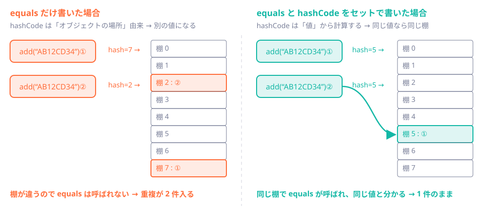
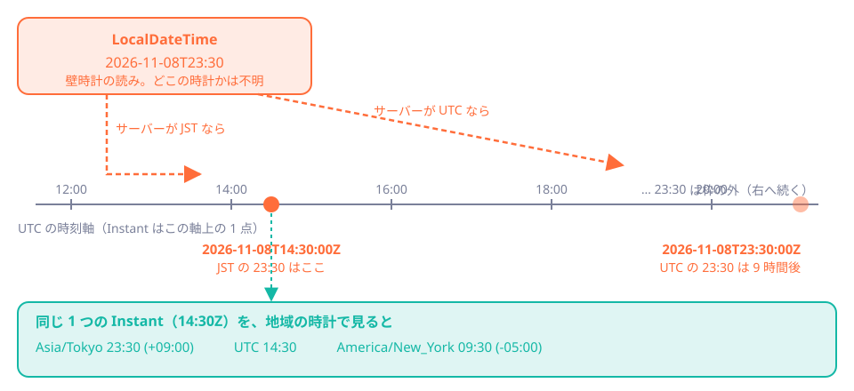

# 第7章 値の落とし穴：equals・数値・時刻・文字

<div class="goal-box" markdown>

この章でできるようになること

- `==` と `equals` の違いを、`Integer` のキャッシュと `HashSet` の実験で説明できる
- `equals` と `hashCode` をセットで書く理由を説明できる
- `double` の誤差と `BigDecimal` の使い方を説明し、得票率を合計ちょうど100%にできる（最大剰余法）
- `Instant` と `LocalDateTime` の違いを説明し、タイムゾーンのずれで起きる事故を再現・防止できる
- 「文字数」と「UTF-8のバイト数」が違う理由を説明し、上限の決め方を言える

</div>

## 1. 事故から始める

この章では4つの事故を順に再現します。どれもコンパイルは通り、テストの1回目もたいてい通りますが、本番で特定の入力のときにだけ壊れます。

| 事故 | QuickVoteでの姿 |
| --- | --- |
| ① 同じはずの値が「違う」と判定される | 参加コード `AB12CD34` を入力したのに、「見つかりません」 |
| ② 計算結果が合わない | 3人が1票ずつ入れたのに、得票率が 33% + 33% + 33% = 99% |
| ③ 時刻が9時間ずれる | 締切を「23:30」にしたのに、サーバーでは別の時刻に |
| ④ 文字数の制限をすり抜ける | 選択肢の名前に、絵文字を100個入れたらDBが重い |

## 2. 事故①：`==` と `equals`

### 動かしてみる

```java title="ch07/Equality.java（抜粋）"
String a = "AB12CD34";
String b = "AB12CD34";
String c = new String("AB12CD34");
String d = String.join("", "AB12", "CD34");
IO.println("a == b      : " + (a == b));
IO.println("a == c      : " + (a == c));
IO.println("a == d      : " + (a == d));
IO.println("a.equals(c) : " + a.equals(c));
```

!!! question "予測カード"
    4行の出力は、それぞれ `true` と `false` のどちらでしょう。

```text
a == b      : true   （リテラル同士はたまたま同じ参照）
a == c      : false  （new は別オブジェクト）
a == d      : false  （実行時に組み立てた文字列も別オブジェクト）
a.equals(c) : true
```

`==` は参照が同じか（同一のオブジェクトか）を比べ、`equals` は値が等しいかを比べます。

| | `==` | `equals` |
| --- | --- | --- |
| プリミティブ（`int` など） | 値を比べる | （呼べない） |
| 参照型 | 同一のオブジェクトかを比べる | 値として等しいか（クラスが定義する） |

`a == b` が `true` になったのは、`"AB12CD34"` のようなリテラルが同じ場所にまとめて保管される仕組みのせいで、たまたま同じオブジェクトになったからです。`new String(...)` や、実行時に組み立てた文字列は別のオブジェクトです。

!!! danger "本番で事故になるパターン"
    テストで使う文字列はリテラルなので、`==` でも通ります。ところが本番では、リクエストから届いた文字列は実行時に作られた別のオブジェクトなので、`==` が `false` になります。「テストは通るのに、本番だけ動かない」の典型です。文字列や、ID・コードのような値の比較には、必ず `equals`（または `Objects.equals`）を使います。

!!! tip "フロントエンドで例えると"
    JavaScriptの `===` は、文字列と数値は値で比べますが、オブジェクトは参照で比べます（`{a:1} === {a:1}` は `false`）。Javaの `==` は文字列まで参照比較になるところが、JavaScriptと違います。

### Integer のキャッシュ

```java
Integer i1 = 127, i2 = 127, j1 = 128, j2 = 128;
IO.println("127 == 127 : " + (i1 == i2));
IO.println("128 == 128 : " + (j1 == j2));
IO.println("128 equals : " + j1.equals(j2));
```

```text
127 == 127 : true
128 == 128 : false  （-128から127だけキャッシュされる）
128 equals : true
```

`Integer`（ラッパー型で参照型）は、-128から127の範囲だけがキャッシュされ、同じオブジェクトが使い回されます。128以上は別オブジェクトになるので、`==` が `false` になります。

「100までのテストは通ったのに、1000でバグる」という、有名な落とし穴です。`Integer` 同士は `equals` で比べます。できれば、そもそも `int`（プリミティブ）を使います。

## 3. equals と hashCode：セットで書く

自分で作るクラスに `equals` を書かないと、`==` と同じ同一性で比べられます。

```java title="ch07/Equality.java（抜粋）"
class JoinCode {                                          // equals を書いていない普通のクラス
    final String value;
    JoinCode(String value) { this.value = value; }
}

class JoinCodeEq {                                        // equals だけ書いた（hashCode なし）
    final String value;
    JoinCodeEq(String value) { this.value = value; }
    @Override public boolean equals(Object o) {
        return o instanceof JoinCodeEq other && value.equals(other.value);
    }
}

class JoinCodeOk {                                        // equals と hashCode をセットで
    final String value;
    JoinCodeOk(String value) { this.value = value; }
    @Override public boolean equals(Object o) {
        return o instanceof JoinCodeOk other && value.equals(other.value);
    }
    @Override public int hashCode() { return Objects.hash(value); }
}

record JoinCodeRec(String value) {}                       // record なら自動
```

同じ値の2つを `HashSet` に入れてみます。

!!! question "予測カード"
    `new JoinCode("AB12CD34")` を2回 `add` したとき、`Set` の大きさはそれぞれ何になるでしょう。（equals なし／equals のみ／equals + hashCode／record）

```text
equals なし            → Set の大きさ 2
equals のみ            → Set の大きさ 2  （hashCode が違うので別の棚に入る）
equals + hashCode      → Set の大きさ 1
record                 → Set の大きさ 1
```

意外なのは、equals を書いたのに重複が除けないことです。理由は `HashSet`（と `HashMap`）の仕組みにあります。



`HashSet` は要素を入れるとき、まず `hashCode()` でどの棚に入れるかを決め、次に同じ棚の中だけで `equals` を使って同じ値がないかを探します。`hashCode` が値から計算されていないと、同じ値でも別の棚に入ってしまい、`equals` が呼ばれることすらありません。

!!! note "用語：equals と hashCode の規約"
    2つのオブジェクトが `equals` で等しいなら、`hashCode` も同じでなければならない、という約束があります。
    どちらか片方だけ書くとこの約束が破れて、`HashSet` や `HashMap` が正しく動かなくなります（探しても見つからない、重複する、など）。

!!! warning "表の数字は絶対ではない"
    「equals のみ」で `2` になるのは、通常は `hashCode` がオブジェクトごとに違う値になるからです。偶然同じ棚に入れば `1` になることもあります。運に頼る挙動は、すでにバグです。

対策は次のとおりです。

- `record` を使う。`equals` と `hashCode` が全フィールドから自動で作られます（第4章）
- 通常のクラスなら、IDE の「equals() と hashCode() を生成」で必ず両方作る
- `HashSet` や `HashMap` のキーに使うオブジェクトは不変にする。あとから値が変わると、「入れた棚」と「今の `hashCode` が指す棚」がずれて、取り出せなくなる

## 4. 事故②：計算が合わない

### double の誤差

```java title="ch07/Doubles.java（抜粋）"
IO.println("0.1 + 0.2        = " + (0.1 + 0.2));
IO.println("0.1 + 0.2 == 0.3 ? " + (0.1 + 0.2 == 0.3));
```

```text
0.1 + 0.2        = 0.30000000000000004
0.1 + 0.2 == 0.3 ? false
```

JavaScriptと同じです。`double` は2進数で小数を表すので、`0.1` のような10進数の小数は正確には表せません。

### BigDecimal：10進数のまま計算する

`BigDecimal` は10進数の小数を正確に扱う型です。ただし、作り方にも落とし穴があります。

```java
IO.println("new BigDecimal(0.1)     = " + new BigDecimal(0.1));
IO.println("new BigDecimal(\"0.1\")   = " + new BigDecimal("0.1"));
IO.println("BigDecimal.valueOf(0.1) = " + BigDecimal.valueOf(0.1));
```

```text
new BigDecimal(0.1)     = 0.1000000000000000055511151231257827021181583404541015625
new BigDecimal("0.1")   = 0.1
BigDecimal.valueOf(0.1) = 0.1
```

`new BigDecimal(0.1)` は、すでに誤差を含んだ `double` の値をそのまま取り込むので、長い小数になります。文字列から作る（`new BigDecimal("0.1")`）か、`BigDecimal.valueOf(...)` を使います。

次の挙動にも注意が必要です。

```java
var two  = new BigDecimal("2.0");
var two2 = new BigDecimal("2.00");
IO.println("2.0 equals 2.00    = " + two.equals(two2));
IO.println("2.0 compareTo 2.00 = " + two.compareTo(two2));
```

```text
2.0 equals 2.00    = false
2.0 compareTo 2.00 = 0
```

`BigDecimal.equals` は小数点以下の桁数（scale）まで比べるので、`2.0` と `2.00` は `false` になります。数値として等しいかを比べたいときは `compareTo` を使います。

割り算には、丸め方の指定が必要です。

```java
BigDecimal.ONE.divide(new BigDecimal(3));                                  // 例外
BigDecimal.ONE.divide(new BigDecimal(3), 1, RoundingMode.HALF_UP);          // 0.3
```

```text
1 / 3 → ArithmeticException: Non-terminating decimal expansion; no exact representable decimal result.
1 / 3 (小数1桁, HALF_UP) = 0.3
```

`1 / 3` は割り切れない（無限小数になる）ので、何桁でどう丸めるかを指定しないと例外になります。このどう丸めるかは、業務の仕様で決まる事柄です。

| 丸めモード | 2.5 | 3.5 | -2.5 | 意味 |
| --- | --- | --- | --- | --- |
| `HALF_UP` | 3 | 4 | -3 | 四捨五入（0から遠ざかる方向） |
| `HALF_EVEN` | 2 | 4 | -2 | 銀行丸め。5のとき偶数へ |
| `DOWN` | 2 | 3 | -2 | 切り捨て（0に近づく方向） |

### 型の選び方

| 扱うもの | 使う型 | 理由 |
| --- | --- | --- |
| 個数・票数 | `int` / `long` | 整数。範囲に注意 |
| お金・割合・精度が必要な小数 | `BigDecimal`（または、最小単位の `long`） | 誤差が許されない |
| 科学計算、近似でよい値 | `double` | 速い。誤差を許容できる |

`int` は約±21億までしか表せず、オーバーフローしても例外になりません。

```java
int big = Integer.MAX_VALUE;
IO.println("MAX_VALUE + 1 = " + (big + 1));
Math.addExact(big, 1);       // ArithmeticException
```

```text
MAX_VALUE + 1 = -2147483648
Math.addExact → integer overflow
```

`MAX_VALUE + 1` は負の数になりました。重要な計算では `Math.addExact` などの `...Exact` を使うと、あふれたときに例外になります。

### 得票率が、合計100%にならない

!!! question "予測カード"
    A、B、Cの3つの選択肢に、1票ずつ入りました。各得票率を四捨五入した整数の合計は、いくつでしょう。

素朴な実装は次のとおりです。

```java title="ch07/Percentages.java（抜粋）"
static int[] naive(int[] counts) {
    long total = Arrays.stream(counts).asLongStream().sum();
    int[] result = new int[counts.length];
    if (total == 0) return result;
    for (int i = 0; i < counts.length; i++) {
        result[i] = (int) Math.round(counts[i] * 100.0 / total);
    }
    return result;
}
```

```text
票数              = [1, 1, 1]
naive (%)         = [33, 33, 33] 合計 99
```

合計は99%です。逆に、票数が `[2, 3, 3]` の場合は合計が超えます。

```text
票数              = [2, 3, 3]
naive (%)         = [25, 38, 38] 合計 101
```

25 + 37.5 + 37.5 を四捨五入すると、合計は101%になります。

どちらも、画面に出すと「なぜ100にならないのか」という問い合わせが必ず来ます。各項目を個別に丸めると、合計が100になる保証はありません。

### 最大剰余法で直す

!!! note "用語：最大剰余法（ハミルトン方式）"
    合計が決まった数になるように、整数を割り振る方法です。
    まず全員を切り捨てで割り当て、足りない分（余り）を、切り捨てた端数が大きい順に1ずつ配ります。

`[2, 3, 3]`（合計8票）を手計算で追います。

| 選択肢 | 票 | 票×100 | 切り捨て（÷8） | 端数（余り） | 配る順 |
| --- | --- | --- | --- | --- | --- |
| A | 2 | 200 | 25 | 0 | - |
| B | 3 | 300 | 37 | 4 | 1番目 |
| C | 3 | 300 | 37 | 4 | 2番目 |

切り捨てた合計は 25 + 37 + 37 = 99 なので、足りない1を端数が最も大きい選択肢に配ります。B と C は端数が同じ（4）なので、同じときは先の選択肢を優先すると決めておきます。すると B が +1 になり、結果は `[25, 38, 37]`、合計は100です。

実装は次のとおりです。

```java title="ch07/Percentages.java（抜粋：allocate）"
static int[] allocate(int[] counts, int target) {
    long total = 0;
    for (int c : counts) {
        if (c < 0) throw new IllegalArgumentException("票数が負です: " + c);
        total += c;
    }
    int[] result = new int[counts.length];
    if (total == 0) return result;                     // 0票のときは全員 0

    long[] remainder = new long[counts.length];
    int assigned = 0;
    for (int i = 0; i < counts.length; i++) {
        long scaled = (long) counts[i] * target;
        result[i] = (int) (scaled / total);            // 切り捨て
        remainder[i] = scaled % total;                 // 切り捨てた端数（分子）
        assigned += result[i];
    }
    // ... 続く
```

```java
    // ... 続き
    int leftover = target - assigned;                  // 配り切れていない分
    Integer[] order = IntStream.range(0, counts.length).boxed().toArray(Integer[]::new);
    Arrays.sort(order, Comparator
            .comparingLong((Integer i) -> remainder[i]).reversed()     // 端数が大きい順
            .thenComparing(Comparator.comparingInt((Integer i) -> counts[i]).reversed()));  // 同じなら票が多い順
    for (int k = 0; k < leftover; k++) {
        result[order[k]]++;                            // 上位 leftover 個に 1 ずつ配る
    }
    return result;
}
```

`Arrays.sort` は安定ソート（同じ値なら元の順序を保つ）なので、端数も票数も同じなら先の選択肢が先になります。

```text
票数              = [1, 1, 1]
allocate (%)      = [34, 33, 33]
票数              = [5, 3, 2, 0]
allocate (%)      = [50, 30, 20, 0]
0.1%単位           = [334, 333, 333] → [33.4, 33.3, 33.3]
票数              = [2, 3, 3]
allocate (%)      = [25, 38, 37]
```

| ポイント | 説明 |
| --- | --- |
| 整数だけで計算している | `double` の誤差が入る余地がない |
| `target` を引数にした | `100` なら百分率、`1000` なら0.1%単位。小数1桁で表示したいときは、`1000` で配って10で割って表示する |
| 同順位の扱いは仕様 | 「先の選択肢を優先」は1つの選び方で、「票が多い方を優先」などの選び方もある。どれを選んだかを仕様に書いて、テストで固定する（第8章） |
| 0票は全員0 | 0除算を避けるための、明示的な仕様 |

!!! warning "『正しい丸め方』は1つではない"
    最大剰余法は「合計が必ず100になる」ことを保証しますが、「34%と33%の差が実際の票差より大きく見える」という副作用があります。
    これは表示の仕様をどうするかという判断です。たとえば「合計は100%にならないことがあります」と注記する選択もあります。どの約束を守るかを決めるのは、人間の仕事です。

## 5. 事故③：時刻が9時間ずれる

### 時刻の型は5種類ある

Javaの時刻APIは `java.time` パッケージにあり、型ごとに意味が違います。



| 型 | 意味 | 例 | 使う場面 |
| --- | --- | --- | --- |
| `Instant` | 時間軸上の1つの瞬間（UTC基準） | `2026-11-08T14:30:00Z` | サーバー内の時刻の標準。DBの `timestamptz`、JSONの日時 |
| `LocalDateTime` | 壁時計の読み。タイムゾーンなし | `2026-11-08T23:30` | 画面入力の一時的な値。単独ではいつか決まらない |
| `LocalDate` | 日付のみ | `2026-11-08` | 誕生日、締切日（時刻なし） |
| `ZonedDateTime` | 瞬間＋タイムゾーン | `2026-11-08T23:30+09:00[Asia/Tokyo]` | ユーザーの地域の時計で表示・計算するとき |
| `OffsetDateTime` | 瞬間＋UTCからのずれ | `2026-11-08T23:30+09:00` | DBやAPIでのずれの保存（用途は限定的） |

!!! tip "フロントエンドで例えると"
    JavaScriptの `Date` の実体は瞬間（エポックからのミリ秒）ですが、`getHours()` などはブラウザのタイムゾーンで答えます。「瞬間」と「壁時計」が混ざった型なので、混乱のもとでした。
    Javaは最初から分けてあり、`Instant` は瞬間、`LocalDateTime` は壁時計の読みです。Temporal API を使ったことがあれば、その区別に近いと考えてください。

QuickVoteの方針は次のとおりです。

- DBは `timestamptz`、Javaは `Instant`、JSONはUTCのISO 8601（`2026-11-08T14:30:00Z`）にする
- ユーザーに見せる時刻の整形にだけ、`ZonedDateTime` を使う

### 動かしてみる：サーバーのタイムゾーンが変わると

主催者が「11月8日 23:30 に締切」と入力しました。画面からは `LocalDateTime`（`2026-11-08T23:30`）として届いたとします。

```java title="ch07/Times.java（抜粋）"
LocalDateTime input = LocalDateTime.of(2026, 11, 8, 23, 30);

// 悪い例：サーバーのタイムゾーン任せで Instant にする
Instant closesAt = input.atZone(ZoneId.systemDefault()).toInstant();

// 良い例：入力者のタイムゾーンを明示する
Instant explicit = input.atZone(ZoneId.of("Asia/Tokyo")).toInstant();

// 現在時刻（11月9日 0:00 JST）で、締切前か？
Clock clock = Clock.fixed(Instant.parse("2026-11-08T15:00:00Z"), ZoneOffset.UTC);
Instant now = Instant.now(clock);
IO.println("サーバー任せ版: 締切前? " + now.isBefore(closesAt));
IO.println("Asia/Tokyo明示版: 締切前? " + now.isBefore(explicit));
```

同じコードを、JVMのタイムゾーンだけ変えて2回実行します。

```bash
java -Duser.timezone=Asia/Tokyo Times.java
java -Duser.timezone=UTC        Times.java
```

!!! question "予測カード"
    締切（日本時間 23:30）を30分過ぎた時点で、「締切前？」は、どちらの環境でも `false`（受付終了）になるでしょうか。

JST のサーバー：

```text
このJVMのタイムゾーン = Asia/Tokyo
サーバー任せの Instant = 2026-11-08T14:30:00Z
Asia/Tokyo 明示       = 2026-11-08T14:30:00Z
サーバー任せ版: 締切前? false
Asia/Tokyo明示版: 締切前? false
```

UTC のサーバー：

```text
このJVMのタイムゾーン = UTC
サーバー任せの Instant = 2026-11-08T23:30:00Z
Asia/Tokyo 明示       = 2026-11-08T14:30:00Z
サーバー任せ版: 締切前? true
Asia/Tokyo明示版: 締切前? false
```

UTC のサーバーでだけ、サーバー任せ版が `true`（まだ受付中）になりました。締切が9時間遅れたことになります。

原因は `ZoneId.systemDefault()` がサーバーの設定に依存することです。開発PCは日本時間で、本番サーバー（クラウド）は UTC という構成はごくふつうなので、手元では動いていたコードが本番で9時間ずれます。

!!! danger "本番で事故になるパターン"
    - `LocalDateTime.now()`、`ZoneId.systemDefault()`、`new Date()` のような、実行環境のタイムゾーンに依存する書き方
    - 画面から来た `LocalDateTime` を、どのタイムゾーンの時刻か明示せずに保存・比較する
    - テストが、開発PCのタイムゾーンを前提にしないと通らない（CIのサーバーで落ちる）

対策は次の4点です。

1. サーバー内は常に `Instant` で扱う。`LocalDateTime` は境界（入力・表示）にだけ置く
2. 入力者の地域は、クライアントから送ってもらう（`Asia/Tokyo`）か、UTC のオフセット付き（`2026-11-08T23:30:00+09:00`）で受け取る
3. 「現在時刻」は `Instant.now()` を直接書かず、`Clock` を受け取って `Instant.now(clock)` とする。こうするとテストで時間を固定したり進めたりできる（第28章）
4. 本番とテストでJVMのタイムゾーンを同じにする（`-Duser.timezone=UTC` など）。ただしこれは保険で、先にコードをタイムゾーンに依存しない書き方にする

### おまけ：夏時間（サマータイム）

日本には夏時間がありません。ただし海外の利用者を相手にすると、`ZonedDateTime` は次のように動きます。

```text
2026-03-08 02:30 (New York) = 2026-03-08T03:30-04:00[America/New_York]
2026-03-08 の長さ = 23 時間
```

ニューヨークの3月8日 2:30 は、夏時間への切り替えで存在しない時刻なので、後ろにずれます。この日は23時間しかありません。「1日後」と「24時間後」は同じとは限らないので、時間の長さには `Duration`、日付の単位には `Period` を使い分けます。

## 6. 事故④：文字数とバイト数

### 「1文字」は4通りに数えられる

選択肢の名前には、「1〜100文字、かつ UTF-8 で 400 バイト以内」という上限があります。では、文字数はどう数えるのでしょうか。

```java title="ch07/TextSize.java（抜粋）"
show("ASCII",   "curry");
show("日本語",   "カレー");
show("絵文字",   "😀");
show("異体字",   "𠮷野家");                      // 「𠮷」は U+20BB7（サロゲートペア）
show("国旗",     "🇯🇵");
show("家族",     "👨‍👩‍👧");                       // 3人の絵文字を ZWJ でつないだ 1 文字
```

```text
ASCII    length=5   codePoints=5   graphemes=5   UTF-8 bytes=5
日本語      length=3   codePoints=3   graphemes=3   UTF-8 bytes=9
絵文字      length=2   codePoints=1   graphemes=1   UTF-8 bytes=4
異体字      length=4   codePoints=3   graphemes=3   UTF-8 bytes=10
国旗       length=4   codePoints=2   graphemes=1   UTF-8 bytes=8
家族       length=8   codePoints=5   graphemes=1   UTF-8 bytes=18
```

| 数え方 | 意味 | 取得方法 |
| --- | --- | --- |
| `length` | UTF-16 の単位数。Javaの `String.length()`。JavaScriptの `.length` と同じ | `s.length()` |
| `codePoints` | Unicode のコードポイント数 | `s.codePointCount(0, s.length())` |
| `graphemes` | 人が見て「1文字」と感じる単位 | `BreakIterator.getCharacterInstance()` |
| `UTF-8 bytes` | UTF-8 でエンコードしたバイト数 | `s.getBytes(StandardCharsets.UTF_8).length` |

「😀」は見た目は1文字ですが、`length` は2です（UTF-16では2つの単位、つまりサロゲートペアになります）。「👨‍👩‍👧」（家族）は、見た目は1文字なのに `length` は8、バイト数は18にもなります。

!!! note "用語：コードポイントと書記素（グラフェム）"
    コードポイントは、Unicodeが文字に振った番号です。絵文字や「𠮷」は、UTF-16では2つの単位に分かれます。
    書記素（グラフェム・クラスター）は、複数のコードポイントが組み合わさって1つの見た目になるまとまりです（国旗、家族の絵文字、濁点つきの文字など）。

### 同じ「が」が、等しくない

```java
String nfc = "が";                                // U+304C（1コードポイント）
String nfd = Normalizer.normalize(nfc, Normalizer.Form.NFD);   // か + 濁点（2コードポイント）
IO.println("見た目は同じ 'が' だが equals = " + nfc.equals(nfd)
        + " / 正規化後は " + nfc.equals(Normalizer.normalize(nfd, Normalizer.Form.NFC)));
```

```text
が(NFC)   length=1   codePoints=1   graphemes=1   UTF-8 bytes=3
が(NFD)   length=2   codePoints=2   graphemes=1   UTF-8 bytes=6
見た目は同じ 'が' だが equals = false / 正規化後は true
```

「が」は、1コードポイント（NFC）でも、「か」と「濁点」の2コードポイント（NFD）でも書けます。見た目は同じでも `equals` は `false` になります。macOSのファイル名や一部の入力経路では、NFDが紛れ込むことがあります。外部から来た文字列は、比較や保存の前に `Normalizer` でNFCに正規化しておくと確実です。

### QuickVoteの上限の決め方

上限を決めるときは、何を守りたいかから考えます。

| 守りたいもの | 数える単位 |
| --- | --- |
| ユーザーが「何文字入力したか」の感覚 | `graphemes`（見た目の文字数） |
| DBの列の大きさ（PostgreSQLの `varchar(n)` はコードポイントで数える） | `codePoints` |
| ログ・メモリ・ネットワークの量 | UTF-8 のバイト数 |

QuickVoteの選択肢ラベルは、「1〜100コードポイント、かつ UTF-8 で400バイトまで」と決めます。仕様書に「100文字」と書いてあるときは、この教材では「100コードポイント」の意味です。

```java title="ch07/TextSize.java（抜粋）"
boolean validLabel(String label) {
    int codePoints = label.codePointCount(0, label.length());   // 仕様の「文字数」はコードポイント数
    int bytes = label.getBytes(StandardCharsets.UTF_8).length;
    return 1 <= codePoints && codePoints <= 100 && bytes <= 400;
}
```

```text
--- 規則：1-100コードポイント かつ UTF-8 で 400 バイト以内 ---
日本語100文字    : true (bytes=300)
日本語101文字    : false
絵文字😀100個    : true (bytes=400)
家族絵文字20個   : true (graphemes=20, codePoints=100)
```

この結果から、2つのことが読み取れます。

1つ目は、100コードポイントなら UTF-8 でも最大400バイトに収まることです。UTF-8は1コードポイントを1〜4バイトで表すので、`😀` を100個並べても 4 × 100 = 400 バイトです。コードポイントで上限を決めておけば、DB・ログ・通信量の上限も計算で決まります。400バイトの検査は、この計算が崩れていないことを確かめる念のための二重チェックです。

2つ目は、最後の行の家族の絵文字が、見た目は20文字なのに100コードポイントあることです（1つが5コードポイントの合成になっています）。見た目の文字数で数える仕様にすると、こうした文字を含む入力のデータ量が読めなくなります。

!!! tip "見た目の文字数はどうする？"
    「残り○文字」のような表示は、フロントエンドで `Intl.Segmenter` を使ってグラフェム単位で数えると、利用者の感覚に合います。
    一方、サーバーの検証には、データ量を確実に縛れる単位（コードポイントとバイト）を使います。表示の数え方と、守るべき上限の数え方は別の問題です。

!!! warning "Bean Validation の `@Size` は何を数える？"
    第14章で使う Bean Validation の `@Size(max = 100)` は、`String.length()`（UTF-16 の単位数）で数えます。絵文字は1つが2と数えられるので、コードポイント数ともずれます。
    どの単位で数える仕様かを決め、それに合った検証（コードポイント、グラフェム、バイト）を自分で用意する必要があります。

## 7. 現場で：AIが書いたコードを読むとき

| 見るもの | 疑う理由 |
| --- | --- |
| 文字列、ID、コードを `==` で比較 | `equals` を使う（テストでは通ってしまう） |
| `Integer` / `Long` 同士の `==` | キャッシュ範囲外で `false`。`equals` か、プリミティブに |
| `equals` だけ、`hashCode` だけ | セットで書く。`record` に |
| `double` / `float` でお金・割合 | `BigDecimal`、または整数 |
| `new BigDecimal(0.1)` | 文字列か `valueOf` から作る |
| `BigDecimal.equals` で金額比較 | `compareTo`（scaleが違うと `false`） |
| 個別に丸めた割合の合計が100を前提としている | 最大剰余法など、合計を保証する方法 |
| `LocalDateTime.now()`、`new Date()`、`ZoneId.systemDefault()` | 環境依存。`Clock` を注入、`Instant` |
| `.length()` で文字数制限 | UTF-16 の単位数。仕様の単位（グラフェム、コードポイント、バイト）で検証しているか |
| 外部文字列を、正規化なしで保存・比較 | NFC に正規化 |

---

## まとめ：3点セット

!!! abstract "この章の3点セット"
    **① 一言で言うと**
    `==` は参照の同一性、`equals` は値の等価性で、`equals` と `hashCode` はセットで実装する。`double` は2進の誤差を持つので、正確な小数は `BigDecimal`、合計を保証する配分は最大剰余法。時刻は `Instant`（瞬間）を基本に、`LocalDateTime` を境界に限定し、環境のタイムゾーンに依存しない。文字数は、UTF-16の単位・コードポイント・書記素・バイトで違うので、上限は単位を決めて検証する。

    **② 現場でこう聞かれる**
    「開発環境では動いていた締切の判定が、本番で9時間ずれたのはなぜですか？」
    → `LocalDateTime` を `ZoneId.systemDefault()` で `Instant` に変換していて、サーバーのタイムゾーン（本番は UTC）に依存していたから。入力者のタイムゾーンを明示し、サーバー内は `Instant` で扱い、`Clock` を注入してテストする。

    **③ 自分のサービスならどこに当たるか**
    自分のサービスの「期限」「割合」「入力文字数の上限」を1つずつ挙げ、それぞれ、どの型・どの単位で扱うかを決めて書く。

## 演習

??? question "確認問題1：Integer のキャッシュ"
    次のコードの出力を予測してから実行してください。理由も説明してください。

    ```java
    Integer a = 1000, b = 1000;
    int c = 1000;
    IO.println(a == b);
    IO.println(a == c);
    IO.println(a.equals(b));
    ```

??? success "解答"
    `false`、`true`、`true` です。
    `a == b` は2つの `Integer`（参照型）の参照比較で、1000はキャッシュ範囲外なので別オブジェクトです。`a == c` は片方が `int` なので、`a` が自動でアンボクシングされ、値の比較になります。`equals` は値で比べます。

??? question "確認問題2：equals と hashCode"
    `equals` を書いて `hashCode` を書かなかったクラスを `HashSet` に入れると、どんな症状が出ますか。2つ挙げてください。

??? success "解答"
    (1) 値が同じオブジェクトが重複して入ります。(2) 入れたものと同じ値のオブジェクトで `contains` や `remove` をしても見つかりません（別の棚を探してしまうため）。

??? question "確認問題3：得票率を手計算する"
    票数が `[3, 3, 1]`（合計7票）のとき、最大剰余法で百分率を求めてください。端数が同じ場合は先の選択肢を優先します。

??? success "解答"
    票×100 は 300、300、100です。÷7 の切り捨ては 42、42、14（合計98）で、余りは 6、6、2です。足りない2を余りが大きい順（6、6）に配るので、`[43, 43, 14]`、合計100です。

??? question "確認問題4：時刻の型"
    次の値は、どの型で持つのが適切ですか。

    1. 投票の締切（サーバーで比較する）
    2. 主催者が画面に入力した「11/8 23:30」（送信直前）
    3. 生年月日

??? success "解答"
    1. `Instant`（瞬間。DBは `timestamptz`）
    2. `LocalDateTime`（タイムゾーンの情報も一緒に送り、サーバーで `Instant` に変換する）
    3. `LocalDate`（時刻もタイムゾーンも不要）

??? question "応用：QuickVoteの小さな変更"
    `Percentages.allocate` に、「**同じ端数のときは、票数が多い方、それも同じなら、あとの選択肢を優先する**」という別の仕様を適用するには、どこをどう変えますか。変えると、`[1, 1, 1]` の結果はどうなりますか。

??? success "解答"
    `order` を作るときの `Arrays.sort` の `Comparator` に、最後に「インデックスの降順」を加えます（`.thenComparing(Comparator.<Integer>naturalOrder().reversed())`）。
    すると `[1, 1, 1]` の余りの1は最後の選択肢に配られ、結果は `[33, 33, 34]` になります。仕様を変えたら、第8章のテスト（`oneVoteEach`）の期待値も変える必要があります。仕様の変更は、テストの変更とセットです。

??? question "説明問題：現場でこう聞かれる"
    「なぜ、金額の計算に `double` を使ってはいけないのですか？」200字程度で答えてください。

??? success "解答"
    例：`double` は2進数の浮動小数点で、`0.1` のような10進の小数を正確に表せず、誤差が入ります。足し算や掛け算を繰り返すと誤差が積み重なり、合計が1円ずれたり、比較が `false` になったりします。金額や割合のような正確さが必要な値は、10進数のまま計算できる `BigDecimal`（文字列から作り、丸めモードを明示する）や、最小単位（円）の整数で扱います。
