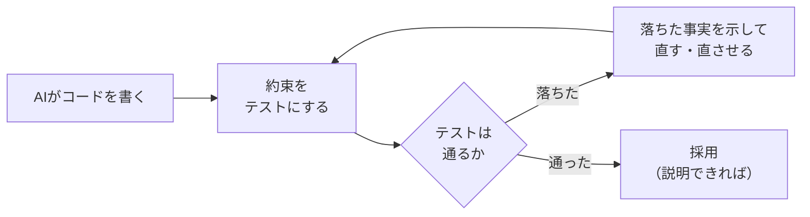

# 第8章 JUnitで最初のテスト

<div class="goal-box" markdown>

この章でできるようになること

- Springを使わずに、JUnit と AssertJ でテストを書いて、`./mvnw test` で実行できる
- 境界値、`@ParameterizedTest`、`@Nested` を使い分けられる
- 「AIが書いたコードの誤り」を、失敗するテストで示せる
- 仕様を変えたとき、テストの期待値も一緒に変える理由を説明できる

</div>

## 1. 問いかけ：第7章の `allocate` は、本当に正しいか

第7章で、最大剰余法の `Percentages.allocate` を書きました。手計算した3つの例では、期待どおりに動きました。でも、それで十分でしょうか。

- 票数が `[0, 0, 0]`（誰も投票していない）なら？
- 票数に負の値が入ったら？
- 選択肢が10個で、票がばらばらだったら、いつも合計100になるか？

手で試すのは、**3回が限界**です。コードで試せば、**1万回**でも一瞬です。この章では、それを**自動テスト**で行います。

テストのない状態で、AIが書いた得票率の計算を受け取ったら、どうやって「正しい」と言えるでしょうか。**テストは、「正しい」と言うための根拠**です。

## 2. TypeScriptのテストと並べる

=== "TypeScript（Vitest）"

    ```ts
    import { describe, test, expect } from "vitest"

    describe("allocate", () => {
      test("3人が1票ずつなら 34/33/33", () => {
        expect(allocate([1, 1, 1], 100)).toEqual([34, 33, 33])
      })
    })
    ```

=== "Java（JUnit + AssertJ）"

    ```java
    class PercentagesTest {

        @Test
        @DisplayName("3人が1票ずつなら 34/33/33（余りは先の選択肢へ）")
        void oneVoteEach() {
            assertThat(Percentages.allocate(new int[] {1, 1, 1}, 100)).containsExactly(34, 33, 33);
        }
    }
    ```

| | Vitest / Jest | JUnit + AssertJ |
| --- | --- | --- |
| テストの印 | `test(...)` / `it(...)` | `@Test` を付けたメソッド |
| グループ化 | `describe(...)` | **クラス**（さらに `@Nested`） |
| 検証 | `expect(x).toEqual(y)` | `assertThat(x).isEqualTo(y)`（AssertJ） |
| 名前 | 文字列で自由 | メソッド名（`@DisplayName` で日本語も可） |
| 実行 | `npm test` | `./mvnw test` |

!!! note "用語：JUnit"
    Javaで最も使われるテストの枠組みです。この教材では、現行の **JUnit 6**（テストを書く部分は **Jupiter** と呼ぶ）を使います。テストの書き方と `org.junit.jupiter.api` パッケージは、先代の JUnit 5 とほぼ同じなので、古い記事の知識も大半は使えます。

!!! note "用語：AssertJ"
    「`assertThat(実際の値).〜`」という流れるような書き方で、検証を書けるライブラリです。メソッドを補完しながら書けて、失敗時のメッセージが読みやすいのが特徴です。JUnit標準の `assertEquals(期待値, 実際の値)` は、引数の順番を間違えやすいため、この教材では AssertJ を使います。

## 3. プロジェクトを開く

第8章の実験は、Maven プロジェクト `code/java-basics/ch08-junit` です。構成は次のとおりです。

```text
ch08-junit/
├── mvnw / mvnw.cmd          Maven Wrapper（第1章）
├── pom.xml                  ビルドの設定
└── src/
    ├── main/java/com/example/quickvote/
    │   ├── vote/Percentages.java         第7章の得票率計算
    │   └── poll/PollState.java 他        第4章の投票状態、VotingWindow
    └── test/java/com/example/quickvote/
        ├── vote/PercentagesTest.java
        ├── vote/AiGeneratedPercentagesTest.java
        ├── vote/LifecycleTest.java
        ├── poll/PollStateTest.java
        └── poll/VotingWindowTest.java
```

**テストのコードは `src/test/java` に、本体と同じパッケージ構成**で置きます。同じパッケージなので、パッケージプライベート（第3章）のものにも、テストからは触れます。

`pom.xml` の肝心な部分を見ます。

```xml title="pom.xml（抜粋）"
<dependencyManagement>
    <dependencies>
        <dependency>
            <groupId>org.junit</groupId>
            <artifactId>junit-bom</artifactId>         <!-- (1)! -->
            <version>6.0.3</version>
            <type>pom</type>
            <scope>import</scope>
        </dependency>
    </dependencies>
</dependencyManagement>

<dependencies>
    <dependency>
        <groupId>org.junit.jupiter</groupId>
        <artifactId>junit-jupiter</artifactId>         <!-- (2)! -->
        <scope>test</scope>                             <!-- (3)! -->
    </dependency>
    <dependency>
        <groupId>org.assertj</groupId>
        <artifactId>assertj-core</artifactId>
        <version>3.27.7</version>
        <scope>test</scope>
    </dependency>
</dependencies>
```

1. **BOM**（Bill of Materials）。JUnit 関連の複数のライブラリの版を、まとめて揃える仕組み。ここで版を決めると、`junit-jupiter` などの版は書かなくてよい（第10章で詳しく）
2. テストを書くための JUnit Jupiter 一式（API とエンジン）
3. `test` スコープ＝**テストのときだけ**使う。本番のjarには含まれない

!!! tip "フロントエンドで例えると"
    `devDependencies` に当たります。`<scope>test</scope>` が付いた依存は、本番に入りません。
    BOMは、`package.json` の `overrides` / `resolutions` で、関連ライブラリの版を揃える仕組みに似ています。

## 4. 動かしてみる

```bash
cd code/java-basics/ch08-junit
./mvnw test             # Windows PowerShell では .\mvnw.cmd test
```

!!! example "動かしてみる"
    初回は、JUnit や AssertJ のダウンロードで時間がかかります。成功すると、次のような出力になります（抜粋）。

    ```text
    [INFO] Tests run: 2, Failures: 0, Errors: 0, Skipped: 0, Time elapsed: 0.098 s -- in com.example.quickvote.poll.PollStateTest$Close
    [INFO] Tests run: 4, Failures: 0, Errors: 0, Skipped: 0, Time elapsed: 0.014 s -- in com.example.quickvote.poll.PollStateTest$CanVote
    [INFO] Tests run: 3, Failures: 0, Errors: 0, Skipped: 0, Time elapsed: 0.008 s -- in com.example.quickvote.poll.VotingWindowTest
    [INFO] Tests run: 1, Failures: 0, Errors: 0, Skipped: 0, Time elapsed: 0.013 s -- in com.example.quickvote.vote.AiGeneratedPercentagesTest
    [INFO] Tests run: 2, Failures: 0, Errors: 0, Skipped: 0, Time elapsed: 0.010 s -- in com.example.quickvote.vote.LifecycleTest
    [INFO] Tests run: 10, Failures: 0, Errors: 0, Skipped: 0, Time elapsed: 0.166 s -- in com.example.quickvote.vote.PercentagesTest
    [INFO] Tests run: 22, Failures: 0, Errors: 0, Skipped: 0
    [INFO] BUILD SUCCESS
    ```

`Tests run: 22, Failures: 0` が、全部通った印です。特定のテストだけ実行したいときは、次のようにします。

```bash
./mvnw test -Dtest='PercentagesTest#oneVoteEach'
```

IntelliJ では、テストメソッドの左の緑の ▶ をクリックすれば、1つだけ実行できます。

## 5. 最初のテストを読む

```java title="src/test/java/com/example/quickvote/vote/PercentagesTest.java（抜粋）"
class PercentagesTest {

    @Test                                                       // (1)!
    @DisplayName("3人が1票ずつなら 34/33/33（余りは先の選択肢へ）")   // (2)!
    void oneVoteEach() {
        assertThat(Percentages.allocate(new int[] {1, 1, 1}, 100))   // (3)!
                .containsExactly(34, 33, 33);                        // (4)!
    }

    @Test
    void zeroVotesGivesAllZero() {
        assertThat(Percentages.allocate(new int[] {0, 0, 0}, 100)).containsExactly(0, 0, 0);
    }

    @Test
    void negativeCountIsRejected() {
        assertThatIllegalArgumentException()                          // (5)!
                .isThrownBy(() -> Percentages.allocate(new int[] {3, -1}, 100))
                .withMessageContaining("-1");
    }
}
```

1. `@Test` が付いたメソッドが、1つのテスト。`public` は不要
2. 画面に出す名前。省略するとメソッド名が使われる。日本語で意図を書けるのが利点
3. **検証したい値**（実際の値）を `assertThat` に渡す
4. 期待する**中身と順序**を `containsExactly` で指定する
5. 「例外が投げられること」を確かめる書き方。`Percentages.allocate` に負の数を渡すと例外になる、という約束をテストにしている

よいテストは、次の3段で読めます（**AAA**：Arrange / Act / Assert）。

| 段 | 内容 | `oneVoteEach` では |
| --- | --- | --- |
| 準備（Arrange） | 入力を用意する | `new int[] {1, 1, 1}` |
| 実行（Act） | テスト対象を呼ぶ | `Percentages.allocate(..., 100)` |
| 検証（Assert） | 期待どおりか確かめる | `containsExactly(34, 33, 33)` |

!!! tip "テストの名前は『仕様の文』"
    `oneVoteEach` のように、**入力と期待する結果が分かる名前**にします。失敗したとき、テスト名を見るだけで「何の約束が破れたか」が分かるのが理想です。`test1`、`testAllocate` のような名前は避けます。

## 6. 境界値：「ちょうど」を確かめる

バグが集まるのは、**境目**です。QuickVoteの締切判定（第4章の `PollState.canVote`）で見ます。「締切**ちょうど**の瞬間」は、受け付けるでしょうか。

```java title="src/main/java/com/example/quickvote/poll/PollState.java（抜粋）"
/** 投票できるか。締切ちょうどの瞬間は受け付けない（closesAt の直前まで）。 */
default boolean canVote(Instant now) {
    return switch (this) {
        case Open(Instant closesAt) -> now.isBefore(closesAt);
        case Closed _ -> false;
    };
}
```

「締切ちょうどは受け付けない」という**仕様**です。この仕様を、境界の前後で確かめます。

```java title="src/test/java/com/example/quickvote/poll/PollStateTest.java（抜粋）"
class PollStateTest {

    private static final Instant T0 = Instant.parse("2026-11-08T10:00:00Z");
    private static final Instant CLOSES_AT = T0.plusSeconds(600);

    @Nested                                                              // (1)!
    class CanVote {
        private final PollState open = new PollState.Open(CLOSES_AT);

        @Test
        void beforeDeadline() {
            assertThat(open.canVote(CLOSES_AT.minusNanos(1))).isTrue();   // (2)!
        }

        @Test
        void exactlyAtDeadlineIsRejected() {
            assertThat(open.canVote(CLOSES_AT)).isFalse();                // (3)!
        }

        @Test
        void afterDeadline() {
            assertThat(open.canVote(CLOSES_AT.plusNanos(1))).isFalse();   // (4)!
        }
    }
}
```

1. `@Nested`：クラスの中に、さらにテストのグループを作る。`describe` に当たる
2. 締切の**1ナノ秒前**。受け付ける
3. **締切ちょうど**。受け付けない（仕様）
4. 締切の1ナノ秒後。受け付けない

境界値は、**境目の「前・ちょうど・後」の3点**を押さえるのが基本です。

| テストする対象 | 境界の候補 |
| --- | --- |
| 締切時刻 | 1ナノ秒前／ちょうど／1ナノ秒後 |
| 参加者50人の上限 | 49人目／50人目／51人目 |
| ラベルの長さ 100文字 | 100文字／101文字 |
| 得票率 | 総票数が 0 ／ 1 ／ 大きい数 |

### 壊してみる：条件を1文字変える

テストが本当に役に立つか、確かめます。`canVote` の `now.isBefore(closesAt)` を、わざと `!now.isAfter(closesAt)`（締切ちょうども許す）に変えて、実行します。

```text
[ERROR] com.example.quickvote.poll.PollStateTest.exactlyAtDeadlineIsRejected -- Time elapsed: 0.018 s <<< FAILURE!
org.opentest4j.AssertionFailedError: 

Expecting value to be false but was true
	at com.example.quickvote.poll.PollStateTest$CanVote.exactlyAtDeadlineIsRejected(PollStateTest.java:26)
```

**境界のテストだけが落ちました**。`beforeDeadline` と `afterDeadline` は、通ったままです。たった1文字の変更（`<` と `<=` のような違い）は、**境界のテストがなければ、永久に気づけません**。

AIがコードを書き換えたときも、同じです。「ちょっとしたリファクタリング」で、境界の挙動が変わっていないことを、テストが保証します。

## 7. `@ParameterizedTest`：同じ形のテストを表にする

「入力と期待値」が違うだけのテストを、何本も書くのは冗長です。**表形式**でまとめます。TypeScriptの `test.each` に当たります。

```java title="PercentagesTest.java（抜粋）"
static Stream<Arguments> cases() {                                      // (1)!
    return Stream.of(
            Arguments.of(new int[] {5, 3, 2, 0}, new int[] {50, 30, 20, 0}),
            Arguments.of(new int[] {2, 3, 3}, new int[] {25, 38, 37}),   // 剰余が同じなら先の選択肢
            Arguments.of(new int[] {1}, new int[] {100}),
            Arguments.of(new int[] {0, 7}, new int[] {0, 100}));
}

@ParameterizedTest(name = "{0} -> {1}")                                  // (2)!
@MethodSource("cases")                                                   // (3)!
void expectedAllocations(int[] counts, int[] expected) {
    assertThat(Percentages.allocate(counts, 100)).containsExactly(expected);
}
```

1. テストデータを返すメソッド。1行が1回のテスト実行
2. 画面に出る名前の形式。`{0}` は1番目の引数
3. どのメソッドからデータをもらうか

1つのメソッドが、4回実行されます（`Tests run: 10` は、通常のテスト5本 ＋ この4回 ＋ 次に出る性質テスト1本）。

!!! note "単純な値なら `@CsvSource` が便利"
    配列ではなく、数値や文字列だけなら、`@CsvSource({"1, 1, 2", "2, 3, 5"})` のように、データをアノテーションに直接書けます。

## 8. 性質テスト：「どんな入力でも成り立つこと」

例を並べるテストには、限界があります。**書いた例の分しか、確かめられません**。そこで、「**どんな入力でも、必ず成り立つ性質**」を、大量のランダムな入力で確かめます。

`allocate` の性質は、次のとおりです。

1. 総票数が1以上なら、結果の**合計は必ず100**
2. 票が多い選択肢は、票が少ない選択肢より、**割合が小さくならない**

```java title="PercentagesTest.java（抜粋）"
@Test
@DisplayName("どんな票数でも、合計は必ず100になり、票の多い方が少ない方を下回らない")
void invariantsHoldForManyInputs() {
    Random random = new Random(42);                          // (1)!
    for (int round = 0; round < 10_000; round++) {
        int[] counts = random.ints(1 + random.nextInt(10), 0, 50).toArray();
        int[] result = Percentages.allocate(counts, 100);

        int total = Arrays.stream(counts).sum();
        if (total > 0) {
            assertThat(Arrays.stream(result).sum())
                    .as("counts=%s", Arrays.toString(counts))    // (2)!
                    .isEqualTo(100);
        }
        // ... 票の大小と割合の大小が逆転していないか
    }
}
```

1. **シード（乱数の種）を固定**する。毎回同じ入力列になるので、失敗しても**再現できる**。乱数を固定しないテストは、「たまに落ちる」テストになる
2. 失敗したときに、**どの入力で落ちたか**が表示されるよう、`as(...)` で説明を付ける

!!! warning "ランダムなテストの鉄則"
    シードを固定しない乱数テストは、「落ちたけど、再現しない」ため、調査できません。**固定するか、落ちたときにシードを必ず出力する**ようにします。
    性質テストの専用ライブラリ（jqwik など）もありますが、まずは、**固定シード＋ループ**で十分です。

## 9. AIが書いたコードの誤りを、テストで示す

ここからが、この教材の「AIとの付き合い方」の実践です（第0章の原則2：生成物は動かして観察する）。

AIに「得票率を計算するメソッドを書いて」と頼んだら、こんなコードが返ってきたとします。

```java title="src/test/java/.../NaivePercentages.java"
/** 「AIが書いた」という想定の実装。各選択肢を四捨五入しているだけ。 */
final class NaivePercentages {
    static int[] calc(int[] counts) {
        long total = Arrays.stream(counts).asLongStream().sum();
        int[] result = new int[counts.length];
        if (total == 0) {
            return result;
        }
        for (int i = 0; i < counts.length; i++) {
            result[i] = (int) Math.round(counts[i] * 100.0 / total);
        }
        return result;
    }
}
```

それらしい、読みやすいコードです。**目で見ても、誤りには気づきにくい**はずです。ここで、「約束」（合計は100になる）をテストにします。

```java title="AiGeneratedPercentagesTest.java（抜粋）"
@Test
@Tag("demo-fail")                                                // (1)!
void naiveImplementationSumsTo100() {
    int[] result = NaivePercentages.calc(new int[] {2, 3, 3});
    assertThat(Arrays.stream(result).sum()).isEqualTo(100);
}
```

1. 失敗する様子を観察するためのテスト。普段は `pom.xml` の設定で除外し、ビルドを壊さない

```bash
./mvnw test -Dexcluded.groups=none      # 除外設定を無効にして、デモのテストも実行する
```

```text
[ERROR] com.example.quickvote.vote.AiGeneratedPercentagesTest.naiveImplementationSumsTo100 -- Time elapsed: 0.018 s <<< FAILURE!
org.opentest4j.AssertionFailedError: 

expected: 100
 but was: 101
	at com.example.quickvote.vote.AiGeneratedPercentagesTest.naiveImplementationSumsTo100(AiGeneratedPercentagesTest.java:16)
```

**`expected: 100  but was: 101`**。AIが書いたコードの誤りを、**意見ではなく、事実として**示せました。



また、「今は直さないが、バグがあることを記録したい」場合は、**バグの挙動を事実として固定するテスト**（特性テスト）を書きます。

```java
@Test
void naiveImplementationIsKnownToBeBroken() {
    int[] result = NaivePercentages.calc(new int[] {2, 3, 3});
    assertThat(result).containsExactly(25, 38, 38);
    assertThat(Arrays.stream(result).sum()).isEqualTo(101);
}
```

直したときに、このテストは消します。

!!! tip "AIへの依頼の仕方が変わる"
    「得票率を計算して」ではなく、**「次のテストが通るコードを書いて」** と、テストを先に渡します。テストが約束になり、AIの出力を、自動で判定できるようになります。
    ただし、AIが書いたテスト自体にも、**「期待値が実装の出力を丸写ししている」**という落とし穴があります。期待値は、**自分で手計算できる**ものにします。

## 10. 時間に依存するコードを、テストできる形にする

第7章で、「`Instant.now()` を直接書かず、`Clock` を受け取る」と書きました。理由が、テストで分かります。

次の2つの書き方を比べます。

=== "テストしにくい"

    ```java
    public boolean isOpen() {
        return Instant.now().isBefore(closesAt);     // 実行した瞬間の時刻に依存する
    }
    ```

    「締切の1秒前」「締切ちょうど」を確かめたくても、**テストを実行する時刻を、自分で決められません**。`Thread.sleep` で待つ方法は、遅くて不安定です。

=== "テストしやすい"

    ```java title="src/main/java/com/example/quickvote/poll/VotingWindow.java"
    public final class VotingWindow {

        private final Clock clock;
        private final Instant closesAt;

        public VotingWindow(Clock clock, Instant closesAt) {
            this.clock = clock;
            this.closesAt = closesAt;
        }

        public boolean isOpen() {
            return Instant.now(clock).isBefore(closesAt);    // (1)!
        }
    }
    ```

    1. 「今」を、**外から渡された `Clock`** に聞く。本番では本物の時計、テストでは**止まった時計**を渡す

```java title="src/test/java/com/example/quickvote/poll/VotingWindowTest.java（抜粋）"
private static final Instant CLOSES_AT = Instant.parse("2026-11-08T14:30:00Z");

private static Clock at(String instant) {
    return Clock.fixed(Instant.parse(instant), ZoneOffset.UTC);      // 時刻が止まった時計
}

@Test
void closedAtDeadline() {
    var window = new VotingWindow(at("2026-11-08T14:30:00Z"), CLOSES_AT);
    assertThat(window.isOpen()).isFalse();
}
```

`Clock.fixed` で、好きな時刻に止まった時計を作れます。テストは、**ミリ秒で終わり、何度やっても同じ結果**になります。

これは、「テストしにくいコードは、設計に問題があるサイン」の典型例です。**時刻、乱数、外部通信のような、外の世界に依存するものは、外から渡せるようにする**。この考え方が、第11章のDI（依存性の注入）の動機そのものです。

!!! tip "フロントエンドで例えると"
    Jest の `jest.useFakeTimers()` や `vi.setSystemTime(...)` で時計を止める代わりに、**時計そのものを引数で受け取る**設計です。グローバルな `Date.now()` を書き換えるより、副作用が少なく、並行して動くテストでも安全です。

## 11. テストの独立性：1メソッドごとに、まっさらから

JUnit は、**テストメソッドごとに、テストクラスの新しいインスタンスを作ります**。そのため、フィールドに入れた値は、テスト間で共有されません。

```java title="src/test/java/com/example/quickvote/vote/LifecycleTest.java（抜粋）"
class LifecycleTest {

    private int calls = 0;                       // フィールドは、テストごとに 0 から始まる
    private List<String> options;

    @BeforeEach                                  // (1)!
    void setUp() {
        options = new ArrayList<>(List.of("カレー", "ラーメン"));
    }

    @Test
    void firstTest() {
        calls++;
        options.add("そば");
        assertThat(calls).isEqualTo(1);
        assertThat(options).hasSize(3);
    }

    @Test
    void secondTest() {
        calls++;
        assertThat(calls).isEqualTo(1);          // 別のインスタンスなので、firstTest の影響を受けない
        assertThat(options).hasSize(2);          // setUp が毎回やり直されるので、そばは入っていない
    }
}
```

1. 各テストの**直前に毎回**実行される。共通の準備を書く場所。TypeScriptの `beforeEach` に当たる

実行順は、保証されません（`firstTest` が先、とは限りません）。それでも両方が通るのは、**どちらも他に依存していない**からです。

!!! warning "『テストの順番に依存する』テストは壊れる"
    「テストAで作ったデータを、テストBが使う」書き方は、実行順が変わった途端に壊れます。**テストは、他のテストの結果に頼らず、自分で準備して、自分で片付ける**。
    第21章でDBを使うテストを書くときも、この原則が最大の課題になります。

## 12. AssertJ：読みやすい検証

AssertJ は、検証の種類が豊富です。よく使うものを挙げます。

| 検証 | 書き方 |
| --- | --- |
| 値が等しい | `assertThat(x).isEqualTo(y)` |
| 真偽 | `assertThat(b).isTrue()` / `.isFalse()` |
| `null` | `assertThat(x).isNull()` / `.isNotNull()` |
| 配列・リストの中身（順序も） | `assertThat(list).containsExactly(a, b)` |
| 順序は問わず中身が同じ | `.containsExactlyInAnyOrder(a, b)` |
| 要素数・空 | `.hasSize(3)` / `.isEmpty()` |
| 文字列 | `assertThat(s).contains("x")` / `.startsWith("x")` |
| 例外 | `assertThatIllegalArgumentException().isThrownBy(() -> ...)` |
| 数値の大小 | `assertThat(n).isGreaterThanOrEqualTo(10)` |
| 失敗時の説明 | `.as("counts=%s", ...)` |

例外の検証は、AssertJには次の2通りがあります。

```java
assertThatThrownBy(() -> close.close(...))                  // 汎用
        .isInstanceOf(IllegalStateException.class)
        .hasMessageContaining("すでに終了");

assertThatIllegalStateException()                           // 専用（読みやすい）
        .isThrownBy(() -> closed.close(...))
        .withMessageContaining("すでに終了");
```

## 13. よいテストの条件

| 条件 | 意味 |
| --- | --- |
| **速い** | 数ミリ秒で終わる。遅いと、実行されなくなる |
| **独立している** | 他のテストの結果や順序に依存しない |
| **再現できる** | 何度やっても同じ結果。乱数は固定シード、時刻は `Clock` で固定 |
| **振る舞いを確かめる** | 「何を返すか」を見る。内部の実装（どのメソッドを呼んだか）には、できるだけ縛られない |
| **1つのテストに1つの観点** | 落ちたとき、原因が1つに絞れる |
| **名前が仕様になっている** | 読むだけで約束が分かる |

!!! danger "『100回動いて失敗しなかった』は根拠にならない"
    並行処理（第9章）や、タイミングに依存するコードは、**100回通っても、101回目に落ちる**ことがあります。「たまたま通った」を、品質の根拠にしてはいけません。
    **狙った条件を、意図的に作る**必要があります（第26章）。

この章のテストは、すべて**Springなし**です。JVM起動だけで、秒単位で終わります。Springを使うテストは、起動に時間がかかるので、**純粋なロジックは、Springなしのテストで厚く確かめる**のが、実務での鉄則です（第16章）。

## 14. 仕様を変えたら、テストも変える

第7章の演習で、「同じ端数なら、あとの選択肢を優先する」という別の仕様を考えました。この仕様に変えると、`oneVoteEach` の期待値は `[34, 33, 33]` から `[33, 33, 34]` に変わります。

テストは、**仕様の記録**です。次の順で変更します。

1. まず**テストの期待値を新しい仕様に書き換える**（このとき、テストは落ちる＝Red）
2. 実装を変更して、テストを通す（Green）

この順番は、「テストファースト」の基本形です。**テストを先に変えれば、仕様の変更を、自分で決めたことになります。** 実装だけ変えて、落ちたテストを黙って書き換えると、バグを仕様に変えてしまいます。

---

## まとめ：3点セット

!!! abstract "この章の3点セット"
    **① 一言で言うと**
    JUnit（Jupiter）と AssertJ で、`@Test` のメソッドに「準備・実行・検証」を書き、`./mvnw test` で自動実行する。境界値の前後、表形式（`@ParameterizedTest`）、固定シードの性質テストで、約束が破れていないことを確かめる。

    **② 現場でこう聞かれる**
    「AIが生成したコードを、どうやって信用していいと判断していますか？」
    → 約束（仕様）を先にテストにし、境界値と性質テストを加えて、落ちる入力がないか確かめる。期待値は実装の丸写しではなく、手計算できる値にする。

    **③ 自分のサービスならどこに当たるか**
    自分のサービスの「守るべき約束」から、Springなしで確かめられる純粋なロジック（計算、状態遷移、入力の検証）を3つ選び、境界値を書き出す。

## 演習

??? question "確認問題1：境界値を列挙する"
    選択肢の数の上限が10件のとき、`addOption` のテストで押さえる境界値を書いてください。

??? success "解答"
    9件目（追加できる）、10件目（追加できる、ちょうど上限）、11件目（拒否される）。さらに、0件（空の状態から1件目を追加できる）も境界です。
    「上限ちょうどは許す」のか「上限未満だけ許す」のかは、仕様で決めて、テスト名に書きます。

??? question "確認問題2：テストを先に書く"
    `PollState` に「`Cancelled`（取り消し済み）」を追加するとします。`canVote` の期待を、まずテストとして書いてください。（実装は、まだ書かない）

??? success "解答"
    ```java
    @Test
    void cancelledPollRejectsVotes() {
        PollState cancelled = new PollState.Cancelled(T0);
        assertThat(cancelled.canVote(T0.plusSeconds(1))).isFalse();
    }
    ```
    `Cancelled` がまだ存在しないので、コンパイルエラーになります（これも「失敗」の一種）。`PollState` に `Cancelled` を追加し、`switch` を直すと、テストが通ります。

??? question "確認問題3：このテストの問題点"
    次のテストの問題点を指摘してください。

    ```java
    @Test
    void test1() {
        int[] result = Percentages.allocate(new int[] {2, 3, 3}, 100);
        assertThat(result).containsExactly(Percentages.allocate(new int[] {2, 3, 3}, 100));
    }
    ```

??? success "解答"
    (1) 名前が `test1` で、何の約束か分からない。(2) 期待値が、**テスト対象自身の出力**になっている。実装が間違っていても（たとえば全部0を返していても）、常に通ってしまう。期待値は、手計算した `[25, 38, 37]` などの**固定値**にします。

??? question "応用：テストで見つける"
    `allocate` の `counts` の合計が、`int` の範囲を超える（たとえば、各要素が20億）場合を考えます。現在の実装は、どう動くでしょう。テストを書いて確かめてください。

??? success "解答"
    `long total` に足し込み、`(long) counts[i] * target` も `long` で計算しているため、**あふれません**。結果の `int` へのキャストは、`result[i]` が最大100なので問題ありません。
    ```java
    @Test
    void hugeCountsDoNotOverflow() {
        int[] result = Percentages.allocate(new int[] {2_000_000_000, 2_000_000_000}, 100);
        assertThat(result).containsExactly(50, 50);
    }
    ```
    もし `long` にしていなかったら、`sum` があふれて負の数になり、このテストが落ちて、気づけます。

??? question "説明問題：現場でこう聞かれる"
    「境界値テストは、なぜ重要ですか？ 具体例を挙げて答えてください。」200字程度で答えてください。

??? success "解答"
    例：バグは、条件の境目（`<` と `<=`、上限ちょうど、0件など）に集中します。たとえば、締切の判定で `isBefore` を `!isAfter` に変えると、締切ちょうどの瞬間だけ挙動が変わりますが、その前後の値のテストは通ります。境目の前・ちょうど・後の3点を確かめておけば、1文字の変更による仕様の変化を、確実に検出できます。
