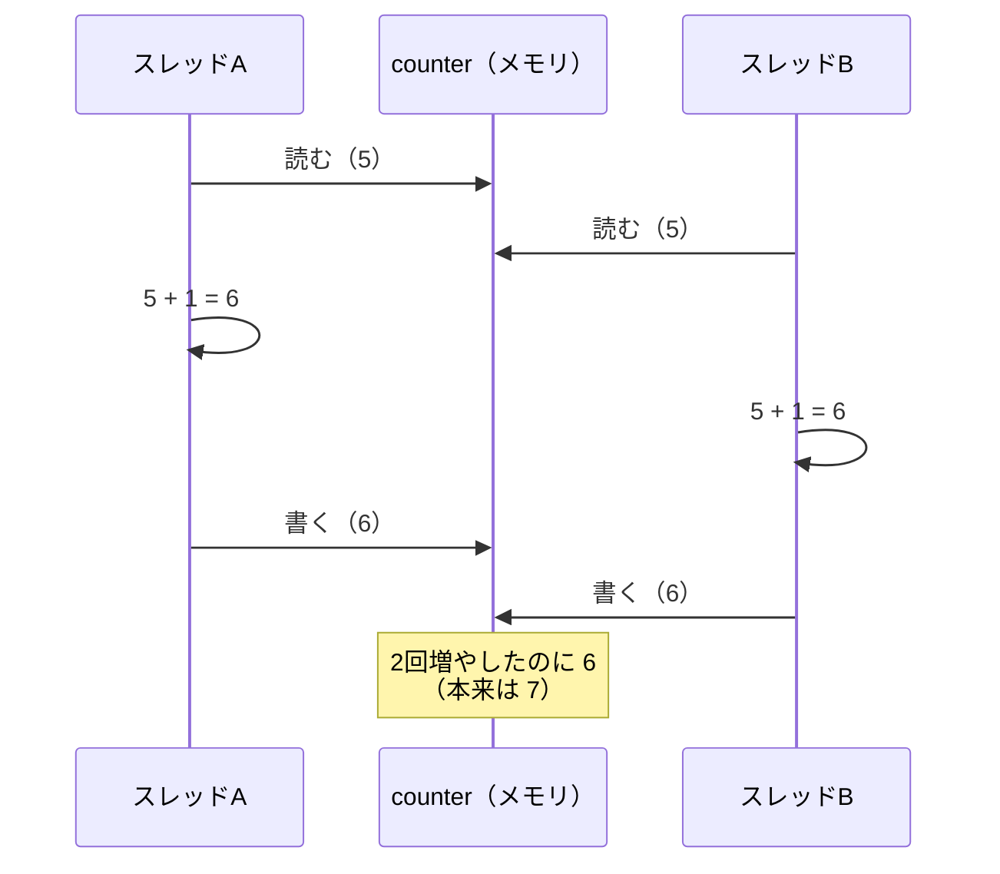

# 第9章 スレッドと共有状態：サーバーは同時に動く

<div class="goal-box" markdown>

この章でできるようになること

- Nodeの「1スレッド＋イベントループ」と、Javaサーバーの「1リクエスト1スレッド」の違いを説明できる
- `counter++` を複数スレッドで実行すると壊れる理由を説明し、`AtomicInteger` などで直せる
- 「数えてから足す」では上限を守れないことを、実験で確かめられる
- シングルトンの共有オブジェクトに、リクエスト固有の値を置いてはいけない理由を説明できる
- 仮想スレッドが解決する問題と、解決しない問題を区別できる

</div>

## 1. 問いかけ：50人が同時に「投票」を押したら

フロントエンドのコードは、基本的に1人のユーザーのブラウザの中で動くので、同じ変数を同時に触るコードはほとんどありません。

サーバーは違います。QuickVote の参加者50人が同じ瞬間に「投票」ボタンを押すと、50個のリクエストが、同じサーバーの同じプログラムの中で同時に処理されます。そこで、次の2つが疑問になります。

- 50個のリクエストは、順番待ちで処理されるのか、並行して処理されるのか
- 同じ変数を同時に書き換えたら、どうなるのか

この章では、前者をNode.jsと比べながら説明し、後者は実験で確かめます。第2部のDIコンテナ（Beanは全員で共有される）を理解するうえで、土台になる章です。

## 2. 例え：レストランの店員

Webアプリをレストランに例えます。客（リクエスト）が来て、注文を受け、料理を作り、運びます。店員（スレッド）が何人いてどう働くかが、2つの方式の違いです。


Node.js には、超高速な店員が1人だけいます。注文を受けたらすぐ厨房に伝え、料理ができるのを待たずに次の客へ向かい、できあがったら戻って運ぶので、店員が何もせず待つ時間はありません。

Java（Tomcat）では、客ごとに店員が1人付きます。店員は料理ができるまでその場で待ち、そのあいだ他の客の注文は別の店員が受けます。

!!! warning "この例えが外れる点"
    実際のJavaサーバーでは、店員（スレッド）が無限にいるわけではありません。あらかじめ用意した数（Tomcatの既定は最大200）を使い回すので、店員が全員忙しければ、客は順番待ちになります。
    Nodeのほうも、重い計算（CPUを使う処理）は店員が1人しかいないので、その間ほかの客が全員待たされます。「待つ」時間と「計算する」時間は別物です。

## 3. 動画で見る：店員モデル

<div class="video-card">
  <video controls preload="metadata" poster="../../assets/videos/thread-model.jpg">
    <source src="../../assets/videos/thread-model.mp4" type="video/mp4">
  </video>
  <p class="video-caption">▶ 店員モデル：NodeとJavaの同時処理</p>
  <p class="video-credit">音声：VOICEVOX:冥鳴ひまり</p>
</div>

動画の要点

- Nodeは、1人の店員が待ち時間に別の仕事へ移ることで、たくさんの客をさばく。ただし、店員が計算で手を止めると、全員が待つ
- Javaは、客ごとに店員が付き、料理を待つ間もその店員はそこに立ち続ける。店員同士は同時に動ける
- 店員が使う道具（オブジェクト）を共有していると、2人が同時に触って、中身がぐちゃぐちゃになる
- 道具を店員ごとの手元（ローカル変数）に置けば、混ざらない

??? note "字幕全文"
    お店の店員にたとえて、同時処理を見てみましょう。
    Nodeは、超高速な店員が、たった1人です。
    客のテーブルを、順番に高速で回ります。
    DBの返事を待つ間は、別の客へ移ります。
    これがイベントループです。
    1人だけなので、同じメモを同時に書き換える事故は起きにくい。
    でも、重い計算で手が止まると、全員が待たされます。
    一方Javaは、客が来るたびに、店員が1人ずつ付きます。
    この店員がスレッドで、みんな同時に動きます。
    返事を待つ間、その店員はその場で待ち続けます。これがブロッキングです。
    待っていても大丈夫。店員は、他にもいるからです。
    ただし、同時に動くと、こんな事故が起きます。
    共有のノートの数字に、2人が同時に＋1します。
    2人とも、まず今の数字を読みます。
    それぞれ1を足して、書き込みます。
    2回足したのに、増えたのは1だけ。
    読んで、足して、書くまでの間に、割り込まれたからです。
    対策は、共有のノートを持たないこと。
    持つなら、AtomicIntegerという、安全な道具を使います。
    ちなみに仮想スレッドは、店員を安く大量に雇える仕組みです。
    Javaのサーバーは、最初から同時に動いている。


動画の「店員」は、コードではスレッド（`Thread`）です。「客ごとに店員」とは、サーバーがリクエストごとに1つのスレッドを割り当てることを指します。

## 4. 動かしてみる①：リクエストとスレッド

まず実測します。JDKに入っている簡易HTTPサーバーに、300ミリ秒ブロックする処理（DB問い合わせの待ち時間の代わり）を用意し、8件を同時に投げます。変えるのはサーバーの「スレッドの供給元」だけで、3通りを試します。

```java title="ch09/ThreadPerRequest.java（抜粋）"
server.createContext("/slow", exchange -> {
    String who = Thread.currentThread().toString();     // 処理しているスレッドの名前を返す
    try {
        Thread.sleep(BLOCK_MILLIS);                     // ブロッキング：この間、このスレッドは何もできない
    } catch (InterruptedException e) {
        Thread.currentThread().interrupt();
    }
    byte[] body = who.getBytes(StandardCharsets.UTF_8);
    exchange.sendResponseHeaders(200, body.length);
    try (var out = exchange.getResponseBody()) {
        out.write(body);
    }
});
server.setExecutor(executor);                           // リクエストを処理するスレッドの供給元
```

```java
measure("スレッド 1 本", Executors.newSingleThreadExecutor());
measure("スレッド 4 本（プール）", Executors.newFixedThreadPool(4));
measure("仮想スレッド", Executors.newVirtualThreadPerTaskExecutor());
```

!!! question "予測カード"
    8件、各300ms。全部終わるまでの時間は、それぞれ約何msでしょう。

    - スレッド1本：(a) 約300ms　(b) 約1200ms　(c) 約2400ms
    - スレッド4本：(a) 約300ms　(b) 約600ms　(c) 約1200ms

```text
8 件を同時に投げる。各リクエストは 300ms ブロックする。
スレッド 1 本 : 8 件の処理に約 2478 ms / 使われたスレッド 1 個
スレッド 4 本（プール） : 8 件の処理に約 605 ms / 使われたスレッド 4 個
仮想スレッド : 8 件の処理に約 308 ms / 使われたスレッド 8 個
```

答えは (c) と (b) です。

| 供給元 | 8件の所要時間 | なぜ |
| --- | --- | --- |
| スレッド1本 | 約2,400ms | 300ms × 8件。待っている間もスレッドが離れないので、1件ずつ順番に処理される |
| スレッド4本 | 約600ms | 4件ずつ、2巡（300ms × 2） |
| 仮想スレッド | 約300ms | 8件が全部同時に待てる |

次の図は、同じことを時間軸で描いたものです。


Nodeとの違いを、コードで並べて確かめます。

=== "Node（TypeScript）"

    ```ts
    import { setTimeout as sleep } from "node:timers/promises"

    app.get("/slow", async (req, res) => {
      await sleep(300)          // 待ち。この間、スレッドは他の仕事をする
      res.send("done")
    })
    ```

    `await` している間、1本しかないスレッドは解放されています。待ち時間を重ねられるので、8件が同時に来ても約300msで全部終わります。

=== "Java（Spring MVC の考え方）"

    ```java
    @GetMapping("/slow")
    String slow() throws InterruptedException {
        Thread.sleep(300);      // 待ち。この間、このスレッドは占有される
        return "done";
    }
    ```

    `sleep`（やDBの応答待ち）をしている間、そのスレッドは何もできず占有されたままです。8件を同時にさばくには8本のスレッドが要ります。

| | Node | Java（既定のスレッド方式） |
| --- | --- | --- |
| スレッドの数 | 1本（JS実行用） | リクエストの数だけ（プールの上限まで） |
| 待ち時間（DB・外部API） | スレッドを手放す（`await`） | スレッドを握ったまま待つ |
| 同時に待てる数 | 数千〜万 | プールのスレッド数まで（Tomcatの既定は200） |
| CPUを使う重い処理 | 他の全員が待たされる | 別のスレッドが動ける（CPUコアの数まで） |
| コードの書き方 | `async/await` で非同期 | 普通の同期コード |

!!! tip "フロントエンドで例えると"
    Nodeの `async/await` は、待ち時間に他の仕事をするために、コードの書き方のほうを変える仕組みです。
    Javaは逆に、コードは普通に同期で書き、代わりにスレッドをたくさん用意します。コードは読みやすくなりますが、スレッドの数が同時に処理できる数の上限になります（第24章で扱います）。

## 5. 動かしてみる②：共有された変数は壊れる

店員（スレッド）が複数いて、同じ道具を同時に触ると何が起きるでしょうか。

### `counter++` を100スレッドで

いちばん単純な実験です。100本のスレッドが、それぞれ1万回ずつカウンタを1増やします。期待値は100万です。

```java title="ch09/LostUpdate.java（抜粋）"
int plain = 0;                                         // ただの int フィールド
int guarded = 0;
final Object lock = new Object();
final AtomicInteger atomic = new AtomicInteger();

runInThreads(threads, perThread, () -> plain++);                    // (1)!
runInThreads(threads, perThread, () -> {
    synchronized (lock) { guarded++; }                              // (2)!
});
runInThreads(threads, perThread, atomic::incrementAndGet);          // (3)!
```

1. 何も守らない
2. `synchronized`（排他制御）で、1つのスレッドずつ入れる
3. `AtomicInteger`（分割できない操作）

!!! question "予測カード"
    3つの結果は、それぞれいくつになるでしょう。

```text
期待値 = 1000000
int の ++              = 100144
synchronized で守った  = 1000000
AtomicInteger          = 1000000
```

何も守らない版は、100万のはずが約10万でした。実行のたびに結果も変わります（筆者の環境では、98,622、104,957 など）。エラーは出ず、値が黙って減るだけです。

### なぜ減るのか

`counter++` は1つの操作に見えますが、実際には、今の値を読む、1を足す、結果を書き戻す、という3つの操作です。2本のスレッドが同時に実行すると、次のようになります。



Bが読んだ時点では、Aの書き込みがまだ行われていません。両方が「5」を読んで両方が「6」を書くので、片方の更新が消えます。これをロストアップデート（更新の消失）と呼びます。

!!! note "用語：競合状態（レースコンディション）"
    複数のスレッドが共有データを同時に読み書きして、実行のタイミングによって結果が変わる状態です。再現性がなく、テストで見つけにくいのが厄介な点です。
    「たまたま動く」ことは、「正しい」ことの証明になりません。

### 直し方

| 方法 | 仕組み | 使いどころ |
| --- | --- | --- |
| `synchronized` | 「1度に1スレッドだけ」入れる（ロック） | 複数の変数をまとめて守る |
| `AtomicInteger` など | 「読む→足す→書く」を分割できない1操作にする | 単一のカウンタ |
| 共有しない | スレッドごとに別の値を持つ（ローカル変数） | いちばん確実な解決策 |
| DBに任せる | トランザクションとロック（第4部） | 永続化されるデータ |

!!! warning "メモリの『見え方』の問題もある"
    あるスレッドが書いた値が他のスレッドにすぐ見える保証はありません（CPUのキャッシュや最適化のため）。`volatile` や `synchronized`、`Atomic*` は、この「見え方」も保証します。
    細部には、この教材では踏み込みません。共有する可変な値には、上の4つの方法のどれかを必ず使う、と覚えておけば足ります。

### 「数えてから足す」で、上限を超える

今度は QuickVote らしい例にします。参加者の上限は50人で、200人が同時に申し込みます。

```java title="ch09/CheckThenAct.java（抜粋）"
boolean joinUnsafe() {
    if (members < MAX) {                           // (1) 空きがあるか確認する
        pause();                                   // (2) DB への問い合わせなどで、少し待つ
        members++;                                 // (3) 参加を記録する
        return true;
    }
    return false;
}
```

`if` で空きがあるかを確認してから足しているので、一見もっともらしい書き方です。

```text
上限 50 人 / 申込 200 人
数えてから足す（unsafe）: 参加 200 人, 記録上の人数 187
compareAndSet（safe）    : 参加 50 人, 記録上の人数 50
```

上限は50人なのに、200人全員が参加できてしまいました。記録上の人数も200ではなく187です（ロストアップデートも重なっています）。

原因は、「確認」と「記録」の間に他のスレッドが割り込めることです。200人全員が、まだ49人以下の状態を確認してから記録しました。

!!! danger "本番で事故になるパターン：確認してから更新する（check-then-act）"
    「条件を確認して、満たしていたら更新する」は2つの操作で、その間に状況が変わります。
    これはメモリ上の変数だけの話ではありません。「DBを `SELECT COUNT` して、少なければ `INSERT`」も同じ構造で、同じ事故が起きます。
    第25章で、これをDBのロックで直します。この章では、確認と更新はまとめて1操作にしないと守れない、という原則を先に押さえてください。

2つ目の `joinSafe` は、`AtomicInteger` の `compareAndSet`（「今の値が `current` なら `current + 1` にする」を分割できない1操作で行う）を成功するまで繰り返すので、常に50人で止まります。

## 6. 事故：共有オブジェクトにリクエスト固有の値を置く

ここまでの話は、第2部のSpringでそのまま事故になります。

Springでは、`@Service` などの部品（Bean）はアプリ全体で1つだけ作られ、全リクエストで共有されます（第11章）。つまり、サービスのオブジェクトのフィールドは、全員で共有される変数です。

```java title="ch09/SharedField.java（抜粋）"
/** Spring では Service は 1 つだけ作られ、全リクエストで共有される。それを模したクラス。 */
class GreetingService {
    private String currentVoter;                       // 悪い例：リクエスト固有の値をフィールドに置いた

    String greetBad(String voter) throws InterruptedException {
        this.currentVoter = voter;                     // (1) 自分の名前を書き込む
        Thread.sleep(100);                             // (2) DB 問い合わせなどで待つ。その間に別スレッドが来る
        return currentVoter + " さん、投票を受け付けました"; // (3) 読み戻す。他人の名前に変わっているかもしれない
    }

    String greetGood(String voter) throws InterruptedException {
        String name = voter;                           // ローカル変数：スレッドごとに別の箱
        Thread.sleep(100);
        return name + " さん、投票を受け付けました";
    }
}
```

alice のリクエストの処理中に、bob のリクエストが来るようにして、実行します。

```text
[request-alice] フィールド版  : bob さん、投票を受け付けました
[request-bob] フィールド版  : bob さん、投票を受け付けました
[request-alice] ローカル変数版: alice さん、投票を受け付けました
[request-bob] ローカル変数版: bob さん、投票を受け付けました
```

フィールド版では、alice が書き込んだ名前を bob が上書きしたため、alice の画面に「bob さん、投票を受け付けました」と出ました。

これは単なる表示の間違いでは済みません。たとえば「現在のユーザー」をフィールドに持っていたら、他人の権限で処理が実行されたり、他人の投票を覗いたり、他人のデータを更新したりする事故に直結します。

| 置き場所 | 共有されるか |
| --- | --- |
| ローカル変数・メソッドの引数 | スレッドごとに別。安全 |
| `static` フィールド | 全員で共有 |
| Beanのフィールド（Spring） | 全員で共有（singleton） |
| 不変（`record`、`final` で中身も不変）のオブジェクト | 共有されても、書き換えられないので安全 |

!!! tip "フロントエンドで例えると"
    Reactで、コンポーネントの外（モジュールのトップレベル）に `let currentUser = ...` を置くのと同じです。ブラウザなら1人のユーザーしかいないので問題になりませんが、サーバーのモジュールレベルの変数は全ユーザーで共有されます。
    コンポーネントの `useState` に当たるものが、サーバーではローカル変数（リクエストごとに作られる）だと対応づけると分かりやすくなります。

### コレクションも同じ

```java title="ch09/ConcurrentTally.java（抜粋）"
tally.merge("カレー", 1, Integer::sum);       // 8 スレッドが 5 万回ずつ
```

```text
期待値 = 400000
HashMap           = 81357
ConcurrentHashMap = 400000
```

第6章で使った `HashMap` を複数スレッドで共有して書き込むと、更新が消えます（このときは例外にもならず、黙って40万が8万になりました）。複数スレッドで共有するなら、`ConcurrentHashMap` のように並行処理用に作られたコレクションを使います。

| 型 | 複数スレッドで共有してよいか |
| --- | --- |
| `ArrayList` / `HashMap` / `HashSet` | 不可（書き込みがあるなら） |
| `ConcurrentHashMap` / `AtomicInteger` / `AtomicLong` | 可 |
| `List.of(...)` / `record`（中身も不変）/ `String` | 可（不変） |
| `StringBuilder` | 不可（不変な `String` を使う） |
| `DateTimeFormatter`（`java.time`） | 可。ただし古い `SimpleDateFormat` は不可 |

## 7. 仮想スレッド：スレッドを安くする

第4節で、Javaでは同時に待てる数がスレッドの数で決まると見ました。通常のスレッドはOSのスレッドを使うため、1本あたり数百KB〜1MB程度のメモリを予約し、作るのにも時間がかかります。1万本のスレッドは現実的ではありません。

そこで、Java 21 から正式に入ったのが仮想スレッドです。

!!! note "用語：仮想スレッド（Virtual Thread）"
    JVMが管理する、とても軽いスレッドです。数万〜数百万個作れます。待ち（ブロッキング）に入ると背後のOSスレッドを自動で手放すので、Nodeの `await` に近い効率を、同期のコードのまま得られます。
    通常のスレッド（プラットフォームスレッド）は、OSのスレッドそのものです。

```java title="ch09/VirtualThreads.java（抜粋）"
try (var executor = Executors.newVirtualThreadPerTaskExecutor()) {
    for (int i = 0; i < n; i++) {
        executor.submit(() -> {
            Thread.sleep(Duration.ofSeconds(1));       // 1 秒ブロック
            finished.incrementAndGet();
            return null;
        });
    }
}
```

```text
10000 個の仮想スレッドが各 1 秒ブロック → 全体で 1038 ms / 完了 10000
仮想スレッドか? true / 守護スレッドか? true
```

1万個のタスクが各1秒ブロックしても、全体で約1秒で終わりました。通常のスレッドなら1万本が必要です。第4節の測定でも、仮想スレッドは8件を約308msで終えています。

ただし、仮想スレッドは万能ではありません。この教材でも、第7部（SSE）まではOFFで進めます。解決する問題と解決しない問題は、次のとおりです。

| 仮想スレッドが解決すること | 解決しないこと |
| --- | --- |
| スレッドが足りなくて、同時にさばけない | 共有状態の競合（`counter++` も `HashMap` も、同じく壊れる） |
| 待ち時間の長い処理を、同期のコードのまま大量に並べる | DBコネクションの数（プールの上限は変わらない。第24章） |
| | CPUを使う重い処理（CPUコアの数は増えない） |

!!! warning "『仮想スレッドにすれば速くなる』は誤解"
    仮想スレッドは、待ち時間が長い処理をたくさん同時に並べるための仕組みです。処理自体が速くなるわけではありません。
    また、スレッドが増えるぶん、共有状態の競合はむしろ起きやすくなります。この章の事故は、仮想スレッドでもまったく同じように起きます。

仮想スレッドを使うかどうかの判断は、第24章（コネクションプール）と第36章（SSE）で、実験しながら行います。今は、仮想スレッドが存在することと、解決しない問題があることを覚えておけば十分です。

## 8. 現場で：共有されるものを探す

AIが書いたコードのレビューで、スレッド安全性（thread safety）を見るときの目線です。

| 見るもの | 疑う理由 |
| --- | --- |
| `@Service` / `@Component` のクラスの、非 `final` のフィールド | 全リクエストで共有される。リクエスト固有の値が入っていないか |
| `static` な可変フィールド | 全員で共有 |
| `HashMap` / `ArrayList` を、キャッシュとしてフィールドに持つ | 同時書き込みで壊れる。`ConcurrentHashMap` に |
| 「確認してから更新」（`if (count < max) count++`、`SELECT COUNT` → `INSERT`） | 間に割り込まれる。まとめて1操作に（第25章） |
| 古い `SimpleDateFormat` を共有 | スレッドセーフでない。`DateTimeFormatter` に |
| `synchronized` が、あちこちに | 本当に必要か。DBのロックで足りる場面が多い。複数台構成では、そもそも効かない（第38章） |
| 「100回動かしても大丈夫でした」 | 競合は、運のよい日には現れない。根拠にならない（第26章） |

!!! danger "複数台になると、さらに別の問題が起きる"
    `synchronized` や `AtomicInteger` が守れるのは、1つのJVMの中だけです。サーバーを2台にすると、それぞれが別のJVMなので、メモリ上の変数は共有されません。
    永続化されるデータの整合性は、DB（トランザクション・制約・ロック）で守るのが原則です。第4部で扱います。

## 第1部を終えて

第9章で、第1部は終わりです。第2部で Spring Boot を使い始めると、この部で見たものが、すべて姿を変えて登場します。

| 第1部で見たもの | 第2部以降での姿 |
| --- | --- |
| `interface` と実装、ポリモーフィズム（第3章） | DIコンテナが、実装を差し替える（第11章） |
| `record`（第4章） | リクエスト・レスポンスのDTO（第13章） |
| 例外、`cause`（第5章） | `@RestControllerAdvice` でHTTPステータスに変換（第14章） |
| `Optional`、`@Nullable`（第5章） | リポジトリの戻り値、JSONの欠落（第13章・第19章） |
| `BigDecimal`、`Instant`、`Clock`（第7章） | DBの型、期限の判定、テストでの時間操作（第28章） |
| JUnit と AssertJ（第8章） | MockMvc、実DBテスト（第16章・第21章） |
| 共有状態、スレッド（第9章） | Beanは全員で共有（第11章）、コネクションプール（第24章）、ロック（第25章） |

第2部へ進む前に、「第1部のチェックリスト」（[第1部の扉](index.md)）の15項目を確認してください。説明できない項目があれば、その章へ戻ります。

---

## まとめ：3点セット

!!! abstract "この章の3点セット"
    **① 一言で言うと**
    Javaのサーバーは、リクエストごとにスレッドを割り当てて同時に処理し、待ち時間中もそのスレッドを占有する。複数スレッドから共有される可変な状態は、更新の消失や上限の突破を起こすので、共有しない（ローカル変数）、または分割できない操作（`Atomic*`、`ConcurrentHashMap`、`synchronized`、DBのロック）で守る。

    **② 現場でこう聞かれる**
    「`@Service` のフィールドに、現在のユーザーIDを持たせて良いですか？」
    → いけない。Beanは全リクエストで共有されるシングルトンなので、別のユーザーの値で上書きされる。リクエスト固有の値は、ローカル変数かメソッドの引数で渡す。

    **③ 自分のサービスならどこに当たるか**
    自分のサービスで「上限がある」「同時に更新される」ものを3つ挙げ、「確認してから更新」の形になっていないか確認する。

## 演習

??? question "確認問題1：予測と実行"
    `LostUpdate.java` の `perThread` を 10,000 から 10 に減らして実行すると、何が起きるでしょう。予測してから、複数回実行してください。この結果から、「テストが通った」ことをどう評価すべきですか。

??? success "解答"
    スレッドの起動が終わる前に各スレッドの処理が終わってしまうため、ほとんど壊れません（期待値の1,000に一致することが多い）。
    ただし、これは安全だからではなく、競合が起きる確率が低いだけです。小さな入力で通ったテストは、バグがないことの証明になりません。スレッド数や待ち時間を増やして、条件を意図的に厳しくして試す必要があります。

??? question "確認問題2：どれが共有されるか"
    次の変数のうち、複数のリクエストが同時に触れる可能性があるものを選んでください。

    ```java
    @Service
    class VoteService {
        private final PollRepository repository;     // (a)
        private int requestCount = 0;                // (b)
        private static final List<String> LOG = new ArrayList<>();   // (c)

        public void vote(String voter) {
            String normalized = voter.strip();       // (d)
            requestCount++;
        }
    }
    ```

??? success "解答"
    (a)(b)(c) が共有されます。(d) は、メソッドのローカル変数なので、スレッドごとに別です。
    - (a) は `final` で参照は変わらず、`repository` 自体がスレッドセーフなら問題ありません（通常、Springが管理するものはそのように作られています）
    - (b) は危険です。`requestCount++` は第5節の `counter++` と同じなので、`AtomicInteger` にします
    - (c) は危険です。`ArrayList` に複数スレッドから `add` すると壊れます

??? question "確認問題3：check-then-act"
    次のコードの問題を指摘し、メモリ上でのみ直す方法を1つ挙げてください。

    ```java
    if (!set.contains(voter)) {
        set.add(voter);
        voteCount++;
    }
    ```

??? success "解答"
    `contains`（確認）と `add`、`voteCount++`（更新）の間に他のスレッドが割り込めるので、同じ `voter` が2回数えられたり、`voteCount` が狂ったりします。
    メモリ上での直し方の例は、`ConcurrentHashMap.newKeySet()` を使い、`if (set.add(voter)) { voteCount.incrementAndGet(); }` とすることです（`add` が「追加できたか」を分割できない1操作で返すため）。
    永続化するデータでは、DBの `UNIQUE` 制約と `INSERT ... ON CONFLICT` に任せます（第26章）。

??? question "応用：Tomcatのスレッドが足りなくなると"
    Tomcatのスレッドが最大200本で、各リクエストがDBの応答を1秒待つとします。1秒あたりに処理できるリクエストは、最大で何件ですか。仮想スレッドにすると、この上限は変わりますか。

??? success "解答"
    約200件／秒です（200本 ÷ 1秒）。201件目からは、スレッドが空くまで順番待ちになります。
    仮想スレッドにすると、スレッド数の制限は事実上なくなりますが、DBのコネクションの数（通常は10本程度）が新しい上限になります。DBの処理が1秒かかるなら、コネクション10本では毎秒約10件までです。これが第24章のテーマです。

??? question "説明問題：現場でこう聞かれる"
    「なぜ `counter++` は、スレッドセーフではないのですか？」200字程度で答えてください。

??? success "解答"
    例：`counter++` は、「現在の値を読む」「1を足す」「書き戻す」の3つの操作に分かれていて、分割できない1操作ではないからです。2つのスレッドが同時に同じ値を読むと、両方が同じ値に1を足して書き戻し、片方の更新が失われます。エラーは出ず、値が静かに減るため、見つけにくいバグになります。`AtomicInteger` のような分割できない操作や、`synchronized` で守る必要があります。
