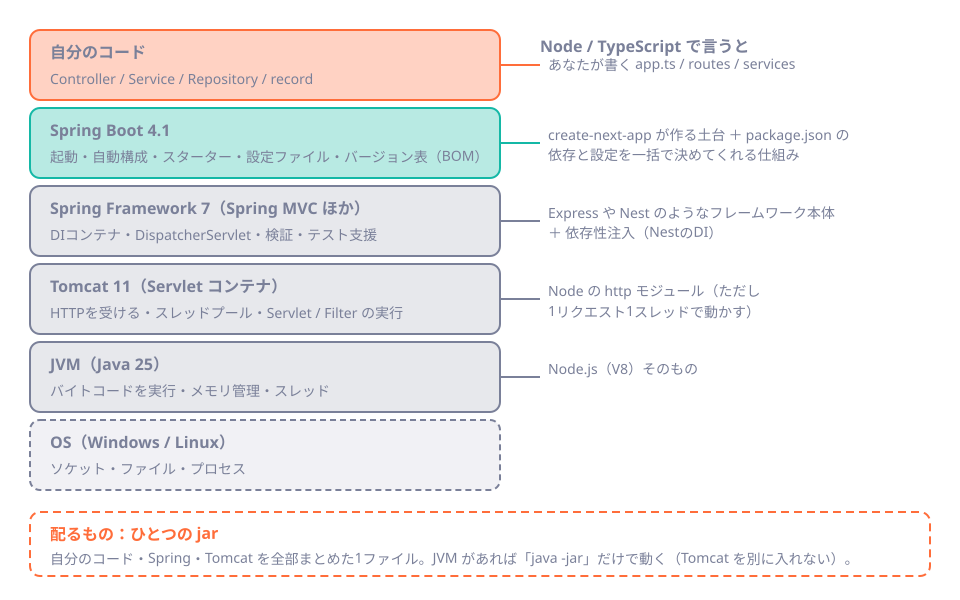
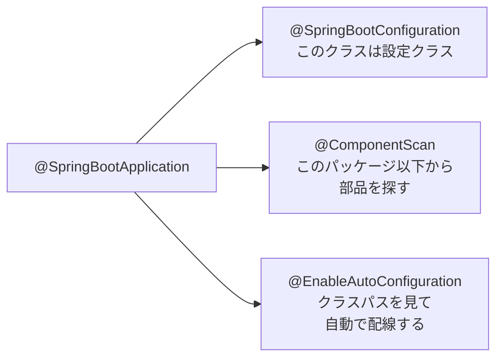
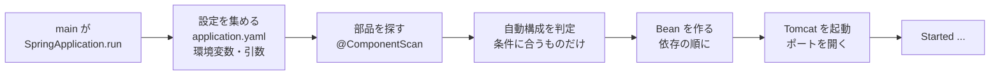

# 第10章 Spring Bootとは：最初のAPIと起動の裏側

<div class="goal-box" markdown>

この章でできるようになること

- Java・Spring Framework・Spring Boot・Tomcat・JVM の関係を、層の図で説明できる
- Spring Initializr で雛形を作り、`pom.xml` を読んで「なぜバージョンを書かなくてよいのか」を説明できる
- 最初のAPIを書いて起動し、起動ログを1行ずつ読める
- 自動構成が「条件付きの設定（if文）」であることを、`--debug` のレポートで確かめられる
- AIが出した `pom.xml` や起動エラーを見て、古い書き方や置き場所の誤りを指摘できる

</div>

## 1. 問いかけ：`java -jar` の1行でサーバーが立つのはなぜか

Node で API を作るとき、あなたは何をしますか。`npm i express`、`app.get(...)`、`app.listen(3000)`。ほかに、JSON を扱う設定、ログの設定、ポートの設定を足していきます。

Spring Boot では、次の1行でHTTPサーバーが立ちます。

```bash
java -jar target/hello-0.0.1-SNAPSHOT.jar
```

Tomcat（HTTPサーバー）をインストールしていません。JSON を変換する設定も書いていません。ポートの指定すらありません。それなのに `GET /api/hello` に JSON が返ります。

この章では、まず動かします。次に、**誰が・いつ・何を勝手に決めたのか**を、ログとレポートで確かめます。第2部の最初の章なので、ここで「Spring Boot とは何か」の地図を持ち帰ってください。

## 2. 層で見る：Spring Boot は何の上に載っているか

初めて Spring に触れると、名前がたくさん出てきて混乱します。Java、Spring、Spring Framework、Spring Boot、Tomcat、Servlet。**層で整理すると、1枚で収まります。**



!!! note "用語：Spring Framework と Spring Boot"
    **Spring Framework** は、サーバーアプリを作るための部品集です。DIコンテナ（第11章）、Web（Spring MVC）、検証、テスト支援などを持ちます。**Spring Boot** は、その Spring Framework を「設定なしで動く状態」にまとめる仕組みです。起動、自動構成、スターター、設定ファイル、依存のバージョン表（BOM）を提供します。
    本教材で「Spring」と書くときは、この2つを合わせたものを指します。

!!! note "用語：Servlet / Tomcat"
    **Servlet** は、HTTPリクエストを受け取って応答を返す、Java 標準の仕組みです（`jakarta.servlet.*`）。**Tomcat** は、Servlet を動かす HTTPサーバーです（Servlet コンテナとも呼ばれます）。昔は Tomcat を別にインストールして、アプリを配置していました。Spring Boot は **Tomcat をアプリの中に埋め込んで**、`java -jar` だけで起動できるようにしています。

### 例え：レストランと電源タップ

2つの例えを使います。どちらも、**この章の範囲で完結**させます。


**レストラン**は、Webアプリの層です。注文票（リクエスト）が入口から来て、ホール係（Controller）が受け、厨房（Service）が調理し、食材庫（Repository / DB）から材料を取り出します。次章以降、各層の役割をこの例えで話します。

!!! warning "この例えが外れる点"
    実際のサーバーでは、**1人の店員（スレッド）が、受付から配膳まで1つの注文を最後まで運びます**。ホール係・厨房係が別人で、注文票を手渡しているわけではありません（第12章で動画で見ます）。また、層の名前は「慣習」で、Spring が強制するものではありません。


**電源タップ**は、Spring Boot です。Boot は「ひな形（雛形を生成して終わり）」ではなく、**あらかじめ配線済みのタップ**です。差し込み口に何かを挿すと、配線が自動でつながります。Web用のスターターを足せば Tomcat と JSON 変換がつながり、DB用のスターターを足せばコネクションプールがつながります。

!!! warning "この例えが外れる点"
    タップには「何もしなくても電気が来る」以上の意味はありませんが、Boot は**既定の判断を持っています**（ポートは 8080、JSON は ISO 8601、など）。そして、その判断は**あなたが何かを定義すると引っ込みます**（本章の 7 節）。また、雛形生成ツールと違い、Boot が配線した結果は**ソースコードとして生成されません**。実行時に決まります。だから、何が配線されたかは「見に行く」必要があります。

## 3. 手を動かす①：Initializr で雛形を作る

**Spring Initializr** は、プロジェクトの雛形を作る Web サービスです（`https://start.spring.io`）。ブラウザでも使えますし、`curl` でも取れます。IntelliJ IDEA の「新規プロジェクト」からも、同じものが呼ばれます。

```bash
curl https://start.spring.io/starter.zip \
  -d bootVersion=4.1.2 -d javaVersion=25 -d type=maven-project \
  -d groupId=com.example -d artifactId=hello -d name=hello \
  -d packageName=com.example.hello -d dependencies=web \
  -o hello.zip
unzip hello.zip -d hello
```

展開すると、次のファイルができます（教材では `code/labs/ch10-hello-boot/` に置いてあります）。

```text
hello/
├── pom.xml                                   ← 依存とビルドの設定（package.json に相当）
├── mvnw / mvnw.cmd                           ← Maven Wrapper（./mvnw で Maven を実行）
├── .mvn/wrapper/maven-wrapper.properties     ← Maven のバージョン指定
└── src/
    ├── main/java/com/example/hello/HelloApplication.java   ← main() を持つクラス
    ├── main/resources/application.properties                ← 設定ファイル（本教材では yaml にする）
    └── test/java/com/example/hello/HelloApplicationTests.java
```

### `pom.xml` を読む：package.json との違い

`pom.xml` は XML ですが、**データ**として読めば怖くありません。重要な部分だけ抜き出します。

```xml title="pom.xml（抜粋）"
<parent>
    <groupId>org.springframework.boot</groupId>
    <artifactId>spring-boot-starter-parent</artifactId>
    <version>4.1.2</version>                       <!-- (1)! -->
</parent>
<properties>
    <java.version>25</java.version>                <!-- (2)! -->
</properties>
<dependencies>
    <dependency>
        <groupId>org.springframework.boot</groupId>
        <artifactId>spring-boot-starter-webmvc</artifactId>   <!-- (3)! -->
    </dependency>
    <dependency>
        <groupId>org.springframework.boot</groupId>
        <artifactId>spring-boot-starter-webmvc-test</artifactId>
        <scope>test</scope>                        <!-- (4)! -->
    </dependency>
</dependencies>
```

1. **親 POM**。この1行が、数百の依存ライブラリの**バージョン表**（BOM）を持ち込みます。ここに書いたのは Spring Boot のバージョンだけです
2. コンパイルに使う Java のバージョン
3. **スターター**。「Web を作るのに必要なもの一式」という名前のついた依存です。下の `dependency:tree` で中身を見ます
4. `scope` が `test` の依存は、テストの時だけ使います（`package.json` の `devDependencies` に近い）

!!! note "用語：BOM（Bill of Materials）"
    「どのライブラリのどのバージョンを組み合わせれば動くか」を、動作確認済みの組として1つの表にしたものです。Spring Boot の親 POM が持っています。
    表に載っているライブラリは、`<version>` を**書かなくてよい**。Spring Boot 4.1.2 を指定すると、Tomcat 11.0.27、Jackson 3.1.7、Spring Framework 7.0.10 など、**組み合わせが決まります**。

TypeScript の世界と並べます。

| | npm（package.json） | Maven（pom.xml） |
| --- | --- | --- |
| バージョンの書き方 | `"express": "^4.19.0"`（範囲） | `<version>4.1.2</version>`（**ぴったり1つ**） |
| 実際のバージョンを固定するもの | **lockfile**（package-lock.json） | **BOM**（親 POM のバージョン表）。lockfile は標準ではない |
| 推移的な依存 | node_modules に入る。バージョンが重なることがある | 1つに決まる（同じライブラリは1バージョン） |
| 更新の単位 | パッケージごとに上げる | Spring Boot のバージョンを上げると**全部が一緒に**変わる |

Maven では、**範囲指定をせず、動作確認済みの組を丸ごと選ぶ**考え方です。個別のバージョンを自分で書き始めたら、BOM を外れた（組み合わせが保証されない）サインです。

### スターターの中身を見る

```bash
./mvnw dependency:tree -Dscope=compile
```

```text
com.example:hello:jar:0.0.1-SNAPSHOT
\- org.springframework.boot:spring-boot-starter-webmvc:jar:4.1.2:compile
   +- org.springframework.boot:spring-boot-starter:jar:4.1.2:compile
   |  +- org.springframework.boot:spring-boot-starter-logging:jar:4.1.2:compile
   |  |  +- ch.qos.logback:logback-classic:jar:1.5.38:compile
   |  +- org.springframework.boot:spring-boot-autoconfigure:jar:4.1.2:compile
   |  \- org.yaml:snakeyaml:jar:2.6:compile
   +- org.springframework.boot:spring-boot-starter-jackson:jar:4.1.2:compile
   |  \- org.springframework.boot:spring-boot-jackson:jar:4.1.2:compile
   |     \- tools.jackson.core:jackson-databind:jar:3.1.7:compile
   +- org.springframework.boot:spring-boot-starter-tomcat:jar:4.1.2:compile
   |  \- org.apache.tomcat.embed:tomcat-embed-core:jar:11.0.27:compile
   \- org.springframework.boot:spring-boot-webmvc:jar:4.1.2:compile
      \- org.springframework:spring-webmvc:jar:7.0.10:compile
```

（長いので抜粋しています。実際は約35行です。）1つの `spring-boot-starter-webmvc` が、ログ（Logback）、JSON（Jackson）、HTTPサーバー（Tomcat）、Spring MVC を**まとめて**連れてきています。これが**スターター**です。

!!! warning "バージョン注意：Boot 4 でスターター名が変わった"
    古い記事や、AIが出した `pom.xml` には、次のように書かれていることがあります。
    ```xml
    <artifactId>spring-boot-starter-web</artifactId>   <!-- Boot 3 までの名前 -->
    ```
    Spring Boot 4 では、**機能ごとにスターターが分かれ**、Web（Spring MVC）は `spring-boot-starter-webmvc` になりました。テスト用のスターターも機能ごとにあります（`spring-boot-starter-webmvc-test` など）。旧名の `spring-boot-starter-web` は 4.1.2 でも取得できますが、**非推奨**（deprecated）の扱いで、`webmvc` への置き換えが案内されています。新しく書くときは `webmvc` を使います。

    | 用途 | Boot 4 のスターター |
    | --- | --- |
    | Web（Spring MVC） | `spring-boot-starter-webmvc` |
    | 入力検証 | `spring-boot-starter-validation` |
    | JDBC | `spring-boot-starter-jdbc` |
    | Web のテスト | `spring-boot-starter-webmvc-test` |
    詳しい差分は、付録の「Spring Boot 3→4 差分カード」にまとめます。

## 4. 手を動かす②：最初のAPIを書く

`HelloApplication.java` は、Initializr が作ったままです。

```java title="src/main/java/com/example/hello/HelloApplication.java"
@SpringBootApplication                                  // (1)!
public class HelloApplication {

    public static void main(String[] args) {
        SpringApplication.run(HelloApplication.class, args);   // (2)!
    }
}
```

1. この1つのアノテーションに、3つの意味が入っています（5 節で分解します）
2. ここが入口です。`SpringApplication.run` が、Spring を起動し、Tomcat を立ち上げます

APIを1つ足します。

```java title="src/main/java/com/example/hello/HelloController.java"
@RestController
public class HelloController {

    @GetMapping("/api/hello")                            // (1)!
    public Hello hello() {
        return new Hello("こんにちは、QuickVote", Instant.now());   // (2)!
    }

    public record Hello(String message, Instant at) {    // (3)!
    }
}
```

1. 「`GET /api/hello` はこのメソッドが担当」という宣言です。Express の `app.get("/api/hello", handler)` に当たります
2. Java のオブジェクト（record）を返すだけです
3. 第4章で学んだ `record` が、そのまま応答の形になります

!!! note "用語：@RestController"
    HTTPリクエストを受けるクラスの目印です。メソッドの戻り値は、**JSON に変換されて応答の本文になります**。同じ形で `@Controller` もありますが、こちらは HTML 画面（テンプレート）用で、本教材では使いません。

起動して、呼びます。

```bash
./mvnw spring-boot:run          # Windows は .\mvnw.cmd spring-boot:run
```

```bash
curl -i localhost:18010/api/hello
```

```text
HTTP/1.1 200
Content-Type: application/json
Content-Length: 79

{"message":"こんにちは、QuickVote","at":"2026-11-07T16:22:18.280562900Z"}
```

`Instant` が、UTC の ISO 8601 文字列で出ています。JSON の変換設定は何も書いていません。**これも Boot が決めた既定の判断**です（第13章で詳しく見ます）。

## 5. 起動ログを1行ずつ読む

AIが書いたコードを動かして、起動に失敗したとき、最初に読むのが起動ログです。正常な起動ログを、**1度は1行ずつ読んでおきます**。

```text
 :: Spring Boot ::                (v4.1.2)

01:22:11.739  INFO 53384 --- [hello] [main] HelloApplication      : Starting HelloApplication v0.0.1-SNAPSHOT using Java 25.0.5 with PID 53384 (...)
01:22:11.745  INFO 53384 --- [hello] [main] HelloApplication      : No active profile set, falling back to 1 default profile: "default"
01:22:13.432  INFO 53384 --- [hello] [main] o.s.boot.tomcat.TomcatWebServer  : Tomcat initialized with port 18010 (http)
01:22:13.461  INFO 53384 --- [hello] [main] o.apache.catalina.core.StandardService : Starting service [Tomcat]
01:22:13.462  INFO 53384 --- [hello] [main] o.apache.catalina.core.StandardEngine  : Starting Servlet engine: [Apache Tomcat/11.0.27]
01:22:13.564  INFO 53384 --- [hello] [main] b.w.c.s.WebApplicationContextInitializer : Root WebApplicationContext: initialization completed in 1705 ms
01:22:14.146  INFO 53384 --- [hello] [main] o.s.boot.tomcat.TomcatWebServer  : Tomcat started on port 18010 (http) with context path '/'
01:22:14.171  INFO 53384 --- [hello] [main] HelloApplication      : Started HelloApplication in 3.344 seconds (process running for 4.108)
```

（時刻は日付を省略し、パッケージ名は短縮して表示しています。）

| 行 | 読み取れること |
| --- | --- |
| `(v4.1.2)` | 実際に動いている Spring Boot のバージョン。`pom.xml` と一致するか確認する |
| `Starting ... using Java 25.0.5 with PID` | 動いている **JVM のバージョン**と、プロセスID。「Java 17 で動いていた」はここで分かる |
| `No active profile set` | **プロファイル**（開発用・本番用の設定の切替）は未指定。第15章 |
| `Tomcat initialized with port 18010` | 埋め込み Tomcat が作られた。ポートは設定（`server.port`）から。未指定なら 8080 |
| `Starting Servlet engine: [Apache Tomcat/11.0.27]` | Tomcat のバージョン。**BOM が決めた版**（`pom.xml` には書いていない） |
| `Root WebApplicationContext: initialization completed in 1705 ms` | **DIコンテナ**（Spring が部品を作って管理する場所）の準備が終わった。第11章 |
| `Tomcat started on port 18010` | **ここからリクエストを受けられる** |
| `Started HelloApplication in 3.344 seconds` | 起動完了。起動の所要時間 |
| `[main]`（スレッド名の欄） | 起動処理は **main スレッド**で行っている |

もう1つ注目してほしいのは、**最初のリクエストが来たとき**に出る行です。

```text
01:22:18.232  INFO ... [io-18010-exec-1] o.a.c.c.C.[Tomcat].[localhost].[/]  : Initializing Spring DispatcherServlet 'dispatcherServlet'
01:22:18.234  INFO ... [io-18010-exec-1] o.s.web.servlet.DispatcherServlet   : Completed initialization in 1 ms
```

スレッド名が `[main]` から `[io-18010-exec-1]` に変わっています。これが、第9章で見た**リクエストを処理するスレッド**です（Tomcat のスレッドプールの1本。名前は `http-nio-18010-exec-1` が省略されたもの）。`DispatcherServlet`（第12章の主役）が、最初のリクエストで初期化されました。

### `@SpringBootApplication` の3つの意味

`@SpringBootApplication` は、3つのアノテーションの合わせ技です。



| 意味 | 何をするか | つまずきどころ |
| --- | --- | --- |
| `@ComponentScan` | `@RestController`、`@Service` などの**目印が付いたクラス**を探して、部品（Bean）として登録する | **探す範囲は、このクラスのパッケージ以下だけ** |
| `@EnableAutoConfiguration` | 依存ライブラリを見て、必要な設定を自動で足す（7 節） | 何が足されたか、コードには現れない |
| `@SpringBootConfiguration` | このクラス自身も設定クラスとして扱う | ほぼ意識しない |

### 壊してみる：パッケージの外に置く

`HelloController` を、`com.example.hello` の外（`com.elsewhere`）に移動して、起動します。

```text
Started HelloApplication in 3.088 seconds ...      ← 起動は成功する。エラーも警告も出ない
```

```bash
curl -i localhost:18014/api/hello
```

```text
HTTP/1.1 404
Content-Type: application/json

{"timestamp":"2026-11-07T16:44:38.717Z","status":404,"error":"Not Found","path":"/api/hello"}
```

**起動は成功し、404 が返ります。** `@ComponentScan` の範囲外にあるクラスは、そもそも存在を知られていないので、エラーも出ません。

!!! danger "AIが生成したコードで起きやすい"
    AIは、ファイルを新しいパッケージ（`com.example.api` のように、アプリのルートの外）に作ることがあります。「起動はするが 404」は、この種のミスの典型です。**アプリのクラスは、`@SpringBootApplication` を付けたクラスと同じパッケージ、またはその配下に置く**。QuickVote が `com.example.quickvote` の下に `poll`、`vote` などを切るのは、この規則に従っています。

## 6. Spring Boot が起動時にやること

起動ログの裏側を、時間の流れで整理します。



ここで大事なのは、**S4 の「条件に合うものだけ」**です。次の節で見ます。

## 7. 自動構成は「条件付きの設定」：if 文として読む

Boot の自動構成の正体は、**「もし〇〇ならこの設定を足す」という if 文の集まり**です。TypeScript で書くなら、次のような疑似コードです。

```ts
// 疑似コード：自動構成が考えていること
if (classpath.has("tools.jackson.databind.json.JsonMapper")) {   // Jackson が依存にあるなら
  if (!container.has(JsonMapper)) {                              // 自分でまだ用意していないなら
    container.register("jacksonJsonMapper", defaultJsonMapper()) // 既定の JsonMapper を用意する
  }
}
```

実際の Java の定義も、ほぼ同じ形です。アノテーションが「条件」を表します。

| アノテーション | 意味 |
| --- | --- |
| `@ConditionalOnClass` | そのクラスがクラスパスにあれば（依存が入っていれば） |
| `@ConditionalOnMissingBean` | **まだその Bean がなければ**（あなたが用意していなければ） |
| `@ConditionalOnProperty` | 設定ファイルにそのプロパティがあれば（`true` なら、など） |

**`@ConditionalOnMissingBean` がいちばん大事**です。これは「あなたが先に定義したら、自動構成は引っ込む（back off）」という意味です。電源タップの例えで言えば、「あなたが自分の延長コードを挿したら、タップの既定の配線は使われない」です。

### 見る：`--debug` で条件評価レポートを出す

```bash
java -jar target/hello-0.0.1-SNAPSHOT.jar --debug
```

起動ログのあとに、`CONDITIONS EVALUATION REPORT` が出ます。**Positive matches**（条件に合い、適用された設定）と、**Negative matches**（条件に合わず、適用されなかった設定）です。実際の出力から抜粋します。

```text
Positive matches:
-----------------

   JacksonAutoConfiguration matched:
      - @ConditionalOnClass found required class 'tools.jackson.databind.json.JsonMapper' (OnClassCondition)

   JacksonAutoConfiguration#jacksonJsonMapper matched:
      - @ConditionalOnMissingBean (types: tools.jackson.databind.json.JsonMapper; SearchStrategy: all) did not find any beans (OnBeanCondition)

   TomcatServletWebServerAutoConfiguration matched:
      - @ConditionalOnClass found required classes 'jakarta.servlet.ServletRequest', 'org.apache.catalina.startup.Tomcat', ... (OnClassCondition)

Negative matches:
-----------------

   GsonHttpMessageConvertersConfiguration:
      Did not match:
         - @ConditionalOnClass did not find required class 'com.google.gson.Gson' (OnClassCondition)

   WebMvcAutoConfiguration.ProblemDetailsErrorHandlingConfiguration:
      Did not match:
         - @ConditionalOnBooleanProperty (spring.mvc.problemdetails.enabled=true) did not find property 'spring.mvc.problemdetails.enabled' (OnPropertyCondition)
```

読み方は単純です。`Tomcat...matched` は「Tomcat のクラスが依存にあったから、Tomcat を起動する設定が有効になった」。`Gson...Did not match` は「Gson（別のJSONライブラリ）は依存にないから、使わない」。この例の Positive matches は、全部で約50件ありました。**自分では1行も書いていない、約50件の判断**が、起動のたびに行われています。

### 壊してみる：自分で `JsonMapper` を用意する

`@ConditionalOnMissingBean` が本当に「引っ込む」のか、確かめます。わざと、`JsonMapper` を自分で定義します。

```java title="CustomMapperConfig.java（実験用。profile 'custom-mapper' のときだけ有効）"
@Configuration
@Profile("custom-mapper")
public class CustomMapperConfig {

    @Bean
    public JsonMapper myMapper() {
        return JsonMapper.builder().enable(SerializationFeature.INDENT_OUTPUT).build();
    }
}
```

```bash
java -jar target/hello-0.0.1-SNAPSHOT.jar --spring.profiles.active=custom-mapper --debug
curl localhost:18010/api/hello
```

```text
{
  "message" : "こんにちは、QuickVote",
  "at" : "2026-11-07T16:23:43.461143700Z"
}
```

応答が整形されました。レポートでも、自動構成の `jacksonJsonMapper` が引っ込んでいます。

```text
   JacksonAutoConfiguration#jacksonJsonMapper:
      Did not match:
         - @ConditionalOnMissingBean (types: tools.jackson.databind.json.JsonMapper; SearchStrategy: all) found beans of type 'tools.jackson.databind.json.JsonMapper' myMapper (OnBeanCondition)
```

!!! danger "本番で事故になるパターン：JsonMapper を丸ごと自作すると、Boot の既定が全部消える"
    上の実験は、整形したかっただけです。しかし `JsonMapper` を丸ごと定義した結果、**Boot が `JsonMapper` に施していた設定（`application.yaml` の `spring.jackson.*` を含む）が、すべて使われなくなります**。JSON の挙動を少し変えたいときは、Bean を丸ごと差し替えるのではなく、`application.yaml` の設定や、Boot が用意するカスタマイズの口を使います。
    AIは「`@Bean` で `JsonMapper` を作る」コードを、気軽に出します。**なぜ自作が必要か**を、レビューで必ず聞いてください。

!!! warning "バージョン注意：Boot 4 では、自動構成クラスの名前とパッケージが変わった"
    Boot 3 までの記事では、自動構成クラスは `org.springframework.boot.autoconfigure.web.servlet.*` のように、`spring-boot-autoconfigure` という巨大な1つの jar の中にありました。Boot 4 では**機能ごとの jar に分割**され、パッケージも `org.springframework.boot.webmvc.autoconfigure.*`、`org.springframework.boot.jdbc.autoconfigure.*` などに移りました。上のレポートに `org.springframework.boot.webmvc.error.ErrorController` のような名前が出るのは、そのためです。
    JSON も、Jackson 2（`com.fasterxml.jackson.databind.ObjectMapper`）から、**Jackson 3（`tools.jackson.databind.json.JsonMapper`）**に変わりました。レポートに `Jackson2HttpMessageConvertersConfiguration` が「Did not match」で出ているのは、Jackson 2 用の旧設定です。古い記事の `ObjectMapper` は、Boot 4 では `JsonMapper` と読み替えます。

## 8. 自動構成の「地図」を持つ：何を見れば分かるか

自動構成は、ソースコードに現れないぶん、**調べ方を知っていること**が大事です。

| 知りたいこと | 見る場所 |
| --- | --- |
| どの設定が有効になったか／ならなかったか、なぜか | `--debug` の `CONDITIONS EVALUATION REPORT`（またはテストでの `ConditionEvaluationReport`） |
| 依存の中身 | `./mvnw dependency:tree` |
| 設定できるキーと既定値 | Spring Boot 公式ドキュメントの「Application Properties」。IDE では `application.yaml` で補完が効く |
| 実行中の Bean の一覧 | 起動ログを `DEBUG` にする。またはテストで `ApplicationContext#getBeanDefinitionNames()` |
| 使われている Java・Tomcat のバージョン | 起動ログの先頭 |

IntelliJ IDEA では、自動構成クラス（`JacksonAutoConfiguration` など）に **Ctrl+クリック**でジャンプして、`@ConditionalOn...` を読めます。AIが生成した設定が「なぜ効かないのか」を調べるとき、最後は**この自動構成のソースが答え**になります。

## 9. 現場で：AIが出した `pom.xml` と起動エラーのレビュー

| 見るもの | 疑う理由 |
| --- | --- |
| `<version>` が個別に書かれている（Spring 管理のライブラリに） | BOM を外れる。組み合わせの保証がなくなる。本当に必要か聞く |
| `spring-boot-starter-web`、`javax.*` の import | Boot 3 以前の書き方。Boot 4 は `webmvc`、`jakarta.*` |
| 親 POM のバージョンが古い（2.x、3.x） | 教材と違う世代の書き方になっている。バージョンを確認 |
| クラスが `@SpringBootApplication` のパッケージの外にある | 起動はするが 404（5 節） |
| 「ビルドが通らないので `<scope>` を消した」 | テスト用の依存を本番に入れている。理由を聞く |
| `@Bean` で `JsonMapper` などを自作 | Boot の既定が消える（7 節）。設定で足りないか |
| 起動ログの Java バージョンが想定と違う | `JAVA_HOME` や IDE の設定の問題。ここを見れば分かる |

---

## まとめ：3点セット

!!! abstract "この章の3点セット"
    **① 一言で言うと**
    Spring Boot は、Spring Framework・Tomcat・Jackson などを、BOM で決めた動作確認済みのバージョンで束ね、クラスパスと設定を見て「条件付きの設定（自動構成）」を適用し、`java -jar` だけで起動できる状態にする仕組み。自分で定義した Bean があれば、自動構成は引っ込む。

    **② 現場でこう聞かれる**
    「`pom.xml` に Tomcat や Jackson のバージョンが書いてないのに、どうして動くの？」
    → 親 POM（`spring-boot-starter-parent`）の BOM がバージョンを決めている。スターターが関連ライブラリを連れてくる。実際の組み合わせは `dependency:tree` と起動ログで確認できる。

    **③ 自分のサービスならどこに当たるか**
    自分のサービスに必要な機能（Web、DB、検証、…）を挙げ、それぞれに対応するスターターの名前を調べる。Boot 4 で名前が変わったものはないか確認する。

## 演習

??? question "確認問題1：層の整理"
    次の4つを、「アプリに近い順」に並べてください。
    Tomcat ／ Spring Boot ／ JVM ／ Spring Framework

??? success "解答"
    Spring Boot → Spring Framework → Tomcat → JVM。
    Boot が Spring Framework を使いやすく束ね、Spring Framework が Tomcat（Servlet の仕組み）の上で動き、Tomcat は JVM の上で動きます。アプリのコードは、いちばん上にあります。

??? question "確認問題2：予測"
    `HelloController` を `com.example.hello.web` パッケージに移しました（`HelloApplication` は `com.example.hello` のまま）。起動すると、どうなりますか。(a) 起動に失敗する (b) 起動して 404 (c) 起動して 200

??? success "解答"
    (c) 起動して 200 です。`@ComponentScan` は `HelloApplication` のパッケージ**以下**を探します。`com.example.hello.web` は配下なので、見つかります。(b) になるのは、`com.example.hello` の**外**（`com.elsewhere` など）に置いたときです。「配下」と「外」の違いを、パッケージ名の前方一致で判断します。

??? question "確認問題3：読解"
    `--debug` のレポートに、次の行がありました。何を意味しますか。
    ```text
    TaskExecutorConfigurations.TaskExecutorConfiguration#applicationTaskExecutorVirtualThreads:
       Did not match:
          - @ConditionalOnThreading did not find VIRTUAL (OnThreadingCondition)
    ```

??? success "解答"
    仮想スレッド用のタスク実行設定が、適用されなかったことを意味します。`spring.threads.virtual.enabled=true` を指定していないためです（既定は無効）。本教材では、第36章（SSE）まで仮想スレッドを使いません。「条件に合わなかった理由」が、1行で書かれているのが分かります。

??? question "応用：QuickVote の起動を確かめる"
    `code/labs/part02-quickvote-inmemory/` を `./mvnw spring-boot:run` で起動し、起動ログから (1) Spring Boot のバージョン (2) Tomcat のバージョン (3) ポート番号 (4) 起動にかかった秒数 を読み取ってください。さらに `--debug` で起動し、Negative matches の中から、自分で理由を説明できるものを3つ選んでください。

??? success "解答"
    例：(1) v4.1.2 (2) Apache Tomcat/11.0.27 (3) 18012 (4) 約4秒（環境による）。
    Negative matches の例：`GsonHttpMessageConvertersConfiguration`（Gson が依存にない）、`JmxAutoConfiguration`（JMX を有効にしていない）、`TomcatMetricsAutoConfiguration`（メトリクスの依存がない。第44章で追加する）。

??? question "説明問題：現場でこう聞かれる"
    「Spring と Spring Boot って、何が違うんですか？」200字程度で答えてください。

??? success "解答"
    例：Spring Framework は、DIコンテナや Spring MVC など、サーバーアプリの部品集です。Spring Boot は、それを動作確認済みのバージョンの組み合わせで束ね、クラスパスや設定を見て必要な設定を自動で適用し、Tomcat を内蔵して `java -jar` だけで起動できるようにする仕組みです。自分で Bean を定義すれば自動構成は引っ込むので、既定を使いながら必要な所だけ上書きできます。
