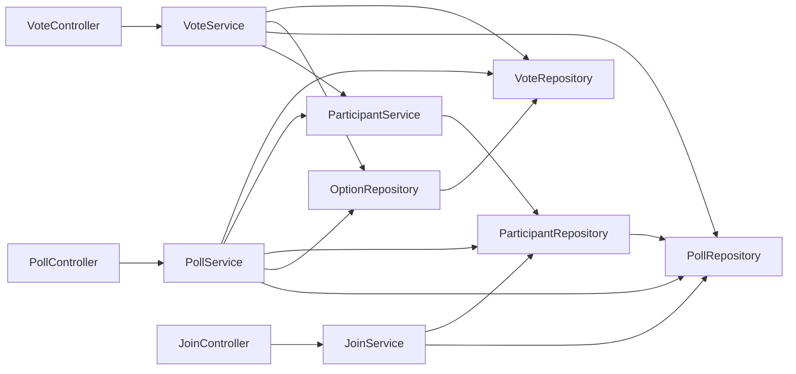

# 第11章 DIコンテナとBean

<div class="goal-box" markdown>

この章でできるようになること

- DI（依存性の注入）とDIコンテナが何を解決するのかを、手で組み立てるコードと比べて説明できる
- `@Component` / `@Service` / `@Repository` / `@RestController` と、`@Configuration` + `@Bean` を使い分けられる
- コンストラクタ注入を書き、フィールド注入（`@Autowired` をフィールドに付ける書き方）が良くない理由を言える
- 「Bean が見つからない」「候補が2つある」「循環している」起動エラーを読んで直せる
- Bean のフィールドにリクエスト固有の値を置くと何が起きるかを、実験で確かめて説明できる

</div>

## 1. 問いかけ：`PollService` は、誰が作るのか

QuickVote の `PollController` は、投票を作るために `PollService` を呼びます。では `PollService` は、どこで `new` されているのでしょうか。

コードをどれだけ探しても、`new PollService(...)` はありません。`PollController` のコンストラクタは、引数で `PollService` を**受け取る**だけです。

```java title="src/main/java/com/example/quickvote/poll/PollController.java（抜粋）"
@RestController
@RequestMapping("/api/polls")
public class PollController {

    private final PollService pollService;

    public PollController(PollService pollService) {      // 受け取るだけ。new しない
        this.pollService = pollService;
    }
    // ...
}
```

誰かが、`PollService` を作って、渡しています。**その「誰か」が DIコンテナ**です。この章では、コンテナがやっている仕事を、まず**自分の手でやって**みます。

## 2. まず手で組み立ててみる

`PollService` を作るには、部品がいくつ要るでしょうか。第16章のテストで使う、手動の組み立てを見ます。

```java title="src/test/java/com/example/quickvote/poll/PollServiceTest.java（抜粋）"
VoteRepository votes = new VoteRepository();
OptionRepository options = new OptionRepository(votes);               // votes が要る
PollRepository polls = new PollRepository();
ParticipantRepository participants = new ParticipantRepository(polls); // polls が要る
ParticipantService access = new ParticipantService(participants);
pollService = new PollService(polls, options, participants, access, votes, new JoinCodeGenerator(), Clock.systemUTC());
joinService = new JoinService(polls, participants, Clock.systemUTC());
voteService = new VoteService(access, polls, options, votes, Clock.systemUTC());
```

8行で済んでいるのは、アプリのうち**投票に関わる部分だけ**だからです。（実際のテストでは、`Clock.systemUTC()` の代わりに、時刻を動かせる偽物を渡します。第16章）これを見て、気づくことがあります。

- **順番が決まっている**。`OptionRepository` は `VoteRepository` が先にないと作れない
- **変更が波及する**。`PollService` に新しい部品を足すと、`new PollService(...)` を書いている**全部の場所**を直す
- **同じ部品を共有したい**。`votes` は、`options` と `PollService` と `VoteService` が**同じ1つ**を使う必要がある（別々に作ったら、票が見えない）

アプリが大きくなると、この組み立て作業が、それだけで1つの仕事になります。これを**自動化するのが DIコンテナ**です。

!!! note "用語：DI（Dependency Injection、依存性の注入）"
    クラスが必要とする部品（依存）を、**自分で作らず、外から受け取る**設計です。`PollController` が `PollService` を必要とするとき、`new PollService()` と書かずに、コンストラクタの引数で受け取ります。第3章で見た、interface 型の変数に別の実装を入れられること（差し替え）を、アプリ全体で使う形です。

!!! note "用語：DIコンテナ / Bean（ビーン）"
    **DIコンテナ**は、部品を作り、必要な相手に渡し、管理する仕組みです（Spring では `ApplicationContext` と呼びます）。コンテナが管理するオブジェクトを **Bean** と呼びます。「Spring が作って持っているオブジェクト」と考えて構いません。

## 3. 例え：劇団の演出家と配役表


DIコンテナを、**劇団**に例えます。

- **役者**は Bean（`PollController`、`PollService`、`PollRepository` など）
- **台本**はクラスのコンストラクタ。「相手役：`PollRepository` が必要」とだけ書いてある。役者は**自分で相手を連れてこない**
- **演出家**が DIコンテナ。起動時に配役表（依存の関係）を作り、**必要とされる側から順に**役者を用意して、相手役を引き合わせる
- 全員の配役が終わったら、**幕が上がる**。これが起動完了

<div class="video-card">
  <video controls preload="metadata" poster="../../assets/videos/di-container.jpg">
    <source src="../../assets/videos/di-container.mp4" type="video/mp4">
  </video>
  <p class="video-caption">▶ DIコンテナ：配役表で役者をつなぐ</p>
  <p class="video-credit">音声：VOICEVOX:冥鳴ひまり</p>
</div>

**動画の要点**

- 台本（クラス）には「相手役が必要」とだけ書いてある。役者は、自分で相手を連れてこない
- 起動すると、演出家が `@Component` などの札が付いた役者を探して名簿に載せる（コンポーネントスキャン）
- 「誰が誰を必要とするか」を矢印でつなぎ、必要とされる側から順に作って、コンストラクタで相手役を手渡す
- 役者は基本的に**1人1役で、全公演に出続ける**（シングルトン）。リクエストのたびに作り直さない
- 自分で `new` した役者は名簿に載っていないので、相手役が渡されず、`null` になる

??? note "字幕全文"
    DIコンテナを、劇団にたとえて見てみましょう。
    台本には、「相手役が必要」とだけ書いてあります。
    役者は、自分で相手を連れてはきません。
    起動すると、演出家がフォルダを見て回ります。
    @Component付きの役者を、名簿に載せます。
    これが、コンポーネントスキャンです。
    次に、誰が誰を必要とするかを、矢印でつなぎます。
    ControllerはServiceを、ServiceはRepositoryを必要とします。
    必要とされる側から、順に作ります。
    そして、コンストラクタで、相手役を手渡します。
    全員の配役が終わったら、幕が上がります。これが起動完了です。
    役者は基本1人1役で、すべての公演に出続けます。シングルトンです。
    リクエストのたびに、作り直すわけではありません。
    Reactのプロバイダーは、木の中で値を渡します。
    Springは、起動時に一括で、木ではなくグラフでつなぎます。
    ただし、自分でnewした役者は、名簿に載っていません。
    だから、相手役がいなくて、nullになります。
    必要なものは、自分で作らず、受け取る。


!!! warning "この例えが外れる点"
    - 配役は**起動時に一括**で行われます。公演（リクエスト）のたびに配役し直すわけではありません
    - 役者は基本的に**1人1役（アプリ全体で1つ）**です。1人を全公演で使い回すので、**役者が持つメモ（フィールド）は全員で共有される**ことになります（[9 節の事故](#9-事故bean-にユーザーごとの状態を置く)）
    - 現実の劇団と違い、演出家は役者の**演技には口を出しません**。作って、渡して、持っておくだけです

動画の場面を、コードに対応づけます。

| 動画の場面 | コードでは |
| --- | --- |
| 台本に「相手役が必要」と書いてある | `public PollController(PollService pollService)` ← コンストラクタの引数 |
| 札の付いた役者を名簿に載せる | `@RestController`、`@Service`、`@Repository`、`@Component` が付いたクラスを、コンポーネントスキャン（第10章）で見つける |
| 矢印でつなぐ | コンストラクタの引数の型から、「誰が誰に依存するか」を読み取る |
| 必要とされる側から順に作る | 依存先を先に完成させてから、依存元を作る |
| 幕が上がる | `Started QuickvoteApplication in ...` のログ |
| 自分で `new` した役者は `null` | [8 節の「壊してみる」④](#8-壊してみる①④起動時の失敗を読む) |

## 4. Bean を登録する：2つの方法

Bean にするには、2つの方法があります。

### 方法①：クラスに目印を付ける（ふつうはこちら）

```java
@Service
public class PollService { ... }
```

| 目印 | 使いどころ | QuickVote の例 |
| --- | --- | --- |
| `@RestController` | HTTP の入口（第12章） | `PollController`、`VoteController` |
| `@Service` | 業務のロジック | `PollService`、`JoinService`、`VoteService`、`ParticipantService` |
| `@Repository` | データの保存・取得 | `PollRepository`、`OptionRepository`、`VoteRepository`、`ParticipantRepository` |
| `@Component` | どれにも当てはまらない部品 | `JoinCodeGenerator`、`RequestIdFilter` |

実は、`@Service` も `@Repository` も `@RestController` も、**中身は `@Component` の別名**です。違いは「役割を表すラベル」としての意味で、読む人に層を伝えます（`@Repository` には、データアクセス例外の変換という追加の働きもあります。第19章）。

### 方法②：`@Configuration` クラスの中で `@Bean` メソッドを書く

自分で書いたクラスではないもの（`java.time.Clock` など）には、目印を付けられません。その場合、**作り方をメソッドで書いて**、戻り値を Bean にします。

```java title="src/main/java/com/example/quickvote/common/ClockConfig.java"
@Configuration
public class ClockConfig {

    @Bean
    public Clock clock() {                 // メソッド名 "clock" が Bean の名前になる
        return Clock.systemUTC();
    }
}
```

これで `PollService` などが、`Clock clock` を引数に書けば、このメソッドの戻り値が渡されます。テストでは `MutableClock` に差し替えて、時間を進められます（第16章、第28章）。**「現在時刻」を Bean にして受け取る**のは、時間に依存する処理をテストできるようにするための、基本の設計です。

| 登録の方法 | 向いているもの |
| --- | --- |
| クラスに `@Service` など | 自分で書いたクラス（大半） |
| `@Configuration` + `@Bean` | 自分で書いていないクラス（`Clock`）、作り方に手順が要るもの |

## 5. コンストラクタ注入：渡し方の作法

コンテナが部品を渡す方法は、3通りあります。

=== "コンストラクタ注入（推奨）"

    ```java
    @Service
    public class VoteService {
        private final VoteRepository votes;          // final：後から差し替えられない

        public VoteService(VoteRepository votes) {   // 引数で受け取る
            this.votes = votes;
        }
    }
    ```

=== "フィールド注入（古い書き方）"

    ```java
    @Service
    public class VoteService {
        @Autowired
        private VoteRepository votes;                // final にできない。new だけでは入らない
    }
    ```

=== "セッター注入（まれ）"

    ```java
    @Service
    public class VoteService {
        private VoteRepository votes;

        @Autowired
        public void setVotes(VoteRepository votes) { this.votes = votes; }
    }
    ```

本教材と QuickVote は、**コンストラクタ注入だけ**を使います。理由は次のとおりです。

| 観点 | コンストラクタ注入 | フィールド注入 |
| --- | --- | --- |
| 依存が見える | コンストラクタの引数に、必要な部品が**全部**書いてある | クラスを読み進めないと分からない |
| `final` にできる | できる（変更されない保証） | できない |
| Spring なしで使える | `new VoteService(new FakeRepo())` と書ける（テスト） | `new` しても `null`。Spring かリフレクションが必要 |
| 渡し忘れ | **コンパイルエラー**になる | 実行時の `NullPointerException` |
| 依存が増えすぎたとき | 引数が長くなり、「このクラスは責務が多すぎる」と気づける | 気づきにくい |

!!! tip "フロントエンドで例えると"
    React のコンポーネントの `props` に近い感覚です。「このコンポーネントが必要なものは、props（コンストラクタの引数）に全部書く」。フィールド注入は、コンポーネントの中でグローバル変数から値を引っ張ってくるようなもので、依存が外から見えません。

コンストラクタが**1つだけ**なら、`@Autowired` は書きません。Spring が自動で使います。

!!! warning "バージョン注意：古い記事は `@Autowired` をフィールドに付けている"
    Spring の古い記事・入門書・AIの出力には、`@Autowired private Xxx xxx;` が大量に出てきます。動きはしますが、上の表のとおり**新しく書く形ではありません**。Spring 自身も、コンストラクタ注入を推奨しています。レビューでは「コンストラクタ注入に直す」と指摘してください。

## 6. 依存の関係を見る：QuickVote の配役表

QuickVote の第2部時点の、投票に関わる部分の配役表です。矢印は「必要とする」を表します。



（`Clock`、`JoinCodeGenerator` は見やすさのため省きました。）矢印の向きに注目します。**`PollRepository` と `VoteRepository` は、誰にも依存しない**ので、先に作られます。`OptionRepository` は `VoteRepository` に依存するので、そのあとです。

コンテナが Bean を作る順番は、`DEBUG` レベルのログで見られます。

```bash
java -jar target/quickvote-0.0.1-SNAPSHOT.jar --logging.level.org.springframework.beans.factory.support.DefaultListableBeanFactory=DEBUG
```

```text
Creating shared instance of singleton bean 'participantRepository'
Creating shared instance of singleton bean 'pollRepository'        ← participantRepository の依存先が、先に完成する
Creating shared instance of singleton bean 'joinController'
Creating shared instance of singleton bean 'joinService'           ← joinController が必要とするので、作り始める
Creating shared instance of singleton bean 'clock'                  ← joinService が必要とする
```

（関係のある行だけを抜粋し、行頭の時刻は省略しました。）ログは入れ子の着手順です。奥の依存から先に完成します（動画の「必要とされる側から順に作る」は、この完成順のことです）。

!!! note "用語：singleton（シングルトン）"
    「アプリ全体で1つだけ作られる」という意味です。Spring の Bean は、**何も指定しなければ singleton** です。リクエストごと、呼び出しごとに作り直されることは、ありません。

実際に、同じ型を2回取り出して、同じオブジェクトか確かめます。

```java title="src/test/java/com/example/quickvote/di/SingletonStateAccidentTest.java（抜粋）"
@Test
void Beanは1つしか作られず_getBeanは何度呼んでも同じインスタンス() {
    runner.withBean(BadGreetingService.class).run(ctx ->
            assertThat(ctx.getBean(BadGreetingService.class)).isSameAs(ctx.getBean(BadGreetingService.class)));
}
```

`isSameAs` は `==`（同一のオブジェクトか）を確かめます。第7章で学んだ、`equals` ではなく `==` の出番です。テストは通ります。

## 7. React の Context / Provider と並べる

フロントエンドの経験者は、「Context でサービスを注入する」ことと、似ていると感じるはずです。似ている点と違う点を、整理します。

| | React Context / Provider | Spring のDIコンテナ |
| --- | --- | --- |
| 目的 | 深い階層に、props のバケツリレーなしで値を渡す | 部品同士の依存を、`new` なしで解決する |
| 範囲 | **木**（`<Provider>` の下のコンポーネントだけ） | **グラフ**（アプリ全体。依存の矢印でつながる） |
| いつ決まるか | **レンダリングのたび**（値が変われば再描画） | **起動時に一括**（その後は基本的に変わらない） |
| 値の取り出し | `useContext(Ctx)`（実行時に取りに行く） | コンストラクタの引数で**渡される** |
| 同じ型を差し替える | 別の `<Provider value=...>` で囲む | 別の Bean を登録する。テストでは `@MockitoBean`（第16章） |
| 見つからないとき | `undefined` か既定値（実行時に気づく） | **起動時に落ちる**（本章の「壊してみる」） |
| 寿命 | コンポーネントの寿命 | **アプリ全体の寿命**（singleton） |
| 状態を持つ | `useState` と組み合わせて持つのが普通 | **持たない**のが原則（[9 節](#9-事故bean-にユーザーごとの状態を置く)） |

特に大事なのは、最後の2行です。React では Provider の中に `state` を置いて、画面ごとに使い分けるのが普通です。**Spring の Bean は、アプリ全体で1つで、全リクエストが共有する**。ここの感覚を取り違えると、[9 節の事故](#9-事故bean-にユーザーごとの状態を置く)になります。

## 8. 壊してみる①〜④：起動時の失敗を読む

DIコンテナの良い点は、**配線の間違いが、起動時に分かる**ことです。わざと壊して、メッセージを読みます。

### ① 必要な Bean がない

`VoteRepository` の `@Repository` を消して起動します（`OptionRepository` が `VoteRepository` を必要としています）。

```text
***************************
APPLICATION FAILED TO START
***************************

Description:

Parameter 0 of constructor in com.example.quickvote.poll.OptionRepository required a bean of type 'com.example.quickvote.vote.VoteRepository' that could not be found.

Action:

Consider defining a bean of type 'com.example.quickvote.vote.VoteRepository' in your configuration.
```

**アプリは起動しません。** 「`OptionRepository` のコンストラクタの 0 番目の引数が `VoteRepository` を要求したが、見つからない」。`Action:` に直し方まで書いてあります。**コンテナのエラーは、親切です。まず Description をそのまま読んでください。**

!!! tip "原因の探し方"
    「見つからない」の原因は、ほぼ次のどれかです。(1) `@Service` などの**目印を付け忘れた** (2) `@SpringBootApplication` の**パッケージの外**にある（第10章）(3) `@Configuration` クラスの `@Bean` メソッドを書いていない。

### ② 候補が2つある

同じ型の Bean が2つあると、コンテナはどちらを渡すか決められません。`ShareFormatter`（得票率の表示形式）に実装が2つある、という想定です。

```text
No qualifying bean of type '...ShareFormatter' available: expected single matching bean but found 2: plainFormatter,fancyFormatter
```

解決の方法は2つです。

```java
@Bean
@Primary                        // 迷ったらこれを使う、と既定を決める
ShareFormatter fancy() { return new FancyFormatter(); }

@Bean
Report report(@Qualifier("plain") ShareFormatter formatter) {   // 名前で指名する
    return new Report(formatter);
}
```

| 方法 | 向いている場面 |
| --- | --- |
| `@Primary` | 「たいていはこれ」という既定がある |
| `@Qualifier("名前")` | 場所ごとに使い分けたい |

### ③ 循環している

`VoteRepository` が `PollService` を必要とするように書き換えます（`PollService → OptionRepository → VoteRepository → PollService` と一周します）。

```text
Description:

The dependencies of some of the beans in the application context form a cycle:

┌─────┐
|  optionRepository defined in ... OptionRepository.class
↑     ↓
|  voteRepository defined in ... VoteRepository.class
↑     ↓
|  pollService defined in ... PollService.class
└─────┘

Action:

Relying upon circular references is discouraged and they are prohibited by default. Update your application to remove the dependency cycle between beans. As a last resort, it may be possible to break the cycle automatically by setting spring.main.allow-circular-references to true.
```

「AがBを要求し、BがAを要求する」状態では、どちらも先に作れません。コンストラクタ注入では、相手が完成するまで自分を作れないので、**必ずここで落ちます**。

!!! danger "AIが勧める `allow-circular-references: true` に、飛びつかない"
    メッセージの最後に、「最後の手段として `spring.main.allow-circular-references` を `true` に」と書いてあります。AIも、これを勧めてきます。**これは問題を隠すだけ**です。循環は、設計の問題（責務が混ざっている）のサインです。直し方は、(1) 共通する部分を第3のクラスに切り出す (2) 依存の向きを一方向にそろえる、です。

### ④ 自分で `new` する

フィールド注入のクラスを、自分で `new` します。これが動画の最後の場面（「自分で `new` した役者は名簿に載っていないので、相手役が `null`」）です。

```java
static class LegacyService {
    @Autowired
    private Repo repo;                 // 古い書き方

    String run() {
        return repo.find();
    }
}

LegacyService service = new LegacyService();   // コンテナを通していない
service.run();
```

```text
Cannot invoke "...Repo.find()" because "this.repo" is null
```

`NullPointerException` です（第5章で学んだ、読み方の出番です。`this.repo` が `null`）。**コンテナを通さずに作ったオブジェクトには、何も注入されません。** コンテナに作らせると、同じクラスでも `repo` が入ります。

コンストラクタ注入なら、`new Service()` と書いた時点で、コンパイラが引数不足を指摘します。実行時の NPE ではなく、**書いた瞬間の赤線**で止まります。

| ①〜④の失敗 | いつ分かるか | 直し方 |
| --- | --- | --- |
| Bean がない | 起動時 | 目印を付ける、パッケージを直す |
| 候補が2つ | 起動時 | `@Primary` / `@Qualifier` |
| 循環 | 起動時 | 設計を直す |
| `new` した | 実行時（NPE）。コンストラクタ注入ならコンパイル時 | コンテナに作らせる、コンストラクタ注入にする |

## 9. 事故：Bean にユーザーごとの状態を置く

ここが、この章でいちばん大事な節です。第9章で、「サービスのフィールドは全リクエストで共有される」と予告しました。Spring のコンテナの上で、同じ事故を起こします。

```java title="src/test/java/com/example/quickvote/di/SingletonStateAccidentTest.java（抜粋）"
/** 悪い例: 「今の訪問者」をフィールドに持つ。Bean は1つしか作られないので、全リクエストで共有される。 */
static class BadGreetingService {
    private final DbWait db;
    private String currentVoter; // ← 全リクエストで共有されるフィールド

    String greet(String voter) {
        this.currentVoter = voter;   // (1)!
        db.await();                  // (2)!
        return currentVoter + " さん、投票を受け付けました"; // (3)!
    }
}
```

1. 自分の名前を書く
2. DB の応答待ち。その間に別のリクエストが割り込む（テストでは、2つのスレッドが同時にここへ来るまで待ち合わせる）
3. 読み戻す。他人の名前に変わっているかもしれない

alice と bob が同時にリクエストを送ります。

!!! question "予測カード"
    alice と bob の応答は、それぞれ何になるでしょうか。
    1. どちらも自分の名前になる
    2. 2人の名前が入れ替わる（alice に「bob さん」、bob に「alice さん」）
    3. どちらか一方が、相手の名前を受け取る（どちらになるかは実行ごとに違う）

```text
[demo] フィールド版 alice -> bob さん、投票を受け付けました
[demo] フィールド版 bob   -> bob さん、投票を受け付けました
```

答えは**3**です。フィールドは1つしかないので、後から書いた方の名前が、両方に返ります（入れ替わりにはなりません）。後から書いた側は自分の名前、先に書いた側は相手の名前を受け取ります。この実行では bob が後だったので、alice に「bob さん」と返りました。待ち合わせでスレッドの出会いを固定しているので、「どちらかが他人の名前になる」ことは毎回起きます（どちらになるかは実行ごとに変わります）。

ローカル変数（メソッドの引数）だけで持ち回る版は、混ざりません。

```text
[demo] ローカル変数版 alice -> alice さん、投票を受け付けました
[demo] ローカル変数版 bob   -> bob さん、投票を受け付けました
```

QuickVote の `PollService` が、`visitorId` を**フィールドではなくメソッドの引数**で受け取っているのは、このためです。

```java
public PollDetail get(long visitorId, UUID pollPublicId) { ... }   // 誰の操作かは、引数で渡す
```

### Bean のフィールドに置いてよいもの

「共有されてよいか」で判断します。

| フィールドの中身 | 置いてよいか | 例 |
| --- | --- | --- |
| 依存する他の Bean（`final`） | ○ | `private final PollRepository polls;` |
| 不変の設定値・定数（`final`） | ○ | 上限値、`Clock` |
| スレッドセーフな共有データ（意図して共有する） | ○ | `ConcurrentHashMap`（今のメモリ版 Repository の中身） |
| **リクエスト固有の値**（誰が、何を） | **×** | `currentVisitorId`、`lastRequest` |
| 可変な共有状態を、保護なしで | **×** | `int counter`、`HashMap`、`ArrayList` |

!!! warning "メモリ版の Repository は、共有が目的の例外"
    いまの `PollRepository` などは、`ConcurrentHashMap` に全員のデータを持っています。これは**共有が目的**（DB の代わり）で、スレッドセーフなコレクションを使っているので、第9章の事故（`HashMap` の更新消失）は起きません。ただし、「確認してから足す」の2操作は守られていない（上限の判定）。それは第4部で直します。第3部で DB に置き換えると、この Map は消えます。

!!! danger "本番で事故になるパターン：Bean に『今の利用者』を持たせる"
    AIが生成した `@Service` に、`private Long currentUserId;` や `private String lastError;` のようなフィールドが入っていたら、**必ず指摘**してください。普段の開発（1人で動かす）では絶対に再現しません。本番で同時アクセスが増えたとき、**他人の権限で処理が実行される**、**他人のデータが見える**形で表面化します。
    直し方は、(1) ローカル変数・引数で渡す (2) リクエストごとの情報は、Spring が用意する仕組み（Spring Security の認証情報など、第6部）で取得する、です。

## 10. DI を使う本当の理由：差し替えられる

最後に、「なぜこんな仕組みを使うのか」に戻ります。理由は、**部品を差し替えられる**ことです。

- 本番では、`Clock` は `Clock.systemUTC()`。テストでは、好きな時刻に固定できる `MutableClock` に差し替える
- 第2部の `PollRepository` は `Map`。第3部で、SQL を使う実装に中身を入れ替えても、`PollService` は変わらない（コンストラクタが受け取るのは `PollRepository` のまま）
- テストでは、`PollService` を丸ごと偽物（モック）に差し替えて、Controller だけを確かめる（第16章）

この「差し替え」のために、AIは **`interface` と実装クラス**を山のように作ります（`PollService` と `PollServiceImpl`）。ですが、**実装が1つしかないなら、`interface` は要りません**。QuickVote の `PollService` は、クラスのままです。必要になったとき（本当に2つ目の実装ができたとき）に、`interface` を取り出せば十分です。

## 11. 現場で：AIが書いた DI のコードを読む

| 見るもの | 疑う理由 |
| --- | --- |
| `@Autowired` が**フィールド**に付いている | 古い書き方。コンストラクタ注入に |
| `@Service` のクラスに、非 `final` のフィールドがある | リクエスト固有の値が入っていないか（[9 節](#9-事故bean-にユーザーごとの状態を置く)） |
| `static` な可変フィールド | 全員で共有される。同上 |
| `XxxService` と `XxxServiceImpl` のペアで、実装が1つ | 不要な `interface`。差し替える予定があるのか |
| 循環を `@Lazy` や `allow-circular-references` で回避 | 設計の問題を隠している |
| `new XxxService(...)` が、本番コードの中にある | コンテナを通していない。注入が効かず、後の `@Transactional` なども効かない（第23章） |
| `@Bean` で自分のクラスを作っている（`@Service` で足りるのに） | 目印で済むものを、手書きしている |
| `@Component` を付けたクラスが、パッケージの外にある | 見つからない（第10章） |

---

## まとめ：3点セット

!!! abstract "この章の3点セット"
    **① 一言で言うと**
    DIコンテナは、起動時に Bean（部品）を依存の順に作り、コンストラクタ経由で相手に渡し、アプリ全体で1つ（singleton）として管理する。依存はコンストラクタの引数に宣言し、配線の誤りは起動時に分かる。Bean は全リクエストで共有されるので、リクエスト固有の状態を持たせてはいけない。

    **② 現場でこう聞かれる**
    「`@Service` のフィールドに、今のユーザーIDを持たせたいのですが、いいですか？」
    → いけない。Bean は全リクエストで共有される singleton なので、別のユーザーの値で上書きされる。ユーザーIDはメソッドの引数で渡す。

    **③ 自分のサービスならどこに当たるか**
    自分のサービスの `Service` クラスを3つ思い浮かべ、それぞれのフィールドに入れるものを挙げる。「依存する部品」「不変の設定」以外が入っていないか確かめる。

## 演習

??? question "確認問題1：予測"
    `PollController` のコンストラクタに `PollService` ではなく、新しく作った `AuditLogger`（`@Component` を付け忘れている）を引数に足して起動します。何が起きますか。

??? success "解答"
    `APPLICATION FAILED TO START`。`Parameter 1 of constructor in ...PollController required a bean of type '...AuditLogger' that could not be found.` と表示され、起動しません。直し方は、`AuditLogger` に `@Component` を付けることです。

??? question "確認問題2：どれが危険か"
    次の `@Service` のフィールドのうち、危険なものはどれですか。理由も答えてください。
    ```java
    @Service
    class ReportService {
        private final PollRepository polls;                   // (a)
        private final Map<UUID, PollDetail> cache = new HashMap<>();   // (b)
        private UUID lastRequestedPoll;                       // (c)
        private static final int MAX = 10;                    // (d)
    }
    ```

??? success "解答"
    (b) と (c) が危険です。(b) は `HashMap` を複数スレッドが書き込む可能性があり、更新が消える・壊れる（共有するなら `ConcurrentHashMap`）。(c) はリクエスト固有の値で、全リクエストで共有されるので、他人の値で上書きされます。(a) は依存する Bean（`final`）、(d) は不変の定数で、安全です。

??? question "確認問題3：読解"
    次の起動エラーを読んで、(1) どのクラスの (2) 何番目の引数が (3) 何を要求して (4) 何が足りないのか、を答えてください。
    ```text
    Parameter 6 of constructor in com.example.quickvote.poll.PollService required a bean of type 'java.time.Clock' that could not be found.
    ```

??? success "解答"
    (1) `PollService` の (2) コンストラクタの 6 番目（0 始まりなので 7 つ目）の引数が (3) `java.time.Clock` 型の Bean を要求しているが (4) その Bean が登録されていない。`ClockConfig` の `@Configuration` / `@Bean` を消した、またはパッケージの外に置いた、などが原因です。

??? question "応用：Bean の依存を足す"
    `PollService` に、「投票の作成数を数える」ための `PollStats`（`AtomicLong` を持つクラス）を足してください。(1) どう登録し、(2) どこで受け取り、(3) なぜ `AtomicLong` を使うのかを説明してください。

??? success "解答"
    (1) `PollStats` に `@Component` を付ける（`@Service` でもよい）。(2) `PollService` のコンストラクタの引数に `PollStats stats` を足し、`final` フィールドに代入する。(3) `PollStats` は singleton で全リクエストが共有するため、`long` に `++` すると第9章のとおり更新が消える。`AtomicLong` の `incrementAndGet()` なら、分割できない1操作として数えられる。なお、サーバーを2台にすると各 JVM が別々に数えるため、正確な集計には DB かメトリクス（第44章）が必要です。

??? question "説明問題：現場でこう聞かれる"
    「コンストラクタ注入がいいと言われますが、フィールドに `@Autowired` を付ける方が短く書けますよね。なぜ避けるのですか？」200字程度で答えてください。

??? success "解答"
    例：コンストラクタ注入だと、クラスが必要とする部品がコンストラクタの引数に全部見え、`final` にできるので変更もされません。Spring なしでも `new` で部品を渡せるため、テストが書きやすく、渡し忘れはコンパイルエラーで分かります。フィールド注入は、`new` すると `null` のままで、実行時の NPE になり、依存の数も見えにくくなります。短さより、安全性と読みやすさを優先します。
