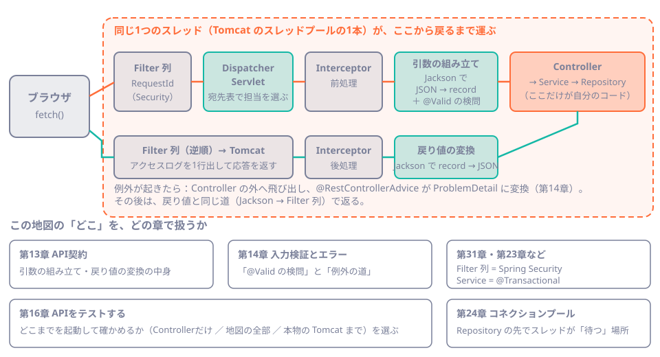
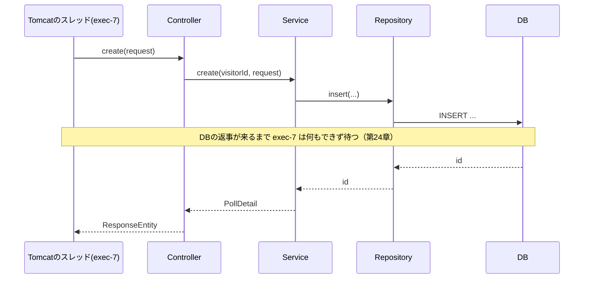

# 第12章 リクエストの旅

<div class="goal-box" markdown>

この章でできるようになること

- 1つのHTTPリクエストが、サーバーの中を通る順番（Tomcat → Filter → DispatcherServlet → Controller → …）を説明できる
- 「1リクエスト＝1スレッドが最後まで運ぶ」ことを、ログで確かめられる
- `Filter` を1つ自作して、リクエストの出入りをログに出せる
- Filter・Interceptor・`@ControllerAdvice` の違いと、どこで何ができるかを説明できる
- 以降の章（検証・エラー・Security・トランザクション）が、この「地図」のどこに当たるかを指せる

</div>

## 1. 問いかけ：このリクエストは、どこを通ってきたのか

QuickVote の投票作成を、ブラウザから呼びます。

```ts
await fetch("/api/polls", {
  method: "POST",
  headers: { "Content-Type": "application/json", "X-Visitor-Id": "1" },
  body: JSON.stringify({ title: "ランチどこ行く？", closesInMinutes: 30 }),
})
```

`PollController.create` は、`CreatePollRequest` という Java の `record` を受け取ります。しかし、HTTP で届いたのはただのバイト列（JSON）です。誰が `record` に変換したのでしょうか。タイトルが空だったとき、`create` が呼ばれる前に400が返るのは、なぜでしょうか。

この章では、リクエスト1本の旅を追います。ここで描く地図は、第2部の残りと、第4部（トランザクション）、第6部（Security）で何度も見返します。

## 2. 動画で見る：リクエストの旅

<div class="video-card">
  <video controls preload="metadata" poster="../../assets/videos/request-journey.jpg">
    <source src="../../assets/videos/request-journey.mp4" type="video/mp4">
  </video>
  <p class="video-caption">▶ リクエストの旅</p>
  <p class="video-credit">音声：VOICEVOX:冥鳴ひまり</p>
</div>

動画の要点

- リクエストは入口の Tomcat で、スレッドプールの店員（スレッド）1人に受け取られる。ほかの店員は、別のリクエストを同時に運んでいる
- 店員は、リクエストが終わるまで、その1通を担当する
- Filter の列を通り、`DispatcherServlet` が宛先表（HandlerMapping）で担当のメソッドを選ぶ。JSON は Jackson が `record` に変換し、`@Valid` で検問される
- Controller → Service → Repository → DB と進む。DB の返事を待つ間も、店員はその場で待ち続ける
- 戻り値は Jackson が JSON に変換し、Filter を逆順に通って返る。終わると、店員はプールに戻る

??? note "字幕全文"
    1つのリクエストの、サーバーの中の旅を追ってみましょう。
    ブラウザが、fetchで、リクエストを送ります。
    リクエストは封筒に入って、入口のTomcatに届きます。
    入口では、スレッドプールの店員が1人、封筒を受け取ります。
    ほかの店員も、別の封筒を、同時に運んでいます。
    この店員は、リクエストが終わるまで、この封筒の担当です。
    Filterの列を通り、通るたびにスタンプです。
    DispatcherServletが宛先を選びます。
    JSONの本文は、Jacksonが、Javaのrecordに変換します。
    @Validの検問で、おかしな入力は、ここで止められます。
    いよいよ、Controller、Service、Repository、DBへ進みます。
    DBの返事を待つ間も、店員はその場で待ち続けます。
    結果は、同じ道を、逆向きに戻ります。
    戻り値は、JacksonがJSONに変換します。
    Filterを逆順に通って、ブラウザへ戻ります。
    最初から最後まで、ずっと同じ店員が運びました。
    つまり、Spring MVCは、1リクエストにつき、1スレッドで動きます。
    終わったら、店員はプールに戻ります。
    1つのリクエストを、1人のスレッドが、最後まで運ぶ。


動画は、第1部の「店員モデル」（第9章）の続きです。ここからは、同じ旅を自分のアプリのログで確かめます。

## 3. 地図：リクエストの通り道



この地図を、左から順に読みます。

| 順 | 場所 | 何が起きるか | 誰の仕事か |
| --- | --- | --- | --- |
| 1 | Tomcat | HTTP を受け、スレッドプールから1本を割り当てる | サーバー（Tomcat） |
| 2 | Filter 列 | 全リクエスト共通の前処理（相関ID、Security など）。次へ進めるか、ここで打ち切るか | Servlet の仕組み |
| 3 | DispatcherServlet | URL とメソッドから、担当の Controller メソッドを選ぶ（宛先表） | Spring MVC |
| 4 | Interceptor（前） | 担当が決まったあとの前処理 | Spring MVC |
| 5 | 引数の組み立て | JSON → `record`（Jackson）、`@Valid` の検査、`@PathVariable` の変換 | Spring MVC |
| 6 | Controller | ここからが自分のコード。Service を呼ぶ | 開発者 |
| 7 | Service → Repository | 業務ロジックとデータの出し入れ | 開発者 |
| 8 | 戻り値の変換 | `record` → JSON（Jackson）、ステータスとヘッダーを付ける | Spring MVC |
| 9 | Interceptor（後）→ Filter 列（逆順）→ Tomcat | 後始末（ログ出力など）をして、応答を返す | Spring MVC / Servlet |

Express で言えば、2 が `app.use(middleware)`、3 が `app.get(path, handler)` の照合、6 が `handler` に当たります。Spring MVC には、その間にもう少し段階がある（引数の組み立てなど）と考えると近いです。

!!! warning "この例えが外れる点（第10章のレストランに戻ると）"
    ホール係（Controller）、厨房（Service）、食材庫（Repository）は、別々の人ではありません。同じ1人のスレッドが、受付から配膳までを担当します。Node のように「待っている間に、別の客へ移る」ことはしません。DB の返事を待つ間、このスレッドは何もできず、そこに立ち続けます（第9章、第24章）。

## 4. 動かしてみる①：通過ログを出す

QuickVote の `journey` プロファイルを有効にすると、リクエストが各地点を通るたびに `[journey]` のログが出ます。仕掛けの中身は後で読むので、まず出力を見ます。

```bash
cd code/labs/part02-quickvote-inmemory
./mvnw spring-boot:run -Dspring-boot.run.profiles=journey     # Windows は .\mvnw.cmd
```

別の端末から、投票を作ります（Windows で日本語を含めるときの注意は、第13章）。

```bash
curl -s -X POST localhost:18012/api/polls -H 'X-Visitor-Id: 1' -H 'Content-Type: application/json' \
  -d '{"title":"lunch","closesInMinutes":30,"options":["curry","soba"]}'
```

!!! question "予測カード"
    出力されるログの順番を、予測してください。次の7つを並べ替えます。
    `Controller` ／ `Filter（入る）` ／ `Jackson（JSON→record）` ／ `Interceptor（前）` ／ `Repository` ／ `Jackson（record→JSON）` ／ `Filter（戻る）`

```text
Filter 入る     | POST /api/polls                                  | thread=http-nio-18012-exec-7
Interceptor 前  | 担当は PollController#create                      | thread=http-nio-18012-exec-7
Jackson 読む    | JSON → CreatePollRequest（この後 @Valid の検問）     | thread=http-nio-18012-exec-7
呼び出し        | PollController.create                            | thread=http-nio-18012-exec-7
呼び出し        |   PollService.create                             | thread=http-nio-18012-exec-7
呼び出し        |     PollRepository.insert                        | thread=http-nio-18012-exec-7
呼び出し        |     ParticipantRepository.insert                 | thread=http-nio-18012-exec-7
呼び出し        |     OptionRepository.insert                      | thread=http-nio-18012-exec-7
  ...（ほかの Repository 呼び出し）
Jackson 書く    | PollDetail → JSON                                | thread=http-nio-18012-exec-7
Interceptor 後  | 完了 status=201                                   | thread=http-nio-18012-exec-7
Filter 戻る     | status=201                                       | thread=http-nio-18012-exec-7
request completed: POST /api/polls -> 201 (43 ms)
```

（見やすく整形し、時刻とログの接頭辞は省略しました。）

答えは、Filter 入る → Interceptor 前 → Jackson 読む → Controller → Repository → Jackson 書く → Filter 戻る です。地図の順番と一致しています。

右端の `thread=` に注目してください。最初の `Filter 入る` から最後の `Filter 戻る` まで、全部同じスレッド（`http-nio-18012-exec-7`）です。これが「1リクエスト＝1スレッド」の証拠です。別のリクエストを送ると、`exec-6` のように別のスレッドが担当します（スレッド名の数字は、プールの何番目か）。

インデントが深くなっている行は、メソッド呼び出しの入れ子です。`PollController.create` が `PollService.create` を呼び、それが `PollRepository.insert` を呼ぶ流れが、そのまま見えます。

### 失敗したときは、どこで止まるか

同じ道をわざと失敗させて通り、ログの違いを見ます。

=== "訪問者ヘッダーなし（401）"

    ```text
    Filter 入る     | POST /api/polls
    Interceptor 前  | 担当は PollController#create
    Jackson 書く    | ProblemDetail → JSON          ← Controller にも、Jackson 読む にも、到達していない
    Interceptor 後  | 完了 status=401
    Filter 戻る     | status=401
    ```

=== "タイトルが空白（400）"

    ```text
    Filter 入る     | POST /api/polls
    Interceptor 前  | 担当は PollController#create
    Jackson 読む    | JSON → CreatePollRequest（この後 @Valid の検問）
    Jackson 書く    | ProblemDetail → JSON          ← @Valid で止まる。Controller は呼ばれていない
    Interceptor 後  | 完了 status=400
    Filter 戻る     | status=400
    ```

=== "存在しないパス（404）"

    ```text
    Filter 入る     | GET /nothing
    Jackson 書く    | ProblemDetail → JSON          ← 担当の Controller がない。Interceptor は /api/** にしか登録していない
    Filter 戻る     | status=404
    ```

3つの失敗ログから、次のことが分かります。

401 では `Jackson 読む` が出ていません。Controller の引数は左から順に組み立てられ、`create` の最初の引数 `VisitorPrincipal visitor` の組み立て（訪問者ヘッダーの確認）で例外になったため、2番目の JSON 本文には進みませんでした。

400 では `Controller` の行が出ていません。`@Valid` の検査は Controller が呼ばれる前に終わるので、入力がおかしければ Service にも Repository にも届きません（第14章）。

どの失敗でも `Jackson 書く | ProblemDetail → JSON` が出て、`Filter 戻る` まで同じ道を戻ります。エラーも、成功と同じ出口（JSON への変換）から出ます。

404（未知のパス）では、Interceptor の行が出ていません。この Interceptor は `/api/**` にだけ登録してあり、`/nothing` は対象外だからです（`/api/` 配下で担当のメソッドがない場合も、`HandlerMethod` ではないので行は出しません）。一方、Filter はパスや担当に関係なく全リクエストで動きます。

## 5. Filter を自作する

ここまでのログの一部は、自作の Filter が出しています。Filter は、リクエストの旅の入口と出口に立つ門番です。実物を読みます。

```java title="src/main/java/com/example/quickvote/journey/JourneyLogFilter.java"
@Component
@Profile("journey")                                        // (1)!
@Order(10)                                                 // (2)!
public class JourneyLogFilter extends OncePerRequestFilter {   // (3)!

    @Override
    protected void doFilterInternal(HttpServletRequest request, HttpServletResponse response, FilterChain chain)
            throws ServletException, IOException {
        Journey.step("Filter 入る", request.getMethod() + " " + request.getRequestURI());
        try {
            chain.doFilter(request, response);             // (4)!
        } finally {
            Journey.step("Filter 戻る", "status=" + response.getStatus());   // (5)!
        }
    }
}
```

1. `journey` プロファイルのときだけ Bean になる（第15章）。普段のアプリには入らない
2. Filter の順番です。数字が小さいほど外側（先に通る）になります
3. `OncePerRequestFilter` を継承すると、1リクエストで1回だけ動くことが保証される（内部の転送で2回呼ばれるのを防ぐ）
4. 「次へ進む」呼び出しです。この呼び出しの前が往路、後が復路で、ここを呼ばなければリクエストはここで止まる
5. `chain.doFilter` が例外で抜けても、`finally` で必ず復路の処理をする

Express と並べます。

=== "Express（ミドルウェア）"

    ```ts
    app.use((req, res, next) => {
      console.log("入る", req.method, req.url)
      res.on("finish", () => console.log("戻る", res.statusCode))   // 復路は「終わったとき」のイベント
      next()                                                        // 次へ進む
    })
    ```

=== "Spring（Filter）"

    ```java
    protected void doFilterInternal(HttpServletRequest request, HttpServletResponse response, FilterChain chain) {
        log("入る");
        try {
            chain.doFilter(request, response);      // 次へ進む。戻ってきたら復路
        } finally {
            log("戻る");
        }
    }
    ```

| | Express のミドルウェア | Spring の Filter |
| --- | --- | --- |
| 次へ進む | `next()` | `chain.doFilter(request, response)` |
| 復路の書き方 | イベント（`res.on("finish")`）か、`await next()` | `doFilter` のあとに書く（呼び出しが入れ子になっている） |
| 止める | `next()` を呼ばず、`res.send()` | `doFilter` を呼ばず、`response` に直接書く |
| 順番 | `app.use` を書いた順 | `@Order` の数字（小さい方が外側） |
| 同期／非同期 | 非同期（`next` はコールバック） | 同期（`doFilter` から戻ってきた時点で、中の処理は全部終わっている） |

Spring の Filter では、`chain.doFilter` が戻ってきた時点でその先の処理がすべて終わっているので、復路を素直に「後ろ」に書けます。これが、1つのスレッドが最後まで処理する方式の分かりやすさです。

### 実物を読む：`RequestIdFilter`

`RequestIdFilter` は、QuickVote の本番のコードにある Filter です（第43章で使います）。各リクエストに相関IDを付けて、ログと応答に載せます。

```java title="src/main/java/com/example/quickvote/common/RequestIdFilter.java（抜粋）"
MDC.put(MDC_KEY, requestId);                 // (1)!
response.setHeader(HEADER, requestId);
long start = System.nanoTime();
try {
    chain.doFilter(request, response);
} finally {
    // ... アクセスログを1行出す ...
    MDC.remove(MDC_KEY);                     // (2)!
}
```

1. `MDC` は「このスレッドのログ全部に自動で付く、メモ帳」。スレッドごとに別の値を持つ（`ThreadLocal`）
2. **必ず消します。** スレッドはプールで使い回されるので、消し忘れると、次の別のリクエストのログに前のリクエストのIDが混ざります

「1リクエスト＝1スレッド」なので、`ThreadLocal`（スレッドごとの変数）にリクエスト固有の情報を持たせられます。第9章の「Bean のフィールドに置いてはいけない」の反対側で、リクエスト固有の値を安全に持つ唯一の定番の方法が、スレッドに結びついた変数です。ただし、後始末（`finally` での削除）が必須です。

### Filter の並び順を見る

自作の Filter は、Boot が持っている Filter と並んで動きます。起動時の `DEBUG` ログ（`--debug`）で、並びを確認できます（第10章のHelloアプリの出力です）。

```text
Mapping filters: characterEncodingFilter urls=[/*] order=-2147483648, formContentFilter urls=[/*] order=-9900, requestContextFilter urls=[/*] order=-105
```

`order` の小さい順（外側から）に、文字コード、フォームの本文、リクエストの文脈が並んでいます。QuickVote の `RequestIdFilter` は `HIGHEST_PRECEDENCE`（最小の数字）なので、最も外側で動きます。第6部で Spring Security を足すと、Security の Filter 群（`order=-100`）がこの列に加わります。

!!! tip "順番が大事な理由"
    相関IDの Filter は、最も外側に置きます。内側に置くと、外側の Filter（Security など）が出したログに相関IDが付きません。最も外側に置けば、Security の Filter で認証に失敗したリクエストも、同じIDで追えます。

## 6. Filter・Interceptor・`@ControllerAdvice`：どこに何を置くか

リクエストの前後に何かしたいときの置き場所は、3つあります。

| | Filter | Interceptor | `@ControllerAdvice` |
| --- | --- | --- | --- |
| 属する仕組み | Servlet（Spring の外側） | Spring MVC | Spring MVC |
| 動く範囲 | 全リクエスト（静的ファイル、404 も） | 担当の Controller が決まったものだけ | Controller の中の例外・変換 |
| 知っているもの | リクエスト／レスポンスのバイト列、ヘッダー | 加えて、担当のメソッド（`HandlerMethod`） | 例外、変換後のオブジェクト |
| 典型的な用途 | 相関ID、認証・認可（Security）、文字コード、CORS | ログ、メトリクス、特定の Controller 群の前処理 | 例外を JSON のエラーに変換（第14章）、レスポンスの加工 |
| 順番の決め方 | `@Order` | 登録した順 | 例外の型で決まる |

迷ったときの目安です。

- 「全リクエストに共通で、HTTPそのものを扱う」→ Filter（認証、相関ID）
- 「どの Controller が担当かを知りたい」→ Interceptor
- 「例外を、決まった形のエラーに変えたい」→ `@ControllerAdvice`（第14章）
- 「業務ルールを守りたい」→ どれでもなく、Service。Filter や Interceptor に業務ロジックを書かない

## 7. 動かしてみる②：引数の組み立てを覗く

3 節の表の 5（引数の組み立て）は、外から見えにくい段階です。QuickVote には、この仕組みを使った部品が1つあります。`StandInVisitorArgumentResolver` です。

```java title="src/main/java/com/example/quickvote/security/StandInVisitorArgumentResolver.java（抜粋）"
@Override
public boolean supportsParameter(MethodParameter parameter) {
    return VisitorPrincipal.class.equals(parameter.getParameterType());     // (1)!
}

@Override
public Object resolveArgument(MethodParameter parameter, ModelAndViewContainer mavContainer,
        NativeWebRequest webRequest, WebDataBinderFactory binderFactory) {
    String value = webRequest.getHeader(headerName);                        // (2)!
    // ... 数字として読めて 1 以上なら new VisitorPrincipal(visitorId)、そうでなければ 401 ...
    throw new ApiException(ErrorCode.UNAUTHENTICATED);
}
```

1. 「`VisitorPrincipal` 型の引数は、私が組み立てます」という宣言
2. リクエストヘッダー `X-Visitor-Id` を読んで、`VisitorPrincipal` を作る

`PollController.create(VisitorPrincipal visitor, @Valid @RequestBody CreatePollRequest request)` の1番目の引数は、この部品が作っています。`@PathVariable UUID pollId` や `@RequestBody` も、同じ仕組み（引数リゾルバ）で組み立てられます。

!!! note "用語：HandlerMethodArgumentResolver（引数リゾルバ）"
    Controller のメソッドの引数1つ1つを、リクエストから組み立てる部品です。引数の型や注釈を見て、担当の部品が選ばれます。`@RequestBody` は JSON を読む部品、`@PathVariable` は URL の一部を取り出す部品です。自作すると、「この型の引数は、こう作る」を足せます。

この部品は暫定です。第6部で、Cookie と Spring Security の `@AuthenticationPrincipal` に置き換えます。Controller の引数の型（`VisitorPrincipal`）は変わりません。置き換える部分が1か所に閉じているのが、この構造の狙いです。

!!! warning "この時点の保証"
    `X-Visitor-Id` ヘッダーは、誰でも書き換えられます。`X-Visitor-Id: 1` と送れば、誰でも訪問者1（投票の主催者）になりすませます。**これは認証ではありません。** 第2部のラボでは、「誰の操作か」が引数で渡ってくる構造を作るための、仮の仕組みです。

## 8. 動かしてみる③：スレッドが「待つ」場所を見る

地図の 7（Service → Repository）で、スレッドは待つことがあります。いまは Map なので一瞬ですが、第3部で DB にすると、ここで DB の返事を待ちます。その間、スレッドは占有されたままです（動画の「その場で待ち続ける」）。



Spring MVC は、待つ間に別の処理へ切り替える仕組み（Node のイベントループ）ではありません。待つ時間が長いとスレッドが足りなくなることが、第24章（コネクションプール）の出発点です。

## 9. 現場で：リクエストの旅の地図で「どこ」を言う

エラーや不具合の報告を受けたときは、まず地図のどこで起きたかを言えると、調査が速くなります。

| 症状 | 地図で疑う場所 |
| --- | --- |
| `401` / `403` が返る（Controller に届かない） | Filter 列（Security）、または引数の組み立て |
| `400` で「Failed to read request」 | 引数の組み立て（JSON が壊れている、型が違う）。第13章 |
| `400` で「入力値が正しくありません」 | `@Valid` の検問。第14章 |
| `404` だが Controller はあるはず | DispatcherServlet の宛先表（パスの綴り、パッケージの外、メソッド違い） |
| `500` | Controller の中（自分のコード）。ログのスタックトレース |
| 一部のリクエストだけ遅い | Service → Repository の先（DB、外部API）。スレッドが待っている |
| ログに別のリクエストのIDが混ざる | `MDC` / `ThreadLocal` の消し忘れ（Filter の `finally`） |

AI が書いた Filter のレビュー観点も、足しておきます。

| 見るもの | 疑う理由 |
| --- | --- |
| `chain.doFilter` を呼ぶ前後で、例外が起きたとき後始末されるか | `try/finally` がないと、`MDC` などが消えない |
| Filter に業務ロジック（権限判定、DB 参照）が入っている | 置き場所が違う。Service に |
| `@Component` を付けた Filter を、さらに別の設定でも登録している | 二重に動く（第31章で詳しく） |
| リクエスト本文（`getInputStream()`）を Filter で読んでいる | 本文は1度しか読めない。あとで Jackson が読めなくなる |
| ログに URL 全体・ヘッダー・本文を出している | トークンや個人情報が漏れる（第43章） |

---

## まとめ：3点セット

!!! abstract "この章の3点セット"
    **① 一言で言うと**
    Spring MVC では、1つのリクエストを、Tomcat のスレッドプールから割り当てられた1本のスレッドが、Filter → DispatcherServlet → Interceptor → 引数の組み立て（Jackson、`@Valid`）→ Controller → Service → Repository と最後まで処理し、同じ道を戻ります。待ち時間の間も、そのスレッドは占有されます。

    **② 現場でこう聞かれる**
    「`@Valid` で弾かれたリクエストは、Service まで届きますか？ ログを出したい場所は Filter ですか、Controller ですか？」
    → 届きません。`@Valid` は Controller が呼ばれる前の「引数の組み立て」で検査されます。全リクエストに共通のログ（相関ID、アクセスログ）は Filter、特定の業務の記録は Service に置きます。

    **③ 自分のサービスならどこに当たるか**
    自分のサービスで「全リクエストに共通でやりたいこと」を3つ挙げ、Filter・Interceptor・Service のどこに置くかを決めます。

## 演習

??? question "確認問題1：予測"
    `GET /api/polls/{存在しないID}` を、訪問者ヘッダー付きで送ります。`[journey]` のログで、`呼び出し` の行はどこまで出るでしょう。`PollController.get` ／ `PollService.get` ／ `ParticipantService.require` ／ `ParticipantRepository.findActive` ／ `OptionRepository.findWithVoteCounts` のうち、出るものを選んでください。

??? success "解答"
    `PollController.get` → `PollService.get` → `ParticipantService.require` → `ParticipantRepository.findActive`（さらにその中の `PollRepository.findByPublicId`）まで出ます。`findActive` が空を返すので `require` が `POLL_NOT_FOUND`（404）を投げ、`OptionRepository.findWithVoteCounts` には届きません。実際のログでも、同じ並びになります。

??? question "確認問題2：Filter の作法"
    次の Filter は、どこが問題ですか。
    ```java
    protected void doFilterInternal(HttpServletRequest req, HttpServletResponse res, FilterChain chain) {
        MDC.put("user", req.getHeader("X-Visitor-Id"));
        chain.doFilter(req, res);
        MDC.remove("user");
    }
    ```

??? success "解答"
    `chain.doFilter` が例外を投げると、`MDC.remove` が実行されません。スレッドはプールで使い回されるので、次の別のリクエストのログに、前の訪問者IDが残ります。`try { chain.doFilter(...) } finally { MDC.remove("user"); }` にします。また、ヘッダーの値を検証せずにログに載せると、改行などを含めた値でログを汚されるため、`RequestIdFilter` のように形式を確かめてから使います。

??? question "確認問題3：どこに置くか"
    次の4つの処理を、Filter ／ Interceptor ／ `@ControllerAdvice` ／ Service のどれに置くか、答えてください。
    (a) 全リクエストにアクセスログを出す (b) 業務例外を ProblemDetail に変換する (c) 「投票は締切前のみ」を守る (d) どの Controller メソッドが呼ばれたかを記録する

??? success "解答"
    (a) Filter（`RequestIdFilter` のように、404 も含めて全部）。(b) `@ControllerAdvice`（第14章）。(c) Service（業務ルールは Service。`VoteService` が締切を判定している）。(d) Interceptor（担当のメソッド `HandlerMethod` を知っているのは、この段階から）。

??? question "応用：自作 Filter を足す"
    `X-Request-Id` ヘッダーを読んで、応答にそのまま返す Filter を書いてください（`RequestIdFilter` を読まずに、自分で）。書いたら、`RequestIdFilter` と比べて、足りない配慮を3つ挙げてください。

??? success "解答"
    最小の形は、`response.setHeader("X-Request-Id", request.getHeader("X-Request-Id"))` のあと `chain.doFilter` です。`RequestIdFilter` と比べた配慮の例：(1) ヘッダーがないときに採番する（UUID） (2) 外から来た値を形式で検証する（改行を含む値でログが汚されないよう、英数字・`._-` の64文字以内だけを許す） (3) `MDC` に入れて、`finally` で消す。ほかに、最も外側に置く `@Order`、アクセスログの出力もあります。

??? question "説明問題：現場でこう聞かれる"
    「Spring MVC は、リクエストをどう処理しているのですか？ Node とは何が違いますか？」200字程度で答えてください。

??? success "解答"
    例：Tomcat がリクエストごとにスレッドプールから1本のスレッドを割り当て、そのスレッドが Filter、DispatcherServlet、Controller、Service、Repository と最後まで同期的に処理して応答を返します。DB の返事を待つ間もスレッドは占有されます。Node はイベントループで1本のスレッドが待ち時間に別の処理へ移りますが、Java は同時に待てる数がスレッド数で決まります。その代わり、コードは普通の同期で書けます。
