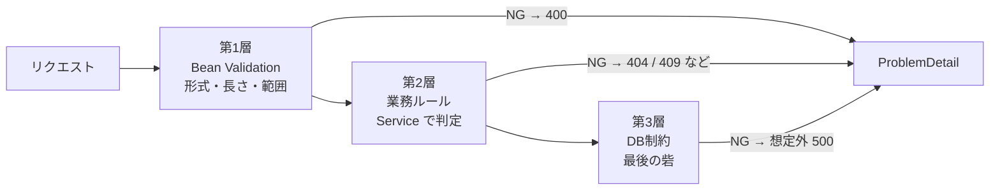
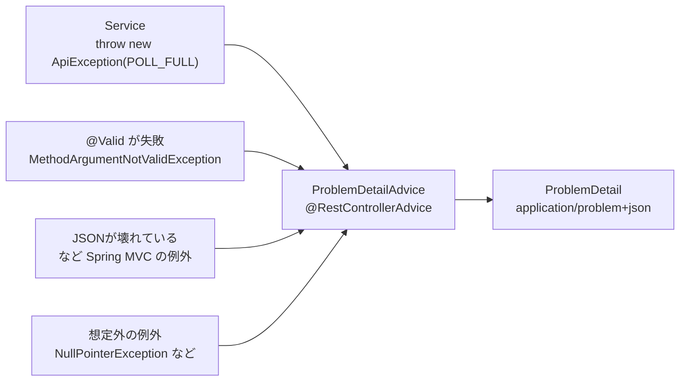
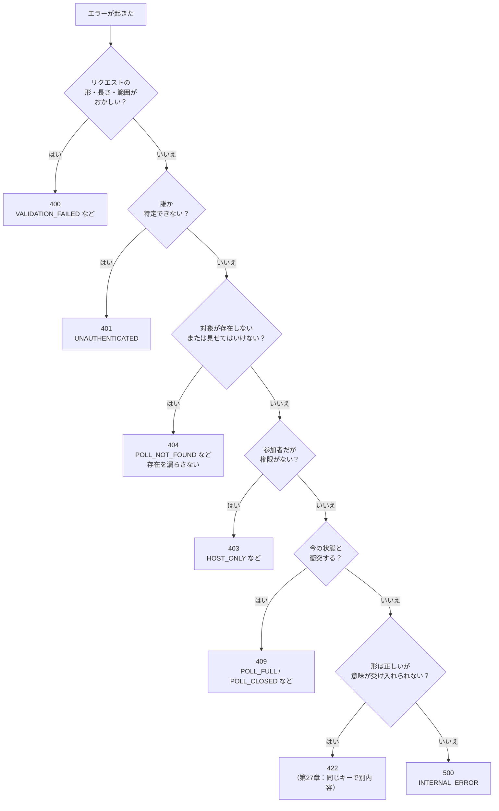

# 第14章 入力検証とエラーの設計

<div class="goal-box" markdown>

この章でできるようになること

- 入力検証を「Bean Validation（形式）」「業務ルール（Service）」「DB制約（最終防衛線）」の3層に分けて、どこで何を守るか決められる
- `@Valid` と検証の注釈を書き、`@Valid` の付け忘れで検証が働かないことを確かめられる
- ProblemDetail（RFC 9457）と `@RestControllerAdvice` で、すべてのエラーを同じ形で返せる
- 400 / 401 / 403 / 404 / 409 / 422 / 500 を、フローチャートで選べる
- スタックトレースや入力値を、エラー応答とログに出さない設計ができる

</div>

## 1. 問いかけ：画面で検証しているのに、なぜサーバーでも検証するのか

React のフォームで、タイトルが空なら送信ボタンを無効にしています。それなのに、サーバーでも「タイトルが空ならエラー」を作る必要があるのでしょうか。

あります。`curl` を使えば、画面を通らずに、**どんなリクエストでも送れる**からです。ブラウザの開発者ツールでも、悪意のあるスクリプトでも、壊れたクライアントでも同じです。第13章で見たとおり、JSON の境界では、型も値も守られません。

**サーバーは、届いたものを疑う。** 検証は、画面のためではなく、**サーバー自身の約束を守るため**のものです。この章では、(1) どう検証するか (2) 失敗したとき、どんな形で返すか、を決めます。エラーの形は、**クライアントが機械的に読める**ことが大事です。

## 2. 検証の3層：どこで何を守るか

QuickVote の「選択肢は10個まで」を例に、守る場所を考えます。



| 層 | 守るもの | 例（QuickVote） | 失敗したとき |
| --- | --- | --- | --- |
| ① Bean Validation | **リクエスト1件だけ見て分かる**形式・長さ・範囲 | タイトルは空でない／100文字まで、`closesInMinutes` は 5〜10080、初期の選択肢は10個まで | 400 `VALIDATION_FAILED` |
| ② 業務ルール（Service） | **今の状態を見ないと分からない**条件 | 満員（`POLL_FULL`）、選択肢の上限（`OPTION_LIMIT_REACHED`）、締切後（`POLL_CLOSED`）、権限 | 403 / 404 / 409 など。`code` で細かく区別 |
| ③ DB制約 | どんな経路でも守りたい**最後の砦** | UNIQUE（1人1票）、CHECK、外部キー（第18章） | 通常は起きない。起きたら**想定外**（500、または 409 に翻訳） |

大事な原則は3つです。

1. **①は①で止める**：形式がおかしい入力は、Service にも DB にも届かせない（第12章のログで確認したとおり、`@Valid` は Controller の前で止める）
2. **②は、②でしか守れない**：「あと1人入れるか」は、リクエストを見ても分かりません。今の人数を数える必要があります（第4部で、同時実行でも守れるようにします）
3. **③は、アプリの `if` をすり抜けたときの保険**：アプリの検証を信用しすぎず、DB にも制約を置く（第18章）

「1つの層だけ」で守ろうとしないこと。**AI が書く検証は、①だけで終わっていることがよくあります**。

## 3. Bean Validation：注釈で書く検証

### `@Valid` と検証の注釈

```java title="src/main/java/com/example/quickvote/poll/CreatePollRequest.java（抜粋）"
public record CreatePollRequest(
        @NotBlank @BoundedText(maxChars = PollRules.MAX_TEXT_CHARS) String title,
        @NotNull @Min(PollRules.MIN_CLOSES_IN_MINUTES) @Max(PollRules.MAX_CLOSES_IN_MINUTES) Integer closesInMinutes,
        Boolean allowMemberOptions,
        @Size(max = PollRules.MAX_OPTIONS) List<@NotBlank @BoundedText(maxChars = PollRules.MAX_TEXT_CHARS,
                maxBytes = PollRules.MAX_LABEL_BYTES) String> options) { ... }
```

```java title="src/main/java/com/example/quickvote/poll/PollController.java（抜粋）"
@PostMapping
public ResponseEntity<PollDetail> create(VisitorPrincipal visitor, @Valid @RequestBody CreatePollRequest request) {
```

!!! note "用語：Bean Validation"
    Java の検証の標準仕様（`jakarta.validation.*`）です。DTO に注釈を付けて「この項目は空でない」「この範囲」と宣言すると、`@Valid` のついた引数に対して自動で検査されます。Spring Boot では `spring-boot-starter-validation` を足すと、実装（Hibernate Validator）が付いてきます。パッケージは `jakarta.validation.*`（`javax.validation.*` は古い世代）。

| 注釈 | 意味 | 注意 |
| --- | --- | --- |
| `@NotNull` | `null` でない | 空文字は通る |
| `@NotBlank` | `null`・空文字・空白だけ、でない | 文字列用 |
| `@Size(max = n)` | 文字列の長さ／コレクションの要素数 | 文字列では**UTF-16 の `char` 数**（4 節） |
| `@Min` / `@Max` | 数値の範囲 | |
| `List<@NotBlank String>` | **要素ごと**の検証 | 型引数に付ける |

`options[1]` のように、**どの要素が悪いか**まで、エラーに出ます（`PollControllerValidationTest` で確認済み）。

### `@Valid` を付け忘れると、何も検証されない

`ValidAnnotationTest` で確かめます。同じ DTO を、`@Valid` ありとなしで受けます。

```java title="src/test/java/com/example/quickvote/poll/ValidAnnotationTest.java（抜粋）"
@PostMapping("/with-valid")
String withValid(@Valid @RequestBody CreatePollRequest request) { ... }

@PostMapping("/without-valid")
String withoutValid(@RequestBody CreatePollRequest request) { ... }   // @Valid が無い
```

空白だけのタイトルを送ると、結果はこうです。

| エンドポイント | 結果 |
| --- | --- |
| `/with-valid` | **400**（Controller の前で止まる） |
| `/without-valid` | **200**（`reached: ` と、空のタイトルのまま Controller に届く） |

**注釈を書いても、`@Valid` が無ければ飾りです。エラーも警告も出ません。** AI が生成した Controller で、`@Valid` が抜けていないか、DTO に注釈があるのに受け側に `@Valid` が無い、を最初に確認してください。

### 文字数を数える：`@Size` は UTF-16 で数える

第7章で、「文字数」と「バイト数」と「`char` の数」は別物だと学びました。ここで影響します。`@Size(max = 100)` は **`String#length()`（UTF-16 の `char` の数）**を数えるので、絵文字のように `char` 2個で1文字のものは、**2として数えられます**。「100文字まで」の仕様に `@Size(max = 100)` を使うと、絵文字だけのタイトルは**51文字で弾かれます**。

そこで QuickVote は、**人間が数える文字（コードポイント）で数える制約**を自作しています。

```java title="src/main/java/com/example/quickvote/common/BoundedTextValidator.java（抜粋）"
@Override
public boolean isValid(String value, ConstraintValidatorContext context) {
    if (value == null) {
        return true;                                              // (1)!
    }
    return value.codePointCount(0, value.length()) <= maxChars    // (2)!
            && value.getBytes(StandardCharsets.UTF_8).length <= maxBytes;   // (3)!
}
```

1. `null` は検証しない。必須かどうかは `@NotBlank` に任せる（役割を分ける）
2. **コードポイント数**（人間が数える文字）で上限を判定
3. UTF-8 でのバイト数でも上限を判定（保険）

テストで、仕様どおりに動くことを確かめます。

```java title="PollControllerValidationTest.java（抜粋）"
assertThat(post("/api/polls", json("😀".repeat(100), List.of())).exchange())
        .hasStatus(HttpStatus.INTERNAL_SERVER_ERROR);       // 100文字は検証を通り、Service に届く（モックの例外で到達を確認）
assertThat(post("/api/polls", json("😀".repeat(101), List.of())).exchange())
        .hasStatus(HttpStatus.BAD_REQUEST);                  // 101文字は 400
```

「文字数の定義」は、**仕様として決める**必要があります。QuickVote では「コードポイント数」と決めました（結合文字を含む絵文字の見た目の数とは、さらに違う数え方になりますが、実用上は十分です）。

## 4. エラーの形：ProblemDetail（RFC 9457）

検証に失敗したとき、どんな形で返しますか。ここを**決めておかない**と、エラーごとに形がバラバラになり、クライアントが読めなくなります。

!!! note "用語：ProblemDetail（RFC 9457）"
    HTTP API のエラーを表す、標準の JSON の形です（旧 RFC 7807）。Content-Type は `application/problem+json`。決まった項目は `type`、`title`、`status`、`detail`、`instance` で、**独自の項目（拡張）を足せます**。Spring は `ProblemDetail` クラスで対応しています。

QuickVote の実際の応答を見ます。タイトルが空白、締切が3分、選択肢が11個のリクエストです。

```bash
curl -s -X POST localhost:18012/api/polls -H 'X-Visitor-Id: 1' -H 'Content-Type: application/json' \
  -d '{"title":" ","closesInMinutes":3,"options":["1","2","3","4","5","6","7","8","9","10","11"]}'
```

```json
{
  "detail": "入力値が正しくありません。",
  "instance": "urn:request-id:4fed46dc-12b4-48c3-b61e-cd7e6ec66a49",
  "status": 400,
  "title": "Bad Request",
  "code": "VALIDATION_FAILED",
  "errors": [
    { "field": "closesInMinutes", "message": "5 以上の値にしてください" },
    { "field": "title", "message": "空白は許可されていません" },
    { "field": "options", "message": "0 から 10 の間のサイズにしてください" }
  ]
}
```

| 項目 | 意味 | 誰が読むか |
| --- | --- | --- |
| `status` | HTTP ステータスの数字（ヘッダーと同じ） | クライアントの分岐 |
| `title` | ステータスの名前（`Bad Request`） | 人 |
| `detail` | 今回の問題の説明 | 人 |
| `instance` | この問題の発生を指す識別子。QuickVote では**相関ID**（`urn:request-id:...`） | 問い合わせ・ログ検索 |
| **`code`**（拡張） | **機械判定用の名前**（`VALIDATION_FAILED`、`POLL_FULL` など） | **クライアントのプログラム** |
| `errors`（拡張） | どの項目がなぜ悪いか | 画面の項目ごとのエラー表示 |

!!! tip "フロントエンドで例えると"
    React で API エラーを扱うとき、`if (res.status === 409)` だけでは足りません。409 には「満員」「選択肢が上限」「締切後」があり、**画面に出す文言も、次の操作も違う**からです。QuickVote は **HTTP ステータス＝粗い分類、`code`＝細かい理由** と役割を分けています。`message`（人間向けの文）は、言語や表現が変わる可能性があるので、**プログラムは `code` と `field` で判断する**のが約束です。

実際、同じコードでも、検証メッセージの**言語は JVM の既定ロケールで変わりました**（jar を起動したときは日本語、Maven のテストでは英語）。メッセージの文字列に頼ったコードは、環境で壊れます。

!!! warning "エラー応答に、入力値を含めない"
    `errors` に出しているのは、**項目名とメッセージだけ**で、入力値そのものは含めません。選択肢の本文やタイトルが、ログ収集ツールや第三者の画面に残るのを避けるためです（`PollControllerValidationTest` の「検証エラーの応答には入力値を含めない」が確かめています）。`instance` も、リクエストのパスではなく相関IDにしてあります（パスに招待トークンが含まれる API があるため。第33章）。

## 5. `@RestControllerAdvice`：エラーの出口を1か所に

エラーを返す処理を、Controller のあちこちに書くと、形がバラバラになります。QuickVote は、**例外を投げて、出口を1か所にまとめる**設計です。



### 業務エラー：`ApiException` と `ErrorCode`

```java title="src/main/java/com/example/quickvote/common/ErrorCode.java（抜粋）"
public enum ErrorCode {
    VALIDATION_FAILED(HttpStatus.BAD_REQUEST, "入力値が正しくありません。"),
    UNAUTHENTICATED(HttpStatus.UNAUTHORIZED, "訪問者として識別できません。"),
    POLL_NOT_FOUND(HttpStatus.NOT_FOUND, "投票が見つかりません。"),
    POLL_FULL(HttpStatus.CONFLICT, "参加者が上限に達しています。"),
    POLL_CLOSED(HttpStatus.CONFLICT, "この投票は締め切られています。"),
    INTERNAL_ERROR(HttpStatus.INTERNAL_SERVER_ERROR, "サーバー内部でエラーが発生しました。");
    // ... HOST_ONLY, MEMBER_OPTIONS_DISABLED, OPTION_NOT_FOUND, JOIN_CODE_NOT_FOUND, OPTION_LIMIT_REACHED
```

Service は、判定に失敗したら**例外を投げる**だけです。

```java title="VoteService.java（抜粋）"
if (poll.isClosedAt(now)) {
    throw new ApiException(ErrorCode.POLL_CLOSED);       // ステータスやJSONの形は、ここでは知らない
}
```

!!! note "用語：@RestControllerAdvice"
    すべての Controller に共通の「例外の受け皿」を作るクラスの目印です。`@ExceptionHandler(例外の型)` を付けたメソッドが、その例外を受けて、HTTP 応答に変換します。第12章の地図では、「例外が起きたら Controller の外へ飛び出し、ここで受ける」場所です。

### 受け皿：`ProblemDetailAdvice`

```java title="src/main/java/com/example/quickvote/common/ProblemDetailAdvice.java（抜粋）"
@RestControllerAdvice
public class ProblemDetailAdvice extends ResponseEntityExceptionHandler {          // (1)!

    @ExceptionHandler(ApiException.class)                                          // (2)!
    public ResponseEntity<ProblemDetail> handleApiException(ApiException ex) {
        ErrorCode code = ex.code();
        ProblemDetail problem = ProblemDetail.forStatusAndDetail(code.status(), code.defaultDetail());
        problem.setProperty("code", code.name());                                  // (3)!
        problem.setInstance(occurrence());
        return ResponseEntity.status(code.status()).body(problem);
    }

    @ExceptionHandler(Exception.class)                                             // (4)!
    public ResponseEntity<ProblemDetail> handleUnexpected(Exception ex) {
        log.error("想定外のエラーが発生しました", ex);                                    // (5)!
        ErrorCode code = ErrorCode.INTERNAL_ERROR;
        ProblemDetail problem = ProblemDetail.forStatusAndDetail(code.status(), code.defaultDetail());
        problem.setProperty("code", code.name());
        problem.setInstance(occurrence());
        return ResponseEntity.status(code.status()).body(problem);                 // (6)!
    }
```

1. `ResponseEntityExceptionHandler` を**継承**すると、Spring MVC 自身が投げる例外（JSON が壊れている、メソッド違い、存在しないパス、パスの値の型違い…）が、**すべて ProblemDetail になります**。継承しないと、これらは Boot 既定の別の形で返ります
2. 想定している業務エラーを受ける
3. 独自の項目 `code` を足す
4. **それ以外の全部**（想定外）
5. 例外は**ここで1回だけ**ログに出す。スタックトレース付き。メッセージに入力値を連結しない
6. 応答には、**例外のメッセージもスタックトレースも載せず**、決まった文言だけ返す

`ResponseEntityExceptionHandler` の継承のおかげで、第12章で見た「存在しないパス」の 404 や、`GET /api/join`（POST 専用に GET）の応答まで、同じ形で返ります。

```text
GET /api/join  → 405  Allow: POST  {"detail":"Method 'GET' is not supported.","status":405,"title":"Method Not Allowed","code":"METHOD_NOT_ALLOWED", ...}
GET /api/polls/abc → 400  {"detail":"Failed to convert 'pollId' with value: 'abc'","status":400,"code":"BAD_REQUEST", ...}
```

`code` は、Spring MVC 由来のものには **HTTP ステータスの名前**（`METHOD_NOT_ALLOWED`、`BAD_REQUEST`）を入れる決めです。

!!! warning "バージョン注意：Boot 4 の ProblemDetail まわり"
    - HTTP ステータス `422` の定数は、Spring Framework 7 では `HttpStatus.UNPROCESSABLE_CONTENT` です。古い記事の `UNPROCESSABLE_ENTITY` は**非推奨**です（RFC の名称変更に合わせたもの）
    - Boot 自身にも `spring.mvc.problemdetails.enabled=true` という設定があり、有効にすると標準の例外が ProblemDetail になります。`--debug` のレポートで、既定では無効（Negative matches）と分かります。QuickVote は `ResponseEntityExceptionHandler` を継承した自前の Advice を使うので、この設定は使いません（併用の必要がなく、`code` などの独自項目を足せるため）
    - メソッド引数に直接付けた検証（`@RequestHeader` に付けた制約など）の失敗は、Spring Framework 6.1 以降 `HandlerMethodValidationException` で表れます。QuickVote の Advice はこれも処理しています

### 想定外の例外：スタックトレースを外に出さない

「想定外の例外（バグ）」を、`e.getMessage()` や `e.toString()` で返す実装は、AI が出しがちです。

```java
// 悪い例：よく見る形
@ExceptionHandler(Exception.class)
ResponseEntity<String> handle(Exception e) {
    return ResponseEntity.status(500).body(e.getMessage());     // 内部の事情が外に出る
}
```

`NullPointerException` なら `Cannot invoke "...Repo.find()" because "this.repo" is null` のように、**クラス名・メソッド名・内部の構造**が外に出ます。SQL の例外なら、**テーブル名や列名、制約名、入力値**まで出ることがあります。攻撃者にとっては、内部を知る手がかりです。

QuickVote の `PollControllerValidationTest` は、これを確かめています。

```java title="PollControllerValidationTest.java（抜粋）"
when(pollService.create(anyLong(), any())).thenThrow(new IllegalStateException("内部の事情 secret-detail"));

var result = post("/api/polls", json("ok", List.of())).exchange();

assertThat(result).hasStatus(HttpStatus.INTERNAL_SERVER_ERROR);
assertThat(result).bodyJson().extractingPath("$.code").isEqualTo("INTERNAL_ERROR");
assertThat(result).bodyText().doesNotContain("secret-detail").doesNotContain("IllegalStateException")
        .doesNotContain("at com.example");
```

応答は `INTERNAL_ERROR` と決まった文言だけ。原因はサーバーのログにだけ残り、利用者に見せる `instance`（相関ID）で突き合わせます。

!!! danger "本番で事故になるパターン：例外を握りつぶす／二重に出す"
    - `catch (Exception e) { return null; }` は、**エラーを消す**。呼び出し側は、成功したと思って進みます（第5章）
    - 例外を `catch` してログに出し、さらに `throw` すると、**同じ例外がログに複数回出ます**。出す場所は決めて、**1回だけ**にします（QuickVote は `ProblemDetailAdvice` だけ）
    - ログのメッセージに入力値を連結しない（`"失敗: " + label`）。選択肢の本文は、ログに残さない約束です（第43章）

## 6. ステータスの選び方

QuickVote は、HTTP ステータスと `code` を使い分けます。選ぶ手順を、フローチャートにします。



| ステータス | 意味 | QuickVote の例 | 見分けるコツ |
| --- | --- | --- | --- |
| **400** | リクエストが**壊れている／形式違反** | 空のタイトル、JSON の構文エラー、範囲外の `closesInMinutes` | **同じ入力は、いつ送っても必ず失敗**する |
| **401** | 誰か分からない | 訪問者ヘッダーがない | 識別（第6部） |
| **403** | 誰か分かるが、**許されない** | MEMBER が主催者専用の操作、選択肢の追加が許可されていない | 参加者だと分かっているので、存在を隠さなくてよい |
| **404** | **存在しない**。または存在を知らせない | 存在しない投票／**参加していない投票（同じ404）** | 「存在しない」と「参加していない」を**区別させない** |
| **409** | **今の状態**と衝突 | 満員、選択肢が上限、締切後 | **状態が変われば成功しうる** |
| **422** | 形は正しいが、**意味として受け入れられない** | 同じ `Idempotency-Key` なのに内容が違う（第27章） | 400 との違いは次で説明 |
| **500** | サーバーの想定外 | バグ、依存先の障害 | `INTERNAL_ERROR`。詳細は出さない |

### 400 と 422、404 と 403、409 の線引き

迷う3か所を整理します。

- **400 か 409 か**：同じリクエストが、別の時刻や別の状態なら成功するか。**成功しうるなら 409**（満員は、誰かが抜ければ入れる）、**絶対に成功しないなら 400**（空のタイトルは、何回送っても同じ）
- **404 か 403 か**：**存在を知られてよいか**。QuickVote は、非参加者に投票の存在を教えない仕様なので 404。参加者に対して「それはできません」と言うのは 403
- **400 か 422 か**：多くのAPIは 400 だけで済ませます。QuickVote は 400 を「形式」、422 を「形は正しいが意味が合わない」に分け、**422 は第27章（冪等性）でだけ使います**。第2部のラボでは、締切の範囲（5〜10080分）を Bean Validation の範囲検査にしたので 400 です。**どこまで細かく分けるかも、API 契約として決める**ことです

「存在しない投票」と「参加していない投票」が、`code` も `detail` も同じであることは、`QuickVoteFlowTest` で確かめています。**差が出ると、存在を探る攻撃に使われる**ためです（第30章）。

## 7. 動かしてみる：すべてのエラーが同じ形で返る

起動して、わざと失敗を起こします。

```bash
./mvnw spring-boot:run -Dspring-boot.run.profiles=dev
```

=== "存在しない投票（404）"

    ```bash
    curl -s localhost:18012/api/polls/00000000-0000-4000-8000-000000000000 -H 'X-Visitor-Id: 1'
    ```
    ```json
    {"detail":"投票が見つかりません。","instance":"urn:request-id:e4b3d3e7-...","status":404,"title":"Not Found","code":"POLL_NOT_FOUND"}
    ```

=== "存在しない選択肢（404）"

    ```bash
    curl -s -X PUT localhost:18012/api/polls/<id>/my-vote -H 'X-Visitor-Id: 2' \
      -H 'Content-Type: application/json' -d '{"optionId":999}'
    ```
    ```json
    {"detail":"選択肢が見つかりません。","status":404,"title":"Not Found","code":"OPTION_NOT_FOUND", ...}
    ```

=== "必須の項目がない（400）"

    ```bash
    curl -s -X PUT localhost:18012/api/polls/<id>/my-vote -H 'X-Visitor-Id: 2' \
      -H 'Content-Type: application/json' -d '{}'
    ```
    ```json
    {"detail":"入力値が正しくありません。","status":400,"code":"VALIDATION_FAILED",
     "errors":[{"field":"optionId","message":"null は許可されていません"}], ...}
    ```

=== "参加コードが違う（404）"

    ```bash
    curl -s -X POST localhost:18012/api/join -H 'X-Visitor-Id: 9' \
      -H 'Content-Type: application/json' -d '{"code":"AAAAAAAA"}'
    ```
    ```json
    {"detail":"参加コードが見つかりません。","status":404,"title":"Not Found","code":"JOIN_CODE_NOT_FOUND", ...}
    ```

どれも `application/problem+json`、`status`・`code`・`instance` が揃っています。クライアント側は、**1つのエラー処理**で全部を扱えます。

```ts
// クライアント側：1つの関数で全エラーを扱える
const res = await fetch(url, init)
if (!res.ok) {
  const problem = await res.json()           // { status, code, detail, errors?, instance }
  if (problem.code === "POLL_FULL") showFullMessage()
  else if (problem.code === "VALIDATION_FAILED") showFieldErrors(problem.errors)
  else showGenericError(problem.instance)    // 問い合わせ用に、相関IDを出す
}
```

## 8. 現場で：AIが書いたエラー処理のレビュー

| 見るもの | 疑う理由 |
| --- | --- |
| 検証が DTO の注釈だけ、`@Valid` が受け側にない | 飾りになる（3 節） |
| 検証が Bean Validation だけで、Service に業務ルールがない | 上限・状態・権限は、リクエストだけ見ても分からない |
| 業務ルールが Service になく、Controller の `if` に散らばる | 別の入口（バッチ、別 API）から呼ばれたら守られない。Service に |
| `catch (Exception e)` して `null` を返す／ログだけ出す | エラーが消える |
| `e.getMessage()` や `e.printStackTrace()` を応答に返す | 内部が漏れる（5 節） |
| エラーごとに `ResponseEntity.status(...)` を Controller に書いている | 形がバラバラになる。例外 ＋ Advice に |
| すべて 400、または 500 | 409/404/403 を区別していない。クライアントが分岐できない |
| 例外の `catch` とログを複数の層で行う | 同じ例外が何回も出る。出口は1か所 |
| エラー応答やログに入力値（本文）を含める | 個人情報・機密がログや応答に残る |
| 「存在しない」と「権限がない」で、メッセージや形が違う | 存在を探られる（第30章） |
| `@Size(max=100)` を「100文字」の仕様に使っている | 絵文字で数が合わない（3 節）。仕様の数え方を決める |

---

## まとめ：3点セット

!!! abstract "この章の3点セット"
    **① 一言で言うと**
    入力の検証は、形式（Bean Validation）・業務ルール（Service）・DB制約の3層で守り、`@Valid` で Controller の前に止める。エラーは `ApiException` を投げて `@RestControllerAdvice` に集め、ProblemDetail（`status` ＋ 機械判定用の `code`）で同じ形で返し、スタックトレースや入力値は外に出さない。

    **② 現場でこう聞かれる**
    「満員のときは 400 ですか 409 ですか？ 存在しない投票と、権限がない投票は、どう返しますか？」
    → 満員は、他の人が抜ければ成功しうる「状態の衝突」なので 409。存在しない投票と参加していない投票は、存在を漏らさないよう同じ 404 にする。細かい理由は `code` で伝える。

    **③ 自分のサービスならどこに当たるか**
    自分のサービスの入力項目を3つ選び、形式（Bean Validation）・業務ルール（Service）・DB制約のどの層で守るか、それぞれ書き出す。エラーの `code` を5つ決める。

## 演習

??? question "確認問題1：予測と実行"
    `POST /api/polls` に `{"title":"t","closesInMinutes":4}` を送ります。(a) ステータス (b) `code` (c) `errors[0].field` を答えてください。実行して確かめます。

??? success "解答"
    (a) 400 (b) `VALIDATION_FAILED` (c) `closesInMinutes`（`@Min(5)` に違反）。Service に届く前に止まるので、`PollService.create` は呼ばれません。

??? question "確認問題2：どの層か"
    次の4つの条件を、「Bean Validation／Service／DB制約」のどれで守るのが適切か、答えてください。
    (a) タイトルが空でない (b) 1人が同じ投票に2票入れない (c) 参加者が50人以下 (d) 参加コードが8文字

??? success "解答"
    (a) Bean Validation（`@NotBlank`）。(b) Service の上書きの扱い（`VoteRepository.upsert`）と、**DB制約**（UNIQUE）の両方。完成形では UNIQUE が最後の砦（第18章）。(c) Service（今の人数を数える）。DB制約では守れない複数行の条件で、同時実行では第4部のロックが必要。(d) 入力の形式なので Bean Validation（`@Size`）。加えて、形式違いは存在しないコードとして 404 にしている（`JoinCodeGenerator.isWellFormed`）。

??? question "確認問題3：読解"
    次の応答を返した API の問題点を、2つ挙げてください。
    ```json
    { "error": "org.postgresql.util.PSQLException: ERROR: duplicate key value violates unique constraint \"votes_poll_id_participant_id_key\" Detail: Key (poll_id, participant_id)=(3, 17) already exists." }
    ```

??? success "解答"
    (1) 内部の事情（DB の種類、テーブルの制約名、列名、内部ID `3` と `17`）が外に出ている。想定外の例外は `INTERNAL_ERROR` と決まった文言だけにする。(2) ProblemDetail ではなく独自の形で、`code` も `status` もない。クライアントが機械的に判定できない。また、この例外自体、アプリの「1人1票」の処理（`upsert`）が正しく書かれていれば起きないはずで、起きたなら**バグか想定外**として、500 ＋ ログ1回で扱う（DB 制約に当たる場合の翻訳は第19章）。

??? question "応用：エラーコードを足す"
    「投票を削除できるのは、主催者だけ」という仕様で、MEMBER が削除しようとしたとき、どの `code`・ステータスで返しますか。また、その人が**そもそも参加していない**場合はどうしますか。

??? success "解答"
    MEMBER は参加者だと分かっているので、`HOST_ONLY`（403）。参加していない人には、投票の存在を漏らさないよう `POLL_NOT_FOUND`（404）。`ParticipantService.requireHost` がこの順（参加者かの確認 → 主催者かの確認）で判定しています。

??? question "説明問題：現場でこう聞かれる"
    「エラーは `{"error": "..."}` のように文字列だけ返せば十分では？ なぜ `code` を別に持つのですか？」200字程度で答えてください。

??? success "解答"
    例：人間向けの文言は、言語や表現が変わるので、プログラムの判断に使えません。HTTP ステータスだけでは、409 の中の「満員」「上限」「締切後」を区別できず、クライアントが画面の出し分けや次の操作を決められません。`status` を粗い分類、`code` を機械判定用の細かい理由、`errors` を項目ごとの詳細と役割を分けると、クライアントが1つのエラー処理で全部を扱えます。
