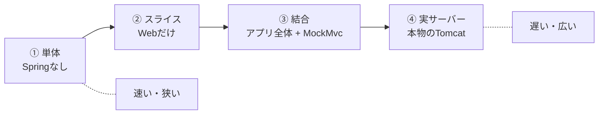

# 第16章 APIをテストする

<div class="goal-box" markdown>

この章でできるようになること

- 「Springを起動しない」「Webだけ起動する」「全部を起動する」「本物のTomcatで動かす」を、速さと守れるものの違いで使い分けられる
- `@WebMvcTest` と `MockMvcTester`、`@MockitoBean` で、Controller の入力検証とエラー応答を確かめるテストを書ける
- `@SpringBootTest` で、作成→参加→投票→取得を通しで確かめ、`Clock` を差し替えて締切の境界をテストできる
- AI が書いたテストと Controller を、第2部で学んだ観点でレビューできる
- 第2部の到達点（チェックリスト）を、自分の言葉で確かめられる

</div>

## 1. 問いかけ：「動いています」を、何で言うのか

第2部で、QuickVote のAPIは動くようになりました。`curl` で呼べば、投票が作れて、参加でき、投票できます。では、**誰かが翌週にコードを変更したあとも、それが動き続けること**を、どうやって確かめますか。

- 毎回 `curl` を10本打つ？ 人間は忘れます
- アプリを全部起動して確かめる？ 起動に数秒かかり、確かめたい範囲も広すぎます

答えは、**自動テスト**です。第8章で、Spring なしの単体テストを書きました。この章では、**Spring の Web 層を含めたテスト**を書きます。そして、「どこまで起動するか」を選ぶ判断を身につけます。

## 2. テストの4つの層：どこまで起動するか

第12章の地図を思い出します。リクエストは、Filter → Controller → Service → Repository と進みました。テストでは、**この地図のどこまでを本物にするか**を選べます。

| 層 | 起動するもの | QuickVote の例 | 得意なこと |
| --- | --- | --- | --- |
| ① 単体テスト | **Spring なし**。`new` で手組み | `PollServiceTest` | 業務ロジック、境界値。最も速い |
| ② スライステスト | Web 層**だけ**（`@WebMvcTest`）。Service は偽物 | `PollControllerValidationTest` | 入力検証、エラーの形、ステータス、JSON |
| ③ 結合テスト | **アプリ全体**（`@SpringBootTest`）。HTTP の入口は MockMvc | `QuickVoteFlowTest` | 層をまたいだ通し、配線の確認 |
| ④ 実サーバーのテスト | アプリ全体 ＋ **本物の Tomcat**（`RANDOM_PORT`） | `JourneyLogTest` | Filter・スレッド・実際の HTTP |

それぞれの実行時間を、1クラスずつ単独で実行して測りました（筆者の環境。他のビルドが並行していたため、**目安**です）。

| テストクラス | テスト数 | 時間 |
| --- | --- | --- |
| `PollServiceTest`（①） | 4 | 約 0.3 秒 |
| `PollControllerValidationTest`（②） | 10 | 約 4.5 秒（うち大半は最初の起動） |
| `QuickVoteFlowTest`（③） | 7 | 約 5.8 秒 |
| `JourneyLogTest`（④） | 1 | 約 6.1 秒 |

絶対値より、**桁の違い**に注目してください。①は、起動がないので、100個書いても1秒かかりません。②③④は、Spring の起動（コンテナの構築）が必要で、**最初の1回が重い**。そのため、起動の回数を減らす工夫（8 節）も大切です。



!!! tip "フロントエンドで例えると"
    Jest の単体テスト（コンポーネントの関数）、React Testing Library でコンポーネントを描画するテスト、Playwright でブラウザを起動する E2E テスト、の3段階に似ています。**下ほど速くて狭く、上ほど遅くて広い**。バランスを取るのは、同じです。

選び方の基本は、**確かめたいことに必要な最小の層**です。

- 業務ルール（「満員なら参加できない」「得票率の合計は100」）→ ①。ここで細かい場合分けをする
- 入力検証・エラー応答の形・ステータス → ②
- 「全部つながっているか」「作成から取得まで通るか」→ ③ を数本
- Filter の順序やスレッド、実際の Cookie・ヘッダー → ④ を少数

## 3. `MockMvcTester`：HTTP を送って、結果を AssertJ で確かめる

②③のテストは、**`MockMvcTester`** でHTTPリクエストを組み立てて、結果を確かめます。`supertest`（Express の API テストライブラリ）に近い道具です。

=== "TypeScript（supertest + Vitest）"

    ```ts
    const res = await request(app)
      .post("/api/polls")
      .set("X-Visitor-Id", "1")
      .send({ title: " ", closesInMinutes: 30 })

    expect(res.status).toBe(400)
    expect(res.body.code).toBe("VALIDATION_FAILED")
    ```

=== "Java（MockMvcTester + AssertJ）"

    ```java
    var result = mvc.post().uri("/api/polls")
            .header("X-Visitor-Id", "1")
            .contentType(MediaType.APPLICATION_JSON)
            .content("{\"title\":\"   \",\"closesInMinutes\":30}")
            .exchange();                                                        // (1)!

    assertThat(result).hasStatus(HttpStatus.BAD_REQUEST);                       // (2)!
    assertThat(result).bodyJson().extractingPath("$.code").isEqualTo("VALIDATION_FAILED");   // (3)!
    ```

    1. `exchange()` でリクエストを実行し、`MvcTestResult` を得る
    2. ステータスの確認
    3. 本文を JSON として読み、`$.code`（JSONPath）の値を確認

| 確かめたいこと | 書き方 |
| --- | --- |
| ステータス | `assertThat(result).hasStatus(HttpStatus.CONFLICT)` ／ `.hasStatusOk()` |
| Content-Type | `assertThat(result).hasContentType(MediaType.APPLICATION_PROBLEM_JSON)` |
| JSON の一部 | `assertThat(result).bodyJson().extractingPath("$.errors[0].field").isEqualTo("title")` |
| 本文の文字列 | `assertThat(result).bodyText().doesNotContain("秘密")` |
| ヘッダー | `result.getResponse().getHeader("Idempotent-Replayed")` |
| 実行 | `mvc.get()` ／ `mvc.post()` ／ `mvc.put()` ／ `mvc.method(HttpMethod.X)` |

!!! warning "バージョン注意：古い記事の `MockMvc` ＋ `andExpect` は、別の書き方"
    古い記事・AIの出力には、次の形がよく出ます。
    ```java
    mockMvc.perform(post("/api/polls").content(json))
           .andExpect(status().isBadRequest())
           .andExpect(jsonPath("$.code").value("VALIDATION_FAILED"));
    ```
    これは `MockMvc` ＋ Hamcrest 風の書き方で、動きますが、**AssertJ に統一した `MockMvcTester`** が新しい推奨です（`org.springframework.test.web.servlet.assertj.MockMvcTester`。Spring Framework 6.2 から）。本教材は、第8章の AssertJ と同じ `assertThat(...)` で書けるこちらを使います。

## 4. `@WebMvcTest`：Web 層だけを起動する

`PollControllerValidationTest` を読みます。

```java title="src/test/java/com/example/quickvote/poll/PollControllerValidationTest.java（抜粋）"
@WebMvcTest(PollController.class)                                            // (1)!
@EnableConfigurationProperties(QuickVoteProperties.class)                    // (2)!
class PollControllerValidationTest {

    @Autowired
    MockMvcTester mvc;                                                       // (3)!

    @MockitoBean
    PollService pollService;                                                 // (4)!

    @Test
    void タイトルが空白だけなら400_VALIDATION_FAILED_で項目名つき() {
        var result = post("/api/polls", "{\"title\":\"   \",\"closesInMinutes\":30}").exchange();

        assertThat(result).hasStatus(HttpStatus.BAD_REQUEST);
        assertThat(result).bodyJson().extractingPath("$.code").isEqualTo("VALIDATION_FAILED");
        assertThat(result).bodyJson().extractingPath("$.errors[0].field").isEqualTo("title");
        verifyNoInteractions(pollService);                                   // (5)!
    }
```

1. **`PollController` だけ**と、Web 層に関係する Bean（`@ControllerAdvice`、`WebMvcConfigurer`、Filter など）を起動する。Service や Repository は起動しない
2. Web 層のテストには**設定クラスが含まれない**ので、足す（第15章）
3. HTTP リクエストを組み立てて送る道具。本物の Tomcat は立てず、`DispatcherServlet` に直接渡す
4. **`PollService` を偽物（モック）に差し替える**。Controller が `PollService` を要求するので、偽物を Bean として置く
5. 検証エラーなら、Service は**一度も呼ばれていない**（Mockito の `verifyNoInteractions`）。第12章のログで見た「`@Valid` は Controller の前で止める」を、テストで固定している

### 何が起動して、何が起動しないか

| 起動する（`@WebMvcTest(PollController.class)`） | 起動しない |
| --- | --- |
| 指定した Controller | `@Service`、`@Repository`、一般の `@Component` |
| `@ControllerAdvice`（`ProblemDetailAdvice`） | 自動構成のうち Web に関係ないもの |
| `WebMvcConfigurer`（`StandInWebConfig`） | `@ConfigurationProperties` のクラス |
| Filter、Jackson（`JsonMapper`）、Bean Validation | 本物のDB・ネットワーク |

だから、`ProblemDetailAdvice` が効いていて（エラーの形が正しい）、Jackson の設定もそのまま効きます。**Controller と、入出力の約束（JSON、ステータス）を、速く確かめるための層**です。

### 壊してみる：`@MockitoBean` を消す

```text
UnsatisfiedDependencyException: Error creating bean with name 'pollController' ...:
Unsatisfied dependency expressed through constructor parameter 0:
No qualifying bean of type 'com.example.quickvote.poll.PollService' available
```

第11章で見た「Bean が見つからない」と同じ形のエラーです。`@WebMvcTest` は `PollService` を起動しないので、**偽物を置かないと Controller を作れません**。テストでも、DIコンテナの規則は同じです。

!!! warning "バージョン注意：テストの注釈は、パッケージと名前が変わった"
    Boot 3 までの記事を、そのまま写すと動かないものがあります。実際にこのプロジェクトで確かめた対応です。

    | | 古い記事（Boot 3 まで） | Boot 4（本教材） |
    | --- | --- | --- |
    | `@WebMvcTest` | `org.springframework.boot.test.autoconfigure.web.servlet.WebMvcTest` | **`org.springframework.boot.webmvc.test.autoconfigure.WebMvcTest`** |
    | `@AutoConfigureMockMvc` | `...boot.test.autoconfigure.web.servlet...` | **`org.springframework.boot.webmvc.test.autoconfigure.AutoConfigureMockMvc`** |
    | モックの注入 | `@MockBean`（`org.springframework.boot.test.mock.mockito`） | **`@MockitoBean`**（`org.springframework.test.context.bean.override.mockito.MockitoBean`。Spring Framework のもの）。`@MockBean` / `@SpyBean` は Boot 4.1.2 に**クラス自体が存在しません** |
    | テスト用スターター | `spring-boot-starter-test` 1つ | 機能ごと（`spring-boot-starter-webmvc-test`、`spring-boot-starter-validation-test` …） |
    | `TestRestTemplate` | `org.springframework.boot.test.web.client` | `org.springframework.boot.resttestclient`（別モジュール） |
    `javax.*` と同じく、**古い import が出たら Boot 3 以前の記事**だと疑ってください。

### Mockito の警告について

テストを実行すると、次のような警告が出ます（Java 25 での Mockito の動作）。

```text
Mockito is currently self-attaching to enable the inline-mock-maker. This will no longer work in future releases of the JDK. ...
WARNING: A Java agent has been loaded dynamically ...
```

動作には影響しません。将来の JDK では Mockito をエージェントとして指定する必要があります（教材の本筋ではないので、警告のままにしています）。

## 5. `@SpringBootTest`：アプリ全体を起動して通す

次は、偽物を使わず、アプリ全体を起動します。`QuickVoteFlowTest` の中心です。

```java title="src/test/java/com/example/quickvote/QuickVoteFlowTest.java（抜粋）"
@SpringBootTest                                      // (1)!
@AutoConfigureMockMvc                                // (2)!
@Import(TestClockConfig.class)                       // (3)!
class QuickVoteFlowTest {

    @Test
    void 作成_参加_投票_取得を通しで確かめる() {
        long host = NEXT_VISITOR.incrementAndGet();
        long member = NEXT_VISITOR.incrementAndGet();

        Map<String, Object> created = body(create(host, "ランチどこ行く？", 30, true, "カレー", "ラーメン"), HttpStatus.CREATED);
        String pollId = (String) created.get("id");
        String joinCode = (String) created.get("joinCode");

        body(post(member, "/api/join", "{\"code\":\"" + joinCode.toLowerCase() + " \"}"), HttpStatus.OK);   // (4)!
        put(member, "/api/polls/" + pollId + "/my-vote", "{\"optionId\":" + optionId(created, "カレー") + "}");

        Map<String, Object> seenByHost = body(get(host, pollId), HttpStatus.OK);
        assertThat(seenByHost).containsEntry("participantCount", 2).containsEntry("totalVotes", 1);
        Map<String, Object> seenByMember = body(get(member, pollId), HttpStatus.OK);
        assertThat(seenByMember.get("joinCode")).as("参加コードは主催者にだけ見せる").isNull();
    }
```

1. **アプリ全体**（本番と同じ Controller・Service・Repository・設定）を起動する
2. HTTP の入口に `MockMvcTester` を使う（Tomcat は立てない）
3. 時刻を差し替える設定を足す（6 節）
4. 参加コードは**小文字・末尾に空白**で送る。サーバーが正規化する（`JoinCodeGenerator.normalize`）仕様を、通しで確かめている

`@SpringBootTest` は、既定では**本物のポートを開きません**（`MOCK` 環境）。`webEnvironment = RANDOM_PORT` を指定すると、本物の Tomcat が空いているポートで立ち上がります（④の `JourneyLogTest`）。

| | `@WebMvcTest` | `@SpringBootTest` |
| --- | --- | --- |
| 起動する範囲 | Web 層だけ | **全部** |
| Service・Repository | 偽物（`@MockitoBean`） | **本物** |
| 速さ | 速い | 遅い（最初の起動） |
| 見つかる問題 | Controller・入出力の約束 | 配線ミス、層をまたぐ不整合 |
| 向く数 | 多く | 少なく（通し数本） |

!!! danger "AI が書くテストは、`@SpringBootTest` だらけになる"
    AIは、迷うと全部に `@SpringBootTest` を付けます。動きますが、**テストが遅く**なり、数十本で数分かかるようになります。入力検証やエラーの形は `@WebMvcTest`、業務ロジックは Spring なしの単体テストで十分です。**`@SpringBootTest` は、「全部つながっているか」を数本で確かめるために使う**、と決めてください。

## 6. 時間を操作する：`Clock` の差し替え

締切の判定（「5分後の締切ちょうど」）は、実際に5分待っては確かめられません。第11章で `Clock` を Bean にしたのは、このためです。テストでは、時計を**自分で進められる偽物**に差し替えます。

```java title="src/test/java/com/example/quickvote/support/TestClockConfig.java（抜粋）"
@TestConfiguration(proxyBeanMethods = false)
public class TestClockConfig {

    @Bean
    @Primary                                         // (1)!
    MutableClock mutableClock() {
        return new MutableClock(Instant.now());
    }
}
```

1. 本番の `Clock` Bean（`ClockConfig`）と**2つ**になるが、`@Primary` で、こちらを優先する（第11章の「候補が2つ」の解決策）

```java title="QuickVoteFlowTest.java（抜粋）"
@Test
void 締切を過ぎると投票は409_POLL_CLOSED() {
    long host = NEXT_VISITOR.incrementAndGet();
    Map<String, Object> created = body(create(host, "短い投票", 5, false, "A"), HttpStatus.CREATED);   // 5分後に締切
    String pollId = (String) created.get("id");
    long a = optionId(created, "A");

    clock.advance(Duration.ofMinutes(5).minusSeconds(1));
    assertThat(put(host, "/api/polls/" + pollId + "/my-vote", "{\"optionId\":" + a + "}"))
            .as("締切の1秒前").hasStatus(HttpStatus.OK);

    clock.advance(Duration.ofSeconds(1)); // ちょうど締切時刻。締切時刻ちょうどは「締切後」
    assertThat(put(host, "/api/polls/" + pollId + "/my-vote", "{\"optionId\":" + a + "}"))
            .as("締切ちょうど").hasStatus(HttpStatus.CONFLICT).bodyJson().extractingPath("$.code")
            .isEqualTo("POLL_CLOSED");
}
```

**「締切の1秒前」と「ちょうど」**を確かめています。第8章の境界値テストの考え方が、そのまま使えます。時間を実際に待たないので、一瞬で終わります。

!!! tip "仕様を決めるのはテスト"
    「締切ちょうどは、投票できるのか」は、コードを読むだけでは判断が分かれます。QuickVote は「締切時刻ちょうどは**締切後**」と決め（`Poll.isClosedAt`）、**テストにその仕様が書かれています**。テストは、仕様の記録でもあります（第28章で詳しく）。

### 共有状態に注意：Map は全テストで1つ

`@SpringBootTest` で起動したアプリでは、**メモリ上の Map はテスト全体で1つ**です（第11章の singleton）。`QuickVoteFlowTest` が、テストごとに別の訪問者ID（`NEXT_VISITOR.incrementAndGet()`）を使うのは、**テスト同士が混ざらないように**するためです。テストが他のテストの結果に依存する（順番によって通ったり落ちたりする）のは、最悪の状態です。第3部で DB に変わると、「テストごとにデータを消す」工夫が要ります（第21章）。

## 7. このテスト群が守っているもの・守っていないもの

第2部のテストが、何を保証しているか、整理します。

| 約束 | 確かめるテスト | 層 |
| --- | --- | --- |
| 入力検証の失敗は 400 `VALIDATION_FAILED`、項目名つき、入力値を含まない | `PollControllerValidationTest` | ② |
| 業務エラーは `code` つきの ProblemDetail | `PollControllerValidationTest` | ② |
| 想定外の例外は 500、スタックトレースを出さない | `PollControllerValidationTest` | ② |
| `@Valid` が無いと検証されない（反例） | `ValidAnnotationTest` | ② |
| 作成→参加→投票→取得が通る、参加コードは主催者にだけ | `QuickVoteFlowTest`、`PollServiceTest` | ③① |
| 存在しない投票と参加していない投票は区別できない 404 | `QuickVoteFlowTest` | ③ |
| 締切の前後で投票の可否が変わる | `QuickVoteFlowTest` | ③ |
| 参加者50人・選択肢10個の上限（**1人ずつ順番に**参加した場合） | `QuickVoteFlowTest` | ③ |
| 得票率の合計が100 | `VoteShareCalculatorTest`、`PollServiceTest` | ① |
| JSON の読み替えの挙動 | `JsonContractTest` | ③ |
| 設定の fail fast | `ConfigurationTest` | ① |
| リクエストが1つのスレッドで運ばれる | `JourneyLogTest` | ④ |

!!! warning "この時点の保証：同時実行は、テストしていない"
    上限のテストは、**1人ずつ順番に**参加させています。「49人のときに2人が**同時に**参加したら」は、確かめていません。実際に、`JoinService` の「数える → 足す」は、同時に動くと守られません（第9章の `CheckThenAct` と同じ構造）。これは**テストがないから見えていない**問題で、「テストが通っている」は「全部守られている」ではありません。第4部（第25〜26章）で、同時実行のテストを書いて、この穴を塞ぎます。
    ほかにも、(1) `X-Visitor-Id` の偽装（第6部）(2) 再送での二重登録（第5部）(3) 再起動で消えるデータ（第3部）は、まだ守られていません。

「テストが通った」の価値は、**何を確かめたテストか**で決まります。テストの一覧を読んで、「確かめていないこと」を言えるのが、レビューの力です。

## 8. テストを速く、安定させる

| 工夫 | 説明 |
| --- | --- |
| 下の層で確かめる | ①で済むものを ③ に書かない |
| 起動の回数を減らす | Spring のテストは、**同じ構成のテストクラス同士で、起動したコンテナを使い回します**（コンテキストキャッシュ）。構成（`@Import`、`@MockitoBean` の組、プロファイル）が違うと、**別のコンテナを新しく起動**する。やたらに構成をばらつかせない |
| テストを独立させる | 他のテストの結果・実行順に依存しない。共有状態は、テストごとに別のIDを使う／消す |
| 時間・乱数は注入 | `Clock` の差し替え（6 節）。`Thread.sleep` で待たない |
| 実装の細部を固定しない | `verify(...)` の乱用で、内部の呼び出し順まで固定すると、リファクタリングのたびに壊れる。守りたい**結果**（応答・状態）を確かめる |

## 9. 第2部の統合課題

### 課題A：Red → Green で仕様を足す

次の仕様を、**テスト先行（Red → Green）**で足してください。

> 同じ投票に、**同じラベルの選択肢を2回追加**したら、409 `OPTION_DUPLICATED`（「同じ選択肢がすでにあります。」）にする。

手順は3つです。(1) **Red**：先に、失敗するテストを書く。(2) **Green**：テストが通る最小の実装を書く。(3) **整理**：全体のテストを流し直す。

??? success "解答例"
    **(1) Red**：`PollServiceTest` に足します（`OPTION_DUPLICATED` がまだないので、コンパイルが通らないこと自体が最初の赤です）。
    ```java
    @Test
    void 同じラベルの選択肢を追加すると409_OPTION_DUPLICATED() {
        PollDetail created = pollService.create(1L, new CreatePollRequest("ランチ", 30, false, List.of("カレー")));

        assertThatThrownBy(() -> pollService.addOption(1L, created.id(), "カレー"))
                .isInstanceOfSatisfying(ApiException.class,
                        e -> assertThat(e.code()).isEqualTo(ErrorCode.OPTION_DUPLICATED));
    }
    ```
    **(2) Green**：`ErrorCode` に1行足します。
    ```java
    OPTION_DUPLICATED(HttpStatus.CONFLICT, "同じ選択肢がすでにあります。"),
    ```
    `OptionRepository` に確認のメソッドを足します。
    ```java
    public boolean existsByLabel(long pollId, String label) {
        return byId.values().stream().anyMatch(r -> r.pollId() == pollId && r.label().equals(label));
    }
    ```
    `PollService.addOption` の、上限の判定の**前**に足します。
    ```java
    if (options.existsByLabel(poll.id(), label)) {
        throw new ApiException(ErrorCode.OPTION_DUPLICATED);
    }
    ```
    **(3) 整理**：`./mvnw test` を実行して、すべて通ることを確かめます（この解答は実際に実行して、5件が通ることを確認しています）。
    **考えてほしいこと**：この「確認してから追加」は、第9章の check-then-act です。2人が同時に同じラベルを追加すると、2つ入ります。完成形では DB の制約（`UNIQUE (poll_id, label)` など）で最後の砦を置く設計になります（第18章）。

### 課題B：AI が書いた Controller をレビューする

AI が書いた、次の Controller があります（`code/labs/part02-quickvote-inmemory/review/AiPollController.java.txt`）。動きますが、第2部で学んだ観点で、**問題を5つ以上**見つけてください。

```java
@RestController
public class AiPollController {

    @Autowired
    private PollRepository pollRepository;

    private String lastVisitor;

    @GetMapping("/ai/polls/{id}")
    public Poll get(@PathVariable long id, @RequestHeader("X-Visitor-Id") String visitor) {
        lastVisitor = visitor;
        return pollRepository.findById(id).orElse(null);
    }

    @PostMapping("/ai/polls")
    public ResponseEntity<?> create(@RequestBody Map<String, Object> body) {
        try {
            long id = pollRepository.insert(UUID.randomUUID(), (String) body.get("title"), "ABCDEFGH", false,
                    Instant.parse((String) body.get("closesAt")), Instant.now());
            return ResponseEntity.ok(id);
        } catch (Exception e) {
            return ResponseEntity.status(500).body(e.getMessage());
        }
    }
}
```

??? success "解答（指摘の例）"
    実際に動かして確かめた結果も添えます。

    | # | 問題 | 根拠の章 |
    | --- | --- | --- |
    | 1 | `@Autowired` が**フィールド**に付いている（コンストラクタ注入にする） | 第11章 |
    | 2 | `private String lastVisitor;`：Bean（singleton）に**リクエスト固有の値**を置いている。他のリクエストと混ざる | 第9・11章 |
    | 3 | 戻り値が内部の型 `Poll`。**参加コード（`ABCDEFGH`）・内部ID・削除時刻が、誰にでも**返る。DTO にする | 第13章 |
    | 4 | **認可がない**。参加していない訪問者（`X-Visitor-Id: 999`）が、他人の投票を読める（実際に、`joinCode` つきで返った）。`PollService` ＋ `ParticipantService.require` を通す | 第2部・第6部 |
    | 5 | 存在しない ID で `orElse(null)` → **200 で空の本文**。404（`POLL_NOT_FOUND`）にする | 第14章 |
    | 6 | `Map<String, Object>` で受け取る。型も検証もない。`@Valid` もない。`record` の DTO ＋ `@Valid` | 第13・14章 |
    | 7 | 参加コードが固定の `"ABCDEFGH"`。推測できる。`JoinCodeGenerator` で生成 | 第2部 |
    | 8 | 締切を**クライアントの時刻**（`closesAt`）から取り、範囲を検査していない。`closesInMinutes` ＋ サーバーの `Clock` で決める。`Instant.now()` の直接呼び出しも、テストで時間を操作できない | 第13章・本章 |
    | 9 | 作成の成功が **200**。作ったなら 201 ＋ `Location` | 第13章 |
    | 10 | `catch (Exception e)` で全部を握り、**`e.getMessage()` を返す**。`closesAt` を送らないと、応答は `text` の4文字（`Instant.parse(null)` の引数名）。意味がなく、内部の事情が漏れる。例外は `@RestControllerAdvice` に任せる | 第14章 |
    | 11 | 作成した投票の ID（内部の `long`）を返している。公開用の ID（UUID）にする | 第13章 |
    | 12 | テストがない。あっても、リポジトリを直接叩く構造は `@WebMvcTest` で確かめにくい | 本章 |

## 10. 現場で：AI が書いたテストのレビュー

| 見るもの | 疑う理由 |
| --- | --- |
| `assertNotNull(result)` だけ、`assertTrue(true)` | 何も確かめていない。結果の中身を確かめる |
| 全部に `@SpringBootTest` | 遅い。下の層で確かめられないか |
| `verify(...)` だらけで、結果の確認がない | 実装の細部を固定している。結果を確かめる |
| `Thread.sleep(1000)` で待つ | 遅く、不安定。`Clock` の差し替え、`Awaitility` |
| テスト同士が順番に依存 | 並びが変わると壊れる。独立させる |
| 例外テストで `message` の文字列を比較 | 文言の変更で壊れる。`code`（`ErrorCode`）を比較 |
| 本物の DB・外部 API に接続 | 不安定で遅い。第21章（Testcontainers）の方針 |
| 成功パスしかない | 境界・失敗・権限の反例がない（第8章） |
| 古い import（`@MockBean`、`MockMvc.andExpect`） | Boot 3 以前の書き方（4 節） |
| 同時実行のテストがない | 「100回動いた」は根拠にならない（第26章） |

---

## まとめ：3点セット

!!! abstract "この章の3点セット"
    **① 一言で言うと**
    API のテストは「どこまで本物にするか」を層で選ぶ。業務ロジックは Spring なしの単体テスト、入力検証とエラーの形は `@WebMvcTest` ＋ `MockMvcTester` ＋ `@MockitoBean`、層をまたぐ通しは `@SpringBootTest` を数本、Filter やスレッドは実サーバー。時間は `Clock` を差し替え、テストの一覧は「守っていないこと」まで読んで評価する。

    **② 現場でこう聞かれる**
    「テストが全部通っています。出して大丈夫ですか？」
    → そのテストが何を確かめているかによる。入力検証と通しは確かめているが、同時実行・認証・再送・永続化は確かめていない。テストの一覧と、確かめていない約束を並べて判断する。

    **③ 自分のサービスならどこに当たるか**
    自分のサービスの重要な約束を5つ挙げ、それぞれを確かめるテストを、単体／スライス／結合／実サーバーのどの層で書くか決める。「テストしていない約束」を1つ見つける。

## 演習

??? question "確認問題1：層の選択"
    次の4つを確かめるテストは、①単体／②スライス／③結合／④実サーバーのどれで書きますか。
    (a) 得票率の合計が100になる (b) `closesInMinutes` が 4 のとき 400 になる (c) 作成→参加→投票→取得が通る (d) Filter が追加した `X-Request-Id` ヘッダーが実際の HTTP 応答に載る

??? success "解答"
    (a) ①（`VoteShareCalculatorTest`。Spring 不要）。(b) ②（`@WebMvcTest`。入力検証は Controller の前で止まる。Service は偽物でよい）。(c) ③（`QuickVoteFlowTest`）。(d) Filter は ② にも含まれるので ② でも確かめられるが、「実際の HTTP 応答」まで確かめたいなら ④（`RANDOM_PORT`）。MockMvc は Tomcat を通らないので、Tomcat 固有の挙動（Cookie 属性など）は ④ で確かめる。

??? question "確認問題2：壊してみる"
    `PollControllerValidationTest` の `@EnableConfigurationProperties(QuickVoteProperties.class)` を消して実行すると、何が起きますか。理由も答えてください。

??? success "解答"
    `StandInWebConfig` のコンストラクタが `QuickVoteProperties` を要求しますが、`@WebMvcTest` は設定クラスを起動しないため、`No qualifying bean of type 'QuickVoteProperties' available` で、テストのコンテナが起動できず全テストが失敗します（実際に起きました）。`@WebMvcTest` が「Web に関係するものだけ」起動することの帰結です。

??? question "確認問題3：境界値"
    「締切の5分前に投票できる」ことを、`QuickVoteFlowTest` に足すとしたら、どう書きますか。時計をどう操作しますか。

??? success "解答"
    締切 5 分の投票を作り、`clock.advance(Duration.ofMinutes(5).minusSeconds(1))` で 4分59秒進め、`PUT /my-vote` が 200 になることを確かめます。さらに `clock.advance(Duration.ofSeconds(1))` でちょうど5分にして、409 `POLL_CLOSED` になることを確かめます（既存のテストがこの形です）。

??? question "応用：テストを足す"
    `PollControllerValidationTest` に、「`Content-Type` が `text/plain` のとき 415 になり、`code` が `UNSUPPORTED_MEDIA_TYPE`」を確かめるテストを足してください。

??? success "解答"
    ```java
    @Test
    void ContentTypeがJSONでなければ415() {
        var result = mvc.post().uri("/api/polls").header("X-Visitor-Id", "1")
                .contentType(MediaType.TEXT_PLAIN).content("x").exchange();

        assertThat(result).hasStatus(HttpStatus.UNSUPPORTED_MEDIA_TYPE);
        assertThat(result).bodyJson().extractingPath("$.code").isEqualTo("UNSUPPORTED_MEDIA_TYPE");
    }
    ```
    `ResponseEntityExceptionHandler` を継承した Advice が、Spring MVC 自身の例外にも `code`（ステータス名）を付けているので、この形になります（第13章で実際に確認した値）。

??? question "説明問題：現場でこう聞かれる"
    「`@WebMvcTest` と `@SpringBootTest` は、どう使い分けますか？」200字程度で答えてください。

??? success "解答"
    例：`@WebMvcTest` は Web 層だけを起動し、Service は偽物に差し替えるので速く、入力検証・エラーの形・ステータスのような Controller の約束を細かく確かめるのに向きます。`@SpringBootTest` はアプリ全体を起動して配線や層をまたぐ流れを確かめられますが、遅いので、通しの数本に絞ります。確かめたいことに必要な最小の層を選び、業務ロジックはさらに Spring なしの単体テストで確かめます。

---

## 第2部を終えて

第2部で、アプリは「メモリ上の Map で、投票の作成・参加・投票・取得ができる」状態になりました。第2部で見たものが、これから姿を変えて登場します。

| 第2部で見たもの | 以降での姿 |
| --- | --- |
| `PollRepository` などのメモリ版 | 第3部で SQL に置き換わる（メソッド名はそのまま） |
| 「数える → 足す」の穴（人数・選択肢の上限） | 第4部でロックと制約で塞ぐ |
| `X-Visitor-Id`（偽装できる訪問者の特定） | 第6部で Cookie ＋ Spring Security に |
| `OptionResponse` を返すだけの選択肢追加 | 第5部で `Idempotency-Key` による再送対策 |
| `Clock` の差し替え | 第28章（期限）、第29章（定期処理）でも使う |
| `ProblemDetailAdvice` と `ErrorCode` | 全部の部で、エラーを足すたびに増える |
| リクエストの旅の地図 | Security の Filter、`@Transactional` のプロキシ、コネクションプールの待ち |

「**第2部のチェックリスト**」（[第2部の扉](index.md)）で、15項目を確かめてから、第3部へ進んでください。説明できない項目があれば、その章へ戻ります。
