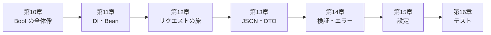

# 第2部 Spring Bootの心臓部

Java の文法が読めるようになったら、次は Spring Boot です。この部では、`java -jar` 1行でサーバーが立つ仕組みから、リクエストが通る道、JSON の境界、エラーの設計、設定、テストまでを、実際に動くアプリで追います。

ここで作る QuickVote は、まだ DB を使いません。投票・選択肢・参加者・票は、メモリ上の `ConcurrentHashMap` に持たせます。それでも API の形、エラーの形、クラスの名前は完成形（`code/quickvote/`）と揃えてあるので、第3部で DB に置き換えるときに変わるのは Repository の中身だけです。

## この部でできるようになること

- Java・Spring Framework・Spring Boot・Tomcat の関係を層の図で説明し、`pom.xml` と起動ログを読める
- 自動構成が「条件付きの設定（if文）」であることを、`--debug` のレポートで確かめられる
- DIコンテナ、Bean、コンストラクタ注入を説明し、起動時の配線エラーを読んで直せる
- Bean にユーザーごとの状態を置く事故を、再現して説明できる
- 1つのリクエストが、Filter → DispatcherServlet → Controller → Service → Repository と、1つのスレッドで運ばれることをログで示せる
- Filter を自作し、Filter・Interceptor・`@ControllerAdvice` を使い分けられる
- JSON の境界（型の読み替え・未知の項目・欠落・日時・数値）で何が起きるかを、実験の事実として言える
- 入力検証を3層に分け、ProblemDetail で全エラーを同じ形で返し、ステータスを選べる
- 設定の優先順位、`@ConfigurationProperties`、プロファイル、秘密の扱いを説明できる
- `@WebMvcTest`・`@SpringBootTest` を使い分けて API をテストし、AI が書いたコードをレビューできる

## アプリの到達状態

第2部が終わった時点で、QuickVote は次のことができます。

| できること | API |
| --- | --- |
| 投票を作る（作った人が主催者になる） | `POST /api/polls` |
| 参加コードで参加する | `POST /api/join` |
| 投票の詳細（選択肢・得票・得票率・自分の票）を見る | `GET /api/polls/{pollId}` |
| 選択肢を追加する（許可されているとき） | `POST /api/polls/{pollId}/options` |
| 投票する（上書き） | `PUT /api/polls/{pollId}/my-vote` |

!!! warning "この時点の保証"
    この時点の QuickVote は動くだけで、データを守る仕組みはまだありません。データはメモリ上にしかなく、再起動で消えます。訪問者の特定には偽装できるヘッダーを使っています。人数と選択肢の上限は、同時実行で破られることがあります。再送すると二重に登録されます。第3部以降で、1つずつ守りを足していきます。

## 各章

<div class="grid cards" markdown>

-   :material-power-plug-outline: **[第10章 Spring Bootとは](ch10-spring-boot.md)**

    ---

    最初のAPI、`pom.xml`とBOM、起動ログ、自動構成は「条件付きの設定」。

-   :material-drama-masks: **[第11章 DIコンテナとBean](ch11-di-container.md)**

    ---

    劇団の配役表、コンストラクタ注入、起動時のエラー、Beanに状態を置く事故。動画つき。

-   :material-routes: **[第12章 リクエストの旅](ch12-request-journey.md)**

    ---

    Tomcat から Controller まで、1つのスレッドが処理する。Filter を自作して通過ログを見る。動画つき。

-   :material-code-json: **[第13章 API契約：DTOとJSON](ch13-api-contract.md)**

    ---

    DTO、Jackson 3、JSON の境界で守られないもの、時刻はサーバーが決める。

-   :material-shield-alert-outline: **[第14章 入力検証とエラーの設計](ch14-validation-errors.md)**

    ---

    3層の検証、ProblemDetail、`@RestControllerAdvice`、400/404/409 の選び方。

-   :material-cog-outline: **[第15章 設定・プロファイル・秘密](ch15-configuration.md)**

    ---

    優先順位、`@ConfigurationProperties`、fail fast、秘密をGitに入れない。

-   :material-test-tube: **[第16章 APIをテストする](ch16-api-testing.md)**

    ---

    `@WebMvcTest`、`MockMvcTester`、`@MockitoBean`、`Clock` の差し替え。第2部の到達確認。

</div>

## 第2部の流れ



第12章の地図を見ると、第13章（引数の組み立てと戻り値の変換）と第14章（検問と例外の道）がリクエストの通り道のどこを扱うかが分かります。第11章の「Bean は全員で共有される」と第12章の「1リクエスト1スレッド」は、合わせて第4部の同時実行につながります。

## 実験コードの置き場

この部のコードは、`code/labs/` にあります。

```text
code/labs/
├── ch10-hello-boot/               第10章：Initializr で作った最小のAPI。起動ログ・--debug・JsonMapper の実験
└── part02-quickvote-inmemory/     第11〜16章：メモリ版の QuickVote（./mvnw test が通る）
    ├── src/main/java/com/example/quickvote/   アプリ本体（poll / participant / vote / common / security / journey）
    ├── src/test/java/com/example/quickvote/   テスト（di / journey / json / config / poll ほか）
    └── review/AiPollController.java.txt       第16章のレビュー演習用
```

```bash
cd code/labs/part02-quickvote-inmemory
./mvnw test                                            # Docker 不要。Windows は .\mvnw.cmd
./mvnw spring-boot:run -Dspring-boot.run.profiles=dev  # ポート 18012。見本の投票つき
```

## 第2部のチェックリスト

第16章を終えたら、次の項目を確かめてください。すべてに ✅ を付けられたら、第3部へ進めます。目安は「③ 検証できる」（実験や反例で確かめられる）です。

- [ ] Java・Spring Framework・Spring Boot・Tomcat・JVM の関係を、層の図を描いて説明できる
- [ ] `pom.xml` の親 POM（BOM）がバージョンを決める仕組みを、`package.json` と対比して説明できる
- [ ] `--debug` の条件評価レポートを読み、自動構成が「条件付きの設定」であることと、`@ConditionalOnMissingBean` で引っ込む理由を説明できる
- [ ] 起動ログを読み、Boot・Tomcat・Java のバージョン、ポート、起動時間を言える
- [ ] コンストラクタ注入を書き、フィールド注入が良くない理由と、Bean が「ない」「2つある」「循環する」ときの起動エラーの読み方を説明できる
- [ ] Bean は全リクエストで共有される singleton であり、リクエスト固有の状態をフィールドに置くと混ざることを、再現して説明できる
- [ ] リクエストが通る道（Tomcat → Filter → DispatcherServlet → 引数の組み立て → Controller → Service → Repository）を、順に言える
- [ ] 1リクエストを同じスレッドが最後まで運ぶことを、ログで示せる
- [ ] Filter・Interceptor・`@ControllerAdvice` の違いを説明し、置き場所を選べる
- [ ] 内部のデータを直接返さず、DTO（`record`）で外に出す形を明示する理由を、漏れる項目の例で説明できる
- [ ] Jackson が型を読み替える・未知の項目を無視する・プリミティブの欠落を拒否することを、実験の事実として言え、`tools.jackson` と `com.fasterxml.jackson` の違いを説明できる
- [ ] 入力検証を Bean Validation／業務ルール／DB制約の3層に分け、`@Valid` の付け忘れで検証が働かないことを確かめられる
- [ ] ProblemDetail と `@RestControllerAdvice` でエラーを同じ形で返し、`code` を使い、スタックトレースや入力値を外に出さない設計ができる
- [ ] 400／401／403／404／409／422／500 を、フローチャートの問いで選べる
- [ ] 設定の優先順位、`@ConfigurationProperties` の fail fast、秘密を Git に入れない運用を説明し、`@WebMvcTest` と `@SpringBootTest` を使い分けて API のテストを書ける

!!! tip "チェックの付け方"
    「たぶん分かる」では付けないでください。白紙に自分の言葉で書いて説明できたときに付けます。説明できない項目は、各章の「まとめ」にある戻り先のリンクから、その章を読み直します。

## 統合課題：メモリ版 API に、エンドポイントを1つ足す

メモリ版の QuickVote（`code/labs/part02-quickvote-inmemory/`）に、投票のタイトルを変更する `PATCH /api/polls/{pollId}` を足してください。変更できるのは主催者だけで、締切済みの投票は変更できません。

1. リクエストを DTO（`record`）にし、Bean Validation で「空でない」「文字数の上限」を検証する（`@Valid` を付け忘れない）
2. 業務ルールは Service に書く。存在しない投票は 404、主催者でなければ 403、締切済みなら 409 とし、`ErrorCode` に足す必要があるものは足す
3. エラーは、既存のエンドポイントと同じ ProblemDetail（`code` つき）で返る。スタックトレースや入力値は外に出さない
4. `@WebMvcTest` と `MockMvcTester` で、「200」「400」「403」「404」「409」の5つを確かめる。Service は `@MockitoBean` で差し替えてよい

??? success "解答の観点"
    - 配線（第11章）：Controller は Service をコンストラクタ注入で受け取り、リクエスト固有の値（誰が、どの投票を）をフィールドに持っていないか
    - 契約（第13章）：戻り値は内部のクラスではなく、DTO（`PollDetail` など）か。タイトルの文字数制限は、既存の作成 API と同じ部品（`BoundedText`）で揃っているか
    - 検証の層（第14章）：形の検証（空・長さ）は Bean Validation、状態の検証（主催者か・締切済みか）は Service、と分かれているか。ステータスの選び方に理由があるか
    - テスト（第16章）：5つのステータスがそれぞれ別のテストになっているか。エラー本文の `code` まで確かめているか。`@SpringBootTest` ではなく `@WebMvcTest` で足りているか
