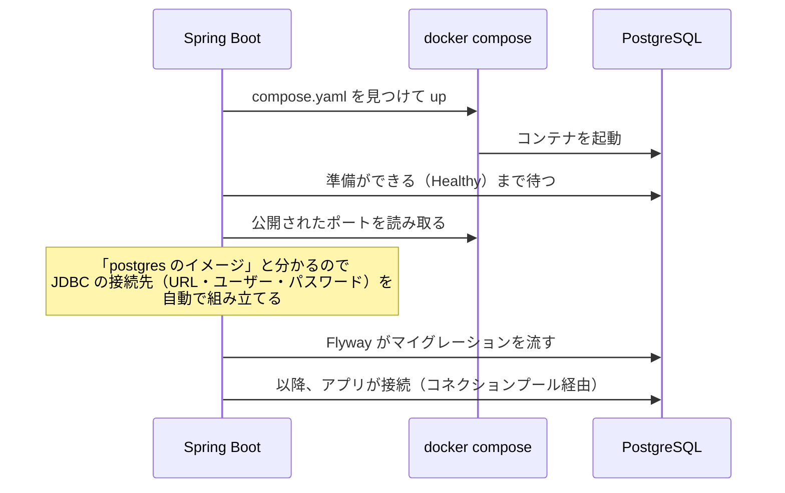
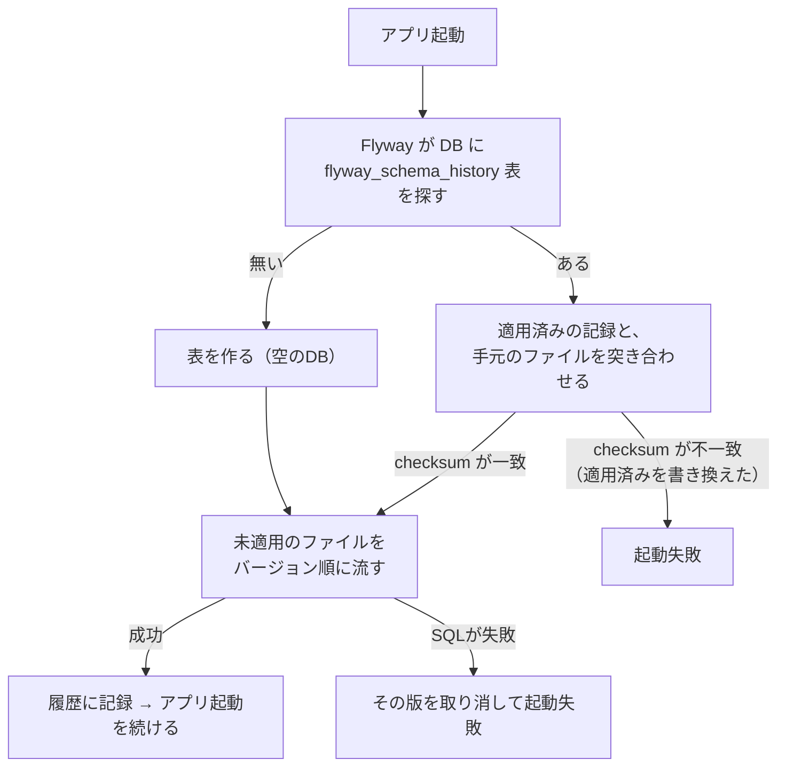

# 第17章 PostgreSQLとFlyway：スキーマをコードで育てる

<div class="goal-box" markdown>

この章でできるようになること

- Docker Compose で PostgreSQL 18 を起動し、Spring Boot の Docker Compose 連携で「接続先を書かずに」つなげる
- Flyway のマイグレーション（`V1__説明.sql`）で、テーブルをコードとして管理できる
- 適用済みのマイグレーションを書き換えると何が起きるかを再現し、エラーを読んで、正しい直し方（新しい `V` を足す）を選べる
- マイグレーションが途中で失敗したとき、PostgreSQL ではどうなるかを説明できる
- チーム開発で起きるバージョン番号の衝突を、メッセージから見分けられる

</div>

## 1. 問いかけ：再起動したら、投票が全部消えた

第2部の QuickVote は、投票も参加者も `ConcurrentHashMap` に持っていたので、アプリを再起動するとすべて消えます。

DB に替えるといっても、Repository の中身を SQL にするだけでは済みません。その前に、次の問いに答える必要があります。

- テーブルは誰がいつ作るのか（手で `CREATE TABLE` を打つのか）
- 自分の PC、テスト、本番の DB が同じ形であることを、どう保証するのか
- 仕様が変わって列を足すとき、動いている本番の DB にどう反映するのか

フロントエンドで言えば、「`localStorage` に入れる値の形を変えたとき、すでに使っているユーザーのブラウザに残った古いデータをどうするか」に近い問題です。ただしサーバーの DB は、全員で共有する1つしかありません。作り直すわけにはいきません。

この章では DB を起動し、スキーマ（テーブルの形）をコードとしてバージョン管理する仕組み、Flyway を使います。

!!! warning "この時点の保証"
    第2部の終わりは「メモリ上で動く」でした。この章の終わりでも、アプリはまだ DB を使いません。この章で作るのは、DB と、DB の形を育てる仕組みです。QuickVote が DB を使い始めるのは第19章です。

## 2. 先に完成形を見る

この章の実験は `code/labs/ch17-flyway/` で行います。Spring Initializr で依存を4つだけ選んで作った、最小のプロジェクトです。

```bash
curl https://start.spring.io/starter.zip -d bootVersion=4.1.2 -d javaVersion=25 -d type=maven-project \
  -d dependencies=jdbc,flyway,postgresql,docker-compose -d artifactId=flyway-lab -o s.zip
```

これを起動すると、次のことが自動で起きます。

```bash
./mvnw spring-boot:run          # Windows は .\mvnw.cmd spring-boot:run
```

```text
DockerComposeLifecycleManager : Using Docker Compose file ...\ch17-flyway\compose.yaml
DockerCli : Container ch17-flyway-postgres-1 Started
DockerCli : Container ch17-flyway-postgres-1 Healthy
FlywayExecutor   : Database: jdbc:postgresql://127.0.0.1:25417/quickvote (PostgreSQL 18.6)
DbMigrate        : Migrating schema "public" to version "1 - create polls and options"
DbMigrate        : Successfully applied 1 migration to schema "public", now at version v1
FlywayLabApplication : Started FlywayLabApplication in 9.482 seconds
```

`application.yaml` には DB の接続先を1行も書いていませんが、コンテナの起動、接続、テーブルの作成まで済んでいます。

## 3. PostgreSQLをDocker Composeで起動する

### compose.yaml

!!! note "用語：Docker Compose（ドッカー・コンポーズ）"
    使うコンテナ（DB など）を `compose.yaml` というファイルに書いておき、`docker compose up` の1行でまとめて起動する仕組みです。「このプロジェクトに必要な部品」をコードとして共有できます。コンテナは、他のソフトと切り離された、使い捨ての実行環境です。

Initializr が作った `compose.yaml` は、次の形でした。

```yaml
services:
  postgres:
    image: 'postgres:latest'
    environment:
      - 'POSTGRES_DB=mydatabase'
      - 'POSTGRES_PASSWORD=secret'
      - 'POSTGRES_USER=myuser'
    ports:
      - '5432'
```

教材では2か所を直しました。

```yaml title="code/labs/ch17-flyway/compose.yaml"
services:
  postgres:
    image: 'postgres:18-alpine'   # (1)!
    environment:
      POSTGRES_DB: quickvote
      POSTGRES_USER: quickvote
      POSTGRES_PASSWORD: quickvote
    ports:
      - '25417:5432'              # (2)!
```

1. `latest` は「その時点の最新」を指すので、ある日突然メジャーバージョンが変わり、本番とテストで版がずれることがあります。本番と同じメジャーバージョンに固定します。
2. `ホスト側:コンテナ側` の順に書きます。Initializr の `'5432'` は「ホスト側はランダム」という意味でした。Windows ではすでに別の PostgreSQL が 5432 番を使っていることが多いので、教材では別の番号に固定します（完成形 `code/quickvote` は 15432）。

DB のユーザー名とパスワード（`quickvote`）は開発用の使い捨てです。本番の秘密を Git に入れるわけにはいきません（第15章）。

### Spring Boot が「つなぎ方」を読み取る

pom.xml には `spring-boot-docker-compose` が入っています。

```xml title="code/labs/ch17-flyway/pom.xml（抜粋）"
<dependency>
    <groupId>org.springframework.boot</groupId>
    <artifactId>spring-boot-docker-compose</artifactId>
    <scope>runtime</scope>
    <optional>true</optional>
</dependency>
```

これがあると、アプリの起動時に Spring Boot が次のことを行います。



Spring Boot はイメージの種類（postgres）から接続情報を自動で組み立てるので、`spring.datasource.url` などを書く必要がありません。ログの `Database: jdbc:postgresql://127.0.0.1:25417/quickvote` が、その結果です。

!!! note "用語：コネクションプール"
    DB への接続（コネクション）は、作るのに時間がかかります。そこで、あらかじめ数本つないでおいて使い回す仕組みがあり、Spring Boot の既定は HikariCP です。接続の数に限りがあることが事故の原因になります（第24章）。ここでは「アプリは、つなぎっぱなしの数本の接続を使い回して DB を使う」とだけ覚えてください。

### 止めたら、DBはどうなるか

`application.yaml` には、次の1行を書いています。

```yaml title="code/labs/ch17-flyway/src/main/resources/application.yaml"
spring:
  docker:
    compose:
      lifecycle-management: start-only
```

| 設定値 | アプリ起動時 | アプリ停止時 |
| --- | --- | --- |
| `none` | 何もしない | 何もしない |
| `start-only` | コンテナを起動 | そのまま動かしておく |
| `start-and-stop`（既定） | コンテナを起動 | `docker compose stop` する |

既定のままアプリを終了させると（この章の最小プロジェクトは、起動してすぐ終わります）、コンテナは `Exited (0)` になりました。教材では、再起動のたびに待たされないよう `start-only` にしています。止めた DB のデータは、**コンテナを消す（`docker compose down`）までは残ります**。データも含めて消したいときは `docker compose down -v` を使います。

## 4. Flywayとは何か：DBのGit

### 例え：Flyway は DB の Git

!!! tip "フロントエンドで例えると：Flyway は DB の Git"
    ソースコードは Git で、「誰が、いつ、何を変えたか」を履歴として残し、どの環境でも同じ状態を再現できます。
    DB の形も同じ考え方で扱います。`CREATE TABLE` や `ALTER TABLE` をファイルとして積み重ね、どこまで適用済みかは Flyway が DB の中に記録します。新しい環境では V1 から順に流すだけで、本番と同じ形ができます。

!!! warning "この例えが外れる点"
    Git はコミットを巻き戻せます（`revert`、`reset`）。**Flyway は基本的に巻き戻しません。** 適用済みのファイルは「歴史」であり、書き換えられません。間違えたときは、間違いを直す新しいコミットに当たるもの（新しい V）を足します。巻き戻しの機能（undo）は、Flyway の有償版にあります。

!!! note "用語：マイグレーション（migration）"
    DB のスキーマ（テーブル・列・制約などの形）を、ある状態から次の状態へ変える1回分の変更のことです。Flyway では、1つのマイグレーションが1つの SQL ファイルです。

### ファイルの名前と置き場所

```text
src/main/resources/db/migration/
    V1__create_polls_and_options.sql
    V2__create_participants_and_votes.sql      ← 次の章で足す
```

| 部分 | 意味 |
| --- | --- |
| `V` | バージョン付きマイグレーション（1回だけ流す）の印 |
| `1` | バージョン番号。この数の小さい順に流される |
| `__`（アンダースコア2つ） | 区切り。1つでは区切りにならない |
| `create_polls_and_options` | 説明。履歴に表示される |
| 置き場所 | `db/migration`（Spring Boot の既定。`spring.flyway.locations` で変えられる） |

pom.xml には、Boot 4 では2つの依存が要ります。

```xml title="pom.xml（抜粋）"
<dependency>
    <groupId>org.springframework.boot</groupId>
    <artifactId>spring-boot-starter-flyway</artifactId>
</dependency>
<dependency>
    <groupId>org.flywaydb</groupId>
    <artifactId>flyway-database-postgresql</artifactId>
</dependency>
```

Boot 3 以前の記事にある `flyway-core` だけでは足りません（[Boot 3 → 4 差分カード](../appendix/boot3-to-4.md)のカード5）。PostgreSQL 用の部分が別の部品に分かれているためです。

### 最初のマイグレーション：V1

QuickVote の V1 は、投票（`polls`）と選択肢（`options`）です。完成形のファイルそのものを、この章の実験にも使っています。

```sql title="src/main/resources/db/migration/V1__create_polls_and_options.sql（抜粋）"
CREATE TABLE polls (
    id                   bigint GENERATED ALWAYS AS IDENTITY PRIMARY KEY,
    public_id            uuid         NOT NULL UNIQUE,
    title                varchar(100) NOT NULL,
    status               varchar(10)  NOT NULL,
    join_code            char(8)      NOT NULL UNIQUE,
    allow_member_options boolean      NOT NULL,
    closes_at            timestamptz  NOT NULL,
    delete_after         timestamptz  NOT NULL,
    created_at           timestamptz  NOT NULL,
    CONSTRAINT polls_status_check CHECK (status IN ('OPEN', 'CLOSED')),
    -- ...（CHECK 制約が続く。意味は第18章で1つずつ読む）
);

CREATE INDEX polls_delete_after_idx ON polls (delete_after);
```

「なぜ `id` と `public_id` の2つがあるのか」「`CHECK` は何を守るのか」は、第18章で設計の話として読みます。今の時点では、ただの SQL ファイルだと分かれば十分です。

### 起動時に、Flyway が何をするか



実際に DB の中を確かめます。

```bash
docker compose exec postgres psql -U quickvote -c '\dt' \
  -c 'SELECT installed_rank, version, description, checksum, success FROM flyway_schema_history'
```

```text
 Schema |         Name          | Type  |   Owner   
--------+-----------------------+-------+-----------
 public | flyway_schema_history | table | quickvote
 public | options               | table | quickvote
 public | polls                 | table | quickvote

 installed_rank | version |       description        | checksum  | success 
----------------+---------+--------------------------+-----------+---------
              1 | 1       | create polls and options | 858975687 | t
```

自分で作った `polls` と `options` のほかに、`flyway_schema_history` という表があります。Flyway の記録帳で、どのファイルを（`version`）いつ適用し、成功したか（`success`）、そしてそのときのファイルの内容の指紋（`checksum`）が残っています。

!!! note "用語：checksum（チェックサム）"
    ファイルの内容から計算した数値です。1文字でも変わると別の値になります。Flyway は適用したときの値を記録しておき、次の起動のときに「手元のファイルの値」と比べます。

## 5. 壊してみる①：適用済みのマイグレーションを書き換える

V1 を適用したあとで、「タイトルは200文字まで許したくなった」としましょう。V1 の `varchar(100)` を `varchar(200)` に書き換えて、再起動します。

```diff
-    title                varchar(100) NOT NULL,
+    title                varchar(200) NOT NULL,
```

!!! question "予測カード"
    再起動すると、どうなるでしょう。
    (a) `title` 列が200文字に変わる　(b) 何も変わらず、そのまま起動する　(c) 起動に失敗する

答えは (c) です。

```text
Caused by: org.flywaydb.core.api.exception.FlywayValidateException: Validate failed: Migrations have failed validation
Migration checksum mismatch for migration version 1
-> Applied to database : 858975687
-> Resolved locally    : -643177187
Either revert the changes to the migration, or run repair to update the schema history.
```

エラーメッセージには、原因がそのまま書いてあります。

| 行 | 意味 |
| --- | --- |
| `checksum mismatch for migration version 1` | 版 1 のファイルの指紋が合わない |
| `Applied to database : 858975687` | DB に記録された、適用時の指紋 |
| `Resolved locally : -643177187` | 今、手元にあるファイルの指紋 |
| `revert ... or run repair` | 書き換えを戻すか、記録を直す（`repair`）かのどちらか |

### なぜ、起動を止めるのか

DB は `varchar(100)` のままなのに、ファイルは `200` だと言っています。ファイルと実際の DB の形が食い違っているわけです。さらに困るのは他の環境で、次のようになります。

- 自分の PC の DB：V1（`100`）を適用済み
- 同僚が今日初めて起動した新しいDB：書き換え後の V1（`200`）で作られる
- 本番の DB：昨日 V1（`100`）を適用済み

同じ「V1」なのに、3つの環境で形が違います。Flyway は、これを起動の時点で止めて知らせます。静かに食い違っていくよりずっと安全です。

コメントを1行足しただけでも指紋は変わります（実験で確認しました。`Resolved locally : 1389191398`）。**適用済みのファイルは、1文字も触らない**のが約束です。

### 正しい直し方：新しい V を足す

書き換えを元に戻し、新しいファイルを足します。

```sql title="code/labs/ch17-flyway/experiments/V2__widen_polls_title.sql"
-- 仕様変更: タイトルを 200 文字まで許す。適用済みの V1 は触らず、新しい V を足す。
ALTER TABLE polls ALTER COLUMN title TYPE varchar(200);
```

```text
DbValidate : Successfully validated 2 migrations
DbMigrate  : Current version of schema "public": 1
DbMigrate  : Migrating schema "public" to version "2 - widen polls title"
DbMigrate  : Successfully applied 1 migration to schema "public", now at version v2
```

履歴には、版が積み重なります。

```text
 installed_rank | version |       description        |  checksum   | success 
----------------+---------+--------------------------+-------------+---------
              1 | 1       | create polls and options |   858975687 | t
              2 | 2       | widen polls title        | -1292809829 | t
```

自分の PC、同僚の新しい DB、本番の DB のどれでも V1 → V2 の順に流れて、同じ形になります。これが「DB の Git」です。

!!! warning "`repair` は『直す』ではない"
    エラーメッセージが勧める `repair` は、履歴の記録（checksum）を今のファイルに合わせて書き換えるだけです。DB の実体（列の定義）は一切変わりません。使ってよいのは、「空白を整えただけで DB の形に影響しないと確信できる」場合など、ごく限られます。間違った理由で使うと、さきほどの「3つの環境で形が違う」状態を黙認することになります。

## 6. 壊してみる②：マイグレーションの途中で失敗する

V3 は、わざと2文目で失敗するように書きます。

```sql title="code/labs/ch17-flyway/experiments/V3__broken.sql"
ALTER TABLE polls ADD COLUMN memo text;       -- 1文目：成功する
ALTER TABLE nosuch_table ADD COLUMN x int;    -- 2文目：存在しない表なので失敗する
```

```text
DbMigrate : Migration of schema "public" to version "3 - add memo" failed! Changes successfully rolled back.
SQL State  : 42P01
Message    : ERROR: relation "nosuch_table" does not exist
Line       : 2
```

`Changes successfully rolled back.`（変更は取り消されました）。実際に確かめます。

```text
 version |       description        | success 
---------+--------------------------+---------
 1       | create polls and options | t
 2       | widen polls title        | t

 column_name 
-------------
(0 rows)
```

履歴に V3 は残らず、1文目で足したはずの `memo` 列もありません。PostgreSQL は、`CREATE TABLE` や `ALTER TABLE` のような構造を変える文もトランザクションの中で実行でき、失敗すると全部なかったことになるからです。

!!! note "用語：トランザクション"
    複数の操作を「全部成功か、全部なかったことにするか」の1つのまとまりにする仕組みです。第22章では、アプリのコードからも使います。

この性質は DB の種類によって違い、構造を変える文が自動で確定してしまう DB もあります。**PostgreSQL では、失敗した V は何も残さないので、直して再実行すれば足ります。** 失敗した版には checksum の記録が残らないため、このときに限ってファイルを直して構いません。

## 7. 壊してみる③：チームで同時に V を作る

2人が別のブランチで同じ「次の番号」を使うことは、よくあります。

### 同じ番号が2つ

`V3__add_memo.sql` を適用したあと、別のブランチから `V3__add_note.sql` が合流したとします。

```text
Found more than one migration with version 3
Offenders:
-> ...\db\migration\V3__add_memo.sql (SQL)
-> ...\db\migration\V3__add_note.sql (SQL)
```

起動は止まります。どちらかの番号を変えて解決します。まだ誰も適用していないファイルなら、番号は自由に付け替えられます。

### 後から小さい番号が現れる

V3 を適用済みの DB に、`V2_1__add_note.sql`（V2 と V3 の間の番号）が合流したとします。

```text
Detected resolved migration not applied to database: 2.1.
To ignore this migration, set -ignoreMigrationPatterns='*:ignored'. To allow executing this migration, set -outOfOrder=true.
```

歴史の途中に後から差し込まれた形なので、Flyway は流しません。番号は常に、今ある最大より大きくします。`outOfOrder=true` で流すこともできますが、環境ごとに適用順が変わるため、通常は使いません。

!!! warning "ハマりどころ：消したはずのマイグレーションが、まだ見つかる"
    この実験で `V3__add_note.sql` を削除したのに、同じエラーが出続けました。`spring-boot:run` は `src/main/resources` を `target/classes` にコピーするだけで、元ファイルの削除をコピー先に反映しないためです。`./mvnw clean spring-boot:run` のように `clean` を付けると消えます。「ファイルを消したのに反映されない」ときによくある原因です。

## 8. 現場ではこうする

| ルール | 理由 |
| --- | --- |
| 適用済みの V は、書き換えない・消さない | 環境ごとに DB の形がずれる |
| 間違いは、新しい V で直す | 歴史が積み重なる。本番でも同じ手順で再現できる |
| 1つの V は、1つの目的 | 失敗したときの切り分けと、レビューがしやすい |
| 番号は、今ある最大より大きく | 後からの差し込みを防ぐ |
| データがある本番の変更は、列を足してから使い、最後に消す（段階的に進める） | 稼働中に列を消すと、古い版のアプリが落ちる（第46章） |
| 開発データは、マイグレーションに入れない | 本番にもそのまま流れてしまう |
| テーブルは Flyway で作る。アプリに自動で作らせない | 下の注意 |

!!! danger "AI が出しがちな設定：`ddl-auto`"
    AI が書いた設定に `spring.jpa.hibernate.ddl-auto=update`（アプリが起動時にエンティティの形に合わせてテーブルを自動で変更する）が入っていたら、本線では採用しないでください。誰がいつ何を変えたか履歴が残らず、環境ごとに形がずれ、本番のデータで事故になります。JPA を使う第8部でも、スキーマは Flyway で作ります。

## 9. まとめと、次の章へ

この章で、DB を起動し、スキーマをコードとして育てる準備が整いました。V1 の中身は、まだ読み方が分かっていない状態です。次の章では、どんな条件をどの層で守るかという設計の話として、1つずつ読み解きます。

---

## まとめ：3点セット

!!! abstract "この章の3点セット"
    **① 一言で言うと**
    スキーマの変更は、バージョン付きの SQL ファイル（マイグレーション）として積み重ね、Flyway が適用済みの版とその checksum を DB に記録する。適用済みのファイルは変更せず、変更は常に新しい版として足す。

    **② 現場でこう聞かれる**
    「本番に出したマイグレーションの typo に気づいたので、ファイルを直していいですか？」
    → いけない。checksum が合わずにアプリが起動しなくなる（そもそも本番と手元で形がずれる）。直す内容を、新しい版のマイグレーションとして足す。

    **③ 自分のサービスならどこに当たるか**
    自分のサービスの「最初のテーブル」を3つ挙げ、V1 に入れるものと、後から V2 以降で足すものを分けて書き出す。「後から足すと既存データが困る列（`NOT NULL` など）」はどれか。

## 演習

??? question "確認問題1：予測と観察"
    適用済みの V1 に、末尾へコメント行を1行足して再起動しました。起動は成功するか、失敗するか。理由も説明してください。

??? success "解答"
    失敗します。checksum はファイルの内容から計算するので、コメントでも値が変わります（実験で `858975687` が `1389191398` に変わり、`checksum mismatch` で起動に失敗しました）。DB の形に影響しない変更でも、適用済みのファイルは触りません。

??? question "確認問題2：エラーの読み取り"
    次のメッセージが出ました。何が起きていて、どう直しますか。
    `Detected resolved migration not applied to database: 4.` ただし、DB は版 6 まで適用済みです。

??? success "解答"
    適用済みの最大の版（6）より小さい番号（4）の未適用ファイルが、後から現れています（別のブランチから合流した、など）。歴史の途中への差し込みは流されません。まだ誰にも適用されていないなら、番号を 7 以降に付け替えます。`outOfOrder` を有効にして流すこともできますが、環境ごとに適用順が変わるので、通常は避けます。

??? question "応用：QuickVote に変更を足す"
    `polls` に、投票の説明文 `description`（最大500文字、省略可）を足す V を書いてください。ファイル名と SQL は？ `NOT NULL` にしなかった理由も説明してください。

??? success "解答"
    例：`V3__add_polls_description.sql`（実際の番号は、そのときの最大＋1）。
    ```sql
    ALTER TABLE polls ADD COLUMN description varchar(500);
    ```
    `NOT NULL` にしないのは、すでにある投票の行には説明文がなく、`DEFAULT` なしで `NOT NULL` の列は足せないためです。既存の行を持つ表に必須の列を足すには、段階的な手順が要ります（第46章）。

??? question "説明問題：現場でこう聞かれる"
    「Flyway を使うと、何が嬉しいんですか？ 本番で手で SQL を流すのと何が違います？」200字程度で答えてください。

??? success "解答"
    例：どの環境でも、同じ順序で同じ変更が再現されるからです。変更は SQL ファイルとして Git に残るのでレビューでき、Flyway が適用済みの版と checksum を DB に記録します。手で流す運用では、環境ごとの差や流し忘れが起きますが、Flyway は起動時に検証して、食い違いがあればアプリを止めます。
