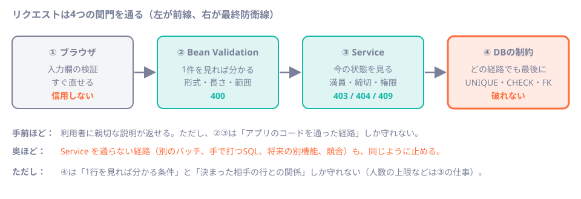
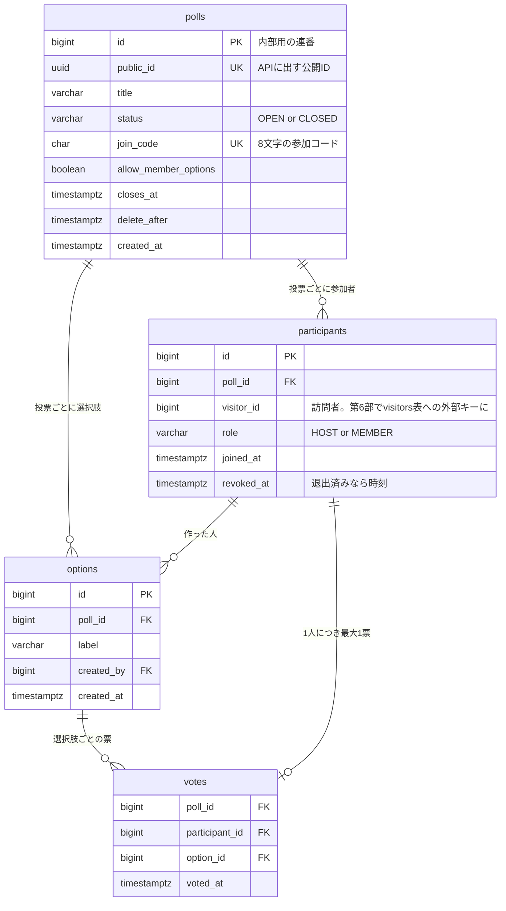

# 第18章 データモデルと制約設計

<div class="goal-box" markdown>

この章でできるようになること

- QuickVote のテーブルを ER 図で描き、各テーブルの責務と関係を説明できる
- 主キー（`bigint` の identity）と公開用 ID（`uuid`）を分ける理由を説明できる
- `NOT NULL`・`UNIQUE`・`CHECK`・外部キーが、それぞれ何を守るかを、実際に破って確かめられる
- 「アプリの `if` は前線、制約は最終防衛線」の意味を、2つの層の役割分担として説明できる
- 単一行（または決まった相手の行）で守れる条件と、複数行にまたがる条件を見分けられる
- 削除方針（連鎖して消す／拒否する／論理削除）を、データの性質から選べる

</div>

## 1. 問いかけ：「1人1票」は、どこで守る？

第2部の `VoteService` は、こう書かれていました。

```java
votes.upsert(poll.id(), context.participantId(), optionId, now);
```

「1人1票」は、`VoteRepository` の中の `Map` のキー `(pollId, participantId)` が守っていました。では DB に替えたとき、これをどこで守ればよいでしょうか。方法は2通り考えられます。

- `INSERT` の前に `SELECT` して、票がなければ入れる（アプリの `if`）
- DB に「この組は1行まで」と宣言する（制約）

この章は表と図が中心の設計の章で、コードは最後に少し書くだけです。QuickVote のテーブルを一通り設計しながら、守る条件をどの層に置くかを決める考え方を身につけます。

## 2. 前線と最終防衛線

第14章では検証を3つの層に分けました。ここにブラウザを4つ目として足して、整理します。



| 層 | 得意なこと | 苦手なこと |
| --- | --- | --- |
| ① ブラウザ | 入力中に、すぐ教えられる | 信用できない（`curl` で飛ばせば素通り） |
| ② Bean Validation | リクエスト1件を見れば分かる形式・長さ・範囲 | 今の DB の状態を知らない |
| ③ Service（業務ルール） | 今の状態を見て判断する（満員・締切・権限）。利用者に分かる説明を返す | Service を通らない経路は守れない。同時に実行されると破れる（第4部） |
| ④ DB の制約 | どの経路から来ても、最後に必ず守る | 説明が不親切（`duplicate key value violates...`）。守れる条件の種類に限りがある |

> **アプリの `if` は前線、制約は最終防衛線。**

前線（②③）は、利用者に分かりやすい説明を返すために置きます。最終防衛線（④）は、前線をすり抜けたものを止めるために置きます。どちらか一方では足りません。

前線をすり抜けるものは、次の3つの形で現れます。同時に2つのリクエストが来て、どちらも `if` を通過することがあります（第4部の主題）。別の機能、バッチ、手で打った SQL、将来の自分が書いたコードが、Service を通らずに書き込むこともあります。バグで `if` の条件が間違っている場合もあります。

AI が書くコードは、②③だけで終わっていることがよくあります。スキーマのレビューでは、「この制約が DB にあるか」を必ず見ます。

## 3. QuickVote のテーブルを描く

第3部の段階で必要なテーブルは4つです。



| テーブル | 1行が表すもの | 主な責務 |
| --- | --- | --- |
| `polls` | 1つの投票 | 公開ID、締切、参加コード、状態 |
| `options` | 投票の選択肢1つ | ラベルと作成者 |
| `participants` | 「ある訪問者が、ある投票に、ある役割で参加している」という事実 | 権限判定の根拠（第30章） |
| `votes` | 「ある参加者が、ある選択肢に投票した」という事実 | 票。1人1票 |

`visitors`（訪問者）、`invites`（招待）、`idempotency_records`（再送の記録）、`poll_events`（SSE の履歴）は、後の部で必要になったときに足します。これが前章で学んだ「スキーマを育てる」ことです。完成形（`code/quickvote`）では、`visitors` が `participants` の外部キーの都合で V2 に前倒しされていますが、第3部のラボでは `visitor_id` を外部キーなしの数値にして、第6部で足します。

## 4. 主キー：連番と公開IDを分ける

`polls` には、ID が2つあります。

```sql
id        bigint GENERATED ALWAYS AS IDENTITY PRIMARY KEY,   -- 内部用
public_id uuid   NOT NULL UNIQUE,                            -- APIに出す
```

### 内部ID：`bigint` の identity

!!! note "用語：identity 列"
    `GENERATED ALWAYS AS IDENTITY` を付けた列は、DB が 1, 2, 3, … と自動で採番します。`ALWAYS` なので、アプリが値を指定して入れようとするとエラーになります（実験で確認しました：`cannot insert a non-DEFAULT value into column "id"`）。

連番には癖が1つあるので、実際に確かめておきます。

```sql
INSERT INTO g (role) VALUES ('MEMBER');   -- id = 1
INSERT INTO g (role) VALUES ('ADMIN');    -- CHECK 違反で失敗。Failing row contains (2, ADMIN)
INSERT INTO g (role) VALUES ('MEMBER');   -- id = 3 !
```

```text
 id |  role  
----+--------
  1 | MEMBER
  3 | MEMBER
```

失敗した INSERT も番号を使うので、連番には欠番ができます。「連番＝件数」や「連番は連続している」という期待は持たないでください。

### 公開ID：推測できない `uuid`

URL に `/api/polls/1`、`/api/polls/2` と連番を出すと、他人の投票を順に試せてしまいます。「存在しない投票」と「参加していない投票」を同じ404にする（存在を漏らさない）設計でも、連番では試行の入口になります。そこで、API に出す ID は別に持ちます。

| | 内部ID `id` | 公開ID `public_id` |
| --- | --- | --- |
| 型 | `bigint`（8バイト） | `uuid`（16バイト） |
| 使う場所 | 外部キー、JOIN、内部の処理 | URL、JSON（API の外側） |
| 推測 | できる | できない |
| 作る人 | DB | アプリ（`UUID.randomUUID()`） |

JOIN と外部キーは、小さくて速い `bigint` で行います。外に出す必要がある場面だけ `uuid` を使います。

!!! tip "PostgreSQL 18 の `uuidv7()` は使わないのか"
    PostgreSQL 18 には、時刻順に並ぶ UUID を作る `uuidv7()` が入りました。実測すると、先頭の部分は時刻です（`uuid_extract_timestamp(uuidv7())` が現在時刻を返しました）。並び順がよくインデックスの効率も良い一方で、作成時刻が漏れます。公開 ID に求めるのは「推測できないこと」なので、教材ではランダムな v4 を選んでいます。

## 5. 制約を1つずつ破る

V2 で作る `participants` と `votes` を例に、各制約が何を守るかを、実際に破って確かめます（第3部のラボを起動した DB で、`psql` から実行しました）。

```sql title="src/main/resources/db/migration/V2__create_participants_and_votes.sql（participants の部分）"
CREATE TABLE participants (
    id         bigint GENERATED ALWAYS AS IDENTITY PRIMARY KEY,
    poll_id    bigint      NOT NULL REFERENCES polls (id) ON DELETE CASCADE,
    visitor_id bigint      NOT NULL,
    role       varchar(10) NOT NULL,
    joined_at  timestamptz NOT NULL,
    revoked_at timestamptz,
    CONSTRAINT participants_role_check CHECK (role IN ('HOST', 'MEMBER')),
    CONSTRAINT participants_poll_visitor_key UNIQUE (poll_id, visitor_id),
    CONSTRAINT participants_poll_id_id_key UNIQUE (poll_id, id)
);
```

### UNIQUE：同じものを2つ作らせない

```sql
INSERT INTO participants (poll_id, visitor_id, role, joined_at) VALUES (1, 2, 'MEMBER', now());
```

```text
ERROR:  duplicate key value violates unique constraint "participants_poll_visitor_key"
DETAIL:  Key (poll_id, visitor_id)=(1, 2) already exists.
```

この制約は、同じ訪問者が同じ投票に二重に参加できないことを守ります。一意なのは1列ではなく組（`poll_id` と `visitor_id` の組）である点に注意してください。訪問者は、別の投票になら参加できます。

`votes` の `UNIQUE (poll_id, participant_id)` が、冒頭の「1人1票」の答えです。

```text
ERROR:  duplicate key value violates unique constraint "votes_poll_participant_key"
DETAIL:  Key (poll_id, participant_id)=(1, 2) already exists.
```

!!! note "用語：制約の名前"
    `CONSTRAINT participants_poll_visitor_key` のように、制約には名前を付けます。名前を付けないと自動で決まり、エラーメッセージや後からの変更（`ALTER TABLE ... DROP CONSTRAINT`）で扱いにくくなります。

### CHECK：1行を見れば分かる条件

```sql
INSERT INTO participants (poll_id, visitor_id, role, joined_at) VALUES (1, 3, 'ADMIN', now());
```

```text
ERROR:  new row for relation "participants" violates check constraint "participants_role_check"
DETAIL:  Failing row contains (4, 1, 3, ADMIN, 2026-11-07 23:12:27.209463+00, null).
```

`role` に入れられるのは `HOST` か `MEMBER` だけです。Java の `enum`（第4章）に当たるものを、DB の側にも置いています。`polls` の `status`、参加コード（`join_code ~ '^[ABCDEFGHJKMNPQRSTUVWXYZ23456789]{8}$'`：正規表現）、`closes_at >= created_at` も CHECK です。

!!! warning "エラーの `DETAIL` に、行の中身が出る"
    `Failing row contains (...)` には、違反した行の全部の値が入ります。タイトルや参加コードも含まれます。この例外メッセージをそのままログや応答に出すと、本文が漏れます（完成形が `SafeThrowable` で防いでいる理由。第43章）。

### NOT NULL：「無い」を許さない

```sql
UPDATE polls SET title = NULL WHERE id = 1;
```

```text
ERROR:  null value in column "title" of relation "polls" violates not-null constraint
```

列は既定では NULL を許す点に注意してください。必須の列には `NOT NULL` を付けます。付けないのは、「値がない状態に意味がある」列だけです。`participants.revoked_at` は、NULL が「退出していない」を意味します。

### 外部キー：存在しない相手を指させない

```sql
INSERT INTO participants (poll_id, visitor_id, role, joined_at) VALUES (999, 3, 'MEMBER', now());
```

```text
ERROR:  insert or update on table "participants" violates foreign key constraint "participants_poll_id_fkey"
DETAIL:  Key (poll_id)=(999) is not present in table "polls".
```

存在しない投票の参加者は作れません。

### 複合外部キー：「同じ投票の中の」相手しか指させない

`votes` には、少し変わった外部キーがあります。

```sql title="V2 の votes の部分"
CREATE TABLE votes (
    poll_id        bigint      NOT NULL,
    participant_id bigint      NOT NULL,
    option_id      bigint      NOT NULL,
    voted_at       timestamptz NOT NULL,
    CONSTRAINT votes_poll_participant_key UNIQUE (poll_id, participant_id),
    CONSTRAINT votes_participant_fkey FOREIGN KEY (poll_id, participant_id)
        REFERENCES participants (poll_id, id) ON DELETE CASCADE,
    CONSTRAINT votes_option_fkey FOREIGN KEY (poll_id, option_id)
        REFERENCES options (poll_id, id) ON DELETE CASCADE
);
```

外部キーは、`participant_id` や `option_id` の1列ではなく、`poll_id` との組で張られています（参照される側に `UNIQUE (poll_id, id)` が必要だったのは、このためです）。

投票1の参加者が、投票2の選択肢（`id = 3`）に投票しようとすると、止まります。

```sql
INSERT INTO votes (poll_id, participant_id, option_id, voted_at) VALUES (1, 1, 3, now());
```

```text
ERROR:  insert or update on table "votes" violates foreign key constraint "votes_option_fkey"
DETAIL:  Key (poll_id, option_id)=(1, 3) is not present in table "options".
```

第2部では、Service に「他の投票の選択肢IDなら404」という `if` を書きました（`existsInPoll`）。これは前線です。この複合外部キーは、**その `if` を書き忘れた経路を止める最終防衛線**になります。

### 型も制約：`varchar(100)` と `timestamptz`

`title varchar(100)` は、101文字を入れると止まります。

```text
ERROR:  value too long for type character varying(100)
```

PostgreSQL の `varchar(n)` の `n` は文字数（Unicode のコードポイント）です。第7章で学んだ Java の `String.length()`（UTF-16 の単位）とは数え方が違います。選択肢ラベルには、さらにバイト数の上限を CHECK で置いています。

```sql
CONSTRAINT options_label_check CHECK (char_length(label) >= 1 AND octet_length(label) <= 400)
```

絵文字（1文字4バイト）を100個入れると、`char_length` が 100、`octet_length` が 400 で、ぴったり通ることを確認しました。

時刻は `timestamptz`（time zone つきの時刻）に統一します。Java の `Instant`（第7章）に対応する型です。`timestamp`（zone なし）は、どこの時刻かを DB が覚えないので使いません。

## 6. 削除方針：消えるとき、何が一緒に消えるか

外部キーには、「親の行が消えたとき、子をどうするか」を決める指定があります。

| 指定 | 意味 | 使いどころ |
| --- | --- | --- |
| `ON DELETE CASCADE` | 親と一緒に、子も消す | 親がいなければ意味を持たない子（選択肢、参加者、票） |
| `ON DELETE RESTRICT`（何も書かないときの既定 `NO ACTION` とほぼ同じ） | 子がいる間は、親を消せない | 子の記録を残したいとき（請求と明細など） |
| `ON DELETE SET NULL` | 子の外部キー列を NULL にする | 親が消えても子を残したいとき（列は NULL 許可に） |

QuickVote の `polls` の子は、すべて `CASCADE` です。**投票を消すと、選択肢・参加者・票が一緒に消えます**。作成から7日で物理削除する仕様（第29章）では、これが好都合です。

```sql
DELETE FROM polls WHERE id = 1;
```

```text
 options | participants | votes 
---------+--------------+-------
       0 |            0 |     0
```

### 物理削除と論理削除

| 方式 | 内容 | 向く場面 |
| --- | --- | --- |
| 物理削除 | `DELETE` で行を消す | 期限が来たら本当に消したいデータ（個人に紐づく可能性のあるもの） |
| 論理削除 | `deleted_at` のような列に時刻を入れ、検索で除外する | 履歴・監査のために残す必要があるデータ |

QuickVote の投票は物理削除です。会員登録のない匿名サービスなので、「期限後に残さない」ことに価値があるためです。一方 `participants.revoked_at` は、参加者を除名する場合の論理的な印です（`WHERE revoked_at IS NULL` が条件に入ります）。

!!! warning "論理削除には代償がある"
    論理削除にすると、すべての検索に `WHERE deleted_at IS NULL` が必要になります。書き忘れた1本が、消したはずのデータを見せてしまいます。UNIQUE 制約も「削除済みを含めて一意」になってしまいます。安易に「とりあえず論理削除」にしないでください。

## 7. 守れない条件：複数行にまたがる

ここまでの制約は、1行（または決まった相手の1行）を見れば判定できる条件でした。QuickVote には、そうでない条件があります。

| 条件 | 見るもの | DB の制約で守れるか |
| --- | --- | --- |
| タイトルは1〜100文字 | 1行 | ○ `CHECK` と `varchar(100)` |
| 参加コードは重複しない | 列の全行 | ○ `UNIQUE` |
| 1人1票 | `(poll_id, participant_id)` の組 | ○ `UNIQUE` |
| 投票先は同じ投票の選択肢 | 決まった相手の行 | ○ 複合外部キー |
| 参加者は50人まで | その投票の全参加者の行の数 | × |
| 選択肢は10件まで | その投票の全選択肢の行の数 | × |

### 実際に、50人を超える

```sql
-- 投票1に、60人の参加者を入れる
INSERT INTO participants (poll_id, visitor_id, role, joined_at)
SELECT 1, 100 + g, 'MEMBER', now() FROM generate_series(1, 60) g;
```

```text
INSERT 0 60
 participants_in_poll_1 
------------------------
                     62
```

**62人が入りました。** DB は何も止めません。「50人まで」という仕様を DB は知らないからです。では CHECK で書けないかと、試してみます。

```sql
ALTER TABLE participants ADD CONSTRAINT max50
  CHECK ((SELECT count(*) FROM participants p WHERE p.poll_id = poll_id) <= 50);
```

```text
ERROR:  cannot use subquery in check constraint
```

CHECK は、その行だけを見るための仕組みで、他の行を数えることは許されていません。

この種の条件は、アプリが次の流れで守ります。

1. その投票の参加者数を数える
2. 50未満なら追加する

この流れは、第9章で見た check-then-act そのものです。2人が同時に「49人だ。入れる」と判断すると、51人になります。守り方は第4部で学びます（親行のロック、第25章）。

!!! warning "この時点の保証"
    第3部の終わり時点の QuickVote は、人数上限と選択肢の上限を、同時実行で破られます。DB の制約が守っているのは、1行（や決まった相手の行）で判定できる条件だけです。設計のたびに、次のように自分に問いかけてください。
    **「この条件は、1行を見れば分かるか？ それとも、他の行を数えるか？」**

### 設計の判断：選択肢のラベルは重複させるか

「同じ名前の選択肢を2つ作らせない」は、1行では判定できませんが、`UNIQUE (poll_id, label)` で守れる条件です（行を数えるのではなく、組の重複を禁じるため）。それでも完成形はこの制約を入れていません。理由は仕様にあります。`カレー` と `カレー `（末尾に空白）、`Curry` と `curry` を同じとみなすかどうかは、利用者の感覚（全角半角、大文字小文字など）で決まるからです。

もし入れるなら、比べ方まで含めて決めます。

```sql
CREATE UNIQUE INDEX options_label_uq ON options (poll_id, lower(btrim(label)));
```

```text
ERROR:  duplicate key value violates unique constraint "options_label_uq"
DETAIL:  Key (poll_id, lower(btrim(label::text)))=(1, curry) already exists.
```

`Curry` と ` curry ` が衝突しました。制約は「何を同じとみなすか」という業務判断をそのまま固定します。仕様が決まっていないうちは入れず、決まったら新しい V で足します（第17章）。

## 8. 実際にV2を書いて、流す

ここまでの設計を V2 として書きます。第3部のラボ（`code/labs/part03-quickvote-jdbc/`）の `V2__create_participants_and_votes.sql` です。完成形の V2 から、`visitors` 表を除いたものです。

```sql title="src/main/resources/db/migration/V2__create_participants_and_votes.sql（抜粋）"
-- V1 の options.created_by に外部キーを足す。
ALTER TABLE options
    ADD CONSTRAINT options_created_by_fkey FOREIGN KEY (created_by) REFERENCES participants (id) ON DELETE CASCADE;
```

V1 の `options.created_by` は、`participants` がまだ無かったので、外部キーなしで作りました。V2 で `participants` を作ってから、`ALTER TABLE` で後から外部キーを足します。これがスキーマを育てるときの実際の作法です（V1 は書き換えません）。

起動すると、V1 と V2 が順に流れます。

```text
DbMigrate : Migrating schema "public" to version "1 - create polls and options"
DbMigrate : Migrating schema "public" to version "2 - create participants and votes"
DbMigrate : Successfully applied 2 migrations to schema "public", now at version v2
```

## 9. 設計のレビュー：この制約の穴を探す

完成形のスキーマにも、よく見ると穴があります。V2 の次の1行を見てください。

```sql
ADD CONSTRAINT options_created_by_fkey FOREIGN KEY (created_by) REFERENCES participants (id)
```

`votes` は `(poll_id, option_id)` のように、投票 ID との組で外部キーを張っていました。ところが `options.created_by` は `created_by` 単独です。これで何が起きるか、試します。

```sql
-- 投票2の選択肢を、「投票1の主催者」が作ったことにする
INSERT INTO options (poll_id, label, created_by, created_at)
SELECT 2, 'x', (SELECT id FROM participants WHERE poll_id = 1 AND role = 'HOST'), now();
```

```text
 option_poll | author_poll 
-------------+-------------
           2 |           1
```

**通ってしまいます。** さらに、このあと投票1を `DELETE` すると、`participants`（投票1の主催者）が連鎖で消え、その主催者を作者とする投票2の選択肢も消えます（実験で、`options` が0件になりました）。

直し方は、`votes` と同じ「組での外部キー」です。

```sql
ALTER TABLE options DROP CONSTRAINT options_created_by_fkey;
ALTER TABLE options ADD CONSTRAINT options_created_by_fkey
    FOREIGN KEY (poll_id, created_by) REFERENCES participants (poll_id, id) ON DELETE CASCADE;
```

```text
ERROR:  insert or update on table "options" violates foreign key constraint "options_created_by_fkey"
DETAIL:  Key (poll_id, created_by)=(2, 1) is not present in table "participants".
```

Service が正しく動いている間、この穴は表に出ません。最終防衛線の穴が見えるのは Service が壊れたときだけで、そのときにはもう手遅れです。レビューでは、制約が関係の意味まで守っているかを見ます。

!!! info "実話：この穴は、完成形の QuickVote にもあった"
    この穴は、教材のために作った例ではありません。QuickVote の完成形（`code/quickvote/`）を作ったとき、テストは全部通っていたのに、この章を書く途中の検証で見つかりました。
    完成形では、適用済みのマイグレーションは書き換えず、新しいマイグレーションを足して組での外部キーに直しています（第17章の作法どおり）。そして「別の投票の参加者を作者にできない」「投票1を消しても投票2の選択肢は残る」ことを、回帰テストで固定しました。

!!! tip "AI が出したスキーマを見るときの表"
    | 見る場所 | 問い |
    | --- | --- |
    | 主キー | 外に出す ID が連番になっていないか |
    | `NOT NULL` | 必須の列が、NULL 許可のままになっていないか |
    | `UNIQUE` | 「1人1つ」の仕様が、制約として存在するか（アプリの `if` だけではないか） |
    | 外部キー | 存在しない相手を指せないか。別の親の下の相手を指せないか |
    | `ON DELETE` | 親を消したとき、子は意図どおりになるか |
    | 型 | 時刻が `timestamp`（zone なし）や文字列になっていないか。金額が `double` になっていないか |
    | `CHECK` | 状態や範囲が、アプリの `enum` や検証と一致しているか |
    | 複数行の条件 | 「N件まで」を CHECK で守ったつもりになっていないか（守れない） |

---

## まとめ：3点セット

!!! abstract "この章の3点セット"
    **① 一言で言うと**
    アプリの検証（Bean Validation・Service）は利用者への説明のための前線、DB の制約（`NOT NULL`・`UNIQUE`・`CHECK`・外部キー）は、どの経路から来ても守る最終防衛線で、両方が要る。制約で守れるのは、1行または決まった相手の行で判定できる条件に限られ、行の数を数える条件（人数上限など）はアプリのロックで守る。

    **② 現場でこう聞かれる**
    「Service でチェックしているのに、なぜ DB にも `UNIQUE` が要るんですか？」
    → Service のチェックは、同時に2つのリクエストが来ると両方が通過しうるし、Service を通らない書き込み経路もある。`UNIQUE` は、それらがあっても二重登録を止める最後の砦で、Service のチェックは親切なエラーを返すために置く。

    **③ 自分のサービスならどこに当たるか**
    自分のサービスの「守りたい約束」を5つ書き出し、それぞれを (a) 1行で判定できる (b) 決まった相手の行との関係 (c) 複数行を数える、に分けて、どの層で守るかを決める。

## 演習

??? question "確認問題1：予測と観察"
    投票1の参加者（`participant_id = 2`）が、すでに投票済みなのに、別の選択肢へ `INSERT INTO votes ...` を実行しました。起きることは (a) 票が更新される (b) 2行目の票ができる (c) エラーになる のどれですか。エラーならメッセージのどこを見れば原因が分かりますか。

??? success "解答"
    (c) です。`votes_poll_participant_key`（`UNIQUE (poll_id, participant_id)`）の違反で、`duplicate key value violates unique constraint "votes_poll_participant_key"` と `Key (poll_id, participant_id)=(1, 2) already exists.` が出ます。更新したいときは、`INSERT ... ON CONFLICT DO UPDATE`（第19章の `VoteRepository.upsert`）を使います。

??? question "確認問題2：どの層で守る？"
    次の条件を、(A) Bean Validation (B) Service (C) DB 制約 のうち、最低限必要な層に分けてください（複数可）。
    ① 選択肢ラベルは1〜100文字　② 締切後は投票できない　③ 同じ参加者の票は1票　④ 参加者は50人まで

??? success "解答"
    ① A と C（`char_length`／`varchar(100)`）。② B のみ（現在時刻と状態を見るため。DB の CHECK は「今」を知らない）。③ B（再投票を上書きとして扱う）と C（`UNIQUE`）。④ B のみ（ロックと再カウント。DB の制約では書けない。第25章）。

??? question "応用：穴を直す"
    `options.created_by` の外部キーを、本文の「組での外部キー」に直す `V3` を書いてください。そのとき既存データに注意が要るのはなぜですか。

??? success "解答"
    ```sql
    ALTER TABLE options DROP CONSTRAINT options_created_by_fkey;
    ALTER TABLE options ADD CONSTRAINT options_created_by_fkey
        FOREIGN KEY (poll_id, created_by) REFERENCES participants (poll_id, id) ON DELETE CASCADE;
    ```
    すでに別の投票の参加者を作者とする行があると、`ADD CONSTRAINT` の時点で検証が失敗します。先にそのような行を調べて直す（または消す）必要があります。本番の変更では、事前に `SELECT` で該当行の有無を確かめます。

??? question "説明問題：現場でこう聞かれる"
    「参加者の上限50人は、`CHECK` 制約にできませんか？」200字程度で答えてください。

??? success "解答"
    例：できません。CHECK は挿入・更新される1行だけを見て判定する仕組みで、同じ投票の他の参加者の行を数えるサブクエリは書けません（`cannot use subquery in check constraint`）。上限はアプリで「数えてから追加する」形で守りますが、同時に実行されると破れるので、第4部で親行のロックなどを使って直列化します。
