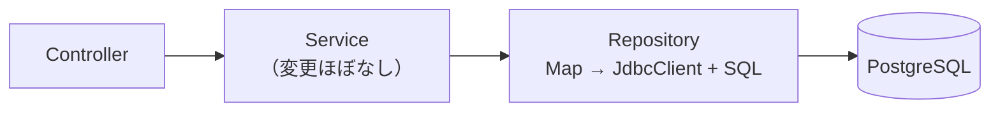
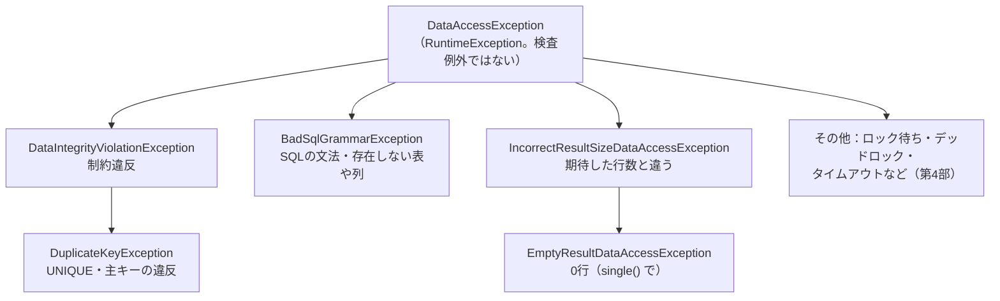
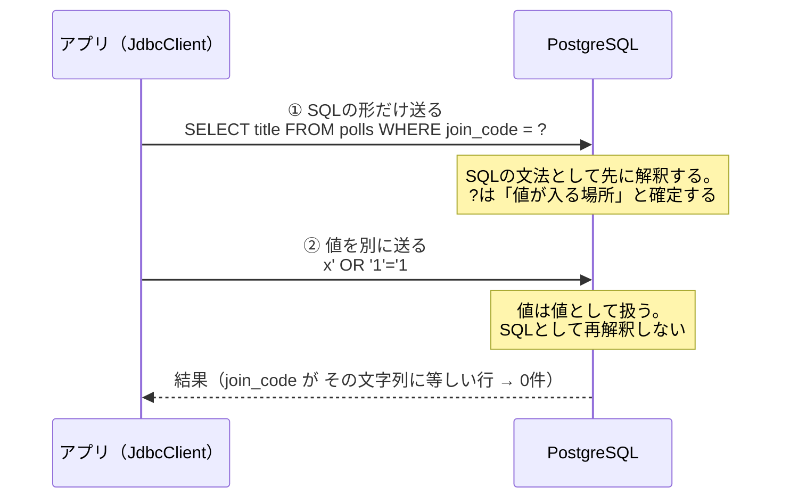

# 第19章 JdbcClientでSQLを書く

<div class="goal-box" markdown>

この章でできるようになること

- 第2部のメモリ版 Repository を、メソッド名を変えずに `JdbcClient` ＋ SQL へ差し替えられる
- 名前付きパラメータ、`single()`／`optional()`／`list()`、`update()` の更新件数を使い分けられる
- 行を `record` に変換する2つの方法（自前の変換と自動変換）を選べる
- `DataAccessException` の階層を読み、`DuplicateKeyException` を「その場にふさわしい扱い」に翻訳できる
- SQL インジェクションを実際に成立させ、バインド変数で防ぐ理由を説明できる

</div>

## 1. 問いかけ：Mapを消して、何が変わる？

第2部の `PollRepository` は、こう書かれていました。

```java title="第2部のラボ：PollRepository（抜粋）"
public Optional<Poll> findById(long id) {
    return Optional.ofNullable(byId.get(id));
}
```

第3部では、この Repository のメソッド名・引数・戻り値を変えずに、中身だけを SQL にします。そうすれば Service と Controller はほぼそのまま動くはずです。それを確かめながら、`JdbcClient` の使い方を一通り身につけます。

```java title="第3部のラボ：PollRepository（抜粋）"
public Optional<Poll> findById(long id) {
    return jdbc.sql("SELECT * FROM polls WHERE id = :id")
            .param("id", id)
            .query(PollRepository::map)
            .optional();
}
```

!!! note "用語：JdbcClient（ジェイディービーシー・クライアント）"
    SQL を書いて DB に問い合わせるための、Spring の道具です（Spring Framework 6.1 で追加）。SQL は自分で文字列として書き、結果を Java のオブジェクトに変換する部分を手伝ってくれます。JDBC は Java が DB につなぐための標準の仕組みで、`JdbcClient` はその上の使いやすい窓口です。ORM（JPA）のように SQL を隠さないので、何が実行されるかをそのまま読めます（JPA は第8部）。

前の章で作った表と Flyway はそのままです。第3部のラボ（`code/labs/part03-quickvote-jdbc/`）を使います。

```bash
cd code/labs/part03-quickvote-jdbc
./mvnw spring-boot:run      # Windows は .\mvnw.cmd spring-boot:run。ポート 18019
```

## 2. 第2部との差：何が変わり、何が変わらないか

| 項目 | 第2部（メモリ） | 第3部 |
| --- | --- | --- |
| 保存先 | `ConcurrentHashMap` | PostgreSQL |
| Repository の公開メソッド | `insert` `findById` `count` など | 同じ |
| 参加コード重複の例外 | 自前の `DuplicateJoinCodeException` | `DuplicateKeyException`（DB の UNIQUE 違反が変換されたもの） |
| 時刻 | `clock.instant()` | `Db.now(clock)`（マイクロ秒に丸める。後述） |
| 票数の集計 | `VoteRepository.countByOption`（Java で数える） | SQL の `count(...) GROUP BY` |

変えたのは Repository の4クラスと `Db`（時刻の変換）、そして Service の2か所だけです。



## 3. JdbcClient の基本の形

### 取得：`sql` → `param` → `query` → 取り出し方

```java title="OptionRepository（抜粋）"
public int count(long pollId) {
    return jdbc.sql("SELECT count(*) FROM options WHERE poll_id = :pollId")   // (1)!
            .param("pollId", pollId)                                          // (2)!
            .query(Integer.class)                                             // (3)!
            .single();                                                        // (4)!
}
```

1. SQL を文字列で書く。`:pollId` が名前付きパラメータ（値の入る穴）
2. 穴に値を渡す。名前で対応づける
3. 1列の結果を何の型で受けるか
4. ちょうど1行を期待して取り出す

`JdbcClient` は Spring Boot が `DataSource` から自動で用意するので、コンストラクタ注入で受け取れます（第11章）。

```java
public OptionRepository(JdbcClient jdbc) {
    this.jdbc = jdbc;
}
```

### 取り出し方は3種類

| メソッド | 期待する行数 | 0行のとき | 2行以上のとき |
| --- | --- | --- | --- |
| `single()` | ちょうど1 | 例外 | 例外 |
| `optional()` | 0または1 | `Optional.empty()` | 例外 |
| `list()` | 何行でも | 空のリスト | リスト |

`single()` が投げる例外は、実験で確かめました（`PollRepositoryIT`）。

```text
0行  → EmptyResultDataAccessException
2行  → IncorrectResultSizeDataAccessException
```

ID で探すような「あるかもしれないし、ないかもしれない」検索には `optional()`、`count(*)` のように「必ず1行ある」集計には `single()` を使います。こうして、期待する行数を戻り値の型で表します。第5章の「Optional は戻り値専用」が、ここで使われます。

### 登録：`INSERT ... RETURNING` で採番されたIDを受け取る

```java title="PollRepository.insert（抜粋）"
return jdbc.sql("""
        INSERT INTO polls (public_id, title, status, join_code, allow_member_options,
                           closes_at, delete_after, created_at)
        VALUES (:publicId, :title, 'OPEN', :joinCode, :allowMemberOptions,
                :closesAt, :deleteAfter, :now)
        RETURNING id
        """)
        .param("publicId", publicId)
        .param("title", title)
        // ... 他のパラメータ
        .query(Long.class)
        .single();
```

identity 列（第18章）の値は DB が決めるので、アプリは入れた行の ID を DB から教えてもらう必要があります。PostgreSQL では `RETURNING id` を付けると、`INSERT` が結果を1行返します。そのため、更新系の文なのに `query(...)` で受けます。

### 更新：`update()` は更新件数を返す

```java title="VoteRepository.upsert（抜粋）"
public int upsert(long pollId, long participantId, long optionId, Instant now) {
    return jdbc.sql("""
            INSERT INTO votes (poll_id, participant_id, option_id, voted_at)
            VALUES (:pollId, :participantId, :optionId, :now)
            ON CONFLICT (poll_id, participant_id) DO UPDATE
               SET option_id = EXCLUDED.option_id, voted_at = EXCLUDED.voted_at
               WHERE votes.option_id <> EXCLUDED.option_id
            """)
            .param("pollId", pollId)
            // ...
            .update();
}
```

`update()` は、影響を受けた行数を返します。実験で確かめました。

| 操作 | 戻り値 |
| --- | --- |
| 条件に合う1行を更新 | `1` |
| 条件に合う行がない | `0`（エラーにならない） |
| 条件なしで全行を更新 | `2`（行数） |

この件数は捨てずに使います。`upsert` は、初めての投票も別の選択肢への変更も `1` を返し、同じ選択肢への再投票だけが `0` を返します（`ON CONFLICT ... DO UPDATE ... WHERE` の `WHERE` が偽になり、何もしないため）。この `0` と `1` が「票が実際に変わったか」を表すので、第7部では、イベントを出すかどうかの判定に使います。PUT が本質的に冪等であることの現れでもあります（第27章）。

!!! note "用語：`ON CONFLICT`（upsert）"
    入れようとした行が UNIQUE 制約に衝突したら、代わりに更新する処理を、SQL 1本で行う PostgreSQL の書き方です。`EXCLUDED` は「入れようとした行」を指します。アプリで「あるか確認 → なければ入れる」と書く代わりに DB に判断を任せるので、確認と更新の間に他のリクエストが割り込めません（第26章）。

## 4. 名前付きパラメータを使いこなす

`:name` には便利な性質がいくつかあります（`JdbcClientTourIT` で確認）。

```java
// 同じ名前は、何度書いても1回の渡しでよい
jdbc.sql("SELECT id FROM polls WHERE id = :n OR id = :n + 1 ORDER BY id")
        .param("n", 1L)
        .query(Long.class).list();                 // → [1, 2]

// IN句には、リストをそのまま渡せる
jdbc.sql("SELECT title FROM polls WHERE id IN (:ids) ORDER BY id")
        .param("ids", List.of(1L, 2L, 99L))
        .query(String.class).list();               // → [ランチ, 飲み会]

// Map や record で、まとめて渡せる
jdbc.sql("INSERT INTO options (poll_id, label, created_by, created_at) VALUES (:pollId, :label, :createdBy, now())")
        .paramSource(new NewOption(1L, "そば", 1L))  // record のコンポーネント名が、:名前 に対応する
        .update();
```

`?`（位置で対応づける古い書き方）と違って、順番を間違える心配がありません。引数が8個ある `PollRepository.insert` を見れば、その利点が分かります。

## 5. 行を record に変換する

`ResultSet`（DB から返ってきた行）を Java のオブジェクトにする方法は2つあります。

### 方法A：自分で変換を書く

```java title="PollRepository.map（抜粋）"
private static Poll map(ResultSet rs, int rowNum) throws SQLException {
    return new Poll(
            rs.getLong("id"),
            rs.getObject("public_id", UUID.class),
            rs.getString("title"),
            PollStatus.valueOf(rs.getString("status")),        // 文字列 → enum
            rs.getString("join_code"),
            rs.getBoolean("allow_member_options"),
            Db.instant(rs, "closes_at"),                       // timestamptz → Instant
            // ...
            0L);
}
```

使うときは `.query(PollRepository::map)` と渡します。

### 方法B：`query(Class)` で自動変換

```java
record PollRow(long id, String title, String status, String joinCode, boolean allowMemberOptions) {}

List<PollRow> rows = jdbc.sql("SELECT id, title, status, join_code, allow_member_options FROM polls ORDER BY id")
        .query(PollRow.class)
        .list();
```

```text
[PollRow[id=1, title=ランチ, status=OPEN, joinCode=ABCDEFGH, allowMemberOptions=true], ...]
```

列名の `join_code` は `joinCode` に読み替えられ、`record` のコンストラクタに渡されます。`timestamptz` 列を `Instant` のコンポーネントに入れることも、実験でできました。

| | A：自前の `RowMapper` | B：`query(Class)` |
| --- | --- | --- |
| 書く量 | 多い | 少ない |
| 変換のコントロール | 自由（`enum`、特別な型、複数列から1つの値など） | 標準の型変換の範囲内 |
| 列の過不足 | コードで見える | 実行時に例外（列が足りないと `BadSqlGrammarException` など） |
| 向く場面 | 本線の主要な Entity、変換が要るもの | 一覧用の読み取り専用の行、集計の結果 |

QuickVote の完成形は、主要な表は方法A、集計結果の `OptionCount` は小さなラムダで書いています。どちらの方法でも、`SELECT *` は避けて必要な列を書くほうが安全です。表に列が足されたときに、気付かないうちに結果が変わることがなくなるからです（`PollRepository` の `SELECT * FROM polls` は、`map` が全列を読む前提で、意図して使っています）。

## 6. 例外：DataAccessException の階層

DB の操作は、さまざまな理由で失敗します。JDBC は失敗をすべて `SQLException` という1つの例外で表しますが、Spring はそれを、意味ごとに分かれた例外の階層（`DataAccessException`）に変換して投げます。



実際に起こして、変換先を確かめました（`SchemaConstraintIT`、`PollRepositoryIT`）。

| 起こしたこと | 例外 |
| --- | --- |
| 参加コードの UNIQUE 違反 | `DuplicateKeyException` |
| 同じ訪問者の二重参加（UNIQUE） | `DuplicateKeyException` |
| 参加コードの形式違反（CHECK） | `DataIntegrityViolationException` |
| 別の投票の選択肢への投票（複合外部キー） | `DataIntegrityViolationException` |
| `single()` で0行 | `EmptyResultDataAccessException` |
| `single()` で2行以上 | `IncorrectResultSizeDataAccessException` |
| 結果の列が足りない／存在しない列 | `BadSqlGrammarException` |

`DuplicateKeyException` は `DataIntegrityViolationException` の子です。UNIQUE 違反だけ別扱いしたいときは `catch (DuplicateKeyException e)` と書き、制約違反全般を受けたいときは親で受けます。

!!! tip "`@Repository` は、この変換のために必須？"
    古い記事では「`@Repository` を付けると例外が変換される」と説明されています。実際に確かめると、`PollRepository` の `@Repository` を外しても、`DuplicateKeyException` は同じように出ました。`JdbcClient`（の内部の `JdbcTemplate`）が自分で変換するからです。`@Repository` は、第2部で学んだとおり役割を示すラベルで、例外変換の効果が出るのは JPA を使うときです（第8部）。

    実用上の注意が1つあります。`@Repository` の Bean は、Spring が例外変換用の代理（プロキシ）で包んでから渡します。第2部のラボの `journey` ログが Repository の呼び出しを出さなくなったのは、そのためでした（クラスの注釈の判定を、代理ではなく元のクラスで行うように直しました）。代理の話は第23章で扱います。

## 7. DuplicateKeyException を、どう扱うか

制約違反の例外は、想定外の障害ではなく、想定していた最終防衛線が働いた結果です。500 にはせず、意味のある扱いに翻訳します。QuickVote には3通りの扱いがあります。

### (a) 取り直す：参加コードの衝突

```java title="PollService.create（抜粋）"
for (int attempt = 1; attempt <= MAX_JOIN_CODE_ATTEMPTS; attempt++) {
    try {
        return createOnce(visitorId, request, joinCodes.generate(), closesAt, now);
    } catch (DuplicateKeyException e) {
        // join_code の UNIQUE 違反。別のコードで取り直す
    }
}
throw new IllegalStateException("参加コードを生成できませんでした");
```

参加コードは 31^8 通りの中から選ぶので、衝突はめったに起きません。起きたときは、別のコードで取り直すのが正しい扱いです。メモリ版でも同じ形（自前の例外）で書いていたので、差し替えたのは `catch` する例外の型だけです。

!!! warning "PostgreSQL では、UNIQUE 違反のあとトランザクションが使えなくなる"
    この「取り直す」が成り立つのは、トランザクションの外で行っているからです。トランザクションの中で UNIQUE 違反が起きると、PostgreSQL はそのトランザクションを「失敗状態」にし、以降の SQL を受け付けません。完成形が `@Transactional` ではなく `TransactionTemplate` を使い、1回ごとにトランザクションをやり直しているのは、このためです（第22章）。

### (b) 成功として扱う：二重参加

```java title="JoinService.join（抜粋）"
try {
    participants.insert(poll.id(), visitorId, ParticipantRole.MEMBER, now);
} catch (DuplicateKeyException e) {
    // 同じ人が「確認」と「挿入」の間にもう一度参加した（ボタンの連打）。UNIQUE(poll_id, visitor_id) が止めた。
    // 再参加と同じ扱い（成功。何も変えない）に翻訳する。
    ParticipantRole role = participants.findByPollAndVisitor(poll.id(), visitorId).orElseThrow().role();
    return new JoinResponse(poll.publicId(), role);
}
```

この仕様では、同じ訪問者の再参加は成功として扱います。確認（`findByPollAndVisitor`）をすり抜けた二重参加は UNIQUE が止め、アプリがそれを仕様どおりの結果に翻訳します。この翻訳は、競合をわざと起こすテストで確かめました（`JoinRaceTranslationIT`。確認が1回だけ「まだいない」と答えるように細工しています。本物の同時実行を作る方法は第26章）。

### (c) 受け皿：409 にする

どこにも翻訳がなかった `DuplicateKeyException` は、そのままだと 500（想定外のエラー）になります。ラボでは `@RestControllerAdvice` に、最後の受け皿を足しました。

```java title="ProblemDetailAdvice（抜粋。第3部のラボで追加）"
@ExceptionHandler(DuplicateKeyException.class)
public ResponseEntity<ProblemDetail> handleDuplicateKey(DuplicateKeyException ex) {
    ErrorCode code = ErrorCode.ALREADY_EXISTS;        // 409 CONFLICT
    ProblemDetail problem = ProblemDetail.forStatusAndDetail(code.status(), code.defaultDetail());
    problem.setProperty("code", code.name());
    problem.setInstance(occurrence());
    return ResponseEntity.status(code.status()).body(problem);
}
```

`@WebMvcTest` で `DuplicateKeyException("Key (join_code)=(SECRET99) already exists")` を投げさせると、409 `ALREADY_EXISTS` が返り、重複した値（`SECRET99`）も制約の列名も応答に含まれないことを確認できます。例外のメッセージには値が入っているので、そのまま外に出さないのが原則です（第14章）。

| 扱い | 使う場面 | 例 |
| --- | --- | --- |
| (a) 取り直す | 偶然の衝突で、やり直せば通る | 参加コードの生成 |
| (b) 成功に翻訳 | 仕様上「同じ結果」とみなせる | 再参加、同じ票の再送 |
| (c) 409 にする | 呼び出し側に「すでにある」と伝えるべき | 同じ名前の重複作成 |

(c) は最後の受け皿です。意味が分かる場所ではそこで翻訳します。(c) に頼ると、どの制約で止まったのかが応答から分からなくなるからです。

## 8. 事故：SQL インジェクションを通す

JdbcClient で最もやってはいけない書き方は、入力を文字列に連結して SQL を作ることです。実際に攻撃を通してみます（`SqlInjectionDemoIT`。悪い例はテストの中にだけ置いてあります）。

```java
// 悪い例：入力を文字列連結で SQL に埋め込む
private List<String> findTitlesByJoinCodeBad(String code) {
    String sql = "SELECT title FROM polls WHERE join_code = '" + code + "'";
    return jdbc.sql(sql).query(String.class).list();
}

// 良い例：値は名前付きパラメータ（バインド変数）で渡す
private List<String> findTitlesByJoinCodeGood(String code) {
    return jdbc.sql("SELECT title FROM polls WHERE join_code = :code")
            .param("code", code)
            .query(String.class)
            .list();
}
```

DB には2つの投票（`社外秘の投票A`、`社外秘の投票B`）があり、参加コードは `ABCDEFGH` と `ABCDEFGJ` です。

!!! question "予測カード"
    参加コードとして `x' OR '1'='1` を渡すと、連結版・バインド版は、それぞれ何件返すでしょう。
    (a) どちらも0件　(b) 連結版は2件、バインド版は0件　(c) どちらも2件

```text
[demo] 実行されるSQL: SELECT title FROM polls WHERE join_code = 'x' OR '1'='1'
[demo] 連結版の結果: [社外秘の投票A, 社外秘の投票B]
[demo] バインド版の結果: []
```

答えは (b) です。連結版では、入力の `'` が文字列の終わりと解釈され、`OR '1'='1'`（常に真）が SQL の一部として実行されたため、全件が返りました。

もっと悪質な入力もあります。`UNION` を使って、別の表の中身を読み出す攻撃です。

```text
[demo] 実行されるSQL: SELECT title FROM polls WHERE join_code = 'x' UNION SELECT 'visitor=' || visitor_id || ' role=' || role FROM participants --'
[demo] UNION の結果: [visitor=4242 role=HOST]
```

`participants` 表の中身が、投票のタイトルの列として返ってきました。入力の末尾の `--` は SQL のコメントで、後ろに残った `'` を無効にします。入力欄ひとつから、DB 全体を読まれてしまいます。

### バインド変数で、なぜ防げるのか



名前付きパラメータ（`:code`）は、JdbcClient が `?` に直し、`PreparedStatement` という仕組みで SQL の形と値を別々に送ります。値にどんな文字が入っていても、それはただの値として扱われ、SQL の一部にはなりません。

この変換は、エラーメッセージにも現れます。実験で文法エラーを起こすと、`bad SQL grammar [SELECT id FROM polls WHERE created_at = ?]` と、`?` に変わった SQL が表示されました。

### バインドできないもの

バインドできるのは値だけです。次のものは `?` にできないので、つい連結したくなります。

| やりたいこと | 安全な方法 |
| --- | --- |
| 並べ替えの列（`ORDER BY :col`） | 許可リストで決める。`enum`（`CREATED_AT`／`TITLE`）を受けて、Java 側で SQL の断片に対応づける |
| テーブル名・列名 | 入力で決めない。必要なら許可リストから |
| `LIKE` の検索語 | 値として渡す（`%` を足すのは Java 側で `param` の値に） |

```java
// 並べ替えを入力で決めたいとき：入力の文字列をSQLに入れず、列挙型で受けて対応づける
String orderBy = switch (sort) {
    case NEWEST -> "created_at DESC, id DESC";
    case TITLE  -> "title ASC, id ASC";
};
jdbc.sql("SELECT id, title FROM polls ORDER BY " + orderBy)   // 連結しているが、中身は自分が決めた固定の文字列
```

!!! danger "AI が書く JdbcClient のコードで、まず見る場所"
    `jdbc.sql("..." + 変数 + "...")`、`String.format` で作った SQL、`"WHERE title LIKE '%" + keyword + "%'"` のような連結です。変数が利用者の入力に由来するなら、攻撃が成立します。入力を検証しているから大丈夫だとは考えず、値は必ずバインドするのが規則です。Bean Validation は規則を守るための道具ではなく、手前の防御線にすぎません。

## 9. 時刻：Instant は直接バインドできない

JdbcClient に `Instant` を直接渡すとどうなるか、試します（`JdbcClientTourIT`）。

```java
jdbc.sql("SELECT id FROM polls WHERE created_at = :at").param("at", Instant.parse("2030-01-01T00:00:00Z"))...
```

```text
BadSqlGrammarException ... 原因: Can't infer the SQL type to use for an instance of java.time.Instant. Use setObject() with an explicit Types value to specify the type to use.
```

（日本語の環境では、同じ内容の日本語のメッセージが出ます。）PostgreSQL の JDBC ドライバは、`Instant` を `timestamptz` と推測してくれません。`OffsetDateTime`（UTC）に直して渡せば通ります。完成形は、その変換を1か所に集めています。

```java title="src/main/java/com/example/quickvote/common/Db.java（抜粋）"
public static Instant now(Clock clock) {
    return clock.instant().truncatedTo(ChronoUnit.MICROS);          // (1)!
}

public static @Nullable OffsetDateTime ts(@Nullable Instant instant) {
    return instant == null ? null : instant.atOffset(ZoneOffset.UTC);   // (2)!
}
```

1. 現在時刻をマイクロ秒に丸める
2. `Instant` → `OffsetDateTime`（UTC）。パラメータには `Db.ts(...)` を通して渡す

丸めるのは、精度が合わないからです。`timestamptz` はマイクロ秒（小数6桁）までしか持てませんが、Java の `Instant` はナノ秒（9桁）まで持てます。実験で確かめました（`PollRepositoryIT`）。

```text
書いた時刻 : 2030-01-01T00:00:00.123456789Z
読み戻した : 2030-01-01T00:00:00.123457Z      ← 四捨五入されている
```

保存して読み戻すと、値が変わります。締切の判定（`closes_at` と現在時刻の比較。第28章）では、「ちょうど」の境界がずれる原因になります。そこで完成形では、時刻を最初からマイクロ秒に丸めて使う規則にしており、ラボの Service も `clock.instant()` から `Db.now(clock)` に替えました。

## 10. 動かしてみる

```bash
curl -s -X POST localhost:18019/api/polls -H 'X-Visitor-Id: 1' -H 'Content-Type: application/json' \
  -d '{"title":"ランチどこ行く？","closesInMinutes":30,"allowMemberOptions":true,"options":["カレー","そば"]}'
curl -s -X POST localhost:18019/api/join -H 'X-Visitor-Id: 2' -H 'Content-Type: application/json' -d '{"code":"<参加コード>"}'
curl -s -X PUT  localhost:18019/api/polls/<pollId>/my-vote -H 'X-Visitor-Id: 2' -H 'Content-Type: application/json' -d '{"optionId":1}'
```

Windows の Git Bash から日本語を含む JSON を `-d` で渡すと、文字コードの都合で `400 Failed to read request` になることがありました（筆者の環境）。その場合は、UTF-8 で保存したファイルを `--data-binary @create.json`（`Content-Type: application/json; charset=utf-8`）で渡してください。

アプリを再起動しても投票は残ります。DB の中も見られます。

```bash
docker compose exec postgres psql -U quickvote -c 'SELECT id, title, status, join_code FROM polls' -c 'SELECT poll_id, participant_id, option_id FROM votes'
```

```text
 id |      title       | status | join_code 
----+------------------+--------+-----------
  1 | ランチどこ行く？ | OPEN   | DWVMQ7CE

 poll_id | participant_id | option_id 
---------+----------------+-----------
       1 |              2 |         1
```

!!! warning "この時点の保証"
    ここまでで QuickVote は、再起動しても消えないようになりました。まだ守れていないことが2つあります。
    1. 全部成功か、全部なしか：`PollService.create` は、投票・参加者・選択肢を別々の SQL（別々のコミット）で書きます。途中で失敗すると、投票だけが残ります。→ 第22章
    2. 同時実行：人数上限と選択肢の上限は、「数える → 足す」の間に他のリクエストが割り込めてしまいます。→ 第25章

## 11. 現場ではこうする：AI が書いた Repository のレビュー

| 見る場所 | 問題の例 | 直し方 |
| --- | --- | --- |
| SQL の組み立て | `"..." + 入力 + "..."` | `:名前` のバインド。並べ替えは許可リスト |
| 更新件数 | `update()` の戻り値を捨てている | `0` が何を意味するか決める（「更新対象がなかった」を例外にするなど） |
| 戻り値 | 0行を `single()` で受けて、500になる | 「無いかもしれない」なら `optional()` |
| `SELECT *` | 列が増えると結果が変わる | 必要な列を書く（`map` が全列を読む前提のときは意図を書く） |
| ループの中の問い合わせ | 一覧の各行で `findById` を呼ぶ（N+1。第40章） | `IN (:ids)` や JOIN で1本にまとめる |
| 時刻 | `Instant` をそのまま渡している／`LocalDateTime` を使っている | `Db.ts` を通す。DB は `timestamptz` |
| 例外 | `catch (Exception e) { return null; }` で握りつぶす | 意味が分かる例外だけを捕まえて翻訳する |
| 確認してから更新 | `exists` → `insert` | 制約＋ `ON CONFLICT`、またはロック（第25章・第26章） |

---

## まとめ：3点セット

!!! abstract "この章の3点セット"
    **① 一言で言うと**
    `JdbcClient` では SQL を文字列で書き、値は名前付きパラメータ（バインド変数）で渡す。行数の期待は `single`／`optional`／`list` で、更新結果は `update()` の件数で受ける。DB の失敗は `DataAccessException` に変換され、`DuplicateKeyException` は、取り直す・成功とみなす・409 にする、のいずれかに翻訳する。入力を連結して作った SQL は、インジェクションで任意の SQL を実行される。

    **② 現場でこう聞かれる**
    「SQL インジェクションは、バリデーションで防げばいいんじゃないですか？」
    → 防ぎきれない。入力の検証は手前の防御線にすぎず、SQL の組み立てに連結が残っていれば、見落とした1か所で破られる。値は必ずバインド変数で渡し、SQL の構造に入力を混ぜない。

    **③ 自分のサービスならどこに当たるか**
    自分のサービスの検索・並べ替え・一覧のうち、「利用者の入力が SQL の形に影響する」場所を挙げる。バインドできるもの、許可リストで決めるものに分ける。

## 演習

??? question "確認問題1：更新件数の意味"
    `VoteRepository.upsert` を、(1) 初めての投票 (2) 別の選択肢への変更 (3) 同じ選択肢への再投票 の順に呼びました。戻り値はそれぞれ何で、(3) が `0` になるのは SQL のどの部分のためですか。

??? success "解答"
    `1`、`1`、`0` です。`ON CONFLICT ... DO UPDATE ... WHERE votes.option_id <> EXCLUDED.option_id` の `WHERE` が、同じ選択肢のときは偽になり、更新が行われないためです。この件数から、票が実際に変わったかどうかが分かります。

??? question "確認問題2：どの例外？"
    次の操作で投げられる例外を答えてください。
    ① 同じ参加コードで2つ目の投票を作る　② 存在しない ID に `single()`　③ タイトルが空の投票を直接 INSERT する

??? success "解答"
    ① `DuplicateKeyException`（UNIQUE 違反）。② `EmptyResultDataAccessException`。③ `DataIntegrityViolationException`（CHECK 違反。`DuplicateKeyException` ではない）。

??? question "応用：インジェクションを見つける"
    次のコードの問題点と直し方を示してください。
    ```java
    List<String> search(String keyword) {
        return jdbc.sql("SELECT title FROM polls WHERE title LIKE '%" + keyword + "%'")
                .query(String.class).list();
    }
    ```

??? success "解答"
    `keyword` が SQL に連結されています。`%' OR '1'='1` のような入力で、条件を無効にできてしまいます。直し方は次のとおりです。
    ```java
    jdbc.sql("SELECT title FROM polls WHERE title LIKE :pattern")
            .param("pattern", "%" + keyword + "%")
            .query(String.class).list();
    ```
    `%` は Java 側で足し、値の一部として渡します。なお、`keyword` に含まれる `%` や `_` は `LIKE` のワイルドカードとして働くので、そのままでよいかどうかは仕様として決めます。

??? question "説明問題：現場でこう聞かれる"
    「DB の UNIQUE 違反が起きたら、全部 500 でいいですか？ それとも 409 にしますか？」200字程度で答えてください。

??? success "解答"
    例：どちらも一律にはしません。意味の分かる場所で翻訳するのが基本です。参加コードの衝突は取り直し、二重参加は仕様上「成功」と同じ扱いにします。それでも残った UNIQUE 違反は、利用者が「すでに存在する」ことを知るべき衝突なので、最後の受け皿で 409 にします。ただし、例外のメッセージには重複した値が入っているので、応答やログには出しません。
