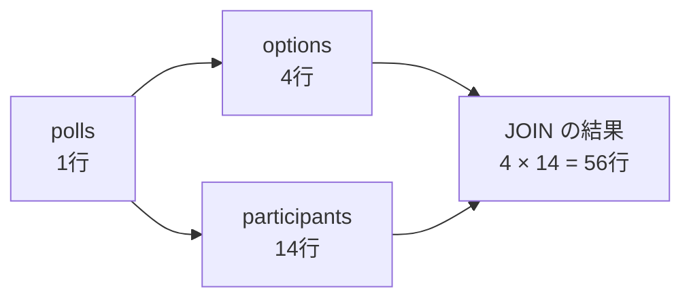
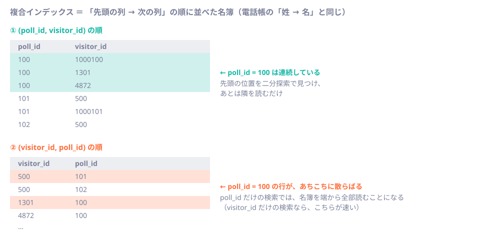

# 第20章 検索・ページング・インデックス

<div class="goal-box" markdown>

この章でできるようになること

- JOIN で行数が掛け算になる事故と、`count` の落とし穴（LEFT JOIN・NULL）を、実行結果で説明できる
- 並べ替えの列が重複すると、ページ送りで重複と欠落が出ることを再現し、安定した並び順を書ける
- OFFSET 方式とキーセット方式の違いを、実行計画（読んだ行数）で説明できる
- 複合インデックスの列順が効く理由を、「先頭の列から並んだ名簿」として説明できる
- `EXPLAIN (ANALYZE, BUFFERS)` の出力を読み、「速い」「遅い」を実測で言える

</div>

## 1. 問いかけ：「遅い」と言われたら、何を見る？

データが10件のうちは、どんな SQL も速く動きます。「本番で遅い」という問題は、データが数万件になって初めて表に出ます。そして「インデックスを張れば速くなる」は、半分しか当たっていません。

この章では、数万件のデータを実際に入れて測ります。推測で答えを出さず、DB に「どう実行するつもりか」を聞いて確かめます。

実験環境は `code/labs/ch20-query-index/` です。QuickVote のスキーマ（第18章の V1・V2）に、次のデータを入れます。

| テーブル | 件数 |
| --- | --- |
| `polls` | 30,000 |
| `options` | 120,000 |
| `participants` | 420,000 |
| `votes` | 約 261,800 |

```bash
cd code/labs/ch20-query-index
./setup.sh                      # PostgreSQL 18 を 25320 番ポートで起動し、データを入れる（約2分）
./psql.sh < sql/01-join-multiplies.sql
docker rm -f ch20-pg            # 終わったら片付ける
```

!!! note "この章のSQLは、完成形のどこ？"
    完成形の `code/quickvote` には、「投票の一覧」APIがありません。この章では、完成形が実際に使うクエリ（`findWithVoteCounts`、`findActive`、期限切れ削除）の実行計画を読みます。一覧のページングだけは、学習用にテストの中で書いています。

## 2. JOIN で行数が増える

投票100の「選択肢の数」と「参加者の数」を、JOIN 1回でまとめて数えたいとします。

```sql
SELECT p.id, count(o.id) AS 選択肢数, count(pt.id) AS 参加者数
FROM polls p
JOIN options o       ON o.poll_id  = p.id
JOIN participants pt ON pt.poll_id = p.id
WHERE p.id = 100
GROUP BY p.id;
```

!!! question "予測カード"
    投票100には、選択肢が4つ、参加者が14人います。結果は？
    (a) 4と14　(b) 18と18　(c) 56と56

```text
 id  | 選択肢数 | 参加者数 
-----+----------+----------
 100 |       56 |       56
```

答えは (c) です。正しい値は4と14でした。



`options` と `participants` はどちらも `polls` につながっていますが、お互いには関係がありません。そのため JOIN すると、選択肢4つと参加者14人の全組み合わせ（56行）ができ、それを数えるので、どちらも56になります。エラーは出ません。

| 直し方 | 内容 | 評価 |
| --- | --- | --- |
| `count(DISTINCT o.id)` | 重複を除いて数える。正しい値（4と14）になる | 56行を作ってから数えるので、行数が増えるほど遅い |
| 集計してから JOIN | 先に表ごとに `GROUP BY poll_id` で1行にまとめ、結ぶ | 行が増えない。基本はこちら |
| サブクエリ（`(SELECT count(*) ...)`） | 1つずつ数える | 読みやすい。件数が少ない取得向き |

```sql
SELECT p.id, o.n AS 選択肢数, pt.n AS 参加者数
FROM polls p
JOIN (SELECT poll_id, count(*) AS n FROM options      GROUP BY poll_id) o  ON o.poll_id  = p.id
JOIN (SELECT poll_id, count(*) AS n FROM participants GROUP BY poll_id) pt ON pt.poll_id = p.id
WHERE p.id = 100;
```

レビューでは、「1対多」を2本同時に JOIN しているクエリを見たら、掛け算になっていないかを疑います。

## 3. 集計：LEFT JOIN と `count`

完成形の `findWithVoteCounts` は、各選択肢の得票数を返します。票が0の選択肢も、0件として返す必要があります。投票43は、案2に票がありません。

```sql
-- 正しい形：LEFT JOIN + count(票の列)
SELECT o.id, o.label, count(v.participant_id) AS 票数
FROM options o LEFT JOIN votes v ON v.option_id = o.id
WHERE o.poll_id = 43 GROUP BY o.id, o.label ORDER BY o.id;
```

| 書き方 | 案1 | 案2（票なし） | 案3 | 案4 |
| --- | --- | --- | --- | --- |
| `LEFT JOIN` ＋ `count(v.participant_id)` | 2 | 0 | 2 | 2 |
| `INNER JOIN` | 2 | （行ごと消える） | 2 | 2 |
| `LEFT JOIN` ＋ `count(*)` | 2 | 1（間違い） | 2 | 2 |

`INNER JOIN` は相手のいない行を捨てるので、票0の選択肢が画面から消えます。`count(*)` は結合した行そのものを数えます。`LEFT JOIN` では相手がなくても1行は残るので、票0の選択肢を1と数えてしまいます。`count(列)` は、その列が NULL でない行だけを数えるので、`LEFT JOIN` と組み合わせたときに正しく0になります。

## 4. NULL：「分からない」は、等しくも等しくなくもない

`participants.revoked_at` は、退出していなければ NULL です。投票2の参加者27人のうち、1人が退出済みです。

```sql
SELECT count(*) FROM participants WHERE poll_id = 2 AND revoked_at = NULL;     -- ?
SELECT count(*) FROM participants WHERE poll_id = 2 AND revoked_at IS NULL;    -- ?
```

```text
 イコールNULL = 0
 IS_NULL      = 26
```

`= NULL` は0件です。NULL は「値が分からない」を表すので、`NULL = NULL` も真にはならず「分からない」になり、`WHERE` は「分からない」の行を捨てます。NULL の判定には `IS NULL`／`IS NOT NULL` を使います。

| 式 | 結果 | 注意 |
| --- | --- | --- |
| `revoked_at = NULL` | 0件 | 常に「分からない」 |
| `revoked_at <> now()` | 1件（退出済みの1人だけ） | 在籍中の26人（NULL）が、条件に合わず消える |
| `id NOT IN (1, 2)` | 26件 | 通常は期待どおり |
| `id NOT IN (1, 2, NULL)` | 0件 | NULL が1つ混ざると、全部「分からない」になる |
| `count(revoked_at)` | 1 | NULL を数えない |
| `count(*) FILTER (WHERE revoked_at IS NULL)` | 26 | 「条件つきの数え方」の書き方 |

完成形の `WHERE revoked_at IS NULL`（在籍中の参加者）は、この性質を前提にしています。NULL を許す列に条件を書くときは、NULL の行をどう扱うかを必ず確認します。`NOT IN` は、サブクエリの結果に NULL が混ざることがあるなら、`NOT EXISTS` に替えます。

## 5. 並べ替え：同じ値が並ぶと、順番が決まらない

「新しい順に20件ずつ」の一覧を作ります。`created_at DESC` だけで並べると、同じ時刻の行の順序は決まりません。実験データでは、作成時刻を「時間」単位に丸めてあります（同じ時刻の投票が約42件ずつあります）。

50ページ分（20件 × 50 = 1,000件）を、ページごとに別々のクエリとして取り出し、重複を除いて何件になるかを数えました。

```sql
-- ページごとに独立したクエリを投げたのと同じ結果
SELECT g AS page, p.id FROM generate_series(0, 49) g
CROSS JOIN LATERAL (SELECT id FROM polls ORDER BY created_at DESC LIMIT 20 OFFSET g * 20) p
```

!!! question "予測カード"
    取り出した1,000件のうち、重複を除くと何件でしょう。

| 並べ替え | 取り出した行数 | 重複なしの行数 |
| --- | --- | --- |
| `ORDER BY created_at DESC` | 1,000 | 581 |
| `ORDER BY created_at DESC, id DESC` | 1,000 | 1,000 |

約4割（419件）が重複でした。同じ行が複数のページに出る一方で、別の行は一度も出ません。同じ値の行は、DB がどの順で返してもよく、`LIMIT` や `OFFSET` が違えば選ばれる順序も変わるからです。エラーは出ません。

!!! danger "本番で事故になるパターン：並び順が一意でないページング"
    「新しい順」や「点数順」のように、値が重なる列だけで並べてページ送りをすると事故になります。並べ替えの最後には必ず、一意な列（主キー）を足します（`ORDER BY created_at DESC, id DESC`）。画面では「同じ投票が2回出る」「見えない投票がある」というバグ報告になり、再現しづらいのが厄介です。

## 6. ページング：OFFSET とキーセット

### OFFSET 方式

```sql
SELECT id, title, created_at FROM polls
ORDER BY created_at DESC, id DESC LIMIT 20 OFFSET 20000;
```

「20,001件目から20件」という指定で、簡単に書けます。ただし DB は、最初の20,020件を読んでから20,000件を捨てます。実行計画で確かめます。

### キーセット方式

```sql
SELECT id, title, created_at FROM polls
WHERE (created_at, id) < (:lastCreatedAt, :lastId)     -- 前のページの最後の行より「後ろ」
ORDER BY created_at DESC, id DESC LIMIT 20;
```

前のページの最後の行の（時刻, id）より後ろを20件取ります。読み始める位置をキーで指定する方式です。

```java title="code/labs/part03-quickvote-jdbc/src/test/java/.../demo/KeysetPagingIT.java（抜粋）"
record Cursor(Instant createdAt, long id) { }

private List<PollRow> page(@Nullable Cursor after, int size) {
    String where = after == null ? "" : "WHERE (created_at, id) < (:createdAt, :id)";
    var statement = jdbc.sql("SELECT id, title, created_at FROM polls " + where
            + " ORDER BY created_at DESC, id DESC LIMIT :size").param("size", size);
    if (after != null) {
        statement = statement.param("createdAt", Db.ts(after.createdAt())).param("id", after.id());
    }
    return statement.query(PollRow.class).list();
}
```

`WHERE` の文字列は固定の2通りで、利用者の入力は連結していません（第19章の規則どおり）。

### 実測

`polls` に 30,000 行あります。20,001件目から20件を、3つの条件で測りました。

| 方式 | インデックス | 読んだ行数 | 実行時間 |
| --- | --- | --- | --- |
| OFFSET 20000 | なし | 30,000（全部読んで並べ替え） | 約 44 ms |
| OFFSET 20000 | `(created_at DESC, id DESC)` | 20,020 | 約 6.7 ms |
| OFFSET 0（1ページ目） | 同上 | 20 | 約 0.15 ms |
| キーセット（20,001件目の位置から） | 同上 | 20 | 約 0.14 ms |

インデックスがあっても、OFFSET 方式は深いページほど遅くなります。キーセット方式は何ページ目でも同じ速さです。実行計画の `rows=` に、その差が出ています。

```text
-- OFFSET 20000（インデックスあり）
->  Index Scan using polls_created_at_id_idx on polls  (actual time=0.049..5.841 rows=20020.00 loops=1)

-- キーセット
->  Index Scan using polls_created_at_id_idx on polls  (actual time=0.025..0.030 rows=20.00 loops=1)
      Index Cond: (ROW(created_at, id) < ROW('2026-10-19 01:00:00+00'::timestamp with time zone, 19999))
```

### 速さ以外の違い：データが動くとき

OFFSET 方式には、速さ以外にも問題があります。ページを読んでいる途中で新しい投票が作られると、位置がずれるのです。トランザクションの中で再現しました（最後に取り消しています）。

```text
ページ1                 {11,10,9,8,7}
-- ここで、新しい投票が1件作られる --
ページ2（OFFSET 5）      {7,6,5,4,3}        ← 7 が、ページ1に続いて、もう一度出る
ページ2（キーセット）    {6,5,4,3,2}        ← 7 の「後ろ」から始まるので、続きになる
```

| | OFFSET | キーセット |
| --- | --- | --- |
| 実装 | 簡単（ページ番号をそのまま使える） | 「しおり」（最後の行のキー）を持ち回る |
| 深いページ | 遅くなる | 同じ速さ |
| 途中でデータが増減 | 重複・欠落が出る | 続きから正しく読める |
| 「5ページ目に飛ぶ」 | できる | できない（前から順に） |
| 向く場面 | 件数が少ない管理画面、ページ番号が要る画面 | 無限スクロール、API、大きなデータ |

キーセットの「しおり」は、`(createdAt, id)` を1つの文字列にまとめてクライアントに渡します（カーソルと呼ぶことが多いです）。並び順の列がそのまま、しおりのキーになります。そのため、前の節で見た一意な並び順が前提になります。

## 7. インデックス：名簿の並べ方

### インデックスとは

!!! note "用語：インデックス（索引）"
    列の値を並べ替えた状態で、表とは別に持っておく仕組みです（PostgreSQL の標準は B-tree という木構造）。本の巻末の索引と同じで、全ページをめくらなくても目的の位置に飛べます。代わりに、行を追加・更新するたびに索引も更新する必要があります。

インデックスがない列で検索すると、DB は表を端から全部読みます（Seq Scan）。ここでは、42万行の `participants` を `visitor_id` で探す実験をします。

### 複合インデックスは「先頭の列から並んだ名簿」

QuickVote の `participants` には `UNIQUE (poll_id, visitor_id)` があります。UNIQUE 制約は、同じ列の組を持つインデックスを自動で作ります。このとき、列の順序が効いてきます。



電話帳が「姓 → 名」の順に並んでいるとき、「田中」さんを全員探すのは速いですが、「太郎」さんを全員探すには全ページを読むことになります。複合インデックスも同じです。

実験で確かめます。

| 検索 | 使えるインデックス | 実行計画 | 時間 |
| --- | --- | --- | --- |
| `WHERE poll_id = 100` | `UNIQUE (poll_id, visitor_id)`（先頭が poll_id） | Index Only Scan | 約 0.12 ms |
| `WHERE poll_id = 100 AND visitor_id = ...` | 同上 | Index Scan（`Index Cond` に両方） | 約 0.10 ms |
| `WHERE visitor_id = 500`（`participants_visitor_idx` あり） | `(visitor_id)` | Bitmap Index Scan | 約 0.24 ms |
| `WHERE visitor_id = 500`（そのインデックスを消した） | 使えるものがない | Parallel Seq Scan（42万行を読む） | 約 44 ms |

2行目までが、本線の `findByPollAndVisitor`／`findActive` のクエリです。先頭が `poll_id` なので速くなります。3行目と4行目は「この訪問者が参加している投票」を探す検索で、先頭が `visitor_id` のインデックス（`participants_visitor_idx`）がないと、全件を読む計画になります。V2 が `participants_visitor_idx` を別に作っているのは、このためです。

列順の違いを、同じデータの小さなコピーで、さらに確かめました。

```text
-- (visitor_id, poll_id) の順のインデックスで、poll_id だけを検索
Seq Scan on pv  (actual time=0.051..51.379 rows=14.00 loops=1)
  Filter: (poll_id = 100)
  Rows Removed by Filter: 419986

-- (poll_id, visitor_id) の順のインデックスで、同じ検索
Index Only Scan using pv_poll_visitor on pv  (actual time=0.053..0.063 rows=14.00 loops=1)
  Index Cond: (poll_id = 100)
```

同じ2列でも、順序を逆にすると約51 ms と約0.06 ms の差が出ました。複合インデックスの列順は、次のように決めます。

1. 等しい（`=`）で検索する列を先頭に置き、範囲（`<`、`BETWEEN`）や並べ替えの列を後ろに置く
2. 「先頭の列だけで検索する」クエリがあるなら、その列を先頭にする
3. 先頭が違う検索（`visitor_id` だけ）は、別のインデックスで受ける

!!! tip "PostgreSQL 18 の skip scan"
    PostgreSQL 18 には、先頭の列の値の種類が少ない場合に限り、先頭の列を指定しない検索でも複合インデックスを使える「skip scan」が入りました。ここの実験では先頭の `poll_id` が3万種類もあるため使われず、全件を読む計画になりました。使える条件は限られるので、これをあてにせず、列順を設計してください。

## 8. EXPLAIN ANALYZE を読む

ここまでに何度か出てきた実行計画の読み方を、まとめて整理します。

```sql
EXPLAIN (ANALYZE, BUFFERS)
SELECT o.id, o.label, count(v.participant_id) AS votes
FROM options o LEFT JOIN votes v ON v.option_id = o.id
WHERE o.poll_id = 100 GROUP BY o.id, o.label ORDER BY o.id;
```

```text
GroupAggregate  (cost=42.63..42.73 rows=4 width=21) (actual time=0.128..0.132 rows=4.00 loops=1)
  ->  Sort  (cost=42.63..42.65 rows=9 width=21) (actual time=0.121..0.122 rows=8.00 loops=1)
        ->  Nested Loop Left Join  (cost=0.71..42.48 rows=9 width=21) (actual time=0.068..0.079 rows=8.00 loops=1)
              ->  Index Scan using options_poll_id_idx on options o  (cost=0.29..8.36 rows=4 width=13) (actual time=0.022..0.024 rows=4.00 loops=1)
                    Index Cond: (poll_id = 100)
              ->  Index Scan using votes_option_idx on votes v  (cost=0.42..8.49 rows=4 width=16) (actual time=0.011..0.012 rows=2.00 loops=4)
                    Index Cond: (option_id = o.id)
Planning Time: 1.808 ms
Execution Time: 0.288 ms
```

| 見る場所 | 意味 |
| --- | --- |
| 読む順序 | 内側（インデントが深い）の行から先に実行され、結果が外側へ渡る |
| `Index Scan using options_poll_id_idx` | `options` を `poll_id` のインデックスで引いた。4行 |
| `Nested Loop Left Join ... loops=4` | 外側の4行それぞれについて、内側（`votes`）を引いた（`loops=4`） |
| `cost=0.29..8.36` | 予想のコスト（単位は相対的で、時間ではない）。「最初の行まで..全部」 |
| `rows=4`（`cost` の側） | 予想の行数 |
| `actual time=...` と `rows=4.00` | 実測の時間（ミリ秒）と行数。`loops` が複数なら1回あたり |
| `Index Cond` | インデックスの検索条件。ここに出ない条件は `Filter`（読んだあとで捨てる）になる |
| `Rows Removed by Filter` | 読んでから捨てた行数。大きい値は、インデックスが使われていない合図 |
| `Buffers: shared hit=19` | 読んだ 8KB のブロック数。`hit` はメモリ上、`read` は ディスクから |
| `Planning Time` / `Execution Time` | 計画を立てる時間 / 実行の時間 |

まず、大きな表に Seq Scan が出ていないかを見ます。次に、予想の行数と実測の行数が大きくずれていないかを見ます。最後に、読んだ行数（`Rows Removed by Filter`、`Buffers`）を見ます。この計画は `options` と `votes` のどちらもインデックスで引いていて、合計 0.29 ms でした。

本線の `findActive`（公開IDと訪問者から参加者を探す）の実行計画も確かめています。

```text
Nested Loop  (actual time=0.127..0.128 rows=1.00 loops=1)
  ->  Index Scan using polls_public_id_key on polls p  (...)  Index Cond: (public_id = ...)
  ->  Index Scan using participants_poll_visitor_key on participants pt
        Index Cond: ((poll_id = p.id) AND (visitor_id = 1000100))
        Filter: (revoked_at IS NULL)
Execution Time: 0.246 ms
```

`polls.public_id` の UNIQUE（のインデックス）で投票を引き、`UNIQUE (poll_id, visitor_id)` のインデックスで参加者を引いています。制約が、そのまま検索のインデックスを兼ねています。

### 予想がずれるとき：統計

DB は、だいたい何行ありそうかという統計を元に計画を立てます。統計がないテーブルで、`WHERE poll_id = 100` の計画を取りました（一時テーブルは自動の統計採取の対象外です）。

```text
-- ANALYZE する前
Bitmap Heap Scan on pv  (cost=52.70..2425.01 rows=2100 width=8) (actual ... rows=14.00 loops=1)

-- ANALYZE したあと
Index Only Scan using pv_poll_visitor on pv  (cost=0.42..53.07 rows=20 width=8) (actual ... rows=14.00 loops=1)
```

予想が2,100行（実際は14行）から20行に変わりました。予想と実測のずれが大きいときは、統計が古いことを疑います（`ANALYZE テーブル名`）。通常の表は PostgreSQL が自動で統計を採取しますが、大量のデータを一気に入れた直後などは、採取が遅れることがあります。

## 9. インデックスの代償

「遅いからインデックスを足す」を繰り返すと、書き込みが遅くなります。同じ30万行の `INSERT` を、インデックスなしと3本ありで比べました。

| 条件 | 30万行の INSERT |
| --- | --- |
| インデックスなし | 約 1.0 秒 |
| インデックス 3本 | 約 6.0 秒 |

（筆者の環境で1回測った値で、傾向を見るためのものです。）インデックスは読み取りを速くする代わりに、書き込みのたびに全インデックスを更新する必要があり、ディスクも使います。

!!! warning "AI が出す『とりあえずインデックス』"
    AI に「このクエリが遅い」と聞くと、`CREATE INDEX` を何本も提案されます。次を確認してください。
    - そのクエリは本当に遅いか（`EXPLAIN (ANALYZE, BUFFERS)` の実測）
    - すでにあるインデックス（UNIQUE 制約が作るもの）で足りていないか
    - 列の順序は、等しい条件の列が先か
    - 書き込みが多い表に、足してよいか

### 現場ではこうする：遅いと言われたら

1. どのクエリが遅いかを特定する（遅いリクエスト → 実行された SQL）
2. 本番に近いデータ量で `EXPLAIN (ANALYZE, BUFFERS)` を取る
3. Seq Scan／読んだ行数／予想と実測のずれ、のどれが問題かを読む
4. 直す（クエリの書き方 → インデックス → 統計 の順に検討）
5. 直したあとに、もう一度計測する（直ったつもりを信用しない）

---

## まとめ：3点セット

!!! abstract "この章の3点セット"
    **① 一言で言うと**
    1対多の JOIN は行数が掛け算になるので集計してから結び、`count` や `NOT IN` は NULL の扱いを確認する。ページングは一意な列を並べ替えの最後に足し、深いページや動くデータにはキーセット方式を使う。インデックスは先頭の列から並んだ名簿で、等しい条件の列を先頭にし、効果は `EXPLAIN (ANALYZE, BUFFERS)` の実測で確かめる。

    **② 現場でこう聞かれる**
    「検索が遅いので、インデックスを張ってもらえますか？」
    → まず実行計画を取る。Seq Scan で大量の行を読んでいるのか、既存のインデックスが使われていない（列順や型の不一致）のか、統計が古いのかを見分ける。足すなら列順を決め、足したあとにもう一度計測する。書き込みへの影響も確認する。

    **③ 自分のサービスならどこに当たるか**
    自分のサービスで「一覧」「検索」「集計」の画面を3つ挙げ、それぞれの `WHERE`、`ORDER BY`、JOIN の列を書き出して、既存のインデックス（主キー・UNIQUE を含む）で受けられるか確認する。

## 演習

??? question "確認問題1：予測と観察"
    `ORDER BY created_at DESC` だけで20件ずつ50ページ読むと、重複なしで581件でした。`ORDER BY created_at DESC, id DESC` にすると1,000件になるのはなぜですか。

??? success "解答"
    `created_at` が同じ行（同じ時間に作られた投票）が多く、同じ値の行の順序は DB がどう決めてもよいため、クエリごとに順序が変わることがあります。`id` を足すと、すべての行の順序が一意に決まり、ページをまたいでも同じ並びになります。

??? question "確認問題2：JOIN の掛け算"
    `polls` に、選択肢3つ、参加者10人の投票があります。`polls JOIN options JOIN participants` で `count(*)` すると何行になりますか。正しい選択肢数と参加者数を求める SQL は、どう直しますか。

??? success "解答"
    `options` と `participants` は互いに無関係なので、3 × 10 = 30行です。直し方は、表ごとに先に `GROUP BY poll_id` で数えてから結ぶか、`(SELECT count(*) FROM options WHERE poll_id = p.id)` のように別々に数えます。`count(DISTINCT ...)` でも合いますが、30行を作ってから数えます。

??? question "応用：インデックスを選ぶ"
    次のクエリが多い画面を考えます。
    `SELECT ... FROM votes WHERE option_id = :id ORDER BY voted_at DESC LIMIT 20`
    `votes` に `(option_id, voted_at DESC)` のインデックスを足すのは妥当ですか。足す前に確認することを3つ挙げてください。

??? success "解答"
    等しい条件（`option_id`）が先、並べ替え（`voted_at`）が後なので、列順は妥当です。足す前に、(1) 現状の実行計画（Seq Scan か、既存の `votes_option_idx` で足りているか）、(2) `votes` の書き込み頻度（票は頻繁に増える）への影響、(3) 本当にこの画面が必要か（一覧の件数・利用頻度）を確認します。足したら、もう一度 `EXPLAIN (ANALYZE, BUFFERS)` で効果を確かめます。

??? question "説明問題：現場でこう聞かれる"
    「ページングは OFFSET でいいですか？」200字程度で答えてください。

??? success "解答"
    例：件数が少なく、ページ番号で移動したい管理画面なら OFFSET で構いません。ただし並び順に主キーなどの一意な列を足します。データが大きい場合、無限スクロールの API、途中でデータが増減する一覧では、OFFSET は深いページほど遅く、ページ送りの途中で同じ行が重複したり抜けたりします。その場合は、最後の行のキーを持ち回るキーセット方式にします。
