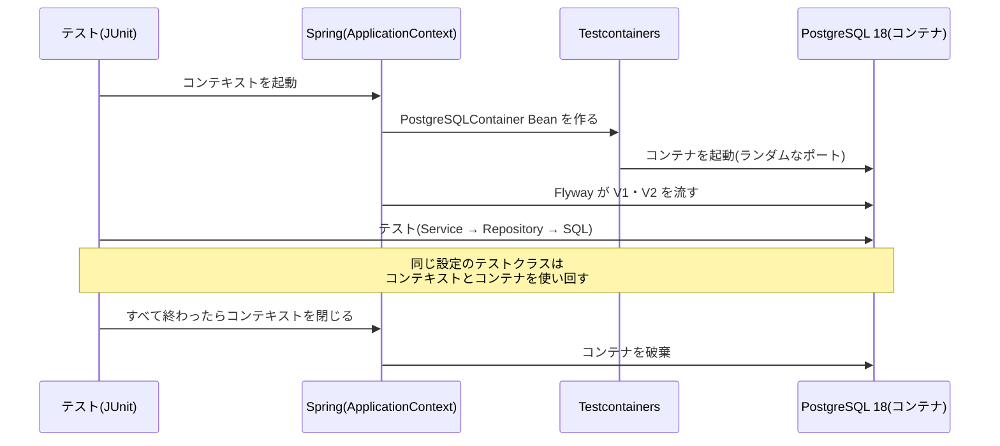

# 第21章 実PostgreSQLでテストする

<div class="goal-box" markdown>

この章でできるようになること

- Testcontainers と `@ServiceConnection` で、テストごとに使い捨ての PostgreSQL 18 を用意できる
- テストの DB も本番と同じ Flyway のマイグレーションで作られることを、テストで確かめられる
- テスト同士が DB の中身を通じて影響し合う事故を再現し、`TRUNCATE` で独立させられる
- `@JdbcTest` や `@SpringBootTest` を、確かめたい範囲に合わせて選べる
- 「H2 で通ったから安心」が危ない理由を、実際に H2 で失敗させて説明できる

</div>

## 1. 問いかけ：メモリ版のテストは、どこへ行った？

第2部のテストは、`Repository` を `new` して手で組み立てていました。Repository が Map だったので、それで本物と同じように動いたからです。

```java title="第2部のラボ：PollServiceTest（抜粋）"
VoteRepository votes = new VoteRepository();
OptionRepository options = new OptionRepository(votes);
PollRepository polls = new PollRepository();
```

Repository の中身が SQL になった今、この書き方はできません。`ON CONFLICT` も、外部キーも、`timestamptz` も、**本物の PostgreSQL がなければ確かめられない**からです。

この章では、テストに本物の PostgreSQL を使います。そして、その代償として生まれる問題（遅い・テスト同士が影響し合う）への対処を学びます。

## 2. Testcontainers：テストが始まると DB が生まれ、終わると消える

!!! note "用語：Testcontainers（テストコンテナーズ）"
    テストの中から Docker を操作して、テスト用のコンテナ（本物の DB など）を起動・破棄するライブラリです。テストを動かす人は、`docker compose up` を手で打つ必要がありません。Docker Desktop が起動していれば、`./mvnw verify` だけで動きます。

Boot 4 では、Testcontainers のバージョンは 2 系です。依存の名前が変わっているので、古い記事とずれます（[Boot 3 → 4 差分カード](../appendix/boot3-to-4.md)のカード12）。

```xml title="pom.xml（抜粋）"
<dependency>
    <groupId>org.springframework.boot</groupId>
    <artifactId>spring-boot-testcontainers</artifactId>
    <scope>test</scope>
</dependency>
<dependency>
    <groupId>org.testcontainers</groupId>
    <artifactId>testcontainers-junit-jupiter</artifactId>   <!-- 1.x では junit-jupiter -->
    <scope>test</scope>
</dependency>
<dependency>
    <groupId>org.testcontainers</groupId>
    <artifactId>testcontainers-postgresql</artifactId>      <!-- 1.x では postgresql -->
    <scope>test</scope>
</dependency>
```

### コンテナを Bean として置く

```java title="src/test/java/com/example/quickvote/TestcontainersConfiguration.java"
@TestConfiguration(proxyBeanMethods = false)
public class TestcontainersConfiguration {

    @Bean
    @ServiceConnection                                                     // (1)!
    PostgreSQLContainer postgresContainer() {
        return new PostgreSQLContainer(DockerImageName.parse("postgres:18-alpine"));   // (2)!
    }
}
```

1. このコンテナの接続先を、アプリの `DataSource`（と Flyway）に**自動で**渡す
2. 本番と**同じ種類・同じメジャーバージョン**の DB を使う（`latest` にしない）

`import` は、`org.testcontainers.postgresql.PostgreSQLContainer`（2系の、ジェネリクスのないクラス）です。古い `org.testcontainers.containers.PostgreSQLContainer<?>` は、使いません。

`@ServiceConnection` は、第17章の Docker Compose 連携と**同じ仕組み**（接続情報を組み立てる Bean を差し替える）の、テスト版です。`spring.datasource.url` を書く必要はありません。

### 使う側は、1行で済む

```java title="src/test/java/com/example/quickvote/support/AbstractIntegrationTest.java（抜粋）"
@SpringBootTest
@Import({ TestcontainersConfiguration.class, TestClockConfig.class })
public abstract class AbstractIntegrationTest {
    // ...
}
```

テストが始まると、次のことが起きます。



ポートは**ランダム**です。自分のPCで動いている開発用のDB（25419）とも、他のテストとも衝突しません。

!!! tip "開発中にも使える：TestQuickvoteApplication"
    `src/test/java/.../TestQuickvoteApplication.java` の `main` を実行すると、Testcontainers の使い捨て DB で**アプリ本体**が起動します（`./mvnw spring-boot:test-run`）。ただし、`spring-boot-docker-compose` も効いているため、**`compose.yaml` の DB が優先されました**（実測：`Database: jdbc:postgresql://127.0.0.1:25419/quickvote`）。使い捨て DB にしたいときは、`-Dspring-boot.run.arguments=--spring.docker.compose.enabled=false` を付けます（その場合は `jdbc:postgresql://localhost:61535/test` に、空の DB から V1・V2 が流れました）。

## 3. Flyway を通したテスト

テストの DB は、**空のコンテナ**です。そこにアプリが接続すると、Flyway が V1 から順にマイグレーションを流します。つまり、テストの DB は、**本番と同じマイグレーションで作られます**。手書きの `schema.sql` を別に持つ必要がありません。

これも、テストで確かめられます。

```java title="src/test/java/com/example/quickvote/FlywayMigrationIT.java（抜粋）"
@Test
void テスト用DBにも_本番と同じマイグレーションが全部適用されている() {
    List<String> applied = jdbc.sql("SELECT version || ' ' || description FROM flyway_schema_history "
            + "WHERE success ORDER BY installed_rank").query(String.class).list();

    assertThat(applied).containsExactly("1 create polls and options", "2 create participants and votes");
}
```

制約も、マイグレーションのとおりに存在します（PostgreSQL 18 では `NOT NULL` も `pg_constraint` に載るので、`contype <> 'n'` で外して比べています）。

このテストの価値は、**新しいマイグレーションを足したとき**に現れます。マイグレーションに文法の間違いがあれば、このテストを含む**全部の統合テスト**が、起動の時点で落ちます。本番に出る前に、CI で気づけます（第46章）。

### 制約を直接叩く

第18章の制約を、アプリの `if` を通さずに SQL で直接実行して、DB が拒否することを確かめるテストがあります（`SchemaConstraintIT`）。

```java title="SchemaConstraintIT（抜粋）"
@Test
void 参加コードは重複できない() {
    insertPoll("a", "ABCDEFGH", "OPEN");

    assertThatThrownBy(() -> insertPoll("b", "ABCDEFGH", "OPEN")).isInstanceOf(DuplicateKeyException.class);
}
```

「最終防衛線が本当に張られているか」は、**本物の DB でなければ確かめられない**テストです。

## 4. 事故：テスト同士が、DB を通じて影響し合う

DB は、メモリ上の変数と違って、**テストが終わっても中身が残ります**。同じ設定のテストクラスは、コンテナを**使い回す**ので、前のテストが作ったデータは、次のテストから見えます。

わざと壊れるテストで再現します（`OrderDependentDemoIT`。普段は動かず、`QV_DEMO_BROKEN=1` のときだけ動きます）。

```java
@Test @Order(1)
void 投票を1件作る() {
    polls.insert(UUID.randomUUID(), "1つ目のテストが作った投票", "ABCDEFGH", false, ...);
    assertThat(count()).isEqualTo(1);
}

@Test @Order(2)
void 投票を1件作ると全部で1件になるはず() {
    polls.insert(UUID.randomUUID(), "2つ目のテストが作った投票", "ABCDEFGJ", false, ...);
    assertThat(count()).isEqualTo(1);     // 前のテストの行が残っていると、2件になる
}
```

```text
OrderDependentDemoIT.投票を1件作ると全部で1件になるはず
expected: 1L
 but was: 2L
```

2つ目のテストは、**単独で動かすと通り**、1つ目の後だと落ちます。実行順で結果が変わる、最悪のテストです。AI が書いた DB テストにはよくある形です。

### 直し方：テストごとに空にする

```java title="AbstractIntegrationTest（抜粋）"
@BeforeEach
void resetState() {
    clock.set(Instant.now().truncatedTo(ChronoUnit.MICROS));
    // CASCADE で、polls を参照するテーブル（選択肢・参加者・票）もまとめて空になる。
    // RESTART IDENTITY で、identity の採番も 1 に戻る（テストが ID に依存しても毎回同じ）。
    jdbc.sql("TRUNCATE polls RESTART IDENTITY CASCADE").update();
}
```

`TRUNCATE` は、表の全行を一気に消します（`DELETE` より速い）。`CASCADE` が、外部キーでつながった表も消し、`RESTART IDENTITY` が連番を1に戻します（`PollRepositoryIT` は、`insert` の戻り値が毎回 `1` であることを前提にできます）。

| 方法 | 内容 | 向き・不向き |
| --- | --- | --- |
| **テストごとに `TRUNCATE`** | 前提を毎回リセット | どの種類のテストでも使える。**本線の方式** |
| テストごとに別のデータ（固有の ID・コード） | 他のテストの行を無視して動く | 速いが、「全件」を数える確認ができない。第2部の `QuickVoteFlowTest` の方式 |
| `@Transactional` で、テスト終了時にロールバック | 変更を残さない | コミット後の挙動（遅延する制約、別トランザクションからの見え方）を確かめられない。**第4部の並行性テストには使えない**（別スレッドが実際にコミットしないと競合にならない） |
| テストごとに新しいコンテナ | 完全に独立 | 遅すぎる |

時計も戻しています。`MutableClock` で時間を進めたテストが、次のテストの「今」を狂わせないためです（第16章）。

### コンテキストとコンテナの使い回し

統合テストは、最初の1つが**遅い**です。Spring の起動、コンテナの起動、Flyway の実行があるからです。

| テストクラス | 時間（筆者の環境の1回の実測） |
| --- | --- |
| 最初にコンテキストを起動するクラス | 約 5〜19 秒 |
| 同じ設定の2つ目以降（`PollRepositoryIT`、`SchemaConstraintIT`、`FlywayMigrationIT` など） | 約 0.1〜0.4 秒 |

同じ設定（`@Import`、プロファイル、`@MockitoBean` の組み合わせ）のテストクラスは、Spring が**コンテキスト（とコンテナ）を使い回す**ためです。逆に、設定が違うクラスは、別のコンテキスト＝別のコンテナになります。

!!! warning "テストを遅くする書き方"
    `@MockitoBean` や `@ActiveProfiles`、`@MockitoSpyBean` を**テストクラスごとに違う組み合わせ**で付けると、そのたびにコンテキストが作り直されます（`JoinRaceTranslationIT` が数秒かかるのはそのためです）。共通の土台（`AbstractIntegrationTest`）を使い、設定を揃えるのが基本です。モックが必要なテストだけを、別クラスに分けます。

## 5. どこまで起動するか：`@JdbcTest` と `@SpringBootTest`

第16章で、起動する範囲を選ぶ考え方を学びました。DB にも、同じ考え方が使えます。

| テスト | 起動するもの | 例 |
| --- | --- | --- |
| `@JdbcTest` | DataSource、JdbcClient、Flyway。**Service・Controller は起動しない** | Repository の SQL を確かめる（`PollRepositorySliceIT`） |
| `@SpringBootTest` | アプリ全体 | Service をまたぐ流れ（`PollServiceIT`、`QuickVoteFlowIT`） |

`@JdbcTest` には、**DataSource を組み込みDB（H2 など）に差し替える**という既定の動作があると、古い記事で説明されます。差し替わると、本物の PostgreSQL に対するテストではなくなります。そこで、差し替えを止める指定を明示します。

```java title="PollRepositorySliceIT（抜粋）"
@JdbcTest
@AutoConfigureTestDatabase(replace = AutoConfigureTestDatabase.Replace.NONE)   // (1)!
@Import({ TestcontainersConfiguration.class, PollRepository.class })           // (2)!
class PollRepositorySliceIT {
    @Autowired PollRepository polls;
    // ...
}
```

1. 差し替えを**止める**（意図を明示する）
2. スライスには `@Repository` が含まれないので、使う Repository を足す

`import` は、Boot 4 では `org.springframework.boot.jdbc.test.autoconfigure.JdbcTest`（以前の `...test.autoconfigure.jdbc` から移動）です。

!!! note "実測：この指定を外しても、動いた"
    このラボで `@AutoConfigureTestDatabase` を外して実行すると、**H2 をクラスパスに足した状態でも**、テストは Testcontainers の PostgreSQL につながって通りました（`@ServiceConnection` のコンテナがあるためと考えられますが、原因までは調べていません）。それでも指定を残すのは、「このテストは本物の DB を使う」という意図をコードに書くためと、この挙動に頼らないためです。

## 6. 事故：「H2 で通ったから安心」

古い記事や AI の出力には、「テストには H2（Java で書かれた組み込みのDB）を使う」と書かれたものが多くあります。速くて、Docker も要らないからです。H2 には「PostgreSQL 互換モード」もあります。

では、QuickVote の本線の SQL を、PostgreSQL 互換モードの H2 に流したら、どうなるでしょう（`code/labs/ch21-h2-trap/`）。

### ① マイグレーションが流れない

```text
Failed to execute script V1__create_polls_and_options.sql
SQL State  : HY004
Message    : 不明なデータ型: "TIMESTAMPTZ"
Unknown data type: "TIMESTAMPTZ"
```

最初の `CREATE TABLE` で止まりました。`timestamptz` という型名を、H2 は知りません。（このほかにも、参加コードの正規表現の CHECK（`~` 演算子）など、PostgreSQL 固有の書き方がたくさんあります。）

### ② 本線の SQL が、文法エラーになる

「H2 でも動くように」手でスキーマを書き直しても、`VoteRepository.upsert` の SQL は動きません。

```text
Syntax error in SQL statement "INSERT INTO votes (...) VALUES (?, ?, ?, ?)
[*]ON CONFLICT (poll_id, participant_id) DO UPDATE SET option_id = EXCLUDED.option_id, ..."
```

`ON CONFLICT ... DO UPDATE` は、PostgreSQL の書き方です。本線の「1人1票」を守る核心の SQL が、**H2 では実行すらできません**。H2 で動かすには、本線とは別の SQL（`MERGE`）を書くことになり、**本番で動く SQL は、テストされなくなります**。

### ③ 似ているが、違う

互換モードで動く部分でも、細部が異なります。時刻の例を見ます。`+09:00` の `OffsetDateTime` を書いて、読み戻しました。

| | 書いた値 | 読み戻した値 |
| --- | --- | --- |
| H2 | `2030-01-01T09:00:00.123456789+09:00` | `2030-01-01T09:00:00.123457+09:00`（**オフセット +09:00 を保持**） |
| PostgreSQL | 同じ | `2030-01-01 00:00:00.123457+00`（**UTC に正規化**。表示は接続の `TimeZone` 設定で変わる） |

ナノ秒をマイクロ秒に丸める点は同じでした（意外に近い）。しかし PostgreSQL の `timestamptz` は、**オフセットを覚えず、瞬間だけを覚えます**。表示のとき、接続の時間帯設定に合わせて見せます。

```text
SET TIME ZONE 'Asia/Tokyo';
SELECT '2030-01-01T09:00:00.123456789+09:00'::timestamptz;   → 2030-01-01 09:00:00.123457+09
```

「瞬間」としては同じなので、`Instant` に直せば一致します。しかし、**オフセットまで比べる**テストや、**文字列で比べる**テストは、H2 で通って PostgreSQL で落ちます（またはその逆）。

### H2 を使うことの本当の問題

| | H2 のテスト | 実 PostgreSQL のテスト |
| --- | --- | --- |
| 速さ | 速い | 起動が遅い（2つ目以降は使い回し） |
| スキーマ | 本線とは別に、H2 用を維持 | **本線の Flyway そのもの** |
| SQL | 本線とは別の SQL に迎合しがち | **本線の SQL** |
| 制約・ロック・分離レベル | 違う（第4部で致命的） | 本番と同じ |
| 「通った」の意味 | H2 では動いた | **本番の DB で動いた** |

テストが保証したいのは、「**本番で動く**」ことです。DB が違えば、その保証は弱くなります。第4部の「ロックして人数上限を守る」「競合のテスト」は、H2 では**そもそも意味を持ちません**。教材は、実 PostgreSQL に統一します。

!!! tip "Docker が使えない環境では"
    CI や社内の制限で Docker が使えない場合は、別に用意した本物の PostgreSQL（CI のサービスコンテナなど）に接続する手があります。H2 に戻る前に、まずそちらを検討してください（第46章）。

## 7. 現場ではこうする：DB テストのルール

| ルール | 理由 |
| --- | --- |
| 本番と同じ DB・同じメジャーバージョン（`postgres:18-alpine`）を使う | 版が違うと、挙動（例：`NOT NULL` が `pg_constraint` に載る）まで違う |
| スキーマは Flyway で作る。テスト専用の `schema.sql` を作らない | 本番のマイグレーションを、毎回テストする |
| テストごとに `TRUNCATE ... RESTART IDENTITY CASCADE` | 実行順に依存しない |
| 並行性のテストでは、`@Transactional` でロールバックしない | 実際のコミットがなければ、競合が起きない |
| 設定を揃えて、コンテキストを使い回す | 統合テストを速く保つ |
| 速いテスト（`*Test`）と、DB が要るテスト（`*IT`）を分ける | `./mvnw test` は Docker なしで速く、`./mvnw verify` で全部 |

!!! note "`*Test` と `*IT` の分け方"
    完成形では、`*Test` は surefire（`./mvnw test`）、`*IT` は failsafe（`./mvnw verify`）が実行します。第3部のラボは、`./mvnw test` で56件（Docker 不要）、`./mvnw verify` で全部（111件。うち2件はわざと壊れるデモで、環境変数がなければスキップ）が動きます。IDE で1つのテストだけを動かすときは、`*IT` でも通常のテストと同じように実行できます。

---

## まとめ：3点セット

!!! abstract "この章の3点セット"
    **① 一言で言うと**
    DB に触れるコードは、本番と同じ種類・同じバージョンの実 DB（Testcontainers の PostgreSQL）で、本番と同じ Flyway のマイグレーションを流して確かめる。テストの DB は使い回されるので、テストごとに全表を `TRUNCATE` して独立させる。H2 は、SQL と型・制約・ロックの違いから、本番で動くことの保証にならない。

    **② 現場でこう聞かれる**
    「テストは H2 で十分じゃないですか？ Docker が要る分、遅いし。」
    → 速さは設定の使い回しで補える。H2 では、`ON CONFLICT` や `timestamptz` など本番の SQL・型が動かず、別のスキーマと SQL を維持することになり、「テストが通った」が「本番で動く」を意味しなくなる。特に第4部のロックや競合は、H2 では確かめられない。

    **③ 自分のサービスならどこに当たるか**
    自分のサービスの DB 依存の機能を3つ挙げ、「その機能の SQL は、テストで本物の DB に対して実行されているか」「テスト同士がデータを共有していないか」を確認する。

## 演習

??? question "確認問題1：予測と観察"
    `OrderDependentDemoIT` の2つ目のテストを、単独で（`-Dit.test=OrderDependentDemoIT#...` などで）実行すると、通るでしょうか。1つ目と続けて実行するとどうなりますか。

??? success "解答"
    単独なら通ります（その投票だけが入るので1件）。続けて実行すると、1つ目のテストが作った行が残っているため、2件になって落ちます。結果が実行順に依存するテストは、直す対象です。`@BeforeEach` で `TRUNCATE` します。

??? question "確認問題2：本物の DB につながっているか"
    あるテストが、本当に Testcontainers の PostgreSQL を使っているかを、テストの中から確かめる方法を1つ考えてください。（ヒント：H2 と PostgreSQL で答えが違う SQL）

??? success "解答"
    例：`SELECT version()` の結果に `PostgreSQL 18` が含まれることを確かめる。または `FlywayMigrationIT` のように `pg_constraint` を引く（H2 には存在しない表なので、H2 につながっていれば失敗する）。「通ったから本物につながっている」と思い込まず、接続先を確かめるテストを1本置くと安心です。

??? question "応用：新しい制約のテスト"
    第18章の穴を直す V3 を足したとします（`options.created_by` の複合外部キー）。(1) 直ったことを確かめるテストを書いてください（SQL を直接実行する方式で）。(2) V3 を足したら、既存のテストの何を直す必要がありますか。

??? success "解答"
    (1) 投票Aの参加者を作者とする選択肢を、投票Bに INSERT して、`DataIntegrityViolationException` になることを `assertThatThrownBy` で確かめます。`SchemaConstraintIT` に足します。(2) `FlywayMigrationIT` の期待値（適用済みの版の一覧）に `3 ...` を足します。他の統合テストは、マイグレーションが通りさえすれば、そのまま動きます。

??? question "説明問題：現場でこう聞かれる"
    「統合テストが遅いので、各テストクラスに `@MockitoBean` をバラバラに付けています。何が問題ですか？」200字程度で答えてください。

??? success "解答"
    例：設定の組み合わせが違うたびに、Spring が別の ApplicationContext を作り、Testcontainers のコンテナと Flyway も最初からやり直すので、全体が遅くなります。モックが必要なテストだけを別クラスに分け、共通の土台（同じ `@Import`・プロファイル）を揃えれば、コンテキストとコンテナが使い回されます。
