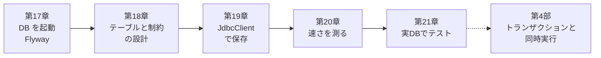

# 第3部 PostgreSQLに正しく保存する

第2部の QuickVote は、再起動すると全部消えるアプリでした。この部では、投票・選択肢・参加者・票を PostgreSQL に保存します。

保存するだけでは終わりません。テーブルの形を Flyway でコードとして育て、守りたい約束を制約として DB に置きます。SQL は `JdbcClient` で書き、データが増えたときの速さを実測し、本物の DB でテストします。第2部で約束した「Repository の中身だけを入れ替える」が、ここで実現します。

## この部でできるようになること

- Docker Compose で PostgreSQL 18 を起動し、Spring Boot の Docker Compose 連携で接続できる
- Flyway のマイグレーションでスキーマを管理し、適用済みのファイルを書き換えるとなぜ起動に失敗するかを説明して、正しく直せる
- QuickVote のテーブルを ER 図で描き、`NOT NULL`・`UNIQUE`・`CHECK`・外部キーを「最終防衛線」として設計できる
- 1行で守れる条件と、複数行を数える条件（人数上限）を見分けられる
- `JdbcClient` で SQL を書き、更新件数・例外（`DuplicateKeyException`）を扱える
- SQL インジェクションを再現し、バインド変数で防ぐ理由を説明できる
- JOIN の行数、NULL、並び順、OFFSET とキーセット、複合インデックスの列順を、`EXPLAIN ANALYZE` の実測で説明できる
- Testcontainers で実 PostgreSQL のテストを書き、テストの独立性を保てる。「H2 で通った」が保証にならない理由を説明できる

## アプリの到達状態

第3部が終わった時点で、QuickVote は第2部と同じ API を、PostgreSQL に保存する形で提供します。

| できること | 第2部 | 第3部 |
| --- | --- | --- |
| 投票を作る・参加する・選択肢を足す・投票する・詳細を見る | ○ | ○ |
| 再起動してもデータが残る | × | ○ |
| 最終防衛線の制約（参加コードの重複、1人1票、同じ投票の選択肢にだけ投票）が DB にある | × | ○ |
| 実 PostgreSQL に対するテスト | × | ○ |

!!! warning "この時点の保証"
    データは保存されますが、約束はまだ守られていません。
    - 全部成功か全部なしか：投票を作る処理は、投票・参加者・選択肢を別々のコミットで書きます。途中で失敗すると、投票だけが残ります（第22章）
    - 人数・選択肢の上限は、同時実行で破れます：「数える → 足す」の間に、別のリクエストが割り込めます。DB の制約は、複数行を数える条件を守れません（第18章）。第25章で直します
    - 再送で二重登録されます（第27章）。訪問者は偽装できます（第30章以降）
    
    第4部で、「全部成功か全部なしか」と、同時実行でも守られる上限を実装します。

## 各章

<div class="grid cards" markdown>

-   :material-database-sync-outline: **[第17章 PostgreSQLとFlyway](ch17-postgres-flyway.md)**

    ---

    Docker Compose で DB を起動する。Flyway は「DB の Git」。適用済みのファイルを書き換えて、起動に失敗させる。

-   :material-table-key: **[第18章 データモデルと制約設計](ch18-data-modeling.md)**

    ---

    ER 図、主キーと公開ID、制約を1つずつ破る。「アプリの if は前線、制約は最終防衛線」。守れない条件の見分け方。

-   :material-code-braces: **[第19章 JdbcClientでSQLを書く](ch19-jdbcclient.md)**

    ---

    Map を SQL に入れ替える。名前付きパラメータ、更新件数、`DuplicateKeyException`。SQL インジェクションを実際に通す。

-   :material-speedometer: **[第20章 検索・ページング・インデックス](ch20-query-index.md)**

    ---

    JOIN で行が増える、NULL、並び順、OFFSET とキーセット、複合インデックス。数万件で `EXPLAIN ANALYZE` を読む。

-   :material-docker: **[第21章 実PostgreSQLでテストする](ch21-testcontainers.md)**

    ---

    Testcontainers と `@ServiceConnection`。テストの独立性。H2 で通っても安心しない理由を、H2 で失敗させて確かめる。

</div>

## 第3部の流れ



第18章で「複数行を数える条件は DB の制約では守れない」と学び、第22章以降でその条件を守ります。第21章で作るテストの土台（テストごとに DB を空にする、実際にコミットされる）は、第26章の並行性テストでそのまま使います。

## 実験コードの置き場

この部のコードは、`code/labs/` にあります。

```text
code/labs/
├── ch17-flyway/                  第17章：Initializr で作った最小のプロジェクト。Docker Compose と Flyway の実験
├── part03-quickvote-jdbc/        第18〜21章：JdbcClient 版の QuickVote（./mvnw verify が通る。Docker 必須）
│   ├── src/main/resources/db/migration/   V1・V2（Flyway）
│   ├── src/main/java/.../  poll / participant / vote / common ...   Repository が SQL に
│   └── src/test/java/.../  *IT（Testcontainers）、demo/（インジェクション・キーセット・わざと壊れるテスト）
├── ch20-query-index/             第20章：3万件の投票で EXPLAIN ANALYZE を読む（setup.sh と sql/）
└── ch21-h2-trap/                 第21章：本線の SQL を H2 に流して失敗させる
```

```bash
cd code/labs/part03-quickvote-jdbc
./mvnw test                  # Docker 不要のテスト（56件）。Windows は .\mvnw.cmd
./mvnw verify                # すべて（実 PostgreSQL を使う *IT を含む）。Docker Desktop の起動が必要
./mvnw spring-boot:run       # 起動（ポート 18019）。compose.yaml の PostgreSQL（25419）が自動で起動する
```

!!! note "完成形（`code/quickvote`）との関係"
    ラボのクラス名・メソッド名・テーブル定義は、完成形と揃えています。違いは、`visitors` 表がない（第6部で足す）、`Poll.lastEventSeq` が常に 0（第37章で列を足す）、ロックやトランザクションがない（第4部）などです。ラボの `README.md` に、差分の表があります。

## 第3部のチェックリスト

第21章を終えたら、次の項目を確かめてください。すべてに ✅ を付けられたら、第4部へ進めます。目安は「③ 検証できる」です。

- [ ] Docker Compose の `compose.yaml` と Spring Boot の連携で、接続先を書かずに DB へ接続される仕組みを説明できる
- [ ] Flyway が `flyway_schema_history` と checksum で何を検証しているかを説明し、適用済みの V を書き換えると起動に失敗することを再現できる
- [ ] 間違えたマイグレーションを、新しい V で直せる。失敗した V が PostgreSQL ではどうなるかを説明できる
- [ ] 内部ID（`bigint` の identity）と公開ID（`uuid`）を分ける理由と、連番に欠番ができる理由を説明できる
- [ ] `NOT NULL`・`UNIQUE`・`CHECK`・外部キーが守るものを、実際に違反するSQLで見せられる
- [ ] 「アプリの `if` は前線、制約は最終防衛線」を、同時実行や別経路の書き込みを例に説明できる
- [ ] 1行（や決まった相手の行）で守れる条件と、複数行を数える条件を見分け、後者が DB の制約では守れないことを実験で示せる
- [ ] `JdbcClient` で、バインド変数を使った取得・登録（`RETURNING`）・更新を書き、`update()` の件数の意味を説明できる
- [ ] `DuplicateKeyException` を、取り直す・成功に翻訳する・409 にする、から場面に合わせて選べる
- [ ] SQL インジェクションを再現し、バインド変数で防げる理由と、バインドできないもの（並べ替えの列など）への対処を説明できる
- [ ] 1対多を2本 JOIN すると行が掛け算になること、`count(*)` と `count(列)` の違い、`= NULL` と `NOT IN` の落とし穴を説明できる
- [ ] 並び順に一意な列を足す理由と、OFFSET とキーセットの違いを、実行計画か実験の事実で説明できる
- [ ] 複合インデックスの列順の考え方を説明し、`EXPLAIN (ANALYZE, BUFFERS)` から Seq Scan・読んだ行数・予想と実測のずれを読み取れる
- [ ] Testcontainers と `@ServiceConnection` で実 PostgreSQL のテストを書き、テストごとに DB を空にして独立させられる
- [ ] 「H2 で通ったから安心」が危ない理由を、SQL・型・制約の具体例で説明できる

!!! tip "チェックの付け方"
    項目を読んで「たぶん分かる」だけでは付けません。**白紙に自分の言葉で書いて説明できたとき**に付けてください。説明できない項目に戻る章へのリンクは、各章の「まとめ」にあります。

## 統合課題：自分のサービスの「最初の2つのマイグレーション」

自分が作りたいサービスを1つ決めて、次を書いてください（実行はしなくてかまいません）。

1. 最初の3テーブルの ER 図（Mermaid）
2. `V1`（テーブルと制約）と、「仕様が1つ変わった」と仮定した `V2`（既存データがあっても流せるもの）
3. 守りたい約束を5つ挙げ、「DB の制約で守れるもの」と「アプリのロックなどで守るもの」に分けた表
4. 本番相当のデータ量（数万件）を想定して、`EXPLAIN ANALYZE` で確かめたい検索を2つ
