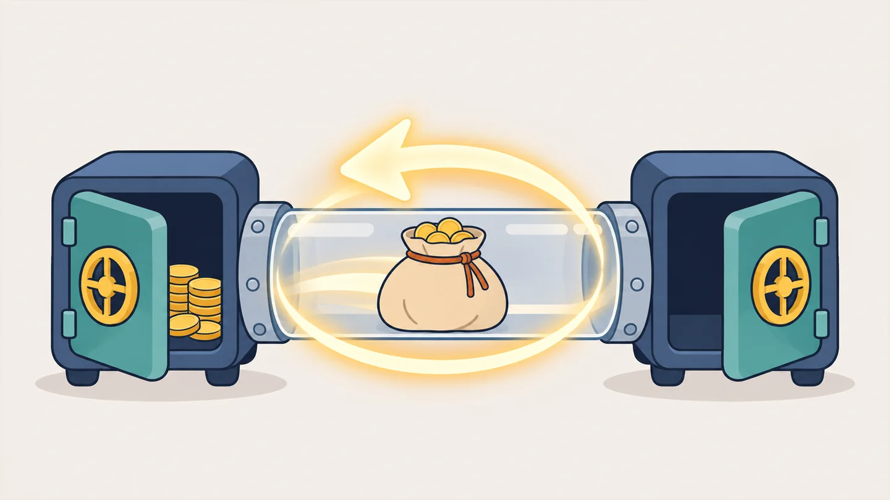
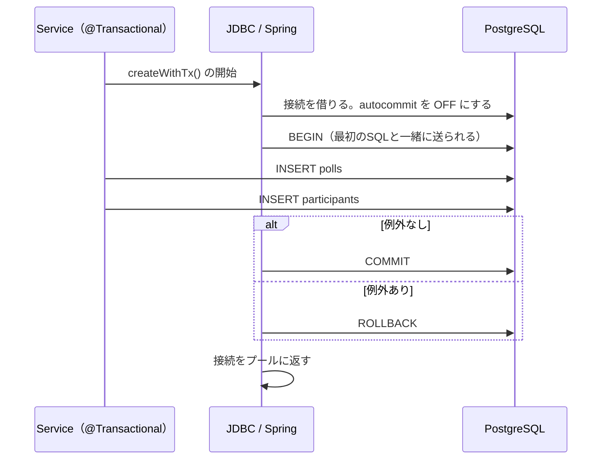

# 第22章 トランザクションの境界

<div class="goal-box" markdown>

この章でできるようになること

- psql で `BEGIN` / `COMMIT` / `ROLLBACK` を打ち、「コミットするまで他の人には見えない」ことを自分の目で確かめられる
- 2本の `INSERT` の間で例外が起きたとき、`@Transactional` の有無で DB に何が残るかを予測し、実際に確かめられる
- Spring が送る `BEGIN` / `COMMIT` / `ROLLBACK` を、サーバー側のログで確認できる
- 「トランザクションの境界を、どこに置くか」を、QuickVote の操作ごとに説明できる
- トランザクションがまだ守ってくれないもの（同時実行）を、先に言い当てられる

</div>

## 1. 問いかけ：投票を作る途中で、サーバーが落ちたら

QuickVote で「投票を作る」と、DB には2行入ります。`polls` に投票そのものを1行、`participants` に作った人（主催者、`HOST`）を1行です。どちらも `INSERT` で、1本目が成功したあと2本目の直前で例外が起きたら（メモリ不足、DB との接続切れ、バグ、デプロイによる強制終了など）、DB はどうなるでしょうか。

```text
polls         : 「ランチどこ行く？」 ← 入っている
participants  : （空）              ← 主催者がいない
```

**主催者のいない投票**が残ります。この投票は誰も締め切れませんが、参加コードは使えてしまいます。エラー画面を見たユーザーはもう一度「作成」を押すので、同じタイトルの投票がもう1つできます。

フロントエンドで言えば、`await createPoll()` のあとに `await addHost()` を呼ぶ2段階の API を、途中で失敗するかもしれないネットワーク越しに叩いている状態です。サーバー側には、この2本を1回の操作として扱う仕組みがあります。それがトランザクションです。

## 2. 例え：銀行振込



A さんの口座から1万円を引き出し、B さんの口座に1万円を入れるのが銀行振込です。引き出しだけ成功して入金が失敗すると1万円が消え、逆に入金だけ成功すると1万円が増えてしまいます。そのため銀行は、引き出しと入金をひとまとまりの取引として扱います。全部成功すれば確定（コミット）し、どこかで失敗すれば最初からなかったことにします（ロールバック）。途中の状態は外から見えません。

!!! warning "この例えが外れる点"
    - 振込は2口座にまたがりますが、トランザクションは1つの DB（1回の接続）の中の話です。別々のサービスやメール送信、外部 API の呼び出しは、ロールバックで取り消せません
    - 銀行の取引は人が見て確かめられますが、DB は他の取引が同時に動いている中で実行されます。「途中の状態が他の取引から見えるか」という問題は、この章では扱わず、[第25章](ch25-locking.md)・[第26章](ch26-concurrency-testing.md)で扱います

## 3. 動かしてみる①：psql で BEGIN / COMMIT / ROLLBACK

最初に Spring を使わず、DB の素の動きを見ます。実験用のプロジェクトは `code/labs/part04-lab/` で、QuickVote と同じ表（`polls`、`participants`、`votes` など）が同じ Flyway のマイグレーションで作られます。

```bash
cd code/labs/part04-lab
docker compose up -d            # PostgreSQL 18（ホスト側 25420）。SQL をすべてログに出す設定つき
./mvnw -q -DskipTests package
java -jar target/part04-lab.jar     # 起動すると Flyway が表を作る。「Started」と出たら Ctrl+C で止めてよい
```

Windows の PowerShell では `.\mvnw.cmd -q -DskipTests package`、`java -jar target\part04-lab.jar` です。

次にターミナルを2つ開き、それぞれで psql に入ります（以下 A と B と呼びます）。

```bash
docker exec -it part04-lab-pg psql -U lab -d lab
```

実験用のデータ（`scenarios/seed.sql`）では、投票2に参加者が主催者1人だけいます。A と B を次の順で操作します。

!!! question "予測カード"
    A が `BEGIN` → `INSERT`（参加者を1人追加）まで実行した時点で、B が `SELECT count(*)` を実行すると、何が返るでしょう。

    1. 1（A の追加は見えない）
    2. 2（A の追加が見える）
    3. B の `SELECT` が、A のコミットまで待たされる

2つのターミナルを手で操作する代わりに、同じ順序を1つのスクリプトで再現できます（`scripts/TwoSessions.java`。2つの `docker exec -i psql` を台本どおりの順に動かし、出力を到着順に並べます）。

```bash
./scripts/scenario.sh scenarios/22-begin-rollback.txt
```

実際の出力です（先頭の `A|` `B|` は、どちらのセッションの出力かを表します。時刻の列は省いています）。

```text
B| SELECT count(*) FROM participants WHERE poll_id = 2;
B|  count
B| -------
B|      1
A| BEGIN;
A| BEGIN
A| INSERT INTO participants (poll_id, visitor_id, role, joined_at) VALUES (2, 51, 'MEMBER', now());
A| INSERT 0 1
A| SELECT count(*) FROM participants WHERE poll_id = 2;
A|  count
A| -------
A|      2                                    ← A 自身には、自分の追加が見える
B| -- Bから見ると、Aの挿入はまだ見えない
B| SELECT count(*) FROM participants WHERE poll_id = 2;
B|  count
B| -------
B|      1                                    ← B には見えない（待たされもしない）
B| SELECT state, left(query, 32) AS last_query FROM pg_stat_activity WHERE application_name = 'psql' AND pid <> pg_backend_pid();
B|         state        |            last_query
B| ---------------------+----------------------------------
B|  idle in transaction | SELECT count(*) FROM participant
A| ROLLBACK;
A| ROLLBACK
B| SELECT count(*) FROM participants WHERE poll_id = 2;
B|      1                                    ← ロールバック後は、A の追加は消えた
A| BEGIN;
A| INSERT INTO participants (poll_id, visitor_id, role, joined_at) VALUES (2, 51, 'MEMBER', now());
A| INSERT 0 1
B| SELECT count(*) FROM participants WHERE poll_id = 2;
B|      1                                    ← コミット前は、まだ見えない
A| COMMIT;
A| COMMIT
B| SELECT count(*) FROM participants WHERE poll_id = 2;
B|      2                                    ← コミット後に、見えるようになった
```

（出力の全文は `code/labs/part04-lab/outputs/22-begin-rollback.txt` にあります。ここでは見やすいよう、表の罫線の一部を省略しています。）

答えは **1** です。観察できたことを表にまとめます。

| 観察 | 意味 |
| --- | --- |
| `BEGIN` のあとの `INSERT` は、A 自身には見えるが B には見えない | コミットするまで、変更は A のトランザクションの中だけにある |
| B の `SELECT` は待たされない | 見えないだけで、ブロックはされない（ロックの話は第25章） |
| A の状態が `idle in transaction` | A はトランザクションを開いたまま、何もしていない。この状態の接続は、DB のリソースを握り続ける（[第24章](ch24-connection-pool.md)で事故になります） |
| `ROLLBACK` すると、A の `INSERT` は最初からなかったことになる | 銀行振込の「取り消し」 |
| `COMMIT` すると、B からも見える | 銀行振込の「確定」 |

!!! note "用語：トランザクション"
    DB に対する複数の操作をひとまとまりとして扱う仕組みです。`COMMIT` で全部を確定し、`ROLLBACK`（または失敗）で全部をなかったことにします。途中の状態は他のトランザクションから見えません（既定の設定では。分離レベルは[第26章](ch26-concurrency-testing.md)）。

!!! tip "フロントエンドで例えると"
    React の `useOptimistic` や、「保存」ボタンを押すまでサーバーに送らない編集画面に似ています。下書きの中では自由に変更でき、確定するまで他の人には見えません。`ROLLBACK` は「変更を破棄」にあたります。ただし下書きの間も、DB の側では接続を1本握り続けています。

### BEGIN を打たない psql は、1文ごとにコミットされている

最初の `SELECT` に `BEGIN` はありませんでした。psql は既定で自動コミット（autocommit）です。`BEGIN` を打たなければ、SQL 文は**1つずつ独立したトランザクション**として、実行直後に確定されます。

```text
INSERT INTO polls ...         ← これだけで確定する
INSERT INTO participants ...  ← これだけで確定する（別のトランザクション）
```

この2本の間でサーバーが落ちれば、1本目だけが残ります。第1節の事故はこの状態で起きます。

### 途中で SQL が失敗すると、そのトランザクションは使えなくなる

もう1つ、PostgreSQL には知っておきたい挙動があります。トランザクションの途中で SQL がエラーになると、そのトランザクションは中断状態（aborted）になり、**以降の SQL はすべて拒否されます**。

```bash
./scripts/scenario.sh scenarios/22-aborted.txt
```

```text
A| BEGIN;
A| INSERT INTO participants (poll_id, visitor_id, role, joined_at) VALUES (2, 51, 'MEMBER', now());
A| INSERT 0 1
A| -- 存在しない訪問者(999)を参加させる → 外部キー違反
A| INSERT INTO participants (poll_id, visitor_id, role, joined_at) VALUES (2, 999, 'MEMBER', now());
A| ERROR:  insert or update on table "participants" violates foreign key constraint "participants_visitor_id_fkey"
A| SELECT 1;
A| ERROR:  current transaction is aborted, commands ignored until end of transaction block
A| COMMIT;
A| ROLLBACK
A| SELECT count(*) FROM participants WHERE poll_id = 2;
A|      1
```

出力から読み取れる点が3つあります。外部キー違反のあとは、`SELECT 1` のような無害な文も `current transaction is aborted` で拒否されます。次に、`COMMIT` と打ったのに DB の返事は `ROLLBACK` で、失敗したトランザクションはコミットしようとしてもロールバックになります。最後に、最初に成功したはずの `INSERT` も消えていて、最後の `count` が1になっています。

この性質は、[第23章](ch23-transactional-proxy.md)で例外を握りつぶしたときに何が起きるかを考えるときにも関わってきます。

## 4. トランザクションが約束すること

トランザクションの性質は、頭文字をとって ACID と呼ばれます。暗記する必要はなく、この教材のどこで扱うかだけ表にしておきます。

| 性質 | 意味 | この教材のどこで扱うか |
| --- | --- | --- |
| **A**tomicity（原子性） | 全部成功するか、全部なかったことになる | この章、[第23章](ch23-transactional-proxy.md) |
| **C**onsistency（一貫性） | 制約（UNIQUE、外部キー、CHECK）を破る状態にならない | [第18章](../part03/ch18-data-modeling.md)の制約設計 |
| **I**solation（独立性） | 同時に動く別のトランザクションから、途中の状態が（どこまで）見えるか | [第25章](ch25-locking.md)、[第26章](ch26-concurrency-testing.md) |
| **D**urability（永続性） | コミットしたら、サーバーが落ちても消えない | DB が担当（WAL。この教材では深追いしない） |

この章で身につけたいのは A（原子性）です。I（独立性）は思っているより弱く、そのことを第25章で事故として体験します。

## 5. 動かしてみる②：Spring で、2本の INSERT の間に例外を起こす

psql で見た動きを Spring のコードで再現します。「投票を作る」を2本の `INSERT` で書き、`@Transactional` が付いているかどうかだけを変えます。

```java title="code/labs/part04-lab/src/main/java/com/example/lab/ch22/PollCreator.java（抜粋）"
public long createWithoutTx(String title, String joinCode, long hostVisitorId, boolean failBetween) {
    long pollId = repo.insertPoll(title, joinCode);              // 1本目のINSERT
    if (failBetween) {
        throw new IllegalStateException("2本のINSERTの間で失敗した");
    }
    repo.insertParticipant(pollId, hostVisitorId, "HOST");       // 2本目のINSERT
    return pollId;
}

@Transactional                                                    // ← 違いはこの1行だけ
public long createWithTx(String title, String joinCode, long hostVisitorId, boolean failBetween) {
    // 本体は上と同じ
}
```

`repo.insertPoll` と `repo.insertParticipant` は、第3部で作った Repository と同じ形（`JdbcClient` で SQL を1本投げる）で、トランザクションの指定はありません。

!!! question "予測カード"
    `failBetween = true`（2本のINSERTの間で例外）で、それぞれ呼びます。実行後の `polls` と `participants` の行数は？

    | | `polls` | `participants` |
    | --- | --- | --- |
    | `@Transactional` なし | ? | ? |
    | `@Transactional` あり | ? | ? |

```bash
java -jar target/part04-lab.jar --lab.run=ch22 --spring.main.web-application-type=none \
  --logging.level.org.springframework.jdbc.support.JdbcTransactionManager=DEBUG
```

実際の出力です（ログの接続オブジェクト名の長い部分は `...` にしています）。

```text
[開始前] polls=0 participants=0
=== @Transactional なし: 2本のINSERTの間で例外 ===
例外: 2本のINSERTの間で失敗した
[なしで失敗した後] polls=1 participants=0            ← 片方だけ残った
=== @Transactional あり: 2本のINSERTの間で例外 ===
Creating new transaction with name [com.example.lab.ch22.PollCreator.createWithTx]: PROPAGATION_REQUIRED,ISOLATION_DEFAULT
Acquired Connection [HikariProxyConnection@... wrapping org.postgresql.jdbc.PgConnection@...] for JDBC transaction
Switching JDBC Connection [...] to manual commit
Initiating transaction rollback
Rolling back JDBC transaction on Connection [...]
Releasing JDBC Connection [...] after transaction
例外: 2本のINSERTの間で失敗した
[ありで失敗した後] polls=1 participants=0            ← 増えていない（1本目も消えた）
=== @Transactional あり: 例外なし ===
...
Initiating transaction commit
Committing JDBC transaction on Connection [...]
作成できた poll id = 3
[成功した後] polls=2 participants=1
```

答えは、「なし」が**片方だけ残る**（`polls`=1、`participants`=0）、「あり」が**どちらも増えない**です。「なし」では例外が2本の `INSERT` の間で起きたので、1本目はすでに確定していました。「あり」では1本目の `INSERT` もロールバックされて消え、ログに `Initiating transaction rollback` が出ています。

最後の行では、作成できた poll id が3になっています。2番は「あり」で失敗したときに使われ、ロールバックで消えました。`GENERATED ALWAYS AS IDENTITY` の連番はロールバックしても戻らないので、ID が飛ぶのは正常です。ID が連続していることに依存してはいけません。

### サーバー側の SQL ログで確かめる

Spring のログは Spring 側の申告にすぎないので、DB が実際に何を受け取ったかをサーバー側で確かめます。`compose.yaml` は PostgreSQL に `log_statement=all` を指定してあり、受け取った SQL がすべて `docker logs` に出ます（`scripts/pgtx.sh` が、`BEGIN` / `COMMIT` / `ROLLBACK` / `INSERT` の先頭行だけを抜き出します）。

```text
[52427] INSERT INTO polls (public_id, title, ...        ← 「なし」: BEGIN がない。1文ごとに確定
[52427] BEGIN                                           ← 「あり・失敗」
[52427] INSERT INTO polls (public_id, title, ...
[52427] ROLLBACK
[52427] BEGIN                                           ← 「あり・成功」
[52427] INSERT INTO polls (public_id, title, ...
[52427] INSERT INTO participants (poll_id, visitor_id, ...
[52427] COMMIT
```

角括弧の数字は DB 側のプロセス番号（接続1本に1つ）です。`@Transactional` 付きの呼び出しでは、同じ接続（52427）で `BEGIN` → `INSERT` → `INSERT` → `COMMIT` が流れています。



図の「autocommit を OFF にする」が、ログの `Switching JDBC Connection to manual commit` にあたります。JDBC の接続は既定で自動コミットです（psql と同じ）。Spring はトランザクションを始めるときにこれを切り、終わると戻します。この処理を誰がどこで動かしているかは、[次の章](ch23-transactional-proxy.md)で扱います。

## 6. 境界をどこに置くか：業務操作の単位

`@Transactional` を付ければ安全だと考えるのは危険です。どこからどこまでを1つのトランザクションにするか（トランザクションの境界）を決めるのは、設計の仕事です。

基準は1つです。

> **「全部成功するか、全部なかったことになってほしい」ひとまとまりの業務操作**を、1つのトランザクションにする。

QuickVote の操作に当てはめると、次のようになります。

| 業務操作 | 含まれる更新 | 境界を置く場所（リファレンス実装） |
| --- | --- | --- |
| 投票を作る | `polls`、`participants`（HOST）、`options`（初期の選択肢） | `PollService.create`（`TransactionTemplate`） |
| 参加する | `participants`、`poll_events`（参加イベント） | `JoinService.join`（`@Transactional`） |
| 投票する | `votes`、`poll_events` | `VoteService.vote`（`@Transactional`） |
| 選択肢を追加する | `options`、`poll_events`、`idempotency_records` | `PollService.addOption`（`@Transactional`） |
| 投票を締め切る | `polls`、`poll_events` | `PollService.close`（`@Transactional`） |
| 詳細を見る | 読み取りのみ（複数のSELECT） | `PollService.get`（`readOnly`、`REPEATABLE_READ`） |

どの操作も、Service のメソッド1つが業務操作1つにあたり、そこに境界があります。「参加する」のコードで確かめます。

```java title="code/quickvote/src/main/java/com/example/quickvote/poll/JoinService.java（抜粋）"
@Transactional                                                       // (1)!
public JoinResponse join(long visitorId, String rawCode) {
    // …省略（参加コードの正規化・形式チェック）
    Poll poll = polls.lockByJoinCode(code).orElseThrow(() -> new ApiException(ErrorCode.JOIN_CODE_NOT_FOUND));
    // …省略（再参加の判定・締切の判定）
    int current = participants.countActive(poll.id());
    if (current >= PollRules.MAX_PARTICIPANTS) {
        throw new ApiException(ErrorCode.POLL_FULL);                 // (2)!
    }
    participants.insert(poll.id(), visitorId, ParticipantRole.MEMBER, now);   // (3)!
    events.append(poll.id(), "PARTICIPANT_JOINED", Map.of("participantCount", current + 1));
    return new JoinResponse(poll.publicId(), ParticipantRole.MEMBER);
}
```

1. 「参加する」という業務操作の外側に、境界を1つだけ置いている。中で呼ぶ Repository や `events.append` は、この境界に参加する
2. 業務エラーは例外で表す。例外が外に出ると、ここまでの変更はすべてロールバックされる
3. 参加者の追加と参加イベントの保存が、同じトランザクションに入っている。片方だけが残ることはない

第7部では、SSE で「参加しました」を通知します。参加者の追加と通知の元データ（`poll_events`）を同じトランザクションに入れておけば、参加者は増えたのに元データがない、という食い違いは起きません。

### Repository に付けると、何が起きるか

`@Transactional` を `participants.insert(...)` のような Repository のメソッドに付けるとどうなるでしょうか。トランザクションが `insert` 1本ごとになるので、第1節の「2本の INSERT の間で落ちる」事故はそのまま残ります。1本ずつ確定する点で、`@Transactional` なしと同じ結果です。境界は、**複数の Repository 呼び出しをまとめる側**（Service）にしか置けません。

### Controller に付けると、何が起きるか

逆に Controller に付けると、HTTP の変換、入力検証、JSON への変換までトランザクションに入ってしまいます。トランザクションは短いほど良く（[第24章](ch24-connection-pool.md)）、Controller に置く理由もありません。

### 境界を呼び出し側に任せる部品もある

境界を付ける側と、境界があることを前提にする側が分かれている部品もあります。

```java title="code/quickvote/src/main/java/com/example/quickvote/event/PollEventService.java（抜粋）"
@Transactional(propagation = Propagation.MANDATORY)
public void append(long pollId, String type, Map<String, Object> payload) {
    long seq = repository.nextSeq(pollId);
    repository.insert(pollId, seq, type, jsonMapper.writeValueAsString(payload), Db.now(clock));
    repository.notifyPoll(pollId);
}
```

`MANDATORY` は、トランザクションがまだ始まっていなければ例外にする、という指定です。イベントの保存は必ず業務更新と同じトランザクションの中で行う、という約束をコードで強制しています（`propagation` は[次の章](ch23-transactional-proxy.md)で扱います）。

もう1つ、`PollService.create` は `@Transactional` ではなく `TransactionTemplate` を使っています。

```java title="code/quickvote/src/main/java/com/example/quickvote/poll/PollService.java（抜粋）"
for (int attempt = 1; attempt <= MAX_JOIN_CODE_ATTEMPTS; attempt++) {
    String joinCode = joinCodes.generate();
    try {
        return Objects.requireNonNull(
                transaction.execute(status -> createOnce(visitorId, request, joinCode, closesAt, now)));
    } catch (DuplicateKeyException e) {
        // join_code の UNIQUE 違反。別のコードで取り直す
    }
}
```

参加コードが偶然重複すると UNIQUE 制約違反になり、PostgreSQL ではそのトランザクションが使えなくなります（第3節の aborted 状態）。やり直すには新しいトランザクションが要るので、1回の試行を1トランザクションとして `transaction.execute(...)` で境界を明示し、その外側でリトライしています。境界をコードの形で自由に引けるのが `TransactionTemplate` の利点です。

## 7. この時点の保証

!!! warning "この時点の保証"
    **守れたこと**

    - 「投票を作る」の2本の INSERT は、全部成功するか、全部なかったことになる（原子性）
    - 途中で例外が起きても、主催者のいない投票は残らない

    **まだ守れていないこと**

    - 同時実行。`JoinService` が「人数を数える → 参加者を追加する」の間に別のトランザクションが割り込むと、上限の50人を超えることがあります。トランザクションを付けただけでは防げません（[第25章](ch25-locking.md)で再現して直します）
    - `@Transactional` が実際に有効になっているかの確認方法。付けたのに有効にならない場合がある（[第23章](ch23-transactional-proxy.md)）
    - トランザクションを長く握ったときの、他のリクエストへの影響（[第24章](ch24-connection-pool.md)）

## 8. 現場ではこうする

| 判断 | 基準 |
| --- | --- |
| 境界の位置 | Service の公開メソッド（業務操作1つ）。Repository にも Controller にも付けない |
| 境界の大きさ | できるだけ小さく、短く。DB を使う部分だけにする。外部API・メール送信・ファイル操作は、境界の外に出す（ロールバックで取り消せない上、接続を握り続ける） |
| 失敗の表し方 | 業務エラーは例外で表す。例外が境界の外まで出れば、ロールバックされる |
| 「呼び出し元が境界を持っている」前提の部品 | `MANDATORY` で、前提をコードに書く |
| 1回で終わらない処理（取り直し） | `TransactionTemplate` で境界を明示する |
| 確認 | 「途中で例外を起こしたら、DB に何が残るか」をテストで確かめる。ログだけを信用しない |

!!! danger "本番で事故になるパターン：片方だけ書けたデータ"
    トランザクションを付け忘れた（または有効になっていなかった）更新は、普段は正しく動きます。失敗したときにだけ、「主催者のいない投票」「票はあるのにイベントがない」といった**矛盾したデータ**が残ります。このデータは後から直すのが難しく、再現条件が「ある一瞬にだけ失敗した」ことなので、ログに痕跡が残らないこともあります。

## まとめ：3点セット

!!! abstract "この章の3点セット"
    **① 一言で言うと**
    トランザクションは、複数のSQLを「全部成功するか、全部なかったことになる」ひとまとまりにする仕組みで、境界は業務操作1つ（Service のメソッド）に置く。コミットするまで変更は他の人に見えず、途中で失敗した SQL があるトランザクションは、コミットしてもロールバックになる。

    **② 現場でこう聞かれる**
    「2つのテーブルに書き込むAPIで、2つ目の書き込みが失敗したら、1つ目はどうなりますか？ それはなぜですか？」
    → `@Transactional` があって例外が境界の外に出れば、1つ目もロールバックされる。なければ1つ目は確定済みで残る。接続は既定で自動コミットで、1文ごとに確定されるため。

    **③ 自分のサービスならどこに当たるか**
    自分のサービスで「2つ以上の表（または2回以上の書き込み）を1つの操作で更新する」場所を3つ挙げ、それぞれ「途中で落ちたら、何が残るか」を書き出す。

## 演習

??? question "確認問題1：予測と観察"
    次の順に実行すると、最後の `SELECT count(*)` は何を返しますか。理由も答えてください。

    ```sql
    BEGIN;
    INSERT INTO participants (poll_id, visitor_id, role, joined_at) VALUES (2, 51, 'MEMBER', now());
    INSERT INTO participants (poll_id, visitor_id, role, joined_at) VALUES (2, 999, 'MEMBER', now());  -- 存在しない訪問者
    COMMIT;
    SELECT count(*) FROM participants WHERE poll_id = 2;
    ```

??? success "解答"
    投票2の元の人数（実験データでは1）のままです。2本目の `INSERT` が外部キー違反で失敗した時点で、トランザクションは中断状態になり、`COMMIT` は `ROLLBACK` として扱われます。1本目の `INSERT` も一緒に消えます（本章の第3節の出力）。

??? question "確認問題2：ログの読み取り"
    次のログから、(a) トランザクションが始まった場所、(b) 確定されたかロールバックされたか、(c) この処理がトランザクションの中で動いたと言える根拠、を読み取ってください。

    ```text
    Creating new transaction with name [com.example.lab.ch22.PollCreator.createWithTx]: PROPAGATION_REQUIRED,ISOLATION_DEFAULT
    Switching JDBC Connection [...] to manual commit
    Initiating transaction rollback
    Rolling back JDBC transaction on Connection [...]
    ```

??? success "解答"
    (a) `PollCreator.createWithTx` メソッドの入口。(b) `Initiating transaction rollback` / `Rolling back` なのでロールバック。(c) `Switching ... to manual commit`（自動コミットを切った）と、サーバー側ログの `BEGIN` / `ROLLBACK`。名前（`name [...]`）が業務メソッドの名前で出ていることも根拠になります。

??? question "応用：QuickVote への小さな変更"
    「投票を作ったら、操作履歴を `lab_audit` に1行書く」機能を追加するとします。履歴の書き込みは、投票の作成と同じトランザクションに入れるべきですか。別にすべきですか。それぞれの場合に、履歴の書き込みが失敗したとき、利用者から見て何が起きますか。

??? success "解答"
    同じトランザクションにすると、履歴が失敗すれば投票の作成もロールバックされます（履歴のない投票は存在しない）。別にすると、投票は作れるが履歴が欠けることがあります。履歴が「必ず残すべき記録（監査）」なら同じトランザクション、「あれば便利なログ」なら別でよい、というのが判断基準です。「業務が失敗した記録を残したい」場合は、別のトランザクションが必要になります（`REQUIRES_NEW`。[第23章](ch23-transactional-proxy.md)）。

??? question "説明問題：現場でこう聞かれる"
    「`@Transactional` を、全部の Repository メソッドに付けておけば安全ですか？」200字程度で答えてください。

??? success "解答"
    例：安全ではありません。Repository のメソッドは SQL を1本投げるだけなので、そこに付けても1本ごとに確定するだけで、複数の更新をまとめて全部成功／全部取り消しにできません。トランザクションは、業務操作1つを表す Service のメソッドに付けて、その中の複数の Repository 呼び出しをまとめる必要があります。また、境界が広すぎると接続を長く握るので、DB を使う部分だけに絞ります。
