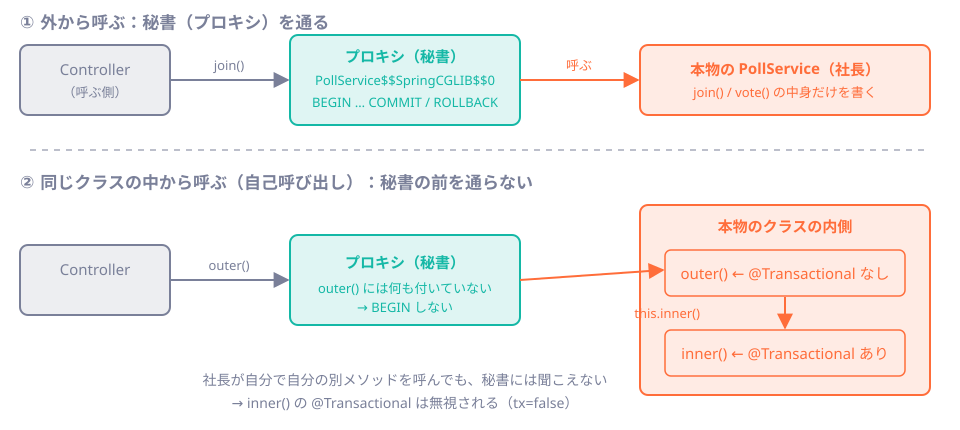

# 第23章 @Transactionalの正体：プロキシ

<div class="goal-box" markdown>

この章でできるようになること

- `@Transactional` が「魔法」ではなく、**プロキシ（本物の前に立つ代理）**で動いていることを、実行結果とスタックトレースで確かめられる
- ログとサーバーの SQL ログで、`BEGIN` / `COMMIT` / `ROLLBACK` が実際に流れたかを確認できる
- 「付けたのに効かない」代表的なケース（自己呼び出し・private・checked 例外・握りつぶし）を、コードを読んで指摘できる
- `REQUIRED` と `REQUIRES_NEW` の違いを、接続の数と合わせて説明できる
- トランザクションが**スレッドに紐づく**ことの意味を説明できる（実験は[第24章](ch24-connection-pool.md)）

</div>

## 1. 問いかけ：付けたのに、効いていない

[第22章](ch22-transactions.md)で、`@Transactional` を付けると、2本の `INSERT` が「全部成功か、全部なかったことか」になることを確かめました。では、次のコードはどうでしょうか。

```java
@Service
public class PollCreator {

    public long createAll(...) {              // 公開メソッドは @Transactional なし
        return create(...);                   // 付いているメソッドを、中から呼ぶ
    }

    @Transactional
    public long create(...) {                 // 付いている
        // INSERT ×2
    }
}
```

`create` には `@Transactional` が付いています。`createAll` から呼べば、トランザクションが効く…と思えますが、**効きません**。コンパイルエラーも、警告も、実行時の例外も出ません。ただ、ひっそりと**トランザクションなしで**動きます。

アノテーションは、ただの印です。印を見て実際に `BEGIN` を送る誰かがいなければ、何も起きません。その「誰か」の正体と、その誰かが**働けない場所**を知るのが、この章の目的です。

## 2. 例え：社長の前に立つ秘書


会社には、社長（Service の本体）がいます。ただし、**取引先は社長に直接依頼できません**。必ず秘書を通します。

1. 秘書が依頼を受ける
2. 秘書が「取引の開始」を宣言する（`BEGIN`）
3. 秘書が、社長に仕事を取り次ぐ（本物のメソッドを呼ぶ）
4. 社長が仕事を終えたら、秘書が「確定」を宣言する（`COMMIT`）。社長が失敗を報告したら、「全部取り消し」（`ROLLBACK`）

社長は、**仕事の中身だけ**を考えればよく、取引の開始と終了は秘書の役目です。

!!! warning "この例えが外れる点"
    - 秘書は人ではなく、Spring が**実行時に自動で作る、本物と同じ見た目のオブジェクト**です。誰かが書いたクラスではありません
    - 秘書が気づけるのは、「**秘書を通った依頼**」だけです。社長が自分で自分に頼む（`this.xxx()`）仕事は、秘書の目に入りません
    - 秘書は、社長の**失敗の報告（例外）**を聞いて、成否を決めます。報告がなければ、失敗に気づけません

## 3. 動画で見る：秘書と社長

<div class="video-card">
  <video controls preload="metadata" poster="../../assets/videos/tx-proxy.jpg">
    <source src="../../assets/videos/tx-proxy.mp4" type="video/mp4">
  </video>
  <p class="video-caption">▶ @Transactionalと秘書（プロキシ）</p>
  <p class="video-credit">音声：VOICEVOX:冥鳴ひまり</p>
</div>

**動画の要点**

- Controller が頼んでいるのは社長ではなく秘書。Spring が注入したのは、じつは**秘書の方**
- 正常時は、秘書が `BEGIN` → 社長が `INSERT` を2回 → 秘書が `COMMIT`。社長が `RuntimeException` を投げれば、秘書は `ROLLBACK`
- **検査例外（checked）は、既定ではロールバックしない**。非検査例外ならロールバック、検査例外はコミット
- 社長が自分の別メソッドを直接呼んでも、private メソッドでも、**秘書を通らないので効かない**。社長が例外を握りつぶすと、秘書は失敗に気づけずコミットしてしまう

??? note "字幕全文"
    トランザクションの仕組みを、社長と秘書にたとえて見てみましょう。
    社長がServiceの本体。前に秘書が立っています。
    Controllerが頼むのは社長でなく秘書です。
    Springが注入したのは、じつは秘書の方なのです。
    だから、取引の開始と終了は、秘書の仕事になります。
    まず、秘書がBEGINで、取引を始めます。
    社長が、INSERTを2回、実行します。
    その間、秘書は、社長の仕事が終わるのを待っています。
    最後に、秘書がCOMMITで、確定します。
    では、社長がRuntimeExceptionを投げたら？
    秘書は、ROLLBACKで、全部なかったことにします。
    ところが、検査例外だと、秘書はロールバックしません。
    非検査例外ならロールバック、検査例外は、既定ではコミットです。
    変えたいときは、rollbackForで指定できます。
    もう一つ。社長が、自分の別メソッドを直接呼ぶと、
    秘書を通らないので、そちらの@Transactionalは効きません。
    privateメソッドも、同じ理由で効きません。
    つまり、秘書の前を通らない呼び出しは、すべて対象外です。
    さらに、社長が例外を握りつぶすと、
    秘書は失敗に気づけず、コミットしてしまいます。
    例外は、秘書まで届いてはじめて、意味を持ちます。
    @Transactionalは秘書経由でのみ効く。


動画の「秘書」は、コードでは `PollCreator$$SpringCGLIB$$0` のようなクラスです。次の節で、実物を確かめます。

## 4. 動かしてみる①：注入されているのは、本物ではない

実験用の `code/labs/part04-lab/` に、`@Transactional` の「効く場合・効かない場合」を順に観察するプログラムがあります。全体は次のコマンドで動きます（第22章の準備が済んでいる前提です）。

```bash
java -Dstdout.encoding=UTF-8 -jar target/part04-lab.jar --lab.run=ch23 --spring.main.web-application-type=none \
  --logging.level.org.springframework.jdbc.support.JdbcTransactionManager=DEBUG
```

最初の実験は、「Spring が注入したオブジェクトのクラスは何か」です。

```java title="code/labs/part04-lab/src/main/java/com/example/lab/ch23/Ch23Runner.java（抜粋）"
System.out.println("  クラス名       : " + selfCall.getClass().getName());
System.out.println("  AOPプロキシ?   : " + AopUtils.isAopProxy(selfCall));
System.out.println("  CGLIBプロキシ? : " + AopUtils.isCglibProxy(selfCall));
System.out.println("  本体のクラス   : " + AopUtils.getTargetClass(selfCall).getName());
```

```text
  クラス名       : com.example.lab.ch23.SelfCallService$$SpringCGLIB$$0
  AOPプロキシ?   : true
  CGLIBプロキシ? : true
  本体のクラス   : com.example.lab.ch23.SelfCallService
```

注入されたのは `SelfCallService` ではなく、**`SelfCallService$$SpringCGLIB$$0`** です。これが秘書です。

!!! note "用語：プロキシ（proxy）"
    「代理」の意味で、本物のオブジェクトと**同じ型に見える**別のオブジェクトです。呼び出しを受けると、本物を呼ぶ**前後に**追加の処理（ここではトランザクションの開始・終了）を挟み、本物に取り次ぎます。
    Spring が使う方式の1つが **CGLIB** で、本物のクラスの**サブクラス**を実行時に生成します（名前の `$$SpringCGLIB$$` はその印）。もう1つの方式（JDK動的プロキシ）は `interface` から作ります。Spring Boot の既定は CGLIB（`proxyTargetClass=true`）なので、QuickVote のように interface を作らなくてもプロキシは作られます。

!!! note "用語：AOP（Aspect-Oriented Programming、アスペクト指向プログラミング）"
    メソッドの**前後に共通の処理を差し込む**仕組みです。トランザクションの開始・終了のように、あちこちのメソッドに同じ形で必要な処理を、本体のコードに書かずに済ませます。Spring では、上のプロキシで実現します。前のコードの `AopUtils` も、この AOP のためのクラスです。

!!! tip "フロントエンドで例えると"
    JavaScript の `Proxy` オブジェクトや、関数を包んで前後に処理を足す高階関数（`withLogging(fn)`）、Redux の middleware と同じ発想です。呼び出し側は包まれていることを意識せず、元の関数と同じように呼べます。
    違いは、Java では**型の名前が変わる**ことです。`getClass()` の結果が元のクラスと一致しないので、たまに驚きます。

### スタックトレースで、秘書を見る

例外が起きたときのスタックトレースにも、秘書は写ります。この章の実験中に、実際に出力されたスタックトレース（抜粋。上が新しい呼び出し。行番号は筆者の環境のもの）です。

```text
at com.example.lab.ch23.ThreadService.insertInAnotherThread(ThreadService.java:22)      ← 社長（本物）
at org.springframework.aop.framework.ReflectiveMethodInvocation.proceed(...)
at org.springframework.transaction.interceptor.TransactionInterceptor$1.proceedWithInvocation(...)
at org.springframework.transaction.interceptor.TransactionAspectSupport.invokeWithinTransaction(...)   ← BEGIN/COMMIT
at org.springframework.transaction.interceptor.TransactionInterceptor.invoke(...)       ← 秘書の仕事
at org.springframework.aop.framework.CglibAopProxy$DynamicAdvisedInterceptor.intercept(...)
at com.example.lab.ch23.ThreadService$$SpringCGLIB$$0.insertInAnotherThread(<generated>)  ← 秘書（プロキシ）
at com.example.lab.ch23.Ch23Runner.run(Ch23Runner.java:133)                             ← 呼んだ人
```

下から読むと、「呼んだ人 → 秘書（`$$SpringCGLIB$$0`）→ `TransactionInterceptor` → `invokeWithinTransaction` → 社長」の順に通っています。**`@Transactional` が効いている呼び出しのスタックトレースには、必ず `TransactionInterceptor` が出ます**。逆に、トランザクションの挙動が怪しいときは、スタックトレースにこの行があるかを探せば、秘書を通ったかどうかが分かります。

なお、`@Transactional` のために `spring-boot-starter-aop` を足す必要はありません（Spring Framework のコアが持っています。[Boot 3→4 差分カード](../appendix/boot3-to-4.md)のカード3）。

## 5. ログで BEGIN / COMMIT / ROLLBACK を確認する

「効いているか」を、推測ではなく**ログで確かめる**方法を身につけます。次の設定1行で、トランザクションの開始・終了がログに出ます。

```yaml title="application.yaml"
logging:
  level:
    org.springframework.jdbc.support.JdbcTransactionManager: DEBUG
```

`JdbcTransactionManager` は、Spring Boot が JDBC（`JdbcClient`）用に自動で用意するトランザクション管理の実体です（秘書が呼び出す先）。第22章・この章で実際に出力されたログの意味を、表にまとめます。

| ログの文言 | 意味 |
| --- | --- |
| `Creating new transaction with name [クラス.メソッド]: PROPAGATION_REQUIRED,ISOLATION_DEFAULT` | 新しいトランザクションを**開始**。どのメソッドの境界か（`name`）、伝播・分離レベルの設定が分かる |
| `Acquired Connection [...] for JDBC transaction` | プールから接続を1本借りた |
| `Switching JDBC Connection [...] to manual commit` | 自動コミットを切った（ここから `BEGIN`） |
| `Initiating transaction commit` → `Committing JDBC transaction` | **コミット**する |
| `Initiating transaction rollback` → `Rolling back JDBC transaction` | **ロールバック**する |
| `Releasing JDBC Connection [...] after transaction` | 接続をプールに返した |
| `Participating in existing transaction` | すでにあるトランザクションに**参加**（新しくは始めない） |
| `Suspending current transaction, creating new transaction` | 今のトランザクションを**一時停止**して、新しいものを始めた（`REQUIRES_NEW`） |

そして、**ログに何も出ない**ことも情報です。「`Creating new transaction` が出ない」＝トランザクションなしで動いた、です。

DB 側でも確かめられます。[第22章](ch22-transactions.md)と同じ `log_statement=all` の設定で、サーバーが受け取った SQL を見ます。

!!! example "動かしてみる：2か所の確認を使い分ける"
    - アプリのログ（`JdbcTransactionManager`）：**Spring がトランザクションを開始・終了した**ことの証拠
    - DB のログ（`docker logs part04-lab-pg`）：**DB が実際に `BEGIN` / `COMMIT` / `ROLLBACK` を受け取った**ことの証拠
    - 食い違うとき（アプリは「コミットした」と言うのに、DB は `ROLLBACK`）に、バグが見つかります。本章の「握りつぶし」が、まさにそれです

## 6. 効かないケース①：自己呼び出し

冒頭の問いに戻ります。同じクラスの中から、`@Transactional` 付きのメソッドを呼ぶとどうなるでしょうか。

```java title="code/labs/part04-lab/src/main/java/com/example/lab/ch23/SelfCallService.java"
@Service
public class SelfCallService {

    public String outer() {
        return inner();                       // this.inner() と同じ。プロキシ（秘書）を通らない
    }

    @Transactional
    public String inner() {
        return TxProbe.state();               // 「いま、トランザクションの中か」を返す小道具
    }
}
```

`TxProbe.state()` は、`TransactionSynchronizationManager.isActualTransactionActive()` で、今のスレッドにトランザクションがあるかを返します。外から呼ぶ場合と、`outer()` 経由の場合を比べます。

!!! question "予測カード"
    `selfCall.inner()` と、`selfCall.outer()` を、それぞれ外から呼びます。`tx=` は `true` と `false` のどちらでしょう。

```text
=== 2. 外から inner() を呼ぶ（プロキシを通る） ===
  Creating new transaction with name [com.example.lab.ch23.SelfCallService.inner]: PROPAGATION_REQUIRED,ISOLATION_DEFAULT
  ...
  Initiating transaction commit
  tx=true name=com.example.lab.ch23.SelfCallService.inner readOnly=false

=== 3. 同じクラスの outer() から this.inner() を呼ぶ（自己呼び出し） ===
  tx=false
```

答えは、外から呼ぶと **true**、`outer()` 経由だと **false**（ログにも `Creating new transaction` が出ません）。



理由は図のとおりです。外から呼ぶ場合は、プロキシを通ってから本物に届きます。`outer()` の中の `inner()` は、本物のオブジェクトが**自分自身（`this`）に対して**呼ぶので、プロキシを経由しません。

### 直し方

| 方法 | 内容 | 向いている場面 |
| --- | --- | --- |
| **業務操作の入口に付ける** | `outer()` 自体に `@Transactional` を付ける。外からは必ずプロキシを通るので、中の呼び出しは同じトランザクションの中で動く | **まず検討する方法**。ほとんどの場合これで足りる |
| 別の Bean に分ける | `inner()` を別のクラス（別の `@Service`）に移し、注入して呼ぶ。呼び出しがプロキシを通る | 本当に別の境界が必要なとき（`REQUIRES_NEW` など） |
| `TransactionTemplate` | 境界をコードで明示する（[第22章](ch22-transactions.md)の `PollService.create`） | 1回の中で境界を何度も引く・取り直すとき |

!!! warning "よくある間違い：自分自身を注入して呼ぶ"
    古い記事には、自分自身を `@Autowired` して `self.inner()` と呼ぶ、という回避策が出てきます。動くことはありますが、設計の問題（境界を引くべき場所が間違っている）を隠すだけです。上の3つのどれかで直します。

## 7. 効かないケース②：private メソッド

```java title="code/labs/part04-lab/src/main/java/com/example/lab/ch23/PrivateService.java"
public String callHidden() {
    return hidden();
}

@Transactional
private String hidden() {
    return TxProbe.state();
}
```

```text
=== 4. private メソッドに付けた @Transactional ===
  tx=false
```

コンパイルは通り、実行しても例外は出ません。**効いていないだけ**です。

理由は2つ重なっています。まず `hidden()` は `callHidden()` から呼ばれるので、前節と同じ自己呼び出しです。さらに、プロキシ（CGLIB は**サブクラス**）は、親クラスの `private` メソッドを**上書きできません**。外から直接呼ぶこともできないので、どちらの面から見ても、秘書が介入する余地がありません。

**`@Transactional` は、他の Bean から呼ばれる `public` メソッドに付ける。** これを守れば、private の問題は起きません。

## 8. 例外でロールバックするか：規則を知る

秘書は、社長の**例外**を見て、コミットかロールバックかを決めます。既定の規則は次のとおりです。

| 投げられたもの | 既定の動作 | 例 |
| --- | --- | --- |
| `RuntimeException`（非検査例外）とそのサブクラス | **ロールバック** | `IllegalStateException`、`DataIntegrityViolationException`、QuickVote の `ApiException` |
| `Error` | **ロールバック** | `OutOfMemoryError` |
| **checked 例外**（`Exception` のうち `RuntimeException` でないもの） | **コミット** | `IOException`、自作の checked 例外（`class XxxException extends Exception`） |
| 例外なし | コミット | |

!!! note "DB のエラーは、checked 例外ではない"
    JDBC の `SQLException` は checked 例外ですが、`JdbcClient` などの DB エラーは、Spring が非検査の `DataAccessException` に翻訳して投げます。そのため、DB の失敗ではロールバックされます（[第19章](../part03/ch19-jdbcclient.md)）。

checked 例外でコミットされるのは、意外で危険です。実験します。

```java title="code/labs/part04-lab/src/main/java/com/example/lab/ch23/CheckedExceptionService.java（抜粋）"
@Transactional
public void failWithChecked(String joinCode) throws IOException {
    repo.insertPoll("checked例外", joinCode);
    throw new IOException("外部との通信に失敗した（checked例外）");
}

@Transactional(rollbackFor = Exception.class)
public void failWithCheckedRollbackFor(String joinCode) throws IOException {
    repo.insertPoll("checked例外+rollbackFor", joinCode);
    throw new IOException("外部との通信に失敗した（checked例外）");
}
```

```text
=== 5. checked 例外 (IOException) を投げる ===
  Creating new transaction with name [...CheckedExceptionService.failWithChecked]: PROPAGATION_REQUIRED,ISOLATION_DEFAULT
  Initiating transaction commit                              ← 例外が出たのに、コミット
  例外: 外部との通信に失敗した（checked例外）
  [checked例外の後（polls に1行残るか）] polls=1 participants=0
  Creating new transaction with name [...failWithCheckedRollbackFor]: PROPAGATION_REQUIRED,ISOLATION_DEFAULT,-java.lang.Exception
  Initiating transaction rollback                            ← rollbackFor を付けたのでロールバック
  例外: 外部との通信に失敗した（checked例外）
  [rollbackFor=Exception.class の後（増えないか）] polls=1 participants=0
```

1つ目は、`IOException` が呼び出し元まで届いたのに、`polls` に1行**残りました**。2つ目は、`rollbackFor = Exception.class` を付けたので、増えていません。ログの設定部分に `-java.lang.Exception` と出ているのが、`rollbackFor` の印です。

なぜこんな規則なのでしょうか。Java の伝統では、checked 例外は「想定内で、呼び出し側が対処するもの（業務上の結果）」、非検査例外は「想定外のバグ」とされていました。その考え方に沿った既定値です。しかし現場のコードでは、`IOException` などの checked 例外が「処理の失敗」を意味することが多く、**既定値が裏目に出ます**。

!!! tip "現場のルール"
    - **業務エラーは `RuntimeException` のサブクラス**で表す。QuickVote の `ApiException` もそうです（`extends RuntimeException`）。これなら既定でロールバックされ、`rollbackFor` を毎回書く必要がありません
    - checked 例外を投げるメソッドに `@Transactional` を付けるときは、`rollbackFor` を**意識して**決める（レビューで必ず確認する）
    - リファレンス実装に実例があります。招待の受諾（`InviteService.accept`）は、招待を消費（UPDATE）したあとで人数上限や締切を判定し、満員なら `ApiException`（非検査）を投げます。例外でロールバックされるので、**招待の消費も取り消され、招待は未使用のまま残ります**（`ConcurrencyIT` の「人数上限で招待の受諾が失敗したら…」が確認しています）

## 9. 効かないケース③：例外の握りつぶし

秘書は、社長が**例外を外に出したとき**にだけ、失敗に気づきます。社長が `catch` して飲み込めば、秘書には「成功」に見えます。

```java title="code/labs/part04-lab/src/main/java/com/example/lab/ch23/SwallowService.java（抜粋）"
@Transactional
public void swallowAppFailure(String joinCode, long hostVisitorId) {
    long pollId = repo.insertPoll("握りつぶし(アプリの失敗)", joinCode);
    try {
        riskyStep();                                                  // ここで例外
        repo.insertParticipant(pollId, hostVisitorId, "HOST");        // 実行されない
    } catch (RuntimeException e) {
        System.out.println("  catch して続行: " + e.getMessage());
    }
}
```

```text
=== 6. 例外の握りつぶし（アプリの失敗） ===
  Creating new transaction with name [...SwallowService.swallowAppFailure]: PROPAGATION_REQUIRED,ISOLATION_DEFAULT
  catch して続行: riskyStep が失敗
  Initiating transaction commit                                       ← 秘書は成功と判断
  [握りつぶした後（poll だけ残るか）] polls=2 participants=0           ← 主催者のいない投票が残った
```

第22章の事故が、`@Transactional` が付いているのに再現しました。`catch` した時点で、例外は秘書まで届いていません。

### DBのエラーを握りつぶすと、もっと奇妙なことが起きる

もう1つ、DB のエラー（外部キー違反）を握りつぶした場合を見ます。

```java
@Transactional
public void swallowDbFailure(String joinCode) {
    long pollId = repo.insertPoll("握りつぶし(DBのエラー)", joinCode);
    try {
        repo.insertParticipant(pollId, 999_999L, "HOST");   // visitors に無い → FK違反
    } catch (DataAccessException e) {
        System.out.println("  catch して続行: " + e.getClass().getSimpleName());
    }
}
```

```text
=== 6b. 例外の握りつぶし（DBのエラー） ===
  catch して続行: DataIntegrityViolationException
  Initiating transaction commit                                       ← Spring は「コミットした」
  [DBエラーを握りつぶした後] polls=2 participants=0                    ← しかし polls は増えていない
```

Spring は `commit` を実行し、**例外も出ません**。ところが `polls` は増えていません。第22章で見た、aborted 状態のトランザクションの動きです。PostgreSQL は `COMMIT` を `ROLLBACK` として扱い、JDBC ドライバもそれを例外にしません。**アプリは「成功した」と思い、DB は「全部取り消した」**。呼び出し元の利用者には 200 が返り、データは消えている、という最悪の状態です。

!!! danger "本番で事故になるパターン：catch して続行"
    `catch (Exception e) { log.warn(...); }` で、トランザクション内の例外を飲み込むと、(a) 半端なデータがコミットされる、または (b) 何も保存されないのに成功を返す、のどちらかになります。
    ルールは単純です。**トランザクションの中では、「この失敗から立ち直れる」と言える例外だけを catch する**。立ち直れないなら、`catch` しない（または、ログを出して**再スロー**する）。

## 10. 伝播：トランザクションの中で、別の @Transactional を呼ぶ

`@Transactional` 付きのメソッドが、別の `@Transactional` 付きのメソッドを呼ぶと、内側はどうなるでしょうか。これを決めるのが**伝播（propagation）**です。

| 伝播 | 動作 | 使いどころ |
| --- | --- | --- |
| `REQUIRED`（**既定**） | すでにトランザクションがあれば**それに参加**。なければ新しく開始 | ほとんどすべて |
| `REQUIRES_NEW` | 今のトランザクションを**一時停止**し、**別の接続で新しい**トランザクションを開始。先にコミット／ロールバックして、元に戻る | 外側が失敗しても残したい記録（監査ログなど） |
| `MANDATORY` | すでにトランザクションが**なければ例外** | 「呼び出し側が境界を持つ」前提の部品（`PollEventService.append`。[第37章](../part07/ch37-event-history.md)） |
| その他（`SUPPORTS`、`NOT_SUPPORTED`、`NEVER`、`NESTED`） | 使う場面は少ない | 必要になったら公式ドキュメントを読む |

### REQUIRED：全員が同じトランザクションに参加する

外側が失敗したあと、内側で書いた監査ログ（`lab_audit`）はどうなるでしょうか。

```java title="code/labs/part04-lab/src/main/java/com/example/lab/ch23/OuterService.java（抜粋）"
@Transactional
public void businessThenFailWithRequired(String joinCode) {
    repo.insertPoll("REQUIRED監査", joinCode);
    System.out.println("  外側: pid=" + repo.backendPid() + " " + TxProbe.state());
    System.out.println("  内側: " + audit.recordRequired("REQUIREDの監査ログ"));   // AuditService（別の Bean）
    throw new IllegalStateException("業務が失敗");
}
```

```text
=== 7. REQUIRED: 外側が失敗。内側の監査ログも一緒に消える ===
  外側: pid=749 tx=true name=com.example.lab.ch23.OuterService.businessThenFailWithRequired readOnly=false
  Participating in existing transaction
  内側: audit(REQUIRED) pid=749 tx=true name=com.example.lab.ch23.OuterService.businessThenFailWithRequired readOnly=false
  Initiating transaction rollback
  例外: 業務が失敗
  lab_audit=0
```

`pid`（DB 側のプロセス番号）が内外とも **749** で、トランザクションの名前も外側のものです。同じ接続・同じトランザクションに参加したので、外側の失敗で、監査ログも一緒に消えました（`lab_audit=0`）。

### REQUIRES_NEW：別の接続で、先に確定する

内側を `REQUIRES_NEW` にすると、どうなるでしょうか。

```text
=== 8. REQUIRES_NEW: 外側が失敗しても、監査ログは残る ===
  外側: pid=749 tx=true name=...OuterService.businessThenFailWithRequiresNew readOnly=false
  Suspending current transaction, creating new transaction with name [com.example.lab.ch23.AuditService.recordRequiresNew]
  Initiating transaction commit
  Resuming suspended transaction after completion of inner transaction
  内側: audit(REQUIRES_NEW) pid=750 tx=true name=com.example.lab.ch23.AuditService.recordRequiresNew readOnly=false
  Initiating transaction rollback
  例外: 業務が失敗
  lab_audit=1
```

内側の `pid` は **750** で、外側（749）とは**別の接続**です。内側が先にコミットしたので、外側が失敗しても、監査ログ（`lab_audit=1`）は残りました。

### 内側の失敗を外側が catch すると

| 内側 | 内側が RuntimeException を投げ、外側が catch して続行 | 結果 |
| --- | --- | --- |
| `REQUIRED` | 内側が通ったとき、**共有しているトランザクションに「ロールバック専用」の印**が付く。外側は気づかずコミットしようとする | `UnexpectedRollbackException`。外側の変更も**全部消える** |
| `REQUIRES_NEW` | 内側のトランザクションだけがロールバックされる。外側は無傷 | 外側はコミットされる |

??? example "実験9・10のログ（内側の失敗を外側が catch）"
    ```text
    === 9. 内側(REQUIRED)の失敗を外側が catch する ===
      Participating in existing transaction
      Participating transaction failed - marking existing transaction as rollback-only
      外側が catch して続行: 内側(REQUIRED)で失敗
      Global transaction is marked as rollback-only but transactional code requested commit
      Initiating transaction rollback
      呼び出し元に届いた例外: org.springframework.transaction.UnexpectedRollbackException
        Transaction rolled back because it has been marked as rollback-only
      [内側REQUIREDが失敗した後] polls=2 participants=0

    === 10. 内側(REQUIRES_NEW)の失敗を外側が catch する ===
      Suspending current transaction, creating new transaction with name [...AuditService.failRequiresNew]
      Initiating transaction rollback
      Resuming suspended transaction after completion of inner transaction
      外側が catch して続行: 内側(REQUIRES_NEW)で失敗
      Initiating transaction commit
      [内側REQUIRES_NEWが失敗した後（外側の INSERT は残るか）] polls=3 participants=0
    ```

実験9では、外側が `catch` で握りつぶしたはずなのに、`UnexpectedRollbackException` が呼び出し元に届きました。**同じトランザクションに参加している以上、内側の失敗は外側の失敗でもある**、という意味です。実験9の `polls` が増えていない（2のまま）点にも注意してください。

!!! warning "REQUIRES_NEW は、気軽に使わない"
    - `REQUIRES_NEW` は、**接続を余分に1本**使います。外側が接続を握ったまま、内側が2本目を要求する。プールが小さいと、この**自己デッドロック**が起きます（[第24章](ch24-connection-pool.md)で再現します）
    - 外側と内側が別のトランザクションなので、**一貫性の保証が切れます**。「業務が失敗した記録を残す」のような、一貫性の切れが意図どおりの場面だけで使います
    - QuickVote のリファレンス実装は、冪等性の記録（[第27章](../part05/ch27-idempotency.md)）でも、イベント履歴（`MANDATORY`）でも、**あえて `REQUIRES_NEW` を使わず、業務更新と同じトランザクション**にしています。「記録だけ残って業務が失敗した」状態を作らないためです

## 11. readOnly：読み取り専用の印

```java title="code/labs/part04-lab/src/main/java/com/example/lab/ch23/ReadOnlyService.java（抜粋）"
@Transactional(readOnly = true)
public void writeInReadOnly(String joinCode) {
    repo.insertPoll("readOnlyで書く", joinCode);
}
```

```text
=== 11. readOnly = true ===
  Creating new transaction with name [...ReadOnlyService.read]: PROPAGATION_REQUIRED,ISOLATION_DEFAULT,readOnly
  tx=true name=...ReadOnlyService.read readOnly=true participants=0
  Creating new transaction with name [...ReadOnlyService.writeInReadOnly]: PROPAGATION_REQUIRED,ISOLATION_DEFAULT,readOnly
  Initiating transaction rollback
  例外: org.springframework.jdbc.UncategorizedSQLException
    原因: ERROR: cannot execute INSERT in a read-only transaction
```

サーバー側のログでは、`BEGIN READ ONLY` が流れていました。つまり `readOnly = true` は、**DB に「このトランザクションでは書かない」と宣言する**指定です。PostgreSQL ではこれで、書き込みが DB に拒否されます。書き込みを書き間違えたときの**安全装置**になります。

QuickVote でも、詳細取得（`PollService.get`）に `@Transactional(readOnly = true, isolation = Isolation.REPEATABLE_READ)` を付けています。複数の `SELECT`（投票・選択肢・票・人数）を、**同じ時点の状態**で読むためです（分離レベルは[第26章](ch26-concurrency-testing.md)）。

!!! warning "readOnly の過信"
    `readOnly` は、速度を保証する魔法でも、他の人の更新を防ぐ鍵でもありません。「書かない」と宣言するだけです。読み取りだけのメソッドに付ける習慣は有益ですが、効果を過大に期待しないでください。

## 12. トランザクションは、スレッドに紐づく

`TxProbe.state()` が問い合わせていた `TransactionSynchronizationManager` は、「今のトランザクション」と「その接続」を**現在のスレッドに紐づけて**（`ThreadLocal`）持っています。

そのため、`@Transactional` の中で `CompletableFuture`・`parallelStream()`・`@Async`・`new Thread` を使うと、別スレッドの DB 操作は**トランザクションの外（`tx=false`）で、別の接続**で動きます。元がロールバックしても、別スレッドの書き込みは残ります。

実験とログは、[第24章](ch24-connection-pool.md#9-トランザクションはスレッドに紐づく)で確かめます。

## 13. 現場ではこうする：@Transactional のレビュー観点

| 見るもの | 疑う理由 |
| --- | --- |
| 同じクラスの中から `@Transactional` メソッドを呼んでいる | 自己呼び出し。秘書を通らず、トランザクションなしで動く |
| `private` / `final` / `static` なメソッドに付いている | 付けても効かない（プロキシが介入できない） |
| `throws Exception` / checked 例外が出るメソッドに付いている | 既定ではコミットされる。`rollbackFor` は意図的か |
| `catch (Exception e)` が、トランザクションの中にある | 握りつぶし。再スロー、または本当に立ち直れる失敗だけか |
| `@Transactional` のメソッドの中で、`@Async`・`CompletableFuture`・`parallelStream` を使っている | 別スレッドは別の接続・トランザクションの外（[第24章](ch24-connection-pool.md#9-トランザクションはスレッドに紐づく)） |
| `REQUIRES_NEW` が使われている | 接続を余分に使う。一貫性が切れる。本当に必要か |
| クラスに `@Transactional`（全メソッドが対象）が付いている | どのメソッドも境界になる。意図しない境界・読み取り専用の混在に注意 |
| 「付いている」ことだけで安心している | **ログで `Creating new transaction` を確認したか**。テストで「途中の例外で何が残るか」を確かめたか |

## まとめ：3点セット

!!! abstract "この章の3点セット"
    **① 一言で言うと**
    `@Transactional` は、Spring が実行時に生成するプロキシ（代理オブジェクト）が、メソッドの前後で `BEGIN` と `COMMIT`／`ROLLBACK` を送る仕組みで、プロキシを通る呼び出し（他の Bean から呼ばれる public メソッド）にしか効かない。ロールバックは、例外がプロキシまで届いたときの規則（非検査例外と Error）で決まり、トランザクションはスレッドに紐づく。

    **② 現場でこう聞かれる**
    「`@Transactional` を付けたのにロールバックされません。なぜですか？」
    → (1) 同じクラスからの自己呼び出し・private でプロキシを通っていない、(2) checked 例外で、既定ではコミットされる、(3) 例外を `catch` して握りつぶしている、(4) 別スレッドで DB を触っている、の順に疑う。まず `JdbcTransactionManager` のログで `Creating new transaction` が出ているかを見る。

    **③ 自分のサービスならどこに当たるか**
    自分のサービスの `@Transactional` が付いたメソッドを3つ選び、(a) 他の Bean から呼ばれているか、(b) 中に `catch` がないか、(c) checked 例外を投げないか、をそれぞれ確かめる。

## 演習

??? question "確認問題1：予測"
    次のコードで、`register()` を外から呼びます。`INSERT` はトランザクションの中で動くでしょうか。

    ```java
    @Service
    public class RegistrationService {
        public void register(String name) {
            save(name);
        }

        @Transactional
        void save(String name) {
            // INSERT
        }
    }
    ```

??? success "解答"
    動きません。(1) `register()` から `save()` は自己呼び出しでプロキシを通らず、(2) さらに `save()` は public でない（package-private）ので、どのみち頼りになりません。`register()` に `@Transactional` を付けるのが最も簡単な直し方です。

??? question "確認問題2：どの例外で、どうなる"
    `@Transactional` が付いたメソッドが、次の例外を投げたとき、ロールバックされますか。(a) `IllegalArgumentException`　(b) `java.io.IOException`　(c) `ApiException`（`extends RuntimeException`）　(d) `catch` されて外に出なかった `IllegalStateException`

??? success "解答"
    (a) ロールバックされる。(b) **されない**（checked 例外。`rollbackFor` を付ければされる）。(c) ロールバックされる。(d) **されない**（秘書に届かないので、コミットされる）。

??? question "確認問題3：ログの読み取り"
    次のログを出した処理は、REQUIRED と REQUIRES_NEW のどちらで動いていますか。pid が 2 種類出ていることは、何を意味しますか。

    ```text
    Suspending current transaction, creating new transaction with name [...AuditService.recordRequiresNew]
    内側: audit(REQUIRES_NEW) pid=750 ...
    外側: pid=749 ...
    ```

??? success "解答"
    `REQUIRES_NEW`（`Suspending current transaction` が根拠）。pid が 749 と 750 の 2 種類あるのは、**DB 接続が2本**使われた（外側と内側が別のトランザクション）ことを意味します。

??? question "応用：QuickVote への小さな変更"
    「参加が拒否された（満員だった）ことを、`lab_audit` に記録したい」とします。`JoinService.join` が満員で `ApiException` を投げる前に、REQUIRED の `audit.record(...)` を呼ぶと、記録は残るでしょうか。残すには、どう変えますか。

??? success "解答"
    残りません。`ApiException` は非検査例外なので、外側がロールバックされ、同じトランザクションに参加している記録も消えます。残すには、記録を **`REQUIRES_NEW`** の別メソッド（別の Bean）にして、先に確定させます。ただし接続を余分に使うこと、記録の失敗が業務に影響しないよう設計することに注意します。あるいは、トランザクションの外（例外を捕まえた呼び出し側）で記録する設計も考えられます。

??? question "説明問題：現場でこう聞かれる"
    「`@Transactional` は、どういう仕組みで動いているのですか？」200字程度で答えてください。

??? success "解答"
    例：Spring が `@Transactional` の付いたクラスのプロキシ（サブクラス）を実行時に作り、DI でそのプロキシを注入しています。プロキシは、メソッドの呼び出しを受けると、接続を借りて自動コミットを切り（`BEGIN`）、本物のメソッドを呼び、正常なら `COMMIT`、例外が出れば規則に従って `ROLLBACK` します。プロキシを通らない呼び出し（自己呼び出し・private）には効かず、接続はスレッドに紐づくので別スレッドには引き継がれません。
