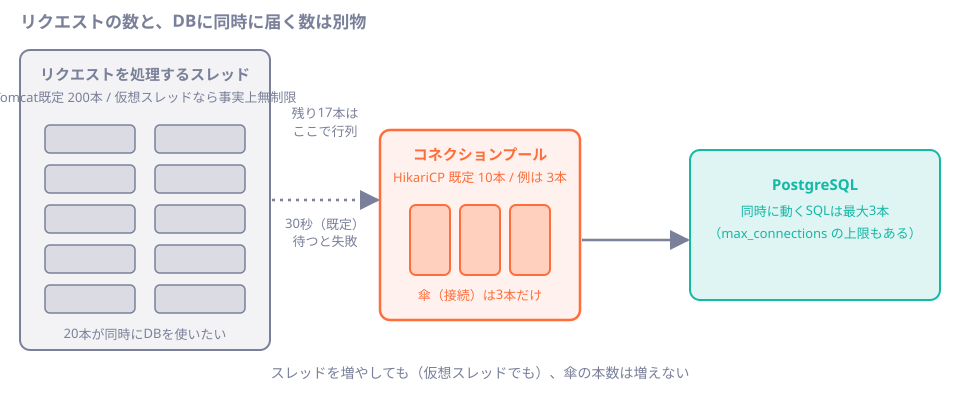

# 第24章 スレッドとコネクションプール

<div class="goal-box" markdown>

この章でできるようになること

- コネクションプール（HikariCP）が何のためにあり、既定値がいくつかを説明できる
- プールをわざと枯渇させて、接続取得のタイムアウトと、そのエラーメッセージを読み解ける
- 「遅い SQL」と「トランザクション中の外部通信」が、他のリクエストを巻き込む理由を、DB 側の状態で確認できる
- 仮想スレッドにしても、DB 接続の数は増えず、上限は変わらないことを実験で説明できる
- トランザクションの中で別スレッドを動かすと、別の接続になりトランザクションの外で動くことを説明できる
- プールの大きさを、「大きいほど良い」と考えずに決める手順を説明できる

</div>

## 1. 問いかけ：CPUもDBも暇なのに、全員が遅い

QuickVote の参加者が増えて、画面が重くなりました。アプリの CPU 使用率は低く、DB も暇なのに、リクエストの多くが数秒から数十秒かかり、一部は 500 エラーになります。ログには次の行が出ています。

```text
HikariPool-1 - Connection is not available, request timed out after 30000ms
(total=10, active=10, idle=0, waiting=37)
```

SQL が遅いわけでも、DB の負荷が高いわけでもありません。足りないのは、DB に入るための「接続」です。この章では、この状態を自分の手で作り、ログを読み、直します。

## 2. 例え：貸出用の傘立て


雨の日、店の入口に貸出用の傘立てがあります。傘（DB 接続）は10本だけです。

客（リクエスト）は傘を借りて外（DB）へ行き、用が済んだら返します。返された傘は次の客が使います。傘を新しく買う（接続を新しく確立する）には時間がかかるので、店はあらかじめ何本か用意しておき、それを使い回します。これがコネクションプールです。傘が全部出払っていると、次の客は返却を待つしかありません。待ちすぎると諦めて帰ります。これが接続取得のタイムアウトです。

!!! warning "この例えが外れる点"
    客を増やしても傘は増えず、待つ人の行列が長くなるだけです。また、現実の傘と違って、DB 接続は持っている間ずっと DB 側のリソース（プロセスとメモリ）を使います。傘立てを大きくすれば済む、という話にはなりません（[第10節](#10-プールの大きさの決め方)）。

## 3. 動画で見る：傘が足りない

<div class="video-card">
  <video controls preload="metadata" poster="../../assets/videos/connection-pool.jpg">
    <source src="../../assets/videos/connection-pool.mp4" type="video/mp4">
  </video>
  <p class="video-caption">▶ コネクションプール：傘が足りない</p>
  <p class="video-credit">音声：VOICEVOX:冥鳴ひまり</p>
</div>

動画の要点

- リクエストは傘（接続）を借りて DB へ行き、終わったら返す。傘を作るには時間がかかるので、先に用意して使い回すのがコネクションプール
- 傘は例えば10本（HikariCP の既定の最大数）。遅い SQL やトランザクション中の外部 API 呼び出しで、傘を持ったまま戻らない人が出ると、傘が減って後ろに行列ができる
- 待ちが30秒（既定）を超えると、接続取得タイムアウトのエラーになる
- 店員（スレッド）を増やしても、仮想スレッドで安く大量に雇っても、傘の本数は増えず、行列が長くなるだけ。ボトルネックは店員ではなく、傘の本数

??? note "字幕全文"
    DBの接続を、貸出用の傘にたとえてみましょう。
    リクエストは、傘を借りてDBへ行きます。
    用が済んだら傘を返し、次の人が使います。
    傘を作るのは時間がかかります。接続の確立は、高コストなのです。
    だから先に用意して、使い回す。これがコネクションプールです。
    例えば、傘は10本。HikariCPの既定の最大数です。
    この10本を、みんなで順番に使い回します。
    ところが、遅いSQLで、傘を持ったまま戻らない人が出ます。
    トランザクション中の外部API呼び出しも、同じです。
    傘が減って、後ろに行列ができます。
    待ちが30秒を超えると、接続取得タイムアウトのエラーです。
    店員を増やしても、傘の本数は増えません。
    仮想スレッドで、安く大量に雇っても、行列が長くなるだけです。
    対策は、傘を持つ時間を短くすること。
    遅いSQLを直し、トランザクション中に外部通信をしない。
    そして傘の本数は、測って決めます。
    ボトルネックは、店員ではなく、傘の本数。


## 4. なぜプールが要るのか、既定値はいくつか

DB に接続するには、ネットワークの接続、認証、DB 側のプロセスの起動が必要です（PostgreSQL は接続1本ごとに専用のプロセスを作ります）。リクエストのたびにこれを行うとコストが高すぎるので、起動時に何本か接続を確立しておき、リクエストが借りて返す仕組みにします。

!!! note "用語：コネクションプール（connection pool）"
    DB 接続をあらかじめ作って貯めておき、使い回す仕組みです。Spring Boot の既定は HikariCP で、借りられる接続がなければ返却を待ちます。
    フロントエンドの `fetch` が（HTTP の keep-alive で）接続を再利用するのと似ていますが、プールには同時に貸し出せる本数の上限があり、足りなければ待たせる点が違います。

Spring Boot 4.1.2 が組み立てる HikariCP の既定値を、`com.zaxxer.hikari` のログを DEBUG にして出力させました。

```text
maximumPoolSize.................10        ← 同時に貸し出せる接続の最大数
minimumIdle.....................10        ← 常に待機させておく接続の数（最大数と同じ＝固定サイズ）
connectionTimeout...............30000     ← 接続を借りるときに待つ上限（30秒）
idleTimeout.....................600000
maxLifetime.....................1800000   ← 接続の寿命（30分）。古い接続を入れ替える
keepaliveTime...................120000
leakDetectionThreshold..........0         ← 0 = 検出しない（接続の返し忘れを調べる機能）
validationTimeout...............5000
```

注目するのは `maximumPoolSize=10` と `connectionTimeout=30000` です。DB を同時に使えるリクエストはアプリ1台につき10本で、11番目は待たされ、30秒待っても借りられなければ失敗します。

QuickVote の規模なら、この設定で足ります。1回のリクエストが接続を握るのは数ミリ秒から数十ミリ秒だからです。問題になるのは、**接続を握る時間が長くなったとき**です。

## 5. 動かしてみる①：遅いSQL1本が、全員を巻き込む

実験用に `code/labs/part04-lab` を、プールを3本、待ち時間を2秒に絞って起動します（`--spring.datasource.hikari.*` で上書きします）。

```bash
java -jar target/part04-lab.jar --server.port=18024 \
  --spring.datasource.hikari.maximum-pool-size=3 \
  --spring.datasource.hikari.connection-timeout=2000
```

用意したエンドポイントは2つです。

```java title="code/labs/part04-lab/src/main/java/com/example/lab/ch24/PoolDemoService.java（抜粋）"
/** 遅いSQL（pg_sleep）。実行している間、コネクションを1本握る。 */
public String slowQuery(double seconds) {
    jdbc.sql("SELECT pg_sleep(:s)").param("s", seconds).query().singleValue();
    return "slow done";
}

/** 速いSQL。コネクションを一瞬だけ使う。 */
public String fastQuery() {
    Integer one = jdbc.sql("SELECT 1").query(Integer.class).single();
    return "fast done " + one;
}
```

`pg_sleep(3)` は DB が3秒間何もせず待つ SQL で、「遅い SQL」の代用です。

!!! question "予測カード"
    `/slow?sec=3`（3秒かかる）を5本同時に呼び、その1秒後に `/fast`（ほぼ0秒で終わる）を1本呼びます。プールは3本、待ち上限は2秒です。

    1. `/slow` の5本は全部成功し、`/fast` も一瞬で返る
    2. `/slow` の3本が成功し、2本が失敗。`/fast` は、数秒待たされる
    3. すべて失敗する

```bash
for i in 1 2 3 4 5; do curl -s -o /dev/null -w "slow-$i: %{http_code} %{time_total}s\n" "localhost:18024/lab/ch24/slow?sec=3" & done
sleep 1
curl -s localhost:18024/actuator/metrics/hikaricp.connections.active     # 1秒後の様子
curl -s localhost:18024/actuator/metrics/hikaricp.connections.pending
curl -s -w "fast: %{http_code} %{time_total}s\n" localhost:18024/lab/ch24/fast
```

実際の出力は次のとおりでした。

```text
（1秒後の Actuator）  hikaricp.connections.active = 3.0   hikaricp.connections.pending = 2.0
slow-5: 500 2.13s
slow-4: 500 2.14s
slow-1: 200 3.05s
slow-2: 200 3.04s
slow-3: 200 3.04s
fast:   200 1.44s
fast（実験の後）: 200 0.025s
```

答えは **2** です。傘（接続）は3本しかなく、先に来た `slow-1〜3` が3本とも握って、3秒間返しません。後から来た `slow-4` と `slow-5` は待ちますが、設定した上限の2秒で諦めて 500 エラーになりました。1秒後に来た `/fast` は、本来25ミリ秒で終わる処理（実験後の値）なのに、傘の返却を待って1.44秒かかっています。遅い SQL とは無関係な軽い処理まで巻き込まれたわけです。



### エラーメッセージを読む

500 になった2本のうち、1本のログです。もう1本にも同じ形の行が出ます。

```text
HikariPool-1 - Connection is not available, request timed out after 2001ms (total=3, active=3, idle=0, waiting=1)
```

Spring はこれを `CannotGetJdbcConnectionException: Failed to obtain JDBC Connection` に包んで投げます。診断の手がかりになるのは括弧の中です。

| 項目 | 意味 | この例では |
| --- | --- | --- |
| `request timed out after 2001ms` | 設定した待ち上限（`connection-timeout`）を使い切った | 2秒 |
| `total=3` | プールにある接続の総数 | 最大3本 |
| `active=3` | 貸し出し中の数 | 全部貸し出し中 |
| `idle=0` | 空いている数 | 空きなし |
| `waiting=1` | 今、待っているスレッドの数 | 行列 |

`active` が `total` と同じで `idle=0`、`waiting` が増えているときは、プールが枯渇しています。CPU や DB の負荷が低いのに遅いときは、まずこの行を探します。

!!! example "動かしてみる：Actuator でプールを見る"
    `management.endpoints.web.exposure.include: health,metrics` を指定すると（実験用プロジェクトは指定済み）、`/actuator/metrics/hikaricp.connections.active` や `.pending`、`.max` などでプールの状態を確認できます。`pending` が 0 でない状態が続くなら、枯渇しています。運用でのメトリクス設計は[第44章](../part09/ch44-metrics.md)で扱います。

## 6. 動かしてみる②：トランザクションの中で外部通信をする

遅い SQL がなくても、同じ状態は作れます。トランザクションの中で DB と関係のない待ち（外部 API の呼び出し、メール送信、ファイル操作）が発生すると、その間も接続を握り続けるからです。ここでは `Thread.sleep` で外部 API の待ちを代用します。

```java title="code/labs/part04-lab/src/main/java/com/example/lab/ch24/PoolDemoService.java（抜粋）"
/** 悪い例: トランザクションの中で外部通信（ここでは sleep で代用）をする。 */
@Transactional
public String externalCallInsideTransaction(long millis) throws InterruptedException {
    repo.countRows("polls");        // 最初のSQLで、接続を取得してトランザクションが始まる
    Thread.sleep(millis);           // 外部APIの呼び出しの代わり（DBは何もしていない）
    repo.countRows("polls");
    return "external (in tx) done";
}

/** 直した例: 外部通信はトランザクションの外。DBを使う部分だけを短いトランザクションにする。 */
public String externalCallOutsideTransaction(long millis) throws InterruptedException {
    Thread.sleep(millis);           // 先に済ませる。この間、接続は要らない
    return transaction.execute(status -> {
        repo.countRows("polls");
        repo.countRows("polls");
        return "external (outside tx) done";
    });
}
```

悪い例を3本同時に呼び（各4秒）、1.5秒後に DB 側から接続の状態を見ます。

```sql
SELECT state, now() - xact_start AS in_tx_for, left(query, 30) AS last_query
FROM pg_stat_activity WHERE datname = 'lab' AND application_name = 'PostgreSQL JDBC Driver';
```

```text
=== 外部通信をトランザクションの中でやる（3本同時）===
        state        |    in_tx_for    |         last_query
---------------------+-----------------+----------------------------
 idle in transaction | 00:00:02.11792  | SELECT count(*) FROM polls
 idle in transaction | 00:00:02.11792  | SELECT count(*) FROM polls
 idle in transaction | 00:00:02.107266 | SELECT count(*) FROM polls
fast（別の軽い要求）: 200 1.78s              ← 待たされた（傘が3本とも使用中）

=== 外部通信をトランザクションの外でやる（3本同時）===
 state | in_tx_for | last_query
-------+-----------+------------
 idle  |           | COMMIT
 idle  |           | SELECT 1
 idle  |           | COMMIT
fast（別の軽い要求）: 200 0.009s             ← 待たされない
```

`idle in transaction` は第22章で見た状態で、トランザクションを開いたまま DB に何も送っていない接続のことです。DB 側では何も起きていませんが、接続は塞がっています。外部通信で待っているリクエストの数だけ、傘が使われたままになります。

直した例では、3本とも4秒待っているあいだ、接続は `idle`（プールに返却済み）です。軽い要求は9ミリ秒で終わりました。

!!! danger "本番で事故になるパターン：トランザクションの中の外部通信"
    メールの送信、決済 API、Slack への通知、ファイルのアップロードを、`@Transactional` のメソッドの中で呼んでいませんか。相手が遅くなる（または止まる）と、待っているリクエストの数だけ接続が塞がります。すると DB と関係のない機能まで巻き込まれて、サービス全体が止まります。

    外部通信にはもう1つ問題があります。ロールバックで取り消せないことです。メールを送ったあとで DB の保存が失敗したら、メールだけが送られた状態になります。

    **外部通信は、トランザクションの外**（前または後）に出します。「保存してから通知する」なら、保存のトランザクションがコミットされた後に送ります（[第37章](../part07/ch37-event-history.md)のイベント履歴が、この考え方の延長です）。

## 7. 動かしてみる③：REQUIRES_NEW が、自分で自分を詰まらせる

[第23章](ch23-transactional-proxy.md)で「`REQUIRES_NEW` は接続を余分に1本使う」と書きました。プールが小さいと、この性質が事故につながります。

```java title="code/labs/part04-lab/src/main/java/com/example/lab/ch24/PoolDemoService.java（抜粋）"
@Transactional
public String needsSecondConnection(long holdMillis) throws InterruptedException {
    repo.countRows("polls");                       // 外側が接続を1本握る
    Thread.sleep(holdMillis);                      // 他のリクエストも、外側で1本ずつ握る時間を作る
    return audit.recordRequiresNew("2本目の接続が要る");   // 内側が2本目を要求する
}
```

プールを2本にして実行します（`--spring.datasource.hikari.maximum-pool-size=2 --spring.datasource.hikari.connection-timeout=2000`）。

```text
### 1本だけ呼ぶ: 外側1本 + 内側1本 = 2本で足りる
audit(REQUIRES_NEW) pid=51526 tx=true name=...AuditService.recordRequiresNew readOnly=false
-> 200 0.86s

### 2本同時に呼ぶ: 2本とも外側で接続を握ってから、内側の2本目を欲しがる
request-1: 500 2.58s
request-2: 200 2.52s
HikariPool-1 - Connection is not available, request timed out after 2001ms (total=2, active=2, idle=0, waiting=1)
```

1本ずつ呼べば成功します。2本同時に呼ぶと、どちらも外側で接続を握ったまま内側の2本目を待つので、互いに相手が握っている接続を待ち合う状態（プール内のデッドロック）になります。片方が2秒で諦めて 500 になり、そのおかげでもう片方が通りました。負荷が高いときにだけ起きるので、再現しにくい事故です。

!!! note "プールが 1 本だと、そもそも起動できない"
    プールを1本にすると、アプリは起動すらできません。Flyway が起動時に DB 側の接続を2本使うためです（`Unable to obtain connection from database: HikariPool-1 - Connection is not available ... (total=1, active=1, ...)`）。プールの大きさには、起動時に必要な本数という下限もあります。

## 8. 仮想スレッドでも、接続は増えない

[第9章](../part01/ch09-threads.md)で、仮想スレッドは「待ちの多い処理を、同期のコードのまま大量に並べられる」と学びました。では、仮想スレッドにすればこの章の問題は解決するでしょうか。スレッドの種類だけを変えて確かめます（`spring.threads.virtual.enabled=false` と `true`）。条件は、プール3本、待ち上限5秒、1秒かかる SQL を20本同時に呼ぶことです。

```text
### spring.threads.virtual.enabled=false : 20本同時、各1秒のSQL、プール3本
active=3.0  pending=8.0（2.5秒時点。curl の起動のばらつきあり）
処理したスレッド: http-nio-18024-exec-6
全体: 6345 ms    HTTPステータス: 200が18本、500が2本

### spring.threads.virtual.enabled=true : 同じ条件
active=3.0  pending=11.0（2.5秒時点）
処理したスレッド: VirtualThread[#97,tomcat-handler-24]/runnable@ForkJoinPool-1-worker-3
全体: 6306 ms    HTTPステータス: 200が18本、500が2本
```

| 比べるもの | プラットフォームスレッド | 仮想スレッド |
| --- | --- | --- |
| 処理したスレッド | `http-nio-...-exec-N` | `VirtualThread[...]` |
| 同時にDBを使えた数（`active`） | 3 | 3 |
| 全体の所要時間 | 約6.3秒 | 約6.3秒 |
| 成功／失敗 | 18本／2本 | 18本／2本 |

スレッドの種類は変わりましたが、結果は同じです。`active` は3のままで、傘が3本しかないので、1秒かかる SQL は1秒に3本ずつしか進みません。20本をさばくには約7秒かかり、待ち上限が5秒だと最後の2本は間に合いません。

仮想スレッドが解決するのは、スレッドが足りなくて待てない問題です。この実験では、そもそも Tomcat のスレッド（最大200本）は足りていて、足りないのは接続でした。待たされているリクエストの数（`pending`）はどちらも8〜11本で、**仮想スレッドにしても行列は短くなっていません**。

!!! warning "『仮想スレッドにしたからプールも大きくしよう』は逆"
    スレッドを増やしても、DB が同時に処理できる量は変わりません。プールを大きくすれば待たされるリクエストは確かに減りますが、そのぶん DB が同時にさばく負荷が増えます（[第10節](#10-プールの大きさの決め方)）。仮想スレッドが安くするのは待ちであり、DB の処理能力は増えません。

## 9. トランザクションは、スレッドに紐づく

スレッドと接続の関係には、もう1つ見落とされやすい性質があります。[第23章](ch23-transactional-proxy.md)の `TxProbe.state()` が問い合わせていた `TransactionSynchronizationManager` は、「今のトランザクション」と「その接続」を現在のスレッドに紐づけて持っています（`ThreadLocal`。[第12章](../part02/ch12-request-journey.md)）。秘書が `BEGIN` したときに接続がそのスレッドに結びつけられ、`JdbcClient` はその接続を使います。

!!! tip "フロントエンド（Node）で例えると"
    `ThreadLocal` は「そのスレッド専用のグローバル変数」です。Node の `AsyncLocalStorage` は `await` を越えて伝播しますが、Java の `ThreadLocal` はスレッドを越えません。

では、トランザクションの中で別のスレッドを動かしたらどうなるでしょうか。第23章の実験プログラム（`--lab.run=ch23`）の実験12で確かめます。

```java title="code/labs/part04-lab/src/main/java/com/example/lab/ch23/ThreadService.java（抜粋）"
@Transactional
public void insertInAnotherThread(String joinCodeMain, String joinCodeOther) {
    repo.insertPoll("このスレッド", joinCodeMain);
    System.out.println("  元のスレッド  : " + Thread.currentThread().getName() + " pid=" + repo.backendPid() + " " + TxProbe.state());
    CompletableFuture.runAsync(() -> {
        repo.insertPoll("別のスレッド", joinCodeOther);
        System.out.println("  別のスレッド  : " + Thread.currentThread().getName() + " pid=" + repo.backendPid() + " " + TxProbe.state());
    }).join();
    throw new IllegalStateException("元のスレッドが失敗 → ロールバック");
}
```

```text
=== 12. 別のスレッドで動かした処理は、トランザクションに入らない ===
  元のスレッド  : main pid=749 tx=true name=com.example.lab.ch23.ThreadService.insertInAnotherThread readOnly=false
  別のスレッド  : ForkJoinPool.commonPool-worker-1 pid=750 tx=false
  Initiating transaction rollback
  例外: 元のスレッドが失敗 → ロールバック
  [スレッド実験の後] polls=4 participants=0
```

別のスレッドは `tx=false` で、別の接続（pid=750）を使い、1行ごとにその場で確定しています。元のスレッドがロールバックしても、別のスレッドの `INSERT` は残りました（実験の最後の `polls=4` のうち1行がこれです）。別の接続を使うので、プールの接続も1本余分に消費します。

| やりがちなコード | 何が起きるか |
| --- | --- |
| `@Transactional` の中で `CompletableFuture.supplyAsync(...)`・`parallelStream()`・`@Async` のメソッドを呼ぶ | 別スレッドの DB 操作は、元のトランザクションの外で、別の接続で動く。元がロールバックしても残る |
| トランザクションの中で `new Thread(...)` | 同上 |

## 10. プールの大きさの決め方

### 大きければ良い、ではない

接続1本は、DB 側では1プロセスです。PostgreSQL の既定の上限は、実行したコンテナで確かめると次のとおりでした。

```text
SHOW max_connections;   →  100
```

アプリが2台で、それぞれのプールが50本なら合計100本になり、DB の上限に達します。すると、管理ツールやバッチなど他のクライアントが接続できなくなります。また、同時に動く SQL が増えるほど DB の CPU とディスクを取り合うので、全体のスループットはかえって下がることがあります。

### 決める手順

1. 1回のリクエストが接続を握る時間を測る（ほとんどの API で数ミリ秒〜数十ミリ秒）
2. 必要な接続数の目安は、秒間リクエスト数 × 握る時間（秒）で出す。例えば1秒に100件で、1件あたり50ミリ秒握るなら、100 × 0.05 = 5本（平均）になる。ピークと揺れを見込んで、少し余裕を持たせる
3. アプリの台数 × プールの大きさ ＜ DB の `max_connections` にする（管理用の接続の分も残す）
4. 設定したら負荷をかけて、`hikaricp.connections.active` と `pending` を見る。`pending` が常に 0 ではないなら、先に握る時間を短くする（遅い SQL、トランザクション中の外部通信）。プールを増やすのはその後

`connection-timeout` の既定30秒は、長すぎることが多い設定です。待っているユーザーも、その背後のスレッドも、30秒間ふさがります。ブラウザの `fetch` なら、利用者はとっくに諦めています。[第45章](../part09/ch45-performance.md)で、「タイムアウトを全部決める」一環として、短く設定する考え方を扱います。

### 診断に使う設定

| 設定キー | 内容 |
| --- | --- |
| `spring.datasource.hikari.maximum-pool-size` | 最大の接続数（既定 10） |
| `spring.datasource.hikari.connection-timeout` | 接続を借りるときの待ち上限（ミリ秒。既定 30000） |
| `spring.datasource.hikari.leak-detection-threshold` | 接続を返し忘れていないか調べる閾値（ミリ秒。既定 0 = 無効） |

接続を借りたまま長く返さないコード（トランザクションの中の外部通信や、`finally` で閉じていない手書きの JDBC）では、`leak-detection-threshold` を設定しておくと、ログにスタックトレースが出ます（開発中の確認用）。

## 11. 現場ではこうする

| 症状 | まず見るもの |
| --- | --- |
| CPUもDBも低いのに遅い／たまに500 | ログの `Connection is not available (total=..., active=..., waiting=...)` と、Actuator の `hikaricp.connections.pending` |
| 特定の時間帯だけ詰まる | その時間に動く遅いSQL（`pg_stat_activity` の長いクエリ）と、`idle in transaction` の接続 |
| `idle in transaction` が長く続く | アプリのトランザクションの中で、DB以外の待ち（外部通信・`sleep`・重い計算）をしていないか |
| 負荷が高いときだけ 500 | `REQUIRES_NEW` などで、接続を2本以上同時に握っていないか |
| `@Transactional` の中で `@Async`・`CompletableFuture`・`parallelStream` を使っている | 別スレッドは別の接続で、トランザクションの外。元がロールバックしても残る（[第9節](#9-トランザクションはスレッドに紐づく)） |
| プールを大きくしたくなった | 握る時間を短くできないか。アプリ台数 × 本数 ＜ `max_connections` か |

## まとめ：3点セット

!!! abstract "この章の3点セット"
    **① 一言で言うと**
    DB 接続は、コネクションプールから借りて返す有限の資源で、既定の最大は10本です。遅い SQL やトランザクション中の外部通信で接続を握る時間が長くなると、他のリクエストが接続待ちになり、待ち上限を超えると失敗します。スレッドを増やしても（仮想スレッドでも）接続は増えません。また、トランザクションはスレッドに紐づくので、別スレッドの DB 操作は別の接続で、元のトランザクションの外で動きます。

    **② 現場でこう聞かれる**
    「負荷が上がるとタイムアウトします。プールの `maximum-pool-size` を増やせば解決しますか？」
    → まず `active`／`pending` と `idle in transaction` を見て、接続を握る時間が長くなっていないかを調べる。握る時間が原因なら、増やしても行列が少し短くなるだけで、DB の負荷が上がる。台数 × 本数が `max_connections` を超えないことも確認する。

    **③ 自分のサービスならどこに当たるか**
    自分のサービスで「トランザクションの中で呼んでいる、DB 以外の処理」（外部 API・メール・ファイル）を書き出し、トランザクションの外に出せるかを検討する。

## 演習

??? question "確認問題1：予測"
    プール3本、待ち上限2秒で、`/slow?sec=1`（1秒かかる）を6本同時に呼びます。何本が成功し、全体で何秒かかるでしょう。（待ち上限を過ぎた分は失敗します）

??? success "解答"
    3本ずつ1秒で処理されるので、最初の3本は1秒で終わります。残りの3本は、前の3本が返却する1秒後に接続を借りて、2秒で終わります。待ちは1秒で上限（2秒）以内なので、**6本とも成功**し、全体で約2秒です。`sec=3` なら、後ろの3本は3秒待たされて、2秒の上限で失敗します（本章の実験）。

??? question "確認問題2：メッセージの読み取り"
    `(total=10, active=10, idle=0, waiting=37)` から、何が分かりますか。次に調べることは何ですか。

??? success "解答"
    接続10本が全部貸し出し中で空きがなく、37個のスレッドが待っています（プール枯渇）。次に、DB 側の `pg_stat_activity` で、長く実行中の SQL と `idle in transaction` の接続がないかを調べ、アプリ側ではトランザクションの中に外部通信がないかを確認します。

??? question "確認問題3：仮想スレッド"
    「仮想スレッドを有効にしたので、プールのタイムアウトは起きなくなる」という主張を、本章の実験を根拠に反論してください。

??? success "解答"
    実験では、スレッドの種類を変えても、同時にDBを使えた接続数（`active=3`）、成功／失敗の数（18／2）、全体の所要時間（約6.3秒）は変わらなかった。ボトルネックは接続の本数で、スレッドではないからである。仮想スレッドで待てるリクエストが増えても、接続待ちの行列が長くなるだけで、待ち上限を超える可能性は残る。

??? question "確認問題4：別スレッド"
    `@Transactional` のメソッドの中で `CompletableFuture.runAsync(() -> repo.insert(...))` を呼び、そのあとメソッドが例外で失敗しました。`insert` した行は残りますか。使う接続の数も答えてください。

??? success "解答"
    残ります。別スレッドにはトランザクションが引き継がれない（`ThreadLocal` はスレッドを越えない）ので、`insert` は元のトランザクションの外で、別の接続を使い、その場で確定します。元のスレッドの接続と合わせて、同時に2本の接続を使います。

??? question "応用：QuickVote への小さな変更"
    投票を作った直後に、Slack に通知する機能を追加します。(a) `PollService.create` の中で通知 API を呼ぶ案と、(b) 作成のトランザクションがコミットされた後で呼ぶ案を比べて、障害時の影響を説明してください。

??? success "解答"
    (a) 通知 API が遅い／止まると、その間 DB 接続を握り続け、接続待ちが連鎖する。さらに、通知が成功したのに DB の保存が失敗（ロールバック）すると、「存在しない投票の通知」が出る。(b) コミット後なら、通知の遅延は接続を握らず、DB の保存は確定している。通知に失敗しても投票は作れる。失敗した通知の再送は別途設計する（イベント履歴・ジョブ。[第29章](../part05/ch29-scheduling.md)・[第37章](../part07/ch37-event-history.md)）。

??? question "説明問題：現場でこう聞かれる"
    「コネクションプールって何で必要なんですか？ サイズはどう決めますか？」200字程度で答えてください。

??? success "解答"
    例：DB への接続は確立にコストがかかるので、あらかじめ作った接続を使い回すためです。サイズは「大きいほど良い」ではなく、1リクエストが接続を握る時間と秒間リクエスト数から目安を出し、アプリの台数×本数がDBの最大接続数を超えないようにして、負荷をかけて `active`／`pending` を見ながら調整します。握る時間が長いなら、プールを増やす前に、遅いSQLやトランザクション内の外部通信を直します。
