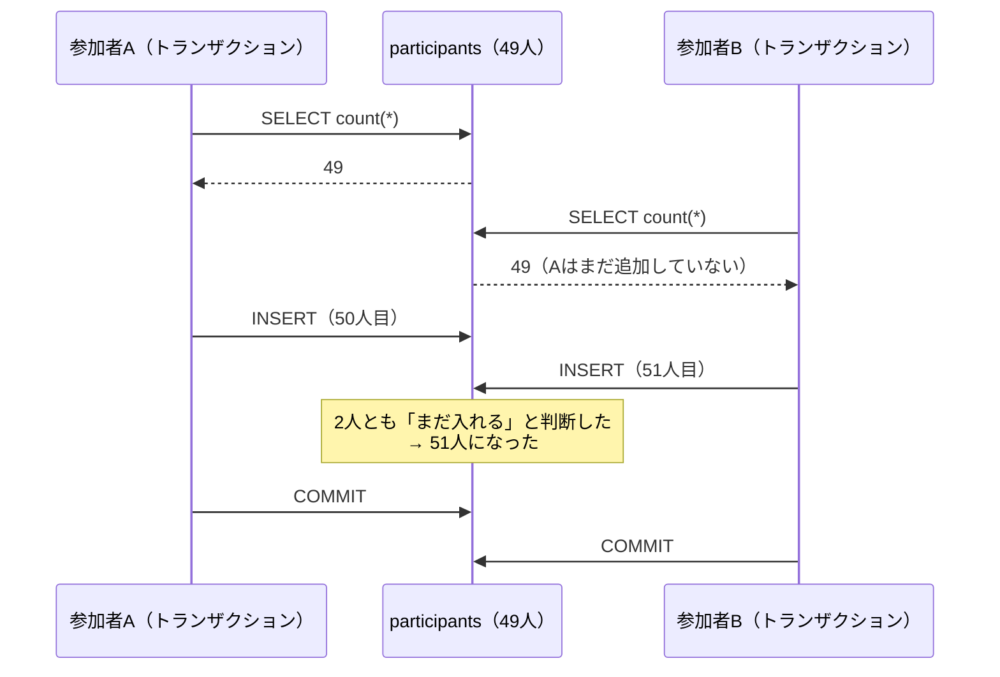

# 第25章 上限を守る：同時参加の競合とロック

<div class="goal-box" markdown>

この章でできるようになること

- 「残り1枠に2人が同時に参加」で、上限を超える事故を、負荷スクリプトと2つの psql の両方で再現できる
- 「数える → 入れる」では守れず、`@Transactional` を付けただけでも守れない理由を、READ COMMITTED の動きから説明できる
- `SELECT ... FOR UPDATE` で親行（`polls`）をロックして、数え直す方式で直せる
- 「すべての更新経路が同じ規則に従う必要がある」ことを、ロックを忘れた経路で実際に壊して確認できる
- 並行性のバグを、レビューでコードから見つけられる

</div>

## 1. いきなり事故：参加者49人の投票に、20人が同時に参加する

[第3部](../part03/index.md)まで作ったアプリには、「参加者は最大50人」という上限があります。参加の処理は、次の2段階で書きました。

1. 今の参加者数を数える
2. 50人未満なら、参加者を1行追加する。50人以上なら、満員（409）として断る

読めば正しく見えます。この状態の `JoinService`（実験用プロジェクトの `JoinServices.Unsafe`）を HTTP で公開し、参加者49人の投票（残り1枠）に、20人が同時に参加してみます。

```bash
cd code/labs/part04-lab
java -jar target/part04-lab.jar --server.port=18025 &
java -Dstdout.encoding=UTF-8 scripts/LoadJoin.java http://localhost:18025 unsafe 20
```

`LoadJoin.java` は、20個のリクエストを `CountDownLatch` で揃えて一斉に送る、JDK だけで動く単一ファイルのスクリプトです。

!!! question "予測カード"
    残り1枠です。20人が同時に参加したとき、成功（200）は何人、満員（409）は何人で、DB の参加者数はいくつになるでしょう。

    1. 成功1人・満員19人・50人
    2. 成功の数は実行のたびに変わるが、50人を超えることがある
    3. 全員が成功して69人

実際の出力（2回実行）です。

```text
--- run 1
投票 1: 参加者49人 / 上限50人 / これから同時に参加する人 20 人 / 方式 = unsafe
HTTPステータスごとの件数: {200=7, 409=13}   (200=参加できた, 409=満員で断られた)
DBの参加者数: {"participants":56}   (上限は50)
--- run 2
投票 2: 参加者49人 / 上限50人 / これから同時に参加する人 20 人 / 方式 = unsafe
HTTPステータスごとの件数: {200=2, 409=18}   (200=参加できた, 409=満員で断られた)
DBの参加者数: {"participants":51}   (上限は50)
```

答えは 2 です。1回目は7人が成功して56人、2回目は2人が成功して51人になり、上限の50人は守られていません。成功の数は実行のたびに変わり、エラーも例外も出ていません。

では、第22章で学んだ `@Transactional` を付ければ直るでしょうか。

!!! question "予測カード"
    同じ処理に `@Transactional` を付けただけ（実験用の `JoinServices.TransactionOnly`）で、同じ実験をします。DB の参加者数は？

    1. 50人に収まる　2. やはり超える

```text
--- run 1
投票 3: 参加者49人 / 上限50人 / これから同時に参加する人 20 人 / 方式 = tx-only
HTTPステータスごとの件数: {200=10, 409=10}   (200=参加できた, 409=満員で断られた)
DBの参加者数: {"participants":59}   (上限は50)
--- run 2
投票 4: ...  方式 = tx-only
HTTPステータスごとの件数: {200=10, 409=10}
DBの参加者数: {"participants":59}   (上限は50)
```

答えは 2 です。前の実験（unsafe）と並べます。

| 方式 | 成功した人数（1回目／2回目） | DB の参加者数 | 特徴 |
| --- | --- | --- | --- |
| unsafe（トランザクションなし） | 7人／2人 | 56人／51人 | 実行のたびに変わる |
| tx-only（`@Transactional` のみ） | 10人／10人 | 59人／59人 | 毎回同じ。きっちり10人 |

この「10」は偶然ではなく、[第24章](ch24-connection-pool.md)のコネクションプールの既定が10本だからです。トランザクションを付けると、各リクエストは接続を握ったまま処理します。そのため同時に進めるのはプールの10人までで、その10人が全員「49人」を数えて入ってしまいました。残りの10人は接続が空くのを待っているうちに、59人になったあとの人数を見て、満員として断られました。トランザクションを付けても、事故の形が変わっただけです。

## 2. 原因を、2つの psql で手で再現する

負荷スクリプトの結果は「たまたま」に見えるかもしれません。そこで原因を手で再現します。ターミナルを2つ開き、それぞれ `docker exec -it part04-lab-pg psql -U lab -d lab` で入ります（A と B とします）。実験データ（`scenarios/seed.sql`）では、投票1の参加者が49人です。

次の順に操作します。

```bash
./scripts/scenario.sh scenarios/25-last-seat-race.txt     # 同じ順序を、2つの psql で非対話に再現
```

```text
A| BEGIN;
B| BEGIN;
A| SELECT count(*) FROM participants WHERE poll_id = 1;
A|     49
B| SELECT count(*) FROM participants WHERE poll_id = 1;
B|     49                                                         ← Bも49人と見た
A| -- 49人なので、入れる
A| INSERT INTO participants (poll_id, visitor_id, role, joined_at) VALUES (1, 50, 'MEMBER', now());
A| INSERT 0 1
B| -- Bも49人と見たので、入れる
B| INSERT INTO participants (poll_id, visitor_id, role, joined_at) VALUES (1, 51, 'MEMBER', now());
B| INSERT 0 1                                                     ← 待たされもせず、成功する
A| COMMIT;
B| COMMIT;
A| SELECT count(*) FROM participants WHERE poll_id = 1;
A|     51                                                         ← 上限50を超えた
```

（罫線などの一部を省略しています。全文は `code/labs/part04-lab/outputs/25-last-seat-race.txt` にあります）

どちらもトランザクションの中（`BEGIN`〜`COMMIT`）で実行しましたが、それでも51人になりました。



## 3. 動画で見る：残り1枠に2人

<div class="video-card">
  <video controls preload="metadata" poster="../../assets/videos/last-seat-race.jpg">
    <source src="../../assets/videos/last-seat-race.mp4" type="video/mp4">
  </video>
  <p class="video-caption">▶ 残り1枠に2人：競合とロック</p>
  <p class="video-credit">音声：VOICEVOX:冥鳴ひまり</p>
</div>

動画の要点

- 上限50人で、いま49人。AさんとBさんがほぼ同時に入ろうとし、2人とも「49人」と見て「まだ入れる」と判断し、2人とも登録して51人になる。これが競合状態（レースコンディション）
- 「トランザクションを付ければ大丈夫？」→ それだけでは防げない。2人とも、自分のトランザクションの中で49人と見ているから
- 対策は、数える前に、投票ルームの行に鍵を掛ける（`SELECT ... FOR UPDATE`）。Aが鍵を取り、Bは鍵が開くまで待つ
- Aが数えて49 → 登録 → コミットで鍵が開く。Bが鍵を取って数え直すと50人 → 満員で断る（409）

??? note "字幕全文"
    投票ルームの参加者は、上限50人です。
    いま49人。残りは、あと1枠です。
    そこへ、AさんとBさんが、ほぼ同時に入ろうとします。
    2人とも、まず今の人数を数えます。
    どちらにも、49人と見えました。
    まだ入れる。2人とも、そう判断します。
    そして2人とも、登録します。
    結果は51人。上限を、超えてしまいました。
    これを、競合状態と呼びます。
    トランザクションを付ければ、大丈夫でしょうか。
    いいえ。それだけでは、防げません。
    2人とも、自分のトランザクションの中で、49人と見ているからです。
    対策は、数える前に、投票ルームの行に鍵を掛けること。
    SELECT FOR UPDATEという書き方です。
    Aさんが鍵を取ります。Bさんは、鍵が開くまで待ちます。
    Aさんは、数えて49人。登録して、コミットすると、鍵が開きます。
    次にBさんが鍵を取って、数え直すと、50人。
    満員なので、Bさんは断られます。ステータスは409です。
    既定のREAD COMMITTEDでは、鍵を取ったあとの数え直しが、最新の結果を見るからです。
    数えてから入れるなら、数える前に鍵を掛ける。


## 4. なぜトランザクションでは防げないのか

[第22章](ch22-transactions.md)で学んだ ACID のうち、`@Transactional` が守るのは A（原子性）です。これは、自分の変更が全部成功するか、全部なかったことになるかという性質です。他のトランザクションが同時に何をしているかは別の問題で、I（独立性）が受け持ちます。

PostgreSQL の既定の分離レベルは READ COMMITTED です。この水準では、トランザクションの中でも、SQL 文ごとにその時点でコミット済みのデータが見えます。

| 時点 | A が見る人数 | B が見る人数 | 理由 |
| --- | --- | --- | --- |
| 両方が `SELECT count(*)` | 49 | 49 | どちらもまだコミットしていない |
| A が `INSERT` | | | A の追加は、A のトランザクションの中だけ。B には見えない |
| B が `INSERT` | | | B の追加も同じ。A の `INSERT` を待たない（別の行を追加するだけなので、衝突しない） |

「数える」と「入れる」は別々の SQL 文で、その間に他のトランザクションの変更がコミットされることがあります。しかもコミット前の変更は見えないので、数えた結果が古くなっていることに気づけません。2人が追加する行は別々の行なので、DB から見ると衝突しておらず、主キーにも UNIQUE にも違反しません。

この形を check-then-act（確認してから動く）と呼びます。[第9章](../part01/ch09-threads.md)のメモリ上の例と同じ構造で、メモリ上の `if (members < MAX) members++` が壊れたのと同じ理由で、DB の `SELECT count` → `INSERT` も壊れます。

!!! tip "フロントエンドで例えると"
    同じ ToDo アプリを2つのタブで開き、両方で「残り1件」の状態から「追加」を押す状況に似ています。どちらのタブも「1件空いている」と表示しているので、どちらも追加できてしまいます。画面に表示された読み取りの結果は、サーバー側の最新の状態を保証しません。

## 5. 対策：数える前に、親行に鍵を掛ける

「数える」と「入れる」を、他のトランザクションに邪魔されない1つのまとまりにしたい。そこで、数える前に鍵（ロック）を取ります。

```sql
SELECT id FROM polls WHERE id = 1 FOR UPDATE;
```

`FOR UPDATE` は「この行を更新するつもりで読む」という指定で、その行に排他ロックをかけます。ロックはトランザクションが終わるまで続き、他のトランザクションが同じ行に `FOR UPDATE` を掛けようとすると、ロックが解放されるまで待たされます。

!!! note "用語：排他ロック（exclusive lock）"
    他のトランザクションが同じ行を更新したり、同じ強さのロックを取ったりするのを待たせる、強いロックです。ロックには他の種類もあります（`FOR SHARE` は、読んでいる間だけ消されないようにする弱いロック。[第27章](../part05/ch27-idempotency.md)で登場します）。

実験します。今度は C を加えた3つのセッションで、B が待たされる様子を第三者から覗きます。

```bash
./scripts/scenario.sh scenarios/25-last-seat-lock.txt
```

```text
 0.6s B| BEGIN;
 0.7s A| BEGIN;
 1.0s A| SELECT id FROM polls WHERE id = 1 FOR UPDATE;
 1.0s A|   1                                                        ← Aが鍵を取った
 1.4s B| -- Bも鍵を取りに行く → Aが終わるまで待たされる
 1.8s B| SELECT id FROM polls WHERE id = 1 FOR UPDATE;              ← 結果が返ってこない（待っている）
 2.2s C| SELECT state, wait_event_type, ... FROM pg_stat_activity WHERE application_name = 'psql' AND pid <> pg_backend_pid() ORDER BY backend_start;
 2.2s C|         state        | wait_event_type
 2.2s C| ---------------------+-----------------
 2.2s C|  active              | Lock               ← B: ロック待ち
 2.2s C|  idle in transaction | Client             ← A: 鍵を持って次の指示待ち
 2.6s A| SELECT count(*) FROM participants WHERE poll_id = 1;
 2.6s A|     49
 3.0s A| INSERT INTO participants (...) VALUES (1, 50, 'MEMBER', now());
 3.0s A| INSERT 0 1
 4.9s A| COMMIT;
 4.9s B|   1                                                        ← 鍵が開いて、Bの FOR UPDATE が返った（約3秒待った）
 5.3s B| -- 鍵が開いた。数え直す
 5.7s B| SELECT count(*) FROM participants WHERE poll_id = 1;
 5.7s B|     50                                                     ← Aの追加が見える → 満員
 6.1s B| -- 50人 → 満員。ロールバックして断る
 6.5s B| ROLLBACK;
```

（`pg_stat_activity` の `wait_event`・`query` 列は省略しました。B の `wait_event` は `transactionid` で、「別のトランザクションの終了待ち」を表します。）

B の `FOR UPDATE` は、A がコミットするまでの約3秒間返ってきませんでした。C の観察では、B は `wait_event_type = Lock`（ロック待ち）で、A は `idle in transaction`（鍵を持ったまま次の命令を待っている状態）です。

B が数え直すと50人でした。READ COMMITTED では SQL 文ごとにそのときコミット済みの最新を見るので、鍵が開いたあとの `SELECT count(*)` には A の追加が見えます。動画の最後の説明はこのことです。

!!! warning "順序が重要：鍵を取ってから数える"
    鍵を取る前に数えた値を、鍵を取った後に使い回してはいけません。B が鍵を待つ間に状況は変わるので、鍵を取った後にもう一度数え直す必要があります。順序は「ロック → 再カウント → 判定 → 書き込み」です。

### リファレンス実装のコード

QuickVote の `JoinService.join` は、この規則のとおりに書いてあります。

```java title="code/quickvote/src/main/java/com/example/quickvote/poll/PollRepository.java（抜粋）"
/**
 * 親行（polls）を排他ロックして読む。人数・選択肢の上限判定、投票、イベント採番はすべてこのロックの下で行う。
 * ロックはトランザクションが終わるまで続く。ほかの更新経路も同じ規則で polls をロックして初めて、
 * 「count してから insert」の間に割り込まれない。
 */
public Optional<Poll> lockById(long id) {
    return jdbc.sql("SELECT * FROM polls WHERE id = :id FOR UPDATE")
            .param("id", id)
            .query(PollRepository::map)
            .optional();
}

public Optional<Poll> lockByJoinCode(String joinCode) {
    return jdbc.sql("SELECT * FROM polls WHERE join_code = :joinCode FOR UPDATE")
            .param("joinCode", joinCode)
            .query(PollRepository::map)
            .optional();
}
```

```java title="code/quickvote/src/main/java/com/example/quickvote/poll/JoinService.java（抜粋）"
@Transactional
public JoinResponse join(long visitorId, String rawCode) {
    // …省略（参加コードの正規化・形式チェック）
    Poll poll = polls.lockByJoinCode(code).orElseThrow(() -> new ApiException(ErrorCode.JOIN_CODE_NOT_FOUND));  // (1)!
    // …省略（再参加は成功扱い・締切の判定）
    int current = participants.countActive(poll.id());                                                         // (2)!
    if (current >= PollRules.MAX_PARTICIPANTS) {
        throw new ApiException(ErrorCode.POLL_FULL);                                                          // (3)!
    }
    participants.insert(poll.id(), visitorId, ParticipantRole.MEMBER, now);                                    // (4)!
    events.append(poll.id(), "PARTICIPANT_JOINED", Map.of("participantCount", current + 1));
    return new JoinResponse(poll.publicId(), ParticipantRole.MEMBER);
}
```

1. 最初に、参加コードから投票の行を探すのと同時にロックを取る。鍵を取れなければここで待たされる
2. 鍵を持ったまま数える。この数は、他のトランザクションが同じ投票に参加者を足していないことが保証された状態での数
3. 満員なら 409 `POLL_FULL`。例外でトランザクションはロールバックされ、鍵も解放される
4. 数えた結果が「まだ入れる」なら追加する。コミットで鍵が解放され、待っていた次の人が動き出す

### なぜ「親行」をロックするのか

数えたいのは `participants` の行数なので、`participants` の行をロックすればよさそうに見えます。ところが、存在しない行（これから追加される行）はロックできません。49人のうち誰かの行をロックしても、新しい50人目の追加は止められません。

そこで、「この投票の人数を変える操作は、先に投票（`polls`）の行の鍵を取る」という約束にします。`polls` の行は必ず1つ存在し、鍵も1つなので、同じ投票への参加は1人ずつ順番に処理されます。

| 方法 | ロックする範囲 | QuickVote での評価 |
| --- | --- | --- |
| 親行（`polls` の1行）をロック | この投票だけ | 採用。別の投票には影響しない。1投票の同時更新は最大でも参加者50人ぶんなので、直列化のコストは小さい |
| テーブル全体をロック（`LOCK TABLE`） | 全投票 | 粗すぎる。他の投票まで止まる |
| アドバイザリロック（アプリ側が決める名前の鍵） | 任意 | 柔軟だが、鍵の名前を自分で管理する必要がある。定期処理で使う（[第29章](../part05/ch29-scheduling.md)） |
| UNIQUE 制約 | — | 「人数の上限」は複数行にまたがる条件で、制約では書けない（[第18章](../part03/ch18-data-modeling.md)） |

## 6. 固定する：負荷スクリプトと自動テストで確かめる

直した版（`JoinServices.Locked`）で、同じ負荷をかけます。

```bash
java -Dstdout.encoding=UTF-8 scripts/LoadJoin.java http://localhost:18025 locked 20
```

```text
--- run 1
投票 5: 参加者49人 / 上限50人 / これから同時に参加する人 20 人 / 方式 = locked
HTTPステータスごとの件数: {200=1, 409=19}   (200=参加できた, 409=満員で断られた)
DBの参加者数: {"participants":50}   (上限は50)
--- run 2
HTTPステータスごとの件数: {200=1, 409=19}
DBの参加者数: {"participants":50}   (上限は50)
```

成功はちょうど1人で、残りの19人は満員（409）、DB は50人です。2回とも同じ結果でした。

リファレンス実装（`code/quickvote`）の本物の API にも、同じ形の負荷をかけました。`scripts/LoadJoinQuickVote.java` は、主催者が投票を作り、48人が順番に参加して49人にしてから、新しい20人が同時に `POST /api/join` を送ります（CSRF の Cookie とヘッダーも自分で付けます）。

!!! info "今は分からなくていい"
    CSRF の Cookie とヘッダーは、ブラウザ経由の書き込みを守る仕組みです。ここでは「本物の API を呼ぶのに必要な前置き」とだけ思ってください。[第34章](../part06/ch34-browser-boundary.md)で扱います。

```text
準備完了: 参加者 49 人 / 上限50人 / これから同時に参加する人 20 人
HTTPステータスごとの件数: {200=1, 409=19}   (200=参加できた, 409=満員 POLL_FULL)
参加者数(主催者が GET /api/polls/{id} で確認): 50 人
```

自動テストにも固定します。リファレンス実装の `ConcurrencyIT` の最初のテストです。

```java title="code/quickvote/src/test/java/com/example/quickvote/ConcurrencyIT.java（抜粋）"
@Test
void 参加者49人の投票に20人が同時に参加しても成功はちょうど1人() {
    TestVisitor host = newVisitor();
    PollDetail poll = createPoll(host, false, "A");
    addMembersDirectly(poll, 48); // 主催者＋48人＝49人（残り1枠）
    List<TestVisitor> candidates = new ArrayList<>();
    for (int i = 0; i < 20; i++) {
        candidates.add(newVisitor());
    }

    List<Outcome<Object>> outcomes = Concurrently.run(20, i -> () -> joinService.join(candidates.get(i).id(),
            poll.joinCode()));

    assertThat(outcomes).filteredOn(Outcome::succeeded).hasSize(1);
    assertThat(outcomes).filteredOn(o -> failedWith(o, ErrorCode.POLL_FULL)).hasSize(19);
    assertThat(countRows("participants")).isEqualTo(50);
}
```

`Concurrently.run(20, ...)` は、20本のスレッドを `CountDownLatch` で揃えて一斉に開始し、各結果（成功か例外か）を集めます。このテストが確かめているのは、特定の順序や回数ではなく、どの順序でも結果が満たすべき条件（成功はちょうど1人、満員が19人、DB は50人）です。この種のテストの作り方は[次の章](ch26-concurrency-testing.md)で詳しく見ます。

## 7. すべての更新経路が、同じ規則に従う必要がある

ロックは、全員が取りに行って初めて意味があります。鍵のかかった部屋の隣に鍵のない裏口があれば、鍵をかけた意味がありません。

QuickVote で参加者を増やす道は1つではありません。

| 経路 | 参加者数を変えるか | 親行のロック |
| --- | --- | --- |
| 参加コードで参加（`JoinService.join`） | 増やす | `lockByJoinCode` |
| 招待の受諾（`InviteService.accept`） | 増やす（共同主催者として） | `lockById` |
| 選択肢の追加（`PollService.addOption`） | 選択肢数（上限10）を増やす | `lockById` |
| 投票（`VoteService.vote`） | 締切判定とイベント採番のため | `lockById` |
| 締切（`PollService.close`） | 状態を変える | `lockById` |

もし招待の受諾の実装者がロックを取り忘れたら、どうなるでしょうか。参加（ロックあり）と招待の受諾（ロックなし）が同時に来る状況を、2つの psql で再現します。

```bash
./scripts/scenario.sh scenarios/25-other-path.txt
```

```text
A| BEGIN;
B| BEGIN;
A| SELECT id FROM polls WHERE id = 1 FOR UPDATE;
A|   1                                                            ← A は鍵を取った（参加コード経由）
A| SELECT count(*) FROM participants WHERE poll_id = 1;
A|     49
B| -- 鍵を取らないので、待たされずに数えられる
B| SELECT count(*) FROM participants WHERE poll_id = 1;
B|     49                                                         ← B は鍵を取りに行かない（別の経路、ロックを忘れた）
A| INSERT INTO participants (...) VALUES (1, 50, 'MEMBER', now());
B| INSERT INTO participants (...) VALUES (1, 51, 'HOST', now());
A| COMMIT;
B| COMMIT;
A| SELECT count(*) FROM participants WHERE poll_id = 1;
A|     51                                                         ← 片方が正しくても、上限を超えた
```

A がロックを取っていても、B が取らなければ、B は待たされません。A の途中の状態も、コミット前なので B には見えません。ロックが止められるのは、ロックを取りに行く者同士だけです。同じことは自動テストにも固定してあります（実験用の `JoinRaceIT` の「片方の経路がロックを忘れると、もう片方が正しくても上限を超える」）。

!!! danger "本番で事故になるパターン：新しい入口を足したときのロック忘れ"
    最初に作った入口（参加コード）は、きちんとロックしていました。数か月後、別の人が「QRコードで参加」「管理者が直接追加」という入口を足します。その人はロックの規則を知りません。テストでは1人ずつしか動かさないので気づけず、本番の混雑した日に、51人の投票ができあがります。
    防ぐには、次の3つを組み合わせます。「この表の件数に上限がある操作は、まず `polls` の行をロックする」をコードコメントとレビュー観点に書くこと、上限判定を1つのメソッドに集約すること、入口ごとに並行性テストを書くことです。

### レビューで探すパターン

AI が書いたコードや他の人のコードをレビューするときは、次の形を探してください。

| 見つけるもの | 疑うこと |
| --- | --- |
| `SELECT count(*) …` → `if (… < 上限)` → `INSERT` | check-then-act。ロックか、制約か、条件付き UPDATE がないか |
| `exists` / `findBy…().isEmpty()` → `save`／`insert` | 「なければ作る」。同時に来たら二重に作る（UNIQUE か `ON CONFLICT` が要る。[次の章](ch26-concurrency-testing.md)） |
| 値を読む → Java で計算 → UPDATE で書き戻す | ロストアップデート（楽観ロックか、SQL 側での計算が要る） |
| `@Transactional` だけで安心している | 原子性は守れるが、独立性は別問題 |
| ロックを取る箇所が、入口ごとにバラバラ | すべての経路が同じ規則か。入口が増えるたびに見直す |

## 8. ロックの代償

ロックは競合を防ぐ代わりに、他の処理を待たせます。気をつけることが3つあります。

1つめは、鍵を持っている間を短くすることです。鍵を持ったままのトランザクションが外部通信などで長引くと、後ろの全員が待たされ、接続も塞がります（[第24章](ch24-connection-pool.md)）。鍵を持ったまま固まった人がいれば、全員が待ち続けることになります。QuickVote の `join` が、鍵を取ってから数えて追加するだけで、すぐにコミットするのはこのためです。待ちの上限（`lock_timeout`・`statement_timeout`）は[第45章](../part09/ch45-performance.md)で決めます。

2つめは、ロックの範囲を小さくすることです。対象を「この投票の1行」にすれば、他の投票は影響を受けません。全体を1つの鍵で守る設計は避けます。

3つめは、複数の鍵を取るときに順序を決めることです。取る順序が人によって違うと、デッドロックになります（[次の章](ch26-concurrency-testing.md)）。QuickVote は、冪等性の記録（[第27章](../part05/ch27-idempotency.md)）の行、`polls` の行、の順に固定しています。

## まとめ：3点セット

!!! abstract "この章の3点セット"
    **① 一言で言うと**
    「数えてから入れる」は、数えた時点と入れる時点の間に他のトランザクションが割り込めるため、トランザクションを付けても上限を守れない。数える前に、数える対象を束ねる親行を `SELECT ... FOR UPDATE` でロックし、ロックを取った後で数え直すことで直列化する。ロックは、すべての更新経路が同じ規則で取って初めて効く。

    **② 現場でこう聞かれる**
    「残り1枠に2人が同時に申し込んだら、どうなりますか？ `@Transactional` は付けていますが」
    → 両方が「空きあり」と判断して、上限を超える可能性がある。READ COMMITTED では、他のトランザクションの未コミットの変更が見えないため。親行を `FOR UPDATE` でロックして、後続を待たせ、ロック取得後に数え直す。テストでは `CountDownLatch` で同時に開始して、成功がちょうど上限までになることを確かめる。

    **③ 自分のサービスならどこに当たるか**
    自分のサービスの「上限がある操作」（人数・件数・回数・在庫・クーポンの枚数など）を書き出し、それぞれが「数える → 入れる」になっていないか、数える対象を束ねる親（ロックする行）は何かを決める。

## 演習

??? question "確認問題1：予測"
    次の SQL を、A と B の2つのセッションがこの順に実行します（投票1は49人）。B の最後の `SELECT count(*)` は何を返し、B は最終的に参加できますか。

    ```text
    A: BEGIN;  SELECT id FROM polls WHERE id = 1 FOR UPDATE;
    B: BEGIN;  SELECT id FROM polls WHERE id = 1 FOR UPDATE;   -- 待たされる
    A: INSERT INTO participants ...;  COMMIT;
    B: （待ちが解けた）  SELECT count(*) FROM participants WHERE poll_id = 1;
    ```

??? success "解答"
    50 を返します。READ COMMITTED では SQL 文ごとにコミット済みの最新を見るので、A のコミット後の `SELECT count(*)` には A の追加が見えます。50人なので、B は満員として断られます（ロールバックします）。

??? question "確認問題2：どこがおかしい"
    次の `join` は、ロックを取っています。それでも上限を超える可能性があります。理由を説明してください。

    ```java
    @Transactional
    public void join(long pollId, long visitorId) {
        int current = participants.countActive(pollId);     // 先に数える
        polls.lockById(pollId);                             // 後からロック
        if (current >= 50) throw new ApiException(ErrorCode.POLL_FULL);
        participants.insert(pollId, visitorId, ParticipantRole.MEMBER, now);
    }
    ```

??? success "解答"
    ロックを取る前に数えているため、ロックを待っている間に他のトランザクションが追加しても、`current` は古いまま使われます（第5節の注意）。ロックを取った後で数える順序にします。

??? question "確認問題3：別の経路"
    QuickVote に「主催者が参加者を直接追加する」API を足します。上限を守るために、何をしますか。同じ追加が、どの既存の経路とも競合しないことを、どう確かめますか。

??? success "解答"
    (a) 参加者数を変える既存の経路と同じ規則で、`polls` の行を `FOR UPDATE` でロックしてから、数え直して挿入します。(b) 既存のテストと同じ形の並行性テスト（`CountDownLatch` で一斉開始）を、追加した経路と既存の経路を混ぜて書き、結果の人数が上限を超えないことを確認します（実験の `JoinRaceIT` のように、経路を混ぜたテストが有効です）。

??? question "応用：選択肢の追加（上限10件）"
    リファレンス実装の `PollService.addOption` は、`insertOption` の中で、`polls.lockById` → `options.count` → `options.insert` の順に呼んでいます。(1) なぜ `options` の行ではなく `polls` の行をロックするのですか。(2) 選択肢が8件のときに20人が同時に追加すると、成功は何人で、何件になりますか（`ConcurrencyIT` の対応するテストで確認できます）。

??? success "解答"
    (1) これから追加される選択肢の行は存在せず、ロックできないためです。「この投票の選択肢を変える操作」を束ねる親行（`polls`）を鍵にします。(2) 成功は2人で、選択肢は10件で止まります（`ConcurrencyIT` の「選択肢が8件の投票に20人が同時に追加しても10件を超えない」は、失敗した18人が `OPTION_LIMIT_REACHED` であることも確かめています）。

??? question "説明問題：現場でこう聞かれる"
    「`SELECT ... FOR UPDATE` で、なぜ上限が守れるのですか？」200字程度で答えてください。

??? success "解答"
    例：数える前に、投票の行を `FOR UPDATE` でロックすると、同じ投票への他の参加処理は、ロックが解放される（コミットされる）まで待たされるためです。待たされた側は、ロックを取った後で人数を数え直すので、先行者の追加が見え、上限を超える場合は断れます。「数える」と「入れる」の間に他の処理が割り込めなくなり、同じ投票への参加が1件ずつ直列に処理されます。
