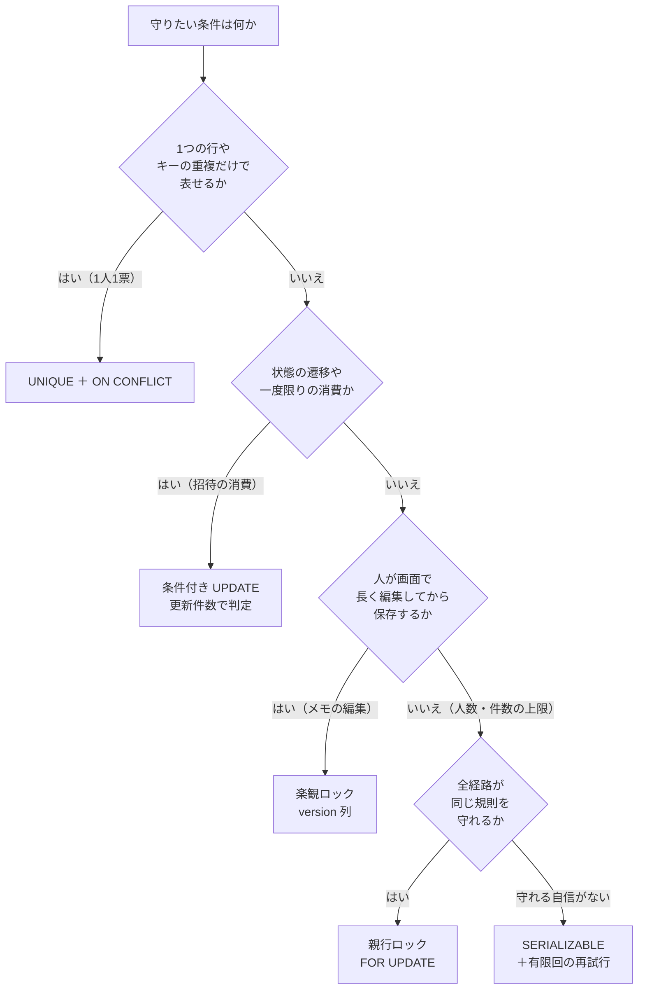

# 第26章 競合の別解と並行性テスト

<div class="goal-box" markdown>

この章でできるようになること

- 競合への対処を、**楽観ロック・条件付き UPDATE・UNIQUE＋ON CONFLICT・分離レベル・ロック**から、条件に応じて選べる
- READ COMMITTED で何が見え、REPEATABLE READ と SERIALIZABLE で何が変わるかを、2つの psql で説明できる
- デッドロックを実際に起こして、ロック順序で直せる
- 競合の失敗を、**有限回**だけ、**トランザクションの外**でやり直せる
- `CountDownLatch` で「狙った競合」を作り、並行性のテストを書ける。「100回動いた」が根拠にならない理由を、数字で説明できる

</div>

## 1. 問いかけ：ロックだけが答えなのか

[前の章](ch25-locking.md)では、「上限を守る」ために、親行を `FOR UPDATE` でロックしました。強力ですが、**全員を待たせる**方法です。QuickVote には、同じ「同時に来る」問題でも、ロックを使っていない場所があります。

- **1人1票**：同じ人が2つの端末から同時に投票しても、票は1行（リファレンス実装は、UNIQUE 制約と `ON CONFLICT` が守る）
- **招待は一度限り**：同じ招待リンクを10人が同時に開いても、成功は1人（条件付き `UPDATE` が守る）

この章では、競合への対処法を一通り並べ、**どれをいつ使うか**を判断できるようにします。そして最後に、「動いた」ではなく**「壊れないと言える」ためのテスト**の書き方を学びます。

| 手段 | 守る相手 | 競合したとき | 本章 |
| --- | --- | --- | --- |
| 親行ロック（`FOR UPDATE`） | 複数行にまたがる条件（人数・件数の上限） | 後続は**待つ** | [前章](ch25-locking.md) |
| **楽観ロック**（version 列） | 読んでから書き戻す更新（ロストアップデート） | 後から保存した側が**失敗**（0件更新） | 第2節 |
| **条件付き UPDATE** | 状態の遷移・一度限りの消費 | 条件に合わない側が**0件更新** | 第3節 |
| **UNIQUE ＋ ON CONFLICT** | 「同じものを二重に作らない」 | 衝突を**上書きや無視**に変える | 第4節 |
| **分離レベル**（SERIALIZABLE） | 読んだ結果に基づく判断全般 | 片方が**失敗**して、やり直す | 第5節 |

## 2. 楽観ロック：読んだ後に、誰かが書き換えていないか

共有のメモ（`lab_memos`）を、2人が同時に編集する場面を考えます。A も B も、「最初」という内容を読み、それぞれ追記して保存します。

### 後勝ちで、黙って消える

読み込んだ値に追記して、`UPDATE` で書き戻すだけの実装だと、どうなるでしょうか（2つの psql で再現します）。

```bash
./scripts/scenario.sh scenarios/26-lost-update.txt
```

```text
A| SELECT body, version FROM lab_memos WHERE id = 1;
A|  最初 |       0
B| SELECT body, version FROM lab_memos WHERE id = 1;
B|  最初 |       0
A| UPDATE lab_memos SET body = '最初 + Aの追記' WHERE id = 1;
A| UPDATE 1
B| UPDATE lab_memos SET body = '最初 + Bの追記' WHERE id = 1;
B| UPDATE 1                                              ← どちらも成功
A| SELECT body, version FROM lab_memos WHERE id = 1;
A|  最初 + Bの追記 |       0                               ← Aの追記が消えた（エラーなし）
```

どちらの `UPDATE` も成功しました。**A の追記は、エラーも出ずに消えました**。[第9章](../part01/ch09-threads.md)の `counter++` と同じ、**ロストアップデート**（更新の消失）です。

### 楽観ロック：version 列を WHERE に入れる

直し方は、「読んだときの `version` のままなら、更新する」を `WHERE` に書き、更新のたびに `version` を進めることです。

```java title="code/labs/part04-lab/src/main/java/com/example/lab/ch26/MemoService.java（抜粋）"
@Transactional
public void saveOptimistic(long id, String newBody, long expectedVersion) {
    int updated = jdbc.sql("""
            UPDATE lab_memos SET body = :body, version = version + 1
            WHERE id = :id AND version = :version
            """)
            .param("id", id)
            .param("body", newBody)
            .param("version", expectedVersion)
            .update();
    if (updated == 0) {
        throw new OptimisticLockingFailureException("メモ " + id + " は、読んだ後に他の人が更新しました");
    }
}
```

`.update()` の戻り値は**更新された行数**です。0 なら、`version` が変わっていた（誰かが先に更新した）ということです。

```text
A| BEGIN;
A| UPDATE lab_memos SET body = 'Aの版', version = version + 1 WHERE id = 1 AND version = 0;
A| UPDATE 1
B| UPDATE lab_memos SET body = 'Bの版', version = version + 1 WHERE id = 1 AND version = 0;     ← Aのコミットまで待たされる（約2秒）
A| COMMIT;
B| UPDATE 0                                              ← 待ちが解けると、条件が合わず0件更新
A| SELECT body, version FROM lab_memos WHERE id = 1;
A|  Aの版 |       1
```

B の `UPDATE` は、A がコミットするまで**行ロックで待たされ**、A が `version` を 1 にした後で、`WHERE version = 0` を**再評価して0件**になりました。A の更新は守られ、B は「競合した」ことを検出できます。

「楽観」ロックという名前は、**競合が滅多に起きないと楽観して、ロックを取らず、書くときに検査する**ことに由来します。これに対し、前章の `FOR UPDATE` は、先に鍵を取るので「悲観ロック」と呼ばれます。

| | 悲観ロック（`FOR UPDATE`） | 楽観ロック（version） |
| --- | --- | --- |
| 競合のとき | 後続が**待つ** | 後から保存した側が**失敗する** |
| 向いている場面 | 競合が頻繁。失敗させたくない。短い処理 | 競合が稀。**ユーザーが画面で編集している間**（数分）鍵を持てない |
| 失敗後 | 待てば先に進める | 読み直して、**利用者に再編集してもらう**（またはやり直す） |
| Web API での表現 | — | `409 Conflict`（または `412 Precondition Failed`）を返し、最新の内容を返す |

「ユーザーがフォームを開いてから保存するまで」DB のロックを持ち続ける設計は成り立ちません（[第24章](ch24-connection-pool.md)の接続の占有になります）。**フォームを開いた時点の `version` をクライアントに持たせ、保存のリクエストで送り返してもらう**のが、楽観ロックです。

!!! note "QuickVote の中の楽観ロック"
    リファレンス実装の中心は悲観ロックと制約で、`version` 列を使う場所はありません。メモや設定のような「利用者が画面で長く編集する」機能を足すときに有効な手段です。JPA の `@Version`（[第40章](../part08/ch40-n-plus-one.md)）は、この楽観ロックの仕組みを自動化したものです。

## 3. 条件付き UPDATE：検査と更新を、1本の SQL にする

楽観ロックは、条件付き UPDATE の応用でした。もっと単純な形が、リファレンス実装の**招待の消費**です。招待リンクは一度限りで、同じリンクを10人が同時に開いても、成功は1人でなければなりません。

```java title="code/quickvote/src/main/java/com/example/quickvote/invite/InviteRepository.java（抜粋）"
/**
 * 一度限りの消費。「未使用で、期限内」を WHERE に書いた UPDATE の更新件数で成否を判定する。
 * 先に SELECT で「未使用か」を調べてから UPDATE する書き方だと、2人が同時に SELECT を通り抜けてしまう。
 * UPDATE は1文の中で「条件の確認と書き込み」が行ロックの下で原子的に行われ、後続は更新後の値を見て0件になる。
 */
public int consume(String tokenHash, long visitorId, Instant now) {
    return jdbc.sql("""
            UPDATE invites SET used_at = :now, used_by = :visitorId
            WHERE token_hash = :tokenHash AND used_at IS NULL AND expires_at > :now
            """)
            .param("now", Db.ts(now))
            .param("visitorId", visitorId)
            .param("tokenHash", tokenHash)
            .update();
}
```

`UPDATE` は、条件に合う行を探して、行にロックを掛けて書き換えるまでが**1つの原子的な操作**です。後から来た人は、ロックが解けるのを待ち、更新された後の `used_at` を見て、`used_at IS NULL` が偽になり、0件になります。呼び出し側は、**戻り値が 1 か 0 か**だけで成否を判定できます。

```java title="code/quickvote/src/main/java/com/example/quickvote/invite/InviteService.java（抜粋）"
if (invites.consume(tokenHash, visitorId, now) == 0) {
    // 使用済み・期限切れ・（直前に他の人が消費した）のどれでも同じ応答。理由を区別して教えない。
    throw new ApiException(ErrorCode.INVITE_INVALID);
}
```

リファレンス実装の `ConcurrencyIT` が、「同じ招待トークンを10人が同時に受けても成功は1人」を確かめています。

| 書き方 | 競合したとき |
| --- | --- |
| `SELECT … WHERE used_at IS NULL` → Java で判定 → `UPDATE` | 2人とも `NULL` を見て、2人とも成功する（check-then-act） |
| **`UPDATE … WHERE used_at IS NULL` の更新件数で判定** | 1人だけが 1 件、他は 0 件。**検査と更新が1本** |

この形は、**状態の遷移**にも使えます。`UPDATE polls SET status = 'CLOSED' WHERE id = :id AND status = 'OPEN'` の更新件数が 1 なら、自分が閉じた、0 なら誰かが先に閉じた、と分かります。

## 4. UNIQUE ＋ ON CONFLICT：二重を、DB に断らせる

1人1票は、「同じ人の票が2行になってはいけない」という条件です。これは**単一の表の中で、キーの重複を禁じるだけ**なので、`UNIQUE(poll_id, participant_id)` という**制約**で表せます（[第18章](../part03/ch18-data-modeling.md)）。制約は、同時に何が来ても、DB が必ず守ります。

では、同じ人が別々の端末から同時に投票したらどうなるでしょうか。2つのトランザクションが、同じキーの `INSERT` を同時に行います。

```bash
./scripts/scenario.sh scenarios/26-on-conflict.txt
```

素の `INSERT`（`ON CONFLICT` なし）では、こうなります。

```text
A| BEGIN;
B| BEGIN;
A| INSERT INTO votes (poll_id, participant_id, option_id, voted_at) VALUES (1, 2, 1, now());
A| INSERT 0 1
B| INSERT INTO votes (poll_id, participant_id, option_id, voted_at) VALUES (1, 2, 2, now());   ← Aのコミットまで待たされる
A| COMMIT;
B| ERROR:  duplicate key value violates unique constraint "votes_poll_participant_key"
B| ROLLBACK;
```

B の `INSERT` は、A がコミットするかロールバックするかが決まるまで**待たされ**、A がコミットした後、**一意制約違反**で失敗します。ロックのような待ちは起きますが、「二重に入る」ことは決してありません。Spring では、この失敗が `DuplicateKeyException` になります（[第19章](../part03/ch19-jdbcclient.md)）。

QuickVote の投票は PUT（上書き）なので、衝突した2回目は**失敗ではなく更新**にしたい。それが `ON CONFLICT DO UPDATE` です。

```java title="code/quickvote/src/main/java/com/example/quickvote/vote/VoteRepository.java（抜粋）"
public int upsert(long pollId, long participantId, long optionId, Instant now) {
    return jdbc.sql("""
            INSERT INTO votes (poll_id, participant_id, option_id, voted_at)
            VALUES (:pollId, :participantId, :optionId, :now)
            ON CONFLICT (poll_id, participant_id) DO UPDATE
               SET option_id = EXCLUDED.option_id, voted_at = EXCLUDED.voted_at
               WHERE votes.option_id <> EXCLUDED.option_id
            """)
            // …省略（.param(...) の並び）
            .update();
}
```

```text
A| INSERT INTO votes (...) VALUES (1, 2, 1, now()) ON CONFLICT (poll_id, participant_id) DO UPDATE SET ...;
A| INSERT 0 1
B| INSERT INTO votes (...) VALUES (1, 2, 2, now()) ON CONFLICT (poll_id, participant_id) DO UPDATE SET ...;   ← Aのコミットまで待たされる
A| COMMIT;
B| INSERT 0 1                                             ← 待ちが解けると、エラーにならず「更新」として成功
B| COMMIT;
A| SELECT participant_id, option_id FROM votes WHERE poll_id = 1;
A|               2 |         2                            ← 票は1行。後から来た B の選択肢が残る
```

投票は1行のままです。後から来た B の選択肢で上書きされました。`WHERE votes.option_id <> EXCLUDED.option_id` は、**同じ選択肢への再投票なら何もしない**（0件更新）ための条件で、「票が実際に変わったときだけイベントを出す」判定に使われます（PUT の冪等性。[第27章](../part05/ch27-idempotency.md)）。

!!! example "動かしてみる：ロックなしでも、票は1行"
    リファレンス実装の `ConcurrencyIT` には、**親行のロックを使わずに**リポジトリを直接20並列で叩くテストがあります。

    ```java title="code/quickvote/src/test/java/com/example/quickvote/ConcurrencyIT.java（抜粋）"
    List<Outcome<Object>> outcomes = Concurrently.run(20, i -> () -> voteRepository.upsert(pollId, participantId,
            poll.options().get(i % 5).id(), clock.instant()));

    assertThat(outcomes).allMatch(Outcome::succeeded);
    assertThat(countRows("votes")).isEqualTo(1);
    ```

    `VoteService` が親行をロックするのは、締切との競合とイベントの採番のためです。**1人1票そのものは、ロックを忘れた更新経路があっても、制約が守る**。これが、制約が「最終防衛線」である理由です。

!!! tip "フロントエンドで例えると"
    `Map` や `Set` のキーの重複を許さないのと同じです。`map.set(key, v)` は、キーがあれば上書き、なければ追加。`ON CONFLICT DO UPDATE` が `map.set` に当たり、素の `INSERT` が「`if (map.has(key)) throw …; map.set(…)`」に当たります。後者は、同時に来るとすり抜けます（check-then-act）が、DB の UNIQUE は、検査と挿入を**DB の内側で**行うので、すり抜けません。

## 5. 分離レベル：何が見えるか

ここまでの競合は、すべて**「他のトランザクションの途中の状態が、どこまで見えるか」**が原因でした。それを決める設定が**分離レベル（isolation level）**です。

!!! note "用語：分離レベル（isolation level）"
    同時に動くトランザクション同士が、**互いの変更をどこまで見られるか**を決める設定です。PostgreSQL の既定は **READ COMMITTED** です。レベルを上げるほど、見える世界が安定し、競合の失敗（やり直しが必要）が増えます。

| 分離レベル | 見える範囲 | 防げること | PostgreSQL |
| --- | --- | --- | --- |
| **READ COMMITTED**（既定） | SQL 文ごとに、その時点のコミット済みの最新 | コミット前の変更を読まない | 既定 |
| **REPEATABLE READ** | トランザクションの**最初の SQL の時点**のスナップショット | 同じトランザクション内で、読み取り結果がぶれない | 利用可 |
| **SERIALIZABLE** | 「1人ずつ順番に実行したのと同じ結果」になるよう、DB が検査する | 読み取りに基づく判断の競合（write skew）など | 利用可。競合したら失敗 |

### READ COMMITTED と REPEATABLE READ

```bash
./scripts/scenario.sh scenarios/26-isolation.txt
```

```text
A| -- READ COMMITTED (PostgreSQLの既定)
A| BEGIN;
A| SELECT count(*) FROM participants WHERE poll_id = 1;
A|     49
B| INSERT INTO participants (...) VALUES (1, 50, 'MEMBER', now());
B| INSERT 0 1
A| SELECT count(*) FROM participants WHERE poll_id = 1;
A|     50                                                  ← 同じトランザクションの中で、結果が変わった
A| COMMIT;
A| -- REPEATABLE READ
A| BEGIN ISOLATION LEVEL REPEATABLE READ;
A| SELECT count(*) FROM participants WHERE poll_id = 1;
A|     50
B| INSERT INTO participants (...) VALUES (1, 51, 'MEMBER', now());
B| INSERT 0 1
A| SELECT count(*) FROM participants WHERE poll_id = 1;
A|     50                                                  ← B が追加してコミットしたのに、見えない（スナップショット）
```

READ COMMITTED では、**同じトランザクションの中でも、2回目の `SELECT` に B の追加が見えました**（前章で「ロックを取った後の再カウント」が効いたのは、この性質のおかげです）。REPEATABLE READ では、最初の SQL の時点の世界が、トランザクションが終わるまで固定されます。

QuickVote の詳細取得（`PollService.get`）は、あえて REPEATABLE READ の読み取り専用にしています。投票・選択肢・票・人数という**複数の SELECT を、同じ時点の状態**で読み、「票数の合計と各選択肢の票数が食い違って見える」ことを防ぐためです。

```java title="code/quickvote/src/main/java/com/example/quickvote/poll/PollService.java（抜粋）"
@Transactional(readOnly = true, isolation = Isolation.REPEATABLE_READ)
public PollDetail get(long visitorId, UUID pollPublicId) {
    ParticipantContext context = access.require(pollPublicId, visitorId);
    return loadDetail(context, Db.now(clock));
}
```

### REPEATABLE READ の落とし穴：同じ行を後から更新すると失敗する

REPEATABLE READ で、**自分が読んだ後に、他のトランザクションが更新してコミットした行**を、自分が更新しようとすると、PostgreSQL は更新を拒否します。

```text
A| BEGIN ISOLATION LEVEL REPEATABLE READ;
A| SELECT count(*) FROM participants WHERE poll_id = 1;      （スナップショットが決まる）
B| UPDATE polls SET title = 'Bが先に更新' WHERE id = 1;
B| UPDATE 1                                                 （自動コミット）
A| UPDATE polls SET title = 'Aが後から更新' WHERE id = 1;
A| ERROR:  could not serialize access due to concurrent update
A| ROLLBACK;
```

`could not serialize access due to concurrent update`（SQLSTATE `40001`）は、「あなたが見ている世界の行が、すでに書き換えられている」という失敗で、**トランザクション全体をやり直す**ことを求められます。

### REPEATABLE READ でも、前章の事故は防げない

では、前章の「残り1枠に2人」は、REPEATABLE READ で防げるでしょうか。

```bash
./scripts/scenario.sh scenarios/26-repeatable-read-skew.txt
```

```text
A| BEGIN ISOLATION LEVEL REPEATABLE READ;
B| BEGIN ISOLATION LEVEL REPEATABLE READ;
A| SELECT count(*) FROM participants WHERE poll_id = 1;   → 49
B| SELECT count(*) FROM participants WHERE poll_id = 1;   → 49
A| INSERT INTO participants (...) VALUES (1, 50, 'MEMBER', now());
B| INSERT INTO participants (...) VALUES (1, 51, 'MEMBER', now());
A| COMMIT;
B| COMMIT;                                                 ← 両方コミットできた
A| SELECT count(*) FROM participants WHERE poll_id = 1;   → 51
```

**防げません**。A と B が書いたのは別々の行なので、REPEATABLE READ が検出する「同じ行の競合」ではないためです。これは、**write skew**（読んだ結果に基づいて、別々の行を書き、全体として条件が破れる）と呼ばれる現象です。

### SERIALIZABLE：DB に、競合を見つけさせる

```bash
./scripts/scenario.sh scenarios/26-serializable.txt
```

```text
A| BEGIN ISOLATION LEVEL SERIALIZABLE;
B| BEGIN ISOLATION LEVEL SERIALIZABLE;
A| SELECT count(*) FROM participants WHERE poll_id = 1;   → 49
B| SELECT count(*) FROM participants WHERE poll_id = 1;   → 49
A| INSERT INTO participants (...) VALUES (1, 50, 'MEMBER', now());
B| INSERT INTO participants (...) VALUES (1, 51, 'MEMBER', now());
A| COMMIT;
A| COMMIT
B| COMMIT;
B| ERROR:  could not serialize access due to read/write dependencies among transactions     ← B のコミットが失敗
A| SELECT count(*) FROM participants WHERE poll_id = 1;   → 50
```

SERIALIZABLE では、DB が「A と B は、どちらを先に実行しても同じ結果になるか」を検査します。今回は、2人とも「49人」と読んで書いたので、**一方を後にするなら、その人は50人と読むはずだった**＝食い違いがあり、片方のコミットが失敗しました。人数は50に収まっています。

つまり、**ロックを一切書かなくても、上限が守れます**。ただし代償があります。

1. **失敗した側は、トランザクションごと、最初からやり直す必要がある**（利用者に 500 を返してはいけない）
2. 競合が多いと、やり直しが多発する（実験では、20人が同時に来ると、15〜17人が一度は失敗しました）
3. 失敗は**コミット時**にも起きる（`COMMIT` のところで例外が出る）

Spring では、この失敗は `CannotAcquireLockException`（`PessimisticLockingFailureException` のサブクラス）になります（実験で確認）。

```java title="code/labs/part04-lab/src/main/java/com/example/lab/ch26/SerializableJoinService.java（抜粋）"
@Transactional(isolation = Isolation.SERIALIZABLE)
public void join(long pollId, long visitorId) {
    int current = repo.countParticipants(pollId);
    if (current >= JoinServices.MAX_PARTICIPANTS) {
        throw new PollFullException(pollId);
    }
    repo.insertParticipant(pollId, visitorId, "MEMBER");
}
```

QuickVote が SERIALIZABLE ではなく親行ロックを選んだ理由は、(1) 失敗とやり直しの設計が不要で、待つだけで済む、(2) 競合の範囲が「1つの投票」と明確、(3) 同じ規則を全経路で守ればよい、からです。SERIALIZABLE は有力な代替で、**ロックの規則を全員が守れる自信がない**ときや、競合が稀な場合に向きます。

## 6. デッドロック：互いに相手の鍵を待つ

複数のロックを取る処理では、**取る順序**が重要です。「投票1と投票2をまとめて締める」処理を、ある呼び出し元は 1→2 の順に、別の呼び出し元は 2→1 の順に実行したとします。

```bash
./scripts/scenario.sh scenarios/26-deadlock.txt
```

```text
A| BEGIN;
B| BEGIN;
A| SELECT id FROM polls WHERE id = 1 FOR UPDATE;           → 1（A が 1 番の鍵）
B| SELECT id FROM polls WHERE id = 2 FOR UPDATE;           → 2（B が 2 番の鍵）
A| -- Aは2番を欲しがる(Bが持っている)
A| SELECT id FROM polls WHERE id = 2 FOR UPDATE;           ← B の鍵を待つ
B| -- Bは1番を欲しがる(Aが持っている) → 互いに待つ
B| SELECT id FROM polls WHERE id = 1 FOR UPDATE;           ← A の鍵を待つ
A| ERROR:  deadlock detected                               ← 約1秒後、DB が検出して A を失敗させた
B|  id
B|   1                                                     ← B は待ちが解けて、取れた
```

A は B を、B は A を待つ。**永遠に動けません**。PostgreSQL は `deadlock_timeout`（既定1秒）後に検出して、**片方を強制的に失敗させ**ます。サーバー側のログには、詳しい理由が出ます。

```text
ERROR:  deadlock detected
DETAIL:  Process 50995 waits for ShareLock on transaction 963; blocked by process 50996.
         Process 50996 waits for ShareLock on transaction 962; blocked by process 50995.
         Process 50995: SELECT id FROM polls WHERE id = 2 FOR UPDATE;
         Process 50996: SELECT id FROM polls WHERE id = 1 FOR UPDATE;
```

Spring では `PessimisticLockingFailureException` になります（SQLSTATE `40P01`）。実験用の `DeadlockDemo` を、2つのスレッドで逆順に動かすと、片方が成功、片方がこの例外で失敗しました。

### 直し方：ロックの順序を決める

デッドロックは、**全員が同じ順序でロックを取れば、起きません**。

```java title="code/labs/part04-lab/src/main/java/com/example/lab/ch26/DeadlockDemo.java（抜粋）"
/** 直し方: どの呼び出し元も、id の小さい順にロックする。 */
public void lockSorted(List<Long> pollIds, CountDownLatch bothHoldFirst) {
    List<Long> ordered = pollIds.stream().sorted().toList();
    lockInOrder(ordered.get(0), ordered.get(1), bothHoldFirst);
}
```

呼び出し元が `[2, 1]` と渡しても `[1, 2]` に並べ替えて、必ず小さいほうから取ります。実験では、2つのスレッドが逆順の引数で呼んでも、両方が成功しました。

QuickVote のリファレンス実装も、ロックの順序を決めています。**「冪等性の記録の行 → `polls` の行」の順に固定**し、招待の受諾は「招待を引く（ロックなし）→ `polls` 行をロック → 招待を消費」の順です（`IMPLEMENTATION_NOTES.md` の 6.1）。新しい入口を足すときは、既存のロック順序を調べて合わせます。

## 7. 有限回の再試行

SERIALIZABLE の失敗やデッドロックは、**同じ処理をやり直せば成功する**可能性が高い失敗です。このような一時的な競合の失敗は、サーバー側で**やり直し**ます。ただし、いくつもの注意があります。

| ルール | 理由 |
| --- | --- |
| **やり直す失敗を限定する**（デッドロック・直列化失敗・楽観ロックの競合） | 入力エラーや制約違反は、何度やっても同じ結果。無駄に負荷をかける |
| **回数に上限**を付ける（例：3〜5回） | 無限に再試行すると、障害時に負荷を増幅し、リクエストが終わらない |
| 待ち時間を**少しずつ延ばし、ばらつき（jitter）**を足す | 全員が同時にやり直すと、また衝突する |
| **トランザクションの外**でやり直す | 失敗したトランザクションは、もう使えない（第22章）。内側でやり直せない |
| やり直す処理が**冪等**であること | 外部への副作用（メール送信）を含んでいると、二重に起きる |

```java title="code/labs/part04-lab/src/main/java/com/example/lab/ch26/Retries.java（抜粋）"
public static <T> T onConflict(int maxAttempts, Supplier<T> action) {
    for (int attempt = 1;; attempt++) {
        try {
            return action.get();                                          // (1)!
        } catch (RuntimeException e) {
            if (!isRetryable(e) || attempt >= maxAttempts) {
                throw e;                                                  // (2)!
            }
            sleep(10L * (1L << attempt) + ThreadLocalRandom.current().nextLong(10));   // (3)!
        }
    }
}
```

1. `action` は「トランザクションを開始して、終わるまで」を1回分とした呼び出し（`@Transactional` のメソッドを呼ぶ）。**この関数自体は、トランザクションの外**にある
2. 競合の失敗でなければ、そのまま投げる。回数を使い切ったときも投げる（有限回）
3. 待ち時間を倍々に増やし、ランダムな揺れを足す

Spring Framework 7 には、同じ考え方の `RetryTemplate`（`org.springframework.core.retry`）が標準で入りました（実験で動作を確認）。

```java title="code/labs/part04-lab/src/test/java/com/example/lab/ConflictIT.java（抜粋）"
RetryTemplate retry = new RetryTemplate(RetryPolicy.builder()
        .maxRetries(10)
        .delay(Duration.ofMillis(20))
        .jitter(Duration.ofMillis(20))
        .includes(PessimisticLockingFailureException.class)    // 再試行する失敗を限定
        .build());

retry.invoke(() -> { serializableJoin.join(pollId, visitorId); return null; });
```

実験（SERIALIZABLE で、参加者49人の投票に20人が同時に参加）では、再試行を付けると、成功は**ちょうど1人**、残り19人は満員（`PollFullException`）で、DB は50人になりました。再試行を付けないとどうなるかは、参加者10人（上限には余裕がある）の投票に20人が同時に参加させて確かめました。**20人中15〜17人**が `CannotAcquireLockException` のまま**利用者に届きます**（上限に余裕があるのに、競合しただけで失敗します）。再試行された回数（直列化の失敗の数）は実行のたびに変わりました（5回の実行で 4〜19 回）。

!!! warning "@Retryable をトランザクションの内側に付けない"
    アノテーションで再試行を付ける方法もありますが、**再試行が `@Transactional` の外側**にあるかを確かめてください。内側に付くと、失敗したトランザクションの中でやり直そうとして、また失敗します。[第23章](ch23-transactional-proxy.md)で見たとおり、アノテーションは複数のプロキシの層になり、**どの層が外側か**に結果が依存します。

## 8. 並行性のテストを書く

並行性のバグは、「たまたま動く」ので、テストで見つけにくい。この節では、**運に頼らず、競合を狙って起こす**方法を学びます。

### 「100回動いて失敗しなかった」は、根拠にならない

実験用の `JoinRaceIT` に、次の3つの条件で「残り1枠の投票に参加」を100回ずつ繰り返し、**上限を超えた回数**を数えるテストがあります（ロックなしの版を使います）。

```text
LUCK: 順番に実行 0/100 回が壊れた。2人がほぼ同時(0〜20msずれ) 3/100 回が壊れた。20人が完全に同時 100/100 回が壊れた
LUCK: 順番に実行 0/100 回が壊れた。2人がほぼ同時(0〜20msずれ) 2/100 回が壊れた。20人が完全に同時 100/100 回が壊れた
```

| 条件 | 100回中、壊れた回数 | 意味 |
| --- | --- | --- |
| 1人ずつ順番に実行（普通の単体テスト） | **0回** | バグがあるのに、何度やっても通る。**単体テストは、並行性のバグを見つけられない** |
| 2人が少しずれて来る（0〜20ミリ秒） | 0〜8回（実行のたびに違う。筆者の5回の実行では 5、0、3、2、8 回） | 現実のアクセスに近い。**運が悪い日にだけ壊れる** |
| 20人が完全に同時 | 100回 | 一斉に来る状況では、ほぼ確実に壊れる |

「100回動かして1回も失敗しませんでした」は、条件によっては**バグがないことの証拠にならない**どころか、**条件が間違っている（競合を起こせていない）証拠**です。2人がずれて来る条件では、100回に0〜8回しか壊れず、10回なら見逃す確率が高い（0回だった実行もあります）。

### 狙った競合を作る：CountDownLatch

テストでは、(1) 全スレッドが準備できるまで待機させ、(2) 同時に開始させます。リファレンス実装の `Concurrently` が、その道具です。

```java title="code/quickvote/src/test/java/com/example/quickvote/support/Concurrently.java（抜粋）"
public static <T> List<Outcome<T>> run(int threads, IntFunction<Callable<T>> taskFactory) {
    ExecutorService executor = Executors.newFixedThreadPool(threads);
    CountDownLatch ready = new CountDownLatch(threads);
    CountDownLatch start = new CountDownLatch(1);
    try {
        List<Future<Outcome<T>>> futures = new ArrayList<>();
        for (int i = 0; i < threads; i++) {
            Callable<T> task = taskFactory.apply(i);
            futures.add(executor.submit(() -> {
                ready.countDown();                          // (1)!
                start.await();                              // (2)!
                try {
                    return new Outcome<>(task.call(), null);
                } catch (Throwable e) {
                    return new Outcome<>(null, e);          // (3)!
                }
            }));
        }
        ready.await(30, TimeUnit.SECONDS);
        start.countDown();                                  // (4)!
        // …省略（結果を集める）
    }
}
```

1. 「準備ができた」と知らせる
2. 号砲（`start`）が鳴るまで待つ
3. 例外を投げたスレッドも、**成功／失敗の結果として記録**する（失敗が期待どおりかを後で検査できる）
4. 全員が揃ったら号砲。20本が**ほぼ同時**に動き出す

!!! note "用語：CountDownLatch"
    カウントを持つ「扉」です。`countDown()` でカウントを1つ減らし、`await()` はカウントが0になるまで待ちます。「全員が揃うまで待って、一斉に開始」を作る定番の道具で、並行性のテストでは**スタートの号砲**に使います。

### 不変条件で検査する

並行性のテストでは、**どのスレッドが成功したか**ではなく、**どんな順序でも必ず成り立つ条件（不変条件）**を検査します。

- 成功した数は、ちょうど（上限 − 現在）
- DB の行数は、上限を超えない
- 失敗した側のエラーは、期待した種類（`POLL_FULL` など）である
- 票は1人1行、イベントの連番は欠けも重複もない

### さらに狙う：隙間を広げる

完全に同時に動かしても、競合の「隙間」（数えてから挿入するまで）は短いので、環境によっては**稀にしか壊れません**。そこで、実験用の `RaceWindow` を使い、「全員が数え終わるまで、誰も挿入しない」状況を**作り出します**。

```java title="code/labs/part04-lab/src/test/java/com/example/lab/JoinRaceIT.java（抜粋）"
/** 全員が「数え終わった」地点に揃うまで待つ。これで「全員が49人と見た」状態が必ずできる。 */
private void waitUntilAllHaveCounted(int parties) {
    CyclicBarrier barrier = new CyclicBarrier(parties);
    window.setHook(() -> {
        try {
            barrier.await(5, TimeUnit.SECONDS);
        } catch (InterruptedException | BrokenBarrierException | TimeoutException e) {
            throw new IllegalStateException(e);
        }
    });
}

@Test
void ロックなし_残り1枠に20人が同時に参加すると_上限を超える() {
    long pollId = pollWithMembers(49);
    List<Long> visitors = newVisitors(20);
    waitUntilAllHaveCounted(20);

    List<Outcome<Object>> outcomes = Concurrently.run(20, i -> () -> {
        unsafe.join(pollId, visitors.get(i));
        return null;
    });

    assertThat(outcomes).allMatch(Outcome::succeeded);               // 20人全員が「参加できた」
    assertThat(repo.countParticipants(pollId)).isEqualTo(69);        // 上限50のはずが69人
}
```

`RaceWindow.pass()` は、「数えた後・挿入する前」に1行だけ差し込んである仕掛けで、本物のコードには要りません。テストが `CyclicBarrier`（全員が揃うまで待つ）を差し込むと、**必ず**69人になり、バグが**100%再現**します。

!!! tip "テストを書いたら、必ず Red を確認する"
    競合のテストが緑でも、**競合を起こせていないだけ**かもしれません。テストを書いたら、次の2つを確認します。
    (1) **ロックを外すと（またはロックなしの版に差し替えると）、赤になる**こと。前の実験は、ロックなしで69人になることを確かめたテストです。
    (2) **直した版で、緑になる**こと。同じ `JoinRaceIT` には、`Locked`（親行ロック）版で「同じ隙間を作っても、成功はちょうど1人」になるテストがあります。
    「赤から緑」を一度経験したテストだけが、競合を守る網として信用できます。

### 並行性のテストで、ハマること

| ハマること | 原因と対処 |
| --- | --- |
| **プールが足りず、テスト自体が固まる** | 20スレッドを `CyclicBarrier` で待たせるテストが、`@Transactional` のメソッドでは**固まりました**。1スレッドが接続を1本握ったまま待つので、プール（既定10本）を超えるスレッドは、そもそも接続を借りられず、バリアに到達できません（[第24章](ch24-connection-pool.md)）。実験用のテストでは、`spring.datasource.hikari.maximum-pool-size=30` に設定しています |
| テストが終わらない | 全スレッドに**タイムアウト**を付ける（`Concurrently` は 30秒／60秒。JUnit 全体にも `junit.jupiter.execution.timeout.default = 90s` を設定している） |
| テスト同士が干渉する | 各テストの前に表を空にする（`TRUNCATE ... RESTART IDENTITY CASCADE`）。アプリのメモリ上の状態（レート制限のバケットなど）は、テストごとに別の値を使う |
| 失敗した原因が分からない | 各スレッドの結果（成功／例外の型）を**集めて**から、最後にまとめて検査する。スレッドの中で `assertThat` しない（失敗が握りつぶされることがある） |
| `Thread.sleep` で待っている | 環境が遅いと通らず、速いと余計に待つ。`CountDownLatch`・`CyclicBarrier`、または Awaitility のような「条件が満たされるまで待つ」道具を使う |

## 9. 使い分けの判断



| 場面 | 選ぶ手段 | QuickVote での例 |
| --- | --- | --- |
| 1人1票・二重登録の防止 | UNIQUE ＋ `ON CONFLICT` | 投票（`VoteRepository.upsert`） |
| 一度限りの消費・状態の遷移 | 条件付き UPDATE（更新件数） | 招待の受諾（`InviteRepository.consume`） |
| 画面で編集 → 保存 | 楽観ロック（`version`） | （本線にはない。設定画面などで有効） |
| 人数・件数の上限 | 親行ロック（`FOR UPDATE`） | 参加（`JoinService`）、選択肢追加（`PollService.addOption`） |
| 複数の鍵を取る処理 | 取る順序を固定 | 冪等性の行 → `polls` の行 |
| 一時的な競合の失敗 | トランザクションの外で、有限回だけ再試行 | （本線では、参加コード衝突のやり直しなど） |
| すべての手段 | **並行性テストで、狙った競合を起こして確認する** | `ConcurrencyIT` |

## 10. 統合課題：事故対応ドリル

!!! example "統合課題（第4部）：ロックを外したら、何が壊れるか"
    実験用プロジェクトを使って、次の手順を実行し、レポートを1枚書いてください。

    1. `JoinRaceIT` の `ロックなし_残り1枠に20人が同時に参加すると_上限を超える` が緑になること（バグが再現すること）を確認する
    2. `JoinServices.Locked` のロック取得の行（`repo.lockPoll(pollId).orElseThrow();`）を**コメントアウト**して、`親行をロックすれば_同じ隙間があっても成功はちょうど1人` が**赤になる**ことを確認する（筆者の環境では「成功は1人のはずが4人」と表示されました）
    3. ロックを戻し、さらに `Locked.join` で**数える行をロック取得の前**に移動して実行する。テストは緑か赤か。なぜか（筆者の環境では赤で、成功は4人でした）
    4. 報告に含める：(a) 赤になったときのテストの出力（人数）、(b) 3 の結果と理由（前章の「順序が重要」）、(c) 自分のサービスの「上限がある操作」を1つ選び、使う手段（本章の使い分け表）と、書くべき並行性テストの不変条件

## まとめ：3点セット

!!! abstract "この章の3点セット"
    **① 一言で言うと**
    競合への対処は、守りたい条件に合わせて選ぶ。1人1票は `UNIQUE` ＋ `ON CONFLICT`、一度限りの消費は条件付き `UPDATE`、画面編集は楽観ロック、人数・件数の上限は親行ロック（または SERIALIZABLE ＋再試行）。ロックの順序を固定してデッドロックを避け、競合の失敗は有限回だけ、トランザクションの外でやり直す。テストは `CountDownLatch` で狙った競合を起こし、不変条件で検査する。

    **② 現場でこう聞かれる**
    「同時実行のテストを書きました。100回実行して全部通ったので、安全ですよね？」
    → 通らない条件で回している可能性がある。1人ずつ順番に実行するテストは、並行性のバグを見つけられない。`CountDownLatch` などで全スレッドを揃えて同時に開始し、可能なら競合の隙間を広げ、直す前に赤になることを確認する。検査は、成功した人数や行数などの不変条件で行う。

    **③ 自分のサービスならどこに当たるか**
    自分のサービスの「同時に来て困る操作」を3つ挙げ、本章の使い分け表のどれに当たるか、どの不変条件でテストするかを書く。

## 演習

??? question "確認問題1：予測"
    楽観ロックのメモ（version=3）を、A と B が同時に開き、A が保存し（version は 4 になる）、その後に B が `UPDATE … WHERE id = 1 AND version = 3` を実行します。B の更新件数は？ B にどう返しますか。

??? success "解答"
    **0件**です。B に「他の人が更新したので、最新を読み直してください」を伝えます。Web API では `409 Conflict`（または `412 Precondition Failed`）で、最新の内容を返し、利用者が差分を確認して再保存できるようにします。

??? question "確認問題2：どの手段か"
    次の3つに、最も適した手段を選んでください。(a) 「同じメールアドレスで二重に登録できない」　(b) 「クーポンは1回だけ使える」　(c) 「投票1つにつき、招待リンクは最大5本まで発行できる」
    手段：親行ロック／条件付き UPDATE／UNIQUE 制約

??? success "解答"
    (a) **UNIQUE 制約**（キーの重複）。(b) **条件付き UPDATE**（`UPDATE … SET used_at = now() WHERE used_at IS NULL` の更新件数）。(c) **親行ロック**（`polls` を `FOR UPDATE` してから、既存の発行数を数え直す。複数行にまたがる件数の上限なので、制約では書けない）。

??? question "確認問題3：デッドロックの読み取り"
    次のログを読んで、どの2つの処理が、どの順序でロックを取ったか説明してください。直すには何をしますか。

    ```text
    ERROR:  deadlock detected
    DETAIL:  Process 11 waits for ShareLock on transaction 201; blocked by process 12.
             Process 12 waits for ShareLock on transaction 200; blocked by process 11.
             Process 11: SELECT id FROM polls WHERE id = 2 FOR UPDATE;
             Process 12: SELECT id FROM polls WHERE id = 1 FOR UPDATE;
    ```

??? success "解答"
    プロセス 11 は（おそらく先に 1 番を持ち）2 番を待ち、プロセス 12 は（先に 2 番を持ち）1 番を待っている。互いに相手の持つロックを待つ循環。直すには、複数の投票をロックする処理が、**id の小さい順など、全員が同じ順序**でロックを取るようにする。

??? question "確認問題4：再試行"
    次の再試行のコードには、問題が2つあります。指摘してください。

    ```java
    @Transactional
    public void join(...) {
        while (true) {
            try {
                doJoin(...);
                return;
            } catch (PessimisticLockingFailureException e) {
                // もう一度
            }
        }
    }
    ```

??? success "解答"
    (1) **回数に上限がない**（`while (true)`）。障害時に無限に再試行し、負荷を増幅する。待ち時間もない。(2) 再試行が**トランザクションの内側**にある。失敗したトランザクション（`40001`／`40P01`）は使えなくなっているので、同じトランザクションの中でやり直しても、また失敗する。トランザクションの外側で、有限回、`@Transactional` のメソッドを呼び直す。

??? question "応用：QuickVote への小さな変更"
    「各参加者が、自分の表示名（ニックネーム）を変更できる」機能を足します。ニックネームは参加者ごとに1つで、1人が複数の端末から同時に変更する可能性があります。どの手段が適しますか。ロストアップデートは問題になりますか。

??? success "解答"
    同じ人が複数端末から変更するだけで、「どちらが最後に書いたか」が結果になれば十分な機能なら、**後勝ち（普通の `UPDATE`）で問題ない**ことが多い。「どちらの変更も失いたくない」（例：自由記述の共同編集）なら、楽観ロック（`version`）にする。判断基準は「更新の消失が、業務上の問題か」です。

??? question "説明問題：現場でこう聞かれる"
    「楽観ロックと悲観ロックの違いと、使い分けの基準を教えてください」200字程度で答えてください。

??? success "解答"
    例：悲観ロックは、更新の前に行を `FOR UPDATE` でロックし、後続を待たせて競合を防ぎます。楽観ロックは、ロックを取らず、更新時に `version` が読んだ時と同じかを `WHERE` で検査し、違えば失敗させます。競合が多く、処理が短いなら悲観、競合が稀で、人が画面で編集する間のように長くロックを持てないなら楽観が向きます。楽観ロックでは、失敗した側に読み直しや再試行を促す設計が要ります。
