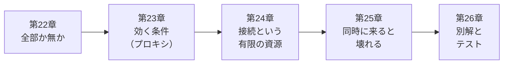

# 第4部 トランザクションと同時実行

<!-- part-intro:start -->
<div class="video-card">
  <video controls preload="metadata" poster="../assets/videos/part04-intro.jpg">
    <source src="../assets/videos/part04-intro.mp4" type="video/mp4">
  </video>
  <p class="video-caption">▶ 第4部でやること（約1分）</p>
  <p class="video-credit">音声：VOICEVOX:冥鳴ひまり</p>
</div>

??? note "字幕全文"
    第4部はトランザクションと同時実行です。
    いまのQuickVoteには、混んだ日にだけ起きる事故が残っています。
    参加者が上限の50人を超えます。
    途中で失敗して、主催者のいない投票が残ります。
    接続が足りなくなって、全員が遅くなります。
    第22章はトランザクションの境界。
    全部成功か、全部なしかにします。
    第23章は@Transactionalの正体。
    プロキシを通ったときだけ働きます。
    第24章はコネクションプール。
    接続を長く持つ処理があると、全員が待たされます。
    第25章は残り1枠に2人が来る競合。
    FOR UPDATEで鍵を掛けて2人目を待たせます。
    第26章は別の直し方と、並行性のテスト。
    楽観ロックやON CONFLICTを比べます。
    100回動いたというだけでは、根拠になりません。
    この部が終わると、20人が同時に来ても、上限を超えません。
    1人1票は必ず1行になります。
    途中で失敗しても、全部なかったことになります。
    接続が足りない原因もログで見つけられます。
    同時に来ても、約束は破らせない。
<!-- part-intro:end -->

第3部で、QuickVote は PostgreSQL に保存できるようになりました。しかしこのアプリには、テストでは見つからず、本番の混雑した日にだけ起きる事故が残っています。参加者が上限の50人を超えたり、途中で失敗して主催者のいない投票が残ったり、接続が足りなくなって全員が遅くなったりします。

この部では、これらの事故を自分の手で再現してから直します。

## この部でできるようになること

- `BEGIN` / `COMMIT` / `ROLLBACK` を psql で操作し、Spring の `@Transactional` が送る SQL を、ログで確認できる
- `@Transactional` がプロキシで動くことを理解し、「付けたのに効かない」ケース（自己呼び出し・private・checked 例外・握りつぶし）を指摘できる
- コネクションプールを枯渇させて、接続取得タイムアウトのログを読み、原因（遅いSQL・トランザクション中の外部通信）を特定できる
- 「残り1枠に2人」を2つの psql で再現し、`SELECT ... FOR UPDATE` で親行をロックして直せる
- 楽観ロック・条件付き UPDATE・UNIQUE＋`ON CONFLICT`・分離レベルを、場面に応じて選べる
- デッドロックを起こして読み解き、ロック順序で直せる
- `CountDownLatch` で狙った競合を起こし、並行性のテストを書ける

## アプリの到達状態

| | 第3部の終わり | 第4部の終わり |
| --- | --- | --- |
| 2本以上の書き込み | 途中で失敗すると、片方だけ残る | 業務操作ごとにトランザクション。全部成功か全部なかったことに |
| 参加者の上限（50人） | 同時に来ると超える | 親行ロックで、同時に20人来ても上限まで |
| 選択肢の上限（10件） | 同時に来ると超える | 同じ規則で守る |
| 1人1票 | 同時に投票すると二重になりうる | UNIQUE ＋ `ON CONFLICT` で、必ず1行 |
| 招待は一度限り | 同時に開くと複数人が使える | 条件付き UPDATE の更新件数で、成功は1人 |
| 接続の枯渇 | 遅い処理で全員が巻き込まれる | 原因（握る時間）を診断できる |
| 並行性のテスト | なし | `CountDownLatch` で競合を起こし、不変条件で検査 |

## 各章

<div class="grid cards" markdown>

-   :material-bank-transfer: **[第22章 トランザクションの境界](ch22-transactions.md)**

    ---

    psql で BEGIN / COMMIT / ROLLBACK を観察します。2本の INSERT の間で例外を起こし、`@Transactional` の有無で何が残るかを見ます。

-   :material-account-tie: **[第23章 @Transactionalの正体：プロキシ](ch23-transactional-proxy.md)**

    ---

    動画つき。付けたのに効かない理由を、自己呼び出し、private、checked 例外、握りつぶし、REQUIRES_NEW、readOnly で確かめます。

-   :material-umbrella-outline: **[第24章 スレッドとコネクションプール](ch24-connection-pool.md)**

    ---

    動画つき。プールをわざと枯渇させ、トランザクション中の外部通信を診断します。仮想スレッドにしても接続は増えません。

-   :material-lock-outline: **[第25章 上限を守る：同時参加の競合とロック](ch25-locking.md)**

    ---

    動画つき・事故章。残り1枠に20人が来る場面を2つの psql で再現し、`FOR UPDATE` で直して、負荷スクリプトで確かめます。

-   :material-test-tube: **[第26章 競合の別解と並行性テスト](ch26-concurrency-testing.md)**

    ---

    楽観ロック、条件付き UPDATE、`ON CONFLICT`、分離レベル、デッドロック、有限回の再試行を扱います。「100回動いた」が根拠にならない理由も説明します。

</div>

## 第4部の流れ



第22章で「全部成功か全部なかったことに」を作り、第23章でそれが効く条件を確かめます。第24章では、トランザクションが握る接続が有限であることを確かめます。トランザクションだけでは守れない同時実行の事故は、第25章で起こして直します。第26章では直し方を整理して、テストで確かめます。

## 実験コードの置き場

この部の実験は `code/labs/part04-lab/` にあります。QuickVote と同じ表（Flyway の V1・V2）に、同じ形の SQL を投げる最小のアプリです。

```text
code/labs/part04-lab/
├── compose.yaml          PostgreSQL 18（ホスト側 25420）。log_statement=all で SQL をすべてログに出す
├── src/main/java/…/ch22〜ch26/   各章の実験コード
├── src/test/java/…       並行性のテスト（JoinRaceIT、ConflictIT）。Testcontainers で実PostgreSQL
├── scenarios/            2つの psql を台本どおりに動かす台本（22-…、25-…、26-…）と seed.sql
├── scripts/              TwoSessions.java（2セッション再現）、LoadJoin.java（負荷）、LoadJoinQuickVote.java ほか
└── outputs/              本文に載せた出力の全文
```

```bash
cd code/labs/part04-lab
docker compose up -d                 # PostgreSQL（ホスト側 25420）
./mvnw -q -DskipTests package        # Windows は .\mvnw.cmd
java -jar target/part04-lab.jar      # 初回は Flyway が表を作る。Started と出たら Ctrl+C
./mvnw verify                        # 並行性のテスト（Docker 必須）
```

## 第4部のチェックリスト

第26章を終えたら、次の項目を確かめてください。すべてに ✅ を付けられたら、第5部へ進めます。目安は「③ 検証できる」です。

- [ ] psql で `BEGIN` → `INSERT` → `ROLLBACK` を打ち、コミット前の変更が他のセッションから見えないことを説明できる
- [ ] 2本の `INSERT` の間で例外が起きたとき、`@Transactional` の有無で DB に何が残るかを、ログと DB の両方で確かめられる
- [ ] トランザクションの境界を、業務操作1つ（Service のメソッド）に置く理由と、Repository や Controller に置いてはいけない理由を説明できる
- [ ] `@Transactional` が効かない4つのケース（自己呼び出し・private・checked 例外・握りつぶし）を、コードを読んで指摘できる
- [ ] `JdbcTransactionManager` のログと、DB のログ（`BEGIN` / `COMMIT` / `ROLLBACK`）で、トランザクションが実際に動いたかを確認できる
- [ ] `REQUIRED` と `REQUIRES_NEW` の違いを、接続の数と、外側が失敗したときの結果で説明できる
- [ ] `Connection is not available (total, active, idle, waiting)` のログから、プール枯渇を判断し、次に調べることを挙げられる
- [ ] トランザクション中の外部通信が、他のリクエストを巻き込む理由を、`idle in transaction` を使って説明できる
- [ ] 仮想スレッドにしても、DB 接続の数が増えないことを、実験の結果を使って説明できる
- [ ] 「数えてから入れる」が、`@Transactional` を付けても上限を超える理由を、READ COMMITTED の動きから説明できる
- [ ] `SELECT ... FOR UPDATE` で親行をロックし、ロックを取った後で数え直す順序で、上限を守るコードを書ける
- [ ] すべての更新経路が同じロックの規則に従う必要がある理由を、ロックを忘れた経路の実験で説明できる
- [ ] 楽観ロック・条件付き UPDATE・UNIQUE＋`ON CONFLICT`・親行ロックを、守りたい条件に応じて選べる
- [ ] デッドロックのログを読み、ロックの順序を固定して直せる。競合の失敗を、有限回、トランザクションの外で再試行する理由を説明できる
- [ ] `CountDownLatch` で全スレッドを揃えて同時に開始する並行性テストを書き、「100回動いた」が根拠にならない理由と、直す前に赤になることを確認する意味を説明できる

!!! tip "チェックの付け方"
    項目を読んで「たぶん分かる」では付けません。**白紙に、自分の言葉で書いて説明できたとき**に付けてください。説明できない項目は、該当する章へ戻ります。第26章の統合課題（ロックを外したら何が壊れるか）が、この部の総仕上げです。
