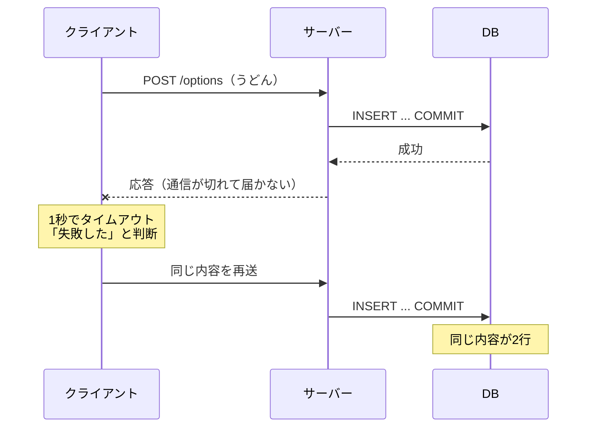
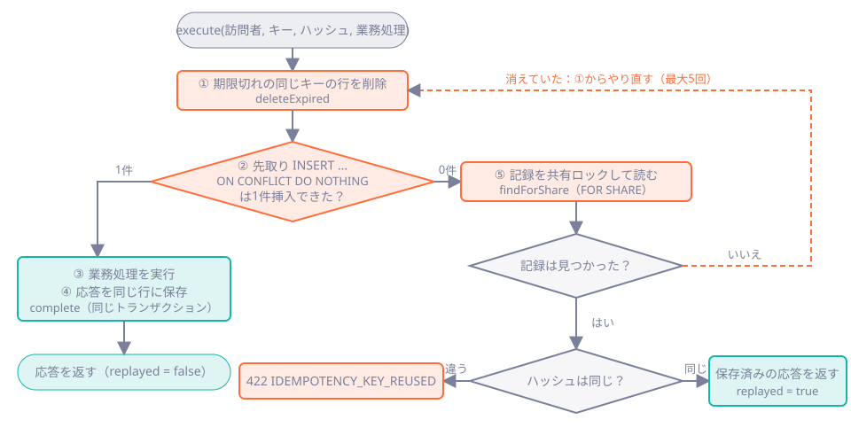

# 第27章 冪等性：応答が消えても二重登録しない

<div class="goal-box" markdown>

この章でできるようになること

- 「サーバーは保存に成功したのに、クライアントは失敗と思い込む」状況を再現し、再送が二重登録になる理由を説明できる
- `Idempotency-Key` の役割と、キーの範囲（訪問者 × キー）を説明できる
- 同じキーで同じ内容の再送、違う内容の再送、同時に届いた再送が、それぞれどう扱われるかを、SQL とテストで確かめられる
- 業務更新と冪等性の記録を同じトランザクションに置く理由と、保持期限の意味を説明できる
- 「`ON CONFLICT DO NOTHING` が 0 件だった」の後で記録が消えている競合（レビュー指摘）を、再現して直せる
- 「exactly once（ちょうど1回）」と言わずに、何が保証され、何が保証されないかを言い切れる

</div>

## 1. 事故：保存は成功した。応答だけが消えた

選択肢を追加する API を呼ぶとします。ところが、サーバーの処理が遅く、クライアントの待ち時間（タイムアウト）が先に切れたとします。


この状況を再現します。リファレンス実装（`code/quickvote/`）の jar を、第27章用の PostgreSQL につないで動かします。

```bash
cd code/labs/ch27-idempotency
docker compose up -d                       # PostgreSQL 18（ホスト側 25427）
cd ../../quickvote && ./mvnw -q -DskipTests package && cd ../..    # jar を作る（初回のみ）
java -jar code/quickvote/target/quickvote.jar --spring.docker.compose.enabled=false \
  --spring.datasource.url=jdbc:postgresql://localhost:25427/quickvote \
  --spring.datasource.username=quickvote --spring.datasource.password=quickvote --server.port=18027
```

「保存に3秒かかる」状況は、DB のトリガーで作ります。`options` に行を INSERT したあと3秒眠るだけで、アプリのコードは1行も変えません。

```sql title="code/labs/ch27-idempotency/scenario.sh（抜粋）"
CREATE FUNCTION lab_slow() RETURNS trigger AS $$ BEGIN PERFORM pg_sleep(3); RETURN NEW; END $$ LANGUAGE plpgsql;
CREATE TRIGGER lab_slow_trg AFTER INSERT ON options FOR EACH ROW EXECUTE FUNCTION lab_slow();
```

クライアントは `curl --max-time 1`（1秒で諦める）を使い、1回目が失敗したら同じ内容をもう一度送ります。ただしこのクライアントは、送るたびに `Idempotency-Key` を新しく作る素朴な実装です。

```bash
# 1回目：1秒でタイムアウトする
curl -X POST .../options --max-time 1 -H "Idempotency-Key: attempt-1" -d '{"label":"うどん"}'
# 失敗したと思って、もう一度
curl -X POST .../options -H "Idempotency-Key: attempt-2" -d '{"label":"うどん"}'
```

!!! question "予測カード"
    2回目が `201` で成功したあと、`options` テーブルには「うどん」が何行ありますか。

    1. 1行（2回目だけが保存された）
    2. 2行（どちらも保存された）
    3. 0行（どちらも失敗した）

```text
  curl の終了コード=28（28 = タイムアウト）
-- クライアントは失敗したと思って、新しいキーで再送
  HTTP 201
 id | label
----+--------
  1 | カレー
  2 | うどん
  3 | うどん
(3 rows)
```

答えは 2 です。1回目のリクエストは、クライアントが1秒で切りました。ところがサーバーは、切られたことに気づかずに処理を続け、3秒後にコミットしています。1回目の保存は成功していて、2回目も成功したので、「うどん」が2行になりました。

## 2. 何が起きたのか：クライアントには区別がつかない



クライアントが受け取ったのは「タイムアウト」だけですが、これは次の3つのどの場合でも起こります。

| 実際に起きたこと | DB の状態 | 再送してよいか |
| --- | --- | --- |
| リクエストがサーバーに届かなかった | 変化なし | 再送が必要 |
| 届いて、処理が失敗した | 変化なし | 再送が必要（直せば成功することがある） |
| 届いて、成功した。応答だけが消えた | 1行増えた | 再送すると二重 |

クライアントはこの3つを区別できません。再送しなければ取りこぼしが起き、再送すれば二重になるという板挟みは、ネットワークをはさむ処理につきものです。

フロントエンドで言えば、`axios-retry` や TanStack Query の `retry` を `POST` に対して有効にした場面にあたります。自動再送そのものは便利ですが、サーバーが再送を受けても壊れない作りになっていなければ、二重登録を起こす原因になります。

## 3. 動画で見る：伝票番号

<div class="video-card">
  <video controls preload="metadata" poster="../../assets/videos/idempotency.jpg">
    <source src="../../assets/videos/idempotency.mp4" type="video/mp4">
  </video>
  <p class="video-caption">▶ 応答が消えても二重登録しない</p>
  <p class="video-credit">音声：VOICEVOX:冥鳴ひまり</p>
</div>

動画の要点

- 保存は成功したのに、戻りの応答がトンネルで消える。スマホは失敗と思い込み、もう一度送って2行になる
- 対策は、リクエストに伝票番号（`Idempotency-Key`）を付けること。サーバーは、まず番号簿を見る
- 初めての番号なら処理して、結果を番号簿に残す。保存と番号簿への記録は、同じトランザクション
- 同じ番号が再送されたら、処理せず、保存した結果をそのまま返す。DB は1行のまま
- 同じ番号で中身が違うリクエストは 422 で断る。番号簿は 24 時間などで掃除する。保証は「その期間内の、同じ利用者のキーの範囲」

??? note "字幕全文"
    宅配の伝票番号にたとえて、二重登録を防ぐ仕組みを見ましょう。
    スマホが、選択肢を追加するリクエストを送ります。
    サーバーは保存に成功。DBに、1行入りました。
    ところが、戻りの応答が、トンネルで消えてしまいます。
    スマホは、失敗したと思い込みます。保存済みだとは、知りません。
    そこで、もう一度送ります。
    サーバーは、また保存。DBは2行。二重登録です。
    対策は、リクエストに伝票番号を付けること。
    これがIdempotency-Keyです。
    何度送っても結果が同じ。これを、冪等と言います。
    サーバーは、まず番号簿を見ます。
    初めての番号なら処理して、結果を番号簿に残します。
    保存と番号簿への記録は、同じトランザクションです。
    同じ番号が再送されたら、処理せず、保存した結果をそのまま返します。
    DBは、1行のまま。
    同じ番号で、中身が違うリクエストは、422エラーで断ります。
    番号簿は、増え続けないよう、例えば24時間で掃除します。
    保証は、その期間内の、同じ利用者のキーの範囲です。
    再送されても、効果は1回。

動画の「宅配の伝票番号」は、荷物を何度出し直しても、同じ伝票番号なら同じ1つの荷物として扱われる、という例えです。

!!! warning "この例えが外れる点"
    - 宅配の伝票番号は配送会社が発行しますが、`Idempotency-Key` はクライアントが作ります（`crypto.randomUUID()` など）。サーバーは番号を発行しません
    - 伝票番号は何年も有効ですが、キーの記録には期限があり、期限が来ると消えます（第8節）
    - 同じ伝票番号に別の荷物を載せることは物理的にできませんが、同じキーで別の内容を送ることはできてしまいます。サーバーが検出して断る必要があります（第5節）

!!! note "用語：冪等性（べきとうせい、idempotency）"
    同じ操作を何回繰り返しても、結果が1回やったときと同じになる性質です。HTTP の仕様では、`GET`・`PUT`・`DELETE` は冪等と定められ、`POST` は冪等とは限りません。
    ここでの「結果」は、サーバーに残る状態や効果のことです。応答のステータスコードまで毎回同じとは限りません（`DELETE` の2回目が 404 になるように）。

## 4. 先に対比：PUT の投票は、最初から冪等

キーが要るのは選択肢の追加だけで、投票には要りません。その理由を見るために、投票（`PUT /api/polls/{id}/my-vote`）を同じ内容で3回送ってみます（`code/labs/ch27-idempotency/put-and-expiry.sh`。それまでの実験で追加した `OPTION_ADDED` が先に並んでいます）。

```text
== PUT /my-vote を3回送る（同じ内容）
  HTTP 200
  HTTP 200
  HTTP 200
 votes_rows
------------
          1

 seq |     type
-----+--------------
   1 | OPTION_ADDED
   2 | OPTION_ADDED
   3 | OPTION_ADDED
   4 | OPTION_ADDED
   5 | OPTION_ADDED
   6 | VOTE_CAST
```

票の行は1つのままで、`VOTE_CAST` のイベントも1回だけです。`PUT` は「この人の票をこの選択肢にする」という状態の指定であり、`counter++` のように今の値に足す操作ではないからです。

```java title="src/main/java/com/example/quickvote/vote/VoteRepository.java（upsert のSQL）"
INSERT INTO votes (poll_id, participant_id, option_id, voted_at)
VALUES (:pollId, :participantId, :optionId, :now)
ON CONFLICT (poll_id, participant_id) DO UPDATE
   SET option_id = EXCLUDED.option_id, voted_at = EXCLUDED.voted_at
   WHERE votes.option_id <> EXCLUDED.option_id
```

同じ選択肢への再投票では `WHERE` が偽になり、更新は0件で終わります。呼び出し側は、更新件数が 0 ならイベントを出しません。

| | 投票（`PUT`） | 選択肢の追加（`POST`） |
| --- | --- | --- |
| 操作の意味 | 状態を指定する（この人の票 ＝ A） | 新しい行を作る（選択肢が1つ増える） |
| 2回送ると | 同じ状態のまま | 2つ増える |
| 冪等にする手段 | 設計（UNIQUE ＋ `ON CONFLICT`） | `Idempotency-Key`（このあと作る） |

!!! tip "現場の判断：まず『本質的に冪等にできないか』を考える"
    冪等性キーは強力ですが、記録の保存、期限、競合と、考えることが増えます。**操作を「状態の指定」の形（`PUT`、UNIQUE ＋ upsert）にできるなら、そのほうが単純で堅くなります。** キーが必要なのは、「新しい行を作る」「数を足す」「外部に通知を出す」のように、繰り返すと効果が積み上がる操作です。

## 5. 設計：伝票番号と番号簿

### クライアントの責任：キーは「操作ごとに1つ」

キーを作るのはクライアントです。リファレンス実装の静的クライアントは、次のように使っています。

```js title="src/main/resources/static/app.js（抜粋）"
if (!pendingOption || pendingOption.label !== label) pendingOption = { key: randomKey(), label };  // (1)!
try {
  await api('POST', `/api/polls/${currentPollId}/options`, { label }, { 'Idempotency-Key': pendingOption.key });
  pendingOption = null;                                          // (2)!
} catch (e) {
  if (e instanceof ApiError) pendingOption = null;               // (3)!
}
```

1. 未送信の操作がなければ、新しいキーを作る。内容が変わったら別の操作なので、別のキー
2. 成功したらキーを捨てる
3. サーバーが判断して返した失敗（4xx）は、再送ではなく新しい操作として扱う。通信エラーのときだけ、`pendingOption` を残して同じキーで再送できる

**最初の事故が起きたのは、キーを毎回作り直したからです。** ユーザーがボタンを1回押したら1つのキーを割り当て、その操作の再送では同じキーを使い回します。これがクライアント側の約束です。

### サーバーの番号簿：`idempotency_records`

```sql title="src/main/resources/db/migration/V3__create_idempotency_records.sql"
CREATE TABLE idempotency_records (
    visitor_id    bigint       NOT NULL REFERENCES visitors (id) ON DELETE CASCADE,
    idem_key      varchar(200) NOT NULL,
    request_hash  char(64)     NOT NULL,   -- リクエスト内容の SHA-256（同じキーで別の内容を検出する）
    status        smallint     NOT NULL,   -- 保存した応答のHTTPステータス（作成中は 0）
    response_body text,                    -- 保存した応答のJSON
    created_at    timestamptz  NOT NULL,
    PRIMARY KEY (visitor_id, idem_key)
);
```

キーのスコープ（有効範囲）は、主キーの `(visitor_id, idem_key)`、つまり訪問者 × キーです。

| 場合 | スコープが「キーだけ」だと | 「訪問者 × キー」なら |
| --- | --- | --- |
| 別の訪問者が、たまたま同じキー（`"1"` など）を使う | 他人の記録に当たり、他人の応答（選択肢のID、ラベル）が返ってしまう | 干渉しない |
| 悪意のある訪問者がキーを推測する | 他人の応答を盗み見られる | 自分の記録しか見えない |

`IdempotencyIT` の「別の人が同じキーを使っても干渉しない」テストが、これを確かめています。

### 同じキーで別の内容：`request_hash`

リクエストの内容のハッシュは、投票ID ＋ ラベルから作ります。

```java title="src/main/java/com/example/quickvote/poll/PollService.java（addOption）"
String requestHash = Tokens.sha256Hex(pollPublicId + "\n" + label);
return idempotency.execute(visitorId, idempotencyKey, requestHash, 201, OptionResponse.class,
        () -> insertOption(context, label));
```

投票IDを含めるので、別の投票に同じキーを使い回した場合も 422 になります。実際に、同じキーを別の内容で送ってみます。

```text
== C. 同じキーで中身が違う
{"detail":"同じ Idempotency-Key が別の内容のリクエストで使われています。", ..., "status":422, "code":"IDEMPOTENCY_KEY_REUSED"}
  HTTP 422
```

`422 Unprocessable Content` は、「形式は正しいが、意味として処理できない」を表します。キーの使い方の間違いはクライアントのバグなので、黙って最初の応答を返さず、はっきり断ります（`HttpStatus.UNPROCESSABLE_CONTENT`。旧名の `UNPROCESSABLE_ENTITY` は非推奨です。[付録](../appendix/boot3-to-4.md)）。

## 6. 読解：`IdempotencyService.execute`

全体の流れを、先に図で示します。



コードは次のとおりです（コメントは省略した抜粋です）。

```java title="src/main/java/com/example/quickvote/common/IdempotencyService.java"
@Transactional(propagation = Propagation.MANDATORY)    // (1)!
public <T> Result<T> execute(long visitorId, String key, String requestHash, int successStatus,
        Class<T> bodyType, Supplier<T> action) {
    for (int attempt = 1; attempt <= MAX_ATTEMPTS; attempt++) {
        Instant now = Db.now(clock);
        repository.deleteExpired(visitorId, key, now.minus(properties.idempotency().retention()));  // (2)!

        if (repository.tryInsert(visitorId, key, requestHash, now) == 1) {         // (3)!
            T body = action.get();                                                  // (4)!
            repository.complete(visitorId, key, successStatus, jsonMapper.writeValueAsString(body));
            return new Result<>(successStatus, body, false);
        }

        Optional<IdempotencyRepository.Record> saved = repository.findForShare(visitorId, key);  // (5)!
        if (saved.isEmpty()) {
            continue;                                                               // (6)!
        }
        if (!saved.get().requestHash().equals(requestHash)) {
            throw new ApiException(ErrorCode.IDEMPOTENCY_KEY_REUSED);               // (7)!
        }
        return new Result<>(saved.get().status(), jsonMapper.readValue(saved.get().responseBody(), bodyType), true);
    }
    throw new IllegalStateException("冪等性記録の先取りを繰り返しても確定できなかった");
}
```

1. `MANDATORY` は「呼び出し元がトランザクションを開始していなければ例外」。この方式の前提（業務更新と同じトランザクション）を、コードで強制している。`addOption` の `@Transactional` の中で呼ばれる（[第23章](../part04/ch23-transactional-proxy.md)の伝播の話）
2. 保持期限（24時間）を過ぎた同じキーの行を消す。定期削除（[第29章](ch29-scheduling.md)）が動く前でも、期限が切れたキーは再利用できる
3. 先取り。`INSERT ... ON CONFLICT DO NOTHING` が1件挿入できたら、自分がこのキーの最初の実行者
4. 業務処理（選択肢の追加）を実行し、結果の応答を同じ行に保存する。ここまでが1つのトランザクション
5. 0件だった（＝記録が既にある）。保存済みの記録を、共有ロックをかけて読む。なぜ `FOR SHARE` なのかは第9節
6. 記録が見つからなかったら、先取りからやり直す（第9節）
7. ハッシュが違えば 422。同じなら、保存済みの応答をそのまま返す（`replayed = true`。コントローラーが `Idempotent-Replayed: true` ヘッダーを付ける）

先取りの SQL は次のとおりです。

```sql title="IdempotencyRepository.tryInsert"
INSERT INTO idempotency_records (visitor_id, idem_key, request_hash, status, created_at)
VALUES (:visitorId, :key, :requestHash, 0, :now)
ON CONFLICT (visitor_id, idem_key) DO NOTHING
```

`ON CONFLICT DO NOTHING` は、主キーが衝突したらエラーにせず何もしない（更新件数 0）という指定です（[第26章](../part04/ch26-concurrency-testing.md)の `ON CONFLICT`）。「先に確認してから INSERT」と2回に分けず、確認と書き込みを1文で行うので、[第9章](../part01/ch09-threads.md)で見た check-then-act の事故を避けられます。

### なぜ「業務更新と同じトランザクション」か

もし記録を別のトランザクションで先にコミットすると、次のように壊れます。

| 手順 | 起きること |
| --- | --- |
| 1 | 番号簿に「処理中」とコミット |
| 2 | 業務処理の途中でサーバーが落ちる（業務更新は未コミット） |
| 3 | 再送が来る。番号簿には記録がある → 「処理済み」と判断 → 更新がないのに、成功を返す |

同じトランザクションなら、「記録があるのに更新がない」状態は作れません。両方コミットされるか、両方なかったことになります（[第22章](../part04/ch22-transactions.md)の銀行振込）。失敗した試行（上限超過で 409 など）もトランザクションごとロールバックされるので、記録は残らず、同じキーで再送すればもう一度評価されます（`IdempotencyIT` の「失敗した試行は記録されず…」）。

リファレンス実装は、別トランザクションで `IN_PROGRESS` 行を確定する方式を採りませんでした。クラッシュ後に「記録だけ残る」状態の掃除が要るからです。

## 7. 同時に同じキーが来たら

再送が来るのは、1回目の処理が終わったあととは限りません。1回目がまだ処理中のうちに、同じキーの再送が来ることもあります。実際に、1回目が3秒かかる状況で、タイムアウトの直後に同じキーを再送します（`concurrent.sh`）。

```text
== 再送の最中、DB の中では何が起きているか
 pid | state  | wait_event_type |  wait_event   |                            query
-----+--------+-----------------+---------------+--------------------------------------------------------------
 125 | active | Timeout         | PgSleep       | INSERT INTO options (poll_id, label, created_by, created_at)
 126 | active | Lock            | transactionid | INSERT INTO idempotency_records (visitor_id, idem_key, reque

HTTP/1.1 201
Idempotent-Replayed: true
{"id":6,"label":"うどん3"}
  elapsed 1.704266s
```

pid 125 が1回目の処理（トリガーの眠り）で、pid 126 が再送です。再送の `INSERT INTO idempotency_records` は `Lock / transactionid` で待っています。待つ相手は1回目のトランザクションの終了です。1回目がコミットすると、再送の INSERT は 0 件で戻り、保存済みの応答（`replayed`）を返しました。

この「待ち」を、psql 2本で素に見ます（`two-sessions.sh`）。

```text
--- セッションA：INSERT して、3秒コミットしない
BEGIN
INSERT 0 1
--- セッションB：1秒後に同じキーで INSERT（ここで待たされる）
INSERT 0 0
Time: 2282.725 ms (00:02.283)
```

B の `INSERT` は約2.3秒かかり、A のコミットを待ってから `INSERT 0 0`（何もしなかった）になりました。A がロールバックしていれば、B の INSERT は成功します。

```java title="src/test/java/com/example/quickvote/IdempotencyIT.java（抜粋）"
List<Outcome<IdempotencyService.Result<OptionResponse>>> outcomes = Concurrently.run(10,
        i -> () -> pollService.addOption(host.id(), poll.id(), "same-key", "うどん"));

assertThat(outcomes).allMatch(Outcome::succeeded);
assertThat(outcomes).filteredOn(o -> !o.value().replayed()).hasSize(1); // 実際に実行したのは1回だけ
assertThat(countRows("options")).isEqualTo(1);
```

10 並列で同じキーを送っても、実際に実行されるのは1回です（`replayed = false` が1件）。アプリ側に `synchronized` やロックはなく、直列化をDBの一意制約に任せています（[第25章](../part04/ch25-locking.md)・[第26章](../part04/ch26-concurrency-testing.md)の考え方）。そのため、複数台でも同じように働きます。

!!! note "ロックの順序"
    `addOption` は、まず冪等性の行を先取りし、そのあとで `polls` の行を `FOR UPDATE` でロックします（[第25章](../part04/ch25-locking.md)）。常に「冪等性の行 → polls 行」の順にそろえているので、2つのリクエストが互いのロックを待ち合うデッドロックは起きません。ロックを取る順序は、設計として決めておきます。

## 8. 保持期限：記録はいつまで持つか

番号簿は、無限に増やせません。リファレンス実装は 24 時間（`quickvote.idempotency.retention`）で消します。では、期限を過ぎたキーが再送されたらどうなるでしょうか。記録の作成時刻を25時間前にずらして、同じキーを送ります（`put-and-expiry.sh`）。

```text
== 保持期限（24時間）を過ぎたら？ 記録の作成時刻を25時間前にずらして、同じキーを再送する
HTTP/1.1 201
{"id":7,"label":"そば"}
```

`Idempotent-Replayed` ヘッダーがなく、`options` に「そば」が2行目として増えました。期限を過ぎたキーは新しい操作として実行されるので、二重登録は起こりえます。

この仕組みが保証する範囲は、次のとおりです。

!!! abstract "この仕組みの保証"
    - 保持期間（24時間）内に、同じ訪問者が、同じキーで再送した操作は、効果が1回になる（業務更新が1回、応答は保存したものが返る）
    - 同じキーで別の内容が来たら、断る（422）
    - 失敗した試行は、なかったことになる

    保証しないこと

    - 期限（24時間）を過ぎた再送
    - キーが違う再送（最初の事故のように、毎回キーを作り直すクライアント）
    - 別の訪問者からの同じ内容の操作（これは別の人の別の操作）

「exactly once（ちょうど1回）」とは言いません。ネットワークをはさむ処理で、ちょうど1回届くことは保証できないからです。できるのは、**何回届いても、効果は1回になるようにする**ことです。クライアントは届くまで何度でも再送し（at-least-once）、サーバーは再送を吸収します（冪等）。この組み合わせにより、保持期間内に限って、利用者から見て1回だけ起きたことになります。

保持期間は、クライアントが再送することのある期間より長くしておく必要があります。`retention=0s` のような短すぎる設定では、再送が常に新しい操作になって二重登録するので、リファレンス実装は起動時に拒否します（1分〜7日。`QuickVotePropertiesTest`）。設定の検証は、[第15章](../part02/ch15-configuration.md)の fail fast の実例です。

## 9. 現場ではこうする：「0件だった」は過去の話（レビュー指摘 8）

リファレンス実装に、シニアレビューが指摘した競合がありました。かつての実装は、`ON CONFLICT DO NOTHING` が 0 件だったあと、普通の `SELECT` で記録を読み、なければ `IllegalStateException`（500）にしていました。「0件だった＝記録がある」と前提していたためです。

しかし、PostgreSQL の既定の分離レベル（READ COMMITTED）では、SQL 文ごとに見える状態が変わります（[第26章](../part04/ch26-concurrency-testing.md)）。「0件だった INSERT」と次の SELECT は別々の文なので、その間に定期削除が期限切れの記録を消してコミットすることがあります。

| 時刻 | 再送 A | 定期削除 B |
| --- | --- | --- |
| 1 | `INSERT ... ON CONFLICT DO NOTHING` → 0件（記録がある） | |
| 2 | | 期限切れの記録を `DELETE` して COMMIT |
| 3 | `SELECT` で記録を読む → 空（旧実装はここで 500） | |

直し方は二段構えです。まず、記録を読むときに `FOR SHARE`（共有ロック）をかけます。読んでいる間は、その行を `DELETE` しようとする側が待たされます。それでも空だった場合は、ロックをかける前にすでに消えていたということなので、先取りからやり直します。記録が消えたのは期限切れということで、新しい操作として扱ってよく、今度は自分が最初の実行者になれます。

```java title="IdempotencyService.java（抜粋）"
Optional<IdempotencyRepository.Record> saved = repository.findForShare(visitorId, key);
if (saved.isEmpty()) {
    continue;     // 先取りからやり直す（最大5回）
}
```

```sql title="IdempotencyRepository.findForShare"
SELECT request_hash, status, response_body FROM idempotency_records
WHERE visitor_id = :visitorId AND idem_key = :key
FOR SHARE
```

この競合は、普通のテストでは再現できず、狙った順序を作る必要があります。`IdempotencyRaceIT` は、記録を読む直前（`findForShare` の呼び出し直前）に、別スレッド（つまり別のDB接続）で削除をコミットさせます。

```java title="src/test/java/com/example/quickvote/IdempotencyRaceIT.java（抜粋）"
doAnswer(invocation -> {
    if (fired.compareAndSet(false, true)) {
        // 別スレッド = 別トランザクション。呼び出し元のトランザクションとは独立にコミットされる。
        CompletableFuture.runAsync(() -> jdbc.sql("DELETE FROM idempotency_records").update()).join();
    }
    return invocation.callRealMethod();
}).when(repository).findForShare(anyLong(), anyString());
```

`@MockitoSpyBean` で本物のリポジトリを包み、`findForShare` が呼ばれる直前に割り込んでいます。結果は、500 にならず、新しい操作として実行されました（201、`replayed = false`）。**前の文で確かめた事実が、次の文でも成り立つとは限りません。** 並行性のコードを読むときは、これを基本の構えにします。

!!! tip "この章のコードを読むときのチェックポイント"
    - 「確認」と「使用」が別の文になっていないか（なっているなら、ロックか、1文にまとめられないか）
    - 読んだ結果が空だったとき、エラーにしてよいのか、やり直すのかが決まっているか
    - 記録を消す側（定期削除）と、読む側のロックの関係

### 全部の API に付けるわけではない

リファレンス実装で `Idempotency-Key` を必須にしているのは、選択肢の追加だけです。投票は `PUT`（本質的に冪等）、締切は「すでに締切後なら何もしない」、参加は「すでに参加していれば成功で何も変えない」と、操作そのものを冪等に作っています。

一方で、投票の作成（`POST /api/polls`）にはキーがありません。応答が消えて再送すると、同じタイトルの投票が2つできます。壊れるものが小さく（作った人が1つ消せる）、キーの運用コストと釣り合わないという判断です。自分のサービスでは、操作ごとに「重複したときの被害」を見積もって決めることになります。決済や通知の送信なら、必ずキーを付けます。


---

## まとめ：3点セット

!!! abstract "この章の3点セット"
    **① 一言で言うと**
    クライアントの再送を前提に、リクエストごとにクライアントが付ける `Idempotency-Key` と、その結果を業務更新と同じトランザクションで保存することで、保持期間内・同じ訪問者・同じキーの再送の効果を1回にする。保証するのは「効果が1回」であって、「ちょうど1回届く」ではない。

    **② 現場でこう聞かれる**
    「同じキーで同時に2リクエスト来たら、どうなりますか？」
    → 先取りの `INSERT ... ON CONFLICT DO NOTHING` で、後続は先行のコミットまでDBが待たせる。先行がコミットすれば後続は保存済みの応答を返し、ロールバックすれば後続が実行者になる。アプリ側のロックは要らず、複数台でも成り立つ。

    **③ 自分のサービスならどこに当たるか**
    自分のサービスの「作成」「送信」「課金」「通知」の操作を挙げ、(a) `PUT` や UNIQUE で本質的に冪等にできるもの、(b) キーが必要なもの、(c) 重複を許容するものに分ける。キーが要るものは、キーのスコープと保持期間をいくつにするか決める。

## 演習

??? question "確認問題1：予測と観察"
    `scenario.sh` の「B. 同じ伝票番号で再送するクライアント」を、`sleep 4` を消して実行すると、再送の応答はいつ返りますか。その間、DB の中では何が待っていますか。

??? success "解答"
    1回目の処理（トリガーの3秒）が終わるまで待たされ、約2秒後に返ります（`concurrent.sh` では 1.7 秒でした）。再送の `INSERT INTO idempotency_records` が、1回目のトランザクションの終了を `Lock / transactionid` で待っています。1回目がコミットすると、再送は `INSERT 0 0` になり、保存済みの応答を `Idempotent-Replayed: true` つきで返します。

??? question "確認問題2：キーのスコープ"
    `idempotency_records` の主キーを `idem_key` だけにしたら、何が起きますか。2つ挙げてください。

??? success "解答"
    (1) 別の訪問者がたまたま同じキーを使うと、他人の記録に当たります。ハッシュが違えば 422 になり、偶然同じなら他人の応答が返ります。(2) 悪意のある訪問者がキーを推測して送ると、他人の応答を盗み見られます。主キーを `(visitor_id, idem_key)` にして訪問者ごとに分けるのは、機能の都合だけでなく、情報漏えいを防ぐためでもあります。

??? question "確認問題3：失敗した試行"
    選択肢が10件ある投票に「11個目」を、キー `k1` で追加して 409 になりました。その後、1件を消して、同じキー `k1` で同じ内容を再送します。結果はどうなりますか。理由も答えてください。

??? success "解答"
    成功（201）します。業務エラーで例外が出ると、トランザクションごとロールバックされ、`k1` の記録も残らないので、再送は新しい操作として評価されるからです（`IdempotencyIT` の「失敗した試行は記録されず…」）。失敗した応答も保存する設計なら、いつまでも 409 が返り続けるので、設計として別の判断が必要になります。

??? question "応用：締切（close）にキーは要るか"
    `POST /api/polls/{id}/close`（締切を早める）に `Idempotency-Key` を足すべきか、考えてください。

??? success "解答"
    要りません。リファレンス実装の `close` は、すでに締切後なら何もせず、イベントも出さないので、操作そのものが冪等です（`DeadlineIT` の「二重に締めてもイベントは増えない」）。本質的に冪等にできる操作にキーを足すと、記録・期限・競合の複雑さだけが増えます。

??? question "応用：保持期限を変える"
    `quickvote.idempotency.retention` を `30m` に変えると、何が変わりますか。モバイルアプリで、機内モードから復帰して再送されるまで最大1時間かかりうる場合、どう判断しますか。

??? success "解答"
    期限が 30 分になり、30 分を過ぎた再送は新しい操作として実行されます。再送が最大1時間後に来るなら、保持期間はそれより長く（24時間など）しなければ、保証が成り立ちません。保持期間は、クライアントが再送することのある最長の時間から決めます。短くして得られるのは記録の量が減ることだけで、安全側にはなりません。

??? question "説明問題：現場でこう聞かれる"
    「`Idempotency-Key` を付ければ、リクエストは『exactly once』で処理されるのですか？」200字程度で答えてください。

??? success "解答"
    例：いいえ。ネットワーク越しに「ちょうど1回届く」ことは保証できません。クライアントは、応答が来るまで同じキーで再送し（at-least-once）、サーバーは記録を見て、同じ訪問者・同じキー・保持期間内の再送を吸収します。保証できるのは、その範囲での効果が1回であることです。期限を過ぎた再送や、キーが違う再送には効きません。また、業務更新と記録を同じトランザクションに置くことが前提です。
