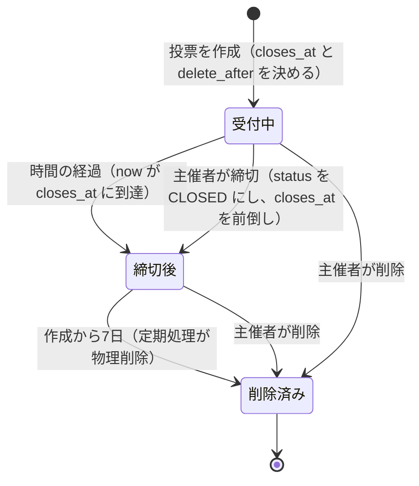
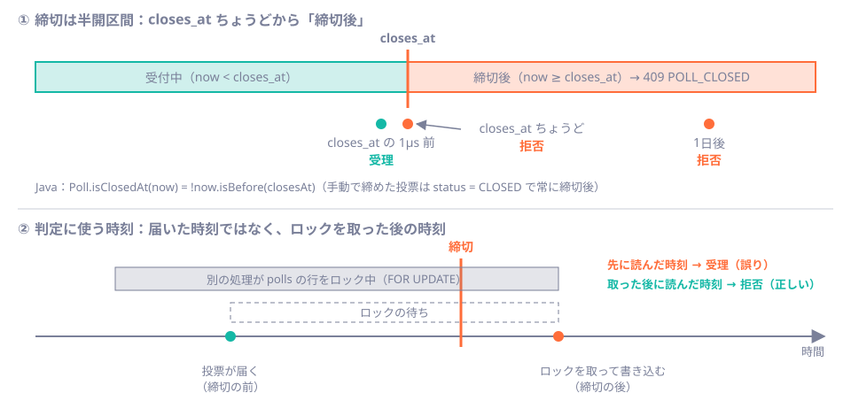

# 第28章 期限と時刻を設計する

<div class="goal-box" markdown>

この章でできるようになること

- 投票の状態（受付中・締切後・削除済み）を状態遷移図で描き、時間の経過で変わる状態と書き込みで変わる状態を区別できる
- 締切の境界（直前・ちょうど・直後）を言い切り、`Clock` を注入したテストで時間を進めて確かめられる
- 締切の判定に使う時刻を、ロックを取った後に読む理由を、再現して説明できる
- 締切を「何分後か」で受け取り、サーバーが締切時刻を計算する理由を説明できる
- 「期限切れの拒否」と「物理削除」を分ける理由を言える。締切後の招待受諾が 409 になる理由も説明できる

</div>

## 1. 問いかけ：「5分後に締め切る」は誰の5分後か

QuickVote の投票には締切があります。締切を過ぎたら、投票も選択肢の追加も新しい参加も受け付けません。簡単そうですが、時刻の扱いには気づきにくい落とし穴が3か所あります。

| 穴 | 起きること |
| --- | --- |
| 誰の時計か | ブラウザの時計は数分ずれていることがある。ユーザーが意図的に変えることもできる |
| いつの時刻か | リクエストが届いた時刻か、処理した時刻か。通信やロックの待ちで、数秒の差が出る |
| 境界はどちらか | 締切時刻ちょうどに届いた投票は、受理か、拒否か |

この章では、この3つを順に決めて、テストで固定します。時刻の扱いはあとから直しにくいので、設計の段階で決めておきます。

## 2. 状態を描く：時間で変わる状態と、書き込みで変わる状態

投票の状態遷移を、先に図にします。



[第4章](../part01/ch04-data-shapes.md)で、状態を `sealed interface PollState`（`Open` と `Closed`）で表しました。リファレンス実装は、これを少し違う形で持っています。

```java title="src/main/java/com/example/quickvote/poll/PollStatus.java"
public enum PollStatus {
    OPEN,
    /** 主催者が手動で締め切った状態。時間切れによる締切は status ではなく closes_at で判定する。 */
    CLOSED
}
```

```java title="src/main/java/com/example/quickvote/poll/Poll.java（抜粋）"
public boolean isClosedAt(Instant now) {
    return status == PollStatus.CLOSED || !now.isBefore(closesAt);
}
```

**時間切れによる締切では、DB の行は書き換わりません。** 時間が進んだだけで `status` が `CLOSED` になることはなく、`status = 'OPEN'` の行も、`closes_at` を過ぎた瞬間から実質的には締切後になります。

| 遷移 | 何が起きるか | 誰が判定するか |
| --- | --- | --- |
| 受付中 → 締切後（時間の経過） | 行は変わらない。判定のたびに `now` と `closes_at` を比べる | リクエストを処理するコード（`isClosedAt`） |
| 受付中 → 締切後（手動） | `UPDATE polls SET status = 'CLOSED', closes_at = LEAST(closes_at, :now)` | 主催者の操作 |
| 締切後 → 削除済み | `DELETE`（子テーブルは CASCADE） | 定期処理（[第29章](ch29-scheduling.md)）、または主催者 |

!!! tip "フロントエンドで例えると"
    React で言えば、`useState` に `isExpired` を持たせて `setTimeout` で `true` にするか、描画のたびに `Date.now() > expiresAt` を計算するかの違いで、サーバーは後者です。期限が切れたという事実を保存せず現在時刻から導くので、定期処理が遅れても止まっても、判定は狂いません（第7節）。

この図の「受付中／締切後」は、第4章の `Open`／`Closed` に対応します。実装が `sealed` ではなく `enum` ＋ 判定メソッドなのは、DB の行から読み出した値（`status` と `closes_at`）に現在時刻を合わせて、状態を導くからです。時刻で変わる状態を DB の列として持ち続けても、列は時刻に追いつけません。

## 3. 締切の境界：直前・ちょうど・直後

境界の仕様を、先に言葉で決めます。

!!! abstract "締切の仕様"
    投票できるのは、`now < closes_at` のときだけです。**`closes_at` ちょうどの時刻は締切後**で、区間で書くと `[作成, closes_at)` の半開区間（始点を含み、終点を含まない）になります。



「ちょうど」を締切後にするのは、まず「締切時刻になったら閉まる」という日常の感覚に合うからです。17:00 締切なら、17:00:00 に投票した人は間に合いません。もう一つの理由は、終点を含めない区間は隣り合う区間と重ならないことです。「受付中」と「締切後」が同時に成り立つ時刻は存在しません。

境界を決めずに `now.isAfter(closesAt)` で締切後を判定すると、「ちょうど」が受理され、誰も気づかないまま仕様が決まってしまいます。境界は仕様として書き、テストで固定します。

### 精度にも注意

PostgreSQL の `timestamptz` はマイクロ秒（100万分の1秒）精度です。Java の `Instant` はナノ秒まで持てるので、そのまま保存すると往復で値が変わります。リファレンス実装は、現在時刻をマイクロ秒に丸めて使います。

```java title="src/main/java/com/example/quickvote/common/Db.java（抜粋）"
public static Instant now(Clock clock) {
    return clock.instant().truncatedTo(ChronoUnit.MICROS);
}
```

「直前」のテストが `Duration.ofNanos(1_000)`（1マイクロ秒）を引いているのは、この最小単位に合わせているためです。

## 4. 時間を進めるテスト：`Clock` を注入する

「締切の7日後」を、本当に7日待って確かめることはできません。現在時刻は、部品として外から渡せるようにします。

```java title="src/main/java/com/example/quickvote/common/ClockConfig.java"
@Configuration
public class ClockConfig {
    @Bean
    public Clock clock() {
        return Clock.systemUTC();
    }
}
```

サービスは `Instant.now()` を呼ばず、注入された `Clock` から時刻を取ります（`Db.now(clock)`）。これで、テストでは別の `Clock` に差し替えられます。

```java title="src/test/java/com/example/quickvote/support/MutableClock.java（抜粋）"
public class MutableClock extends Clock {
    private volatile Instant now;

    public void advance(Duration duration) { now = now.plus(duration); }
    public void set(Instant instant)       { now = instant; }

    @Override
    public Instant instant() { return now; }
    // getZone / withZone は省略
}
```

```java title="src/test/java/com/example/quickvote/support/TestClockConfig.java（抜粋）"
@TestConfiguration(proxyBeanMethods = false)
public class TestClockConfig {
    @Bean
    @Primary                          // (1)!
    MutableClock mutableClock() {
        return new MutableClock(Instant.now());
    }
}
```

1. 本番の `Clock` Bean（`ClockConfig`）と同じ型の Bean が2つになるので、`@Primary` でテスト用を優先させる。[第11章](../part02/ch11-di-container.md)の「同じ型の Bean が複数あるとき」の解決方法

`Clock.fixed(...)`（固定して動かない時計）でなく `MutableClock` を使うのは、1つのテストの中で時間を進めたいからです。固定の時計では、「直前は通り、ちょうどで拒否される」という流れを1つのテストに書けません。

### `DeadlineIT`：境界を固定する

```java title="src/test/java/com/example/quickvote/DeadlineIT.java（抜粋）"
Instant closesAt = poll.closesAt();

clock.set(closesAt.minus(Duration.ofNanos(1_000))); // 1マイクロ秒前
voteService.vote(host.id(), poll.id(), optionA);    // 受理される

clock.set(closesAt);                                // 締切ちょうど（半開区間）
Throwable atDeadline = catchThrowable(() -> voteService.vote(host.id(), poll.id(), optionB));
assertRejected(atDeadline, ErrorCode.POLL_CLOSED);  // 拒否される

clock.set(closesAt.plus(Duration.ofDays(1)));       // 1日後も拒否
```

`DeadlineIT` は全部で13件のテストがあり、実 PostgreSQL（Testcontainers）で約2秒で終わります（`./mvnw verify -Dit.test=DeadlineIT`。筆者の環境で13件成功）。7日分の時間経過も、1行の `clock.advance(...)` で済みます。

!!! danger "本番で事故になるパターン：`Instant.now()` や `LocalDateTime.now()` を直接呼ぶ"
    `Instant.now()` をサービスの中で直接呼ぶと、そのコードの時間はテストから動かせません。「締切の直前」を確かめるには、実際にその時刻まで待つか、締切をテスト用に数秒後に設定するしかなく、脆いテストになります。確かめにくいコードは、確かめられないまま出荷されがちです。**現在時刻は引数か、注入された部品として受け取ります**（[第7章](../part01/ch07-value-pitfalls.md)の3原則の3つ目）。AI が書いたコードに `Instant.now()` や `new Date()` があれば、まず指摘する箇所です。

## 5. 判定に使う時刻は「ロックを取った後」に読む

締切の判定は、`Poll.isClosedAt(now)` の `now` をいつ読むかで結果が変わります。

投票の処理を、もう一度見ます（[第25章](../part04/ch25-locking.md)で、`polls` の行を `FOR UPDATE` でロックする規則を見ました）。

```java title="src/main/java/com/example/quickvote/vote/VoteService.java（vote の冒頭）"
ParticipantContext context = access.require(pollPublicId, visitorId);
Poll poll = polls.lockById(context.pollId()).orElseThrow(...);   // (1)!
Instant now = Db.now(clock);                                      // (2)!
if (poll.isClosedAt(now)) {
    throw new ApiException(ErrorCode.POLL_CLOSED);
}
```

1. `SELECT ... FOR UPDATE`。他の処理がこの行をロックしていれば、ここで待たされる
2. 時刻を読むのは、ロックを取った後

もし (1) と (2) の順番が逆だったら、どうなるでしょうか。

### 実験 1：模型で見る

ロック待ちを `ReentrantLock` で作った模型です（`code/labs/ch28-time-expiry/StaleNow.java`）。締切は t=1000ms。別の処理が t=100ms から 1500ms の間ロックを持ち、投票のリクエストは t=300ms（締切の前）に届きます。

```java title="code/labs/ch28-time-expiry/StaleNow.java（抜粋）"
static String voteBad() {
    Instant now = CLOCK.instant();       // ロックの前に時刻を読む
    POLL_ROW.lock();                     // ここで待たされる
    try {
        boolean open = now.isBefore(closesAt);
        ...

static String voteGood() {
    POLL_ROW.lock();
    try {
        Instant now = CLOCK.instant();   // ロックを取った後に時刻を読む
        boolean open = now.isBefore(closesAt);
        ...
```

```bash
java -Dstdout.encoding=UTF-8 StaleNow.java
```

```text
時刻を先に読む版: 締切は t=1000ms。リクエストは t=303ms に到着
  → 受理（判定に使った時刻 t=309ms / 実際に書き込む時刻 t=1508ms）
ロック後に読む版: 締切は t=1000ms。リクエストは t=302ms に到着
  → 拒否（判定に使った時刻 t=1570ms / 実際に書き込む時刻 t=1570ms）
```

「先に読む版」は、309ms の古い時刻で「まだ締切前」と判断し、締切の後（1508ms）に書き込みました。「ロック後に読む版」は、書き込む時点の時刻で判定するので、拒否できます。

### 実験 2：リファレンス実装で見る

同じことを、本物のアプリと PostgreSQL で確かめます（`scenario.sh`）。締切を「今から2秒後」に書き換え、別の psql が `polls` の行を4秒間ロックしている最中に、締切の前に投票を送ります。

```text
-- 別のトランザクション（psql）が polls の行を4秒間ロックしている
-- 締切の1.5秒前に投票リクエストが届く（行ロックで待たされる）
{"detail":"この投票は締め切られています。", ..., "status":409, "code":"POLL_CLOSED"}
  HTTP 409
  応答まで 3.93722 秒
 votes
-------
     0
```

リクエストは締切の前に届きましたが、行ロックの待ちで処理が締切後にずれ込み、`409 POLL_CLOSED` になりました。票は0件です。

!!! note "判定の基準は『処理した時刻』"
    ユーザーから見ると「締切前に押したのに拒否された」ことになりますが、この仕様にはわけがあります。締切は、票を数えられる状態に確定する時刻だからです。締切後に書き込みが入ると、主催者に「締切です」と宣言（SSE の `POLL_CLOSED`）したあとで、得票数が変わってしまいます。
    基準を届いた時刻にすると、サーバーはその時刻を信用できる形で記録しなければならず、複数台では時計のずれも絡みます。ロックを持って書き込む時刻なら、1つの投票に対する更新が直列になっているので、前後関係が一意に決まります。

招待の受諾も同じ規則です。`InviteService.accept` のコメントにも「締切の判定は、ロックを取った後（ロックの前だと、判定してから締め切られる隙間ができる）」と書かれています。

## 6. 締切は「何分後か」で受け取る（レビュー指摘 14）

投票の作成 API は、締切を絶対時刻（`closesAt`）ではなく「今から何分後か」（`closesInMinutes`）で受け取ります。かつての実装は `closesAt`（ISO 8601の時刻）を受け取っていて、シニアレビューで、「5分後」を選ぶとときどき拒否されると指摘されました。

| 場面 | 絶対時刻で送る場合 | 相対（分）で送る場合 |
| --- | --- | --- |
| ブラウザの時計が3分遅れている | 「5分後」を選んだつもりが、サーバーから見ると2分後。最小の5分を割って拒否 | 5分と送るだけ。時計は無関係 |
| ブラウザの時計が3分進んでいる | 8分後の締切になる（ユーザーの意図と違う） | 影響なし |
| 通信に2秒かかる | 到着時には「4分58秒後」。5分ちょうどが拒否されることがある | サーバーが到着後の時刻から5分を足す |
| ユーザーが時計を意図的に変えた | 好きな締切を作れる | 影響なし |

```text
クライアントの現在時刻（この端末）: 2026-11-07T23:17:29Z
サーバーが計算した closesAt:         2026-11-07T23:22:29.389591Z
```

```java title="src/main/java/com/example/quickvote/poll/PollService.java（create の冒頭）"
Instant now = Db.now(clock);
// 締切は「今から何分後」。サーバーの Clock から計算するので、クライアントの時計や通信時間に左右されない。
Instant closesAt = now.plus(Duration.ofMinutes(request.closesInMinutes()));
```

```java title="src/main/java/com/example/quickvote/poll/CreatePollRequest.java（抜粋）"
@NotNull @Min(PollRules.MIN_CLOSES_IN_MINUTES) @Max(PollRules.MAX_CLOSES_IN_MINUTES) Integer closesInMinutes,
```

範囲（5〜10080分＝5分〜7日）は現在時刻に依存しない固定の規則なので、他の項目と同じ Bean Validation で検証できます（[第14章](../part02/ch14-validation-errors.md)）。範囲外は `400 VALIDATION_FAILED` です。

```text
-- 範囲外（4分）は 400
{"detail":"入力値が正しくありません。", ..., "status":400, "code":"VALIDATION_FAILED",
 "errors":[{"field":"closesInMinutes","message":"5 以上の値にしてください"}]}
```

絶対時刻で受け取っていたころは、「`closesAt` が未来か」という現在時刻に依存する規則をサービス層で検証するしかなく、`422 INVALID_CLOSES_AT` を返していました。相対指定にすると、その規則自体が要らなくなり、`INVALID_CLOSES_AT` は廃止されました。

!!! tip "現場ではこうする：時刻は『サーバーが決める』"
    クライアントから時刻を受け取る設計では、時計のずれ、通信時間、改ざんの3つを同時に考えなければなりません。**いつ起きたかはサーバーが記録し、クライアントには「何分後」「何日間」のような長さだけを言わせる**のが安全です。どうしても絶対時刻を受け取る必要があるなら（カレンダーの予定など）、タイムゾーン付きで受け取り、ずれを許容する幅を設計に入れます。

DB 側にも、時刻の整合性を守る制約があります（[第18章](../part03/ch18-data-modeling.md)）。

```sql title="V1__create_polls_and_options.sql（抜粋）"
CONSTRAINT polls_closes_at_check CHECK (closes_at >= created_at),
CONSTRAINT polls_delete_after_check CHECK (delete_after >= closes_at)
```

それぞれ、締切が作成より前にならないこと、削除が締切より前にならないことを守る制約です。複数台で時計がずれていると、手動締切（`closes_at = LEAST(closes_at, :now)`）が `created_at` より前の時刻を書こうとして、この制約に違反することがあります。レビュー指摘 2 の再現では、テストで時計を作成時刻より前に戻して、この制約違反を起こしています（[第29章](ch29-scheduling.md)で例外ログの扱いを見ます）。サーバー間の時計は、NTP などでそろえておくのが前提です。

## 7. 「期限切れの拒否」と「物理削除」を分ける

QuickVote には、期限が2種類あります。

| | 締切（`closes_at`） | 物理削除（`delete_after`） |
| --- | --- | --- |
| 意味 | 投票・追加・参加を拒否する | データを消す |
| いつ | 作成の5分〜7日後（主催者が指定） | 作成から7日後（固定） |
| 誰が | リクエストを処理するコードが、毎回判定 | 定期処理（[第29章](ch29-scheduling.md)） |
| 遅れたら | 遅れない（判定は現在時刻から導く） | 遅れる（次の実行まで残る） |

分ける理由は3つあります。1つ目は、削除が止まっても締切後の投票を通さないためです。「削除されていれば拒否」という作りだと、定期処理が止まった（落ちた、遅れた、失敗が続いた）瞬間に、締切後の投票を受け付けてしまいます。拒否は、リクエストの処理の中で確実に行います。

2つ目は、締切後も結果を見られるようにするためです。締切後の投票は `status: "CLOSED"` として詳細を返すので、締切のたびにデータを消すと結果を見せられません。3つ目は、削除が重い操作だからです。大量の行を消す処理は、件数を区切り、空いている時間に、失敗しても続きから動かすものにしたく、締切の判定と同じ頻度・同じ確実さを求めると設計が窮屈になります。

```java title="src/test/java/com/example/quickvote/CleanupIT.java（抜粋）"
@Test
void 締切後でも_物理削除の期限まで投票は残る() {
    ...
    clock.set(poll.closesAt().plus(Duration.ofHours(1)));
    cleaner.runOnce();

    assertThat(countRows("polls")).isEqualTo(1);
    assertThat(pollService.get(host.id(), poll.id()).status()).isEqualTo("CLOSED");
}
```

**「期限」と聞いたら、「拒否するのか、消すのか」を分けて聞きます。** これが、この章の最大の持ち帰りです。

## 8. 締切後に何が許されるか：招待の受諾も 409

締切後のふるまいを、操作ごとに一覧にします。

| 操作 | 締切後の結果 |
| --- | --- |
| 投票 | `409 POLL_CLOSED` |
| 選択肢の追加 | `409 POLL_CLOSED` |
| 参加コードでの新規参加 | `409 POLL_CLOSED` |
| 招待の受諾 | `409 POLL_CLOSED`（招待は消費されない） |
| すでに参加している人の再参加 | 成功（何も変えない） |
| 冪等性キー付きの再送 | 保存済みの応答を返す（[第27章](ch27-idempotency.md)） |
| 詳細の取得 | 閲覧できる（`status: "CLOSED"`） |
| 手動の締切（2回目以降） | 何もしない（イベントも増えない） |

招待の受諾は、シニアレビュー（指摘 17）で「仕様が不明」とされた箇所でした。投票の顔ぶれを締切後に変えないことを理由に、参加コードでの参加と同じ規則（409）にそろえました。

```java title="src/main/java/com/example/quickvote/invite/InviteService.java（accept の判定の順序）"
long pollId = invites.findPollId(tokenHash).orElseThrow(() -> new ApiException(ErrorCode.INVITE_INVALID)); // ①
Poll poll = polls.lockById(pollId)...;                                                                      // ② ロック
Instant now = Db.now(clock);
if (invites.consume(tokenHash, visitorId, now) == 0) {                                                      // ③ 消費
    throw new ApiException(ErrorCode.INVITE_INVALID);
}
if (poll.isClosedAt(now)) {                                                                                 // ④ 締切後なら拒否
    throw new ApiException(ErrorCode.POLL_CLOSED);
}
```

順序には理由があります。②でロックを取ってから時刻を読むのは、第5節の規則どおりです。④の締切判定を③の招待の消費より後に置くのは、順序を逆にすると、使用済み・期限切れ・存在しない招待を持つ人にまで「この投票は締め切られた」と教えてしまうからです。無効な招待は、投票の状態に関わらず `INVITE_INVALID` にそろえます（存在を漏らさない。[第30章](../part06/ch30-authz-design.md)）。

また、④で例外を投げるとトランザクションがロールバックされ、③の消費も取り消されます。締切後に拒否された招待は使用済みにならず、未消費のまま残ります（`DeadlineIT` の「締切後の招待受諾は拒否され、招待は未消費のまま残る」）。

```text
締切後の招待受諾はHTTPでは409_POLL_CLOSED     ← DeadlineIT
手動で締め切った投票にも招待では参加できない  ← DeadlineIT
無効な招待は、締切後でも INVITE_INVALID のまま ← DeadlineIT
```

## 9. 現場ではこうする：時刻まわりのレビュー観点

| 見るもの | 疑う理由 |
| --- | --- |
| `Instant.now()`、`LocalDateTime.now()`、`new Date()` が直接ある | テストで動かせない。`Clock` の注入に |
| クライアントから絶対時刻を受け取って、そのまま使う | 時計のずれ・通信時間・改ざん。長さ（何分後）で受ける |
| 境界が `isAfter` / `isBefore` / `>` / `>=` のどれか、仕様書にもテストにもない | 「ちょうど」が偶然決まっている。半開区間と決めて、境界のテストを書く |
| 時刻を読んでから、ロックを取っている | ロック待ちのあいだに古くなる。ロックを取った後に読む |
| 「期限切れ」の判定を、削除ジョブの結果に頼っている | ジョブが止まると拒否されなくなる。判定は現在時刻から導く |
| `LocalDateTime` でDBに保存している | タイムゾーンが失われる。`timestamptz` ＋ `Instant`（[第7章](../part01/ch07-value-pitfalls.md)） |
| DB の `now()` とアプリの `Clock` が混ざっている | テストで進められない部分が残る。どちらか一方に統一する（リファレンス実装は `Clock`） |
| 期限の長さが、コードのあちこちに散らばっている | 一覧にして、どれが「拒否」でどれが「削除」かを分ける（下の表） |

QuickVote の期限の一覧です。

| 期限 | 長さ | 種類 | 判定する場所 |
| --- | --- | --- | --- |
| 締切 | 5分〜7日（作成時に指定） | 拒否 | 投票・追加・参加・受諾の処理の中（ロック後） |
| 招待 | 24時間 | 拒否 | `UPDATE ... WHERE expires_at > :now`（消費と同時に判定） |
| 冪等性の記録 | 24時間 | 再利用可 | 先取りの前に、期限切れの同じキーを削除 |
| 投票の物理削除 | 作成から7日 | 削除 | 定期処理 |
| 招待・冪等性記録の物理削除 | それぞれの期限後 | 削除 | 定期処理 |
| 訪問者 | 60日アクセスなし | 削除 | 定期処理 |
| 訪問者 Cookie | 30日 | ブラウザが保持 | Cookie の `Max-Age` |

---

## まとめ：3点セット

!!! abstract "この章の3点セット"
    **① 一言で言うと**
    期限は「拒否」と「削除」を分け、拒否の判定は現在時刻から導く。判定に使う時刻は、行ロックを取った後にサーバーの `Clock` から読み、境界は半開区間 `[作成, closes_at)` と決めてテストで固定する。クライアントには絶対時刻でなく、長さ（何分後）を言わせる。

    **② 現場でこう聞かれる**
    「締切の直前に押したのに、拒否されたとクレームが来ました。バグですか？」
    → 判定の基準は『リクエストが届いた時刻』ではなく『ロックを取って書き込む時刻』。その間に締切を過ぎたなら仕様どおり。締切後に票が増えると、確定した結果が変わるため。

    **③ 自分のサービスならどこに当たるか**
    自分のサービスの期限（有効期限、予約枠、トークンの寿命など）を全部挙げ、それぞれ「拒否」か「削除」か、境界は含むか含まないか、判定する時刻は誰の時計か、を表にする。

## 演習

??? question "確認問題1：境界"
    締切が `12:00:00.000000` の投票に、`12:00:00.000000` ちょうどに処理される投票は、受理されますか。その根拠のコードはどれですか。

??? success "解答"
    拒否されます（`409 POLL_CLOSED`）。`Poll.isClosedAt(now)` が `!now.isBefore(closesAt)` で、`now` が `closesAt` と等しいとき `isBefore` は偽、全体は真（締切後）になるからです。`DeadlineIT` の「締切時刻の直前までは投票でき、締切時刻ちょうどから拒否される」が固定しています。

??? question "確認問題2：順序"
    `VoteService.vote` で、`Instant now = Db.now(clock);` を `polls.lockById(...)` の前に移すと、どんな不具合が起きますか。どのような状況で表に出ますか。

??? success "解答"
    別の処理が `polls` の行を長くロックしていて、投票がロックの待ちに入った場合に、待つ前に読んだ古い時刻で判定してしまいます。締切を過ぎてからロックが取れても「まだ締切前」と判断し、締切後の票を受理します。待ち時間が短いと再現しにくく、負荷が高いときだけ起きます。`StaleNow.java` の「時刻を先に読む版」が、この状況の模型です。

??? question "確認問題3：クライアントの時計"
    締切を絶対時刻（`closesAt`）で受け取る設計で、ユーザーの端末の時計が10分進んでいたら、何が起きますか。相対（分）にするとどう変わりますか。

??? success "解答"
    ユーザーが「30分後」を選んだつもりでも、サーバーから見ると20分後の締切になります（逆に10分遅れていれば40分後）。最小値（5分）の近くでは、拒否にもなります。相対（`closesInMinutes`）なら、サーバーが自分の `Clock` の現在時刻に足すので、端末の時計は無関係です。

??? question "応用：テストを足す"
    `DeadlineIT` に、「手動で締め切ったあと、`clock` を巻き戻して締切より前にしても、投票は拒否される」テストを書いてください。なぜ拒否されるのかも説明してください。

??? success "解答"
    ```java
    @Test
    void 手動で締め切ったあと_時計を巻き戻しても_投票は拒否される() {
        TestVisitor host = newVisitor();
        PollDetail poll = createPoll(host, false, "A");
        pollService.close(host.id(), poll.id());

        clock.set(clock.instant().minus(Duration.ofHours(1)));

        assertRejected(catchThrowable(() -> voteService.vote(host.id(), poll.id(), poll.options().get(0).id())),
                ErrorCode.POLL_CLOSED);
    }
    ```
    手動の締切は `status = 'CLOSED'` を書き込む操作で、`isClosedAt` は `status == CLOSED` なら時刻を見ずに真を返すからです。ただし、巻き戻した時刻が `created_at` より前になると、別の書き込みで CHECK 制約に当たりうるので、巻き戻す幅には注意してください。

??? question "説明問題：現場でこう聞かれる"
    「締切後の投票を防ぐのに、締切時刻に status を CLOSED に更新するバッチを回せばいいのでは？」200字程度で答えてください。

??? success "解答"
    例：バッチだと、実行間隔のぶん（数分）締切後も投票が通り、バッチが止まれば通り続けます。判定のたびに、現在時刻と `closes_at` を比べれば、遅れも停止も影響しません。status の更新は、主催者が手動で締める場合など「書き込み」が必要なときだけにします。バッチが必要なのは削除のような重い処理で、拒否の判定とは別の役割です。
