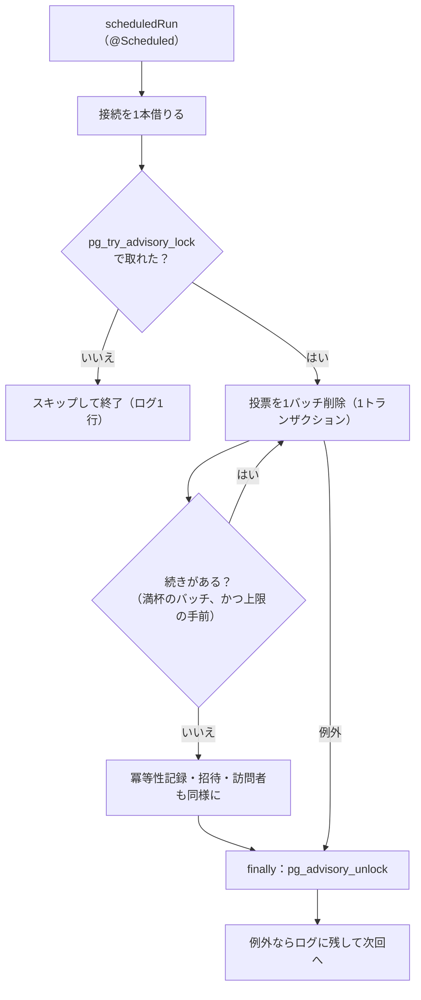

# 第29章 定期処理：失敗しても続けられるジョブ

<div class="goal-box" markdown>

この章でできるようになること

- `@Scheduled` で定期処理を書き、`fixedDelay` と `fixedRate` の違いと、スレッド数の既定値（1本）が何を引き起こすかを説明できる
- 期限切れデータの削除を、件数を区切って、途中で失敗しても続きから動かせる形に設計できる
- 2台のサーバーが同時に同じ定期処理を始める問題を再現し、`pg_try_advisory_lock` で1台に絞れる。ShedLock との違いも言える
- `@Async` で呼んだ処理が、呼び出し元のトランザクションの外で動くことを実験で確かめ、コミット後に動かす書き方を選べる
- 定期処理の例外ログに、DB エラー由来の機密が漏れる理由と、`SafeThrowable` の考え方を説明できる

</div>

## 1. 問いかけ：「7日たったデータを消す」を、誰がいつ動かすのか

QuickVote の投票は、作成から7日で物理削除します（[第28章](ch28-time-expiry.md)で、締切の拒否とは別の仕事だと決めました）。誰かが毎晩 SQL を叩くわけにはいかないので、アプリ自身が定期的に掃除することにします。

ところが、定期処理にはリクエスト処理にない落とし穴があります。

| 落とし穴 | 起きること |
| --- | --- |
| 件数が多い | 1回の `DELETE` が数分かかり、長いトランザクションがロックを抱え続ける |
| 途中で失敗する | 半分消えて、残りは？ 再実行したらどうなる？ |
| サーバーが2台ある | 両方が同時に同じ掃除を始める |
| スレッドが足りない | 重い掃除が、別の定期処理を巻き込んで待たせる |
| 誰も見ていない | 失敗してもユーザーには見えない。例外ログに入力値が出てしまうこともある |

この章は、この5つに順に答えます。リクエストは必ず誰かが見ていますが、定期処理は黙って失敗します。だから、失敗したときにどうなるかを先に決めておきます。

## 2. 最小の定期処理：`@Scheduled`

```java title="src/main/java/com/example/quickvote/QuickvoteApplication.java（抜粋）"
@SpringBootApplication
@ConfigurationPropertiesScan
@EnableScheduling   // 期限切れ削除・SSEハートビート・レート制限の掃除に使う
public class QuickvoteApplication { ... }
```

```java title="src/main/java/com/example/quickvote/poll/ExpiredDataCleaner.java（抜粋）"
@Scheduled(fixedDelayString = "${quickvote.cleanup.interval:5m}")
public void scheduledRun() {
    ...
}
```

!!! note "用語：`@Scheduled` と `fixedDelay`・`fixedRate`・`cron`"
    メソッドを定期的に呼び出すアノテーションです。`@EnableScheduling` を付けたクラスがあると有効になります。
    `fixedDelay` は「前回の終了から、この時間をあけて次を開始」、`fixedRate` は「前回の開始から、この間隔で開始」、`cron` は「毎日3時」のような時刻指定です。
    実行時間が長引いたとき、`fixedDelay` は自然に間隔が空きます。`fixedRate` は、実行が長引くと終了後すぐ次が始まり、間が空きません。終了を待ちたい掃除には `fixedDelay` を使います。

`5m` のような書き方は、`Duration` の簡易形式です（`PT5M` でも書けます。[第15章](../part02/ch15-configuration.md)の設定値の話）。

Node との対比です。

=== "TypeScript（Node）"

    ```ts
    // プロセスの中のタイマー。2プロセス起動すれば、2つ動く
    setInterval(async () => {
      await cleanup()
    }, 5 * 60 * 1000)
    ```

=== "Java（Spring）"

    ```java
    // プロセスの中のスケジューラ。2台起動すれば、2つ動く
    @Scheduled(fixedDelayString = "${quickvote.cleanup.interval:5m}")
    public void scheduledRun() { ... }
    ```

どちらも同じ弱点を持っています。タイマーがプロセスの中にあるので、サーバーを2台にすればタイマーも2つ動きます（第5節）。`setInterval` の中で例外が投げられると Unhandled rejection になるのと同じように、Spring の `@Scheduled` でも、例外が出たときの扱いを自分で決める必要があります（第8節）。

## 3. 件数を区切る

削除の SQL は、こう書いています。

```java title="src/main/java/com/example/quickvote/poll/PollRepository.java（deleteExpiredBatch）"
DELETE FROM polls WHERE id IN (
    SELECT id FROM polls WHERE delete_after <= :now ORDER BY delete_after LIMIT :limit)
```

`WHERE delete_after <= :now` だけでは、期限切れが100万件あれば1回の `DELETE` が100万件を対象にします。そこで `LIMIT` で最大 `:limit` 件に区切ります。

長いトランザクションはロックを長く持ち続けるので、削除する行を更新・参照する通常のリクエストが待たされます（[第25章](../part04/ch25-locking.md)）。子テーブル（選択肢・参加者・票・招待・イベント）も `ON DELETE CASCADE` で一緒に消えるため、実際の削除行数は見かけの何倍にもなります。途中で失敗すると、それまでの削除がすべて巻き戻ります。全か無かの仕事は、大きいほど失敗したときのコストが高くなります。さらに、接続（[第24章](../part04/ch24-connection-pool.md)）を長く占有するので、プールが足りなくなります。

1バッチごとに別のトランザクションでコミットし、1回の実行で消す量にも上限を置きます。

```java title="src/main/java/com/example/quickvote/poll/ExpiredDataCleaner.java（抜粋）"
private int deleteInBatches(IntUnaryOperator deleteOneBatch) {
    QuickVoteProperties.Cleanup config = properties.cleanup();
    int total = 0;
    for (int i = 0; i < config.maxBatchesPerRun(); i++) {      // (1)!
        int deleted = deleteOneBatch.applyAsInt(config.batchSize());
        total += deleted;
        if (deleted < config.batchSize()) {                    // (2)!
            break;
        }
    }
    return total;
}

private int inTransaction(java.util.function.IntSupplier work) {
    Integer deleted = transaction.execute(status -> work.getAsInt());   // (3)!
    return deleted == null ? 0 : deleted;
}
```

1. 1回の実行では最大 `max-batches-per-run`（既定50）バッチまで削除する。残りは次回に回す
2. 区切りの件数より少なければ、もう残っていないのでループを抜ける
3. `TransactionTemplate` で、1バッチを1トランザクションにする。`scheduledRun` 全体に `@Transactional` を付けると、1つの巨大なトランザクションになり、区切った意味がなくなる

!!! warning "`@Transactional` を付けずに `TransactionTemplate` を使う理由"
    `scheduledRun` から同じクラスの `@Transactional` メソッドを呼んでも、プロキシを通らないのでトランザクションが始まりません（自己呼び出し。[第23章](../part04/ch23-transactional-proxy.md)）。1バッチごとに境界を引きたいときは、`TransactionTemplate` で境界をコードの中に書くのが確実です。

設定は `quickvote.cleanup.*`（既定は間隔5分、バッチ100件、1回あたり最大50バッチ）です。`CleanupIT` では、バッチ10件・最大2バッチに絞って、動きを確かめています。

```java title="src/test/java/com/example/quickvote/CleanupIT.java（抜粋）"
for (int i = 0; i < 25; i++) { createPoll(host, false, "A"); }
clock.advance(Duration.ofDays(8));

ExpiredDataCleaner.Result first = small.runOnce();    // 10件 × 2バッチ = 20件で打ち切り
assertThat(first.polls()).isEqualTo(20);
ExpiredDataCleaner.Result second = small.runOnce();   // 残り5件
assertThat(second.polls()).isEqualTo(5);
assertThat(small.runOnce().polls()).isZero();         // 何度実行しても結果は同じ
```

## 4. 途中で失敗しても、続きから動く

実際に途中で失敗させてみます。実験の仕込みは次のとおりです（`code/labs/ch29-scheduling/failure-resume.sh`）。

- 期限切れの投票を151件、DB に直接 `INSERT` する。最後の1件（最も新しく期限切れになったもの）だけ、タイトルが `poison-秘密のタイトル`
- 削除時に、タイトルが `poison` で始まる行を見つけたら、タイトルを含むメッセージで失敗するトリガーを仕込む
- アプリは10秒ごと、1バッチ50件、1回あたり最大2バッチで動かす

```bash
sh code/labs/ch29-scheduling/failure-resume.sh
```

!!! question "予測カード"
    151件のうち、`poison` は最後の1件です。1回目・2回目・（トリガーを外した後の）3回目の実行が終わるたびに、`polls` に何件残るでしょうか。

    1. 151 → 151 → 0（失敗した回は、何も消えない）
    2. 51 → 1 → 0（失敗した回も、消せたぶんは残る）
    3. 151 → 0 → 0

```text
-- 1回目の実行後に残っている件数
51
-- 2回目の実行後（poison を含むバッチは失敗する）
1
== 原因を直す（トリガーを外す）
-- 次の実行のあと
0
```

答えは **2** です。ログも見てみます。

```text
23:09:24 [scheduling-2] INFO 期限切れデータを削除しました: polls=100 idempotencyRecords=0 invites=0 visitors=0
23:09:34 [scheduling-2] ERROR 期限切れデータの削除に失敗しました。次回の実行で続きから削除します org.springframework.jdbc.UncategorizedSQLException
23:09:44 [scheduling-3] INFO 期限切れデータを削除しました: polls=1 idempotencyRecords=0 invites=0 visitors=0
23:09:54 [scheduling-1] INFO 期限切れデータを削除しました: polls=0 idempotencyRecords=0 invites=0 visitors=0
```

1回目は、50件ずつ2バッチで100件を削除しました（残り51件）。2回目は、1バッチ目の50件が成功してコミットされ、2バッチ目は `poison` の1件だけで構成されていたため、そのバッチだけがロールバックされました。例外はログに残りますが、アプリは止まりません。原因を直したあとの3回目で残りの1件が消え、4回目は0件でした。再実行しても結果は同じです（冪等）。

この設計が成り立つ条件は2つです。

1. 削除の条件が「状態」で書かれていること（`delete_after <= :now`）。どこまで消したかを覚えておく必要がなく、毎回「期限切れのもの全部」を対象にします。第27章の冪等性の考え方と同じです
2. 1バッチが独立したトランザクションであること。失敗しても、前のバッチは巻き戻りません



!!! danger "この実装の限界：poison が居座ると、後ろの掃除も止まる"
    `cleanup()` は、投票 → 冪等性記録 → 招待 → 訪問者の順に直列で削除します。投票の削除で例外が出ると、その回は後ろの3つに進みません。上の実験でも、`poison` が居座っている間は他のテーブルの掃除が止まります。また、失敗した回は例外が先に出るので、消せた件数もログに出ません。
    リファレンス実装は、「次回に続きから動く」ことを優先した最小の形です。現場では、(a) テーブルごとに try/catch で独立させる、(b) 失敗が続いたらアラートを出す（[第44章](../part09/ch44-metrics.md)）、(c) 「期限切れなのに残っている件数」を指標にする、のいずれかを足します。

## 5. 2台で同時に走る

サーバーを2台にすると、`@Scheduled` は両方で動きます。2つの掃除が同じ行を同時に消そうとしてロックを奪い合い、片方がエラーになったり、無駄に二重に動いたりします。

実験します。期限切れ100件を仕込み、削除が1行ごとに 0.05 秒かかるトリガーを付けて、同じ DB に2台をほぼ同時に起動します（`two-instances.sh`）。

```bash
sh code/labs/ch29-scheduling/two-instances.sh
```

削除の最中に、PostgreSQL の `pg_locks` を見ます。

```text
== 削除の最中の pg_locks（advisory）
 locktype | lock_key | granted |  pid  | state |              query
----------+----------+---------+-------+-------+---------------------------------
 advisory |  7001001 | t       | 49103 | idle  | SELECT pg_try_advisory_lock($1)
(1 row)
```

```text
== インスタンスA のログ
23:10:42 [scheduling-2] INFO 他のインスタンスが削除処理を実行中のためスキップします
== インスタンスB のログ
23:10:47 [scheduling-2] INFO 期限切れデータを削除しました: polls=100 idempotencyRecords=0 invites=0 visitors=0
polls の残り: 0
```

B が100件を削除し、A は待たずにスキップしました。ロックの持ち主（pid 49103）の状態が `idle` なのは、その接続が「ロックを持つ」ためだけに使われ、削除の SQL は別の接続で流れているからです。

### `pg_try_advisory_lock`：アプリが名前を付ける鍵

!!! note "用語：アドバイザリロック（advisory lock）"
    PostgreSQL が提供する、アプリが好きな数値を鍵にして取れるロックです。テーブルの行や表とは関係ありません。「この鍵を持っている間、他の人は取れない」という約束をアプリ同士で共有するための道具で、DB は鍵の意味を知りません（advisory は「助言的」という意味です）。
    `pg_try_advisory_lock(鍵)` は、取れたら `true`、取れなければ待たずに `false` を返します。`pg_advisory_unlock(鍵)` で外します。

QuickVote は鍵に `7001001`（アプリ内で一意な任意の数値）を使っています。

```java title="src/main/java/com/example/quickvote/poll/ExpiredDataCleaner.java（runOnce）"
public Result runOnce() {
    try (Connection lockConnection = dataSource.getConnection()) {     // (1)!
        if (!tryLock(lockConnection)) {
            log.info("他のインスタンスが削除処理を実行中のためスキップします");
            return Result.SKIPPED;                                      // (2)!
        }
        try {
            return cleanup();                                           // (3)!
        } finally {
            unlock(lockConnection);                                     // (4)!
        }
    } catch (SQLException e) {
        throw new IllegalStateException("アドバイザリロックの操作に失敗しました", e);
    }
}
```

1. ロック専用に、プールから接続を1本借りる。ロックは接続（セッション）に紐づくので、最後まで手放さない
2. 取れなかったのは、他のインスタンスが実行中だから。待たずに終了する（次回の実行に任せる）
3. 削除のバッチは、プールの別の接続で流れる（`TransactionTemplate`）
4. ロックを取った接続と同じ接続で unlock する。別の接続で unlock しても外れない

psql 2本でも確かめます（`advisory-lock.sh`）。

```text
--- セッションA：ロックを取り、3秒後に接続を閉じる（unlock は呼ばない）
A: pg_try_advisory_lock = true
--- セッションB：1秒後に同じキーで試す（待たずに結果が返る）
B: pg_try_advisory_lock = false
--- Aの接続が閉じたあと
B: pg_try_advisory_lock = true
```

**接続が閉じれば、ロックは自動で外れます。** アプリが落ちても、ロックが残り続けることはありません。この性質は、「実行中フラグ」をテーブルに書く方式に対する大きな利点です（フラグ方式は、落ちたときに「実行中」が残り、誰も実行できなくなります）。

### 設計の判断と落とし穴

| 判断 | 理由 |
| --- | --- |
| `pg_advisory_lock`（待つ）ではなく `pg_try_advisory_lock`（待たない） | 待つと、2台目以降が列を作る。掃除は次回でよいので、スキップが正解 |
| `pg_try_advisory_xact_lock`（トランザクション単位）にしなかった | 1バッチごとにトランザクションを分けているので、トランザクション単位のロックだとバッチの間で外れてしまう。全体を1台に限るには、セッション単位が必要 |
| ロック専用に接続を1本使う | プールの最大が1本だと、ロックで1本を占有し、削除用の接続が取れず固まる。コネクションプールの余裕を確認する（[第24章](../part04/ch24-connection-pool.md)） |
| `finally` で必ず unlock | unlock し忘れて接続をプールに返すと、その接続がロックを持ったままプールに残る。以降、誰も掃除できなくなる |

!!! warning "接続プーラーの種類によっては使えない"
    PgBouncer などの外部プーラーを「トランザクション単位」で使うと、接続が文ごとに別のセッションに割り当たり、セッション単位のロックの前提が崩れます。外部プーラーを入れるときは、この前提を確認してください。

### ShedLock という選択肢

Spring の定期処理を複数台で1台に絞るためのライブラリとして、ShedLock がよく使われます（この教材では動かしていないので、概要の紹介です）。

```java
@Scheduled(fixedDelay = 300_000)
@SchedulerLock(name = "expiredDataCleaner", lockAtMostFor = "10m", lockAtLeastFor = "30s")
public void scheduledRun() { ... }
```

| | アドバイザリロック（QuickVote） | ShedLock（JDBC 版） |
| --- | --- | --- |
| 仕組み | DB が持つ鍵。接続に紐づく | `shedlock` テーブルに「いつまでロック」を書く |
| 落ちたとき | 接続が切れれば自動で外れる | `lockAtMostFor` の期限まで残る（期限で外れる） |
| 長く実行されたとき | 終わるまで保持 | `lockAtMostFor` を超えると別のインスタンスが入れる（重なりうる） |
| 追加物 | なし（PostgreSQL 固有の機能） | ライブラリとテーブル。Redis など DB 以外の実装もある |
| 向いている場面 | PostgreSQL 一本で、依存を増やしたくない | DB の種類を問わない。ロックを設定で宣言したい |

もう一つの選択肢は、そもそもアプリの中に定期処理を持たないことです。cron、Kubernetes の CronJob、クラウドのスケジューラから、専用のコマンドや API を1回だけ呼ぶ形にします。台数に左右されませんが、運用の部品が増えます。QuickVote の規模では、アプリ内でアドバイザリロックを使うのが最小の構成です。

`CleanupIT` は、「他のインスタンス」を別の接続でロックを持たせて作り、スキップを確かめます。4並列で `runOnce()` を呼んでも、全件が消えて、データが壊れないことも確認しています。

## 6. スケジューラのスレッド数（レビュー指摘 9）

`@Scheduled` のメソッドは、スケジューラのスレッドで動きます。Spring Boot の既定は1本です。

実験です。軽い処理（1秒ごとに1行出す `heartbeat`）と、重い処理（4秒かかる `slowCleanup`）を並べます（`code/labs/ch29-scheduling/async-lab/`）。

```java title="PoolDemo.java（抜粋）"
@Scheduled(fixedDelay = 1000)
void heartbeat() { say("heartbeat（1秒ごとのはずの軽い処理）"); }

@Scheduled(initialDelay = 2500, fixedDelay = 60_000)
void slowCleanup() throws InterruptedException {
    say("slowCleanup 開始（4秒かかる）");
    Thread.sleep(4000);
    say("slowCleanup 終了");
}
```

```bash
java -jar target/ch29-async-lab-0.0.1-SNAPSHOT.jar --lab.mode=pool                                   # 既定（1本）
java -jar target/ch29-async-lab-0.0.1-SNAPSHOT.jar --lab.mode=pool --spring.task.scheduling.pool.size=3
```

```text
##### pool size=1（既定）
t= 5958ms [scheduling-1] heartbeat（1秒ごとのはずの軽い処理）
t= 6435ms [scheduling-1] slowCleanup 開始（4秒かかる）
t=10436ms [scheduling-1] slowCleanup 終了
t=10436ms [scheduling-1] heartbeat（1秒ごとのはずの軽い処理）      ← 4.5秒、止まっていた

##### pool size=3
t= 5062ms [scheduling-1] heartbeat（1秒ごとのはずの軽い処理）
t= 5542ms [scheduling-2] slowCleanup 開始（4秒かかる）
t= 6063ms [scheduling-3] heartbeat（1秒ごとのはずの軽い処理）      ← 続く
t= 7064ms [scheduling-3] heartbeat（1秒ごとのはずの軽い処理）
```

スレッドが1本だと、`slowCleanup` が動いている4秒間、`heartbeat` は一度も動けません。3本にすると、別のスレッドが引き受けます。

QuickVote の `@Scheduled` は3つあります。

| 処理 | 役割 |
| --- | --- |
| `ExpiredDataCleaner.scheduledRun` | 期限切れ削除（DB を使うので、数秒かかりうる） |
| `PollEventHub.sendHeartbeats` | SSE のハートビート。詰まった接続の打ち切りも兼ねる（[第36章](../part07/ch36-sse.md)） |
| `RateLimiter` の掃除 | 満タンに戻ったバケットを1分ごとに捨てる（[第35章](../part06/ch35-rate-limiting.md)） |

シニアレビューは、遅い SSE 接続が、他の通知・定期清掃・アプリ停止まで待たせることを指摘しました（指摘 9）。既定のスレッド1本が塞がると、期限切れ削除と掃除も進まなくなります。対応は2段構えです。

1. 根本の対応：SSE の書き込みを、定期処理のスレッドでやらない。専用の配信プールに移す（第7部）
2. 保険：`spring.task.scheduling.pool.size: 3` にして、期限切れ削除とハートビート・掃除が、同じスレッドを待ち合わないようにする

```yaml title="src/main/resources/application.yaml（抜粋）"
spring:
  task:
    scheduling:
      pool:
        # @Scheduled のスレッド数（既定は1）。1本だと、期限切れ削除（DBを使うので数秒かかりうる）が走っている間、
        # SSE のハートビート（詰まった接続の打ち切りも兼ねる）や、レート制限の掃除が待たされる。
        size: 3
```

ログのスレッド名が `scheduling-1`〜`scheduling-3` になっていたのは、このためです（この章の実行ログにも出ています）。

!!! tip "現場の判断：『数を増やす』は保険、『詰まる仕事を同じ場所に置かない』が本筋"
    スレッドを100本にすれば安心、という話ではありません。詰まる仕事（遅いクライアントへの書き込み、外部 API の呼び出し）が定期処理のスレッドを塞ぐ構造そのものを直します。スレッド数は、定期処理の個数と最大の実行時間から決めるのが基本で、3つの処理なら3本あれば足ります。

## 7. `@Async` とトランザクション

「定期処理の中から、別のスレッドに処理を逃がしたい」とき、`@Async` が候補に挙がります。

!!! note "用語：`@Async`"
    メソッドを呼び出し元とは別のスレッドで実行するアノテーションです（`@EnableAsync` で有効化）。呼び出し側は結果を待たずに戻ります。`@Transactional` と同じくプロキシで実現されるので、同じクラスの中からの呼び出し（自己呼び出し）では働きません（[第23章](../part04/ch23-transactional-proxy.md)）。

QuickVote は `@Async` を使っていません（リファレンス実装に1か所もありません）。使わないと決めた理由を、実験で確かめます。見るのは、トランザクションの途中で `@Async` のメソッドを呼ぶと何が起きるか、です。

```java title="AsyncDemo.java（抜粋）"
@Transactional
void createBad() throws InterruptedException {
    long id = insert("bad");
    say("[bad] INSERT した id=" + id + " / トランザクション中? " + TransactionSynchronizationManager.isActualTransactionActive());
    reader.readLater(id);        // @Async。別スレッドで id の行を読む
    Thread.sleep(500);           // このあとも処理が続く（コミットはメソッドを抜けたとき）
    say("[bad] メソッドを抜ける（ここでコミット）");
}
```

!!! question "予測カード"
    `readLater` は、`INSERT` した行を見つけられるでしょうか。

    1. 見つかる（同じトランザクションで動くから）
    2. 見つからない（別のスレッドで、まだコミットされていないから）

```text
t= 3945ms [main] [bad] INSERT した id=1 / トランザクション中? true
t= 4028ms [task-1] [bad] 別スレッドで id=1 を読む → 見つからない / トランザクション中? false
t= 4450ms [main] [bad] メソッドを抜ける（ここでコミット）
```

答えは **2** です。トランザクションはスレッドに紐づくので（[第23章](../part04/ch23-transactional-proxy.md)、[第24章](../part04/ch24-connection-pool.md)）、別スレッド（`task-1`）には引き継がれません。`isActualTransactionActive()` も `false` です。別スレッドは別の接続を使うので、コミット前の行は見えません。

直し方は、「コミットされてから動く処理」として登録することです。

```java title="AsyncDemo.java（抜粋）"
@Transactional
void createGood() throws InterruptedException {
    long id = insert("good");
    events.publishEvent(new MemoCreated(id));      // 今すぐではなく、コミット後に配る
    ...
}

@Async
@TransactionalEventListener(phase = TransactionPhase.AFTER_COMMIT)   // (1)!
void onCreated(MemoCreated event) { ... }
```

1. トランザクションがコミットされたあとに呼ばれるイベントリスナー。ロールバックされたら呼ばれない

```text
t= 4974ms [main] [good] INSERT した id=2
t= 5481ms [main] [good] メソッドを抜ける（ここでコミット）
t= 5497ms [task-2] [good] 別スレッドで id=2 を読む → 見つかった / トランザクション中? false
```

コミットの後に別スレッドが動き、行が見つかりました。

!!! warning "それでも残る問題：コミット後に落ちたら、通知は消える"
    `AFTER_COMMIT` は、コミットした直後に呼ばれるだけです。コミットとリスナーの呼び出しの間にサーバーが落ちると、更新は残り、後続の処理だけが失われます。確実に後続を動かしたいときは、業務更新と「やるべき仕事」の記録を同じトランザクションで保存し、別の仕組みが拾う設計にします。QuickVote の SSE がこの形で、`poll_events` に業務更新と同じトランザクションで保存し、`pg_notify` も同じトランザクションの中で呼びます（[第37章](../part07/ch37-event-history.md)）。

`@Async` の例外も、静かに消えやすい点に注意します。`void` を返す `@Async` メソッドで例外が出ても、呼び出し元には届きません。既定では、スレッドプールの側でログに1回出るだけです。

```text
ERROR ... [         task-1] .a.i.SimpleAsyncUncaughtExceptionHandler : Unexpected exception occurred invoking async method: void ...ErrorDemo$AsyncWorker.failing()
java.lang.IllegalStateException: 非同期の失敗 token=SECRET-ASYNC
```

メッセージがそのままログに出ています（次の第8節）。

## 8. 例外ログに機密を出さない：`SafeThrowable`（レビュー指摘 2）

`@Scheduled` のメソッドから例外が出たらどうなるでしょうか。毎回例外を投げるジョブで実験します（`--lab.mode=error`）。

```java title="ErrorDemo.java（抜粋）"
@Scheduled(fixedDelay = 1500)
void failingJob() {
    count++;
    say("failingJob " + count + " 回目");
    throw new IllegalStateException("失敗しました token=SECRET-" + count);
}
```

```text
t= 3910ms [scheduling-1] failingJob 1 回目
ERROR ... TaskUtils$LoggingErrorHandler : Unexpected error occurred in scheduled task
java.lang.IllegalStateException: 失敗しました token=SECRET-1
t= 5422ms [scheduling-1] failingJob 2 回目
ERROR ... TaskUtils$LoggingErrorHandler : Unexpected error occurred in scheduled task
java.lang.IllegalStateException: 失敗しました token=SECRET-2
```

例外が出ても、次の回は動きます。Spring の既定のエラーハンドラが、ログに1回出してスケジュールを続けるからです。もう1つ分かるのは、例外のメッセージがログにそのまま出ることです。ここでは自分で書いたメッセージですが、問題になるのは自分で書いていないメッセージです。

第4節の実験で、トリガーは『`cannot delete poll titled <タイトル>`』というメッセージで失敗しました。PostgreSQL の例外のメッセージには、CHECK 制約違反の `Failing row contains (...)` のように、違反した行の中身が入ることがあります。タイトルや参加コードが、そのままログに載ります。「自分のメッセージに入力値を連結しなければ安全」とは言えません。`log.error("...", ex)` は、原因（cause）のメッセージも出力するからです。

リファレンス実装は、例外をログ用の別の例外に作り替えてから渡します。

```java title="src/main/java/com/example/quickvote/common/SafeThrowable.java（抜粋）"
private static Throwable copy(Throwable original, int depth, Map<Throwable, Boolean> seen) {
    StringBuilder description = new StringBuilder(original.getClass().getName());       // (1)!
    if (original instanceof SQLException sql && sql.getSQLState() != null) {
        description.append(" [SQLSTATE=").append(sql.getSQLState()).append(']');       // (2)!
    }
    Redacted copy = new Redacted(description.toString());
    copy.setStackTrace(original.getStackTrace());                                       // (3)!
    ...
```

1. 例外のクラス名
2. SQL の例外なら、SQLSTATE（エラーの種類を表す5文字のコード。値は含まない）
3. スタックのフレーム（どこで起きたか）。メッセージは捨てる

```java title="ExpiredDataCleaner.java（抜粋）"
} catch (RuntimeException e) {
    // 例外をそのまま渡すと、DB エラーのメッセージ（違反した行の中身）がログに出る。SafeThrowable で落とす。
    log.error("期限切れデータの削除に失敗しました。次回の実行で続きから削除します", SafeThrowable.of(e));
}
```

第4節の実験で、実際に出たログを確かめます。

```text
"error":{"type":"com.example.quickvote.common.SafeThrowable$Redacted",
         "message":"org.springframework.jdbc.UncategorizedSQLException", "stack_trace":"..."}
...
Caused by: com.example.quickvote.common.SafeThrowable$Redacted: org.postgresql.util.PSQLException [SQLSTATE=P0001]
```

```bash
grep -c '秘密のタイトル' /tmp/ch29-a.log
0
```

型・SQLSTATE（`P0001` ＝ PL/pgSQL の `RAISE EXCEPTION`）・スタックは残り、タイトルは1回も出ていません。どこで、どの種類のエラーが起きたかは分かるので、調査には十分です。値が必要なら、ログではなく DB で、権限のある人が調べます。

これは許可リスト方式です。「出してはいけないものを消す」（拒否リスト）のではなく、「出してよいものだけ出す」と決めます。拒否リスト方式は、想定外のメッセージが混ざった瞬間に漏れるからです。`SafeThrowableTest` と `LoggingIT`（実際の CHECK 制約違反と、削除トリガーの失敗）が、メッセージを含まないことを確かめています。ログ全体の方針は[第43章](../part09/ch43-logging.md)で扱います。

## 9. 現場ではこうする：定期処理のレビュー観点

| 見るもの | 疑う理由 |
| --- | --- |
| 1回の `DELETE`／`UPDATE` に件数の上限がない | 長いトランザクション。区切る（`LIMIT`）。1バッチ1トランザクション |
| 条件が『前回の続き』を覚えている前提 | 失敗で壊れる。『状態』で条件を書き、再実行しても同じ結果に |
| `@Scheduled` を複数台で動かしている | 台数ぶん動く。アドバイザリロック／ShedLock／外部スケジューラ |
| スレッド数が既定の1本のまま | 重い処理が、他の定期処理を止める |
| 定期処理に `@Transactional` を1つ付けて全体を括っている | 区切った意味がなくなる。`TransactionTemplate` で境界を細かく |
| `@Async` の中で、呼び出し元の更新を読んでいる | コミット前は見えない。`AFTER_COMMIT`、または同一トランザクションの記録＋別の拾い手 |
| `log.error("...", ex)` | 原因のメッセージに機密が入る。許可リスト方式で出す |
| 失敗してもログ1行だけ | 気づかれない。失敗の連続・滞留の件数をメトリクスにしてアラート（[第44章](../part09/ch44-metrics.md)） |
| 起動直後に定期処理が走る | `@Scheduled` は既定で起動直後に1回動く（この章のログでも起動直後に動いた）。重いなら `initialDelay` |

---

## まとめ：3点セット

!!! abstract "この章の3点セット"
    **① 一言で言うと**
    定期処理は、状態で条件を書いた冪等な処理を、件数を区切って1バッチ1トランザクションで流し、複数台では `pg_try_advisory_lock` などで1台に絞り、専用のスレッドで動かし、例外はメッセージを落として許可リスト方式でログに残す。

    **② 現場でこう聞かれる**
    「サーバーを2台に増やしたら、期限切れ削除が二重に動いていませんか？」
    → 動く。`@Scheduled` は台数ぶん動くので、アドバイザリロックで1台に絞っている。取れなかったインスタンスは待たずにスキップし、アプリが落ちても接続が切れればロックは自動で外れる。

    **③ 自分のサービスならどこに当たるか**
    自分のサービスの定期処理（削除、集計、通知、再試行）を挙げ、(a) 1回に処理する件数の上限、(b) 途中失敗後の再実行で結果が変わらないか、(c) 台数が増えたときに二重に動いてよいか、(d) 例外ログに入力値が入らないか、を確認する。

## 演習

??? question "確認問題1：予測と観察"
    `failure-resume.sh` で、1回の実行で消す最大バッチ数を 2 から 5 に増やす（`--quickvote.cleanup.max-batches-per-run=5`）と、1回目の実行後の残りは何件になりますか。2回目の結果はどうなりますか。

??? success "解答"
    1回目は 50件 × 3バッチで151件のうち150件を消し、4バッチ目に当たる `poison` 1件の削除で失敗します。残りは1件です（`poison` は最後のバッチに単独で入るため）。実験の1回目と2回目が、1回に圧縮されたような結果です。トリガーを外すまで、以降の実行はすべて同じ失敗をします。1回で消せる量が増えても、居座る行がある限り、失敗は変わりません。

??? question "確認問題2：アドバイザリロック"
    `ExpiredDataCleaner.runOnce()` が `finally` の `unlock(lockConnection)` を書き忘れたら、何が起きますか。`try-with-resources` で接続を閉じているのに、なぜ問題になるのですか。

??? success "解答"
    接続はコネクションプールの接続なので、`close()` は物理的に閉じるのではなく、プールに返すだけです。ロックは接続（セッション）に紐づいているので、unlock しないと、プールの中の接続がロックを持ったまま残ります。以降、その接続は再利用され続け、他のインスタンスはロックを取れず、永遠にスキップされます（アプリを再起動して接続が切れるまで）。`CleanupIT` の「実行後はロックが解放されている」が、これを防いでいます。

??? question "確認問題3：`@Async` の読み取り"
    `@Transactional` のメソッドの中で、行を `INSERT` して、同じトランザクションの `@Async` メソッドで `SELECT` しています。ときどき「見つからない」ことがあり、ときどき「見つかる」ことがありました。なぜ、結果が一定しないのですか。

??? success "解答"
    `@Async` のメソッドは別スレッド・別の接続で動くので、呼び出し元がコミットする前だと、行は見えません。呼び出し元がコミットするのが先か、別スレッドの `SELECT` が先かは、タイミング次第で変わります。『ときどき見つかる』のは、たまたま先にコミットされたときだけです。`AFTER_COMMIT` のリスナーにすれば、毎回コミット後に動きます。

??? question "応用：テーブルごとに独立させる"
    第4節の「限界」を直してください。`cleanup()` の4つの削除を、ある削除が失敗しても、他の削除が実行されるようにするには、どう変えますか。

??? success "解答"
    それぞれの `deleteInBatches(...)` を `try/catch` で囲み、失敗したテーブルだけ件数を0にして、`SafeThrowable.of(e)` でログに残し、最後に1つでも失敗があれば、結果にその旨を持たせます。例外の握りつぶしにならないよう、(a) 必ずログに出す、(b) 失敗の回数をメトリクスにする、の2つを一緒に入れます。テストは、削除に失敗するトリガーを1つのテーブルにだけ仕込み、ほかのテーブルが消えることを確かめます。

??? question "応用：2台の実験を変える"
    `two-instances.sh` の、削除用トリガーの待ち時間を `pg_sleep(0.05)` から `pg_sleep(0)` に変えて、同じ実験をします。スキップは起きますか。起きなくなったとき、ロックは不要だったと言えますか。

??? success "解答"
    削除が一瞬で終わるので、2台の実行が重なりにくく、スキップが起きないことが多くなります。ただし、重ならなかったのは運であって、保証ではありません。件数が増えた日や、DB が遅くなった日には重なります。「100回動かして問題なかった」は根拠になりません（[第26章](../part04/ch26-concurrency-testing.md)）。

??? question "説明問題：現場でこう聞かれる"
    「定期処理で例外が出たら、アプリは止まりますか。ログには何を出しますか。」200字程度で答えてください。

??? success "解答"
    例：`@Scheduled` で例外が出ても、Spring の既定のエラーハンドラがログに出して、次の回は動きます。ただし、例外のメッセージには DB が返した行の値などの機密が入ることがあるので、`log.error("...", ex)` と渡さず、例外のクラス名・SQLSTATE・スタックだけを出す形に作り替えます。失敗が続いていることに気づけるよう、メトリクスとアラートも必要です。
