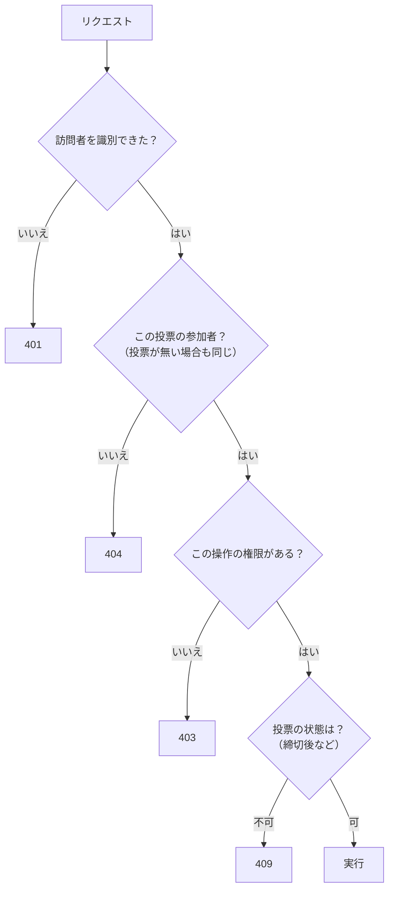

# 第30章 認証・識別・認可を分ける

<div class="goal-box" markdown>

この章でできるようになること

- 「誰として扱うか（識別）」と「何を許すか（認可）」を分けて、自分のサービスに当てはめられる
- 権限表（誰が・何を・どう拒否されるか）を書き、そのままテストにできる
- IDを書き換えて他人のデータを覗く攻撃（IDOR）を、実際のHTTPで再現し、防げる
- 401・403・404 を使い分け、「存在しないこと」と「見せないこと」を区別させない理由を説明できる

</div>

## 1. 問いかけ：会員登録がないのに、他人の投票を覗けないのはなぜか

QuickVote にはログインがなく、メールアドレスもパスワードもありません。それでも、自分が参加していない投票は、URL を知っていても開けません。完成形（`code/quickvote/`）で、同じ投票を3つの立場から呼んでみます。

```bash
# Cookie なし
curl -s -o /dev/null -w '%{http_code}\n' http://localhost:18130/api/polls/809470cf-62a7-473c-8fd7-900ff50ea1ee
```

```text
401
```

Cookie を持つ別の訪問者（その投票の参加者ではない人）が呼ぶと、こうなります。

```text
404   {"detail":"投票が見つかりません。", ... "code":"POLL_NOT_FOUND"}
```

存在しない投票 ID を呼んでも、まったく同じ応答が返ります。参加者（MEMBER）が主催者専用の「締切」を呼ぶと、こうなります。

```text
403   {"detail":"この操作は主催者のみ行えます。", ... "code":"HOST_ONLY"}
```

3つの数字はそれぞれ別の意味を持ちます。この章では、この3つがどんな設計から出てくるのかを、表と実験で見ます。コードは最後にして、先に「約束の表」を決めます。

## 2. 3つの問いに分ける

サーバーはリクエストを受けるたびに、次の3つを順に決めています。

| 問い | 名前 | QuickVote での答え | 間違えると |
| --- | --- | --- | --- |
| 誰として扱うか | 識別 | Cookie の訪問者トークン → 訪問者ID | 他人として扱われる |
| その人だと信じてよいか | 認証 | 「トークンを持っている＝その訪問者」とみなす | なりすまし |
| その人に何を許すか | 認可 | 投票ごとの参加者表（HOST / MEMBER） | 他人のデータを見る・壊す |

!!! note "用語：識別・認証・認可"
    識別は「この人として扱います」という名札付け、認証はその名札が本物かの確認、認可は「この人にこの操作を許すか」の判断です。
    Spring Security の用語では、識別と認証をまとめて「認証（Authentication）」と呼ぶことが多く、この教材の分け方より粗くなっています。ここでは、考える材料として3つに分けます。


この章の例えは、入館証とフロアの入室権です。入館証（識別・認証）は、ビルに入るときに1枚もらいます。フロアの入室権（認可）は階ごとに別々に決まっていて、入館証を持っているだけでは全階に入れません。

ただし、この例えには合わない点があります。実際の入館証は、発行時に受付が名前と顔を確認します。QuickVote の入館証は名前のない整理券で、誰が持っていても同じ扱いになり、失くしたら取り戻せません（第32章）。もう1つ、入室権は「フロア単位」ではなく「投票ごと」に、人によって違います。同じ訪問者が、投票 A では HOST、投票 B では MEMBER、投票 C では部外者になります。

### アプリ全体のロールを持たない

Spring Security には、`ROLE_ADMIN` のような「アプリ全体の権限（GrantedAuthority）」を持たせる仕組みがあります。QuickVote はこれを使いません。権限が投票ごとに違い、アプリ全体の権限には押し込めないからです。

```java title="src/main/java/com/example/quickvote/security/VisitorAuthentication.java（抜粋）"
public class VisitorAuthentication extends AbstractAuthenticationToken {

    private final VisitorPrincipal principal;

    public VisitorAuthentication(VisitorPrincipal principal) {
        super(AuthorityUtils.NO_AUTHORITIES);   // (1)!
        this.principal = principal;
        setAuthenticated(true);
    }
```

1. 権限は空にして、「誰か」だけを持たせる。認可は、投票ごとの参加者表（DB）を引いて決める

!!! tip "フロントエンドで例えると"
    JWT に `role: "admin"` を入れて、フロントで画面を出し分ける設計と似ています。ただし、QuickVote ではそれができません。「この投票の主催者か」は、投票ごとに DB を見ないと分からないからです。権限はトークンの中ではなく、DB の表にあります。

## 3. 権限表を先に書く

認可を実装する前に、表を書きます。行は操作、列は立場です。

| 操作 | Cookieなし | 非参加者 | MEMBER | HOST |
| --- | --- | --- | --- | --- |
| `POST /api/polls`（投票を作る） | 通る（Cookie を発行） | 通る | 通る | 通る |
| `POST /api/join`（参加コードで参加） | 通る（回数制限） | 通る（回数制限） | 通る（再参加は成功） | 通る |
| `GET /api/polls/{id}`（詳細） | 401 | 404 | 200 | 200 |
| `POST …/options`（選択肢追加） | 401 | 404 | 403（許可時は201） | 201 |
| `PUT …/my-vote`（投票） | 401 | 404 | 200 | 200 |
| `POST …/close`（締切を早める） | 401 | 404 | 403 | 204 |
| `DELETE …`（削除） | 401 | 404 | 403 | 204 |
| `POST …/invites`（招待の発行） | 401 | 404 | 403 | 201 |
| `POST /api/invites/{token}/accept` | 通る（一度限り・回数制限） | 通る | 通る | 通る |
| `GET …/events`（SSE） | 401 | 404 | 200 | 200 |

この表から、規則が3つ読み取れます。

| 数字 | 意味 | 返す場面 |
| --- | --- | --- |
| 401 | 誰か分からない | 訪問者 Cookie がない・無効 |
| 404 | その人には存在しない | 投票がない、または参加していない |
| 403 | 参加者だが、権限が足りない | MEMBER が HOST 専用の操作をした |

判定には順番もあります。



**認可（404・403）は、状態（409）より先**です。順番を逆にすると、部外者に「この投票は締め切られています」と返すことになり、存在が漏れます。第33章の招待の締切判定も、同じ理由で順番が決まっています。

### なぜ「参加していない」を 403 にしないのか

403 は「あなたには許されていない」、つまりそのものは存在するという意味に聞こえます。部外者に 403 を返すと、「この ID の投票は実在する」と教えてしまいます。実在が分かれば、参加コードの総当たり（第33章）や、ID を集める攻撃の手がかりになります。

そのため、実在しない投票と、実在するが参加していない投票には、まったく同じ応答を返します。ステータスだけでなく `code` も `detail` も同じで、完成形のテストがこれを確かめています。

```java title="src/test/java/com/example/quickvote/PermissionMatrixIT.java（抜粋）"
@Test
void 存在しない投票と参加していない投票は区別できない() {
    // ...
    assertThat(notParticipant).hasStatus(HttpStatus.NOT_FOUND);
    assertThat(notExisting).hasStatus(HttpStatus.NOT_FOUND);
    // ステータスだけでなく code と detail も同じ。instance（相関ID）だけが違う。
    Map<?, ?> a = bodyAs(notParticipant, Map.class);
    Map<?, ?> b = bodyAs(notExisting, Map.class);
    assertThat(a.get("code")).isEqualTo(b.get("code")).isEqualTo("POLL_NOT_FOUND");
    assertThat(a.get("detail")).isEqualTo(b.get("detail"));
}
```

`instance` には相関 ID を入れています。リクエストのパスを入れると、応答に違いが出たり、招待トークンが残ったりするからです（[第14章](../part02/ch14-validation-errors.md)）。

!!! warning "よくある間違い：存在を漏らす4つの経路"
    1. 部外者に 403 を返す（存在が分かる）
    2. メッセージが違う（「見つかりません」と「権限がありません」）
    3. 認可の前に状態を見る（「締切後です」が部外者に届く）
    4. 参加コードの入力ミスと「存在しない」を別の応答にする（`JOIN_CODE_NOT_FOUND` は形式不正も同じ）

    応答時間の差も理屈の上では手がかりですが、ネットワーク越しには測りにくく、この教材では扱いません。

## 4. 実演：IDを書き換えて他人の投票を覗く（IDOR）

表を書いても、実装が表に従わなければ意味がありません。そこで、表を破る実装をわざと作って攻撃します。

第2部のメモリ版ラボ（`code/labs/part02-quickvote-inmemory/`）を元に、認可をわざと忘れた API を足したラボ `code/labs/ch30-idor/` を使います。第2部の訪問者の特定は、リクエストヘッダー `X-Visitor-Id` を信用する暫定版でした。

```bash
cd code/labs/ch30-idor
./mvnw spring-boot:run -Dspring-boot.run.profiles=idor     # ポート 18030。Windows は .\mvnw.cmd
```

主催者A（訪問者1）が「ランチどこ行く？」、主催者B（訪問者2）が「ボーナスの配分」という投票を作った状態から始めます。攻撃者は訪問者99で、どちらの投票にも参加していません。

!!! question "予測カード"
    攻撃者（訪問者99）が、次の3つを呼びます。それぞれ何が返るでしょうか。

    1. 正規の API：`GET /api/polls/<Aの投票のUUID>`
    2. 認可を忘れた API：`GET /api/v0/polls/1`（内部の連番ID）
    3. 同じ API の `/api/v0/polls/2`、`/api/v0/polls/3`

実行します。

```bash
curl -s -i localhost:18030/api/polls/d1eb408d-01a0-4d11-9b58-a68fa2f27821 -H 'X-Visitor-Id: 99'
```

```text
HTTP/1.1 404
{"detail":"投票が見つかりません。", ... "code":"POLL_NOT_FOUND"}
```

正規の API は、期待どおり 404 です。次に、認可を忘れた API を呼びます。

```bash
for i in 1 2 3; do curl -s localhost:18030/api/v0/polls/$i -H 'X-Visitor-Id: 99'; echo; done
```

```text
{"id":1,"title":"ランチどこ行く？","joinCode":"SD4DQQAK"}
{"id":2,"title":"ボーナスの配分","joinCode":"8RSTH4M5"}
{"detail":"投票が見つかりません。", ... "code":"POLL_NOT_FOUND"}
```

答えは、1が404、2が200（中身が丸見え）、3は `/2` が200で `/3` は存在しないので404です。**ID を1つずつ増やすだけで、他人の投票のタイトルと参加コードが全部取れました。** 参加コードが分かれば、攻撃者は `POST /api/join` で正規の参加者になれます。認可を1か所忘れただけで、他の認可がすべてすり抜けられたことになります。

原因は、悪い例のコードにそのまま出ています。

```java title="code/labs/ch30-idor/.../NaivePollController.java（悪い例）"
@GetMapping("/api/v0/polls/{id}")
public Map<String, Object> getV0(VisitorPrincipal visitor, @PathVariable long id) {   // (1)!
    Poll poll = polls.findById(id).orElseThrow(() -> new ApiException(ErrorCode.POLL_NOT_FOUND));
    return summary(poll);                                                              // (2)!
}
```

1. `visitor` を受け取っているのに使っておらず、ID だけで引いている
2. 「この人がこの投票の参加者か」を、誰も確かめていない

!!! note "用語：IDOR（Insecure Direct Object Reference）"
    オブジェクトの ID（連番、UUID など）を直接指定して取得する API で、「その人に見せてよいか」を確かめていない欠陥です。ID を書き換えるだけで他人のデータが取れます。Web アプリの認可の欠陥として、最もよく見つかるものの1つです。

### 「UUID にしたから安全」ではない

本線の API は、公開用の ID に UUID（`polls.public_id`）を使っています。連番のように「1, 2, 3」と試せないので、v0 のような攻撃は難しくなります。ただし、見つけにくくなっただけで、認可にはなっていません。

| 漏れ方 | 例 |
| --- | --- |
| URL の共有 | チャットに貼られたURL、画面共有 |
| ログ・履歴 | アクセスログ、ブラウザ履歴、拡張機能 |
| Referrer | 外部サイトへのリンクを踏んだとき（QuickVote は `Referrer-Policy: no-referrer` で抑えている） |
| 参加をやめた人 | かつて参加者だった人は ID を覚えている |

「ID を知っている」ことと「見てよい」ことは別で、ID が漏れても守られるのが認可の役割です。

### 直す：参加者かどうかを確かめる

直した v1 は、取得のあとに参加者かどうかを確かめます。参加者でなければ、存在しない投票と同じ 404 にします。

```java
@GetMapping("/api/v1/polls/{id}")
public Map<String, Object> getV1(VisitorPrincipal visitor, @PathVariable long id) {
    Poll poll = polls.findById(id).orElseThrow(() -> new ApiException(ErrorCode.POLL_NOT_FOUND));
    participants.findByPollAndVisitor(poll.id(), visitor.visitorId())
            .orElseThrow(() -> new ApiException(ErrorCode.POLL_NOT_FOUND));    // 部外者も同じ404
    return summary(poll);
}
```

```text
v1/1 -> 404
v1/2 -> 404
v1/3 -> 404
```

### 識別が偽装できると、認可の表は無力

もう1つ、ラボの暫定実装の弱さを見ます。攻撃者は投票の参加者ではありませんが、主催者Aになりすますことはできます。

```bash
curl -s localhost:18030/api/polls/d1eb408d-01a0-4d11-9b58-a68fa2f27821 -H 'X-Visitor-Id: 1'
```

```text
{"id":"d1eb408d-...","title":"ランチどこ行く？","status":"OPEN", ... "role":"HOST", ... "joinCode":"SD4DQQAK", ...}
```

ヘッダーに `1` と書いただけで、HOST として全部見えました。認可の表も `require()` も正しく動いていて、壊れているのはその前の「誰として扱うか」です。

!!! warning "この時点の保証"
    第2部のラボの `X-Visitor-Id` は、誰でも書き換えられる自己申告です。認可の表が完璧でも、識別が偽装できれば表は意味を持ちません。**識別と認可は、両方そろって初めて守れます。** 識別を本物に置き換えるのが第32章です。第2部のラボでコントローラーの引数の型（`VisitorPrincipal`）を変えずに済むようにしてあったのは、そのためです。

## 5. 権限表をそのままテストにする

表は書いて終わりにせず、テストとして実行します。完成形の `PermissionMatrixIT` は、権限表の6操作×3立場＝18マスを、1行ずつパラメータにしています。

```java title="src/test/java/com/example/quickvote/PermissionMatrixIT.java（抜粋）"
static Stream<Arguments> matrix() {
    return Stream.of(
            // 操作                      非参加者  MEMBER   HOST
            row(Operation.GET_POLL, 404, 200, 200),
            row(Operation.ADD_OPTION, 404, 403, 201), // allowMemberOptions=false の投票
            row(Operation.VOTE, 404, 200, 200),
            row(Operation.CLOSE, 404, 403, 204),
            row(Operation.DELETE, 404, 403, 204),
            row(Operation.ISSUE_INVITE, 404, 403, 201)).flatMap(s -> s);
}

@ParameterizedTest(name = "{0} を {1} が実行すると {2}")
@MethodSource("matrix")
void 権限表どおりの応答になる(Operation operation, Actor actor, int expectedStatus) { /* ... */ }
```

表の1行が、テストの1行になります。この表を読めば仕様が分かります。新しい API を足したら、表に行を足し、テストにも行を足します。これがルールです。

メモリ版のラボにも、3操作ぶんの同じテスト（`PermissionMatrixTest`）があります。

```bash
./mvnw test -Dtest=PermissionMatrixTest
```

```text
Tests run: 11, Failures: 0, Errors: 0, Skipped: 0
```

9個が権限表（3操作×3立場）、2個が v0 と v1 の確認です。v0 のテストは、穴があることをわざと表明しています。

```java
// この assert が通る＝穴がある。権限表のテストに v0 の行を足すと、ここが赤くなる。
assertThat(result).hasStatus(HttpStatus.OK);
assertThat(result).bodyText().contains((String) poll.get("joinCode"));
```

!!! tip "Red → Green の練習"
    権限表の `GET_POLL` の行を `/api/v0/polls/{id}` に向けて、非参加者が 404 になることを期待するテストを書くと赤になります。v0 を v1 の実装に直すと緑になります。AI が書いた API に表の行がなければ、その時点でレビューの指摘になります。

## 6. 認可の置き場所：入口を1か所にする

認可を各所に `if` で書き散らすと、必ず1か所忘れます。完成形は、認可の入口を1か所に集めています。

```java title="src/main/java/com/example/quickvote/participant/ParticipantService.java"
/** 参加者でなければ404。投票が存在しない場合と区別しない（存在を漏らさない）。 */
public ParticipantContext require(UUID pollPublicId, long visitorId) {
    return participants.findActive(pollPublicId, visitorId)
            .orElseThrow(() -> new ApiException(ErrorCode.POLL_NOT_FOUND));
}

/** 主催者でなければ403。参加者であることは確認済みなので、存在を隠す必要はない。 */
public ParticipantContext requireHost(UUID pollPublicId, long visitorId) {
    ParticipantContext context = require(pollPublicId, visitorId);
    if (!context.isHost()) {
        throw new ApiException(ErrorCode.HOST_ONLY);
    }
    return context;
}
```

`require` は、投票が存在しない場合と参加していない場合を、どちらも「空」にして同じ 404 にします。SQL がそうなっていて、`participants` と `polls` を JOIN し、見つからなければ空になります。`requireHost` は `require` を先に呼ぶので、404 → 403 の順番がコードの構造で守られます。戻り値の `ParticipantContext` は「この訪問者は、この投票の、この参加者である」という認可済みの事実で、以降の処理は生の ID ではなくこれを使います。

```sql title="src/main/java/com/example/quickvote/participant/ParticipantRepository.java（SQLの抜粋）"
SELECT p.id AS poll_id, pt.id AS participant_id, pt.role
FROM polls p
JOIN participants pt ON pt.poll_id = p.id
WHERE p.public_id = :publicId AND pt.visitor_id = :visitorId AND pt.revoked_at IS NULL
```

「投票」と「参加者」は1つの SQL で引きます。「投票を取る → 参加者かを調べる」と2回に分けると、間で状態が変わったり、片方の確認を忘れたりするからです。

!!! note "フロントエンドとの対比：UIで隠すのは認可ではない"
    「主催者ではないので、締切ボタンを出さない」は、フロントの親切です。認可ではありません。ブラウザの開発者ツールや curl で、ボタンのない API を直接叩けるからです。サーバーが毎回、同じ表で判定します。

## 7. 現場ではこう：AI が書いた認可コードを読む

AI が書いた API のレビューでは、次の点を見ます。

| 見るもの | 疑う理由 |
| --- | --- |
| `@PathVariable long id` で `findById` だけして返す | IDOR。誰の ID でも引ける |
| コントローラーの引数に訪問者があるのに、使っていない | 認可を忘れている |
| 一覧 API（`GET /api/polls`）で、全件を返している | 自分の分に絞る `WHERE` がない |
| リクエスト本文の `optionId` を、そのまま使っている | 別の投票の選択肢でないか（第3部の複合外部キーが守る。API では 404 `OPTION_NOT_FOUND`） |
| 権限の判定が、画面側（JS）にしかない | UI は認可ではない |
| 403 と 404 の使い分けがない・メッセージが違う | 存在が漏れる |
| 認可のテストが「成功する場合」だけ | 失敗する場合（部外者・MEMBER）こそ書く |
| `X-User-Id` のようなヘッダーを信用している | 誰でも書ける。識別は Cookie や署名つきの値で |

!!! danger "本番で事故になるパターン"
    「内部ツールだから」「URL を知らないと開けないから」と認可を省く例です。URL は共有され、ログに残り、他の欠陥から漏れます。認可は、他の防御が破られたときに残る最後の防御です。

---

## まとめ：3点セット

!!! abstract "この章の3点セット"
    **① 一言で言うと**
    識別（誰として扱うか）・認証（その人と信じてよいか）・認可（何を許すか）は別の判断で、認可は「操作×立場」の表で先に決める。部外者には存在しない場合と同じ 404 を返し、403 は参加者にだけ返す。ID を知っていることは、見てよいことを意味しない。

    **② 現場でこう聞かれる**
    「UUID にしているので、他人の投票は見つからないですよね？」
    → 見つけにくいだけで認可ではない。URL の共有・ログ・履歴から ID は漏れる。ID が漏れても守られるよう、リクエストごとに参加者表で判定し、部外者は存在しない場合と同じ 404 にする。

    **③ 自分のサービスならどこに当たるか**
    自分のサービスの「操作」を5つ挙げ、立場ごと（Cookieなし・部外者・一般・管理側）の応答を表にする。部外者と「存在しない」で、応答が同じになっているか。

## 演習

??? question "確認問題1：3つの数字"
    次の場面で返すべきステータスは 401・403・404・409 のどれですか。(a) Cookie を消した状態で投票詳細を開く (b) 参加していない投票の締切ボタンを押す (c) MEMBER が削除を押す (d) 参加者が、締切後に投票する

??? success "解答"
    (a) 401（誰か分からない）、(b) 404（存在を漏らさない。参加者でなければ存在しない場合と同じ）、(c) 403（参加者なので存在は知っている。権限が足りない）、(d) 409 `POLL_CLOSED`（認可は通り、状態が許さない）。

??? question "確認問題2：IDOR を見つける"
    次のコードの問題を指摘し、直してください。
    ```java
    @DeleteMapping("/api/polls/{id}")
    void delete(@AuthenticationPrincipal VisitorPrincipal visitor, @PathVariable long id) {
        pollRepository.deleteById(id);
    }
    ```

??? success "解答"
    `visitor` を使っておらず、誰でも連番の ID を指定して他人の投票を削除できます（IDOR。しかも書き込み）。公開 ID（UUID）で受け、`participantService.requireHost(pollId, visitor.visitorId())` を先に呼びます。部外者は 404、MEMBER は 403 になります。表に「DELETE：404 / 403 / 204」の行を足し、テストにも足します。

??? question "応用：権限表に1行足す"
    「参加者を除名する `DELETE /api/polls/{id}/participants/{participantId}`」を足すとします。HOST だけに許し、自分自身は除名できないことにします。権限表の行（Cookieなし・非参加者・MEMBER・HOST）と、追加すべきテストケースを書いてください。

??? success "解答"
    行：`401 / 404 / 403 / 204`。テストケースは、権限表の3立場に加えて、(1) HOST が自分自身を除名すると 409 または 422（業務ルール）、(2) 他の投票の `participantId` を指定しても 404（別の投票の参加者を消せない。選択肢IDと同じ問題）、(3) 除名された人が、以降 404 になる（`revoked_at IS NULL` の条件）。

??? question "説明問題：現場でこう聞かれる"
    「403 のほうが親切なのに、なぜ部外者に 404 を返すのですか？」200字程度で答えてください。

??? success "解答"
    例：403 は「その投票は存在するが、あなたには許されていない」と伝えてしまいます。部外者に実在を教えると、参加コードの総当たりや ID の収集の手がかりになります。存在しない場合と同じ 404 にすれば、攻撃者は「無い」と「見せない」を区別できません。参加者には存在が分かっているので、権限不足の 403 を返して親切に伝えます。
