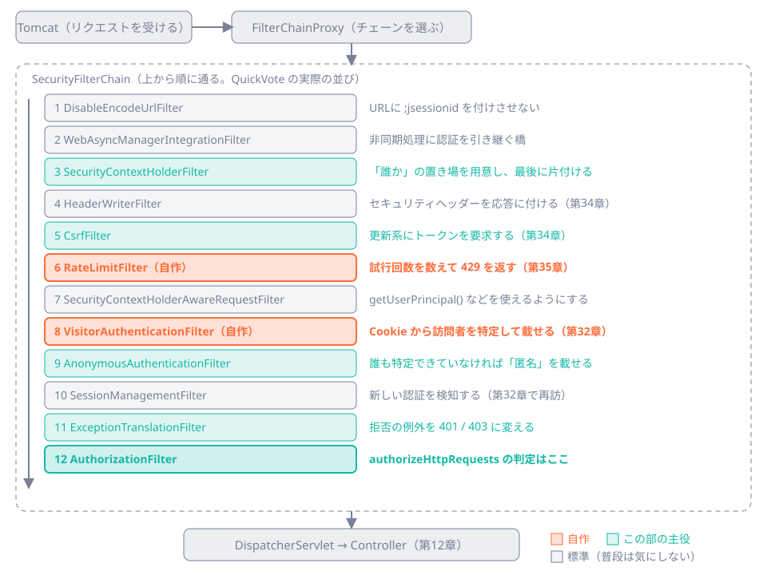

# 第31章 Spring Securityの地図

<div class="goal-box" markdown>

この章でできるようになること

- 依存を足しただけで全部 401 になる理由を、既定のチェーンとして説明できる
- `SecurityFilterChain` Bean の意味と、標準のフィルタが並ぶ順番を、図から読める
- 「全部許可」から始めて「許可リスト方式」に閉じていく手順を、実際のHTTPで確かめられる
- 自作フィルタを正しく登録でき、`@Component` にすると何が起きるか説明できる
- 古い書き方（`and()`、`antMatchers`、`WebSecurityConfigurerAdapter`）を見抜ける

</div>

## 1. 問いかけ：依存を1つ足しただけで、全部 401

第2部のアプリに、Spring Security を足してみます。`pom.xml` に1つ足すだけです。

```xml
<dependency>
    <groupId>org.springframework.boot</groupId>
    <artifactId>spring-boot-starter-security</artifactId>
</dependency>
```

コードは1行も変えていません。ところが、起動して `GET /hello`（誰でも見てよいはずの API）を呼ぶと、次のようになります。

```bash
curl -s -i localhost:18031/hello
```

```text
HTTP/1.1 401
Set-Cookie: JSESSIONID=4CBCC4A78C552FE274CE87E9E2C3FAD3; Path=/; HttpOnly
WWW-Authenticate: Basic realm="Realm", charset="UTF-8"
...
```

全部の URL が 401 になり、起動ログにも見覚えのない行が出ています。

```text
Using generated security password: 5f9810dd-09a0-4c03-bb66-369bcb46e5a5
```

!!! question "予測カード"
    次の2つで、どうなるでしょうか。

    1. ブラウザのように `Accept: text/html` を付けて、`GET /hello` を呼ぶ
    2. 起動ログのパスワードを使って、`curl -u user:<パスワード>` で `GET /hello` を呼ぶ

    - A: どちらも 401
    - B: 1 はログイン画面へのリダイレクト（302）、2 は 200
    - C: 1 は 403、2 は 200

実験します（`code/labs/ch31-security-map/`。Initializr で `web` と `security` を選んで作った最小のアプリです。ポート 18031）。

```text
GET /hello (Accept: text/html)   →  HTTP/1.1 302    # ログイン画面へ
POST /api/echo                   →  HTTP/1.1 401
curl -u user:5f9810dd-...        →  {"message":"誰でも見てよい"}
```

答えは **B** です。Spring Boot は Spring Security を見つけると、何も設定しなくても「ログイン必須」の既定の設定を自動で入れます。第10章で見た「自動構成は条件付きの設定」の一例です。中身は次のとおりです。

| 既定で入るもの | 見えた現象 |
| --- | --- |
| すべてのリクエストに認証を要求（`anyRequest().authenticated()`） | 全URLが 401 |
| ログインフォーム ＋ Basic 認証 | ブラウザは 302、curl は `WWW-Authenticate: Basic` |
| ユーザー `user` と、起動のたびに作る使い捨てパスワード | 起動ログの `Using generated security password` |
| セッション（`HttpSession`）で認証状態を保持 | `Set-Cookie: JSESSIONID` |

QuickVote では、この既定の設定を1つも使いません（ログイン画面もユーザーもパスワードも使わないためです）。そこで設定を自分で書き直し、`application.yaml` では、使わないパスワードがログに出てしまう自動構成を外します。

```yaml title="src/main/resources/application.yaml（抜粋）"
spring:
  autoconfigure:
    exclude:
      # ログインユーザーは使わない。除外しないと使わないパスワードがログに出る
      - org.springframework.boot.security.autoconfigure.UserDetailsServiceAutoConfiguration
```

## 2. Spring Security の正体：フィルタの列

Spring Security は、サーブレットのフィルタを並べた列でできています。第12章で見た「リクエストの旅」では、DispatcherServlet より前にこのフィルタが並びます。

```text
リクエスト → Tomcat → FilterChainProxy → [SecurityFilterChain: フィルタが12個ほど] → DispatcherServlet → Controller
```

- `FilterChainProxy`：Spring Security の入口。リクエストごとに、使う `SecurityFilterChain` を選ぶ
- `SecurityFilterChain`：フィルタを並べた1本の列。Bean として登録すると、リクエストの条件に最初に合った列が使われる
- フィルタ：1つが1つの役割を受け持つ（認証情報の読み込み、CSRF の検査、認可の判定など）

起動時にデバッグログを出すと、列に入ったフィルタの一覧がそのまま見えます。依存を足しただけの既定の列は次のとおりです。

```text
Will secure any request with filters: DisableEncodeUrlFilter, WebAsyncManagerIntegrationFilter,
SecurityContextHolderFilter, HeaderWriterFilter, CsrfFilter, LogoutFilter,
UsernamePasswordAuthenticationFilter, DefaultResourcesFilter, DefaultLoginPageGeneratingFilter,
DefaultLogoutPageGeneratingFilter, BasicAuthenticationFilter, RequestCacheAwareFilter,
SecurityContextHolderAwareRequestFilter, AnonymousAuthenticationFilter,
ExceptionTranslationFilter, AuthorizationFilter
```

（`logging.level.org.springframework.security.web.DefaultSecurityFilterChain=DEBUG` で出ます。ラボの `application.yaml` に設定済みです）

QuickVote の列は、この既定を書き換えた次の12個で、自作のフィルタは2つだけです。



リクエストはフィルタを上から下へ通るので、順番が意味を持ちます。たとえば `VisitorAuthenticationFilter`（誰かを特定する）は、`AuthorizationFilter`（許すかどうかを決める）より前になければなりません。「誰か」は、`SecurityContextHolderFilter` が用意した置き場へ認証フィルタが書き込む形で決まります（第32章）。最後の `AuthorizationFilter` が「この人にこの URL を許すか」を判定し、拒否されると `ExceptionTranslationFilter` が 401 か 403 に変えます。

!!! tip "フロントエンドで例えると"
    Express の `app.use(...)` で並べたミドルウェアの列とよく似ています。「`cors()` → 認証 → ルーティング」の順番を間違えると動かない、あの感覚です。違うのは、Spring Security では最初から標準のミドルウェアが十数個入っていることです。入れ忘れよりも、何が入っているかを知らないことのほうが事故のもとになります。

## 3. 実験：まず全部許可して、「何も守られていない」を見る

自分の設定を書く最初の一歩として、全部許可から始めます。`SecurityFilterChain` を返す `@Bean` を定義すると、自動構成の既定は使われなくなります。

```java title="OpenSecurityConfig.java（ch31-security-map）"
@Configuration
@Profile("open")
public class OpenSecurityConfig {

    @Bean
    SecurityFilterChain open(HttpSecurity http) throws Exception {   // (1)!
        http
                .csrf(csrf -> csrf.disable())                         // (2)!
                .authorizeHttpRequests(a -> a.anyRequest().permitAll());  // (3)!
        return http.build();                                          // (4)!
    }
}
```

1. `HttpSecurity` は Spring が用意してくれる設定の入れ物で、引数で受け取る
2. CSRF を無効にした（実験のため。理由は第34章）
3. すべてのリクエストを許可する
4. 設定を組み立てて `SecurityFilterChain` を返す

```bash
./mvnw spring-boot:run -Dspring-boot.run.profiles=open
curl -s -i localhost:18031/api/secret | sed -n '1p;$p'
curl -s -i -X POST localhost:18031/api/echo -H 'Content-Type: application/json' -d '{"a":"b"}' | sed -n '1p;$p'
```

```text
HTTP/1.1 200
{"message":"参加者だけに見せたい情報"}
HTTP/1.1 200
{"a":"b"}
```

**何も守られていません。** Spring Security は動いていて、フィルタも通っています。ただ、判定が「全部許可」なので、すべて通り抜けます。フィルタの列も次のように縮みました。

```text
SecurityContextHolderFilter, HeaderWriterFilter, LogoutFilter, RequestCacheAwareFilter,
SecurityContextHolderAwareRequestFilter, AnonymousAuthenticationFilter,
ExceptionTranslationFilter, AuthorizationFilter       （CsrfFilter などが消えた）
```

!!! warning "この時点の保証"
    Security を依存に入れても、守られているとは限りません。守るかどうかは、`authorizeHttpRequests` に何を書いたかで決まります。AI が書いた設定に `anyRequest().permitAll()` や `csrf.disable()` があれば、理由を確かめます。試しに動かすために一時的に入れた設定が、そのまま残ることはよくあります。

## 4. 実験：許可リスト方式に閉じる

次は、許すものを列挙し、それ以外は全部拒否します。

```java title="ClosedSecurityConfig.java（ch31-security-map、抜粋）"
http
        .authorizeHttpRequests(a -> a
                .requestMatchers("/hello").permitAll()            // (1)!
                .requestMatchers("/api/**").authenticated()       // (2)!
                .anyRequest().denyAll())                          // (3)!
        .exceptionHandling(e -> e
                .authenticationEntryPoint((req, res, ex) -> { res.setStatus(401); /* ... */ })
                .accessDeniedHandler((req, res, ex) -> { res.setStatus(403); /* ... */ }))
        .httpBasic(b -> b.disable())
        .formLogin(f -> f.disable());
```

1. 公開する URL は1つずつ列挙する
2. `/api/**` は「誰か特定できていること」を要求する
3. 上に書いていないものは全部拒否する。書き忘れても、開いてしまうのではなく閉じる側に倒れる

```text
GET  /hello        → 200  {"message":"誰でも見てよい"}
GET  /api/secret   → 401  {"code":"UNAUTHENTICATED"}
GET  /other        → 401  {"code":"UNAUTHENTICATED"}
POST /api/echo     → 403  {"code":"FORBIDDEN"}
```

`authorizeHttpRequests` の規則は、次の4つを覚えれば足ります。

| 規則 | 内容 |
| --- | --- |
| 上から順に判定し、最初に合ったものが勝つ | 広い条件（`anyRequest`）は必ず最後に置く |
| `permitAll` / `authenticated` / `denyAll` | 誰でも / 識別できていれば / 誰も通さない |
| `requestMatchers` のパターン | Spring MVC と同じ書き方（`/api/**`、`/api/invites/{token}/accept`）。URL エンコードもデコード後で判定される（第33章） |
| 許可リスト方式にする | 最後は `anyRequest().denyAll()`。ここを `permitAll()` にしない |

### 401 と 403 は、誰が決めているか

上の結果で `GET /other` が 401、`POST /api/echo` が 403 になった理由を、図の `ExceptionTranslationFilter` で説明します。

| 起きたこと | 誰が検出 | 返る応答 |
| --- | --- | --- |
| 識別できていない人が、認証が必要な URL に来た | `AuthorizationFilter` が拒否 → `ExceptionTranslationFilter` が受ける | `authenticationEntryPoint` → 401 |
| 識別できている人が、権限のない URL に来た | 同上 | `accessDeniedHandler` → 403 |
| CSRF トークンがない・違う | `CsrfFilter` が直接拒否 | `accessDeniedHandler` → 403 |

`GET /other` は `denyAll` で拒否されましたが、リクエストの主は誰も特定できていない匿名なので、401（「まず名乗ってください」）になります。`POST /api/echo` は、認可の前に `CsrfFilter` が止めたので 403 です。実験の `/api/secret` で 401 が続くのは、このラボには誰かを特定するフィルタがまだないからで、それを足すのが第32章です。

## 5. Security 7 のラムダ DSL と、古い書き方

ここまでの設定は、すべてラムダで書いています（`.csrf(csrf -> ...)`、`.authorizeHttpRequests(a -> ...)`）。これが Spring Security 7 の書き方で、QuickVote の本物の設定（`SecurityConfig`）も同じ形です。

```java title="src/main/java/com/example/quickvote/security/SecurityConfig.java（抜粋）"
http
        .sessionManagement(session -> session.sessionCreationPolicy(SessionCreationPolicy.STATELESS))
        .securityContext(context -> context.securityContextRepository(contextRepository))
        .csrf(csrf -> csrf.spa().csrfTokenRepository(csrfRepository))
        .logout(AbstractHttpConfigurer::disable)
        .exceptionHandling(exceptions -> exceptions
                .authenticationEntryPoint(problemHandler)
                .accessDeniedHandler(problemHandler))
        .authorizeHttpRequests(authorize -> authorize
                .requestMatchers("/", "/index.html", "/app.js", "/app.css", "/favicon.ico", "/error").permitAll()
                .requestMatchers(EndpointRequest.to("health", "metrics")).permitAll()
                .requestMatchers("/api/**").authenticated()
                .anyRequest().denyAll())
        .addFilterAfter(new RateLimitFilter(rateLimiter, resolver), CsrfFilter.class)
        .addFilterBefore(new VisitorAuthenticationFilter(visitors, clock, properties, contextRepository),
                AnonymousAuthenticationFilter.class);
```

読む順番は「識別の方針（stateless）→ CSRF → エラーの形 → 認可（許可リスト）→ 自作フィルタの位置」です。`/api/**` に `authenticated()` しか書いていない点に注目してください。ここで決めているのは「識別できているか」だけで、「この投票の参加者か」は、第30章のとおりサービスが判定します。

古い記事や AI の出力で見かける次の書き方は、Spring Security 7 ではコンパイルエラーになります（1つずつコンパイルして確かめた結果が、[付録 Boot 3→4 差分カード](../appendix/boot3-to-4.md)のカード14にあります）。

| 古い書き方 | Security 7 での結果 |
| --- | --- |
| `extends WebSecurityConfigurerAdapter` | クラスが存在しない |
| `http.csrf().disable().authorizeRequests()...and()` | `csrf()` は引数なしで呼べない。`authorizeRequests`・`and()` は存在しない |
| `.antMatchers("/api/**")` | メソッドが存在しない（`requestMatchers`） |

コンパイルエラーになるので、書き方の誤りには気づけます。**静かに間違うのは設定の中身**（`permitAll`、`csrf.disable()`）のほうです。

## 6. 自作フィルタを足す：`@Component` にしない

自作のフィルタは、`addFilterBefore` / `addFilterAfter` で列の中の位置を指定して足します（上の抜粋の最後の2行）。ここで、第12章に書いた約束（「`@Component` を付けた Filter を、別の設定でも登録すると二重に動く」）を回収します。

2つのフィルタをどちらも `@Component` にし、同時に `addFilterBefore` で列にも入れます（`twice` プロファイル）。

```java
@Component
static class PlainFilter implements Filter { /* ログを1行出して chain.doFilter */ }

@Component
static class OnceFilter extends OncePerRequestFilter { /* 同じ */ }
```

`GET /hello` を1回だけ呼んだログです。

```text
twice : PlainFilter 通過: /hello
twice : OnceFilter 通過: /hello
twice : PlainFilter 通過: /hello          ← もう一度
```

!!! danger "本番で事故になるパターン"
    `@Component`（Bean）にしたフィルタは、Spring Boot が Servlet フィルタとしても自動で登録します。そのため、Security の列の中で1回、列を抜けたあとの Servlet 側でもう1回、合計2回動きます（`OncePerRequestFilter` は「このリクエストで実行済み」の印を見て2回目を飛ばすので、1回で済みます）。
    認証フィルタが2回動くと、DB を2回引き、Cookie を2回発行します。**自作の Security フィルタは `@Component` にせず、`SecurityConfig` の中で `new` して `addFilterBefore/After` で足す**のが決まりです（QuickVote はそうしています）。

自作フィルタにはもう1つ注意点があります。フィルタの中で投げた例外は `@RestControllerAdvice` に届きません。Security のフィルタは DispatcherServlet より前で動くからです。QuickVote は `HandlerExceptionResolver` を経由して、同じ ProblemDetail で返しています。

```java title="src/main/java/com/example/quickvote/security/ProblemDetailSecurityHandler.java（抜粋）"
@Override
public void commence(HttpServletRequest request, HttpServletResponse response,
        AuthenticationException authException) throws IOException {
    resolver.resolveException(request, response, null, new ApiException(ErrorCode.UNAUTHENTICATED));   // (1)!
}
```

1. 401 を返すクラスが `ApiException` を `ProblemDetailAdvice` に処理させるので、他のエラーと同じ形（`code` つき）で返せる

## 7. 現場ではこう：Security の設定を読む順番

AI が書いた `SecurityConfig` は、次の順で読みます。

| 順番 | 見るもの | 疑うこと |
| --- | --- | --- |
| 1 | 最後の `anyRequest()` | `permitAll()` なら全部開いている。`denyAll()` か `authenticated()` が望ましい |
| 2 | `csrf` | `disable()` なら、Cookie で認証する設計では穴（第34章）。理由が書いてあるか |
| 3 | `permitAll` の列挙 | 公開しすぎていないか（`/actuator/**`、`/h2-console/**` など） |
| 4 | `sessionManagement` / 認証の方式 | 設計と合っているか（QuickVote は STATELESS）。使わない `formLogin`・`httpBasic` が残っていないか |
| 5 | 自作フィルタ | `@Component` になっていないか。位置は妥当か |
| 6 | 古い書き方 | コンパイルが通っているなら混ざっていない。`grep` で確かめる（付録） |

---

## まとめ：3点セット

!!! abstract "この章の3点セット"
    **① 一言で言うと**
    Spring Security の実体は `SecurityFilterChain`（サーブレットフィルタの列）で、依存を足すと「全 URL 認証必須＋ログインフォーム＋セッション」の既定が自動で入ります。自分の `SecurityFilterChain` Bean で置き換え、許可リスト方式（最後は `anyRequest().denyAll()`）に閉じます。フィルタは順番に意味があり、自作フィルタは `@Component` にせず、位置を指定して足します。

    **② 現場でこう聞かれる**
    「Spring Security を入れたので、セキュリティは大丈夫ですよね？」
    → 入れただけでは守られていません。`authorizeHttpRequests` の末尾が `permitAll()` なら全部開いています。何を許可リストに入れたか、CSRF を無効にしていないか、既定のパスワードが残っていないかを確かめます。

    **③ 自分のサービスならどこに当たるか**
    自分のサービスの URL を「誰でも」「識別できた人」「誰も通さない」に分類し、`authorizeHttpRequests` の行として書きます。最後の行は何になるでしょうか。

## 演習

??? question "確認問題1：既定の設定"
    Spring Security を足しただけのアプリで、`curl` と `Accept: text/html` 付きの `curl` で、どう応答が違いますか。それはなぜですか。

??? success "解答"
    `curl` は 401 と `WWW-Authenticate: Basic` を返し、`Accept: text/html` 付きだとログインページへ 302 でリダイレクトされます。既定の設定がフォームログインと Basic 認証の両方を有効にしていて、リクエストの種類（ブラウザか API クライアントか）で応答を出し分けるためです。

??? question "確認問題2：順番"
    `authorizeHttpRequests` に、次の順で書きました。どのような問題が起きますか。
    ```java
    .anyRequest().authenticated()
    .requestMatchers("/hello").permitAll()
    ```

??? success "解答"
    上から順に判定し、最初に合ったものが勝ちます。`anyRequest()` が先にすべてに合ってしまうので、`/hello` の `permitAll` が使われない設定になります。Spring Security 7 は、これを起動時に検出します（ラボの `badorder` プロファイルで確認）。

    ```text
    IllegalStateException: Can't configure requestMatchers after anyRequest
    ```

    起動に失敗するので気づけます。広い条件（`anyRequest`）は必ず最後に置きます。

??? question "応用：公開する URL を足す"
    QuickVote に、静的ファイル `/privacy.html` を公開したくなりました。`SecurityConfig` の何を、どこに足しますか。足し忘れると、何が起きますか。

??? success "解答"
    `authorizeHttpRequests` の先頭の `requestMatchers("/", "/index.html", ...)` に `"/privacy.html"` を足します（`anyRequest().denyAll()` より前）。足し忘れると、許可リスト方式なので開かない側（匿名の訪問者は 401）に倒れます。開かないことには気づけるので、安全な失敗です。

??? question "説明問題：現場でこう聞かれる"
    「自作のフィルタを `@Component` にしただけで、動いているのでいいのでは？」200字程度で答えてください。

??? success "解答"
    例：`@Component` にすると、Spring Boot が Servlet フィルタとしても登録するため、Security の列の中と外で2回動く場合があります（`OncePerRequestFilter` なら2回目は飛ばされますが、通常の `Filter` は2回動きます）。認証フィルタが2回動くと、DB を2回引き Cookie も2回発行します。Security の列に足すものは、`SecurityConfig` の中で `new` して `addFilterBefore/After` で位置を指定します。
