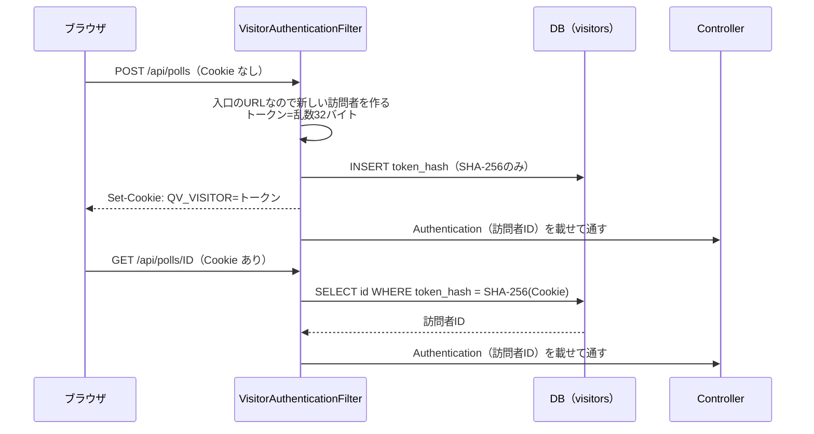
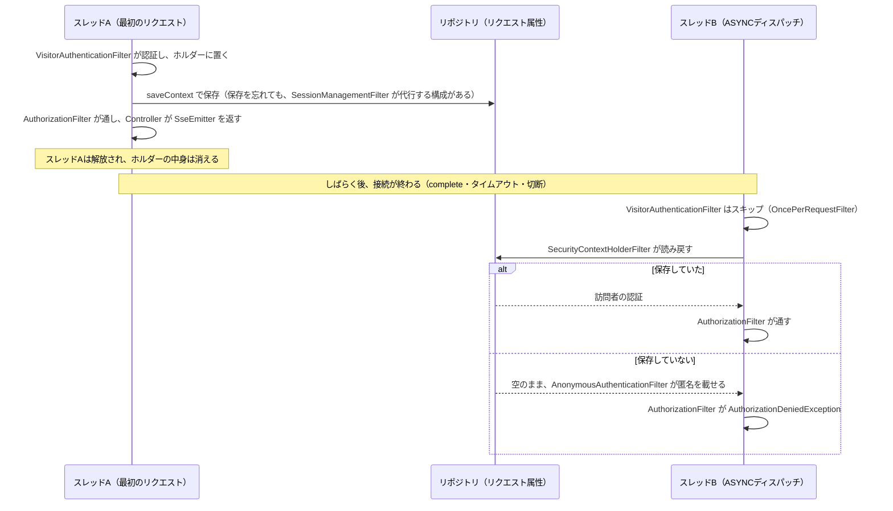

# 第32章 匿名セッション：Cookieで利用主体を識別する

<div class="goal-box" markdown>

この章でできるようになること

- 訪問者トークンの発行から、Cookie、DB（ハッシュのみ）、`Authentication` までの流れを図とコードで説明できる
- Cookie の各属性が防ぐものを言える
- 自作の認証フィルタを書き、**`SecurityContext` を保存しないと非同期ディスパッチ（SSE）で認証が失われる**理由を再現して説明できる
- `HttpSession` を使わない理由と、「Cookie を消したら権限を失う」を仕様として決める理由を説明できる
- Spring Security の「匿名認証」と、QuickVote の「匿名の訪問者」を区別できる

</div>

## 1. 問いかけ：Cookie を消したら、自分の投票に戻れなくなる。これはバグか

第30章で、第2部のラボの `X-Visitor-Id` ヘッダーが**誰でも書き換えられる**ことを見ました。この章で、本物に置き換えます。

QuickVote には、ログインがありません。それでも「この人は、さっきの人と同じ」を覚えておく必要があります。投票の主催者が、画面を開き直しても主催者のままでなければいけないからです。そこで、**サーバーが最初に整理券（訪問者トークン）を渡し、ブラウザが毎回それを添える**方式にします。

整理券を失くしたら（Cookie を消したら）、もう取り戻せません。これはバグではなく、**そう決めた仕様**です。なぜそう決めるのかは、節 7 で説明します。

この例えが外れる点があります。整理券と違って、**失くしても再発行できません**。見せれば誰でも使えるのは同じです（＝盗難対策が前提です）。

## 2. 全体の流れ



登場するのは3つの決め事です。

| 決め事 | 内容 |
| --- | --- |
| トークン | 暗号論的乱数32バイト → Base64URL（43文字） |
| 保存 | DBには SHA-256 のハッシュだけ。トークンそのものは保存しない |
| 運び方 | Cookie `QV_VISITOR`（`HttpOnly`、`SameSite=Lax` など） |

## 3. 訪問者トークン：乱数、そしてハッシュ

```java title="src/main/java/com/example/quickvote/common/Tokens.java（抜粋）"
/** SecureRandom はスレッドセーフ。使い回してよい。java.util.Random は予測できるので使わない。 */
private static final SecureRandom RANDOM = new SecureRandom();

/** 32バイト（256ビット）の乱数を Base64URL（パディングなし）にした43文字。総当たりでは当たらない長さ。 */
public static String newToken() {
    byte[] bytes = new byte[32];
    RANDOM.nextBytes(bytes);
    return Base64.getUrlEncoder().withoutPadding().encodeToString(bytes);
}

public static String sha256Hex(String value) { /* SHA-256 を16進64文字に */ }
```

3つの選択に理由があります。

- **`SecureRandom`**：暗号用の乱数。`java.util.Random` は、数個の出力から次の値を計算で当てられる（式が公開されている）ので、トークンには使えません
- **32バイト**：2の256乗通り。総当たりで当てられる数ではありません（参加コードの31の8乗とは桁が違います。次の章）
- **Base64URL**：Cookie の値に使えて、URL にも入れられる文字（`A-Z a-z 0-9 - _`）だけ。`+` や `/` や `=` を含まない

### DB には、ハッシュだけを置く

```bash
# 主催者の Cookie の値（ブラウザには、これが入っている）
o75tkpaGS2oOPaQPyKILP7D9nzzXJJXmFEFDqb9fEsk
echo -n "o75tkpaGS2oOPaQPyKILP7D9nzzXJJXmFEFDqb9fEsk" | sha256sum
```

```text
25ef551e2ebf0588ee77b740f7b9a90d0e70db7d47cdfeaa2d8dac7ead5a53ce
```

```sql
SELECT id, token_hash FROM visitors WHERE token_hash = '25ef551e...';
```

```text
 id |                            token_hash
----+------------------------------------------------------------------
  5 | 25ef551e2ebf0588ee77b740f7b9a90d0e70db7d47cdfeaa2d8dac7ead5a53ce
```

DB に入っているのは、Cookie の値の SHA-256 です。**DB が漏れても、ハッシュからは Cookie の値（トークン）を復元できないので、そのままではなりすませません。** パスワードのように遅いハッシュ（bcrypt など）にしないのは、トークンが**十分に長い乱数**で、総当たりの余地がないからです。短くて推測しやすい値（パスワード）だけが、遅いハッシュを必要とします。

形式の確認も、検索の前に入れています（`Tokens.isWellFormed`）。43文字の Base64URL でない値は、DB を引かずに「Cookie なし」と同じに扱います。出まかせの Cookie で、DB に問い合わせをさせないためです。

## 4. Cookie の属性

訪問者を初めて発行したときの応答です（実際の HTTP）。

```text
Set-Cookie: QV_VISITOR=thAv0srk9AdRPFCcpySDDoPDo7kqO7aV3KQmYwna_Hg; Path=/; Max-Age=2592000;
            Expires=Mon, 07 Dec 2026 17:20:16 GMT; HttpOnly; SameSite=Lax
```

| 属性 | 意味 | 防ぐもの |
| --- | --- | --- |
| `HttpOnly` | JavaScript から読めない | XSS でトークンを盗まれる |
| `SameSite=Lax` | 他サイトからの POST などには添えない | CSRF（第34章） |
| `Secure` | HTTPS のときだけ送る（本番で有効。開発の HTTP では付けない） | 通信の盗聴 |
| `Path=/` | 全パスに添える | （範囲の指定） |
| `Max-Age=2592000` | 30日 | 長期に残る Cookie の期限。使われ続ける間は、1時間に1回延長する |

`Secure` は設定で切り替えます（`quickvote.visitor-cookie.secure`。開発 `false`、`prod` は `true`）。HTTP の開発環境で `Secure` を付けると、ブラウザが Cookie を送り返さず、「ログインできない」ような症状になるためです（本番の HTTPS 終端と合わせて第34章）。

!!! tip "フロントエンドで例えると"
    `localStorage` にトークンを置く SPA と比べると分かりやすいです。`localStorage` は JavaScript から読めるので、XSS で盗まれます。`HttpOnly` Cookie は JavaScript から読めません。**代わりに、ブラウザが自動で添える**ので、CSRF という別の問題が出ます（第34章）。

## 5. 認証フィルタを書く

訪問者を特定して、Spring Security の `Authentication` に載せるのが、`VisitorAuthenticationFilter` です。

```java title="src/main/java/com/example/quickvote/security/VisitorAuthenticationFilter.java（doFilterInternal の抜粋）"
Cookie cookie = WebUtils.getCookie(request, COOKIE_NAME);
String token = cookie == null || !Tokens.isWellFormed(cookie.getValue()) ? null : cookie.getValue();   // (1)!

Optional<Long> visitorId = token == null
        ? Optional.empty()
        : visitors.findIdByTokenHash(Tokens.sha256Hex(token));                                         // (2)!

if (visitorId.isPresent()) {
    // ...使われ続ける限り Cookie の有効期限も延ばす（1時間に1回）
} else if (EntryMatchers.issuesVisitor(request)) {                                                     // (3)!
    String newToken = Tokens.newToken();
    visitorId = Optional.of(visitors.create(Tokens.sha256Hex(newToken), now));
    addCookie(response, newToken);
}

visitorId.ifPresent(id -> {
    SecurityContext context = SecurityContextHolder.getContextHolderStrategy().createEmptyContext();
    context.setAuthentication(new VisitorAuthentication(new VisitorPrincipal(id)));                    // (4)!
    SecurityContextHolder.getContextHolderStrategy().setContext(context);
    securityContextRepository.saveContext(context, request, response);                                 // (5)!
});
chain.doFilter(request, response);
```

1. 形式が違う値は、DB を引かずに捨てる
2. Cookie → SHA-256 → `visitors` を引く。見つかれば訪問者ID
3. **新しい訪問者を発行するのは、入口の3つだけ**（投票の作成・参加・招待の受諾）
4. 「この人は訪問者ID n」という `Authentication` を作り、`SecurityContext` に載せる
5. **保存する。これが節 9 の主役。** 省略しても普通のリクエストでは動くので、見落としやすい

### 自作の `Authentication` と、その保存先

`SessionCreationPolicy.STATELESS`（セッションを作らない設定）の構成では、`SecurityContext` の保存先に `RequestAttributeSecurityContextRepository`（リクエストの属性。そのリクエストの間だけ）を使います。(5) の `saveContext` は、ここへ保存します。

載せる `Authentication` は、自作の `VisitorAuthentication` です。最小限の形は、**認証済みであること・principal・権限**の3つです。

```java title="src/main/java/com/example/quickvote/security/VisitorAuthentication.java（抜粋）"
public class VisitorAuthentication extends AbstractAuthenticationToken {
    private final VisitorPrincipal principal;               // principal = record VisitorPrincipal(long visitorId)

    public VisitorAuthentication(VisitorPrincipal principal) {
        super(AuthorityUtils.NO_AUTHORITIES);               // 権限（ロール）は持たせない
        this.principal = principal;
        setAuthenticated(true);                             // isAuthenticated() が true になる
    }

    @Override public Object getCredentials() { return ""; }                    // 資格情報は持たない
    @Override public VisitorPrincipal getPrincipal() { return principal; }     // @AuthenticationPrincipal で受け取る値
}
```

権限を持たせないのは、QuickVote の認可が「投票ごとの参加者表」で決まり、アプリ全体のロールでは決まらないからです。

### 発行するのは入口だけ

Cookie のない人が何を呼んでも訪問者を作ると、bot が叩くだけで `visitors` の行が増え続けます。そこで、発行するのは**誰でも使える入口の3つだけ**です。それ以外の API は、Cookie がなければ 401 になり、Cookie も発行されません。

```bash
curl -s -i localhost:18032/api/polls/00000000-0000-4000-8000-000000000000 | grep -i set-cookie
```

```text
Set-Cookie: XSRF-TOKEN=967490d7-364b-4b32-813a-a3e054f40133; Path=/; SameSite=Lax     ← CSRF 用だけ。QV_VISITOR はない
```

入口を判定する `EntryMatchers` は、次の章の事故と関係します（URL をどう比べるか）。

### 第2部のコードは、引数の型を変えずに済む

第2部のラボでは、コントローラーの引数 `VisitorPrincipal` を、暫定の引数リゾルバーがヘッダーから作っていました。本物は、`@AuthenticationPrincipal` で Spring Security が作った値を受け取ります。

=== "第2部（暫定）"

    ```java
    @GetMapping("/{pollId}")
    public PollDetail get(VisitorPrincipal visitor, @PathVariable UUID pollId) {
        return pollService.get(visitor.visitorId(), pollId);
    }
    ```

=== "第6部（本物）"

    ```java
    @GetMapping("/{pollId}")
    public PollDetail get(@AuthenticationPrincipal VisitorPrincipal visitor, @PathVariable UUID pollId) {
        return pollService.get(visitor.visitorId(), pollId);
    }
    ```

変わるのは**引数の注釈1つ**です。Service 以下（`ParticipantService.require` など）は、**1行も変わりません**。第2部で「識別」と「認可」を分けておいた効果です。ラボ `code/labs/part06-session-lab/` は、第2部のラボから `StandIn*` の2クラスを消し、このフィルタと設定を足したものです（visitors 表だけメモリ上の `Map`。ポート 18032）。

## 6. `HttpSession` を使わない理由

Spring Security には、セッション（`JSESSIONID` の Cookie とサーバーのメモリ）で認証状態を覚える標準の仕組みがあります（第31章の実験で `Set-Cookie: JSESSIONID` が出ていました）。QuickVote は使いません（`SessionCreationPolicy.STATELESS`）。

| 場面 | `HttpSession` | 訪問者トークン（DB引き） |
| --- | --- | --- |
| アプリを再起動 | 全員の状態が消える（Redis等に置かなければ） | **そのまま続く** |
| 2台に並べる | 別のサーバーは知らない（共有が必要） | **どちらの台でも同じ** |
| 状態の置き場 | サーバーのメモリ | DB（もともと使っている） |
| リクエストごとの費用 | メモリの参照 | インデックス引き1回 |
| 失効の操作 | セッションを破棄 | 行を消す |

「毎回 DB を引くのは遅いのでは」という疑問は自然です。`visitors.token_hash` には UNIQUE 制約（＝インデックス）があるので、**主キー検索並みの1回**です。QuickVote は `last_seen_at` の更新も1時間に1回だけにして、書き込みを減らしています。複数台（第38章）は、この設計がそのまま通ります。**セッションを使わないことの価値は、複数台と再起動のとき**にあります。

## 7. Cookie を消したら権限を失う、を仕様にする

（以下の `18130` は、リファレンス実装 `code/quickvote/` を起動したときのポートです。ラボは 18032 でした。）

```bash
# Cookie を捨てて、同じ投票を呼ぶ
curl -s -o /dev/null -w '%{http_code}\n' http://localhost:18130/api/polls/809470cf-...
```

```text
401
```

主催者が Cookie を消すと、その投票の主催者に**二度となれません**。パスワードがないので、再発行の手段もありません。これを仕様として決めるのは、次のような判断だからです。

| 選べる方式 | 得るもの | 失うもの |
| --- | --- | --- |
| **Cookie だけ（QuickVote）** | 登録なし。守る範囲が小さい（パスワード・メール・再設定の仕組みがいらない） | 失くしたら戻れない |
| メールで「戻るリンク」を送る | 戻れる | メールを集める・送る・守る責任が増える |
| ログイン（パスワード・OAuth） | 端末をまたげる | 守るものが一気に増える（[付録：ログイン型認証の概観](../appendix/login-auth.md)） |

QuickVote は「**今この場で決める**」サービスで、投票は7日で消えます。だから、**取り戻せない代わりに、守るものを小さくする**ことを選びました。そのかわり、主催者の保険として**共同主催者の招待**（第33章）があります。静的クライアントも、開いた投票を `localStorage` に覚えるだけで、サーバー側で「自分の投票の一覧」は持ちません。

!!! warning "仕様として書いておく"
    「Cookie を消したら権限を失う」は、**後から『バグだ』と言われないために、設計書に書く**項目です。同じ設計の自分のサービスでも、「失くしたらどうなるか」を最初に決めて、画面にも書きます。

## 8. Spring Security の「匿名認証」とは別物

名前が紛らわしいので、整理します。

| | Spring Security の「匿名認証」 | QuickVote の「匿名の訪問者」 |
| --- | --- | --- |
| 何か | `AnonymousAuthenticationFilter` が載せる `AnonymousAuthenticationToken` | `VisitorAuthentication`（自作） |
| 意味 | **誰も特定できなかった**状態の印 | **Cookie で特定できた**訪問者 |
| `authenticated()` を通るか | **通らない**（匿名は未認証扱い） | 通る |
| 誰のものか分かるか | 分からない（全員同じ） | 訪問者IDで区別できる |

フィルタの列では、`VisitorAuthenticationFilter` が `AnonymousAuthenticationFilter` の**前**にあります。訪問者を特定できれば、後ろの `AnonymousAuthenticationFilter` は何もしません。

```text
AnonymousAuthenticationFilter : Did not set SecurityContextHolder since already authenticated
VisitorAuthentication [Principal=VisitorPrincipal[visitorId=1], ...]
```

特定できなかったときだけ、`AnonymousAuthenticationFilter` が「匿名」を載せ、`/api/**` の `authenticated()` が 401 にします。**「匿名の人にも訪問者IDを持たせた」のではなく、「匿名の人を、ID を持つ人にした」**のが QuickVote の設計です。

## 9. 壊してみる：`saveContext` を呼ばないと、SSE の終わりで認証が失われる

ここが、この章の山場です。プロのレビューで実際に見つかった穴（[第6部の指摘表](index.md)の18。レビューの進め方は[第47章](../part10/ch47-ai-review.md)）を再現します。

!!! abstract "先に結論"
    この穴は、`SessionManagementFilter` が代わりに保存してしまう構成では**隠れます**。だから再現には**2つのスイッチ**が要ります。

    1. 自作フィルタが `saveContext` を呼ばない（`--lab.save-context=false`）
    2. `SessionManagementFilter` をフィルタの列から外す（`--lab.session-management=false`）

    片方だけでは、ログに ERROR は出ません。「自作フィルタが保存を忘れても動いている」のは**標準フィルタのおかげ**で、設定を変えた日に穴が現れます。

### 何が起きるか：SSE の終わりは、もう一度フィルタを通る

SSE（第36章）の接続が**終わる**とき（サーバーが閉じる・タイムアウト・クライアントが切る）、サーブレットコンテナは、**同じリクエストを `DispatcherType.ASYNC` として、もう一度フィルタの列に通します**。このとき、次のことが起きます。

1. `OncePerRequestFilter` は、非同期ディスパッチをスキップする（**自作の認証フィルタは動かない**）
2. `AuthorizationFilter` は、Spring Security 6 以降、**すべてのディスパッチで認可する**
3. `SecurityContextHolder` に置いた認証は、**スレッドローカル**（そのスレッドの、その場限り）。別のスレッドで動く非同期ディスパッチには引き継がれない
4. 認証を取り戻せる道は1つだけ。`SecurityContextHolderFilter` が、**リポジトリ（`SecurityContextRepository`）から読み戻す**こと。保存されていなければ匿名になり、`AuthorizationDeniedException` になる

応答はすでに送信済みなので、401 を返すこともできず、ログに ERROR が3本出ます。流れを時間順に描くと、次のとおりです。



### なぜ隠れるのか：`SessionManagementFilter` の働き

`saveContext` を呼ばなくても動いてしまう理由は、`SessionManagementFilter` にあります。Spring Security 7.1.2 のクラスを `javap` で読んで確認した事実は、次の4つです。

1. **列に入る条件。** `SessionManagementConfigurer` は、`sessionCreationPolicy(...)`、`sessionAuthenticationStrategy(...)`、`invalidSessionUrl(...)`、`maximumSessions(...)` などを**明示したときだけ**、このフィルタを足します。何も明示しなければ足しません。QuickVote は `sessionCreationPolicy(STATELESS)` を呼ぶので、**STATELESS でもこのフィルタは列に入ります**
2. **動き。** 1リクエストに1回だけ動きます。リポジトリに**まだコンテキストがなく**（`containsContext` が偽）、ホルダーの認証が**認証済み**（`null` でも匿名でもない）なら、`SessionAuthenticationStrategy` を呼んだあと、`securityContextRepository.saveContext(ホルダーのコンテキスト, ...)` を呼びます。**新しい認証が成立したことを検知して、代わりに保存する**わけです
3. **保存先。** このフィルタの保存先は、`.securityContext(...)` で指定したリポジトリです（QuickVote もラボも `RequestAttributeSecurityContextRepository`）。リポジトリを指定しない STATELESS 構成では、保存先が `NullSecurityContextRepository`（何も保存しない）になる分岐がクラスにあります。この分岐は、読んだだけで、実験は**していません**
4. **非同期ディスパッチ。** このフィルタが働くのは、最初のディスパッチだけです（「適用済み」の印をリクエストに残し、外しません）。一方、`SecurityContextHolderFilter` は処理の終わりに印を外すので、ASYNC ディスパッチでも**もう一度動き**、リポジトリから読み戻します

つまり、自作フィルタが保存しなくても、最初のディスパッチで `SessionManagementFilter` が保存するため、ASYNC ディスパッチで読み戻せます。穴は**隠れていた**のです。TRACE ログ（`logging.level.org.springframework.security=TRACE`）では、このフィルタが認証済みと判断して、`SessionAuthenticationStrategy`（セッション固定攻撃の対策と CSRF トークンの更新）を呼ぶ様子が見えます。

```text
Invoking SessionManagementFilter (9/11)
CompositeSessionAuthenticationStrategy : Preparing session with ChangeSessionIdAuthenticationStrategy (1/2)
CompositeSessionAuthenticationStrategy : Preparing session with CsrfAuthenticationStrategy (2/2)
```

??? note "寄り道：最初は再現しなかった"
    筆者は最初、`saveContext` を呼ばないスイッチ1つだけで再現しようとして、**ERROR が出ない**ことに驚きました。レビューの指摘が間違っているのかと疑い、TRACE ログで非同期ディスパッチの周辺を追って、`SessionManagementFilter` が保存を代行していることに気づきました。このフィルタを外す2つ目のスイッチを足して、初めて指摘どおりの症状が出ました。**再現できないときは、「何かが穴を隠していないか」を疑う**のが、この寄り道の教訓です。

### 再現する

ラボには、最小の SSE（接続時に認可して1件送り、0.3秒後に閉じる）があります。まず、正常な状態です。

```bash
cd code/labs/part06-session-lab
./mvnw -q -DskipTests package
java -jar target/quickvote-0.0.1-SNAPSHOT.jar                 # ポート 18032

curl -s -c j.txt -b j.txt localhost:18032/victim.html -o /dev/null          # XSRF-TOKEN をもらう
curl -s -c j.txt -b j.txt -X POST localhost:18032/api/polls -H "X-XSRF-TOKEN: $X" \
     -H 'Content-Type: application/json' --data-binary @poll.json            # 主催者になる
curl -s -N -b j.txt localhost:18032/api/polls/<id>/events
```

```text
event:hello
data:connected
```

ログに ERROR はありません。次に、スイッチを1つだけ入れます。フィルタの `saveContext` を呼ばないようにして（`--lab.save-context=false`）、同じことをします。

!!! question "予測カード"
    `saveContext` を呼ばずに SSE をつなぎ、0.3秒後にサーバーが閉じます。ログはどうなるでしょうか。

    - A: `AuthorizationDeniedException` が ERROR で3本出る
    - B: 何も起きない
    - C: 接続自体が 401 になる

```bash
java -jar target/quickvote-0.0.1-SNAPSHOT.jar --lab.save-context=false
```

```text
（ログに ERROR はない）
```

答えは **B** です。前の節のとおり、`SessionManagementFilter` が代わりに保存しているからです。では、2つ目のスイッチ（`sessionManagement` を `disable()` して、このフィルタを外す）も入れます。

```bash
java -jar target/quickvote-0.0.1-SNAPSHOT.jar --lab.save-context=false --lab.session-management=false
```

```text
ERROR ... Servlet.service() for servlet [dispatcherServlet] threw exception
org.springframework.security.authorization.AuthorizationDeniedException: Access Denied
ERROR ... [Unable to handle the Spring Security Exception because the response is already committed.]
ERROR ... Cannot render error page for request [null] as the response has already been committed.
```

3本の ERROR が出ました（上の図の「保存していない」側です）。応答は、curl から見ると正常に終わっています（`event:hello` が届く）。**利用者には何も見えず、サーバーのログだけが ERROR で埋まる**、という出方です。`saveContext` を戻せば（`--lab.session-management=false` のままでも）、ERROR は消えます。

!!! danger "ここから学ぶこと"
    1. **「動いている」は「正しい」ではない。** 利用者の画面は無事でも、ログの ERROR は事実です。SSE を試すときは、ログを見る
    2. **標準フィルタの暗黙の動作に頼らない。** 自作の認証フィルタは、`SecurityContextHolder` に置くだけでなく、**リポジトリへ明示的に保存する**。`sessionManagement` の設定を変えただけで穴が出る
    3. **回帰テストは、赤くなることを確かめる。** 完成形の `RealHttpIT` は、この ERROR が出ないことを確かめるテストですが、筆者が完成形から `saveContext` の1行だけを消して流したところ、**テストは通りました**（この構成では `SessionManagementFilter` が保存するため）。穴を守るテストにするには、穴が出る構成と組み合わせる必要があります。ラボの `SessionHttpTest` は、2つのスイッチを入れて起動すると**赤くなる**ことを確かめてあります

```bash
./mvnw test -Dtest=SessionHttpTest                                                  # 緑
./mvnw test -Dtest=SessionHttpTest -Dlab.save-context=false -Dlab.session-management=false   # 赤（AuthorizationDeniedException）
```

`dispatcherTypeMatchers(DispatcherType.ASYNC, DispatcherType.ERROR).permitAll()` で黙らせる方法もありますが、採りませんでした。非同期ディスパッチの認可を外すと、「認証を失っているのに気づけない」状態が残り、`@AuthenticationPrincipal` も使えなくなるからです。

## 10. 現場ではこう：自作の認証フィルタのレビュー観点

| 観点 | 理由 |
| --- | --- |
| `SecurityContext` を `securityContextRepository.saveContext` で保存しているか | 非同期ディスパッチ（SSE など）の認可で失われる |
| `@Component` になっていないか | 二重に動く（第31章） |
| 識別に失敗したとき、**黙って匿名のまま通す**のか、**エラーを返す**のか | 設計と合っているか。QuickVote は、通して 401 にする（Anonymous のまま `authenticated()` が拒否） |
| トークンの生成が `SecureRandom` か | `java.util.Random` や `Math.random()` は予測できる |
| DBに平文で保存していないか | 漏れたらそのままなりすませる |
| 形式検証の前に DB を引いていないか | 出まかせの値で DB を叩かれる |
| Cookie 属性（`HttpOnly`・`SameSite`・`Secure`） | 第34章 |
| 発行する入口を制限しているか | bot でテーブルが増える（第35章） |

---

## まとめ：3点セット

!!! abstract "この章の3点セット"
    **① 一言で言うと**
    匿名の利用者を、`SecureRandom` の32バイトを Base64URL にした訪問者トークンで識別する。Cookie（`HttpOnly`・`SameSite=Lax`・本番は `Secure`）で運び、DB には SHA-256 のハッシュだけを保存する。自作の認証フィルタで `Authentication` に載せ、`SecurityContext` をリポジトリに**明示的に保存**する。`HttpSession` は使わず、再起動・複数台で状態が続くようにする。Cookie を失えば権限も失う。

    **② 現場でこう聞かれる**
    「ログインがないのに、他人になりすまされないのはなぜですか？」
    → 識別子が、推測できない長さの乱数（256ビット）で、HttpOnly の Cookie だけで運ばれ、DB にはハッシュしかないから。ただし Cookie を盗まれれば同じ訪問者になれる（HTTPS・XSS対策・CSRF対策が前提）。

    **③ 自分のサービスならどこに当たるか**
    「利用者を覚えておく仕組み」を何で作るか（Cookie・ヘッダー・ログイン）。失くしたらどうなると決めたか。DB に平文で入れている秘密は無いか。

## 演習

??? question "確認問題1：なぜハッシュか"
    訪問者トークンを DB に平文で保存すると、何が起きますか。ハッシュにすると、何が防げて、何が防げませんか。

??? success "解答"
    平文だと、DB が漏れた（バックアップ流出、SQL インジェクション、権限の甘い閲覧）時点で、全訪問者になりすませます。SHA-256 のハッシュなら、ハッシュからトークンは復元できず、そのままでは使えません。防げないのは、**通信中や端末で Cookie 自体を盗まれる**場合（XSS、盗聴）で、これは `HttpOnly`・`Secure`・HTTPS で防ぎます。

??? question "確認問題2：Anonymous の誤解"
    `VisitorAuthenticationFilter` が訪問者を特定できなかったとき、リクエストは `/api/polls/{id}` を呼べますか。何がそう決めていますか。

??? success "解答"
    呼べず、401 になります。特定できなかったリクエストには `AnonymousAuthenticationFilter` が「匿名」を載せ、`authorizeHttpRequests` の `/api/**` は `authenticated()` を要求し、匿名は未認証扱いだからです。入口の3つ（作成・参加・招待の受諾）だけは、フィルタが新しい訪問者を発行するので通ります。

??? question "応用：Cookie の有効期限"
    訪問者の `last_seen_at` を毎回更新すると、Cookie の期限も毎回延ばせます。QuickVote が1時間に1回にしているのはなぜですか。

??? success "解答"
    更新は DB への書き込みで、すべてのリクエストに付くと書き込みが増え、行ロックも競合します。期限が30日なので、1時間の誤差は影響しません。「頻繁には書かない」ことで、読み取り中心のリクエストを軽く保ちます（`touch` が更新したときだけ、Cookie も再発行）。

??? question "説明問題：現場でこう聞かれる"
    「Spring Security にはセッション管理があるのに、なぜ使わないのですか？」200字程度で答えてください。

??? success "解答"
    例：`HttpSession` はサーバーのメモリに状態を持つので、再起動で消え、複数台では共有の仕組みが必要になる。QuickVote は DB の `visitors` に訪問者トークンのハッシュを持ち、リクエストごとに Cookie から引くので、再起動しても、どの台に当たっても同じ訪問者として扱える。引く費用は UNIQUE 制約のインデックス1回で小さい。
