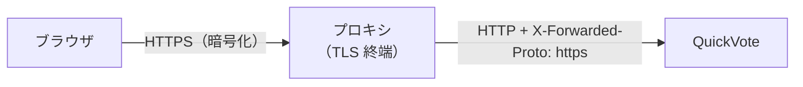

# 第34章 ブラウザとの境界：Cookie属性・CSRF・CORS・HTTPS

<div class="goal-box" markdown>

この章でできるようになること

- ブラウザが Cookie を**自動で添える**ことが、なぜ攻撃の足場になるのかを、実際のブラウザで再現して説明できる
- 「オリジン」と「サイト」の違いを使って、`SameSite` が守る範囲・守らない範囲を言える
- CSRF トークン（`csrf.spa()`）の仕組みを説明し、ヘッダーなし・値違いが 403 になることを確かめられる
- CORS が「サーバーを守る仕組みではなく、ブラウザのドアマン」であることを、別オリジンの実験と curl の違いで説明できる
- HTTPS 終端とセキュリティヘッダーの役割を、設定と応答から読める

</div>

## 1. 問いかけ：別のサイトのページが、あなたの代わりに「締切」を押せるか

QuickVote の主催者であるあなたが、同じブラウザで、**別のサイト**のページを開きました。そのページには、猫の画像と、**見えない `<form>` が1つ**あります。ページを開いた瞬間に、そのフォームが `POST /api/polls/<あなたの投票>/close` を送信しました。

QuickVote の画面は、一度も操作していません。それでも、あなたの投票は締め切られるでしょうか。

答えは、**サーバーの設定次第で、締め切られます**。ブラウザが、QuickVote 宛てのリクエストに、**あなたの Cookie を自動で添える**からです。この章は、その仕掛けを、実際のブラウザで再現して、止めるところまでを扱います。

## 2. 動画で見る：ブラウザはCookieを自動で添える

<div class="video-card">
  <video controls preload="metadata" poster="../../assets/videos/csrf-cookie.jpg">
    <source src="../../assets/videos/csrf-cookie.mp4" type="video/mp4">
  </video>
  <p class="video-caption">▶ ブラウザはCookieを自動で添える：CSRFとトークン</p>
  <p class="video-credit">音声：VOICEVOX:冥鳴ひまり</p>
</div>

**動画の要点**

- ブラウザは、Cookie（入館証）を、**宛先に合えば自動で添える**。リクエストを出したのが誰であっても
- 悪意のあるサイトのページが、裏で QuickVote 宛てのリクエストを出させると、**Cookie も一緒に付いていく**。Cookie だけで本人と判断すると、削除が通る
- `SameSite=Lax` は、**別サイトからの POST** には Cookie を付けない。ただし、**ページ移動の GET** には付くので、これだけに頼れない
- 対策は **CSRF トークン**（正規のページだけが知る合言葉）をヘッダーに付けさせ、サーバーが照合すること
- **CORS は別物**。他サイトの JavaScript が応答を読めるかを決める、**ブラウザのドアマン**で、サーバーを守る仕組みではない

??? note "字幕全文"
    Cookieの落とし穴、CSRFを見てみましょう。
    左が正規のQuickVote、右が悪意のサイトです。
    参加すると、ブラウザは入館証のCookieを受け取ります。
    QuickVote宛てには、入館証を自動で添えます。
    ブラウザは正直者なので、条件が合えば、必ず添えます。
    ここで、利用者が悪意のあるサイトを開きます。
    そのページが、裏でQuickVoteへ「投票を削除」を送らせます。
    ブラウザは律儀に、入館証のCookieも添えてしまいます。
    Cookieだけで本人扱いすると、削除が通ります。
    SameSite=Laxなら、別サイトからのPOSTにCookieは付きません。
    ただし、ページ移動のGETには付くので、これだけに頼れません。
    対策はCSRFトークン。正規のページだけが知る合言葉です。
    これをヘッダーに付けて送り、サーバーが照合します。
    悪意のあるサイトは、合言葉を読めません。
    だからサーバーは、403で拒否できます。
    ちなみにCORSは、別物です。
    他のサイトのJavaScriptが、応答を読めるかを決める、ブラウザのドアマンです。
    送信そのものは、止めない場合もあります。サーバーを守る仕組みではありません。
    Cookieは自動で付く。だから、合言葉で確かめる。

動画の「入館証」は、コードでは QuickVote の訪問者 Cookie（`QV_VISITOR`）です。動画の「参加すると受け取る」は、QuickVote では最初の API 呼び出し（投票の作成や参加）で Cookie をもらうことに当たります。動画の「合言葉」は、`XSRF-TOKEN` Cookie と `X-XSRF-TOKEN` ヘッダーの組です（節 5）。

## 3. 準備：「オリジン」と「サイト」は別の単位

実験の前に、用語を1つ区別します。

!!! note "用語：オリジン（origin）とサイト（site）"
    **オリジン**は「スキーム＋ホスト＋**ポート**」の組です（`http://localhost:18034`）。**サイト**は「スキーム＋登録可能ドメイン」で、**ポートを区別しません**。
    CORS（読めるか）は**オリジン**で、`SameSite`（Cookie を付けるか）は**サイト**で判定されます。

| ページ | 相手 | オリジン | サイト | Cookie（SameSite=Lax） |
| --- | --- | --- | --- | --- |
| `http://localhost:18034` | `http://localhost:18034` | 同じ | 同じ | 付く |
| `http://localhost:18134` | `http://localhost:18034` | **別**（ポート違い） | **同じ** | **付く** |
| `http://127.0.0.1:18134` | `http://localhost:18034` | 別 | **別**（ホスト違い） | **付かない**（POST） |

2行目が大切です。**ポートだけが違う別オリジンは、同じサイトなので、`SameSite` は何も守ってくれません。** 同じことが、本番の `app.example.com` と `evil.example.com`（サブドメイン違い）でも起きます。`SameSite=Lax` は強い防御ですが、**CSRF 対策の代わりにはなりません。**

## 4. 実験：ブラウザで別オリジンから攻撃してみる

ラボ（`code/labs/part06-session-lab/`）の被害者ページと、攻撃側のページ（`code/labs/ch34-evil/`）を、別ポートで動かします。攻撃側は、JDK 付属の簡易サーバーで配信します。

```bash
# 被害者：QuickVote（まず CSRF 対策なしで動かす。実験用スイッチ）
java -jar target/quickvote-0.0.1-SNAPSHOT.jar --server.port=18034 --lab.csrf=false

# 攻撃者：静的ファイルを配るだけ
jwebserver -p 18134 -d code/labs/ch34-evil
```

被害者のブラウザ（Chrome 系）で `http://localhost:18034/victim.html` を開き、「投票を作る」を押します。あなたは主催者の Cookie を持ち、投票ができました（ID は `8d55e962-…`）。続けて、**同じブラウザで**攻撃側のページを開きます。

```text
http://localhost:18134/close.html?target=http://localhost:18034&poll=8d55e962-65dc-45e6-bc11-6fe549b18add
```

`close.html` の中身は、ただのフォーム送信です。

```javascript title="code/labs/ch34-evil/close.js"
const q = new URLSearchParams(location.search);
const f = document.getElementById('f');            // <form method="post"></form>（空）
f.action = `${q.get('target')}/api/polls/${q.get('poll')}/close`;
f.submit();                                         // 本文のない POST は、fetch なしでも送れる
```

!!! question "予測カード"
    攻撃側のページ（`localhost:18134`）を開いた直後、被害者の投票（`localhost:18034`）はどうなるでしょうか。

    - A: 何も起きない（別オリジンだから）
    - B: 締め切られる
    - C: 403 が返って、締め切られない

被害者の画面で投票の詳細を開き直します。

```text
{"id":"8d55e962-...","title":"ランチどこ行く？","status":"CLOSED", ... "role":"HOST", ...}
```

答えは **B**（`status` が `CLOSED`）です。ブラウザは、**攻撃側のページから出たリクエスト**に、**あなたの Cookie** を添えました。`localhost:18134` と `localhost:18034` は同じサイトなので、`SameSite=Lax` が働かなかったのです。サーバーから見ると、**主催者本人が操作した締切**と区別できません。

次に、攻撃側を**別のサイト**にします（`localhost` ではなく `127.0.0.1` で開く）。

```text
http://127.0.0.1:18134/close.html?target=http://localhost:18034&poll=86a6716d-80ad-4d5e-b7e8-bffb060ee9e7
```

```text
HTTP 401   {"detail":"訪問者として識別できません。", ... "code":"UNAUTHENTICATED"}
```

今度は 401 です。サイトが違うので、`SameSite=Lax` が、別サイトからの POST に Cookie を付けさせませんでした。**`SameSite` は、別サイトには効く**のです。

最後に、被害者側の **CSRF 対策を有効**にして（既定）、同じサイト・別オリジンの攻撃を、もう一度行います。

```bash
java -jar target/quickvote-0.0.1-SNAPSHOT.jar --server.port=18034       # --lab.csrf=false を外す
```

```text
HTTP 403   {"detail":"CSRFトークンが正しくありません。", ... "code":"CSRF_REJECTED"}
```

Cookie は付いて**いる**のに、403 です。3つの実験を並べます。

| 実験 | 攻撃側 | CSRF 対策 | 結果 |
| --- | --- | --- | --- |
| A | 同じサイト・別オリジン（ポート違い） | なし | **締め切られた**（Cookie が付く） |
| B | 別サイト（ホスト違い） | なし | 401（`SameSite=Lax` が Cookie を止めた） |
| C | 同じサイト・別オリジン | **あり** | 403（Cookie は付くが、トークンがない） |

## 5. CSRF トークン：`csrf.spa()`

CSRF トークンの考え方は、動画の「合言葉」です。サーバーが**ランダムな値**を作り、①Cookie（`XSRF-TOKEN`）で正規のページに渡し、②更新系のリクエストに、**同じ値をヘッダー `X-XSRF-TOKEN` でも**送らせます。サーバーは、Cookie とヘッダーが一致するかを確かめます。

攻撃側のページが、これを破れない理由は2つあります。

1. 攻撃側の `<form>` は、**カスタムヘッダーを付けられない**
2. 攻撃側の JavaScript が `fetch` でヘッダーを付けようとすると、**CORS のプリフライト**（節 6）で、まず許可を求められる

`SecurityConfig` の設定は、1行です。

```java title="src/main/java/com/example/quickvote/security/SecurityConfig.java（抜粋）"
// CSRFトークンの Cookie（XSRF-TOKEN）。JS が読んで X-XSRF-TOKEN ヘッダーに入れるので HttpOnly にはしない。
CookieCsrfTokenRepository csrfRepository = CookieCsrfTokenRepository.withHttpOnlyFalse();
csrfRepository.setCookieCustomizer(cookie -> cookie
        .secure(properties.visitorCookie().secure())
        .sameSite("Lax"));

http.csrf(csrf -> csrf.spa().csrfTokenRepository(csrfRepository));
```

`csrf.spa()` は、Spring Security 7 が、**SPA（`fetch` で API を呼ぶ画面）向け**に用意した設定の組み合わせです（Cookie でトークンを渡し、ヘッダーで受ける）。`XSRF-TOKEN` を `HttpOnly` にしないのは、**JavaScript が読んで、ヘッダーに入れる必要があるから**です。訪問者 Cookie と、役割が逆です。

| Cookie | 役割 | HttpOnly |
| --- | --- | --- |
| `QV_VISITOR` | 入館証（秘密。JS に読ませない） | **あり** |
| `XSRF-TOKEN` | 合言葉（JS が読んで、ヘッダーに入れる） | **なし** |

静的クライアント（`app.js`）は、更新系リクエストのたびに、Cookie を読み直してヘッダーに入れます。

```javascript title="src/main/resources/static/app.js（抜粋）"
function xsrfToken() {
  const m = document.cookie.match(/(?:^|; )XSRF-TOKEN=([^;]*)/);
  return m ? decodeURIComponent(m[1]) : '';
}
// ...
if (method !== 'GET') init.headers['X-XSRF-TOKEN'] = xsrfToken();
```

実際の応答を確かめます。

```text
POST /api/polls （ヘッダーなし）      → 403  CSRF_REJECTED
POST /api/polls （値が違う）          → 403  CSRF_REJECTED
POST /api/polls （Cookie と同じ値）   → 201
```

!!! tip "プロのレビューで実際に見つかった穴（指摘13）：古い記事の定石が不要になっていた"
    Spring Security 6 時代の記事には、「SPA では、最初の GET で `XSRF-TOKEN` Cookie が出るように、**独自の `CsrfCookieFilter` を足す**」という定石があります。当初の QuickVote も、これを足していました。レビューで「Security 7 の `csrf.spa()` なら不要では」と指摘され、**削除したうえで、最初の GET（静的ファイル・Actuator・401 の API・404）のすべてで Cookie が出ること**を、実際の HTTP で確かめました（`RealHttpIT`）。
    教訓は2つです。**①古い記事の「足すべきコード」は、今のバージョンでは不要かもしれない**（コードは負債です）。**②削除する前に、実際のHTTPで確かめる**。ただし、訪問者が新しく発行された最初の POST では、`XSRF-TOKEN` が**入れ替わる**ので、クライアントは毎回 Cookie を読み直します。

**CSRF を無効にしてよいのは、どんなときか。** Cookie を使わずに、リクエストごとに**ヘッダーでトークンを付ける**方式（`Authorization: Bearer ...` を JS が付ける API）です。ブラウザが勝手に付ける認証情報がないので、CSRF が成立しません。QuickVote は Cookie で識別するので、**無効にしてはいけません**。

## 6. CORS：サーバーを守る仕組みではない

ここまで、攻撃側の `<form>` が「送る」ことを見ました。次は、攻撃側の JavaScript（`fetch`）が「**読む**」ことです。

攻撃側の `fetch.html` が、被害者の API を2つ呼びます。(1) 投票の取得（`GET`、Cookie つき）、(2) 選択肢の追加（`POST`、JSON、Cookie つき）。

```javascript title="code/labs/ch34-evil/fetch.js（抜粋）"
await attempt('1) GET + credentials', `${target}/api/polls/${poll}`, { credentials: 'include' });
await attempt('2) POST JSON + credentials', `${target}/api/polls/${poll}/options`, {
  method: 'POST',
  credentials: 'include',
  headers: { 'Content-Type': 'application/json' },
  body: JSON.stringify({ label: 'うどん' }),
});
```

被害者の QuickVote（CORS の設定なし）に、別オリジン（`localhost:18134`）のページから呼ぶと、次のようになります。

```text
1) GET + credentials: 失敗 TypeError: Failed to fetch
2) POST JSON + credentials: 失敗 TypeError: Failed to fetch
```

ブラウザのコンソールには、こう出ます。

```text
Access to fetch at 'http://localhost:18034/api/polls/e25c...' from origin 'http://localhost:18134'
has been blocked by CORS policy: No 'Access-Control-Allow-Origin' header is present on the requested resource.
```

「サーバーに届かなかった」と読みたくなりますが、**サーバーのログを見ると、違います**。

```text
request completed: GET /api/polls/{pollId} -> 200 (10 ms)       ← (1) は届いて、処理されて、200 を返した
request completed: OPTIONS unmatched -> 401 (4 ms)               ← (2) は、本体（POST）の前の確認で止まった
```

- (1)（GET）は、**サーバーに届き、Cookie も付き、200 で処理されました**。ブラウザは、**応答を攻撃側の JavaScript に渡さなかった**だけです。「読ませない」のが CORS の仕事です
- (2)（POST と JSON）は、ブラウザが先に**プリフライト**（`OPTIONS`）で「この要求を送ってよいか」を尋ね、サーバーが許可しなかった（401）ので、**本体の POST は送られませんでした**

!!! note "用語：プリフライト"
    **単純でない**別オリジンの要求（JSON の `Content-Type`、カスタムヘッダー、`PUT`/`DELETE` など）の前に、ブラウザが自動で送る `OPTIONS` リクエストです。「この Origin から、このメソッド・ヘッダーで送ってよいか」を尋ね、サーバーの `Access-Control-Allow-*` ヘッダーで許可されたときだけ、本体を送ります。**単純な要求**（`GET`、フォームの `POST` など）には、プリフライトがありません。

つまり CORS は、次の仕組みです。

| 問い | 答え |
| --- | --- |
| サーバーを守るか | **守らない**。サーバーは、届いたリクエストを普通に処理する |
| 何を制限するか | **ブラウザの中で動く、他オリジンの JavaScript が、応答を読むこと**（と、単純でない要求を送ること） |
| 誰が制限するか | **ブラウザ**（サーバーの許可ヘッダーを見て判断する） |
| curl や自作ツールには | **何も効かない**（そもそも CORS を実装していない） |

```bash
curl -s -o /dev/null -w '%{http_code}\n' -b j.txt -H 'Origin: http://evil.example' localhost:18034/api/polls/<id>
```

```text
200
```

curl は、`Origin` ヘッダーを付けようが付けまいが、**普通に読めます**。「ブラウザで CORS エラーになるから安全」では、まったく守れていません。**守りは、認証と認可と CSRF トークンです**（第30章・節 5）。CORS は、**自分の画面（別オリジン）から自分の API を呼びたいときに、許可を出す**ためのものです。

### CORS を許可するときの落とし穴

QuickVote は、画面と API を**同じオリジン**で配っているので、CORS の設定は**ありません**。別オリジンの画面（たとえば開発中の `localhost:5173` の React アプリ）から呼ぶときは、**許可するオリジンを1つずつ列挙**します。

```java title="ラボの SecurityConfig（実験用スイッチ lab.cors-allow-origin）"
CorsConfiguration config = new CorsConfiguration();
config.setAllowedOrigins(List.of(allowedOrigin));                    // (1)!
config.setAllowedMethods(List.of("GET", "POST", "PUT", "OPTIONS"));
config.setAllowedHeaders(List.of("Content-Type", "X-XSRF-TOKEN"));   // (2)!
config.setAllowCredentials(true);                                    // (3)!
UrlBasedCorsConfigurationSource source = new UrlBasedCorsConfigurationSource();
source.registerCorsConfiguration("/api/**", config);
// ...
http.cors(cors -> cors.configurationSource(source));
```

1. **オリジンを列挙する**。`*`（すべて）にしない。`allowCredentials(true)` と `*` の組み合わせは、仕様で禁止されている
2. 許可するヘッダーも必要なものだけ
3. Cookie を付ける要求を許可する（ここが危険の入口）

実験として、攻撃側のオリジン（`http://localhost:18134`）を**うっかり許可**してみます（`--lab.cors-allow-origin=http://localhost:18134`）。プリフライトの応答は、こうなります。

```text
HTTP/1.1 200
Access-Control-Allow-Origin: http://localhost:18134
Access-Control-Allow-Methods: GET,POST,PUT,OPTIONS
Access-Control-Allow-Headers: content-type
Access-Control-Allow-Credentials: true
```

そのうえで、攻撃側の `fetch.html` を、被害者の Cookie を持つブラウザで開きます。

```text
1) GET + credentials: 読めた status=200 body={"id":"4ecd7ba8-...","title":"ランチどこ行く？","status":"OPEN", ...
2) POST JSON + credentials: 読めた status=403 body={"detail":"CSRFトークンが正しくありません。", ...
```

**攻撃側のページが、被害者の投票を丸ごと読めました**（参加コードを含む詳細です）。CORS の設定ミスは、**そのまま情報漏洩**です。一方、POST は 403 のままでした。**CSRF トークンは、CORS を許可しても、別の層として働いています。** 守りは重ねるものです。

## 7. HTTPS と、その終端

本番では、ブラウザとの通信は HTTPS です。ただし、アプリ（Tomcat）が TLS を直接話すことは少なく、手前の **リバースプロキシ**（nginx、ロードバランサー）が TLS を終わらせて、アプリには HTTP で渡します（**TLS 終端**）。



このとき、アプリ側で起きる問題が2つあります。

1. **アプリは、リクエストが HTTPS だったことを知らない**。HTTP で受けているからです。HSTS ヘッダー（「今後は HTTPS だけで来なさい」）は、**リクエストが安全（HTTPS）なときだけ**付ける決まりなので、プロキシの後ろでは付きません
2. 解決策は、プロキシが付ける `X-Forwarded-Proto` を、アプリが信用する設定（`server.forward-headers-strategy`）です

ラボで確かめます（プロキシのつもりで、ヘッダーを手で付ける）。

```bash
curl -s -i localhost:18034/victim.html -H 'X-Forwarded-Proto: https' | grep -i strict-transport
```

| `server.forward-headers-strategy` | 結果 |
| --- | --- |
| なし（既定） | **HSTS ヘッダーなし** |
| `framework` | `Strict-Transport-Security: max-age=31536000 ; includeSubDomains` |

!!! danger "本番で事故になるパターン"
    `X-Forwarded-*` を信用する設定は、**信頼できるプロキシだけがそのヘッダーを付ける前提**です。アプリがインターネットに直接公開されていると、**誰でも偽装できます**（第35章で、`X-Forwarded-For` を偽装して、IP 単位の回数制限をすり抜けます）。プロキシ側で、外から来た `X-Forwarded-*` を**上書き・削除**する設定が必要です。

`Secure` 属性（第32章）は、アプリが付ける属性なので、HTTPS 終端の有無に**かかわらず**設定どおり付きます（`quickvote.visitor-cookie.secure=true` の `prod`）。HTTP の開発環境では、`false` に戻さないと、Cookie が使われません。

## 8. セキュリティヘッダー

Spring Security は、応答に**セキュリティヘッダー**を自動で付けます（`HeaderWriterFilter`、第31章の図の4番目）。QuickVote の実際の応答です。

```text
X-Content-Type-Options: nosniff
X-XSS-Protection: 0
Cache-Control: no-cache, no-store, max-age=0, must-revalidate
X-Frame-Options: DENY
Content-Security-Policy: default-src 'self'; frame-ancestors 'none'
Referrer-Policy: no-referrer
```

| ヘッダー | 役割 |
| --- | --- |
| `X-Content-Type-Options: nosniff` | ブラウザに、Content-Type を**推測させない**（画像のふりをした JS を実行させない） |
| `Cache-Control: no-store …` | 応答（個人の投票など）を、**キャッシュさせない** |
| `X-Frame-Options: DENY` / CSP `frame-ancestors 'none'` | 他のサイトの `<iframe>` に**埋め込ませない**（クリックジャッキング対策） |
| `Content-Security-Policy: default-src 'self'` | 読み込める資源を**自分のオリジンだけ**にする。インラインのスクリプトも動かない |
| `Referrer-Policy: no-referrer` | 外部サイトへのリンクを踏んだとき、**元の URL（投票 ID を含む）を送らない** |
| `X-XSS-Protection: 0` | 古いブラウザの危うい機能を**無効**にする（現代の標準は CSP） |

CSP の `default-src 'self'` は、実は実験でも効いていました。被害者ページ（`victim.html`）の `<script>` を、**外部ファイル**（`victim.js`）にしてあるのは、インラインのスクリプトが動かないからです。静的クライアントも、棒グラフの幅を `element.style.width`（CSSOM）で設定し、`innerHTML` を使いません。**セキュリティヘッダーを強くすると、書き方が制約を受ける**ので、最初から合わせます。

## 9. ブラウザと curl は、別の世界

| | ブラウザ | curl |
| --- | --- | --- |
| Cookie | 宛先に合えば、**自動で添える** | 自分で `-b` を付けない限り送らない |
| 別オリジンの応答 | CORS で、**読ませないことがある** | 常に読める |
| 単純でない要求 | **プリフライト**を先に送る | 送らない（そのまま本体を送る） |
| `Secure` Cookie | HTTP では**送らない** | `-b` で指定すれば送る |
| CSP・フレーム禁止 | **守る** | 関係ない |

**「curl で動いた」は、「ブラウザで動く」を意味しません。** 逆に、ブラウザの CORS エラーは、**「サーバーに届いていない」を意味しません**（上の実験で、GET は 200 で処理されていました）。原因が分からないときは、**サーバーのログ**と、ブラウザの開発者ツールの**ネットワークタブ**を、両方見ます。

---

## まとめ：3点セット

!!! abstract "この章の3点セット"
    **① 一言で言うと**
    ブラウザは宛先に合う Cookie を自動で添えるので、Cookie で識別する API には CSRF トークン（`csrf.spa()`：`XSRF-TOKEN` Cookie と `X-XSRF-TOKEN` ヘッダーの一致）が要る。`SameSite` は「別サイト」には効くが「同じサイトの別オリジン」には効かない。CORS はブラウザが他オリジンの JS に応答を読ませない仕組みで、サーバーを守らない。HTTPS 終端の後ろでは `X-Forwarded-*` を信頼できる範囲に限って使い、セキュリティヘッダーで埋め込み・推測・漏れを抑える。

    **② 現場でこう聞かれる**
    「CORS を `*` で全部許可したら、フロントのエラーが消えました。これでいいですか？」
    → エラーは消えるが、守りは増えていない。認証の Cookie を使うなら `*` と credentials の併用はそもそも不可で、オリジンを列挙して許可する。許可したオリジンの JS は応答を読めるので、設定ミスは情報漏洩になる。CSRF トークンは別の層として必要。

    **③ 自分のサービスならどこに当たるか**
    認証情報を、ブラウザが自動で添える（Cookie）のか、JS が付ける（Authorization）のか。前者なら、更新系 API に CSRF 対策があるか。画面と API は同じオリジンか。

## 演習

??? question "確認問題1：SameSite の範囲"
    `app.example.com`（画面）から `api.example.com`（API）を呼ぶ構成で、API の Cookie が `SameSite=Lax` です。攻撃者が `evil.example.com` を取得しました。`SameSite` は、`evil.example.com` からの攻撃を防げますか。

??? success "解答"
    防げません。`example.com` が同じ登録可能ドメインなので、3つとも同じサイトです。`SameSite=Lax` は Cookie を止めないので、CSRF トークンが必要です（実験 A と同じ構図）。サブドメインを他人に貸す設計（ユーザーごとのサブドメインなど）では、特に注意します。

??? question "確認問題2：CORS の誤解"
    「ブラウザで CORS エラーが出たので、サーバーには何も届いていないはずです」。正しいですか。

??? success "解答"
    正しくありません。単純な要求（GET、フォームの POST）は、サーバーに届き、処理されます。ブラウザは、応答を JavaScript に渡さないだけです（実験で、サーバーのログに GET の 200 が残っていました）。プリフライトが必要な要求だけが、本体を送る前に止まります。

??? question "応用：CSRF の対象を考える"
    QuickVote の `PUT /api/polls/{id}/my-vote`（投票）に、CSRF 対策がなかったらどうなりますか。攻撃者に何ができ、何ができませんか。

??? success "解答"
    攻撃者は、被害者のブラウザから、**被害者の票を、攻撃者が選んだ選択肢に書き換える**ことができます（被害者が参加している投票なら、Cookie が付くため）。ただし、**結果を読む**ことは、CORS が止めます（許可していなければ）。JSON の `PUT` は、プリフライトで止まる可能性が高いですが、設定や `Content-Type` の扱い次第で抜け道があるので、**CSRF トークンに頼る**のが確実です。

??? question "説明問題：現場でこう聞かれる"
    「`SameSite=Lax` を付けているので、CSRF トークンは要らないですよね？」200字程度で答えてください。

??? success "解答"
    例：`SameSite=Lax` は、別のサイトからの POST に Cookie を付けないので、強い防御になる。ただし同じサイトの別オリジン（サブドメイン・別ポート）には効かず、古いブラウザや設定で付かない場合もある。CSRF トークンは、Cookie が付いても、正規のページしか知らない値で本人の操作かを確かめるので、別の層として併用する。
