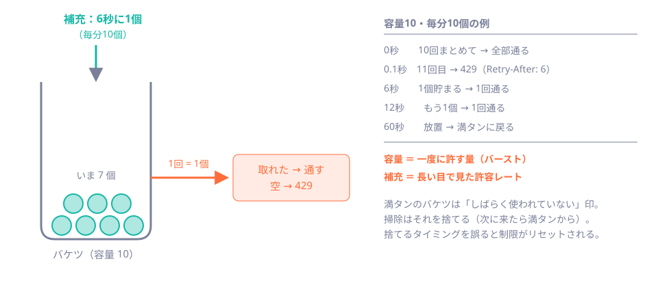

# 第35章 レート制限と資源の保護

<div class="goal-box" markdown>

この章でできるようになること

- 回数制限を「主体・IP・対象」の複数軸で設計し、429 と `Retry-After` で返せる
- リクエストのサイズ上限が、どの層に何個あるかを、実測の値で言える
- 自作のトークンバケットの仕組みを説明し、**掃除と消費の競合**を、テストで再現して説明できる
- 「拒否したあとに資源を作る」「複数台で数えがずれる」という穴を、実験で確かめられる
- Bucket4j を使う場面と、自作との対応を説明できる

</div>

## 1. 問いかけ：回数制限は、何を守っているのか

前の章で、参加コードの総当たりを止めるために、試行回数制限を入れました。ところが回数制限は、**パスワードの総当たりだけ**の道具ではありません。守るのは、**サーバーの資源**（DB の行、メモリ、CPU、帯域）です。

次の実験で、それが見えます。ラボ（`code/labs/part06-session-lab/`、ポート 18035）で、**Cookie を持たない人が、`POST /api/join` に出まかせのコードを250回**送ります。QuickVote では、`POST /api/join` は「誰でも叩ける入口」なので、**Cookie がなければ、その場で新しい訪問者を発行します**（第32章）。

```bash
for i in $(seq 1 250); do
  curl -s -o /dev/null -w '%{http_code} ' -b 'XSRF-TOKEN=abc' -X POST localhost:18035/api/join \
       -H 'X-XSRF-TOKEN: abc' -H 'Content-Type: application/json' -d '{"code":"AAAAAAAA"}'
done
curl -s localhost:18035/lab/stats          # 実験用：中の数を見る
```

!!! question "予測カード"
    回数制限なし（`--lab.rate-limit=none`）と、あり（既定）で、`visitors`（訪問者の行の数）は、それぞれいくつになるでしょうか。

    - A: どちらも 250
    - B: なし=250、あり=約100〜110
    - C: どちらも 1

```text
rate-limit=none      250 回とも 404       {"visitors":250, ...}
rate-limit=あり      112 回が 404、138 回が 429     {"visitors":112, ...}
```

答えは **B** です。回数制限がなければ、**何の価値もないリクエスト**（存在しないコードでの参加）で、訪問者の行が**250本**増えました。実際の QuickVote では、この行は60日残ります。`curl` の `for` を回し続ければ、DB は膨らみ続けます。**回数制限は、秘密を守るだけでなく、「拒否されるリクエストに、資源を使わせない」ためにあります**。

## 2. 何を軸に数えるか

回数を数える「軸」を、設計で決めます。

| 軸 | 何を数えるか | 防げるもの | 弱点 |
| --- | --- | --- | --- |
| **主体**（訪問者） | 同じ Cookie の人 | 1人が連打する | Cookie を捨てて、毎回新しい訪問者になれる |
| **IP** | 同じ接続元 | Cookie を捨てる攻撃 | 会場の全員が同じ IP（NAT）の場合、巻き添え。IP を変えられる攻撃者には効かない |
| **対象**（参加コード・招待・投票） | 同じ標的への試行 | 標的を絞った総当たり | 標的が分散すると効かない。数える鍵（キー）の管理が増える |

QuickVote は、**主体とIPの2軸**で数え、対象ごとの軸は持ちません。

| 入口 | IP単位（全入口で共通） | 訪問者単位 |
| --- | --- | --- |
| `POST /api/join`、招待の受諾 | 容量100・毎分60回補充 | 「試行」容量10・毎分10 |
| `POST /api/polls`、招待の発行 | 同上 | 「作成」容量10・毎分10 |

IP 単位の値が大きいのは、**会場の全員が同じ NAT の後ろから一斉に参加する**場面を想定したからです（50人が1つの IP から参加しても、100回の容量に収まる）。「人数が多い会場で、全員が 429 になる」という別の事故を避けるための数字です。設定で変えられます（`quickvote.rate-limit.*`）。

数える単位も決めます。**成功も失敗も、すべて「試行」**として数えます。失敗だけ数えると、「当たりを引くまでは数えない」ことになり、当たった後に大量に試せます。

## 3. 429 と `Retry-After`

回数を超えたリクエストには、**429 Too Many Requests** を返します。同時に、**`Retry-After`**（あと何秒待てばよいか）を付けます。

```bash
curl -s -i -c z.txt -b z.txt -X POST "localhost:18130/api/%6aoin" -H "X-XSRF-TOKEN: ..." \
     -H 'Content-Type: application/json' -d '{"code":"AAAAAAAA"}'
```

```text
HTTP/1.1 429
Retry-After: 5
{"detail":"試行回数が多すぎます。しばらく待ってからやり直してください。",
 "instance":"urn:request-id:bfb4bc1e-...","status":429,"title":"Too Many Requests","code":"RATE_LIMITED"}
```

- **429** は「あなたは短時間に送りすぎている」を意味する、専用のステータスです（503 や 403 ではなく）。クライアントは、**再試行してよい**と読み取れます
- **`Retry-After`** は、整数の秒数（次の1トークンが貯まるまでを**切り上げ**、最低1秒）。クライアントが**待つべき時間を、サーバーが教える**
- 本文は、他のエラーと同じ ProblemDetail（`code: RATE_LIMITED`）。フィルタの中で作る応答も、同じ形にそろえてあります（第31章）

!!! tip "フロントエンドで例えると"
    フロントエンドから見ると、429 は「`fetch` を**リトライするときの合図**」です。`Retry-After` の秒数だけ待ってから、再送します（待たずに連打すると、制限が延びるだけです）。自分で再試行を書くときは、**指数バックオフ＋揺らぎ（jitter）**に `Retry-After` を組み合わせます。

## 4. リクエストの大きさにも上限を決める

回数だけでなく、**1回のリクエストの大きさ**も、資源を使います。巨大な本文を送られると、メモリを使い、JSON の解析でCPUを使います。大きさの上限は、**層ごとに複数ある**ので、どれが何バイトかを、自分で確かめます。

完成形に、実際に送って測りました。

| 層 | 設定 | 実測（完成形） |
| --- | --- | --- |
| JSON の本文 | `spring.jackson.factory.constraints.read.max-document-length: 16384` | 15,000文字 → 入力検証エラー（400 `VALIDATION_FAILED`）、**17,000文字 → 解析の時点で 400（`Failed to read request`）** |
| HTTP ヘッダー | Tomcat の既定（8KB）。`server.max-http-request-header-size` | **7,000バイトのヘッダー → 通る（404）、9,000 → 400** |
| フォーム・アップロード | `server.tomcat.max-http-form-post-size`、`spring.servlet.multipart.*` | QuickVote は使わない（既定値のまま） |

最初の行が、**本文の上限を決める唯一の設定**です。JSON ライブラリが、**読み始めた時点で**上限（16,384）を超えたら中断するので、巨大な本文を最後まで読み込みません。検証（`@Valid`、第14章）より**前**の、一番外側の関門です。

!!! warning "この教材では扱わない層"
    リバースプロキシ（nginx の `client_max_body_size`）、接続数、タイムアウト（遅い接続でスレッドを占有される「スローロリス」）は、第45章で扱います。**資源を守る線は、層ごとに引く**のが基本で、アプリの設定だけでは足りません。

## 5. 自作のトークンバケット

回数制限の方式は、いくつかあります（固定ウィンドウ、スライディングウィンドウ、リーキーバケットなど）。QuickVote は、**トークンバケット**を自作しています。仕組みを理解するには、読める大きさだからです。



考え方は、この4つです。

1. バケツに、最大 `capacity` 個の**トークン**が入る（最初は満タン）
2. リクエスト1回で、トークンを**1個**使う
3. トークンは、**一定の速さ**で補充される（上限は `capacity`）
4. 取れなければ **429**。次の1個が貯まるまでの時間が `Retry-After`

**容量（バースト）**は「一度にまとめて許す量」、**補充速度**は「長い目で見た許容レート」です。「10回まとめて通るが、その後は6秒に1回」という振る舞いが、1つのバケツで表せます。

```java title="src/main/java/com/example/quickvote/security/TokenBucket.java（抜粋）"
public Decision tryConsume(Instant now) {
    refill(now);                                                   // (1)!
    if (tokens >= 1) {
        tokens -= 1;
        return Decision.ALLOWED;
    }
    double secondsUntilNextToken = (1 - tokens) / refillPerSecond;  // (2)!
    return new Decision(false, Duration.ofMillis((long) Math.ceil(secondsUntilNextToken * 1000)));
}

private void refill(Instant now) {
    double elapsedSeconds = Math.max(0, Duration.between(lastRefill, now).toNanos() / 1_000_000_000.0);
    tokens = Math.min(capacity, tokens + elapsedSeconds * refillPerSecond);   // (3)!
    lastRefill = now;
}
```

1. 使う**直前に**、前回からの経過時間で補充を計算し直す。**補充用のスレッドやタイマーは要らない**
2. 取れなかったときの待ち時間 ＝ 足りない分 ÷ 補充速度
3. 補充は容量を超えない（放置しても、満タンを超えて貯まらない）

時刻は、**引数で受け取ります**（`Clock` から取った値を、呼ぶ側が渡す）。第28章の `Clock` 注入と同じ理由で、テストで時間を進められます。`TokenBucketTest` が、容量・待ち時間・補充・上限を確かめています。

キー（IP や訪問者）ごとに、バケツを1個ずつ持つ表が `TokenBucketLimiter` です。

```java title="src/main/java/com/example/quickvote/security/TokenBucketLimiter.java（抜粋）"
public TokenBucket.Decision tryAcquire(String key) {
    TokenBucket.Decision[] result = new TokenBucket.Decision[1];   // ラムダの外へ結果を取り出す入れ物
    buckets.compute(key, (k, bucket) -> {                          // (1)!
        Instant now = clock.instant();
        TokenBucket current = bucket != null ? bucket : new TokenBucket(capacity, refillPerSecond, now);
        result[0] = current.tryConsume(now);
        return current;
    });
    return result[0];
}

public void evictIdle() {                                          // (2)!
    for (String key : buckets.keySet()) {
        buckets.computeIfPresent(key, (k, bucket) -> bucket.isIdle(clock.instant()) ? null : bucket);
    }
}
```

1. 「消費」は `compute` の**中**で行う
2. 「掃除」（満タンに戻ったバケツを捨てる）も `computeIfPresent` の**中**で行う。やらないと、来たキーの数だけメモリが増え続ける

`compute` は、**同じキーに対する操作を直列にする**メソッドです。この2つを `compute` の中に入れたことに、**レビューで見つかった事故**が関わっています。

## 6. 事故：掃除と消費の競合で、制限がリセットされた（指摘7）

元の実装は、「Map から取り出す」と「バケツを触る」を、別々の操作にしていました。

```java
// 元の実装（悪い例）
TokenBucket bucket = buckets.computeIfAbsent(key, k -> new TokenBucket(...));   // ① バケツを手にする
Instant now = clock.instant();
synchronized (bucket) { return bucket.tryConsume(now); }                         // ③ 消費する

void evictIdle() {
    for (String key : buckets.keySet()) {
        TokenBucket bucket = buckets.get(key);
        if (isIdle(bucket)) { buckets.remove(key); }                             // ② 「満タン＝不要」と判断して捨てる
    }
}
```

バケツ1個の中は `synchronized` で守ってあります。それでも、**①の後・③の前**に、②が割り込むと、こうなります。

1. 消費の処理が、バケツ（満タン）を手にした（①）
2. その最中に、掃除が「満タンだから不要」と判断して、Map から**捨てた**（②）
3. 消費の処理は、**捨てられたバケツ**から1個取る（③）。誰にも見えない場所に、消費の記録が消える
4. 次のリクエストは、Map に何もないので、**満タンの新しいバケツ**を得る＝**制限のリセット**

`synchronized` は「バケツの中」しか守りません。**Map から取り出した後・削除する前の隙間**は、守れないのです。

この順序を、テストで再現します（`BucketRaceTest`）。「消費の最中」を作るために、**時刻を取る呼び出しを、テストが許可するまで止める時計**を使います。

```java title="ラボの BucketRaceTest（抜粋）"
limiter.tryAcquire("k");                          // 容量2のうち1個使う
base.advance(Duration.ofMinutes(10));             // 十分に時間が経った（次に触れば満タン＝掃除の対象）

Thread consumer = new Thread(() -> limiter.tryAcquire("k"));
clock.gate(consumer);                             // 消費が時刻を取る所で止める
consumer.start();                                 // ① バケツを手にした
Thread evictor = new Thread(limiter::evictIdle);  // ② この最中に掃除を走らせる
evictor.start();
// ...消費を再開 → 掃除が終わる...
limiter.tryAcquire("k");                          // 消費は済んでいるので、あと1回しか許されないはず
return limiter.tryAcquire("k");                   // ← これが許可されたら、リセットされている
```

```text
取得と更新を分けた元の実装   → 制限がリセットされた（バグの再現）          … allowed = true
computeの中で行う完成形      → 消費済みのバケツが捨てられていない          … allowed = false
Tests run: 2, Failures: 0
```

完成形では、**掃除が `compute` の中で動く**ので、消費が終わるまで待たされます。消費の途中のバケツは捨てられません。「バケツの判定と削除」を、同じキーの直列な操作の中に入れるのが、解決の核です。

!!! tip "プロのレビューで実際に見つかった穴"
    | 指摘 | 穴 | 観点 |
    | --- | --- | --- |
    | 7 | 掃除と消費の競合で、消費済みのバケツが捨てられ、制限がリセットされる | 「取得」と「更新」を分けていないか。`get` → 判断 → `remove`（check-then-act）は、**Map のメソッド1つ（`compute`）に畳む**（第25〜26章） |
    | 4 | 登録と最後の解除が競合し、購読が消える（`computeIfAbsent(...).add(...)` は原子的でない） | 同じ型。**取得と追加を `compute` の中で一体にする** |

## 7. 事故：IP で拒否したあとも、偽 Cookie ごとにバケツを作った（指摘6）

訪問者単位のバケツは、**Cookie の値のハッシュ**をキーにします。ここで、攻撃者が**出まかせの Cookie**（43文字の Base64URL）を毎回変えながら送ると、どうなるでしょうか。

元の実装は、「IP 単位 → 訪問者単位」の順に判定するとき、**IP 単位で拒否された後も、訪問者単位のバケツを作っていました**。IP で 429 になっていても、偽 Cookie の数だけバケツがメモリに増えます。

```java
// 元の実装（lab.bucket-on-ip-reject=true で再現）
TokenBucket.Decision ipDecision = perIp.tryAcquire(ip);
TokenBucket.Decision visitorDecision = perVisitor.tryAcquire(visitorKey);   // IP で拒否されていても作ってしまう
```

```java title="完成形（RateLimiter.check）"
TokenBucket.Decision ipDecision = perIp.tryAcquire(ip);
if (!ipDecision.allowed() || visitorKey == null) {
    return ipDecision;                                   // IP で拒否したら、ここで終わり
}
return perVisitor.tryAcquire(visitorKey);
```

実際のHTTPで、**偽の Cookie を毎回変えて400回**送ります。

```text
元のバグ（bucket-on-ip-reject=true）   253回が 429 なのに  visitorBuckets = 400
完成形                                                       visitorBuckets = 147   （IP が通した回数ぶんだけ）
```

429 を返しているのに、バケツが**400個**に増えました。1台のサーバーを、攻撃者が**メモリで圧迫**できます。完成形は、**拒否したら何も作らない**ことで、増える数を「IP の制限が通した回数」に抑えます。Cookie の形式（43文字の Base64URL）を、**バケツを作る前に**確かめる（`Tokens.isWellFormed`）のも、同じ理由です。ユニットテスト（`RateLimiterBucketCountTest`）でも、**10,000個の偽 Cookie で、元のバグは10,000個、完成形は5個**（IP の容量）になることを確かめています。

## 8. 事故：訪問者の行が、不正な入口の連打で増えた（指摘3）

本章の冒頭の実験が、この穴でした。元の実装は、回数制限が `POST /api/join` **だけ**にありました。ところが、訪問者を発行する入口は3つです（作成・参加・招待の受諾）。

```text
POST /api/invites/invalid/accept      ← 存在しない招待でも、Cookie がなければ訪問者を発行してから 404 にする
POST /api/polls （壊した本文）         ← 検証エラー（400）でも、訪問者の行は先に作られる
```

訪問者の行は、入力検証・招待検証より**前**に確定します。回数制限のない入口を、Cookie を捨てながら連打すると、**404 や 400 を返しながら、行が増え続けました**。CSRF トークンは「他サイトからの書き込み」を止めるものなので、**自動化されたクライアントの資源消費**には効きません。

対策は、**訪問者を発行する入口すべてに、発行より前の IP 単位の回数制限を置く**ことです。完成形で、同じ実験を確かめます（Cookie を捨てて、不正な招待受諾を150回）。

```text
訪問者の行: 21 → 158（増えたのは 137 行）   応答: 404 が 137 回、429 が 13 回
```

増加は、IP の容量（100）と補充の範囲で止まりました。そして**順番**も大切です。フィルタの列で、`RateLimitFilter` は `VisitorAuthenticationFilter` の**前**に置かれています（第31章の図の6番目と8番目）。後ろに置くと、拒否される前に、訪問者の行が作られてしまうからです。

!!! tip "プロのレビューで実際に見つかった穴"
    | 指摘 | 穴 | 観点 |
    | --- | --- | --- |
    | 3 | 不正なリクエストで、訪問者の行が増え続ける | 「**拒否される前に**、行・メモリ・外部呼び出しなどの資源を作っていないか」 |
    | 6 | IP で拒否した後も、偽 Cookie ごとにバケツを作る | 「拒否したら、そこで**何も作らず**終わるか」 |

## 9. 複数台では、共有が必要

自作のバケツは、**JVM のメモリ**にあります。アプリを2台並べると、それぞれが別々に数えます。同じ Cookie で、24回の試行を送って確かめます（訪問者単位は容量10）。

```text
1台だけに24回送る        → 404 が 10回、429 が 14回
2台に交互に24回送る      → 404 が 20回、429 が 4回
```

**2台なら、20回まで試せました。台数倍に緩みます。** 台数に関係なく正確に制限するには、全台から見える場所（Redis、DB など）に、カウンターを置く必要があります（第38章で、複数台の構成を見ます）。

もう1つ、リバースプロキシの後ろでは、**接続元 IP の決め方**が問題になります。アプリが見る `getRemoteAddr()` は、**プロキシの IP**になるからです（全員が同じ IP のバケツを共有してしまう）。そこで `X-Forwarded-For` を使う設定（`server.forward-headers-strategy=native`）にすると、次の実験のとおり、**別の穴**が開きます。IP 単位の制限が効く状態で、Cookie なしの300回を送ります。

```text
X-Forwarded-For なし            → 404 が 122回、429 が 178回   （IP 単位の制限が効いた）
X-Forwarded-For: 198.51.100.N  → 404 が 300回、429 が 0回     （Nを毎回変えると、IP 制限をすり抜けた）
```

!!! danger "本番で事故になるパターン"
    アプリがインターネットに直接さらされていると、`X-Forwarded-For` は**誰でも偽装できます**。偽装された値で IP を決めると、IP 単位の制限が**無意味**になります（上の実験）。信用するのは、**信頼できるプロキシが付けた値だけ**にします。プロキシ側で、外から来た `X-Forwarded-For` を**上書き**し、アプリは**プロキシ以外から直接つながらない**ようにします。

## 10. ライブラリを使う：Bucket4j

自作は、仕組みを学ぶには良いのですが、**本番では、実績のあるライブラリを使う**ほうが多くの場面で賢明です。Java では **Bucket4j** が、トークンバケットの代表的なライブラリです。QuickVote の自作と同じものを書くと、こうなります（`code/labs/ch35-bucket4j/`で、ビルドとテストを確かめてあります）。

```xml
<dependency>
    <groupId>com.bucket4j</groupId>
    <artifactId>bucket4j_jdk17-core</artifactId>
    <version>8.20.0</version>       <!-- Spring Boot の BOM の管理外。自分でバージョンを書く -->
</dependency>
```

```java title="code/labs/ch35-bucket4j/src/test/java/com/example/bucket4jlab/Bucket4jTest.java（抜粋）"
Bucket bucket = Bucket.builder()
        .addLimit(limit -> limit.capacity(10).refillGreedy(10, Duration.ofMinutes(1)))   // (1)!
        .withCustomTimePrecision(time)                                                    // (2)!
        .build();

for (int i = 0; i < 10; i++) {
    assertThat(bucket.tryConsume(1)).isTrue();
}
ConsumptionProbe probe = bucket.tryConsumeAndReturnRemaining(1);                          // (3)!
assertThat(probe.isConsumed()).isFalse();
assertThat(Duration.ofNanos(probe.getNanosToWaitForRefill())).isEqualTo(Duration.ofSeconds(6));
```

1. 容量10・毎分10個を補充（自作の `new TokenBucket(10, 10/60.0, now)` に当たる）
2. 時計を差し替える（自作の `Clock` 引数に当たる）
3. 拒否のときの待ち時間が取れる（自作の `Decision.retryAfter` ＝ `Retry-After` に当たる）

| 自作 | Bucket4j |
| --- | --- |
| `TokenBucket` | `Bucket` |
| `Decision(allowed, retryAfter)` | `ConsumptionProbe`（`isConsumed`、`getNanosToWaitForRefill`） |
| `Clock` の引数 | `TimeMeter` |
| キーごとの `ConcurrentHashMap` と `compute` | キーごとの `Bucket`（競合は内部で処理済み）。キー管理は別途 |
| **共有できない** | **Redis・JDBC（PostgreSQL）・Hazelcast などに状態を置ける**（`bucket4j_jdk17-lettuce`、`-jedis`、`-postgresql`、`-hazelcast` など別モジュール） |

ライブラリの利点は、**競合（節 6 のような）が検証済み**であることと、**複数台での共有**（節 9）が、モジュールを足す形で実現できることです。ただし、依存が増え、Redis などの**運用の対象が増える**費用もあります。

!!! tip "どこで制限するか"
    回数制限は、**アプリの手前**でも行えます（nginx の `limit_req`、クラウドの WAF、CDN）。入口に近いほど、アプリの資源を守れます。一方、「参加コードの試行は訪問者ごと」のような**業務の意味を持つ軸**は、アプリでしか数えられません。**手前で粗く、アプリで細かく**、重ねます。

---

## まとめ：3点セット

!!! abstract "この章の3点セット"
    **① 一言で言うと**
    回数制限は、秘密の総当たりを止めるだけでなく、拒否されるリクエストに資源を使わせないための仕組み。主体・IP・対象の複数軸で数え、429 と `Retry-After` で返す。トークンバケットは「容量＝バースト、補充＝許容レート」で、消費も掃除も `compute` の中で行う。拒否したら何も作らず、本文・ヘッダーの上限も決める。メモリ上の制限は台数倍に緩むので、複数台では共有が必要。

    **② 現場でこう聞かれる**
    「アプリを2台に増やしたら、制限が効かなくなった気がします」
    → メモリ上のバケツは台ごとに別なので、許容回数は台数倍になる。全台で共有できる場所（Redis、DB）に置くか、Bucket4j の分散モジュールを使う。手前（プロキシ・WAF）で粗く制限する方法もある。IP を `X-Forwarded-For` で決めるときは、信頼できるプロキシだけにする。

    **③ 自分のサービスならどこに当たるか**
    「認証前に叩ける入口」と「作成系の API」を挙げ、それぞれ何を軸に数えるか。拒否の前に、行・メモリ・外部呼び出しを使っていないか。本文とヘッダーの上限は何バイトか。

## 演習

??? question "確認問題1：Retry-After"
    容量10・毎分10個補充のバケツが空のとき、`Retry-After` は何秒になりますか。補充が毎分30個なら？

??? success "解答"
    毎分10個＝6秒に1個なので、6秒です。毎分30個＝2秒に1個なので、2秒です。`(1 − 現在のトークン数) ÷ 補充速度` を切り上げて、最低1秒にします。

??? question "確認問題2：なぜ compute か"
    次のコードの問題を、`compute` を使って直してください。
    ```java
    if (bucket.isIdle(now)) {
        buckets.remove(key);
    }
    ```

??? success "解答"
    `isIdle` の判定と `remove` の間に、別スレッドが消費すると、消費済みのバケツを捨ててしまい、制限がリセットされます。
    ```java
    buckets.computeIfPresent(key, (k, bucket) -> bucket.isIdle(clock.instant()) ? null : bucket);
    ```
    判定と削除（`null` を返す）を、同じキーの直列な操作の中に入れます。

??? question "応用：新しい入口に制限を足す"
    QuickVote に、`POST /api/polls/{pollId}/report`（不適切な投票の通報）を足します。誰でも叩ける入口にはしませんが、参加者なら連打できます。どの軸で、どのくらい制限しますか。理由も書いてください。

??? success "解答"
    例：訪問者単位で「容量5・毎分2個補充」の専用バケツを持ちます（作成系とは別。通報が他の操作を巻き添えにしない）。IP 単位は、訪問者を発行する入口ではないので、共通の IP 制限の対象にはしなくてよい（ただし、Cookie を捨てて通報の対象から外れる攻撃は、参加者でなければ 404 になるので成立しない）。参加者表で認可したあとに数えるか、認可の前に数えるかも決める（前に数えると、部外者の連打にも資源を使わない）。拒否には 429 と `Retry-After` を付け、`EntryMatchers` に追加するパスは `PathPatternRequestMatcher` で判定する。

??? question "説明問題：現場でこう聞かれる"
    「回数制限は、nginx に入れたので、アプリでは要らないですよね？」200字程度で答えてください。

??? success "解答"
    例：nginx の制限は、IP や URL のような粗い軸で、アプリの資源を守る最初の線として有効。ただし「参加コードの試行は訪問者ごと」「成功・失敗とも数える」のような業務の意味を持つ軸は、アプリでしか数えられない。二つを重ねる。複数台や再起動に対しても、どちらで何を数えるかを決めておく。
