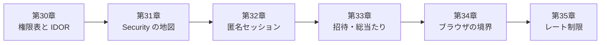

# 第6部 匿名利用者と認可


この部は、**卒業後に一人でサービスを作るとき、最も重要な部**です。第5部まででアプリは「同時に使われても、再送されても、壊れない」ところまで来ました。ここで問うのは、**「他人に触られても壊れない」か**です。

QuickVote にはログインがありません。それでも、他人の投票は覗けず、主催者以外は締め切れず、参加コードは総当たりで破られず、別のサイトのページに操作を横取りされません。この部では、そのために必要な**設計と実装と失敗**を、実際の HTTP で見ていきます。

## この部でできるようになること

- 識別（誰として扱うか）・認証・認可（何を許すか）を分け、**権限表**を書いて、そのままテストにできる
- IDを書き換えて他人のデータを覗く攻撃（IDOR）を再現し、**404 で存在を漏らさない**設計で防げる
- Spring Security の `SecurityFilterChain`（フィルタの列）を図で読み、**全部許可から許可リスト方式へ**閉じられる
- 匿名の訪問者を、**乱数トークン・ハッシュ保存・Cookie・自作の認証フィルタ**で識別し、`SecurityContext` を保存しないと非同期ディスパッチで認証を失う理由を説明できる
- 参加コードの探索空間を計算し、総当たりを**試行回数制限**で止め、一度限りの招待を**条件付き UPDATE**で守れる
- Cookie の自動送信・CSRF・CORS・HTTPS 終端・セキュリティヘッダーを、**ブラウザの実験**で説明できる
- トークンバケットの競合・資源の増殖・複数台の緩みという、**プロのレビューで実際に見つかった穴**を再現し、AIが書いたコードをレビューする観点にできる

## アプリの到達状態

第6部が終わった時点で、QuickVote は完成形（`code/quickvote/`）の認可・防御の部分が、すべてそろいます。

| 守るもの | 仕組み | 章 |
| --- | --- | --- |
| 他人の投票を見せない | 参加者表による認可。部外者は存在しない場合と同じ 404 | 30 |
| 全 URL を閉じる | 許可リスト方式の `SecurityFilterChain` | 31 |
| 利用者を識別する | 訪問者トークン（Cookie）。DB にはハッシュだけ | 32 |
| 参加コード・招待を守る | 試行回数制限、一度限りの原子的な消費 | 33 |
| ブラウザ経由の攻撃 | CSRF トークン、Cookie 属性、セキュリティヘッダー | 34 |
| 資源を守る | 回数制限（429）、サイズ上限、掃除 | 35 |

第2部のラボで**暫定**だった `X-Visitor-Id`（誰でも書き換えられるヘッダー）は、この部で本物の匿名セッション（Cookie ＋ Spring Security）に置き換わります。コントローラーの引数の型（`VisitorPrincipal`）は変わらず、注釈が `@AuthenticationPrincipal` になるだけです。

!!! warning "この部のあとも残る限界"
    - 回数制限は **JVM のメモリ**にある。複数台では台数倍に緩む（第38章で再訪）
    - Cookie を盗まれれば、その訪問者になれる（HTTPS・XSS 対策・`HttpOnly` が前提）
    - 訪問者トークンの失効・除名の API は、まだない
    - 本番の公開前チェックは第46章

## この部の特徴：「プロのレビューで実際に見つかった穴」

完成形のリファレンス実装には、シニアのレビューで**18件の指摘**が入り、すべて修正されました。そのうち、この部に関わるものを、**再現してから直す**形で扱います。AI が書いたコードを読むとき、同じ型の穴を探せるようになるためです。

| 指摘 | 内容 | 章 |
| --- | --- | --- |
| 1 | URL を文字列比較で判定し、`/api/%6aoin` で回数制限をすり抜け | 33 |
| 3 | 不正な入口の連打で、訪問者の行が増え続ける | 35 |
| 6 | IP で拒否した後も、偽 Cookie ごとにバケツを作る（メモリ） | 35 |
| 7 | 掃除と消費の競合で、制限がリセットされる | 35 |
| 13 | 古い記事の `CsrfCookieFilter` が `csrf.spa()` で不要に | 34 |
| 17 | 締切後の招待受諾の仕様の穴 | 33 |
| 18 | `SecurityContext` を保存せず、SSE の終了で認証を失う | 32 |

## 各章

<div class="grid cards" markdown>

-   :material-badge-account-horizontal-outline: **[第30章 認証・識別・認可を分ける](ch30-authz-design.md)**

    ---

    入館証とフロアの入室権。権限表をテストにする。IDOR を実演し、404 で存在を漏らさない。

-   :material-map-outline: **[第31章 Spring Securityの地図](ch31-spring-security.md)**

    ---

    依存を足すと全部 401。フィルタの列を図で読み、全部許可から許可リスト方式へ。

-   :material-cookie-outline: **[第32章 匿名セッション](ch32-anonymous-session.md)**

    ---

    訪問者トークン、ハッシュ保存、Cookie、自作の認証フィルタ。`saveContext` の穴を再現する。

-   :material-key-alert-outline: **[第33章 招待・参加コード・総当たり対策](ch33-invites-brute-force.md)**

    ---

    総当たりで突破し、試行回数制限で止める。一度限りの招待。URL エンコードの穴。

-   :material-web-check: **[第34章 ブラウザとの境界](ch34-browser-boundary.md)**

    ---

    Cookie の自動送信、CSRF、CORS、HTTPS 終端。別オリジンから、ブラウザで攻撃してみる。動画つき。

-   :material-speedometer: **[第35章 レート制限と資源の保護](ch35-rate-limiting.md)**

    ---

    429 と Retry-After。自作トークンバケットの競合。複数台で緩む。Bucket4j。

</div>

## 第6部の流れ



第30章で「識別が偽装できると、認可の表は無力」と見て、第32章でその識別を本物にします。第31章は、そのための地図です。第33〜35章は、**本物にした入口を、攻撃から守る**章です。

## 実験コードの置き場

```text
code/labs/
├── ch30-idor/             第2部のメモリ版 ＋ わざと認可を忘れた API（ポート 18030）
├── ch31-security-map/     Spring Security の最小のアプリ。profile で段階を切り替える（18031）
├── part06-session-lab/    第2部のメモリ版 ＋ 匿名セッション ＋ Spring Security（18032〜18035）
│   └── scripts/           BruteForce.java（総当たり）、TimingDemo.java（定数時間比較）
├── ch34-evil/             別オリジンの「悪意のあるページ」（静的ファイル。18134）
└── ch35-bucket4j/         Bucket4j の最小の使い方
```

`part06-session-lab` には、章の実験で**わざと壊す**ためのスイッチ（`lab.*`。`LabProperties`）があります。既定値は、すべて正しい（完成形と同じ）動作です。

| スイッチ | 実験 | 章 |
| --- | --- | --- |
| `--lab.save-context=false` `--lab.session-management=false` | SSE の終了で認証を失う | 32 |
| `--lab.join-code-length=3` `--lab.rate-limit=none` | 参加コードの総当たり | 33 |
| `--lab.rate-limit=raw-uri` | URL エンコードですり抜け | 33 |
| `--lab.csrf=false` | CSRF 攻撃の再現 | 34 |
| `--lab.cors-allow-origin=...` | CORS の設定ミス | 34 |
| `--lab.bucket-on-ip-reject=true` | 偽 Cookie でバケツが増える | 35 |

## 統合課題：事故対応ドリル

第6部の仕上げに、次のどれか1つを、**自分の手で**やってください。

1. **Red → Green**：権限表のテストに、`POST /api/polls/{id}/participants`（参加者の追加）の行を足す。実装を先に書かず、テストを赤にしてから、`ParticipantService.requireHost` を使って緑にする
2. **レビュー演習**：次の AI の出力を、第30〜35章の観点で、指摘できるだけ指摘する（「Cookie 名は `userId`・値は連番、`SecurityConfig` は `csrf.disable()` と `anyRequest().permitAll()`、招待は `GET /api/invites/{token}` で `used=true` にする、回数制限は `getRequestURI()` の文字列比較」）
3. **設計説明**：自分の卒業制作（第48章）の「誰が・何を」を、権限表に書き、**部外者が見たときの応答**（401 / 404 / 403）を決める

## 第6部のチェックリスト

第35章を終えたら、次の項目を確かめてください。**すべてに ✅ を付けられたら、第7部へ進めます。** 目安は「③ 検証できる」です。

- [ ] 識別・認証・認可の違いを、QuickVote の具体例で説明できる
- [ ] 権限表（操作×立場）を書き、各マスをテストにできる。新しい API を足したら表に行を足す習慣がある
- [ ] 401・403・404・409 の使い分けと、判定の順番（認可は状態より先）を説明できる
- [ ] IDOR を実際の HTTP で再現し、「ID を知っていること」と「見てよいこと」が別だと説明できる
- [ ] `SecurityFilterChain` のフィルタの順番を図で説明し、`authorizeHttpRequests` を許可リスト方式で書ける
- [ ] 自作の Security フィルタを `@Component` にしてはいけない理由を、実験の結果で説明できる
- [ ] 訪問者トークンが乱数32バイトで、DB にはハッシュだけを持つ理由を説明できる
- [ ] 自作の認証フィルタが `SecurityContext` を保存しないと、SSE の終了で何が起きるかを説明できる
- [ ] 参加コードの探索空間を計算し、総当たりを試行回数制限（訪問者・IP の2軸）で止めて確かめられる
- [ ] 一度限りの招待を、条件付き UPDATE の更新件数で実装でき、同時実行で1人しか通らないことを確かめられる
- [ ] URL の判定を文字列比較でやってはいけない理由を、`/api/%6aoin` で説明できる
- [ ] SameSite・CSRF トークン・CORS が、それぞれ何を防ぎ、何を防がないかを説明できる
- [ ] 429 と `Retry-After` を返し、「拒否したら何も作らない」を守れる
- [ ] メモリ上の回数制限が、複数台で台数倍に緩むことを説明し、共有の選択肢（Redis・DB・Bucket4j）を挙げられる
- [ ] AI が書いた認可・Security 設定・認証フィルタを、この部の観点でレビューできる

!!! tip "チェックの付け方"
    項目を読んで「たぶん分かる」では、付けません。**白紙に、自分の言葉で書いて説明できたとき**に付けてください。説明できない項目に戻る章は、各章の「まとめ」にあります。
