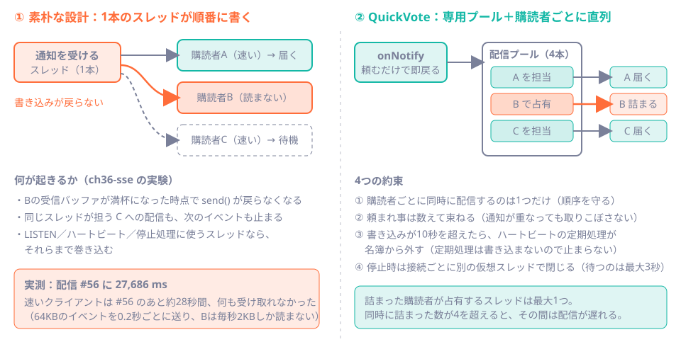

# 第36章 SSE入門：サーバーから流し続ける

<div class="goal-box" markdown>

この章でできるようになること

- ポーリング・SSE・WebSocket を、通信の向きと再接続の責任で使い分けられる
- `curl -N` で SSE の中身（`id` / `event` / `data` / `retry` / コメント行）を自分の目で読める
- `SseEmitter` を返すだけでは最初の書き込みまでヘッダーが出ないことを、実験で確かめて直せる
- ハートビート・タイムアウト・切断の後始末が、なぜ必要かを説明できる
- 遅いクライアント1人が配信全体を止める事故と、停止が30秒止まる事故を、QuickVote の設計で説明できる
- 仮想スレッドをONにして、何が変わり、何が変わらないかを観察できる

</div>

## 1. 問いかけ：他人の投票で、自分の棒グラフが伸びるには

QuickVote の画面では、別の参加者が投票すると、自分の棒グラフも伸びます。リロードはしていません。

フロントエンドの感覚なら、まず思いつくのは `setInterval` で `fetch` し続ける方法でしょう。それでも動きますが、50人が2秒おきに聞くと、サーバーは毎秒25回「変わりましたか？」に答えることになります。そのほとんどは「変わっていません」です。

サーバーから、変わった瞬間に知らせる方法が第7部のテーマです。この章では、その最初の部品である SSE（Server-Sent Events）を、動かしながら理解します。

## 2. 例え：ノック、ラジオ、電話


| 方式 | 例え | 通信の向き | 再接続 |
| --- | --- | --- | --- |
| ポーリング | 何度もドアをノックして「変わりました？」と聞く | クライアント → サーバー（毎回） | 不要（毎回つなぎ直している） |
| SSE | ラジオ。つけっぱなしにしておくと、放送が流れてくる | サーバー → クライアントの片方向 | ブラウザが自動で行う |
| WebSocket | 電話。つながったら、双方がいつでも話せる | 双方向 | 自分で作る |

QuickVote に必要なのは、サーバーから聞き手への片方向だけです。投票そのものは普通の `PUT` で送るので、SSE を選びます。

!!! warning "この例えが外れる点"
    - ラジオは電波が切れても、聞き手は気づきません。SSE は、切れたらブラウザが自動でつなぎ直し、「ここまで聞きました」（`Last-Event-ID`）を伝えられます。次の第37章の主役です
    - 実際の SSE は、ふつうの HTTP の応答が終わらないだけです。特別なプロトコルではありません。そのため、Cookie も HTTPS もプロキシも、今までの知識がそのまま使えます
    - WebSocket が劣っているわけではありません。チャットやゲームのように、クライアントから高頻度で送る用途に向いています

## 3. SSE の正体：終わらない HTTP 応答

SSE の応答は `Content-Type: text/event-stream` で、閉じずに書き足され続けるテキストです。1つのイベントは次の形の行で書き、空行で区切ります。

| 行 | 意味 |
| --- | --- |
| `id:` | イベントの番号。ブラウザが覚えておき、再接続のとき `Last-Event-ID` ヘッダーで送り返す |
| `event:` | イベントの種類。`EventSource` の `addEventListener("VOTE_CAST", ...)` に対応 |
| `data:` | 本文（複数行にもできる） |
| `retry:` | 切れたあと何ミリ秒待って再接続するか |
| `:` で始まる行 | コメント。ブラウザには見えない。接続を生かすために使う |

実際に QuickVote を動かして、`curl -N`（出力をためずに流す）で見てみましょう。参加者の bob が接続し、別の人が投票します。

```bash
curl -sS -N -i -b bob.jar http://localhost:18138/api/polls/$PID/events
```

```text
HTTP/1.1 200
Content-Type: text/event-stream
Transfer-Encoding: chunked
（セキュリティヘッダーは省略）

:connected
retry:3000

:heartbeat

id:2
event:VOTE_CAST
data:{"optionId": 1}

:heartbeat

id:3
event:VOTE_CAST
data:{"optionId": 2}
```

この出力から読み取れることを整理します。

- `Transfer-Encoding: chunked` は、長さを決めずに少しずつ送る HTTP の機能です。SSE 専用の仕組みではありません
- 最初の `:connected` と `retry:3000` は、サーバーが接続直後に自分から書いたものです（理由は第5節）
- `:heartbeat` は、2秒ごとに届いたコメント行です（観察用に間隔を縮めています。既定は15秒）
- `id:1` が出ていないのは、`id:1` が bob 自身の参加イベント（`PARTICIPANT_JOINED`）で、接続より前に起きたからです。新規接続は現在の最新から流れます
- `data:` の `{"optionId": 1}` は、保存したときと空白の入り方が違うことがあります。`jsonb` は保存時に整形されるためです

!!! tip "フロントエンドで例えると"
    ブラウザ側は `new EventSource(url)` と `addEventListener` だけで書けます。`fetch` との違いは、応答が終わらないことと、切れたら自動で再接続することです。`onmessage` が届くたびに状態を更新する、という書き方になります。QuickVote の `app.js` も、イベントが来たら詳細を取り直すだけの作りです（[第37章のコラム](ch37-event-history.md#column-app-js)）。

## 4. Spring で書く：SseEmitter

Spring MVC では、コントローラーが `SseEmitter` を返すだけで、応答が開いたままになります。QuickVote の実装です。

```java title="src/main/java/com/example/quickvote/event/PollEventController.java（抜粋）"
@GetMapping(path = "/api/polls/{pollId}/events", produces = MediaType.TEXT_EVENT_STREAM_VALUE)
public SseEmitter events(@AuthenticationPrincipal VisitorPrincipal visitor, @PathVariable UUID pollId,
        @RequestHeader(name = "Last-Event-ID", required = false) String lastEventIdHeader) {
    ParticipantContext context = participants.require(pollId, visitor.visitorId()); // (1)!

    SseEmitter emitter = new SseEmitter(properties.sse().timeout().toMillis());     // (2)!
    sendOrFail(emitter, SseEmitter.event().comment("connected").reconnectTime(RECONNECT_MILLIS)); // (3)!
    PollEventHub.Subscription subscription = hub.subscribe(context.pollId(),
            parseLastEventId(lastEventIdHeader), new SseSink(emitter));             // (4)!
    emitter.onCompletion(() -> hub.unsubscribe(subscription));                       // (5)!
    emitter.onTimeout(emitter::complete);
    emitter.onError(e -> hub.unsubscribe(subscription));
    return emitter;                                                                  // (6)!
}
```

1. 認可は接続時に1回だけ行う。参加者でなければここで404（存在も漏らさない）
2. `SseEmitter` は「この接続への書き込み口」。引数は接続の最長時間（QuickVote は既定30分）
3. 接続直後にコメント行と `retry` を書く。理由は次の節
4. 名簿（購読者の一覧）に登録する。再接続なら、ここで続きを再送してもらう（第37章）
5. 終わり方は3通り（正常終了・タイムアウト・エラー）。どれでも名簿から外す。外し忘れると、死んだ接続がたまり続ける
6. 返した時点で、このリクエストを処理していたスレッドは手放される。書き込みは、あとから別のスレッドが `emitter.send(...)` で行う

6番の性質は大切です。コントローラーのメソッドが終わっても接続は閉じず、接続が生きている間スレッドを占有し続けることもありません。この性質は、第9節の仮想スレッドの実験で結果を左右します。

=== "TypeScript（Express）"

    ```ts
    app.get("/events", (req, res) => {
      res.writeHead(200, { "Content-Type": "text/event-stream" })
      res.write(":connected\n\n")                       // 最初に何か書く
      const timer = setInterval(() => res.write(":heartbeat\n\n"), 15_000)
      subscribers.add(res)
      req.on("close", () => {                           // 切断の後始末
        clearInterval(timer)
        subscribers.delete(res)
      })
    })
    ```

=== "Java（Spring MVC）"

    ```java
    SseEmitter emitter = new SseEmitter(timeoutMillis);
    emitter.send(SseEmitter.event().comment("connected"));   // 最初に何か書く
    hub.subscribe(emitter);
    emitter.onCompletion(() -> hub.unsubscribe(emitter));    // 切断の後始末
    return emitter;
    ```

やることは同じです。違いは、Express では `res`（応答そのもの）を自分で握り、Spring では `SseEmitter` が書き込み口と後始末の通知をまとめて持っていることです。

## 5. 動かしてみる①：最初の書き込みまで、ヘッダーが出ない

`SseEmitter` を返しただけで何も書かなかったら、どうなるでしょう。実験用プロジェクト（`code/labs/ch36-sse/`）に、3秒後に最初のイベントを送るだけのエンドポイントを用意しました。

```java title="code/labs/ch36-sse/src/main/java/com/example/sse/SseLab.java（抜粋）"
@GetMapping(path = "/sse/silent", produces = MediaType.TEXT_EVENT_STREAM_VALUE)
public SseEmitter silent() {
    SseEmitter emitter = new SseEmitter(30_000L);
    scheduler.schedule(() -> send(emitter, SseEmitter.event().id("1").name("hello").data("3秒後の最初のイベント")),
            3, TimeUnit.SECONDS);
    return emitter;   // 何も書かずに返す
}
```

!!! question "予測カード"
    `curl -N -i` でつなぐと、`HTTP/1.1 200` の行はいつ表示されるでしょう。
    (a) つないだ瞬間　(b) 3秒後（最初のイベントと一緒）

```text
$ curl -sS -N -i localhost:18036/sse/silent
（3秒間、何も表示されない）
HTTP/1.1 200
Content-Type: text/event-stream
Transfer-Encoding: chunked

id:1
event:hello
data:3秒後の最初のイベント
```

答えは (b) です。応答は、最初の1バイトを書くまで送られません。レスポンスヘッダーも同じです。

ブラウザでは、これが次の症状になります。

- `EventSource` の `onopen` が、最初のイベントまで呼ばれない。画面は「接続中」のまま
- JDK の `HttpClient.send` など、ヘッダーを待つ API は最初のイベントまで返ってこない（QuickVote のテストでも同じ現象にぶつかりました）
- 間にプロキシがあると、ヘッダーを待つ側が先にタイムアウトすることもある

対策は、接続直後に何か書くことです。QuickVote は、コメント行と `retry` を送ります（第4節の(3)）。コメント行はブラウザには見えないので、画面には影響しません。

```text
$ curl -sS -N -i localhost:18036/sse/hello
HTTP/1.1 200
Content-Type: text/event-stream
Transfer-Encoding: chunked

:connected
retry:3000
（ここまでは接続の瞬間に届く。以後は1秒ごとにイベント）
id:1
event:tick
data:{"n": 1}
```

!!! note "用語：Last-Event-ID（ラスト・イベント・アイディー）"
    ブラウザの `EventSource` が、最後に受け取った `id:` を覚えておき、再接続のときにリクエストヘッダー `Last-Event-ID` として送り返す仕組みです。実験用の `/sse/hello` に `-H 'Last-Event-ID: 41'` を付けると、サーバーのログに `Last-Event-ID=41` が出て、`id:42` から始まります。どう続きを送るかはサーバーの仕事です（第37章）。

## 6. 動かしてみる②：ハートビート・タイムアウト・切断

SSE の接続は、何も流れていない時間が長くなりがちです。その間に、いろいろなものが接続を切ります。

| 接続を切るもの | 例 |
| --- | --- |
| プロキシ・ロードバランサー | 無通信が一定時間（nginx の既定は60秒）続くと切る（[第38章](ch38-multi-instance.md#nginx)で実測） |
| スマホ回線・NAT | 使われていない接続の記録を捨てる |
| サーバー自身 | `SseEmitter` に決めた最長時間 |

そこで、定期的に何かを流します。これがハートビートです。QuickVote は `:heartbeat` というコメント行を、既定15秒ごとに送ります。ハートビートにはもう1つ役目があります。次の実験で見てみましょう。

```java title="code/labs/ch36-sse/.../SseLab.java（抜粋）"
@GetMapping(path = "/sse/watch", produces = MediaType.TEXT_EVENT_STREAM_VALUE)
public SseEmitter watch(@RequestParam(defaultValue = "8000") long timeout) {
    SseEmitter emitter = new SseEmitter(timeout);
    send(emitter, SseEmitter.event().comment("connected"));
    var task = scheduler.scheduleAtFixedRate(() -> {
        try { emitter.send(SseEmitter.event().comment("heartbeat")); log.info("  heartbeat 送信OK"); }
        catch (Exception e) { log.info("  heartbeat 送信失敗: {}", e.getClass().getSimpleName()); }
    }, 2, 2, TimeUnit.SECONDS);
    emitter.onTimeout(() -> { log.info("  onTimeout"); emitter.complete(); });
    emitter.onCompletion(() -> { log.info("  onCompletion"); task.cancel(false); });
    emitter.onError(e -> { log.info("  onError {}", e.getClass().getSimpleName()); task.cancel(false); });
    return emitter;
}
```

### タイムアウト

`timeout=8000`（8秒）でつなぐと、`curl` は8秒ちょうどで終わり、サーバーのログは次の順に並びました。

```text
  heartbeat 送信OK   （2秒・4秒・6秒）
  onTimeout
  onCompletion
```

`onTimeout` の中で `complete()` を呼ぶのがお約束です。呼ばないと、Spring はタイムアウトを例外として処理しようとします。すでに応答を書き始めているので、`Ignoring exception, response committed already` の警告がログに出ます（実験で、`onTimeout` を登録しなかった `/sse/silent` に出ました）。

QuickVote の既定は30分で、切れたあとは `retry:3000` に従ってブラウザが3秒後に再接続します。タイムアウトは異常ではなく、定期的な接続のやり直しです。

### 切断：サーバーが気づくのは「次の書き込み」

3秒でクライアントを切って、サーバーのログを見ます。

```text
02:24:07.835  /sse/watch 接続 timeout=60000ms
02:24:09.846  heartbeat 送信OK
02:24:11.839  heartbeat 送信OK        ← curl はこの前（約10.8秒）に切れている
02:24:13.841  heartbeat 送信失敗: AsyncRequestNotUsableException
02:24:13.843  onError AsyncRequestNotUsableException
02:24:13.845  onCompletion
```

切断は、書き込みに失敗して初めて分かります。しかも、切れた直後の1回目の書き込みは成功してしまうことがあります（OSが送信バッファに受け付けるため）。実験では2回目で失敗しました。

つまり、書き込みが一度もなければ、サーバーは接続が死んでいることに気づけません。ハートビートは接続を生かすだけでなく、死んだ接続を見つけるための定期的な書き込みでもあります。見つけたら `onError` → `onCompletion` で名簿から外します。QuickVote の `emitter.onCompletion` と `onError` が、まさにそれです。

!!! danger "本番で事故になるパターン：後始末の書き忘れ"
    名簿（`Map` や `List`）に `SseEmitter` を入れたまま、`onCompletion` / `onError` で外さないと、切断された接続がメモリに残り続けます。ログにも出ないので、数日後にメモリを圧迫して初めて気づきます。登録した場所と同じ数だけ解除の場所があることを、レビューで確認してください。

## 7. 認可済みの接続：参加者だけが聞ける

SSE も HTTP なので、Cookie が普通に送られます。QuickVote は、通常の API と同じ認可の入口（`participants.require`）を、接続時に1回通します。

```text
$ curl -s -i localhost:18138/api/polls/$PID/events                      （Cookie なし）
HTTP/1.1 401   {"code":"UNAUTHENTICATED", ...}

$ curl -s -i -b carol.jar localhost:18138/api/polls/$PID/events         （参加していない訪問者）
HTTP/1.1 404   {"code":"POLL_NOT_FOUND", ...}

$ curl -s -i -b carol.jar localhost:18138/api/polls/00000000-.../events （存在しない投票）
HTTP/1.1 404   {"code":"POLL_NOT_FOUND", ...}
```

「参加していない」と「存在しない」は、同じ404で区別できません（[第30章](../part06/ch30-authz-design.md)）。

ここには、設計上の割り切りが2つあります。

- 認可は接続時の1回だけです。接続中に権限が変わっても、その接続は続きます。QuickVote には参加者を外す API がないので問題になりませんが、あれば「外したら接続も切る」仕組みが必要になります
- ブラウザの `EventSource` は、独自のヘッダーを付けられません。そのため Cookie による認証とは相性がよい一方、`Authorization: Bearer` のヘッダー認証は使いにくくなります。ヘッダーが必要なら、`fetch` でストリームを読む実装に変える選択肢があります

!!! warning "SSE が終わるとき、認証をもう一度通る"
    SSE の接続が終わるとき（タイムアウト・`complete()`・切断）、サーブレットコンテナはフィルタチェーンをもう一度通します（非同期ディスパッチ）。自作の認証フィルタが認証情報を保存していないと、このとき匿名扱いになり、ログに `AuthorizationDeniedException` が出ます。QuickVote は、認証情報を `RequestAttributeSecurityContextRepository` に保存して防いでいます（シニアレビューの指摘18）。「動いているのにエラーログが出る」ときの手がかりになります。

## 8. 事故：遅いクライアント1人が、全員を止める

読み取りを止めたクライアントが1人いると、何が起きるでしょう。

`SseEmitter.send()` は同期（ブロッキング）です。相手が読まないと、OSの送信バッファが埋まり、そこで `send()` が戻ってこなくなります。素朴な「全員に順番に送る」実装を、実験で再現します。

```java title="code/labs/ch36-sse/.../SseLab.java（抜粋）"
for (SseEmitter e : subscribers) {                 // 1本のスレッドが、全員に順番に書く
    try {
        e.send(SseEmitter.event().id(String.valueOf(id)).data(payload));   // 64KB のイベント
    } catch (Exception ex) {
        subscribers.remove(e);
    }
}
```

速いクライアントと、毎秒2KBしか読まないクライアント（`curl --limit-rate 2k`）をつなぎ、0.2秒ごとに64KBのイベントを送ります。

```text
配信 #54 に 0 ms（購読者 2人）
配信 #55 に 0 ms（購読者 2人）
配信 #56 に 27686 ms（購読者 1人）     ← ここで止まった
配信 #57 に 2 ms（購読者 0人）
```

速いクライアントには `#56` までは届きましたが、そのあと約28秒間、何も届きませんでした。遅いクライアントの `curl` が `--max-time` で終わって、ようやく動き出しました。



!!! danger "本番で事故になるパターン"
    これが LISTEN を受けるスレッドや `@Scheduled` のスレッドで起きたら、どうなるでしょう。全員の配信に加えて、ハートビート、期限切れ削除、アプリの停止まで巻き込みます。QuickVote の初期の実装がまさにそうで、シニアレビューで指摘されました（指摘9）。

### QuickVote の直し方

`PollEventHub` は、書き込みを専用の配信プールに分けています。

```java title="src/main/java/com/example/quickvote/event/PollEventHub.java（抜粋）"
/** NOTIFY を受けたときに呼ばれる。その投票の購読者へ、未送信のイベントを届けるよう頼む（すぐ戻る）。 */
public void onNotify(long pollId) {
    Set<Subscription> targets = subscriptions.get(pollId);
    if (targets != null) {
        targets.forEach(this::request);
    }
}

private void request(Subscription subscription) {
    if (subscription.closed) {
        return;
    }
    if (subscription.requests.getAndIncrement() == 0) {          // (1)!
        try {
            executor.execute(() -> drain(subscription));          // (2)!
        } catch (RejectedExecutionException e) {
            subscription.requests.set(0);
        }
    }
}
```

1. 購読者ごとに「頼まれ事の数」を数える。0 → 1 になったときだけ、仕事を出す
2. 配信プール（既定4本）のスレッドが、書き込みを行う。呼び出し側は、頼むだけですぐ戻る

この設計の約束は4つです（図の右側）。

1. 同じ購読者への配信は、同時に1つだけにする。順序が守られ、ロックも要りません
2. 頼まれ事は束ねる。配信中に通知が重なっても、取りこぼさず、読み直しは1回にまとまります
3. 書き込みが `sendTimeout`（既定10秒）を超えたら、打ち切る。ハートビートの定期処理が、書き込み中の時刻を見て名簿から外します。定期処理自身は書き込まないので、詰まりません
4. 停止時は待ち時間に上限を置く。後述

```java title="src/main/java/com/example/quickvote/event/PollEventHub.java（抜粋）"
@Scheduled(fixedDelayString = "${quickvote.sse.heartbeat-interval:15s}")
public void sendHeartbeats() {
    Instant now = clock.instant();
    subscriptions.values().forEach(set -> set.forEach(subscription -> {
        Instant since = subscription.sendingSince;
        if (since != null && Duration.between(since, now).compareTo(sendTimeout) > 0) {
            log.warn("SSE の書き込みが詰まっているため購読を打ち切ります: pollId={}", subscription.pollId);
            subscription.abandoned = true;
            close(subscription);                                  // 名簿から外す
            return;
        }
        subscription.heartbeatDue = true;
        request(subscription);                                    // ハートビートも「頼むだけ」
    }));
}
```

ただし、詰まった書き込みそのものを中断する手段は、`SseEmitter` にはありません。スレッドが戻るのは、Tomcat の書き込みタイムアウト（`server.tomcat.connection-timeout: 20s`）が切れたときです。同時に詰まった接続が配信スレッド数（4）を超えると、その間は配信が遅れます。これは、参加者（認証済みの訪問者）だけが購読できる前提での割り切りです。ノンブロッキングの書き込み（WebFlux など）は、この教材では扱いません。

## 9. 動かしてみる③：仮想スレッドをONにする

第9章で見た仮想スレッドを、ここで初めてONにします。設定は1行です。

```yaml
spring:
  threads:
    virtual:
      enabled: true
```

何が変わり、何が変わらないのかを見ます。実験用プロジェクトに、2種類の SSE を用意しました。

- `/sse/emitter`：QuickVote と同じ `SseEmitter` 方式。返した時点でスレッドを手放し、共有のスケジューラが全接続に書く
- `/sse/blocking`：古典的な方式。リクエストを処理するスレッドの中で、接続が続く限り `write` して `sleep` する。1接続＝1スレッドを握りっぱなしにする

`Load.java` で、250本をいっせいにつなぎます（Tomcat の処理スレッドの上限は200）。

!!! question "予測カード"
    仮想スレッド OFF のとき、250本つなぐと、何本が接続できるでしょう。
    - `/sse/emitter`：(a) 約200本　(b) 250本全部
    - `/sse/blocking`：(a) 約200本　(b) 250本全部

| 方式 | 仮想スレッド OFF | 仮想スレッド ON |
| --- | --- | --- |
| `/sse/emitter`（`SseEmitter`） | 250 / 250 接続。処理スレッドは使い回し | 250 / 250 接続。Tomcat の処理は仮想スレッド |
| `/sse/blocking`（スレッドを握る） | 200 / 250 で頭打ち。残りはヘッダーすら返らない | 250 / 250 接続 |
| JVM のスレッド数（`/stats`） | emitter：149、blocking：213 | どちらも約31〜32 |

答えは、emitter が (b)、blocking が (a) です。

古典的な方式では、仮想スレッドの効果が大きく出ます。1接続ごとにスレッドを握る作りは、OFF では上限（200）で詰まりますが、ON では何千本でも握れます。しかし `SseEmitter` 方式では、OFF でも250本つながっていました。スレッドを手放す作りなので、そもそも接続数がスレッド数に縛られません。ON にしても接続数の限界は変わりません（変わるのは、処理スレッドが仮想スレッドになることです）。

QuickVote の `PollEventHub` の配信プールは、仮想スレッドにしても固定4本の通常のスレッドのままです。第8節の「詰まった書き込み」は、スレッドが安くなっても詰まること自体は変わりません。`sendTimeout` による打ち切りは、ON でも必要です。

!!! warning "『仮想スレッドにすれば SSE が楽になる』は半分だけ正しい"
    効果が出るのは、「1接続につきスレッドを握る」書き方のときです。`SseEmitter` を使う限り、その問題はすでに避けています。ON にするかどうかは、他のブロッキング処理（DB待ちなど）を見て決めます。DB接続数が新しい上限になる点は、[第24章](../part04/ch24-connection-pool.md)のとおりです。
    なお、この章のQuickVote の実験では、ONでも起動・配信・タイムアウトが問題なく動くことを確認しています（`--spring.threads.virtual.enabled=true`、タイムアウトを1分にして61秒で終了）。

## 10. 事故：停止が30秒止まる（graceful shutdown）

最後の事故です。QuickVote は `server.shutdown: graceful`（処理中のリクエストが終わるまで待ってから止まる）にしています。ところが、SSE は終わらないリクエストです。

SSE を1本つないだ状態でアプリを止めて、かかる時間を測りました。比べるのは、QuickVote そのものと、停止時の `hub.closeAll()` だけを外した版です（`code/labs/ch38-multi/`）。

```text
=== reference: SSE接続を1本つないだ状態で docker compose stop app1
停止まで 1 秒
=== nocloseall: （closeAll を呼ばない版）
停止まで 32 秒
curl: (18) transfer closed with outstanding read data remaining
```

1秒と32秒です。`closeAll` を呼ばないと、graceful shutdown は SSE の終了を待ち続け、`spring.lifecycle.timeout-per-shutdown-phase`（既定30秒）まで止まりません。デプロイのたびに30秒待たされ、コンテナ基盤が強制終了するまでの時間より長いと、`SIGKILL` で落とされます。

```java title="src/main/java/com/example/quickvote/event/PollEventListener.java（抜粋）"
@Override
public void stop() {
    running = false;
    // SSE の接続を先に閉じる（閉じないと graceful shutdown が接続の終了を待ち続ける）。
    hub.closeAll();
    ...
}
```

`PollEventListener` は `SmartLifecycle` で、Web サーバーより先に止まるため、ここで全接続を閉じます。ブラウザの `EventSource` は切れたら自動で再接続するので、再起動後のサーバーにつなぎ直します。

`closeAll` は、さらに2つの工夫をしています。

```java title="src/main/java/com/example/quickvote/event/PollEventHub.java（抜粋）"
ExecutorService closer = Executors.newVirtualThreadPerTaskExecutor();   // 接続ごとに別の仮想スレッド
try {
    closer.invokeAll(completions, CLOSE_WAIT.toMillis(), TimeUnit.MILLISECONDS);   // 待つのは最大3秒
} ...
```

`SseEmitter#complete` は書き込みと同じロックを取るため、詰まった接続の `complete` は戻ってきません。1本ずつ順番に閉じると、その1本のせいで停止が止まります。そこで、接続ごとに別のスレッドで閉じ、待つ時間に上限を置きます。ここは、仮想スレッドの安さがそのまま役に立つ場面です。

## 11. 現場ではこうする

| 見るもの | 判断 |
| --- | --- |
| 最初の書き込み | 接続直後に必ず何か書いているか（コメント行） |
| ハートビート | プロキシの無通信タイムアウトより短い間隔か |
| 後始末 | `onCompletion` / `onError` で名簿から外しているか。登録と解除の数は合うか |
| 書き込みの置き場所 | 通知を受けるスレッド・定期処理のスレッドで、直接 `send` していないか |
| 遅いクライアント | 書き込みに上限時間を置いているか。専用プールか |
| 停止 | graceful shutdown で、SSE を先に閉じているか。実測で止まる時間を見たか |
| 認可 | 接続時に認可しているか。接続中に権限が変わる設計なら、どう切るか |
| ブラウザの制約 | HTTP/1.1 では、1つのドメインへの同時接続はブラウザごとに6本前後が目安。タブを何枚も開くと足りなくなる（HTTP/2 なら大きく緩む） |

## まとめ：3点セット

!!! abstract "この章の3点セット"
    **① 一言で言うと**
    SSE は、`text/event-stream` の HTTP 応答を閉じずに書き足し続ける、サーバーからクライアントへの片方向の通知。ブラウザが自動で再接続し、`Last-Event-ID` で続きを要求できる。サーバー側は、最初の書き込み・ハートビート・切断の後始末・遅いクライアントの隔離・停止時の終了を、自分で設計する必要がある。

    **② 現場でこう聞かれる**
    「SSE の接続を1万本持てますか？ 仮想スレッドをONにすれば大丈夫ですか？」
    → `SseEmitter` は接続中にスレッドを握らないので、ONでなくても接続数はスレッド数に縛られない。ただし1本ごとに書き込みがあり、詰まった書き込みが配信スレッドを塞ぐ問題は仮想スレッドでは解決しない。書き込みに上限時間を置き、遅い接続を打ち切る設計が要る。メモリ・ファイルディスクリプタ・プロキシの接続上限も別に見る。

    **③ 自分のサービスならどこに当たるか**
    「画面が自動で更新されてほしい場所」を3つ挙げ、通知の向き（片方向か双方向か）と、通知が数分間届かなかったときの被害を書く。被害が小さいならポーリングで足りる。

## 演習

??? question "確認問題1：予測と実行"
    `/sse/silent` に `curl -N`（`-i` なし）でつなぎます。3秒待ったあと、何が表示されるでしょう。`-i` を付けたときと何が違いますか。

??? success "解答"
    `-i` なしでは、ヘッダーは表示されず、3秒後に `id:1` / `event:hello` / `data:...` の3行だけが出ます。どちらも3秒間は無表示なので、見た目では、ヘッダーが遅れていることに気づけません。`-i`（または `-v`）を付けると、`HTTP/1.1 200` の行そのものが3秒後に出ることから、ヘッダーが最初の書き込みまで送られていないと分かります。

??? question "確認問題2：どこで気づくのか"
    ハートビートを止めたサーバーがあります。クライアントが機内モードにして、通信が切れました。サーバーは、いつ接続が死んだことに気づきますか。

??? success "解答"
    次にその接続へ書き込もうとしたときです（しかも1回目は成功する可能性があり、その次の書き込みで失敗する）。イベントが起きなければ、ずっと気づきません。名簿に死んだ接続が残り続けるので、ハートビートで定期的に書き、失敗した接続を外す必要があります。

??? question "確認問題3：コードレビュー"
    次のコードの問題を、2つ以上挙げてください。

    ```java
    private final List<SseEmitter> emitters = new ArrayList<>();

    @GetMapping("/events")
    public SseEmitter events() {
        SseEmitter emitter = new SseEmitter(Long.MAX_VALUE);
        emitters.add(emitter);
        return emitter;
    }

    public void publish(String message) throws IOException {
        for (SseEmitter e : emitters) {
            e.send(message);
        }
    }
    ```

??? success "解答"
    - `ArrayList` を複数スレッド（接続を受けるスレッドと、`publish` を呼ぶスレッド）で共有している。`CopyOnWriteArrayList` や `ConcurrentHashMap` 系にする（[第9章](../part01/ch09-threads.md)）
    - 後始末がない。`onCompletion` / `onError` で `emitters` から外さないので、切断された接続が残る
    - `send` が `IOException` を投げると、`publish` 全体が途中で止まり、後ろの購読者に届かない。1人ぶんの失敗が全員に影響する
    - `send` が同期で、遅いクライアントに塞がれると、`publish` を呼んだスレッドが止まる（第8節）
    - 接続直後の書き込みがなく、ヘッダーが最初の `publish` まで出ない
    - タイムアウトが事実上無限で、`onTimeout` もない

??? question "応用：QuickVote に小さな変更"
    ハートビートの間隔を、既定の15秒から5秒にして、`./mvnw spring-boot:run` で動かします（`--quickvote.sse.heartbeat-interval=5s`）。`curl -N` でつなぎ、`:heartbeat` の間隔を観察してください。次に `--quickvote.sse.heartbeat-interval=0s` を指定して、起動がどうなるか確かめます。

??? success "解答"
    5秒ごとに `:heartbeat` が流れます。`0s` は、起動時に設定の検証で落ちます（`@DurationMin(seconds = 1)`。範囲は1秒〜5分）。「0ならハートビートなし」という解釈にはせず、不正な設定は起動時に拒否するのが QuickVote の方針です（[第15章](../part02/ch15-configuration.md)）。

??? question "説明問題：現場でこう聞かれる"
    「なぜ SSE の書き込みを、通知を受けるスレッドで直接やってはいけないのですか？」200字程度で答えてください。

??? success "解答"
    例：SSE への書き込みは同期で、クライアントが読み取りを止めると、OSの送信バッファが埋まった時点で戻ってこなくなるからです。通知を受けるスレッドや定期処理のスレッドでやると、1人の遅いクライアントのせいで、全員への配信、ハートビート、期限切れ削除、アプリの停止まで止まります。書き込みは専用のスレッドプールで、購読者ごとに直列に行い、一定時間を超えたら打ち切ります。
