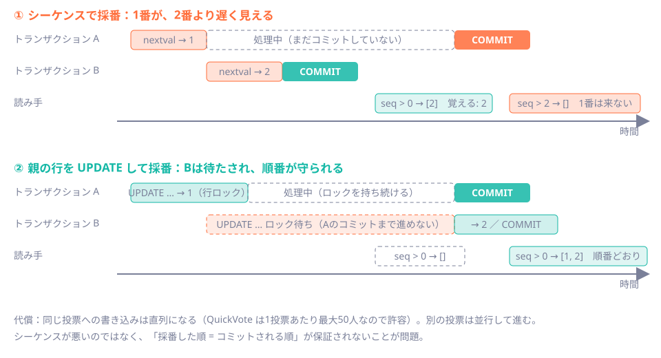
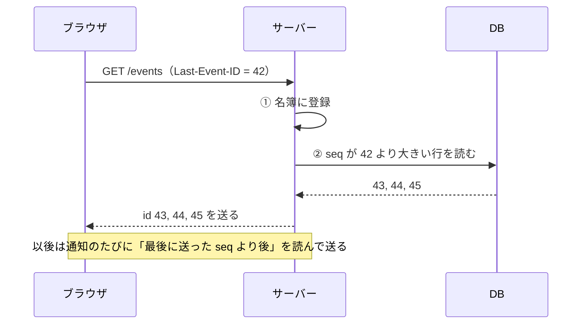

# 第37章 取りこぼしを防ぐ：イベント履歴とLast-Event-ID

<div class="goal-box" markdown>

この章でできるようになること

- 切断中に起きた更新を、再接続したときに**順番どおり・欠けなく**取り戻す設計を説明できる
- 「採番の順 ≠ コミットの順」の罠を実験で再現し、行ロックによる採番で防ぐ理由を説明できる
- `Last-Event-ID` による再送、重複の排除、`RESYNC`（全量の取り直し）の役割を区別できる
- 500件ページの再送が止まった事故を、原因からテストまで説明できる
- 「イベントの通知」と「イベントの正（DBの履歴）」を分ける設計の利点を言える
- （発展）配信まわりの事故集：購読の名簿の競合（Java の並行性）と、クライアントの応答順の競合を、再現して説明できる。本章の主題ではないので、後半にまとめた

</div>

## 1. 問いかけ：トンネルに入っている間の投票は、どうなる？

電車でQuickVoteの画面を開いています。トンネルに入って、通信が切れました。その間に、他の参加者が3回投票しました。トンネルを出ると、`EventSource` は自動でつなぎ直します。

**見逃した3回は、どうなるでしょう。**

何もしなければ、取り戻せません。SSE は「流れてきたものを受け取る」だけで、過去には戻れないからです。次に誰かが投票するまで、あなたの棒グラフは**古いまま**です。しかも、古いことに自分では気づけません。

前の章で、ブラウザが `Last-Event-ID` を送り返すことは見ました。この章では、**サーバーがその続きをどう用意するか**を作ります。キーワードは「履歴」と「連番」です。

## 2. 動画で見る：切断と再接続

<div class="video-card">
  <video controls preload="metadata" poster="../../assets/videos/sse-resume.jpg">
    <source src="../../assets/videos/sse-resume.mp4" type="video/mp4">
  </video>
  <p class="video-caption">▶ SSEの切断とLast-Event-ID</p>
  <p class="video-credit">音声：VOICEVOX:冥鳴ひまり</p>
</div>

**動画の要点**

- イベントには**番号**が付いていて、届くたびに得票バーが伸びる。トンネルで切れている間も、サーバーでは43、44、45が起きて、**DBの履歴台帳**に積まれる
- 再接続のとき、ブラウザは「最後に受け取ったのは42」と伝える（`Last-Event-ID`）。サーバーは台帳から43〜45を**先に**送り、そのあとライブ配信に合流する
- 取りこぼしを避けるために少し重ねて送るので、**同じ番号が2回届くことがある**。番号を見て、2回目を無視する
- 台帳の保存期間を過ぎた分は取り戻せない。その場合は差分ではなく、**現在の状態をまるごと取り直す**

??? note "字幕全文"
    ラジオ局にたとえて、SSEの再接続を見てみましょう。
    SSEは、サーバーからブラウザへ、ずっと流し続ける仕組みです。
    イベントには番号が付いていて、届くたびに得票バーが伸びます。
    ところが、トンネルに入って、電波が切れました。
    その間も、サーバーでは43、44、45が起きています。
    これらは、DBの履歴台帳に積まれていきます。
    でもブラウザは、その間に何が起きたか、知りません。
    電波が戻ると、EventSourceが自動で再接続します。
    そのとき「最後に受け取ったのは42」と伝えます。これがLast-Event-IDです。
    サーバーは台帳から、43から45を先に送ります。
    そのあと、ライブ配信に合流して、46以降が続きます。
    つまり、切れていた間の分も、順番に取り戻せます。
    ときどき、同じ番号が重複して届くことがあります。
    取りこぼしを避けるため、少し重ねて送るからです。
    ブラウザは番号を見て、2回目を無視します。
    ただし、台帳には保存期間があり、過ぎた分は消えています。
    その場合は、差分ではなく、現在の状態をまるごと取り直します。
    これで、画面は最新の状態に追いつきます。
    切れても、台帳から続きを届ける。

動画の登場人物は、コードでは次のように対応します。

| 動画 | コード |
| --- | --- |
| イベントの番号（43、44…） | `poll_events.seq`。SSE の `id:` にそのまま使う |
| DBの履歴台帳 | テーブル `poll_events`（主キー `(poll_id, seq)`） |
| 「最後に受け取ったのは42」 | リクエストヘッダー `Last-Event-ID: 42` |
| 台帳から先に送り、ライブに合流 | `PollEventHub.subscribe`（登録 → 再送を頼む） |
| 同じ番号を無視する | サーバー側の `lastSentSeq`、クライアント側の描画済み連番 |
| 現在の状態をまるごと取り直す | イベント `RESYNC` を受けて、`GET /api/polls/{id}` をやり直す |

## 3. 全体の設計：「通知」と「正」を分ける

QuickVote の方針を先に1文で言います。

> **通知は「何か起きた」という合図にすぎない。何が起きたかの正は、DBの履歴（`poll_events`）。**

投票1回の流れです。

| 順 | 処理 | 要点 |
| --- | --- | --- |
| 1 | `PUT /my-vote` を受ける | |
| 2 | `polls` 行を `FOR UPDATE` でロック | この投票への書き込みを直列にする |
| 3 | `votes` を UPSERT | |
| 4 | 採番（`last_event_seq + 1`） | 次の節で詳しく見る |
| 5 | `poll_events` に INSERT | 手順3・4と同じトランザクション |
| 6 | `pg_notify` | **COMMIT まで保留**される |
| 7 | COMMIT | ここで初めて通知が配送される |
| 8 | 各インスタンスが履歴を読み直して送る | 通知の中身は使わない |

「通知の中身を信用せず、DBを読み直す」設計には、3つの利点があります。

- **通知を取りこぼしても、次の通知や再接続で追いつける。** 通知は「合図」なので、失われても、履歴は DB に残っている
- **自分のインスタンスの変更も、他のインスタンスの変更も、同じ経路**で届く（[第38章](ch38-multi-instance.md)）
- **再送と通常配信が同じコード**になる。「`lastSentSeq` より後を DB から読んで送る」だけ

## 4. 業務更新とイベント履歴を、同じトランザクションで保存する

まず、イベントを保存する場所です。

```java title="src/main/java/com/example/quickvote/event/PollEventService.java（抜粋）"
@Transactional(propagation = Propagation.MANDATORY)                 // (1)!
public void append(long pollId, String type, Map<String, Object> payload) {
    long seq = repository.nextSeq(pollId);                          // (2)!
    repository.insert(pollId, seq, type, jsonMapper.writeValueAsString(payload), Db.now(clock));
    repository.notifyPoll(pollId);                                  // (3)!
}
```

1. 呼び出し側にトランザクションがなければ**例外**にする。「業務更新と同じトランザクション」という前提を、コードで強制する（[第27章](../part05/ch27-idempotency.md)の冪等性記録と同じ考え方）
2. 連番を取る（次の節）
3. `pg_notify` は**コミット時に初めて配送**され、ロールバックなら破棄される

投票の側からは、こう呼ばれます。

```java title="src/main/java/com/example/quickvote/vote/VoteService.java（抜粋）"
@Transactional
public VoteResponse vote(long visitorId, UUID pollPublicId, long optionId) {
    ParticipantContext context = access.require(pollPublicId, visitorId);
    Poll poll = polls.lockById(context.pollId()).orElseThrow(...);   // 親行ロック
    ...
    boolean changed = votes.upsert(poll.id(), context.participantId(), optionId, now) > 0;
    if (changed) {                                                   // 票が変わったときだけ
        events.append(poll.id(), "VOTE_CAST", Map.of("optionId", optionId));
    }
    return new VoteResponse(optionId);
}
```

**なぜ同じトランザクションなのか。** 別々にすると、次の2つが起きます。

| 順序 | 失敗したとき |
| --- | --- |
| 先に票を保存し、あとでイベントを保存 | 票は入ったのに、イベントがない。**棒グラフが永遠に更新されない** |
| 先にイベントを保存し、あとで票を保存 | イベントはあるのに、票がない。**存在しない票を、全員に知らせる** |

同じトランザクションなら、**両方残るか、両方消えるか**です。QuickVote のテスト（`PollEventIT`）は、失敗・ロールバックで、イベントも採番も残らないことを確かめています。

!!! tip "第22章の銀行振込と同じ"
    「票の記録」と「イベントの記録」は、2つの口座の出し入れと同じです。片方だけ成功してはいけない、という条件を、トランザクションで守ります（[第22章](../part04/ch22-transactions.md)）。

`changed` の判定にも意味があります。同じ選択肢への再投票は、`ON CONFLICT ... WHERE option_id <> EXCLUDED.option_id` により0件更新となり、**イベントを出しません**。PUT が冪等なのと同じ理屈で、「何も変わっていない」ことは通知しません。

## 5. 事故：連番をシーケンスで振ると、1番が消える

イベントには、投票ごとの連番（`seq`）が要ります。「どこまで受け取ったか」を、1つの数字で言えるからです。

PostgreSQL には、連番専用の**シーケンス**（`nextval`）があります。素直に考えれば、これを使いたくなります。実際、多くのコードがそうしています。しかしこれは、`Last-Event-ID` による補完と**相性が悪い**のです。

### 再現する

2つのトランザクション A・B と、1秒ごとに「最後に見た番号より後」を読む読み手を、psql で動かします（`code/labs/ch37-event-history/seq-vs-commit.sh`。スクリプトは Git Bash で実行します。[第1章](../part00/ch01-setup.md)）。

- A は先に採番して、3秒かけてコミットする（遅いトランザクション）
- B は後から採番して、すぐコミットする

!!! question "予測カード"
    シーケンスで採番した場合、読み手は最終的に何番を見るでしょう。
    (a) 1番と2番の両方　(b) 2番だけ

```text
$ ./seq-vs-commit.sh sequence
3s  読み手: seq > 0 → [2:B ]
4s  読み手: seq > 2 → []
6s  読み手: seq > 2 → []
...
--- 最終的にテーブルにあるもの
 seq | who
-----+-----
   1 | A
   2 | B
```

答えは (b) です。**テーブルには1番も2番もある**のに、読み手には1番が**永久に見えません**。



原因は、シーケンスが「**採番した順**」に番号を配るだけで、「**コミットされる順**」は保証しないことです。A は1番を取ったあと、3秒かけてコミットします。その間に、2番を取った B がコミットし、読み手は「2番まで見た」と記録します。そのあと A の1番がコミットされても、読み手は**2番より後**しか読まないので、1番を二度と見ません。

!!! danger "本番で事故になるパターン：シーケンスで作った連番を、カーソルに使う"
    「最後に見た番号より大きいものを取る」という読み方は、**番号がコミット順に見えるときだけ**正しく動きます。テストでは、トランザクションが短く競合も稀なので、**ほぼ必ず動きます**。本番で、遅いトランザクションと速いトランザクションが重なった日に、**たまに1件だけ欠けます**。再現しにくく、ログにも出ません。

### QuickVote の直し方：親行を更新して採番する

```java title="src/main/java/com/example/quickvote/event/PollEventRepository.java（抜粋）"
/**
 * 連番の採番。polls 行の last_event_seq を +1 して、新しい値を受け取る。
 * 呼び出し側は、先に polls 行を FOR UPDATE でロックしている。この UPDATE は、その同じ鍵の下で動く。
 * 仮に FOR UPDATE を忘れた経路があっても、UPDATE 自体が行ロックを取り、トランザクションの終わりまで続く。
 * だから「採番した順 = コミットされる順」になり、seq が小さいイベントが後から見えることがない。
 */
public long nextSeq(long pollId) {
    return jdbc.sql("UPDATE polls SET last_event_seq = last_event_seq + 1 WHERE id = :pollId RETURNING last_event_seq")
            .param("pollId", pollId)
            .query(Long.class)
            .single();
}
```

同じ実験を、この方式で動かします。

```text
$ ./seq-vs-commit.sh rowlock
2s  読み手: seq > 0 → []
4s  読み手: seq > 0 → [1:A 2:B ]
6s  読み手: seq > 2 → []
```

B の採番（`UPDATE`）は、**A の行ロックが解けるまで待たされます**。A がコミットして初めて B が進み、2番を取ってコミットします。読み手が見るのは、最初は何もなし、次に**1番と2番が揃って**です。順番も保たれています（図の下段）。

これは[第25章](../part04/ch25-locking.md)の「親行ロック」と同じ道具です。ロックの取り方を整理すると、**守りは二重**になっています。

1. 各操作（投票・参加・選択肢追加）は、先に `polls` 行を `FOR UPDATE` でロックして、**鍵を持っています**。`nextSeq` の `UPDATE` は、その同じ鍵の下で動きます
2. 仮に `FOR UPDATE` を忘れた経路があっても、`UPDATE` 自体が行ロックを取るので、採番の順（＝コミットの順）は守られます

追加の仕組みは要りません。代償は、同じ投票への書き込みが直列になることです。1投票あたり最大50人なので、QuickVote では許容しています。別の投票には影響しません。

| 方式 | 採番順＝コミット順？ | 代償 |
| --- | --- | --- |
| シーケンス（`nextval`） | **保証されない** | なし（速い。穴も空く） |
| 親行の `UPDATE ... RETURNING`（QuickVote） | 保証される（ロックがコミットまで続く） | 同じ親への書き込みが直列になる |

## 6. 再接続：Last-Event-ID より後を再送する

連番が信頼できるので、再送は単純です。「`Last-Event-ID` より大きい `seq` を、小さい順に送る」だけです。

```bash
# 履歴は seq 1〜3。Last-Event-ID に 1 を付けて接続する
curl -sS -N -H 'Last-Event-ID: 1' -b bob.jar localhost:18138/api/polls/$PID/events
```

```text
:connected
retry:3000

id:2
event:VOTE_CAST
data:{"optionId": 1}

id:3
event:VOTE_CAST
data:{"optionId": 2}

:heartbeat
```

比べるために、ヘッダーなし、そして**サーバーの最新より大きい番号**（999）でつないだ結果も並べます。

| 接続のしかた | 受け取るもの |
| --- | --- |
| ヘッダーなし（新規接続） | 過去は送らず、**いまの最新から**。画面は最初に `GET` で取る |
| `Last-Event-ID: 1` | `id:2`、`id:3` を再送し、そのあとライブ配信 |
| `Last-Event-ID: 999`（最新は3） | `id:3` / `event:RESYNC` / `data:{}` |

3行目が `RESYNC` です。クライアントがサーバーより**先に進んでいる**のは、DBが作り直されたなど、履歴では補えない状態です。そのときは差分を送らず、「**最初から取り直して**」という合図を送ります。

`RESYNC` に `id:3`（サーバーの最新の `seq`）が付くのは、ブラウザが覚えている `lastEventId` を**正しい値に戻す**ためです。ブラウザは最後に受け取った `id:` を覚えて、次の再接続の `Last-Event-ID` に使います。`id:` を付けないと、999 を送り続けて、再接続のたびに `RESYNC` になります。コードでも、`RESYNC` の `PollEvent` は最新の `seq` で作られ、通常のイベントと同じく `id:` に `seq` が書かれます（`PollEventHub.deliver`、`PollEventController`）。

### 順序：登録してから、再送を頼む

接続時の処理は、次の順序で書かれています。

```java title="src/main/java/com/example/quickvote/event/PollEventHub.java（抜粋）"
public Subscription subscribe(long pollId, @Nullable Long lastEventId, EventSink sink) {
    long latest = events.lastSeq(pollId);
    Subscription subscription = new Subscription(pollId, sink, lastEventId == null ? latest : lastEventId);
    if (lastEventId != null && lastEventId > latest) {
        subscription.resyncSeq = latest;          // クライアントの方が先に進んでいる → RESYNC を送る
    }
    subscriptions.compute(pollId, (id, set) -> {  // ① 名簿に登録
        Set<Subscription> target = set != null ? set : ConcurrentHashMap.newKeySet();
        target.add(subscription);
        return target;
    });
    request(subscription);                         // ② 再送を頼む
    return subscription;
}
```



**順序を逆にするとどうなるか。** 「先に再送、あとで登録」だと、再送を読んでから登録するまでの**わずかな間**に起きた更新が、再送にも載らず、通知も受けられません。**1件だけ消える**事故です。先に登録しておけば、再送中に起きた変更の通知も受け取れます。

## 7. 重複の排除

先に登録して、あとから再送する以上、**同じイベントが再送と通知の両方から届きうる**ことになります。そこで、購読者ごとに `lastSentSeq`（最後に送った番号）を持ちます。

```java title="PollEventHub.deliver（抜粋）"
page = events.findAfter(subscription.pollId, subscription.lastSentSeq);   // 最後に送った番号より後だけ読む
for (PollEvent event : page) {
    send(subscription, event);
    subscription.lastSentSeq = event.seq();                                // 送れたら進める
}
```

通知が何回来ても、**読むのは「まだ送っていない分」だけ**なので、重複しません。通知が重なっても、配信は購読者ごとに同時に1つだけ（[第36章](ch36-sse.md)の §8「QuickVote の直し方」にある `request` / `drain`）なので、順序も崩れません。

動画で「ブラウザは番号を見て2回目を無視する」と言っていたのは、**防御を二重にする**考え方です。QuickVote の静的クライアントは、イベントを受けたら**詳細を取り直して描画する**だけなので、同じイベントが2回来ても結果は同じです（冪等）。クライアントで番号を見る実装にする場合も、サーバー側の排除を捨てる理由にはなりません。

## 8. 事故：500件ページの再送が止まった

履歴を1回で全部読むと、遅れが大きいときに、メモリも書き込みも膨らみます。そこで QuickVote は、`PAGE_SIZE = 500` 件ずつ読みます。ところが、これがシニアレビューで、**取りこぼしの原因**として指摘されました（指摘5）。

修正前の動きを、再現できる版で試します。`poll_events` に1,203件の履歴を入れ、`Last-Event-ID: 0` でつなぎます（`code/labs/ch38-multi/` の `onepage.jar` は、ページを読み進める1行だけを外した版）。

!!! question "予測カード"
    履歴が1,203件あり、`Last-Event-ID: 0` で接続します。受け取れるイベントは何件でしょう。
    (a) 500件で止まる　(b) 1,203件全部

```text
=== reference（現在の QuickVote）
受け取った id: 1203 件
=== onepage（修正前）
id:1 ... id:500        ← 500件で止まった
--- 修正前版に、新しい投票を1票入れると
受け取った id: 1204 件  ← 止まっていた続きが、一気に届く
```

修正前は、**501件目以降が、次の通知が来るまで届きません**。誰も投票しなければ、そのまま止まっています。接続は生きていて、ハートビートも流れているので、**画面からは異常に見えません**。

原因は、1回の配信が「最初のページ」で終わっていたことです。直しは、**ページが満杯なら、続きを読み進める**ことです。

```java title="src/main/java/com/example/quickvote/event/PollEventHub.java（抜粋）"
List<PollEvent> page;
do {
    page = events.findAfter(subscription.pollId, subscription.lastSentSeq);
    for (PollEvent event : page) {
        if (subscription.closed) {
            return;
        }
        send(subscription, event);
        subscription.lastSentSeq = event.seq();
    }
    // 満杯のページが返ったら、まだ続きがある。次の通知を待たずに読み進める。
} while (page.size() >= PollEventService.PAGE_SIZE);
```

回帰テストは、未送信が501件・1,200件の場合に、**次の通知なしで最後まで届く**ことを確かめます（`PollEventIT`、`PollEventHubTest`）。

!!! warning "境界で止まるバグは、ふだんのテストに現れない"
    ページサイズ（500）より少ない履歴では、このバグは**絶対に起きません**。「ページングで読む」コードは、**ちょうどページサイズ・ページサイズ＋1**のデータでテストします（ページングの境界は、[第20章](../part03/ch20-query-index.md)でも見た、いちばんバグが出やすい場所です）。

## 9. RESYNC：差分で追いつけないとき

動画の最後の場面です。履歴が残っていなかったら、差分は送れません。このとき必要なのが、**状態そのものを取り直す**逃げ道です。

QuickVote の `RESYNC` は、いまのところ「クライアントがサーバーより先に進んでいる」場合だけ送ります。

!!! note "QuickVote の限界（正直に書く）"
    - **履歴は削除していません。** 投票と一緒に `CASCADE` で消えるだけです。したがって「履歴が切り詰められた」場合の `RESYNC` は実装していません
    - 履歴を切り詰める設計にするなら、**「保存している最小の `seq`」を持ち、`Last-Event-ID` がそれより小さければ `RESYNC`** を送る必要があります
    - 投票が削除されても、購読者には通知されません。次の接続で404になり、クライアントが気づきます

この設計の背景には、もう1つの安全網があります。クライアントは、**接続できる（再接続を含む）たびに、詳細を取り直します**。最初の `GET` と接続の間の隙間を埋めるためです。だから、`Last-Event-ID` の補完が万一失敗しても、**画面は再接続のたびに正しい状態に戻ります**。`RESYNC` が必要なのは、接続は切れずに、サーバー側だけが状態を失った場合です。

## 10. この時点の保証

第37章までで、QuickVote は次のことを守ります。

| 守ること | どう守るか |
| --- | --- |
| 業務更新とイベントが片方だけ残らない | 同じトランザクション（`MANDATORY`） |
| ロールバックしたら通知も出ない | `pg_notify` はコミット時に配送され、ロールバックで破棄される |
| 採番の順＝コミットの順 | 親行（`polls`）の `UPDATE` による採番（行ロックがコミットまで続く） |
| 切断中の更新を、順番どおり取り戻す | `Last-Event-ID` より後を、`seq` 順に再送 |
| 重複しない | `lastSentSeq` |
| 500件を超えても届く | 満杯なら読み進める |

**まだ守れていないこと**があります。

- **アプリが2台になると、隣のサーバーにつないだ人には届かない**（名簿が各JVMのメモリにあるため）。→ [第38章](ch38-multi-instance.md)
- 履歴の切り詰めと、それに伴う `RESYNC`
- 投票の削除の通知

## 現場ではこうする

| 見るもの | 判断 |
| --- | --- |
| 連番の作り方 | カーソル（「この番号より後」）に使う連番は、**コミット順**になっているか。シーケンスなら要注意 |
| 保存と通知 | 業務更新と同じトランザクションか。通知はコミット後に配送されるか |
| 再送の順序 | 「先に登録 → 再送」か。逆ではないか |
| ページング | ページサイズ・ページサイズ＋1 のデータでテストしたか。続きを読み進めているか |
| 通知の扱い | 通知の中身を信用せず、DBを正にしているか |

## まとめ：3点セット

!!! abstract "この章の3点セット"
    **① 一言で言うと**
    SSE の取りこぼしは、イベントの履歴を業務更新と同じトランザクションで保存し、投票ごとに行ロックの下で連番を振り、再接続で `Last-Event-ID` より後を再送することで防ぐ。通知は合図にとどめ、何が起きたかの正は DB の履歴にする。差分で追いつけないときは、全量の取り直し（`RESYNC`）を指示する。

    **② 現場でこう聞かれる**
    「連番に PostgreSQL のシーケンスを使えば、ID の順に再送できませんか？」
    → できない。シーケンスは採番の順に番号を配るだけで、コミットの順は保証しない。遅いトランザクションの小さい番号が、あとからコミットされると、「最後に見た番号より後」を読む方式では二度と見えない。コミット順になる連番（親行のロックの下で採番するなど）が要る。

    **③ 自分のサービスならどこに当たるか**
    「あとから来た人・再接続した人に、見逃した更新を渡したい」場所を挙げる。その更新を記録する履歴が、業務更新と同じトランザクションにあるか、履歴の連番がコミット順か、確認する。

    （購読の名簿の競合と、クライアントの応答順の競合は、章末の「発展」にまとめた。3点セットと演習は、本編の範囲です。）

## 演習

??? question "確認問題1：予測と実行"
    `seq-vs-commit.sh sequence` の A の `pg_sleep` を、3秒から0秒に変えて実行します。結果はどうなると予想しますか。この結果から、「テストが通った」ことを、どう評価すべきでしょう。

??? success "解答"
    A も B もほぼ同時にコミットされ、読み手は1番と2番を**順に見る**ことが多いでしょう（実行のタイミング次第）。**競合が起きる確率が低いだけで、安全ではありません。** 遅いトランザクションが必ず混ざる本番を再現するには、意図的に A を遅らせるなど、**条件を厳しくして**確かめます（[第26章](../part04/ch26-concurrency-testing.md)）。

??? question "確認問題2：どちらの順序か"
    再接続時の処理を、「①履歴を読んで送る → ②名簿に登録する」の順に書いた実装があります。どんな更新が失われるでしょう。登録を先にすると、なぜ防げるのですか。

??? success "解答"
    ①と②の**間**に起きた更新です。①の読み出しには載らず、②の時点ではまだ登録されていないので通知も受け取れません。登録を先にすれば、再送を読んでいる間に起きた更新の通知は受け取れます。そのぶん、再送と通知で**同じイベントが二重に届きうる**ので、`lastSentSeq` で重複を排除します。

??? question "確認問題3：500件のテスト"
    ページサイズ500で履歴を読み進める処理のテストを書きます。履歴の件数は、どの値を使うべきですか。

??? success "解答"
    **0件、1件、499件、500件、501件、1,000件、1,001件**など。特に**500件ちょうど**（満杯のページが返るが、続きはない）と**501件**（続きが1件ある）が境界です。QuickVote の `PollEventIT` は、501件と1,200件を使っています。

??? question "応用：QuickVote に小さな変更"
    投票の削除を、SSE の購読者にも通知したいとします（`POLL_DELETED` イベント）。履歴テーブル `poll_events` は、投票と一緒に `CASCADE` で消えます。この設計で、何が問題になりますか。

??? success "解答"
    投票の行と一緒に履歴も消えるので、**「削除された」という履歴を残せません**。削除の通知は、履歴ではなく `pg_notify` で「削除された」という合図を直接流し、購読者に `complete()` させるなど、別の経路が必要です。再接続してきたクライアントは、投票がもう存在しないので404になります（現在の挙動）。**どのイベントを履歴に残し、どれを合図にとどめるか**を、イベントごとに決める設計の問題です。

??? question "説明問題：現場でこう聞かれる"
    「業務の更新とイベントの保存を、なぜ同じトランザクションにするのですか？」200字程度で答えてください。

??? success "解答"
    例：別々だと、片方だけ成功した状態ができるからです。票は入ったのにイベントがなければ、画面が更新されません。イベントだけあって票がなければ、存在しない更新を全員に知らせてしまいます。同じトランザクションなら、両方残るか、両方消えるかです。通知（`pg_notify`）も、コミット時に初めて配送され、ロールバックなら破棄されるので、コミットされた変更だけが通知されます。

---

## 発展：配信まわりの事故集

!!! note "この節の位置づけ"
    本章の主題を理解したら読む。読み飛ばしても次の章に進める。

    ここの2つは、章題（イベント履歴と `Last-Event-ID`）の外にある話題です。1つ目は購読の名簿の競合（Java の並行性）、2つ目はクライアント（`app.js`）の応答順の競合です。どちらもシニアレビューで実際に見つかりました。

### 発展1　事故：購読の登録と解除が競合して、購読が消えた

この事故は、名簿の更新そのものです。第6節の `subscribe` の「① 名簿に登録」の中身の話です。`PollEventHub` は、投票IDごとの購読者の集合を `ConcurrentHashMap` に持っています。最後の1人が切断したら、集合ごと名簿から外します（空の集合を残さないため）。

修正前の登録は、こう書かれていました（指摘4）。

```java
registry.computeIfAbsent(pollId, id -> ConcurrentHashMap.newKeySet()).add(who);   // 取得・作成 と 追加が別の操作
```

そして、解除は次のとおりです。

```java
registry.computeIfPresent(pollId, (id, set) -> {
    set.remove(who);
    return set.isEmpty() ? null : set;      // 空になったら、集合ごと名簿から外す
});
```

2つが**同時に**起きると、次の順で動くことがあります。

1. 登録側が `computeIfAbsent` で、**既存の集合**（最後の1人 `old` が入っている）を手に入れる
2. 解除側が `old` を消し、集合が空になったので、**集合ごと名簿から外す**
3. 登録側が、**もう名簿にない集合**に `new` を `add` する

`new` は、名簿に載っていない集合に入っています。**以後、通知もハートビートも `new` には届きません。** 接続は開いたままなのに、画面は**静かに止まります**。

`ConcurrentHashMap` は「どの操作も安全」ですが、**「取得してから追加」という2操作の間は守ってくれません**（[第9章](../part01/ch09-threads.md)の check-then-act と同じです）。

#### 再現する

この競合だけを取り出して、2万回繰り返します（`code/labs/ch37-event-history/RegistryRace.java`）。

```text
$ java RegistryRace.java
computeIfAbsent(...).add : 購読が消えた回数 = 101 / 20000
compute でひとまとめ       : 購読が消えた回数 = 0 / 20000
（実行のたびに違う。別の2回では 63 と 40。直した版は、毎回 0）
```

20,000回のうち、**数十〜百回**。0.2〜0.5%ほどです。1回の実行では、通ってしまうことが十分ありえます。

#### 直し方：取得・作成・追加を、1つの操作に

```java title="src/main/java/com/example/quickvote/event/PollEventHub.java（抜粋）"
// 「Set の取得・作成・追加」を compute の中でひとまとめにする。
// close() も同じキーの compute 系なので、同じキーに対する操作は直列になる。
subscriptions.compute(pollId, (id, set) -> {
    Set<Subscription> target = set != null ? set : ConcurrentHashMap.newKeySet();
    target.add(subscription);
    return target;
});
```

`compute` は、**同じキーに対する操作を直列にします**。解除の `computeIfPresent` と同じキーなので、「追加の途中で集合が外される」ことがなくなります。`PollEventHubTest` は、登録と最後の解除を20,000回同時に開始して、登録した購読が消えないことを確かめます（旧実装では失敗することも確認済みです）。

!!! tip "フロントエンドで例えると"
    React の `setState(prev => ...)`（更新関数）と `setState(value)` の違いに近い話です。「いまの値を読む」と「書く」を別々にやると、間に他の更新が割り込みます。更新関数にまとめれば、割り込めません。ただしJavaでは、割り込むのは**本当に同時に動いている別のスレッド**です。

### 発展2　コラム：静的クライアントの EventSource ― 応答の順番が入れ替わる { #column-app-js }

ここは、フロントエンドのプロである読者に向けた話です。QuickVote の静的クライアント（`src/main/resources/static/app.js`）は、SSE の通知を受けるたびに**詳細を取り直して**描画します。

```js
for (const t of ['PARTICIPANT_JOINED', 'OPTION_ADDED', 'VOTE_CAST', 'POLL_CLOSED']) {
  es.addEventListener(t, () => refresh());       // 通知のたびに詳細を取り直す
}
```

素朴に書くと、通知が来るたびに `fetch` を投げます。10回続けて通知が来れば、10本の `fetch` が**並行して**走ります。HTTP の応答は、**投げた順に返ってくる保証がありません**。1回目の応答が遅く、2回目が速ければ、画面は **2回目（新しい）→ 1回目（古い）** の順に描画され、**古い状態に巻き戻ります**（シニアレビューの指摘10）。

```text
$ refresh-race.js（ネットワークを setTimeout で模擬。1回目は300ms、2回目は50msで返る）
悪い版が描画した lastEventSeq の順番 : [2,1] ← 最後が 1。画面が巻き戻る
守る版が描画した lastEventSeq の順番 : [1,2] ← 最後は常に最新
```

React で `useEffect` の中から `fetch` したときの、**古い応答が後から `setState` する競合**と同じものです。`app.js` は、3つの守りを重ねています。

```js title="src/main/resources/static/app.js（抜粋）"
async function refresh() {
  if (!currentPollId) return;
  if (refreshing) {              // 守り1: 同時に取得するのは1つだけ
    refreshAgain = true;         //       取得中の通知は「もう1回」にまとめる
    return;
  }
  refreshing = true;
  try {
    do {
      refreshAgain = false;
      const generation = viewGeneration;
      const p = await api('GET', `/api/polls/${currentPollId}`, undefined, {}, AbortSignal.timeout(15000));
      if (generation !== viewGeneration) continue;   // 守り2: 取得中に別の画面へ移ったら捨てる
      if (p.lastEventSeq < shownSeq) continue;       // 守り3: 描画済みより古い状態は捨てる
      shownSeq = p.lastEventSeq;
      renderPoll(p);
    } while (refreshAgain);
  } finally {
    refreshing = false;
  }
}
```

| 守り | 防ぐもの |
| --- | --- |
| ① 同時に1つだけ取得・通知は束ねる | 応答の順番の入れ替わりそのもの。リクエストも減る |
| ② 画面の世代（`viewGeneration`） | 別の投票へ移ったあとに、前の投票の応答が届いて描画される |
| ③ `lastEventSeq` の比較 | 同じ投票で、古い状態が新しい状態を上書きする |

②の「世代」は、`AbortController` で中断する方法と並ぶ定番の書き方です。③の `lastEventSeq` は、サーバーが詳細の応答に**その時点のイベント連番**（`lastEventSeq`）を入れているから使えます。`REPEATABLE READ` の1つのスナップショットで読むので、票数と連番は**同じ時点**です。

`RESYNC` を受けたときだけ、`shownSeq = -1` に戻します。サーバーの状態が作り直されると、連番が**巻き戻りうる**ので、「描画済みより古い」の比較を、いったん忘れる必要があるからです。

!!! note "この部分には、自動テストがありません"
    静的クライアントのJavaScriptは、ブラウザでの手動確認（詳細取得の応答順の入れ替え・別の投票への切り替え）だけです。サーバー側の仕組みは自動テストで固めてありますが、**クライアントの競合は、第37章の範囲では、実験で確かめるところまで**です。

### 発展の確認

??? question "発展の確認問題1：名簿の競合"
    `registry.computeIfAbsent(pollId, ...).add(who)` は、`ConcurrentHashMap` の操作だけで書かれているのに、なぜ購読が消えるのですか。

??? success "解答"
    `computeIfAbsent`（取得・作成）と `add`（追加）が**2つの別の操作**だからです。その間に、別のスレッドの `computeIfPresent` が最後の1人を消して、空になった集合を名簿から外すことがあります。`add` は、もう名簿にない集合に入るので、通知もハートビートも届きません。`compute` の中で取得・作成・追加をまとめると、同じキーへの操作が直列になり、防げます。

??? question "発展の確認問題2：応答の順番"
    通知のたびに `fetch` で詳細を取り直すクライアントで、画面が古い状態に巻き戻ることがあります。なぜですか。`app.js` は、どう防いでいますか。

??? success "解答"
    `fetch` を並行して投げると、応答が**投げた順に返る保証がない**からです。遅い1回目の応答が、速い2回目の後に届くと、古い状態が新しい状態を上書きします。`app.js` は、同時に取得するのを1つにして通知を束ねること、画面の世代で別の投票の応答を捨てること、`lastEventSeq` が描画済みより古い応答を捨てることの3つで防いでいます。
