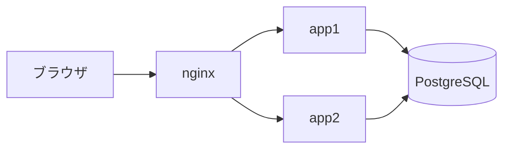
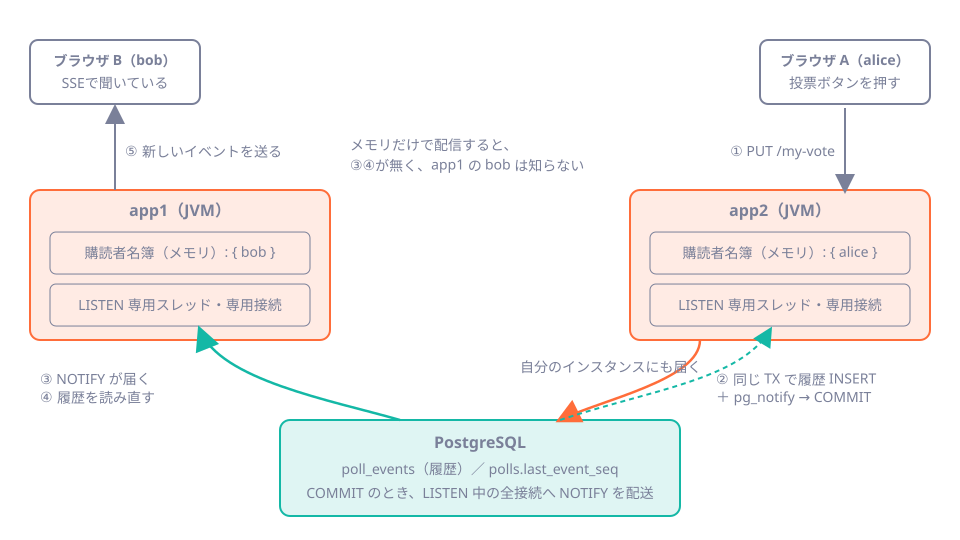

# 第38章 2台構成で起きること

<div class="goal-box" markdown>

この章でできるようになること

- アプリを2台にしたとき、「隣のサーバーにつないだ人に届かない」事故を実際に再現できる
- PostgreSQL の `LISTEN` / `NOTIFY` で、インスタンス間の通知を橋渡しする仕組みと、その限界を説明できる
- Redis Pub/Sub との違いを、保証と運用の面から言える
- nginx の後ろに SSE を置くときの設定（`proxy_buffering`・`proxy_read_timeout`）を、実測をもとに決められる
- セッション・レート制限・スケジューラ・DB接続数を、台数を2にして見直す表を、自分のサービスで作れる

</div>

## 1. いきなり事故：隣のサーバーにつないだ人に届かない

ここまで QuickVote は、1台のアプリで動かしてきました。人が増えたので、アプリを2台にして、前に nginx を置きます。コードは1行も変えません。



実験環境は `code/labs/ch38-multi/` にあります。`build.sh` は、QuickVote からメモリ配信のみの版（`naive.jar`）を作ります。リファレンス実装との違いは、台をまたぐ通知だけです。`pg_notify` を呼ばず、コミットの後で同じJVMの購読者にだけ直接知らせます（イベント履歴はDBにあります）。「通知はメモリの中で済ませる」と考えた素朴な実装に当たります。ハートビートも、コメント行を書くだけにしてあります。

```bash
./build.sh                         # jars/ に reference / naive / nocloseall / onepage を作る
APP_JAR=naive docker compose up -d # PostgreSQL ＋ app1 ＋ app2 ＋ nginx を起動
./scripts/neighbor.sh
```

シナリオは次のとおりです。

1. alice が app1 で投票を作る
2. bob が、app2 経由で参加する（状態は DB にあるので、別の台から参加できる）
3. bob は app1 の SSE につなぐ
4. alice が、app2 から2回、app1 から1回、投票を切り替える

!!! question "予測カード"
    bob の画面（app1 の SSE）には、alice の投票のイベントが、いつ・何件届くでしょう。
    (a) 3件とも、投票の直後に届く
    (b) app2 での2件は届かない
    (c) app2 での2件は、app1 での投票と一緒に届く

```text
=== naive（メモリ配信のみ）
bob が app2 経由で参加: MEMBER
--- alice が app2 から投票 (Curry)
--- alice が app2 から投票 (Ramen)          ← bob には何も届かない
--- alice が app1 から投票 (Curry)
  [bob@app1 10s] id:2
  [bob@app1 10s] data:{"optionId": 13}
  [bob@app1 10s] id:3                      ← app2 の2件が、いまになって届く
  [bob@app1 10s] data:{"optionId": 14}
  [bob@app1 10s] id:4
  [bob@app1 10s] data:{"optionId": 13}
```

答えは (c) です。DB には `id:2` と `id:3` がすでにあり（`poll_events` を見れば4件並んでいます）、それでも bob の画面は、app1 で次に何かが起きるまで止まったままでした。

!!! note "「永久に届かない」ではなく「止まって見える」理由"
    QuickVote の `PollEventHub` は、通知の中身を使わず、DBの履歴から「最後に送った番号より後」を読み直して送ります（[第37章](ch37-event-history.md)）。そのため、app1 で次の更新が起きれば、app2 で起きた分もまとめて追いつきます。メモリのイベントオブジェクトをそのまま配る素朴な実装なら、app2 の更新は永久に届きません。
    DBを正にした設計のおかげで、被害は「欠落」から「遅延」に減っています。ただし遅延でも、リアルタイムではありません。更新が稀な投票ほど、長く止まります。

    なお、リファレンス実装は、ハートビート（既定15秒）のたびにも同じ読み直しを頼みます。そのため、`pg_notify` だけを止めた版（ハートビートの処理は元のまま）でも、ハートビートの間隔以内には追いつくことを、実験で見ました。これは偶然働く安全網なので、15秒の遅れに頼った設計にしてはいけません。この章の `naive.jar` は、安全網も外してあります。

nginx の後ろでも同じです。bob の SSE がどちらかの台につながり、alice の投票は交互に振り分けられるので、2回に1回は隣の台で起きます。

```text
=== nginx（ラウンドロビン）経由、naive。alice は6回、投票を切り替える
3s alice の更新 1          ← app2 で処理された。bob（app1 につながっている）には届かない
5s alice の更新 2          ← app1 で処理された
5s id:2   5s id:3          ← ここで、1の分もまとめて届く
6s alice の更新 3
8s alice の更新 4
8s id:4   8s id:5
```

奇数番目の更新は次の偶数番目まで届かず、1〜2秒遅れて2件ずつ届きました（全6件は届いています）。更新が毎秒あるなら「ちょっと遅い」で済んで気づかれません。しかし、1票入れたあとしばらく誰も入れない投票では、その1票が止まったままになります。

## 2. 原因：購読者の名簿は、JVM のメモリの中にある



[第37章](ch37-event-history.md)の `PollEventHub` の名簿（`Map<Long, Set<Subscription>>`）は、そのJVMのメモリにあります。bob の接続は app1 のソケットで、app2 は bob の存在を知りません。

[第9章](../part01/ch09-threads.md)では、`synchronized` や `AtomicInteger` が効くのは1つのJVMの中だけだと書きました。同じ話です。メモリ上のものは、台数が増えた瞬間に共有されなくなります。

| 1台のときは成り立つこと | 2台だと |
| --- | --- |
| 変更を処理した台が、全購読者を知っている | 購読者は、別の台にもいる |
| メモリの名簿へ配ればよい | 台をまたぐ通知の経路が要る |
| `synchronized` で守れる | 守れない（DBのロックなど、共有できる場所で） |

## 3. 直し方：PostgreSQL の LISTEN/NOTIFY で橋渡しする

必要なのは、「どこかの台で変更があった」という合図を全台に届ける経路です。QuickVote には、すでに全台が共有しているものがあります。PostgreSQL です。

!!! note "用語：LISTEN / NOTIFY（リッスン・ノーティファイ）"
    PostgreSQL の通知機能です。接続が `LISTEN チャンネル名` を実行しておくと、誰かが `NOTIFY チャンネル名, '文字列'`（または `pg_notify()`）を実行したとき、LISTEN している接続にだけ通知が届きます。通知はトランザクションがコミットされた時点で配送され、ロールバックなら破棄されます。

業務更新のトランザクションの中で `pg_notify` を呼んでおけば、コミットされた変更だけが通知されます（[第37章](ch37-event-history.md)の `append`）。

```java title="src/main/java/com/example/quickvote/event/PollEventRepository.java（抜粋）"
public void notifyPoll(long pollId) {
    jdbc.sql("SELECT pg_notify(:channel, :payload)")
            .param("channel", CHANNEL)                      // "poll_events"
            .param("payload", String.valueOf(pollId))       // 中身は投票IDだけ（合図にとどめる）
            .query()
            .singleValue();
}
```

受け取る側は、各インスタンスの `PollEventListener` です。

```java title="src/main/java/com/example/quickvote/event/PollEventListener.java（抜粋）"
private void loop() {
    while (running) {
        try (Connection connection = DriverManager.getConnection(connectionDetails.getJdbcUrl(),   // (1)!
                connectionDetails.getUsername(), connectionDetails.getPassword())) {
            try (Statement statement = connection.createStatement()) {
                statement.execute("LISTEN " + PollEventRepository.CHANNEL);
            }
            hub.deliverAll();                                                                        // (2)!
            PGConnection pgConnection = connection.unwrap(PGConnection.class);
            while (running) {
                PGNotification[] notifications = pgConnection.getNotifications(POLL_TIMEOUT_MILLIS); // (3)!
                if (notifications == null) {
                    continue;
                }
                for (PGNotification notification : notifications) {
                    hub.onNotify(Long.parseLong(notification.getParameter()));                       // (4)!
                }
            }
        } catch (SQLException | RuntimeException e) {
            if (running) {
                log.warn("LISTEN 接続でエラーが発生しました。再接続します: {}", e.getClass().getSimpleName());
                sleepQuietly();                                                                      // (5)!
            }
        }
    }
}
```

1. HikariCP のプールを使わず、専用の接続を1本持つ。プールの接続は「借りて返す」ものなので、何時間も `LISTEN` し続ける用途には向かない。接続先は `JdbcConnectionDetails` から得るので、Docker Compose 連携やテスト用コンテナにも追従する
2. `LISTEN` する前に起きた変更を取りこぼさないよう、開始後に1度、全購読者を追いつかせる
3. 通知を最大1秒待つ。停止の要求に反応できる粒度でもある
4. 受け取ったら、その投票の購読者へ「配信してほしい」と頼む（前章の `request` / `drain`）。自分のインスタンスで起きた変更も、この経路で届く
5. 切れたら2秒後に再接続し、手順2に戻る

同じ実験を、リファレンス実装でやり直します。

```text
=== reference（LISTEN/NOTIFY あり）
bob が app2 経由で参加: MEMBER
--- alice が app2 から投票 (Curry)
  [bob@app1 3s] id:2                       ← 直後に届く
--- alice が app2 から投票 (Ramen)
  [bob@app1 7s] id:3
--- alice が app1 から投票 (Curry)
  [bob@app1 10s] id:4
```

隣のサーバーの更新が、その場で届きました。nginx 経由の6回の更新も、すべて即座に届きます。

### 壊してみる：LISTEN の接続が切れたら

`NOTIFY` が届くのは、その瞬間に LISTEN している接続だけで、切れている間の通知は失われます。実際に、app1 の LISTEN 接続を DB 側から強制切断し、切断中に app2 で投票してみます。

```sql
SELECT pg_terminate_backend(pid) FROM pg_stat_activity WHERE query LIKE 'LISTEN%' AND ...;
```

```text
23:42:10.133  app1 の LISTEN 接続を強制切断
23:42:10.420  app2 で投票を送信（完了）          ← app1 は聞こえていない
23:42:12.112  LISTEN を開始しました（app1 のログ）
23:42:12.184  bob が受信: id:2                   ← 再接続の直後に追いつく
```

通知は失われましたが、再接続の2秒後に `deliverAll()` が DB を読み直して追いつきました。「通知は合図、正はDB」という設計が、ここで働きます。通知が1件欠けても次の通知か再接続で追いつけるので、この方式では通知が届くことを前提にしません。

### LISTEN/NOTIFY の癖

PostgreSQL の通知には、設計に影響する性質がいくつかあります。

- コミット前には届かず、ロールバックなら届きません。実験で確かめました（下）
- 同じトランザクションの中の、同じチャンネル・同じ文字列の通知は、1つにまとめられます。1つのトランザクションで同じ投票に何度 `pg_notify` しても、届くのは1回かもしれません。QuickVote は「何が起きたか」を通知に入れず、DBを読み直すので、まとめられても困りません
- 通知は保存されません。LISTEN していなかった間のものは、あとから取れません
- 中身（payload）は約8000バイト未満に制限されます（公式ドキュメント）。だから投票IDだけを入れます
- 接続プーラー（PgBouncer など）のトランザクション単位のプーリングを経由すると、`LISTEN` が成立しません。LISTEN 専用の接続は、プーラーを通さず直接つなぎます

このうち、最後の2項目（payload の大きさ、プーラー）は公式ドキュメントの記述で、この教材では実験していません。残りは、この章の実験で確かめています。

```text
-- LISTEN している接続に、別の接続から（1つのトランザクションで）通知する
BEGIN;
SELECT pg_notify('c', '1');
SELECT pg_notify('c', '1');
SELECT pg_notify('c', '2');
COMMIT;
BEGIN; SELECT pg_notify('c', 'rolled-back'); ROLLBACK;

[listener] Asynchronous notification "c" with payload "1" received ...
[listener] Asynchronous notification "c" with payload "2" received ...    ← 重複は1つに。ロールバックの分は届かない
```

## 4. Redis Pub/Sub は、どう違うのか

台をまたぐ通知の定番に、Redis Pub/Sub があります。QuickVote では使いませんが、現場で見かけるので概説します。

| | PostgreSQL LISTEN/NOTIFY | Redis Pub/Sub |
| --- | --- | --- |
| 追加のインフラ | 不要（DBはすでにある） | Redis を運用する |
| 業務更新との一貫性 | 同じトランザクションに入る（コミット時に配送） | 別のシステムなので、DBがコミットされたあとに、アプリが `PUBLISH` する。間でアプリが落ちると、通知だけ失われる |
| 配送の保証 | その時 LISTEN 中の接続にだけ。保存されない | 同じ（購読中のクライアントにだけ。保存されない） |
| 負荷・規模 | 通知はDBのキューを通る。大量には向かない | 高速で、大量の通知に向く |
| 中身 | 約8000バイト未満の文字列 | 任意のバイト列 |

どちらも「届かないことがある」方式なので、どちらを選んでも、合図を受けたら正（QuickVote ではDB）を読み直す設計が要ります。QuickVote は、通知の規模が小さく、業務更新と一貫させたいので、LISTEN/NOTIFY を選びました。通知が毎秒何千件にもなる規模では、Redis などを検討します。

!!! warning "Redis に替えても、第37章の設計は消えない"
    Redis Pub/Sub に替えても、「履歴をDBに持つ」「`Last-Event-ID` で再送する」はそのまま必要です。Redis Pub/Sub は履歴を持たないので、替わるのは橋渡しの経路だけです。

## 5. nginx の後ろに置く { #nginx }

実験環境の `nginx.conf` に、SSE 用の設定を入れてあります。

```nginx title="code/labs/ch38-multi/nginx.conf（抜粋）"
location ~ ^/api/polls/[^/]+/events$ {
    proxy_pass http://quickvote;
    proxy_http_version 1.1;          # 既定は 1.0。keep-alive／チャンク転送に必要
    proxy_set_header Connection "";
    proxy_buffering off;             # 応答をためずに、すぐクライアントへ流す
    proxy_cache off;
    proxy_read_timeout 1h;           # 既定は60秒。無通信がこれを超えると切られる
}
```

### proxy_read_timeout：ハートビートより長くする

nginx の `proxy_read_timeout`（既定60秒）は、アプリから何も届かない時間の上限です。SSE はイベントがなければ何も流れないので、ハートビートの間隔が60秒より長いと、nginx に切られます。ハートビートを90秒にして、設定を書かない場所（既定の60秒）を通して測りました。

```text
$ curl -sS -N -i localhost:18038/default-timeout/api/polls/$PID/events     # アプリのハートビートは90秒
HTTP/1.1 200
:connected
curl: (18) transfer closed with outstanding read data remaining
curl が終わるまで 60 秒
```

接続は60秒ちょうどで切れました。ブラウザなら `EventSource` が再接続するので気づきにくい事故ですが、再接続のたびに履歴の再送とDBの読み直しが走ります。QuickVote の既定のハートビート（15秒）は nginx の既定（60秒）より十分短いので、既定のままなら切られません。ハートビートの間隔は、経路上でいちばん短い無通信タイムアウトより短くします（ロードバランサーにも、同様の設定があります）。

### proxy_buffering：実測では、流れた

一般に、SSE を nginx に通すときは `proxy_buffering off` が必須と言われます。実験では、バッファありの設定（nginx の既定）でも、小さなコメント行やイベントは遅れずに流れました。この版では、事故になりませんでした。

それでも `off` にしておくのは、バッファの挙動が `gzip`、`proxy_cache`、バッファの大きさといった設定や、間に入る別のプロキシで変わるからです。動いたからといって、保証はされません。アプリが `X-Accel-Buffering: no` ヘッダーを返す方法もあります（QuickVote は付けていません）。どちらかで明示しておきます。

!!! tip "「必須と言われている」ことを、実測で確かめる"
    ネットで「必須」と書かれている設定が自分の環境でも必須かどうかは、実際に試すまで分かりません。この章では、効いたもの（`proxy_read_timeout`）と効かなかったもの（`proxy_buffering`）を分けて書きました。効かなかった設定を、効くと信じて書かないことも大切です。

### 停止と再起動

SSE を1本つないだまま `docker compose stop app1` したとき、QuickVote は1秒で止まり、停止までに接続を閉じました（[第36章](ch36-sse.md)の `closeAll`）。閉じられた `EventSource` は3秒後に再接続します。nginx が生きている台へ振り分けるので、再起動中の台から別の台へ自然に移ります。そのとき `Last-Event-ID` が送られるので、切断中の更新は、再接続先の台が履歴から再送します。LISTEN/NOTIFY とイベント履歴が揃っているため、どの台につなぎ直しても同じ続きが見えます（この教材の実験で測ったのは、停止にかかる時間までです。再接続先での続きの再送は、[第37章](ch37-event-history.md)で確かめた `Last-Event-ID` の仕組みそのものです）。

## 6. 2台で見直す表

SSE だけではありません。QuickVote の他の部品も、台数を2にして問い直します。見直しの第一歩は、メモリにあるものとDBにあるものを分けることです。

| 部品 | 置き場所 | 2台での結果 | 対処 |
| --- | --- | --- | --- |
| セッション（訪問者の識別） | Cookie ＋ DB（`visitors`） | 問題なし | `HttpSession` を使わない設計が効く |
| 購読者の名簿 | JVM のメモリ | 届かない（本章の事故） | LISTEN/NOTIFY ＋ DB の読み直し |
| レート制限（トークンバケット） | JVM のメモリ | 台数倍に緩む | 共有するなら Redis や DB（[第35章](../part06/ch35-rate-limiting.md)） |
| 期限切れ削除（スケジューラ） | 各台で `@Scheduled` | 2台で同時に走る | advisory lock で1台だけ（[第29章](../part05/ch29-scheduling.md)） |
| DB接続数 | 各台のプール | 台数倍に増える | 合計が上限を超えないよう設計する |
| 冪等性記録・招待・投票 | DB | 問題なし | DB の制約とロックで守っている |

### セッション：問題なし

実験では、bob は app2 の参加で得た Cookie を、そのまま app1 の SSE に使えました。訪問者の識別は、Cookie の値のハッシュをDBの `visitors` で引くだけで、台に依存しないからです。もし `HttpSession`（サーバーのメモリにセッションを持つ）を使っていたら、別の台では「知らない人」になります。第32章で `HttpSession` を使わなかった理由の1つです。

### レート制限：台数倍に緩む

参加コードの総当たり対策は、訪問者ごとに「容量10・毎分10」です。同じ訪問者が、存在しないコードで `POST /api/join` を連打します。

```text
app1 に12回:  404 404 404 404 404 404 404 404 404 404 429 429     ← 10回まで試せて、11回目から拒否
app2 に12回:  404 404 404 404 404 404 404 404 404 404 429 429     ← 別の台では、また10回試せる
app1 にもう12回:  429 429 404 429 429 ...
```

バケットは各JVMのメモリにあるので、台ごとに別々に数えます。2台なら2倍の20回、10台なら100回まで試せます。8.5×10^11 通りの参加コードに対して、増える試行回数は大きな問題にはなりません。それでも、「毎分10回」と言っていた制限が実際には台数に比例することは、仕様として知っておく必要があります。

!!! warning "nginx の後ろでは、全員が同じIPになる"
    QuickVote のレート制限の IP 単位の判定は、`getRemoteAddr()`（接続してきた相手のIP）です。nginx を挟むと全員が nginx の IP に見えて、IP 単位の容量（100）を全員で分け合うことになります。リバースプロキシの後ろでは、`server.forward-headers-strategy` と、信頼するプロキシの設定が要ります（`application.yaml` にコメントが残してあります。[第35章](../part06/ch35-rate-limiting.md)）。

### スケジューラ：advisory lock で1台だけ

期限切れ削除は、各台が `@Scheduled` で定期的に動かします。2台で同時に走ると、同じ行を二重に消そうとします。そこで QuickVote は、PostgreSQL の `pg_try_advisory_lock` を使い、ロックを取れた1台だけが実行するようにしています。

別のインスタンスが実行中の状況を、psql でロックを握って作り、実行間隔を10秒にして観察しました。

```text
（psql が pg_advisory_lock(7001001) を握っている22秒間）
app2  他のインスタンスが削除処理を実行中のためスキップします
app1  他のインスタンスが削除処理を実行中のためスキップします
app2  他のインスタンスが削除処理を実行中のためスキップします
app1  他のインスタンスが削除処理を実行中のためスキップします
```

どちらの台も、待たずにスキップしました（次の周期にまた試します）。`CleanupIT` は、4並列で動かしても全件が消えることと、他のインスタンスがロックを持っている間はスキップすることを確かめています。

### DB接続数：合計を見る

各台のコネクションプール（HikariCP）は、既定で最大10本です。それに加えて、各台に LISTEN 専用の接続が1本（プールの外）あります。2台の PostgreSQL への接続を数えます。

```text
 client_addr | state  | count
-------------+--------+-------
 172.23.0.3  | idle   |    11       ← app（プール10 ＋ LISTEN 1）
 172.23.0.4  | idle   |    11
             | active |     1       ← この確認用の接続

 max_connections = 100
```

2台で22本、上限100のうち約2割です。台数を増やすと、`台数 × 11` で増えます。9台で99本となり上限の100に迫るので、ほかの用途（管理ツール、マイグレーション、別のアプリ）の分がなくなります。オートスケール（負荷で台数が自動で増える）の環境では、最大台数 × 11 が `max_connections` に収まるように設計しないと、負荷が高い日に新しい台が起動できません（[第24章](../part04/ch24-connection-pool.md)）。

### まだ残る問いかけ

| 問い | 本章の答え |
| --- | --- |
| 2台で同時に起動すると、Flyway はどうなる？ | Flyway は DB 側のロックを使う。実験でも、2台を同時に起動できた |
| 片方が落ちたら？ | `EventSource` が、残った台へ再接続して続きを受け取る |
| 台ごとの設定が食い違ったら？ | 設定は環境変数で渡し、同じ値になるようにする。台ごとの差は事故のもと |

## 7. 固定する：テストで押さえる

事故を一度直しただけでは、次の改修で元に戻ることがあります。QuickVote の `PollEventIT` は、2台構成を1つのテストの中で再現します。

| テスト | 証明すること |
| --- | --- |
| 他インスタンスの書き込みが NOTIFY 経由で届く | 別の接続（別のインスタンス相当）の `INSERT` ＋ `pg_notify` が、購読者に届く |
| コミットされない NOTIFY は届かない | ロールバックした変更の通知が、購読者に漏れない |
| LISTEN 接続を強制切断しても追いつく | `pg_terminate_backend` で切っても、再接続後に追いつく |
| 停止時に全ストリームが終わる | `closeAll` が、停止を止めない |

このように、「別のインスタンス」は、同じテストの中の「別のDB接続」で代用できます。アプリを2つ起動しなくても、DBを共有する別の書き手がいれば、台をまたぐ挙動を検証できます。

## まとめ：3点セット

!!! abstract "この章の3点セット"
    **① 一言で言うと**
    アプリを複数台にすると、JVM のメモリにある状態（SSE の購読者名簿、レート制限のバケット）は台ごとに別になる。SSE は、PostgreSQL の LISTEN/NOTIFY で「変更があった」という合図を全台へ届け、各台が履歴を読み直して配ることで橋渡しする。通知は失われうるので、正は DB に置き、再接続のたびに追いつく。

    **② 現場でこう聞かれる**
    「アプリを2台にしたら、リアルタイム更新が、たまに遅れるようになりました。なぜですか？」
    → 購読者の名簿が各台のメモリにあり、更新を処理した台と、購読者がつながっている台が違うから。台をまたぐ通知経路（LISTEN/NOTIFY や Redis Pub/Sub）がないと、同じ台で次の更新が起きるまで届かない。通知は届かないこともあるので、DBの履歴を正にして、再接続・ハートビートでも追いつける設計にする。

    **③ 自分のサービスならどこに当たるか**
    次の4列で、自分のサービスの「メモリにあるもの」を洗い出す。「何が」「どこに」（メモリ／DB）「2台にすると」「どう直すか」。キャッシュ、カウンタ、レート制限、セッション、ロック、スケジューラ、WebSocket/SSE の接続が候補。

## 演習

??? question "確認問題1：予測と実行"
    `./scripts/neighbor.sh` を、`APP_JAR=naive` と `APP_JAR=reference` の両方で動かします。それぞれ、bob が最初のイベント（`id:2`）を受け取るのは、alice が app2 から投票した直後か、app1 から投票したあとか、答えてください。

??? success "解答"
    `naive` は、app1 から投票したあと（次の同じ台の更新で、DBを読み直したとき）です。`reference` は、app2 から投票した直後です。NOTIFY が全台の LISTEN 接続へ届き、各台が購読者へ配信するからです。

??? question "確認問題2：どちらが安全か"
    「通知に、イベントの中身（JSON）を全部入れて、受け取った台がそのまま購読者に流す」設計にしたとします。LISTEN/NOTIFY の性質のうち、どれが問題になりますか。

??? success "解答"
    問題になる性質は3つあります。1つ目は、通知が保存されず、切断中のものは失われることです。中身を直接流す設計では、失われたイベントを取り戻せません。履歴（DB）を正にして読み直す設計なら、追いつけます。2つ目は、同じトランザクション内の同じ文字列の通知がまとめられることです。中身を流す設計だと、まとめられたぶんが欠けます。3つ目は、中身が約8000バイト未満に制限されることです。
    QuickVote は、投票IDだけを通知して、中身はDBから読み直します。

??? question "確認問題3：2台で見直す"
    次の実装は、2台で動かすとどうなりますか。(a)(b) それぞれ答えてください。

    ```java
    // (a)
    private final Map<Long, Integer> viewCounts = new ConcurrentHashMap<>();   // 投票ごとの閲覧数
    // (b)
    @Scheduled(fixedDelay = 60_000)
    void sendDailyMail() { ... }                                                // 1日1回メールを送る
    ```

??? success "解答"
    (a) 台ごとに別の数字になります。どの台に当たったかで表示が変わり、再起動すれば消えます。永続したい値は DB に置きます（更新はアトミックな `UPDATE ... SET n = n + 1`）。(b) 2台で、同じメールが2通送られます。advisory lock や、ShedLock のようなライブラリで、1台だけが実行するようにします（[第29章](../part05/ch29-scheduling.md)）。

??? question "応用：QuickVote に小さな変更"
    `docker-compose` の `app1` と `app2` に、環境変数 `QUICKVOTE_RATELIMIT_VISITORCAPACITY=5` を設定します。同じ訪問者が、2台に交互に10回ずつ試すと、合計で何回まで通りますか。台数を3にすると、どうなりますか。

??? success "解答"
    容量5なので、各台で5回ずつ通り、2台で10回です（補充を無視した場合）。3台なら15回です。制限は、台数に比例して緩みます。「毎分10回」を厳密に守りたいなら、バケットを台の外（Redis など、共有できる場所）に置く必要があります。

??? question "説明問題：現場でこう聞かれる"
    「なぜ、通知は届かないことがあるのに、QuickVote は LISTEN/NOTIFY で問題ないのですか？」200字程度で答えてください。

??? success "解答"
    例：通知を「何か起きた」という合図にとどめ、何が起きたかの正はDBの履歴に置いているからです。通知が失われても、購読者は次の通知、再接続、ハートビートのいずれかのときに、DBから「最後に送った番号より後」を読み直して追いつけます。LISTEN の接続が切れた場合も、再接続の直後に全購読者を追いつかせるので、取りこぼしません。
