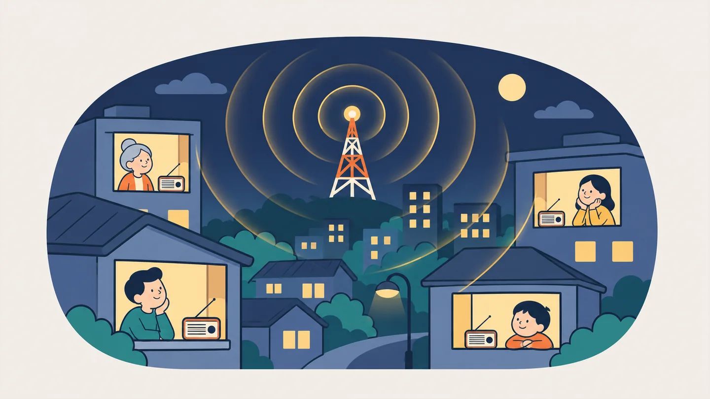
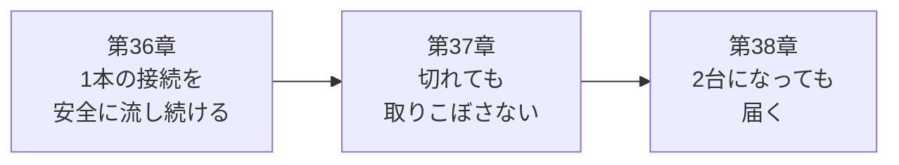

# 第7部 リアルタイム通知

QuickVote の画面で、他の人が投票すると、自分の棒グラフも伸びます。この部では、その仕組みを作り、**壊しながら**理解します。ただ流すだけなら簡単です。難しいのは、**切れたとき**、**遅いクライアントがいたとき**、**サーバーが2台になったとき**です。

## この部でできるようになること

- ポーリング・SSE・WebSocket を、通信の向きと再接続の責任で使い分けられる
- `SseEmitter` で SSE を実装し、ヘッダー・ハートビート・タイムアウト・切断の後始末を設計できる
- 遅いクライアントが配信全体を止める事故と、graceful shutdown が SSE に止められる事故を、再現して直せる
- 業務更新とイベント履歴を同じトランザクションで保存し、コミット順の連番で `Last-Event-ID` による再送ができる
- 「採番の順 ≠ コミットの順」の罠を、2つのトランザクションで再現できる
- アプリが2台になったとき、メモリにあるものを洗い出し、LISTEN/NOTIFY で橋渡しできる

## アプリの到達状態

第7部を終えると、QuickVote は**得票がリアルタイムに動き、再接続で取りこぼしを補い、2台構成でも届きます**。

| この部で加わるもの | 場所 |
| --- | --- |
| `GET /api/polls/{pollId}/events`（SSE、参加者のみ） | `PollEventController` |
| 購読者の名簿と、専用プールでの配信 | `PollEventHub` |
| イベント履歴（`poll_events`）と、コミット順の連番 | `PollEventService`、`PollEventRepository`、Flyway V5 |
| 台をまたぐ通知（`LISTEN` / `pg_notify`） | `PollEventListener` |
| 応答の順番が入れ替わっても壊れないクライアント | `static/app.js` |

## 各章

-   :material-radio-tower: **[第36章 SSE入門](ch36-sse.md)**

    ---

    ポーリングはノック、SSEはラジオ、WebSocketは電話。`curl -N` でイベントを読み、仮想スレッドをONにして違いを観察。遅いクライアントが全員を止める事故と、停止が30秒止まる事故。

-   :material-history: **[第37章 取りこぼしを防ぐ](ch37-event-history.md)**

    ---

    イベント履歴、コミット順の連番、`Last-Event-ID`。500件で再送が止まった事故と、購読が消えた事故。動画つき。

-   :material-server-network: **[第38章 2台構成で起きること](ch38-multi-instance.md)**

    ---

    「隣のサーバーにつないだ人に届かない」を再現し、LISTEN/NOTIFY で直す。セッション・レート制限・スケジューラ・接続数を、2台で見直す。

## 第7部の流れ

## 実験コードの置き場

| 場所 | 内容 |
| --- | --- |
| `code/labs/ch36-sse/` | 最小の SSE アプリ（ヘッダー・タイムアウト・仮想スレッド・遅いクライアントの実験）と、接続数を数える `tools/Load.java` |
| `code/labs/ch37-event-history/` | 採番の順とコミットの順（`seq-vs-commit.sh`）、購読名簿の競合（`RegistryRace.java`）、描画の競合（`refresh-race.js`） |
| `code/labs/ch38-multi/` | QuickVote の4つの変種（`build.sh`）と、app×2＋nginx＋PostgreSQL の `compose.yaml` |

実験用のコンテナは、使い終わったら `docker compose down -v` で止めてください。

## 統合課題：「反映が遅い」という問い合わせ

運用中の QuickVote に、次の問い合わせが来ました。**原因の候補を、確かめる順番とコマンドつきで並べてください。**

> 「投票したのに、他の人の画面がすぐ変わらない。リロードすると変わる。ときどきだけ。」

??? success "解答例"
    1. **台をまたいでいないか。** 2台以上で運用しているなら、NOTIFY が届いているか。`pg_stat_activity` で、各台の `LISTEN poll_events` の接続があるか確認する。切れていれば、アプリのログに `LISTEN 接続でエラーが発生しました` が出ているはず（第38章）
    2. **経路が SSE を切っていないか。** nginx などの `proxy_read_timeout` が、ハートビート間隔より短くないか。`curl -N` で、`:heartbeat` が届き続けるか、何秒で切れるか測る（第38章）
    3. **遅いクライアントの影響。** ログに `SSE の書き込みが詰まっているため購読を打ち切ります` が出ていないか。同時に詰まった数が配信スレッド数（既定4）を超えていないか（第36章）
    4. **履歴の取りこぼし。** 切れたあとの再接続で、`Last-Event-ID` より後が送られているか。`poll_events` の連番が欠けていないか（第37章）
    5. **クライアントの競合。** 古い応答を後から描画していないか（第37章のコラム）

    **リロードすると直る**ことから、DBの状態は正しく、通知か描画の経路の問題だと絞れます。

## 第7部のチェックリスト

第38章を終えたら、次の項目を確かめてください。目安は「③ 検証できる」（反例を作って確かめられる）です。

- [ ] ポーリング・SSE・WebSocket の違いを、通信の向きと再接続の責任で説明できる
- [ ] `curl -N -i` で SSE の応答を読み、`id` / `event` / `data` / `retry` / コメント行を区別できる
- [ ] `SseEmitter` を返しただけでは、最初の書き込みまでヘッダーが出ないことを実験で示し、対策を言える
- [ ] ハートビートが「接続を保つ」ことと「死んだ接続を見つける」ことの両方に必要な理由を説明できる
- [ ] 切断・タイムアウト・エラーのときに、購読者を名簿から外す後始末を、レビューで確認できる
- [ ] 遅いクライアントが配信を止める仕組みを再現し、専用プール・購読者ごとの直列化・打ち切りで防ぐ理由を説明できる
- [ ] 仮想スレッドをONにして、何が変わり（スレッドを握る方式の接続数）、何が変わらないか（`SseEmitter` の接続数、詰まった書き込み）を説明できる
- [ ] SSE が graceful shutdown を止める理由と、停止時に接続を閉じる必要性を説明できる
- [ ] 業務更新とイベント履歴を、同じトランザクションで保存する理由を説明できる
- [ ] シーケンスで採番した連番が、`Last-Event-ID` による補完で取りこぼしを起こす理由を、図と実験で説明できる
- [ ] 再接続で「先に名簿へ登録し、あとで再送する」順序の理由と、重複の排除（`lastSentSeq`）を説明できる
- [ ] ページング読み出しの境界（ページサイズちょうど・＋1）をテストすべき理由を説明できる
- [ ] 「取得して追加」を `compute` で束ねる理由を、競合の再現コードで説明できる
- [ ] アプリを2台にしたとき、メモリにある状態を洗い出し、LISTEN/NOTIFY（または Redis Pub/Sub）で橋渡しする設計を説明できる
- [ ] nginx の後ろに SSE を置くときに、`proxy_read_timeout` とハートビート間隔の関係を言える

!!! tip "チェックの付け方"
    項目を読んで「たぶん分かる」では、付けません。**白紙に、自分の言葉で書いて説明できたとき**に付けてください。説明できない項目の章へ戻ってください。
