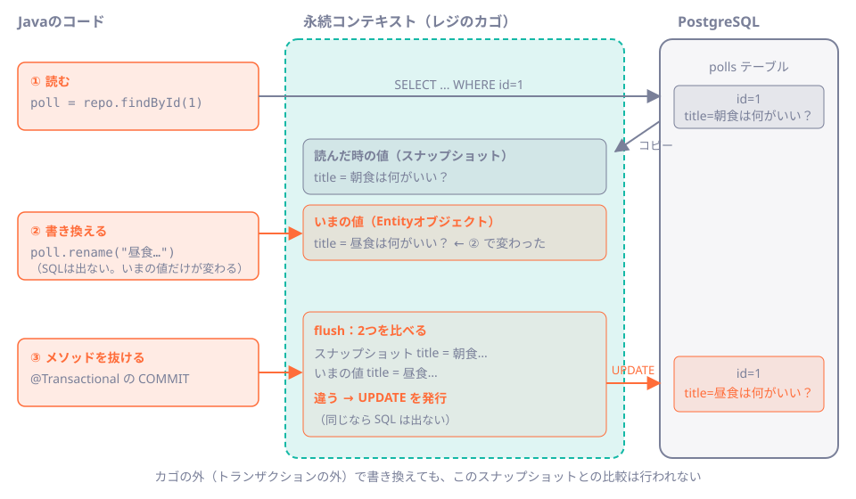
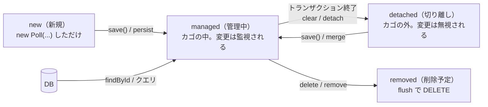

# 第39章 JPAは何を肩代わりするのか

<div class="goal-box" markdown>

この章でできるようになること

- JPA・Hibernate・Spring Data JPA の関係と、本教材で使う世代（Jakarta Persistence 3.2／Hibernate ORM 7）を説明できる
- 「永続コンテキスト＝レジのカゴ」の例えで、`save()` を呼ばなくても UPDATE が出る理由と、`@Transactional` がないと変更が消える理由を説明できる
- Entity の4つの状態（new／managed／detached／removed）と、`save()` が新規と既存で何をするかを説明できる
- JPAが発行するSQL（全列UPDATE、1行ずつの DELETE、クエリ直前の flush）を、ログから読める

</div>

## 1. 問いかけ：`save()` を呼んでいないのに、UPDATE が出る

最初に、JPAで書いたコードを1つ読んでください。QuickVote の投票タイトルを書き換える処理です。

```java title="src/main/java/com/example/jpalab/poll/PollService.java（抜粋）"
@Transactional
public void rename(Long id, String newTitle) {
    Poll poll = polls.findById(id).orElseThrow();   // (1)!
    poll.rename(newTitle);                           // (2)!
}
```

1. 投票を1件読みます。`polls` は Spring Data JPA の Repository です。
2. タイトルを書き換えます。`polls.save(...)` も、`UPDATE` を書くコードも、ここにはありません。

!!! question "予測カード"
    このメソッドを呼んだとき、DBのタイトルはどうなるでしょう。

    1. 変わらない。`save()` を呼んでいないから
    2. 変わる。SQLの `UPDATE` が自動で発行される
    3. 例外が出る。「保存されていない変更がある」と怒られる

実際に呼んで、発行されたSQLをログで見ます。`--` で始まる行は、実験の目印として挟んだログです（SQLではありません）。

```text
select p1_0.id,p1_0.closes_at,p1_0.status,p1_0.title,p1_0.version from polls p1_0 where p1_0.id=?
-- setter を呼ぶ直前
-- setter を呼んだ直後（まだ UPDATE は出ていない）。メソッドを抜けるとコミット
update polls set closes_at=?,status=?,title=?,version=? where id=? and version=?
```

答えは **2** です。`setter` を呼んだ時点では何も起きず、**メソッドを抜けてコミットされる直前に** `UPDATE` が1本発行されました。

JdbcClient で書いていた読者には、不思議に見えるはずです。**SQLを1行も書いていないのに、SQLが出ました。** この章では、これを実現している仕組み（永続コンテキスト）と、その代償を見ていきます。

## 2. JPAが肩代わりする4つの仕事

JdbcClient（第19章）で、あなたは次の仕事を**自分で**書いていました。JPAは、これを肩代わりします。

| 仕事 | JdbcClient（QuickVote） | JPA |
| --- | --- | --- |
| SQLを書く | `SELECT * FROM polls WHERE id = :id` を文字列で書く | 書かない。Entityの定義とメソッド名から組み立てる |
| 行 ↔ オブジェクトの変換 | `PollRepository.map(rs, rowNum)` で列を1つずつ詰める | 書かない。`@Column` などの注釈から自動で変換 |
| 変更したことをDBへ伝える | `UPDATE` を自分で書いて呼ぶ | 書かない。**変更を検出して**、必要な `UPDATE` を発行（dirty checking） |
| 関連の読み込み | `JOIN` を自分で書く、または別の `SELECT` を呼ぶ | 書かない。`poll.getOptions()` を呼ぶと**必要になった時点で**読む（遅延ロード） |

便利です。ただし、**SQLを書かない＝SQLが出ない、ではありません。** 裏ではSQLが出続けていて、そのタイミングと本数は、コードからは見えにくくなります。第8部は、この「見えにくさ」を観測可能にするための部です。

!!! tip "フロントエンドで例えると"
    React の state は、直接書き換えても**何も起きません**（`setState` を呼ばないと再描画されない）。JPAの Entity は逆で、**直接書き換えると、あとでDBに反映されます**。「オブジェクトの変更を監視して、差分だけを外へ反映する」仕組みは、MobX のような監視型ストアに近い感覚です。
    TypeScript の ORM では、Prisma は永続コンテキストを持たず `update()` を呼んで初めてSQLが出ます。TypeORM は `save()` を呼ばないと UPDATE されません。**「呼ばなくても出る」のは、JPA（Hibernate）の大きな特徴**です。

## 3. 世代と登場人物：JPA、Hibernate、Spring Data JPA

「JPA」という名前は、3つの別のものを指して使われます。最初に分けておきます。

!!! note "用語：JPA（Jakarta Persistence）"
    Javaの世界の **ORM の標準仕様**です。`@Entity` や `EntityManager` などの**インターフェースと注釈**を決めたもので、実装そのものではありません。以前は Java Persistence API で、Jakarta EE への移管で名前が **Jakarta Persistence** になり、パッケージも `javax.persistence.*` から **`jakarta.persistence.*`** に変わりました。

!!! note "用語：ORM（オーアールエム、Object-Relational Mapping）"
    DBの表の行を、プログラミング言語のオブジェクトに対応づける技術です。「オブジェクトと表のずれ（たとえばオブジェクトは入れ子になるが、表は平らな行）を埋める」ことが仕事です。

| 名前 | 何か | 本教材で確認した版 |
| --- | --- | --- |
| Jakarta Persistence（JPA） | 仕様（注釈とインターフェース） | 3.2.0（`jakarta.persistence-api`） |
| Hibernate ORM | JPAの**実装**。SQLを実際に組み立てて発行する | 7.4.13.Final |
| Spring Data JPA | `JpaRepository` を提供する Spring の部品。Hibernate を使いやすく包む | 4.1.2 |

つまり、`JpaRepository` を書くと **Spring Data JPA → JPA → Hibernate → JDBC → PostgreSQL** の順に呼び出しが深く入ります。エラーメッセージやログに `org.hibernate...` が出るのは、実装が Hibernate だからです。

本教材（Spring Boot 4.1.2）では、`spring-boot-starter-data-jpa` を入れるだけで、この3つが揃います。import は次のようになります。

```java
import jakarta.persistence.Entity;      // 仕様（JPA）の注釈。javax.persistence ではない
import jakarta.persistence.Id;
import org.springframework.data.jpa.repository.JpaRepository;   // Spring Data JPA
```

この世代は、実際にビルドして確かめています。

```text
[世代] Hibernate ORM = 7.4.13.Final / Jakarta Persistence API = 3.2.0
```

!!! warning "古い記事を読むときの目印"
    `import javax.persistence.*` は古い世代（Spring Boot 2 以前）です。`jakarta.persistence.*` に読み替えます。Hibernate 5 時代の記事は、SQLの形やデフォルト挙動が変わっていることがあります（たとえば Hibernate 6 以降は、出力されるSQLの別名が `p1_0` のような形になりました）。**本文のログは、すべてこの教材の環境で実際に出力したものです。**

## 4. 実験の舞台：jpa-lab

この部の実験は、本線とは別のプロジェクト `code/jpa-lab/` で行います。テーブルは QuickVote の `polls`／`options`／`votes` を簡略化した同じ形で、Flyway で作ります（第17章と同じ）。

```sql title="src/main/resources/db/migration/V1__create_polls_options_votes.sql（polls のみ抜粋）"
CREATE TABLE polls (
    id        bigint GENERATED ALWAYS AS IDENTITY PRIMARY KEY,
    title     varchar(100) NOT NULL,
    status    varchar(10)  NOT NULL,
    closes_at timestamptz  NOT NULL,
    version   bigint       NOT NULL DEFAULT 0,   -- 楽観ロック用（第40章）
    CONSTRAINT polls_status_check CHECK (status IN ('OPEN', 'CLOSED'))
);
```

スキーマを作るのは**Flywayだけ**です。HibernateにはDDLを作らせず、起動時に「Entityとテーブルがずれていないかだけをチェックさせる」設定にします。

```yaml title="src/main/resources/application.yaml（抜粋）"
spring:
  jpa:
    hibernate:
      ddl-auto: validate      # (1)!
    properties:
      hibernate:
        generate_statistics: true   # (2)!
logging:
  level:
    org.hibernate.SQL: DEBUG        # (3)!
```

1. `create` や `update` にすると、HibernateがDDLを勝手に流します。本番ではFlywayと二重管理になるので、使いません。`validate` なら、列名や型のずれを**起動時に**落としてくれます。
2. SQLの本数などの統計を取ります（第40章で使います）。
3. 発行したSQLを1本ずつログに出します。**JPAを学ぶ間は、このログを常に見ます。**

## 5. Entity：テーブルの1行を表すクラス

`polls` の1行に対応する **Entity** です。

```java title="src/main/java/com/example/jpalab/poll/Poll.java（抜粋）"
@Entity                                       // (1)!
@Table(name = "polls")
public class Poll {

    @Id
    @GeneratedValue(strategy = GenerationType.IDENTITY)   // (2)!
    private Long id;

    @Column(nullable = false)
    private String title;

    @Enumerated(EnumType.STRING)              // (3)!
    @Column(nullable = false)
    private PollStatus status;

    @Column(name = "closes_at", nullable = false)
    private Instant closesAt;

    @Version
    private long version;                     // (4)!

    protected Poll() {                        // (5)!
    }

    public void rename(String newTitle) {     // (6)!
        this.title = newTitle;
    }
}
```

1. `@Entity` を付けたクラスは、JPAが管理する対象になります。第13章の DTO（`record`）とは別物です。
2. 主キーはDBの `GENERATED ALWAYS AS IDENTITY` に採番を任せます。`INSERT` した時点で `id` が決まります（あとで実験します）。
3. Javaの `enum` を、数字ではなく名前（`"OPEN"`）で保存します。`ORDINAL`（0, 1, ...）は、enumの並びを変えると壊れるので使いません。
4. 楽観ロックの版番号です。第40章で使います。
5. JPAが内部でオブジェクトを作るための引数なしコンストラクタです。アプリのコードから呼ばせないよう `protected` にします。
6. 「タイトルを変える」という**業務の操作**をメソッドにしています。setter を無秩序に公開しないのが、Entity設計の定石です。

列名は書いていないのに `closes_at` に対応する理由は、Spring Boot が `closesAt` → `closes_at` の変換（キャメルケース → スネークケース）を既定で行うからです。

Repository は、インターフェースを書くだけです。

```java title="src/main/java/com/example/jpalab/poll/PollRepository.java（抜粋）"
public interface PollRepository extends JpaRepository<Poll, Long> {
    long countByTitle(String title);       // (1)!
}
```

1. 実装は書きません。メソッド名（`countBy` ＋ `Title`）から、`where title = ?` の件数取得が組み立てられます（派生クエリ）。`findById`・`save`・`delete` などは `JpaRepository` が最初から持っています。

## 6. 例え：レジのカゴ（永続コンテキスト）

では、なぜ `save()` なしで UPDATE が出るのでしょうか。鍵になるのが **永続コンテキスト** です。これをスーパーの**レジのカゴ**に例えます。


!!! note "用語：永続コンテキスト（Persistence Context）"
    トランザクションの間、**Entity を管理しておく作業領域**です。DBから読んだ Entity は、ここ（`EntityManager` の中）に入ります。同じ id の Entity は1つだけ保持され、**入ったときの値を覚えておいて**、あとで変更があったかを調べます。Hibernate では `Session` と呼ばれるものがこれに当たります。

- **商品を取ってきてカゴに入れる**：`findById` で行を読むと、Entityがカゴに入ります。同時に、**入れたときの値**（スナップショット）が控えとして残ります
- **カゴの中の商品を手直しする**：`poll.rename(...)` はカゴの中のオブジェクトを書き換えるだけで、DBには何も伝わりません
- **レジで精算する**：コミットの直前に、カゴの中の現在の値とスナップショットを**見比べ**、違うものだけを `UPDATE` として精算します（これが **flush**）
- **同じ商品は1個**：同じ id を2回取ってきても、カゴの中の同じ1つが返ります

!!! warning "この例えが外れる点"
    - カゴは**トランザクション（または1リクエスト）ごと**に別々です。スーパー全体で共有する大きなカゴではありません。別のトランザクションが同じ行を書き換えても、あなたのカゴの中身は**勝手に最新には更新されません**
    - カゴの外に出た商品（トランザクションが終わった Entity）を手直ししても、精算されません（あとで実験します）
    - 精算のタイミングは、コミット時だけではありません。後述のとおり、**カゴの中身に関係しそうなクエリの直前**にも精算が起きます

仕組みを図にします。左がコード、中央がカゴ、右がDBです。



## 7. 動かしてみる：変更検出とトランザクション

### 7.1 `@Transactional` がないと、変更は黙って捨てられる

冒頭のコードから `@Transactional` だけを外した版を実行します。カゴが**メソッドの途中で閉じてしまう**ので、何が起きるでしょうか。

```java title="src/main/java/com/example/jpalab/poll/PollService.java（抜粋）"
/** @Transactional がない。 */
public void renameWithoutTransaction(Long id, String newTitle) {
    Poll poll = polls.findById(id).orElseThrow();   // (1)!
    poll.rename(newTitle);                          // (2)!
}
```

1. `findById` は Repository が自分でトランザクションを開いて閉じます。戻った時点で、カゴはもう閉じています。
2. カゴから出た（detached な）Entity を書き換えているだけです。

```text
select p1_0.id,p1_0.closes_at,p1_0.status,p1_0.title,p1_0.version from polls p1_0 where p1_0.id=?
```

`SELECT` が1本出ただけで、**`UPDATE` は出ません。例外も出ません。** DBのタイトルは `poll-1` のままでした。保存したつもりのコードが、黙って何もしない。レビューで最も見落としやすい種類のバグです。

!!! danger "本番で事故になるパターン"
    「`save()` を呼ばなくても更新される」という知識だけを持つと、**`@Transactional` を付け忘れた更新**に気づけません。逆に、Controllerで読んだEntity（もうカゴの外）を書き換えて「保存された」と思い込む事故も起きます。**更新を行うメソッドには `@Transactional`、そしてそのメソッドの中で「読む → 変える」まで完結させる**のが基本です（第22章・第23章）。

### 7.2 同じ id は、カゴの中で1つだけ

同じトランザクションで同じ id を2回読みます。

```text
select p1_0.id,p1_0.closes_at,p1_0.status,p1_0.title,p1_0.version from polls p1_0 where p1_0.id=?
-- 2回目の findById
```

2回目の `findById` の**あとにSQLはありません**。カゴにすでにあるので、DBへ行かずに**同じオブジェクト**が返ります。実際に `first == second`（同一インスタンス）が `true` でした。これを **一次キャッシュ**とも呼びます。

便利な反面、**他のトランザクションの更新が見えない**ことでもあります。トランザクションの中で何度読んでも、最初に読んだ値が返ります。

### 7.3 クエリの直前に、flush が起きる

変更したあとで、別のクエリを実行したらどうなるでしょう。

```java title="src/main/java/com/example/jpalab/poll/PollService.java（抜粋）"
@Transactional
public long renameThenCount(Long id, String newTitle) {
    Poll poll = polls.findById(id).orElseThrow();
    poll.rename(newTitle);
    return polls.countByTitle(newTitle);     // 新しい題の件数を数える
}
```

```text
select p1_0.id,p1_0.closes_at,p1_0.status,p1_0.title,p1_0.version from polls p1_0 where p1_0.id=?
-- 変更後に count クエリを実行
update polls set closes_at=?,status=?,title=?,version=? where id=? and version=?
select count(p1_0.id) from polls p1_0 where p1_0.title=?
```

コミットを待たずに、**`count` の直前に `UPDATE` が出ています**。もし `UPDATE` を後回しにしたら、`count` は「まだ古いタイトルのDB」を数えてしまい、直前に自分が変えた結果が反映されないからです。Hibernateはこれを避けるため、**クエリの結果に影響しそうなときは、先に flush する**ようになっています（auto flush）。

!!! note "用語：flush（フラッシュ）"
    カゴの中の変更を、**SQLとしてDBに送る**ことです。送っただけで、まだ確定（コミット）ではありません。コミットが失敗すれば、flush で送った `UPDATE` もロールバックされます。flush が起きるのは、①コミット直前、②クエリ実行の直前（auto flush）、③`flush()` を明示的に呼んだとき、の3つです。

### 7.4 `IDENTITY` の INSERT は、`save()` の時点で出る

新しい投票を作るときは、`new Poll(...)` して `save()` します。

```text
-- save() を呼ぶ直前
insert into polls (closes_at,status,title,version) values (?,?,?,?)
insert into options (label,poll_id) values (?,?)
insert into options (label,poll_id) values (?,?)
-- save() が戻った直後（IDENTITY なので INSERT はここまでに出ている）
```

`UPDATE` と違って、`INSERT` は**コミットを待たず、`save()` の中で**出ています。主キーを `IDENTITY`（DBに採番させる）にしているため、Hibernateは `INSERT` してはじめて `id` が分かるからです。`save()` から戻った時点で `poll.getId()` が使えるのは、このためです。

選択肢（`options`）の `INSERT` は `Poll` の `@OneToMany(cascade = CascadeType.ALL)` によるものです。親を保存すると、子も一緒に保存されます。

!!! tip "現場では"
    `IDENTITY` を使うと、複数行の `INSERT` を1回の通信にまとめる最適化（JDBCバッチ）が使いにくくなります。大量に挿入するバッチ処理でJPAを使うときは、この点で設計を変えることがあります。QuickVote 程度の件数では気にしなくて構いません。

### 7.5 削除は、子を1行ずつ消してから親を消す

投票を削除します（`options` は `cascade = ALL` なので、一緒に消す設定です）。

```text
select p1_0.id,p1_0.closes_at,p1_0.status,p1_0.title,p1_0.version from polls p1_0 where p1_0.id=?
-- delete() を呼ぶ直前
select o1_0.poll_id,o1_0.id,o1_0.label from options o1_0 where o1_0.poll_id=?
delete from options where id=?
delete from options where id=?
delete from options where id=?
delete from polls where id=? and version=?
```

選択肢が3件なら、`SELECT` 1本のあとに `DELETE` が3本、さらに親で1本です。QuickVote 本線の `PollRepository.delete` は、`DELETE FROM polls WHERE id = :id` の**1本**でした。子は DB の `ON DELETE CASCADE`（外部キーの設定）が消します。

| | QuickVote（JdbcClient） | JPA（`cascade = ALL`） |
| --- | --- | --- |
| 子を消す担当 | DB（`ON DELETE CASCADE`） | アプリ（Hibernate が子を読んで1行ずつ） |
| 選択肢100件の投票を消すと | 1本 | 読み込み2本 ＋ 子の DELETE 100本 ＋ 親の DELETE 1本 ＝ 103本 |

JPAでも、`@OnDelete(action = OnDeleteAction.CASCADE)` のようにDB側に任せる指定はできます。ただし、**デフォルトの `cascade = ALL` が「SQLの本数を増やす」** 点は覚えておいてください。

## 8. Entity の状態遷移

ここまでの実験を、Entity の状態で整理します。Entity は、カゴとの関係で **4つの状態**を行き来します。



| 状態 | カゴの中か | 変更はDBへ届くか | 例 |
| --- | --- | --- | --- |
| new | いいえ | 届かない（`save()` するまで存在しない） | `new Poll(...)` した直後 |
| managed | はい | **届く**（flush で自動） | `@Transactional` の中で `findById` した値 |
| detached | いいえ | **届かない** | トランザクションを抜けたあとの Entity |
| removed | はい | flush で `DELETE` | `delete()` を呼んだあと |

Spring Data JPA の `save()` は、**状態を見て中身を切り替えます**。

- 新規（id が `null`）のときは `persist`：`INSERT` を出す
- 既存（id がある）のときは `merge`：まず `SELECT` で現在のDBの状態を読み、渡された値で上書きする

つまり、**managed な Entity には `save()` は不要**です（すでに監視されている）。`save()` が必要なのは、新規作成のときと、detached な Entity を戻すときだけです。「毎回 `save()` を呼ぶ」書き方は、動きますが、意味を理解していないサインでもあります。

## 9. JdbcClient と並べる：同じ「締切」を2通りで

QuickVote の「締切」を、2通りで見比べます。

=== "JdbcClient（QuickVote の実コード）"
    ```java title="code/quickvote/.../poll/PollRepository.java"
    /** 手動締切。すでに締切時刻より前なら、締切時刻も「今」に前倒しする。 */
    public int close(long id, Instant now) {
        return jdbc.sql("""
                UPDATE polls SET status = 'CLOSED', closes_at = LEAST(closes_at, :now)
                WHERE id = :id
                """)
                .param("id", id)
                .param("now", Db.ts(now))
                .update();
    }
    ```

=== "JPA（jpa-lab）"
    ```java title="src/main/java/com/example/jpalab/poll/Poll.java（抜粋）"
    public void close(Instant now) {
        this.status = PollStatus.CLOSED;
        if (closesAt.isAfter(now)) {
            this.closesAt = now;
        }
    }
    ```
    ```java title="src/main/java/com/example/jpalab/poll/PollService.java（抜粋）"
    @Transactional
    public void close(Long id, Instant now) {
        polls.findById(id).orElseThrow().close(now);
    }
    ```

発行されるSQLを並べます。

| | JdbcClient（QuickVote） | JPA（jpa-lab） |
| --- | --- | --- |
| SQLの本数 | `UPDATE` 1本 | `SELECT` 1本 ＋ `UPDATE` 1本 |
| 更新する列 | `status`、`closes_at` の2列 | **全列**（`closes_at, status, title, version`） |
| `WHERE` 条件 | `id = ?` | `id = ? and version = ?`（楽観ロック） |
| 「締切の前倒し」の判定 | SQLの `LEAST(...)` | Javaの `if`（`Poll.close` の中） |
| 行をロックするか | しない（そのまま `UPDATE`） | しない（読んでから書く間に、他の更新が入り得る） |

この表から、2つのことが分かります。

1. **JPAの `UPDATE` は、既定で全列を更新します。** 変えていない列も `SET` に並びます。同時に別の人が別の列を変えていたら、上書きして消すことになります。これを防ぐのが、第40章の `@Version` です
2. **JPAは「読んでから書く」ので、その間に他のトランザクションが割り込めます。** QuickVote 本線は、競合する更新を `FOR UPDATE` と条件付きSQLで守っていました（第25章・第26章）。JPAに乗り換えると、その守り方を**自分で選び直す**ことになります（第41章）

## 10. 現場では：JPAの Entity を書くときの定石

- **setter を公開せず、業務のメソッドを作る**（`rename`、`close`）。どこからでも `setStatus(...)` できると、`close` の規則（締切の前倒し）を飛ばせてしまう
- **引数なしコンストラクタは `protected`**。アプリのコードから空の Entity を作らせない
- **`ddl-auto` は `validate`（または `none`）**。DDLはFlywayが担当する
- **SQLログを常に出す**（開発中）。出るSQLを見ない JPA は、遅くなるまで気づけない
- **`@Transactional` の中で、読む → 変える**を完結させる。Controllerで読んだ Entity を書き換えない
- **更新の前に、`save()` が必要な状態か**（新規か detached か）を考える

!!! tip "AIが書いたJPAコードをレビューするとき"
    最初に見るのは3か所です。①更新メソッドに `@Transactional` があるか、②`save()` が不要な場所にまで散らばっていないか、③SQLログを出してテストを動かすと、何本のSQLが出るか。①②は次章以降の事故の入口で、③は第40章で数値にします。

---

## まとめ：3点セット

!!! abstract "この章の3点セット"
    **① 一言で言うと**
    JPAは、トランザクションの間 Entity を永続コンテキスト（EntityManager／Session）で管理し、読んだ時点の値と比較して、変更があった列を flush（コミット直前・クエリ直前）で `UPDATE` として発行する。SQLを書かない代わりに、SQLの本数とタイミングはコードから見えにくい。

    **② 現場でこう聞かれる**
    「`save()` を呼んでいないのに、なぜ更新されたのですか？」
    → `@Transactional` の中で読んだ Entity は managed（管理中）で、永続コンテキストがスナップショットとの差分を検出し、flush で `UPDATE` を発行するから（dirty checking）。トランザクションの外で書き換えた Entity は detached なので、更新されない。

    **③ 自分のサービスならどこに当たるか**
    自分のサービスで「読んで、少し変えて、保存する」処理を3つ挙げる。それぞれ、JPAで書いたら `@Transactional` はどこに置くか、`UPDATE` は全列になって困らないか（同時に別の人が別の列を変えないか）を考える。

## 演習

??? question "確認問題1：予測と観察"
    次のコードの `PollService.rename2` を呼ぶと、DBのタイトルはどうなりますか。`@Transactional` の有無で場合分けして答えてください。

    ```java
    public void rename2(Long id, String newTitle) {
        Poll poll = polls.findById(id).orElseThrow();
        poll.rename(newTitle);
        polls.save(poll);
    }
    ```

??? success "解答"
    - **`@Transactional` あり**：変わります。`save(poll)` は managed な Entity に対しては実質何もせず（すでに監視中）、UPDATE は通常どおりコミット直前に発行されます。つまり `save()` は**不要ですが、害もありません**
    - **`@Transactional` なし**：変わります。`findById` のトランザクションが終わって `poll` は detached になりますが、`save(poll)` が `merge` を行い、**新しいトランザクションで** `SELECT` のあとに `UPDATE` を発行します。ただし、`findById` から `save` までの間に他の人が更新していたら、その変更を**上書きして消します**（検出するには `@Version`、第40章）

    「`save()` を書けば動く」ことと、「正しい」ことは別です。`@Transactional` で一連の処理を1つにまとめるのが基本です。

??? question "確認問題2：ログを読む"
    次のSQLログの上から3行目まで（`select` ×1、`update` ×1、`select count` ×1）が出るコードを、1つ書いてください。`update` の位置がカギです。

    ```text
    select ... from polls p1_0 where p1_0.id=?
    update polls set closes_at=?,status=?,title=?,version=? where id=? and version=?
    select count(p1_0.id) from polls p1_0 where p1_0.title=?
    ```

??? success "解答"
    `@Transactional` のメソッドの中で、`findById` → setter で変更 → `countByTitle` のようなクエリ、の順に呼べば出ます（本文 7.3 の `renameThenCount`）。`update` は変更時点ではなく、**次のクエリの直前の auto flush** で出ます。

??? question "確認問題3：delete のSQL本数"
    選択肢が50件ある投票を、`polls.delete(poll)`（`cascade = CascadeType.ALL`）で削除しました。SQLは何本出ますか。DBに `ON DELETE CASCADE` が設定されていても、本数は変わるでしょうか。

??? success "解答"
    親の読み込み 1 ＋ 選択肢の読み込み 1 ＋ 選択肢の `DELETE` 50 ＋ 親の `DELETE` 1 ＝ **53本**です。`ON DELETE CASCADE` がDBにあっても、Hibernate が `cascade = ALL` で子を1行ずつ消すので、本数は変わりません。DBに任せたいなら、JPA側で子のカスケードをやめて（または `@OnDelete` を指定して）DBに任せる必要があります。

??? question "応用：QuickVote の `lastEventSeq` を JPA で増やすと"
    QuickVote の `PollEventRepository` は、`UPDATE polls SET last_event_seq = last_event_seq + 1 ... RETURNING last_event_seq` で採番しています。これを「Entity を読んで、`seq` を `+1` して、setter で書き換える」JPAの書き方に置き換えると、何が変わりますか。同時に10人が投票すると、どうなりますか。

??? success "解答"
    JPA版は「読む → 計算する → 書く」の3段階になり、読んだ時点と書く時点の間に他のトランザクションが割り込めます。2人が同じ値 `5` を読めば、2人とも `6` を書いて**採番が重複**します（`@Version` があれば、後から書いた側が `ObjectOptimisticLockingFailureException` で失敗して検出できますが、再試行が必要になります）。
    QuickVote の `UPDATE ... SET x = x + 1 RETURNING` は、**「読む」と「書く」が分かれていない1本のSQL**で、行ロックの下で直列化されます。この「増やす」類の処理は、JPAのEntityを書き換える形より、SQLで1本にまとめる方が安全です（第41章）。

??? question "説明問題：現場でこう聞かれる"
    「永続コンテキストとは何ですか？ なぜ `@Transactional` がないと更新されないのですか？」200字程度で答えてください。

??? success "解答"
    例：永続コンテキストは、トランザクションの間 Entity を管理する作業領域で、読み込んだ時点の値を控えておきます。コミットの直前に控えと現在の値を比べ、変わった Entity だけ `UPDATE` を発行します（dirty checking）。`@Transactional` がないと、読み込み直後にトランザクションとカゴが閉じて Entity が切り離され、書き換えても比較の対象にならないため、更新は黙って無視されます。
