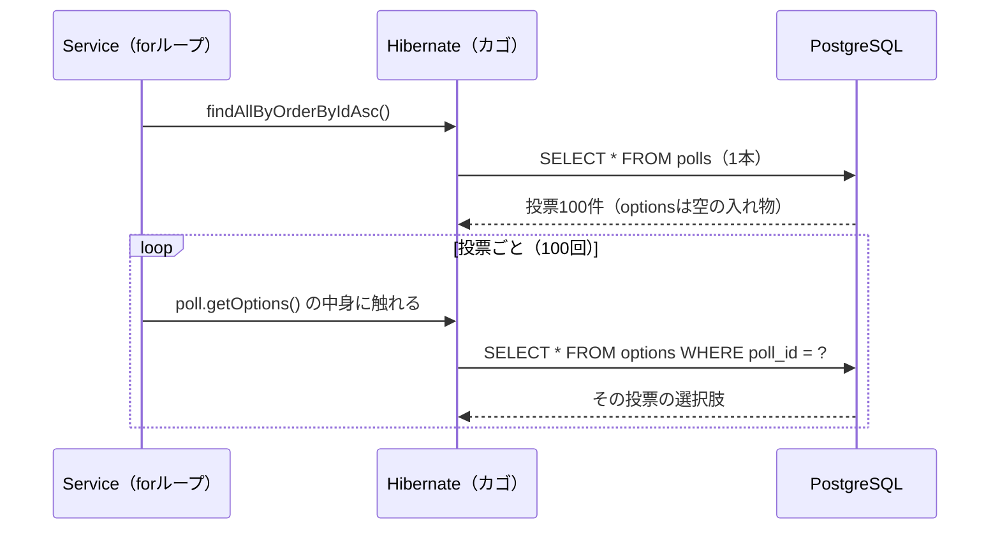
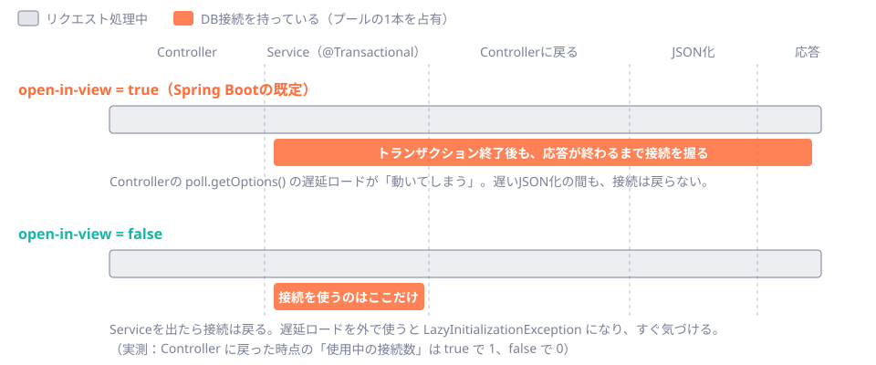

# 第40章 N+1と取得戦略

<div class="goal-box" markdown>

この章でできるようになること

- 一覧APIで流れるSQLの本数を、ログとHibernateの統計で数え、「投票100件で101本」を再現できる
- N+1が起きる理由（遅延ロード）を説明し、fetch join・`@EntityGraph`・DTO射影・バッチフェッチで減らして、それぞれの注意点を言える
- `LazyInitializationException` を再現し、安全な直し方と、やってはいけない直し方を区別できる
- open-in-view（OSIV）の既定値と警告ログの意味、接続を握り続ける問題を説明できる
- `@Version` による楽観ロックの衝突を再現し、HTTPの409に結びつけられる

</div>

## 1. いきなり事故：開発中は速いのに、本番だけ遅い

投票の一覧画面を作ります。各投票のタイトルと、その選択肢のラベルを返します。AIにこう頼みました。

> 「投票の一覧と、それぞれの選択肢のラベルを返すメソッドを JPA で書いて」

返ってきたコードは、読みやすく、正しく動き、テストも通ります。

```java title="src/main/java/com/example/jpalab/poll/PollService.java（抜粋）"
@Transactional(readOnly = true)
public List<PollView> listLazy() {
    return polls.findAllByOrderByIdAsc().stream()                                  // (1)!
            .map(p -> new PollView(p.getId(), p.getTitle(), labelsOf(p)))          // (2)!
            .toList();
}

private static List<String> labelsOf(Poll poll) {
    return poll.getOptions().stream().map(Option::getLabel).toList();              // (3)!
}
```

1. 投票を全件取ります（`select ... from polls order by id`）。
2. 投票ごとに、DTO（`PollView`）に詰めます。
3. 選択肢のラベルを取り出します。`Poll.options` は `@OneToMany` の関連です。

開発用DBには投票が3件しかありません。画面は一瞬で出ます。ところが本番には、投票が100件あります。

!!! question "予測カード"
    投票100件（選択肢は各3件）のこの `listLazy()` を呼ぶと、SQLは何本発行されるでしょう。

    1. 1本（`polls` を取る1本だけ）
    2. 2本（`polls` と `options`）
    3. 101本

実際に数えます。検証用のテスト（`NPlusOneTest`）は、2通りの方法で同時に数えています。

```text
[N+1] 遅延ロード: Hibernate統計=101本 / ログに出たSQL=101本
  select p1_0.id,p1_0.closes_at,p1_0.status,p1_0.title,p1_0.version from polls p1_0 order by p1_0.id
  select o1_0.poll_id,o1_0.id,o1_0.label from options o1_0 where o1_0.poll_id=?
  select o1_0.poll_id,o1_0.id,o1_0.label from options o1_0 where o1_0.poll_id=?
  select o1_0.poll_id,o1_0.id,o1_0.label from options o1_0 where o1_0.poll_id=?
  ...
```

答えは **3（101本）** です。最初の1本で投票を100件取り、その**1件ごとに**選択肢を取るSQLが1本ずつ、合計100本。**1 + N 本**なので、**N+1問題**と呼ばれます。

コードのどこにも、ループで `SELECT` を呼ぶ記述はありません。それなのに、SQLの滝が流れました。

## 2. 動画で見る：N+1の「滝」

<div class="video-card">
  <video controls preload="metadata" poster="../../assets/videos/n-plus-one.jpg">
    <source src="../../assets/videos/n-plus-one.mp4" type="video/mp4">
  </video>
  <p class="video-caption">▶ N+1：SQLの滝</p>
  <p class="video-credit">音声：VOICEVOX:冥鳴ひまり</p>
</div>

**動画の要点**

- 最初に投票の一覧を取ります（SQL1本）。取ったデータは**レジのカゴ**（永続コンテキスト）に入ります
- 選択肢には「あとで店員（DB）に聞く」札（**Lazy**）が付いています。ループで投票ごとに札を見るたび、聞きに行きます
- 投票が100件なら、SQLが100本追加されて**合計101本（1＋N）**。データが少ない開発中は気づきにくいのが怖いところです
- 直し方は「**最初から一緒に取ってくる**」こと（fetch join）や、「必要な形だけ取る」こと（DTO）。SQLは1〜2本になります
- 注意：トランザクションが終わったあとに札を見に行くと、`LazyInitializationException` になります

??? note "字幕全文"
    SQLが滝のように流れる、N+1問題を見てみましょう。
    投票の一覧と、それぞれの選択肢を、表示したいとします。
    まず、投票の一覧を取ります。SQLは1本です。
    取ったデータは、レジのカゴに入ります。永続コンテキストです。
    選択肢には、「あとで店員に聞く」札が付いています。これがLazyです。
    ループで投票ごとに札を見るたび、店員に聞きに行きます。
    投票が100件なら、SQLが100本、追加されます。
    1本と100本で、合計101本。これが「1＋N」です。
    SQLが増えるほど、応答時間も伸びていきます。
    データが少ない開発中は、気づきにくいのが怖いところです。
    対策は、最初から一緒に取ってくること。
    fetch joinや、必要な形だけ取るDTOがあります。
    SQLは1〜2本になり、応答時間も短くなります。
    注意。トランザクションが終わった後に札を見に行くと、エラーになります。
    それが、LazyInitializationExceptionです。
    SQLが何本流れるか、言えるようにする。

動画の「札」は、コードでは `poll.getOptions()` の戻り値です。最初に触れるまで中身を持たず、**触れた瞬間にSQLを出す**特別なリストです。

## 3. なぜ101本になるのか：遅延ロードの仕組み

`Poll` の関連は、次のように宣言されています。

```java title="src/main/java/com/example/jpalab/poll/Poll.java（抜粋）"
@OneToMany(mappedBy = "poll", cascade = CascadeType.ALL, orphanRemoval = true)
private List<Option> options = new ArrayList<>();
```

`@OneToMany` の取得方法の既定は **LAZY（遅延）** です。`findAll` で `Poll` を読んだ時点では、`options` は**空の入れ物**（Hibernate が差し込む特殊なリスト）で、中身は読まれていません。`poll.getOptions().stream()...` で**中身に初めて触れた瞬間**に、その1件ぶんの `SELECT` が出ます。



!!! note "用語：N+1問題"
    親を取る1本のSQLのあと、子を取るSQLが**親の件数（N）だけ**追加で流れる状態です。1件ずつの往復が積み上がるので、件数に比例して遅くなります。DBが別サーバーなら、1往復が1ミリ秒かかるだけでも、100件で約100ミリ秒、1000件で約1秒です（試算）。

!!! tip "フロントエンドで例えると"
    `useEffect` の中で、リストの要素ごとに `fetch('/api/items/' + id)` を呼ぶコンポーネントを、親が `map` で100個並べたときと同じです。**1個ずつは速いのに、全体で遅い**。React なら「リクエストの滝」としてネットワークタブに並びますが、JPAでは**サーバーとDBの間**で起きるので、ブラウザからは見えません。

## 4. SQLの本数を数える

N+1は、**数えないと気づけません**。この教材では、3つの方法を使い分けます。

| 方法 | 使いどころ | 本章で使ったもの |
| --- | --- | --- |
| ① SQLログ（`org.hibernate.SQL`） | 開発中に目で見る。どのSQLが何回出たかを知る | `logging.level.org.hibernate.SQL: DEBUG` |
| ② Hibernate の統計（`Statistics`） | **テストで本数を数えて、固定する** | `hibernate.generate_statistics: true` |
| ③ datasource-proxy などのJDBCプロキシ | Hibernate以外（JdbcClientなど）も含めて数える | 本教材では使いません |

テストでの数え方は、次の10行ほどです。

```java title="src/test/java/com/example/jpalab/support/AbstractLabTest.java（抜粋）"
protected <T> Measured<T> measure(Supplier<T> action) {
    Statistics statistics = emf.unwrap(SessionFactory.class).getStatistics();   // (1)!
    statistics.clear();
    T result = action.get();
    return new Measured<>(result, statistics.getPrepareStatementCount());       // (2)!
}
```

1. `EntityManagerFactory` から Hibernate の `SessionFactory` を取り出し、統計を得ます。
2. 実行中に Hibernate が JDBC に渡した SQL（`PreparedStatement`）の本数です。

これでテストを書けます。

```java title="src/test/java/com/example/jpalab/NPlusOneTest.java（抜粋）"
Measured<List<PollView>> m = measure(service::listLazy);
assertThat(m.sqlCount()).isEqualTo(101);
```

「**このAPIのSQLは何本まで**」をテストに書いておけば、誰かが `@OneToMany` の周辺を触ったとき、**CIで落ちて気づけます**。性能の劣化を、レビューの目視ではなくテストに任せる方法です。

## 5. 直し方：4つの取得戦略

101本を減らす方法は、大きく4つあります。同じ100件・選択肢3件のデータで、すべて実測しました。

### 5.1 fetch join：親と子を1本のSQLで取る

```java title="src/main/java/com/example/jpalab/poll/PollRepository.java（抜粋）"
@Query("select p from Poll p join fetch p.options order by p.id")
List<Poll> findAllWithOptions();
```

`join fetch` は「結合して、**関連も一緒に読み込む**」指示です。

```text
[fetch join] Hibernate統計=1本
  select p1_0.id,p1_0.closes_at,o1_0.poll_id,o1_0.id,o1_0.label,p1_0.status,p1_0.title,p1_0.version from polls p1_0 join options o1_0 on p1_0.id=o1_0.poll_id order by p1_0.id
```

**1本**になりました。結果は、投票×選択肢の行（300行）を、Hibernate が「投票100件、それぞれに選択肢3件」に組み立て直します。

### 5.2 `@EntityGraph`：JPQLを書かずに「一緒に取る」を宣言する

```java title="src/main/java/com/example/jpalab/poll/PollRepository.java（抜粋）"
@EntityGraph(attributePaths = "options")
List<Poll> findAllWithGraphByOrderByIdAsc();
```

```text
[EntityGraph] Hibernate統計=1本
  select p1_0.id,p1_0.closes_at,o1_0.poll_id,o1_0.id,o1_0.label,p1_0.status,p1_0.title,p1_0.version from polls p1_0 left join options o1_0 on p1_0.id=o1_0.poll_id order by p1_0.id
```

こちらも**1本**です。派生クエリ（メソッド名から作るクエリ）に、あとから「options も取る」を足せるのが利点です。

!!! warning "よくある間違い：fetch join は `join`、`@EntityGraph` は `left join`"
    上の2つのSQLをよく見ると、fetch join は `join options`（**内部結合**）、`@EntityGraph` は `left join options`（**外部結合**）です。選択肢が0件の投票は、fetch join の結果から**消えます**。「選択肢がまだない投票も一覧に出したい」のなら、`left join fetch` と書くか、`@EntityGraph` を使います。件数が合わない不具合は、この違いが原因になりがちです。

### 5.3 DTO射影：必要な列だけを、Entityにせず受け取る

```java title="src/main/java/com/example/jpalab/poll/PollRepository.java（抜粋）"
@Query("""
        select new com.example.jpalab.poll.PollOptionRow(p.id, p.title, o.label)
        from Poll p join p.options o
        order by p.id, o.id
        """)
List<PollOptionRow> findOptionRows();
```

```java title="src/main/java/com/example/jpalab/poll/PollOptionRow.java"
public record PollOptionRow(Long pollId, String title, String label) {
}
```

```text
[DTO射影] Hibernate統計=1本
  select p1_0.id,p1_0.title,o1_0.label from polls p1_0 join options o1_0 on p1_0.id=o1_0.poll_id order by p1_0.id,o1_0.id
```

SQLが**必要な3列だけ**になりました（上の2つは `closes_at`、`status`、`version` まで読んでいます）。Entityを作らないので、**カゴにも入らず、flush の対象にもなりません**。読むだけの画面には、最も軽い方法です。結果の組み立て（投票ごとにまとめる）は、Javaの側で行います。集計もDBにやらせたいなら、こう書けます。

```text
[集計DTO] Hibernate統計=1本
  select p1_0.id,p1_0.title,count(o1_0.id) from polls p1_0 left join options o1_0 on p1_0.id=o1_0.poll_id group by p1_0.id,p1_0.title order by p1_0.id
```

### 5.4 バッチフェッチ：遅延ロードはそのまま、まとめて読ませる

コードを変えず、設定1行で、遅延ロードのSQLを「まとめて」読ませる方法です。

```yaml
spring:
  jpa:
    properties:
      hibernate:
        default_batch_fetch_size: 50
```

```text
[バッチフェッチ(50)] Hibernate統計=3本
  select p1_0.id,p1_0.closes_at,p1_0.status,p1_0.title,p1_0.version from polls p1_0 order by p1_0.id
  select o1_0.poll_id,o1_0.id,o1_0.label from options o1_0 where o1_0.poll_id = any (?)
  select o1_0.poll_id,o1_0.id,o1_0.label from options o1_0 where o1_0.poll_id = any (?)
```

101本が **3本**になりました。1 ＋ 100÷50 ＝ 3 です。「投票50件ぶんの選択肢を、1本のSQLでまとめて読む」ようになります。

### 5.5 4つの比べ方

| 方法 | 本数（実測） | 向く場面 | 注意点 |
| --- | --- | --- | --- |
| fetch join | 1 | 親と子を**Entityとして**使う（更新もする） | 内部結合で0件の親が消える。ページングは件数と挙動の確認が必要（次節） |
| `@EntityGraph` | 1 | 派生クエリにも足したい | 外部結合。複数の関連を同時に取ると行が掛け算で増える |
| DTO射影 | 1 | **読み取り専用**の一覧・画面・集計 | 更新はできない。DTOを増やす手間がある |
| バッチフェッチ | 3 | 既存コードを大きく変えずに減らしたい | 「必要なときに、まとめて」なので本数は読み取り方次第。根治ではなく緩和 |

**迷ったら、読み取り専用ならDTO射影、更新するなら fetch join または `@EntityGraph`、既存の救急処置ならバッチフェッチ**、です。

## 6. 壊してみる：fetch join とページング

一覧には、ふつうページングが付きます。fetch join に `Pageable`（10件ずつ）を組み合わせるとどうなるでしょう。

```java title="src/main/java/com/example/jpalab/poll/PollRepository.java（抜粋）"
@Query(value = "select p from Poll p join fetch p.options o order by p.id",
       countQuery = "select count(p) from Poll p")
Page<Poll> findPageWithOptions(Pageable pageable);
```

```text
[fetch join + ページング] Hibernate統計=2本
  select p1_0.id,...,o1_0.label,... from (select p1_0.id,p1_0.version,p1_0.closes_at,p1_0.status,p1_0.title from polls p1_0 where exists(select 1 from options o1_0 where p1_0.id=o1_0.poll_id) order by p1_0.id offset ? rows fetch first ? rows only) p1_0(id,version,closes_at,status,title) join options o1_0 on p1_0.id=o1_0.poll_id order by p1_0.id
  select count(p1_0.id) from polls p1_0
```

この環境（Hibernate 7.4）では、**親の絞り込みを副問い合わせの中で行う**SQLが作られ、投票10件（行は30行）が返りました。

ただし、ここは**ライブラリの版や書き方によって挙動が変わる場所**です。古い版では「コレクションの fetch join にページングを付けると、全件を読んでからメモリ上で10件に切る（警告ログが出る）」という動きが知られています。この教材の検証中にも、問い合わせの使い方によっては10件に絞られず全件が返る現象を観測しました（`NPlusOneTest` の「壊してみる」テスト）。

!!! warning "現場ではこうする：コレクションの fetch join とページングは、2段階に分ける"
    「たぶん10件になっている」に頼らず、**誰が読んでも結果が明らかな形**にします。
    先に**親のIDだけ**をページングで取り、そのIDで fetch join する2段階です。SQLは2本で、件数は必ず10件になります。

    ```text
    [IDページング→fetch join] Hibernate統計=2本
      select p1_0.id from polls p1_0 order by p1_0.id offset ? rows fetch first ? rows only
      select p1_0.id,...,o1_0.label,... from polls p1_0 join options o1_0 on p1_0.id=o1_0.poll_id where p1_0.id in (?,?,?,?,?,?,?,?,?,?) order by p1_0.id
    ```

    そして、**ページングの件数とSQLの本数をテストで確かめます**。ライブラリを更新したときに挙動が変わっても、テストが教えてくれます。

## 7. LazyInitializationException：札を見に行ったら、店が閉まっていた

動画の最後の注意を、再現します。Service が Entity を返し、**トランザクションを抜けた後で**関連に触れます。

```java title="src/main/java/com/example/jpalab/poll/PollService.java（抜粋）"
/** トランザクションは、このメソッドを抜けた時点で終わる。返ってくる Poll の options は未取得のまま。 */
@Transactional(readOnly = true)
public Poll findEntity(Long id) {
    return polls.findById(id).orElseThrow();
}
```

```java
Poll poll = service.findEntity(1L);   // ここでトランザクションは終わっている
poll.getOptions().size();             // 遅延ロードを発動させる
```

```text
[LazyInitializationException] Cannot lazily initialize collection of role 'com.example.jpalab.poll.Poll.options' with key '1' (no session)
```

メッセージの `no session` は、**カゴ（永続コンテキスト、Session）がもう閉じている**という意味です。遅延ロードは「カゴが開いている間に、SQLを出す」仕組みなので、カゴが閉じたあとでは出せません。

N+1が「遅い」不具合なら、これは「**落ちる**」不具合です。直し方を、安全な順に並べます。

| 直し方 | 安全か | 理由 |
| --- | --- | --- |
| **トランザクションの中で必要な形（DTO）まで作って返す** | ◎ | 本章の `findView`。Service の外にEntityを出さない |
| 必要な関連を fetch join／`@EntityGraph` で読んでおく | ○ | 関連が必要なことが、クエリに明示される |
| Controller に `@Transactional` を付ける | △ | 動くが、トランザクションが HTTP の入出力まで長くなる（第24章） |
| `spring.jpa.open-in-view=true` のまま、Controller で遅延ロードする | ✕ | 次節。動いてしまうので、N+1も接続の占有も見えなくなる |
| `fetch = FetchType.EAGER` にする | ✕ | 全箇所で常に読むようになる（第41章の罠1） |

## 8. open-in-view（OSIV）：エラーを消す設定は、接続を握りしめる

直前の `LazyInitializationException` を、**Spring Boot の既定の設定のまま**、Controller で再現してみます。

```java title="src/main/java/com/example/jpalab/web/LabController.java（抜粋）"
@GetMapping("/polls/{id}/option-labels")
public List<String> optionLabels(@PathVariable Long id) {
    Poll poll = polls.findEntity(id);                    // Service のトランザクションはここで終わっている
    lab.info("controller: トランザクション中={}, 使用中の接続数={}",
            TransactionSynchronizationManager.isActualTransactionActive(), activeConnections());
    return poll.getOptions().stream().map(Option::getLabel).toList();   // ← ここで遅延ロード
}
```

!!! question "予測カード"
    Service のトランザクションが終わったあと、Controller で `poll.getOptions()` を呼びます。結果はどうなるでしょう。

    1. 前節と同じ `LazyInitializationException` で 500 になる
    2. 動く。選択肢のラベルが返る
    3. 動くが、警告が出る

起動したときのログと、リクエストのログは次のとおりです。

```text
WARN ... JpaBaseConfiguration$JpaWebConfiguration : spring.jpa.open-in-view is enabled by default. Therefore, database queries may be performed during view rendering. Explicitly configure spring.jpa.open-in-view to disable this warning
```

```text
select p1_0.id,p1_0.closes_at,p1_0.status,p1_0.title,p1_0.version from polls p1_0 where p1_0.id=?
controller: トランザクション中=false, 使用中の接続数=1
select o1_0.poll_id,o1_0.id,o1_0.label from options o1_0 where o1_0.poll_id=?
```

答えは **2**（そして起動時に警告）です。Controller では「トランザクション中=false」なのに、`options` の `SELECT` が**成功しました**。しかも、「使用中の接続数=1」。トランザクションが終わったのに、**DB接続はプールに返されていません**。

これが **open-in-view（OSIV）** です。

!!! note "用語：open-in-view（OSIV）"
    リクエストの最初から最後まで（Controller、Viewの描画、JSON化まで）、**EntityManager（カゴ）を開きっぱなしにする**仕組みです。Spring Boot では**既定で有効**（`spring.jpa.open-in-view` が未設定なら `true`）で、そのまま起動すると上の警告ログが出ます。

OSIV が有効だと、Service の外でも遅延ロードが動きます。`LazyInitializationException` は出なくなります。しかし、**エラーが消えただけで、問題は消えていません。**



- **接続を握り続ける**：Controller に戻ってからJSON化が終わるまで、プールの接続を1本占有します。遅いJSON化や外部呼び出しが挟まれば、その間ずっと接続が戻らず、**コネクションプールの枯渇**を招きます（第24章の「傘立て」が空になる事故です）
- **SQLがどこで出るか分からなくなる**：JSON化の最中（`return` のあと）にSQLが出る場合があり、トランザクションの境界とも無関係になります
- **N+1が隠れる**：Controllerの中で `getOptions()` をループで呼んでも、エラーにならない。気づくきっかけを失います

では、設定を `false` にするとどうなるでしょう。

```text
[OSIV=false] ServletException ← Cannot lazily initialize collection of role 'com.example.jpalab.poll.Poll.options' with key '1' (no session)
```

同じ Controller が `LazyInitializationException` で落ちました。**これが正しい姿**です。開発中に落ちるので、Serviceの中でDTOまで作るよう直せます。DTOを返す版では、Controller に戻った時点の接続数は次のとおりでした。

```text
[OSIV=false] controller: トランザクション中=false, 使用中の接続数=0
```

| | `open-in-view=true`（既定） | `open-in-view=false` |
| --- | --- | --- |
| Controller での遅延ロード | 動く（SQLが出る） | `LazyInitializationException` |
| トランザクション後の接続 | **握ったまま**（実測 1） | 返す（実測 0） |
| 問題に気づく時期 | 本番で負荷が上がってから | 開発中のテスト |

!!! tip "現場では"
    - **`spring.jpa.open-in-view=false` を、`application.yaml` に明示する**。警告も消え、意図が残る
    - 既存のプロジェクトで `false` にするときは、先にテストを厚くする。Controller や JSON化の中で遅延ロードに頼っている箇所が、まとめて `LazyInitializationException` になる
    - 「エラーが出たから `true` にした」というAIの提案は、そのまま採用しない

## 9. `@Version`：同時に書き換える2人を、DBに任せずに検出する

第39章で、JPAの `UPDATE` は**全列**を更新する、と見ました。2人の主催者が同じ投票を同時に編集したらどうなるでしょう。

### 9.1 `@Version` がないと、後勝ちで黙って上書きされる

`Option` には `@Version` を付けていません。主催者Aが開いたあとで、主催者Bが先にラベルを変えて保存します。そのあとAが保存すると、どうなるでしょう。

```java title="src/test/java/com/example/jpalab/OptimisticLockTest.java（抜粋）"
tx.executeWithoutResult(a -> {
    var optionA = options.findById(1L).orElseThrow();                                  // Aが読む
    txNew.executeWithoutResult(b -> options.findById(1L).orElseThrow().relabel("Bが付けたラベル"));  // Bが保存（先にコミット）
    optionA.relabel("Aが付けたラベル");                                                // Aが書き換えて、コミット
});
```

```text
select o1_0.id,o1_0.label,o1_0.poll_id from options o1_0 where o1_0.id=?
select o1_0.id,o1_0.label,o1_0.poll_id from options o1_0 where o1_0.id=?
update options set label=?,poll_id=? where id=?
update options set label=?,poll_id=? where id=?
[versionなし] DBの最終状態: label=Aが付けたラベル（Bの変更は黙って消えた）
```

例外は出ません。Bの変更は**黙って消えました**。これを **更新の消失（lost update）** と呼びます（第9章の `counter++` と同じ型の事故が、DBの行で起きています）。

### 9.2 `@Version` があると、後から保存した側が失敗する

`Poll` には `@Version` が付いています。同じ手順で、Bがタイトルを変更し、Aも変更します。

```java title="src/test/java/com/example/jpalab/OptimisticLockTest.java（抜粋）"
tx.executeWithoutResult(a -> {
    Poll pollA = polls.findById(1L).orElseThrow();                                       // 主催者Aが画面を開いた（version=0）
    txNew.executeWithoutResult(b -> polls.findById(1L).orElseThrow().rename("Bが付けた題")); // Bが保存（version=1 になる）
    pollA.rename("Aが付けた題");                                                          // Aが保存しようとする
});
```

```text
[楽観ロック] ObjectOptimisticLockingFailureException: Unexpected row count (expected row count 1 but was 0) [update polls set closes_at=?,status=?,title=?,version=? where id=? and version=?] for entity [com.example.jpalab.poll.Poll with id '1']
[楽観ロック] 発行されたSQL ↓
  select ... from polls p1_0 where p1_0.id=?          ← A が読む
  select ... from polls p1_0 where p1_0.id=?          ← B が読む
  update polls set closes_at=?,status=?,title=?,version=? where id=? and version=?    ← B（成功。version 0 → 1）
  update polls set closes_at=?,status=?,title=?,version=? where id=? and version=?    ← A（0件更新。失敗）
[楽観ロック] DBの最終状態: {title=Bが付けた題, version=1}
```

（`←` 以降は、読みやすくするための注釈で、実際のログにはありません。）

仕組みは、`UPDATE` の `WHERE` にあります。`where id=? and version=?` の `version` は、**Aが読んだ時点の値（0）**です。Bの保存で DB の version は 1 になっているので、Aの `UPDATE` は **0件**しか更新できません。Hibernate は「期待は1件、実際は0件」を検出して、`ObjectOptimisticLockingFailureException` を投げます。Bの変更は残り、Aの変更は捨てられ（正確には、失敗として知らされ）ました。

!!! note "用語：楽観ロック（optimistic locking）"
    「めったに衝突しない」と**楽観**して、読んでいる間はロックを取らず、**書くときに「自分が読んだあとで変わっていないか」を確認する**方式です。変わっていたら失敗させます。対して、読むときに `SELECT ... FOR UPDATE` で行を押さえる方式が**悲観ロック**です（第25章）。

- 別の列を変えていても（Aはタイトル、Bは締切）、**同じ行なら衝突**します（`OptimisticLockTest` で確認）。version は行単位だからです
- 編集画面を開いた時点の Entity を保存する（detached を `save()` する）場合でも、同じように検出されます。`merge` で version が比較されるためです

```text
[detachedのsave] ObjectOptimisticLockingFailureException: Row was already updated or deleted by another transaction for entity [com.example.jpalab.poll.Poll with id '1']
```

### 9.3 HTTP APIでは、どうつなぐか

WebのAPIでは、「編集画面を開いた」と「保存する」が**別のHTTPリクエスト**です。version を画面に持たせて往復させないと、2つ目のリクエストでは version を比べられません。

| 方式 | 内容 |
| --- | --- |
| リクエストに version を含める | レスポンスのDTOに `version` を入れ、更新リクエストで送り返してもらう。Service は、読んだ Entity の version と一致するかを確認する |
| `ETag` ／ `If-Match` ヘッダー | HTTPの標準の仕組みで、version を表す。不一致なら `412 Precondition Failed` |
| 例外 → HTTPステータス | `ObjectOptimisticLockingFailureException` を `@RestControllerAdvice`（第14章）で **409 Conflict** に変える。「他の人が先に更新しました。読み込み直してください」 |

QuickVote の本線は、**同時更新を悲観ロック（`FOR UPDATE`）と制約で守りました**（第25章・第26章）。`@Version` は、それとは別の守り方です。**どちらを選ぶか**は、第41章で扱います。

## 10. 現場では：N+1とLazyを見張る

AIが書いたJPAコードのレビューや、新機能を足したときのチェックです。

| 見るもの | 疑う理由 |
| --- | --- |
| 一覧・検索APIで、Entity の関連（`getXxx()`）を `map` やループの中で呼んでいる | N+1。SQLログで本数を見る |
| 一覧のテストが、**SQL本数を検査していない** | 劣化に気づけない。`measure` の形で本数を固定する |
| `@OneToMany` の関連を fetch join するのにページングも付けている | 件数・本数を必ずテストで確認する（本章第6節） |
| `fetch = FetchType.EAGER` | 常に読み込むので、別の画面を遅くする。基本は LAZY に戻す |
| Controller／JSON化の中で関連に触れている | OSIV で隠れた遅延ロード。`open-in-view=false` で顕在化させる |
| Entity を更新するのに `@Version` がない | 更新の消失の可能性。同時編集があり得る画面か確認する |
| `ObjectOptimisticLockingFailureException` が処理されず 500 になっている | 409 に変換する |
| 「本番だけ遅い」「データが増えると遅くなる」という報告 | まずSQLの本数と、1本ごとの時間を見る（第20章の `EXPLAIN`） |

---

## まとめ：3点セット

!!! abstract "この章の3点セット"
    **① 一言で言うと**
    JPAの関連は既定で遅延ロードされ、親一覧のループで子に触れると、親1本＋子N本のSQLが流れる（N+1）。fetch join・`@EntityGraph`・DTO射影・バッチフェッチで本数を減らし、トランザクションの外での遅延ロードは `LazyInitializationException` になる。open-in-view は、そのエラーを隠す代わりに接続を握り続けるので `false` にし、同時更新は `@Version` の楽観ロックで検出する。

    **② 現場でこう聞かれる**
    「一覧APIが遅いのですが、JPAの何を疑いますか？」
    → まずSQLログで本数を数える。親の件数に比例して増えていればN+1。関連をfetch joinか`@EntityGraph`で一緒に読むか、読み取り専用ならDTO射影にする。直したら、SQL本数を検査するテストで固定する。

    **③ 自分のサービスならどこに当たるか**
    自分のサービスの「一覧」を3つ挙げ、それぞれの表示項目が**何テーブルにまたがるか**を書く。親100件で、SQLが何本流れるか予測し、実際に数えて答え合わせをする。

## 演習

??? question "確認問題1：SQLの本数を予測する"
    投票200件、選択肢は各5件とします。次の3つで、SQLはそれぞれ何本ですか。(a) 遅延ロード任せ (b) `default_batch_fetch_size=50` (c) DTO射影（本章の `findOptionRows`）

??? success "解答"
    (a) 1 + 200 ＝ **201本**。(b) 1 + 200 ÷ 50 ＝ **5本**。(c) **1本**（行は 200 × 5 ＝ 1,000行）。
    本数は同じ1本でも、(c) は行数が掛け算で増える点に注意します。選択肢が1投票100件あれば、20,000行です。DTO射影・fetch join は「本数」と「行数」の両方を見ます。

??? question "確認問題2：なぜ落ちたか"
    `spring.jpa.open-in-view=false` にしたら、一覧APIで `LazyInitializationException` が出るようになりました。原因はコードのどこにあり、どう直しますか。

??? success "解答"
    Service が Entity を返し、Controller（または JSON化）の中で関連（`getOptions()`）に触れているからです。OSIV が `true` の間は、カゴが開きっぱなしだったので動いていただけで、**もともと不適切な書き方**でした。
    直し方は、Service の `@Transactional` の中で DTO（`PollView`）まで作って返す（本章の `findView`）、または必要な関連を fetch join／`@EntityGraph` で読む、です。`open-in-view` を `true` に戻すのは、直し方ではありません。

??? question "確認問題3：fetch join の落とし穴"
    `select p from Poll p join fetch p.options` で一覧を作ったところ、「選択肢がまだない新しい投票」が一覧から消えました。なぜですか。どう直しますか。

??? success "解答"
    `join fetch` は内部結合なので、`options` が0件の投票は結果に残りません（本文のSQLでは `join options`）。`left join fetch p.options` に変えるか、`@EntityGraph(attributePaths = "options")`（本文のSQLでは `left join options`）を使います。

??? question "応用：楽観ロックの衝突を409にする"
    投票のタイトルを更新するAPI `PUT /api/polls/{pollId}` を、JPAの `@Version` を使って作るとします。(1) リクエストとレスポンスのDTOに何を足しますか。(2) 衝突したとき、クライアントにどう伝えますか。(3) クライアントは、そのあと何をしますか。

??? success "解答"
    (1) レスポンスのDTOに `version` を入れ、更新リクエストに「読んだときの `version`」を含めます。Service は、読んだ Entity の version と一致するか確認してから更新します（`If-Match` ヘッダーでも可）。
    (2) `ObjectOptimisticLockingFailureException` を `@RestControllerAdvice` で受け、ProblemDetail（第14章）の **409 Conflict** で「他の人が先に更新しました」と返します。
    (3) 最新の内容を GET し直して、画面に反映し、利用者に再編集してもらいます。自動で再試行してはいけません（人の入力を勝手に上書きしてしまう）。

??? question "説明問題：現場でこう聞かれる"
    「open-in-view を false にして大丈夫ですか？ true のままだと何が困りますか？」200字程度で答えてください。

??? success "解答"
    例：true のままだと、Serviceのトランザクションが終わったあとも、レスポンスを返し終えるまでDB接続を握り続けるため、遅いJSON化や外部呼び出しが挟まるとコネクションプールが枯渇します。また、Controllerでの遅延ロードが動いてしまい、SQLの発行箇所が見えず、N+1にも気づけません。false にすると遅延ロードの誤用は `LazyInitializationException` で開発中に落ちるので、ServiceでDTOまで作る設計に直せます。移行時は、テストで落ちる箇所を洗い出してから切り替えます。
