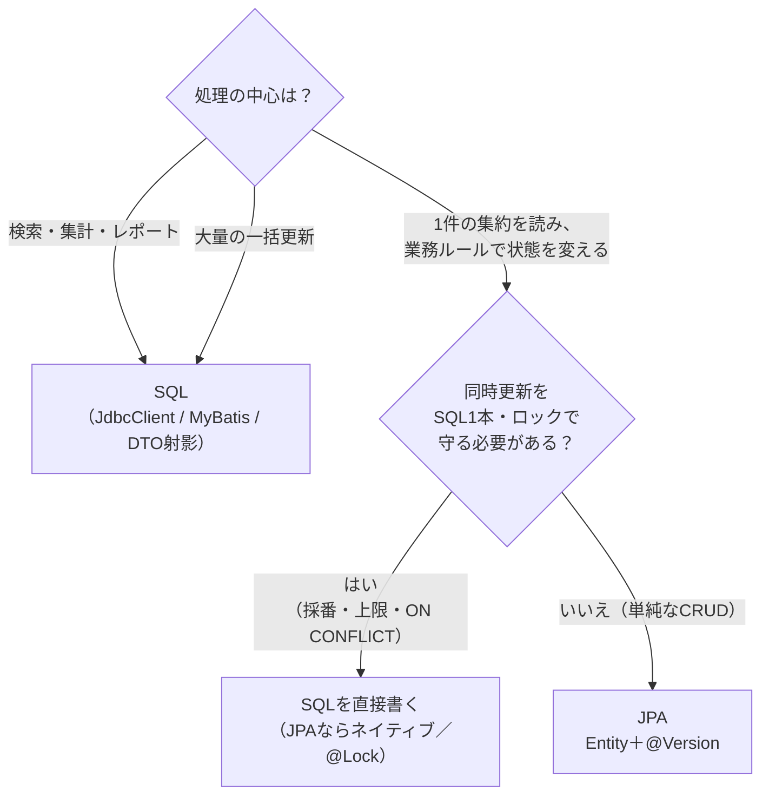

# 第41章 SQLとJPAの使い分けとレビュー

<div class="goal-box" markdown>

この章でできるようになること

- QuickVote の同じユースケースを、JdbcClient と JPA で並べて比べ、使い分けの基準を理由つきで言える
- JPA と JdbcClient を同じトランザクションで混ぜたときの落とし穴（flush されない変更、古い Entity）を、再現して説明できる
- MyBatis の「XMLにSQLを書く」形（`#{}` と `${}`、動的SQL、`resultMap`）を読めるようになる
- AIが生成したJPAコードの典型的な罠5つを、検出方法（SQL本数・grep・テスト）つきで指摘し、直せる

</div>

この章は読解の章です。前半では同じ処理を2つの方式で読み比べ、後半では、AIが書きそうなJPAコードをレビューする演習をします。書くより読む量が多くなります。

## 1. 問いかけ：QuickVote を JPA で書き直すべきか

第3部から第7部まで、QuickVote は JdbcClient で書いてきました。ところが日本の現場では、JPAで書かれたコードに出会う可能性が高く、次のような疑問が出てきます。

> 「QuickVote も、JPAで書いたほうが楽なのでは？」

答えを先に言うと、処理によって違います。この章では、QuickVote の代表的な3つのユースケースを、JdbcClient（本線の実コード）と JPA（jpa-lab で実際に動かしたもの）で並べて、判断の材料を揃えます。

| ユースケース | 本線の実装（第何章） | この章で見る点 |
| --- | --- | --- |
| ① 選択肢ごとの得票数 | `findWithVoteCounts`（`LEFT JOIN`＋`GROUP BY`） | 集計・読み取り |
| ② 投票（1人1票・上書き） | `upsert`（`ON CONFLICT`、第26章） | 書き込み・同時実行 |
| ③ 親行ロック | `lockById`（`FOR UPDATE`、第25章） | ロックの強さ |

## 2. 比べる①：選択肢ごとの得票数（集計）

=== "JdbcClient（QuickVote の実コード）"
    ```java title="code/quickvote/.../poll/OptionRepository.java"
    /** LEFT JOIN なので、票が0の選択肢も 0 件として返る（INNER JOIN だと消える）。 */
    public List<OptionCount> findWithVoteCounts(long pollId) {
        return jdbc.sql("""
                SELECT o.id, o.label, count(v.participant_id) AS votes
                FROM options o
                LEFT JOIN votes v ON v.option_id = o.id
                WHERE o.poll_id = :pollId
                GROUP BY o.id, o.label
                ORDER BY o.id
                """)
                .param("pollId", pollId)
                .query((rs, n) -> new OptionCount(rs.getLong("id"), rs.getString("label"), rs.getInt("votes")))
                .list();
    }
    ```

=== "JPA（jpa-lab）"
    ```java title="src/main/java/com/example/jpalab/poll/OptionRepository.java"
    @Query("""
            select new com.example.jpalab.poll.OptionCount(o.id, o.label, count(v))
            from Option o left join Vote v on v.option = o
            where o.poll.id = :pollId
            group by o.id, o.label
            order by o.id
            """)
    List<OptionCount> findWithVoteCounts(@Param("pollId") Long pollId);
    ```

JPA 版の `@Query` は SQL ではなく JPQL（Jakarta Persistence Query Language）で、テーブルではなく Entity に対して書きます（`options` ではなく `Option`、`o.poll.id` のようにフィールドをたどる）。同じ投票1件を両方で実行した結果は一致しました。

```text
[得票数] JdbcClient=[OptionCount[id=1, label=option-1, votes=3], OptionCount[id=2, label=option-2, votes=1], OptionCount[id=3, label=option-3, votes=0]]
[得票数] JPQL      =[OptionCount[id=1, label=option-1, votes=3], OptionCount[id=2, label=option-2, votes=1], OptionCount[id=3, label=option-3, votes=0]]
[得票数] JPA が発行したSQL ↓
  select o1_0.id,o1_0.label,count(v1_0.id) from options o1_0 left join votes v1_0 on v1_0.option_id=o1_0.id where o1_0.poll_id=? group by o1_0.id,o1_0.label order by o1_0.id
```

出力されたSQLはほぼ同じです。JPQL を使っても「SQLを書かなくてよい」わけではなく、SQL を別の文法で書いているだけです。集計・結合・`GROUP BY` では、JPA でも結局SQLの知識が要ります。しかも、読み取り専用の集計は DTO で受けるので、Entity も永続コンテキストも出番がありません。**この領域では、JPAの強みはほぼ生きません。**

## 3. 比べる②：投票（1人1票・上書き）

次は書き込みです。QuickVote の `VoteRepository.upsert` は、`ON CONFLICT` を使って、「初投票なら INSERT、別の選択肢なら UPDATE、同じ選択肢なら何もしない」をSQL1本で行います。

=== "JdbcClient（QuickVote の実コード）"
    ```java title="code/quickvote/.../vote/VoteRepository.java"
    public int upsert(long pollId, long participantId, long optionId, Instant now) {
        return jdbc.sql("""
                INSERT INTO votes (poll_id, participant_id, option_id, voted_at)
                VALUES (:pollId, :participantId, :optionId, :now)
                ON CONFLICT (poll_id, participant_id) DO UPDATE
                   SET option_id = EXCLUDED.option_id, voted_at = EXCLUDED.voted_at
                   WHERE votes.option_id <> EXCLUDED.option_id
                """)
                .param("pollId", pollId)
                .param("participantId", participantId)
                .param("optionId", optionId)
                .param("now", Db.ts(now))
                .update();
    }
    ```

=== "JPA（素直に書いた版）"
    ```java title="src/main/java/com/example/jpalab/poll/VoteService.java（抜粋）"
    @Transactional
    public void voteWithJpa(Long pollId, Long participantId, Long optionId, Instant now) {
        Option option = options.getReferenceById(optionId);
        Vote vote = votes.findByPollIdAndParticipantId(pollId, participantId).orElse(null);
        if (vote == null) {
            votes.save(new Vote(pollId, participantId, option, now));
        } else {
            vote.changeOption(option, now);          // UPDATE は dirty checking
        }
    }
    ```

「探す → なければ INSERT、あれば Entity を書き換える」は、JPAではごく自然な書き方です。これを3回続けて呼んだときのSQLを見ます。

```text
[JPA版 投票] ① 初めての投票 ↓
  select v1_0.id,v1_0.option_id,v1_0.participant_id,v1_0.poll_id,v1_0.voted_at from votes v1_0 where v1_0.poll_id=? and v1_0.participant_id=?
  insert into votes (option_id,participant_id,poll_id,voted_at) values (?,?,?,?)
[JPA版 投票] ② 別の選択肢へ変更 ↓
  select v1_0.id,v1_0.option_id,v1_0.participant_id,v1_0.poll_id,v1_0.voted_at from votes v1_0 where v1_0.poll_id=? and v1_0.participant_id=?
  update votes set option_id=?,participant_id=?,poll_id=?,voted_at=? where id=?
[JPA版 投票] ③ 同じ選択肢へ再投票（時刻だけ違う） ↓
  select v1_0.id,v1_0.option_id,v1_0.participant_id,v1_0.poll_id,v1_0.voted_at from votes v1_0 where v1_0.poll_id=? and v1_0.participant_id=?
  update votes set option_id=?,participant_id=?,poll_id=?,voted_at=? where id=?
```

| | JdbcClient（`ON CONFLICT`） | JPA（探して分岐） |
| --- | --- | --- |
| SQLの本数 | 常に1本 | 常に2本（`SELECT` ＋ `INSERT`/`UPDATE`） |
| 同じ選択肢への再投票 | 0件更新（イベントを出さない判定に使える） | `voted_at` が変わるので `UPDATE` が出る。`if` で自分で止める必要がある |
| 更新件数 | 戻り値で分かる | Entity では分からない |

### 同時に初投票が来たら

本数よりも深刻なのは、確認してから挿入する形です（第9章の check-then-act、第26章）。同じ人の初投票がほぼ同時に2つ届いたらどうなるでしょう。

```java title="src/test/java/com/example/jpalab/SqlVsJpaTest.java（抜粋）"
tx.executeWithoutResult(a -> {
    assertThat(votes.findByPollIdAndParticipantId(1L, 100L)).isEmpty();            // A：「まだ票がない」と確認
    txNew.executeWithoutResult(b -> voteService.voteWithJpa(1L, 100L, 1L, NOW));   // B：同じ人の別リクエストが先にINSERT
    votes.saveAndFlush(new Vote(1L, 100L, options.getReferenceById(2L), NOW));     // A：続きのINSERT
});
```

```text
[確認してから挿入] DataIntegrityViolationException ← ConstraintViolationException
```

票が2行になることはありませんでした。DBの `UNIQUE(poll_id, participant_id)`（第18章）が止めたからです。ただし、その結果は例外（`DataIntegrityViolationException`）で、利用者には500エラーが見えます。QuickVote の `ON CONFLICT` は、この衝突をエラーにせず、SQL1本の中で解決します。

!!! tip "現場では：JPAでもネイティブSQLを使える"
    JPAを使っていても、`@Query(nativeQuery = true)` で本線と同じ `ON CONFLICT` のSQLを呼べます（jpa-lab の `VoteRepository.upsert`）。更新件数は、初回=1、変更=1、同じ選択肢=0 で、本線の `upsert` と同じでした。
    「JPAか、SQLか」は二者択一ではなく、1つのプロジェクトの中で処理ごとに選べます。

## 4. 比べる③：親行ロック

第25章で、QuickVote は参加人数や選択肢数の上限を守るために、親の `polls` 行を `FOR UPDATE` でロックしてから再カウントしていました。JPA で同じことをするには `@Lock` を使います。

=== "JdbcClient（QuickVote の実コード）"
    ```java title="code/quickvote/.../poll/PollRepository.java"
    public Optional<Poll> lockById(long id) {
        return jdbc.sql("SELECT * FROM polls WHERE id = :id FOR UPDATE")
                .param("id", id)
                .query(PollRepository::map)
                .optional();
    }
    ```

=== "JPA（jpa-lab）"
    ```java title="src/main/java/com/example/jpalab/poll/PollRepository.java（抜粋）"
    @Lock(LockModeType.PESSIMISTIC_WRITE)
    @Query("select p from Poll p where p.id = :id")
    Optional<Poll> lockById(@Param("id") Long id);
    ```

```text
select p1_0.id,p1_0.closes_at,p1_0.status,p1_0.title,p1_0.version from polls p1_0 where p1_0.id=? for no key update of p1_0
```

JPAの `PESSIMISTIC_WRITE` は、PostgreSQL では `FOR NO KEY UPDATE` になりました。本線の `FOR UPDATE` より一段弱いロックです。違いを実際に確かめます。ロックを取った接続がロックを持っている間に、別の接続が子の表（`options`）に行を追加します（外部キーの確認で `polls` の行に触れる操作です）。

```text
[ロックの強さ] polls を FOR UPDATE でロック中に options へ INSERT → 待たされた（lock_timeout で中断: 55P03）
[ロックの強さ] polls を FOR NO KEY UPDATE でロック中に options へ INSERT → すぐ成功
```

QuickVote のように、すべての更新経路が先に `polls` をロックする規則なら、どちらでも直列化されます。ただし、ロックを取らずに子行を追加する経路があると、`FOR UPDATE` なら待たされ、`FOR NO KEY UPDATE` なら通り抜けます。JPAに置き換えたらロックの強さが変わっていた、ということに気づけるのは、発行されるSQLを見ているときだけです。

## 5. 使い分けの基準

ここまでの観察をまとめます。

| 観点 | JdbcClient＋SQL | JPA（Hibernate） |
| --- | --- | --- |
| SQLが見えるか | 自分で書くので常に見える | 組み立てられるので、ログを見ないと分からない |
| 検索・集計・結合 | 得意（SQLそのもの） | JPQL＝別文法のSQL。DTO射影が前提 |
| 1つの集約を読んで、業務ルールで状態を変える | 手で `UPDATE` を書く | 得意（Entityのメソッド＋dirty checking） |
| 同時更新の制御 | SQL1本・ロック・制約を明示的に設計 | `@Version`／`@Lock` が使えるが、「読んでから書く」形になりがち |
| 性能の落とし穴 | 書いたSQLの数がそのまま | N+1、全列UPDATE、1行ずつDELETE、OSIV |
| テーブル・列の変更への追従 | SQLを探して直す | Entityを直せば追従（`ddl-auto: validate` で検出） |
| 学習コスト | SQLが分かれば低い | JPA特有の概念（カゴ・状態遷移・遅延ロード）が必要 |



QuickVote の判断を書いておきます。本線は JdbcClient のままが妥当です。第一に、守るべき約束の中心が同時実行にあります（人数上限・選択肢上限・1人1票・イベント採番）。どれもSQL1本・ロック順序・制約で守っており、JPAのEntityを書き換える形には置き換えにくいものです。第二に、詳細取得は複数テーブルの集計で、DTO射影が前提になります。第三に、SSE の再送（第37章）は「この `seq` より後」を読み直すだけで、Entity の管理は要りません。

一方、「投票の作成」や「タイトルの変更」のような単純な CRUD は、JPA でも十分に書けます。現場では、1つのアプリの中で両方が同居していることも珍しくありません。

!!! warning "「JPAは遅い」「SQLは古い」は、判断基準ではありません"
    本当の基準は、①処理の形（集計か、状態遷移か）、②同時更新の守り方、③チームがその方式の落とし穴（N+1、ロック、flush）を検出できるか、の3つです。方式を決めたら、その方式の事故を検出するテスト（SQL本数、競合）もセットで用意します。

## 6. 混在させるときの落とし穴

同じトランザクションの中で、JPAとJdbcClient（またはネイティブSQL）を混ぜる場合があります。本章のjpa-labで、よく起きる4つの落とし穴を観察しました。

### 6.1 JPAの変更は、flush するまで JdbcClient から見えない

```java
Poll poll = polls.findById(1L).orElseThrow();
poll.close(Instant.now());                                       // カゴの中で変更（まだSQLなし）
jdbc.sql("SELECT status FROM polls WHERE id = 1")...             // → 古い値が返る
polls.flush();                                                   // 明示的に flush
jdbc.sql("SELECT status FROM polls WHERE id = 1")...             // → 新しい値が返る
```

```text
[混在1] 同じトランザクション内で JdbcClient が見た status: flush前=OPEN / flush後=CLOSED
```

JdbcClient は JPA のカゴを経由しないので、auto flush は起きません（JPAのクエリの前でだけ起きます）。JPAで変更してから同じトランザクションの SQL で読むなら、先に `flush()` が必要です。なお、flush後に変更が見えたことから、JdbcClient とJPAが同じトランザクションの同じ接続を共有していることも分かります。

### 6.2 SQLで直接更新すると、カゴの中の Entity は古いまま

```java
Poll poll = polls.findById(1L).orElseThrow();                        // カゴに入る（OPEN）
jdbc.sql("UPDATE polls SET status = 'CLOSED' WHERE id = 1").update(); // JPAを通さない更新
polls.findById(1L).orElseThrow().getStatus();                        // → SQLは出ず、カゴの中身（OPEN）が返る
em.refresh(poll);                                                    // カゴの中身をDBから読み直す → CLOSED
```

```text
[混在2] SQLで CLOSED に更新したあと Entity が見せた status: そのまま=OPEN / refresh後=CLOSED
```

第39章の「同じ id は、カゴの中で1つ」の裏返しです。JPAを通さずに行を変えると、その Entity は古いままになります。対処は、`refresh`（読み直し）するか、そのトランザクションでその Entity を使わないか、のどちらかです。

### 6.3 バルク更新のJPQLも、Entity は古いまま

`@Modifying @Query("update Poll p set p.status = ... where p.id = :id")` のようなバルク更新（`closeInBulk`）は、Entity を経由せずDBへ直接 `UPDATE` を出します。

```text
select p1_0.id,p1_0.closes_at,p1_0.status,p1_0.title,p1_0.version from polls p1_0 where p1_0.id=?
update polls p1_0 set status='CLOSED' where p1_0.id=?
[混在3] バルク更新: 更新件数=1 / Entityの status=OPEN / DBの status=CLOSED
```

Entity は `OPEN` のままです。しかも、このバルク更新は `version` を増やしません。`@Modifying(clearAutomatically = true)` のようにカゴを空にする指定もありますが、「カゴの中の他の変更はどうなるか」まで考える必要があります。**バルク更新のあとは、同じトランザクションで Entity を使わない**のが安全です。

### 6.4 ネイティブクエリの直前にも、flush は起きる

```text
select p1_0.id,p1_0.closes_at,p1_0.status,p1_0.title,p1_0.version from polls p1_0 where p1_0.id=?
update polls set closes_at=?,status=?,title=?,version=? where id=? and version=?
select status from polls where id = 1
[混在4] ネイティブクエリが返した status=CLOSED
```

`EntityManager.createNativeQuery`（JPA経由のネイティブクエリ）の前には、JPQL と同じように auto flush が起きました。ところが 6.1 の JdbcClient では起きませんでした。JPAを通るクエリか、JdbcClient のようにJPAを通らないかで、結果が変わります。

| 経路 | カゴの変更は自動で flush されるか |
| --- | --- |
| JPQL・派生クエリ（Repositoryのメソッド） | される（本章6.4、第39章） |
| `EntityManager.createNativeQuery` | される（本章6.4で確認） |
| JdbcClient（JPAを通らない） | されない（本章6.1） |
| バルク更新の JPQL | 実行はDBへ直接。カゴの中の Entity は更新されない（本章6.3） |

!!! tip "現場では"
    混在させるなら、ルールを1つ決めます。たとえば「1つの業務操作（1つの `@Transactional`）では、どちらかの方式だけ使う」。複数の操作をまたぐ場合は、方式の切り替わりに `flush()` と `refresh()`（または `clear()`）を明示します。

## 7. コラム：MyBatis ── 「XMLにSQLを書く」形を読む

日本のSI現場では、JPAよりも MyBatis（マイバティス）に出会う確率のほうが高いこともあります。SQLをJavaではなくXMLファイルに書き、Javaのインターフェースのメソッドと結びつける方式で、第3部で学んだSQLの知識がそのまま使えます。読めるようになっておきましょう。

### 7.1 Javaのインターフェースと、XMLの対応

```java title="src/main/java/com/example/mybatislab/PollMapper.java（抜粋）"
@Mapper
public interface PollMapper {

    List<OptionCount> findWithVoteCounts(@Param("pollId") long pollId);

    int upsertVote(@Param("pollId") long pollId, @Param("participantId") long participantId,
            @Param("optionId") long optionId);
}
```

```xml title="src/main/resources/mapper/PollMapper.xml（抜粋）"
<mapper namespace="com.example.mybatislab.PollMapper">

    <select id="findWithVoteCounts" resultType="OptionCount">
        SELECT o.id, o.label, count(v.participant_id) AS votes
        FROM options o
        LEFT JOIN votes v ON v.option_id = o.id
        WHERE o.poll_id = #{pollId}
        GROUP BY o.id, o.label
        ORDER BY o.id
    </select>

    <insert id="upsertVote">
        INSERT INTO votes (poll_id, participant_id, option_id, voted_at)
        VALUES (#{pollId}, #{participantId}, #{optionId}, now())
        ON CONFLICT (poll_id, participant_id) DO UPDATE
           SET option_id = EXCLUDED.option_id, voted_at = EXCLUDED.voted_at
           WHERE votes.option_id &lt;&gt; EXCLUDED.option_id
    </insert>
</mapper>
```

読み方は3つだけです。

1. XMLの `namespace` はJavaのインターフェースの完全修飾名、`id` はメソッド名に対応する。この対応でメソッドとSQLが結びつく
2. `#{pollId}` は、引数をバインド変数（`?`）として渡す。JdbcClientの `:pollId` と同じ役割
3. SQLの中に `<`、`>` を書くときは、XMLの規則で `&lt;`、`&gt;` にする（`<>` は `&lt;&gt;`）

実行すると、SQLとパラメータがログに出ます（第3部の SQL ログと同じ感覚で読めます）。

```text
==>  Preparing: SELECT o.id, o.label, count(v.participant_id) AS votes FROM options o LEFT JOIN votes v ON v.option_id = o.id WHERE o.poll_id = ? GROUP BY o.id, o.label ORDER BY o.id
==> Parameters: 1(Long)
```

`#{pollId}` が `?` になり、値は別に渡されています。更新件数も本線と同じ（初回=1、変更=1、同じ選択肢=0）でした。

### 7.2 `#{}` と `${}`：SQLインジェクションの分かれ道

XMLの中に `$` があったら、必ず立ち止まってください。

```xml
<select id="search" resultType="PollRow">
    SELECT id, title, status FROM polls
    <where>
        <if test="status != null">AND status = #{status}</if>
        <if test="keyword != null">AND title LIKE concat('%', #{keyword}, '%')</if>
    </where>
    ORDER BY ${orderBy}
</select>
```

- `#{...}` ＝ バインド変数（`?`）。値として渡されるので、安全
- `${...}` ＝ 文字列がそのまま SQL に埋め込まれる。外部の入力を渡せば、第19章の SQL インジェクションそのもの

```text
mapper.search(null, null, "id DESC") を実行すると：
SELECT id, title, status FROM polls ORDER BY id DESC
```

`orderBy` に渡した文字列が、そのまま SQL の一部になりました。`ORDER BY` や表名のように、バインド変数にできない場所で `${}` が使われがちです。使うなら、Java側で許可する値の一覧（allow-list）と照合してから渡します。

### 7.3 動的SQL：`<where>` と `<if>`

上のXMLの `<where>` と `<if>` は、条件があるときだけ WHERE を組み立てるための部品です。

```text
mapper.search(null, null, "id") →
SELECT id, title, status FROM polls ORDER BY id
mapper.search("OPEN", "poll-1", "id") →
SELECT id, title, status FROM polls WHERE status = ? AND title LIKE concat('%', ?, '%') ORDER BY id
```

条件がなければ `WHERE` ごと消え、あれば先頭の `AND` が取られて `WHERE` に直されます。検索画面のように条件が可変のSQLでは、JdbcClient ならJavaで文字列を組み立てる処理を、XMLの部品が受け持ちます。

### 7.4 `resultMap` と N+1：MyBatis にもある

親子の関係は、`resultMap` の `<collection>` で詰めます。ここにも、JPAと同じ N+1 の落とし穴があります。

```xml
<!-- (A) 入れ子の select：親ごとに selectOptionsByPollId を実行する（1 + N） -->
<resultMap id="pollWithOptionsNested" type="PollWithOptions">
    <id property="id" column="id"/>
    <result property="title" column="title"/>
    <collection property="options" ofType="OptionRow" column="id" select="selectOptionsByPollId"/>
</resultMap>

<!-- (B) JOIN の結果を詰め直す（1本） -->
<resultMap id="pollWithOptionsJoin" type="PollWithOptions">
    <id property="id" column="id"/>
    <result property="title" column="title"/>
    <collection property="options" ofType="OptionRow">
        <id property="id" column="option_id"/>
        <result property="label" column="label"/>
    </collection>
</resultMap>
```

```text
[MyBatis 入れ子select] SQL 101本
  SELECT id, title FROM polls ORDER BY id
  SELECT id, label FROM options WHERE poll_id = ? ORDER BY id
  SELECT id, label FROM options WHERE poll_id = ? ORDER BY id
[MyBatis JOIN+collection] SQL 1本
```

`select="..."` で子を取る形（A）は、投票100件で 101本になりました（JPAの遅延ロードと同じ数字です）。JOINして `<collection>` で詰め直す形（B）は1本です。N+1 は JPA の欠陥ではなく、親子を別々のSQLで取ることから起きます。方式が違っても、SQLの本数を数える習慣は変わりません。

### 7.5 JPA・JdbcClient・MyBatis の比べ方

| | JdbcClient | MyBatis | JPA |
| --- | --- | --- | --- |
| SQLを書く場所 | Javaの中（テキストブロック） | XMLファイル | 書かない（JPQL・自動生成） |
| SQLの可視性 | 常に見える | 常に見える | ログを見ないと分からない |
| 結果の詰め替え | 自分で書く（`RowMapper`） | `resultType`／`resultMap`（設定） | 自動（Entity） |
| 変更検出（dirty checking） | なし | なし | あり |
| 動的SQL | Javaで文字列を組み立てる | `<if>` `<where>` など | Criteria API・Specification |
| 得意な処理 | 小さな規模で、SQLを明示したい | 複雑なSQL、DB固有の機能が多い、SQLを分離したい | 単純なCRUD、集約の状態遷移 |
| 落とし穴 | SQLの重複 | `${}`、XMLとJavaの不整合（実行時に気づく） | N+1、flush、OSIV、LazyInit |

MyBatis の XML は、実行して初めて列名やプロパティ名の食い違いに気づく場合があります（コンパイル時に検査されないため）。そのため、テストでSQLを実際に流すことが特に重要です。

!!! info "この教材で動作確認した組み合わせ"
    Spring Boot 4.1.2 ＋ `mybatis-spring-boot-starter` 4.1.0（MyBatis 3.5.19）で、本節のコードが動作することを `code/labs/ch41-mybatis/` で確認しました。ただし、Spring Initializr では、Spring Boot 4.1.2 を選ぶと MyBatis を依存として選択できませんでした（対応範囲が Boot 4.0 系まで）。公式のバージョン対応表を確認して、手動で依存を追加しています。実プロジェクトでは、採用前に MyBatis 側の対応表を確認してください。

## 8. レビュー演習：AIが書いたJPAコードの罠を5つ見つける

読解章の本題です。AIに「投票の一覧と締切のAPIを JPA で書いて」と頼んだら、次のコードが返ってきたとします。コンパイルでき、一見きれいに動きますが、5つの罠が入っています。

まず、答えを見ずにレビューコメントを書いてください。ヒントは次の観点です。

- SQLは何本流れるか（取得方法）
- APIの境界で何を返しているか
- ログに出したときに何が起きるか
- `Set` に入れたときに何が起きるか

```java title="traps/BadPoll.java（抜粋）"
@Entity(name = "BadPoll")
@Table(name = "polls")
public class BadPoll {
    @Id @GeneratedValue(strategy = GenerationType.IDENTITY) private Long id;
    private String title;
    @Enumerated(EnumType.STRING) private PollStatus status;
    @Column(name = "closes_at") private Instant closesAt;
    @Version private long version;

    @OneToMany(mappedBy = "poll", cascade = CascadeType.ALL, fetch = FetchType.EAGER)
    private Set<BadOption> options = new HashSet<>();

    public void addOption(String label) { options.add(new BadOption(this, label)); }
    // ... getter、close(Instant now) など

    @Override public boolean equals(Object o) {
        if (this == o) return true;
        if (!(o instanceof BadPoll other)) return false;
        return Objects.equals(id, other.id);
    }
    @Override public int hashCode() { return Objects.hash(id); }

    @Override public String toString() {
        return "Poll{id=" + id + ", title=" + title + ", status=" + status + ", options=" + options + "}";
    }
}
```

```java title="traps/BadOption.java（抜粋）"
@Entity(name = "BadOption")
@Table(name = "options")
public class BadOption {
    @Id @GeneratedValue(strategy = GenerationType.IDENTITY) private Long id;

    @ManyToOne
    @JoinColumn(name = "poll_id")
    @JsonIgnore
    private BadPoll poll;

    private String label;
    // ... コンストラクタ、getter

    @Override public boolean equals(Object o) {
        if (this == o) return true;
        if (!(o instanceof BadOption other)) return false;
        return Objects.equals(id, other.id);
    }
    @Override public int hashCode() { return Objects.hash(id); }

    @Override public String toString() {
        return "Option{id=" + id + ", label=" + label + ", poll=" + poll + "}";
    }
}
```

```java title="traps/BadPollService.java と BadPollController.java（抜粋）"
@Service
public class BadPollService {
    private static final Logger log = LoggerFactory.getLogger(BadPollService.class);
    // ... コンストラクタ（polls, options の Repository を受け取る）

    public List<BadPoll> findAll() {
        return polls.findAll();
    }

    /** 選択肢IDの一覧から、ラベルの一覧を返す。 */
    @Transactional(readOnly = true)
    public List<String> labelsOf(List<Long> optionIds) {
        List<String> labels = new ArrayList<>();
        for (Long optionId : optionIds) {
            BadOption option = options.findById(optionId).orElseThrow();
            labels.add(option.getLabel());
        }
        return labels;
    }

    @Transactional
    public void close(Long id, Instant now) {
        BadPoll poll = polls.findById(id).orElseThrow();
        poll.close(now);
        log.info("closed: {}", poll);
    }
}

@RestController
@RequestMapping("/api/bad")
public class BadPollController {
    @GetMapping("/polls")
    public List<BadPoll> list() {
        return service.findAll();
    }
}
```

!!! example "やってみる：レビューコメントを書く"
    5分間、コードを読み、気になった点をメモしてください。「何が起きるか」と「どう確かめるか」まで書けたら満点です。コードは `code/jpa-lab/src/main/java/com/example/jpalab/traps/` にあります。答え合わせの `TrapsTest` は、読み終わるまで開かないでください。

??? success "解答：5つの罠、検出方法、修正"
    **罠1：`EAGER`（`@OneToMany(fetch = EAGER)` と、`fetch` を書いていない `@ManyToOne`）**

    - 何が起きるか：`@ManyToOne` の既定は EAGER です。一覧を取っただけで、全投票の選択肢が読み込まれます。投票100件で、`findAll()` が 101本になりました（修正後は1本）
    - 検出方法：`grep -rn "FetchType.EAGER"`。`@ManyToOne`／`@OneToOne` に `fetch =` が書かれていないものを探す。SQL本数を検査するテスト（`measure`）
    - 修正：関連はすべて `LAZY` を明示し、必要な画面ごとに fetch join／`@EntityGraph`／DTO射影で取る（第40章）

    ```text
    [罠1] 罠入り(EAGER): 101本 / 修正後(LAZY): 1本
    ```

    **罠2：ループの中の `findById`**

    - 何が起きるか：IDの数だけSQLが出ます。20個のIDで 40本になりました（EAGER の副作用で、1つのIDごとに「選択肢＋投票」と「その投票の全選択肢」の2本が出ます）
    - 検出方法：`for` の中の `findById`／`getReferenceById` を読む。SQL本数のテスト
    - 修正：`findAllById(ids)`（`where id in (...)` の1本）

    ```text
    [罠2] 罠入り(ループ内 findById): 40本 / 修正後(findAllById): 1本
      select bo1_0.id,bo1_0.label,p1_0.id,... from options bo1_0 left join polls p1_0 on p1_0.id=bo1_0.poll_id where bo1_0.id=?
      select o1_0.poll_id,o1_0.id,o1_0.label from options o1_0 where o1_0.poll_id=?
      ...
      select o1_0.id,o1_0.label,o1_0.poll_id from options o1_0 where o1_0.id in (?,?,?,?,?,?,?,?,?,?,?,?,?,?,?,?,?,?,?,?)
    ```

    **罠3：Entity をそのまま返す Controller**

    - 何が起きるか：JSON に `version` など内部の列まで出ます。Entity を変えるとAPIの形も変わります。無限ループを避けるために付けた `@JsonIgnore` は、問題を隠しただけです
    - 検出方法：`@RestController` のメソッドの戻り値の型に `@Entity` が含まれていないか。応答JSONを検査するテスト
    - 修正：DTO（`record`）に詰めて返す（第13章）

    ```text
    [罠3] 罠入りの応答: [{"title":"poll-1","closesAt":"2026-11-08T16:51:40.072048Z","id":1,"options":[{"id":1,"label":"option-1"},{"id":2,"label":"option-2"}],"status":"OPEN","version":0}, ...]
    [罠3] 修正後(DTO)の応答: {"id":1,"title":"poll-1","optionLabels":["option-1","option-2"]}
    ```

    **罠4：`toString` に関連を含めて、循環する**

    - 何が起きるか：`BadPoll.toString()` が `options` を、`BadOption.toString()` が `poll` を出力するので、無限に呼び合って `StackOverflowError` になります。しかも、ログ出力ではこの例外が握りつぶされます（`log.info("closed: {}", poll)` は、`closed: [FAILED toString()]` と出るだけです）
    - 検出方法：`toString()` を直接呼ぶテスト。ログに `[FAILED toString()]` が出ていないか grep。Lombok の `@Data`／`@ToString` は、既定ですべてのフィールドを並べるので同じ事故を起こします
    - 修正：`toString` に関連（コレクション・親への参照）を含めない。`id` と、重要な単純な値だけにする

    ```text
    [罠4] poll.toString() → StackOverflowError
    [罠4] ログ: closed: [FAILED toString()]
    [罠4] 修正後: Poll{id=null, title=昼食は何がいい？, status=OPEN} / [Option{id=null, label=パン}]
    ```

    **罠5：`id` だけで `equals`／`hashCode` を実装する**

    - 何が起きるか：①保存前の Entity は `id` が `null` で、すべて互いに等しいので、`Set` に入れると1件に潰れます。3つの選択肢を足したのに1件でした。②保存すると `id` が採番されて `hashCode` が変わり（31 → 32）、`HashSet` から見つからなくなります
    - 検出方法：`new` した Entity を `Set` に複数入れるテスト。`hashCode` が `id` を使っていないか読む
    - 修正：`id` が `null` の間は等しくしない（`getId() != null && ...`）、`hashCode` は定数（または不変の業務キー）にする。Entity を `Set` に入れないなら、そもそも `equals`／`hashCode` を実装しない（オブジェクト同一性のまま）という選択肢もあります

    ```text
    [罠5] 3回 addOption したのに options の件数 = 1
    [罠5] 保存前 hashCode=31 → 保存後 hashCode=32 / poll.getOptions().contains(option) = false
    [罠5] 修正後の equals/hashCode で Set に入れた件数 = 3
    ```

    修正した `Option` の実装（jpa-lab）です。

    ```java title="src/main/java/com/example/jpalab/poll/Option.java（抜粋）"
    @Override
    public boolean equals(Object other) {
        if (this == other) {
            return true;
        }
        return other instanceof Option that && getId() != null && getId().equals(that.getId());   // (1)!
    }

    @Override
    public int hashCode() {
        return Option.class.hashCode();          // (2)!
    }
    ```

    1. `id` が `null`（未保存）の間は、自分自身としか等しくなりません。`instanceof` ＋ `getId()` で、Hibernate のプロキシとも比較できます。
    2. 保存の前後で変わらない値にします。

    **ボーナス（見つけやすい順）**：どの罠も、「SQLを数える」「JSONを見る」「`toString` を呼ぶ」「`Set` に入れてみる」という小さなテスト1本で検出できます。レビューでは、コードを眺めるだけでなく、テストで反証するのが確実です。

!!! tip "他にも注意する点"
    この演習のコードには、`@Transactional` の外で遅延ロードに触れる書き方（第40章）や、`@Version` の衝突を処理しない書き方（第40章）は含めていません。これらは前章の「現場では」の表でレビューします。レビュー観点の全体像は、第47章（AIと組むレビュー術）で、チェックリストにまとめ直します。

---

## まとめ：3点セット

!!! abstract "この章の3点セット"
    **① 一言で言うと**
    JPAは「1件の集約を読んで業務ルールで状態を変える」処理に向き、検索・集計・同時更新の制御はSQL（JdbcClient・MyBatis・JPAのネイティブ）が向く。両者を混ぜるなら flush と古い Entity に注意し、どの方式でも、発行されるSQLの本数と、同時実行の守り方をテストで確かめる。

    **② 現場でこう聞かれる**
    「このプロジェクトはJPAとMyBatisのどちらで書くべきですか？」
    → 処理の形で決める。単純なCRUDと集約の状態遷移ならJPA、集計・複雑な検索・採番や上限のような同時実行制御はSQL。どちらにしても、SQLのログを見られる状態にし、N+1と同時更新を検出するテストを用意する。

    **③ 自分のサービスならどこに当たるか**
    自分のサービスの主要な処理を5つ挙げ、「検索・集計」「状態遷移」「同時更新の制御」に分類する。それぞれ、JPAとSQLのどちらで書くかを決め、理由を1行で書く。

## 演習

??? question "確認問題1：どちらで書く？"
    QuickVote に次の機能を足すとします。JPA と JdbcClient のどちらで書きますか。理由も添えてください。(a) 投票のタイトル変更 (b) 投票の参加者数ランキング（全投票を横断した集計） (c) 「選択肢の追加は10件まで」の判定と追加

??? success "解答"
    (a) JPA でも十分です。1件を読んで業務のメソッドで変えるだけで、`@Version` で同時編集を検出できます。(b) SQL（JdbcClient か DTO射影）です。横断した集計で、Entity は不要です。(c) SQL（本線のまま）です。「親行をロック → 再カウント → 追加」は、同時実行の制御が本質です。JPA の「読んでから書く」では、競合の穴ができやすくなります（JPAなら `@Lock(PESSIMISTIC_WRITE)` を使いますが、ロックの強さが `FOR NO KEY UPDATE` に変わる点に注意）。

??? question "確認問題2：混在の事故を予測する"
    次のメソッドを呼ぶと、戻り値はどうなりますか。

    ```java
    @Transactional
    public String check(Long id) {
        Poll poll = polls.findById(id).orElseThrow();
        poll.close(Instant.now());
        return jdbc.sql("SELECT status FROM polls WHERE id = :id").param("id", id)
                .query(String.class).single();
    }
    ```

??? success "解答"
    `"OPEN"` が返ります（変更前の値）。`poll.close(...)` はカゴの中の変更で、JdbcClient の `SELECT` の前に flush は起きないからです。`polls.flush()` を `SELECT` の前に呼べば `"CLOSED"` になります。メソッドを抜けるとコミット前に flush され、DBは `CLOSED` になります。

??? question "確認問題3：MyBatis を読む"
    次のXMLを読んで、`mapper.find(null)` と `mapper.find("OPEN")` で発行されるSQLを書いてください。また、この書き方の問題点を1つ指摘してください。

    ```xml
    <select id="find" resultType="PollRow">
        SELECT id, title FROM polls
        <where>
            <if test="status != null">status = #{status}</if>
        </where>
        ORDER BY ${sort}
    </select>
    ```

??? success "解答"
    `find(null)` は `SELECT id, title FROM polls ORDER BY ...`（`WHERE` が消える）、`find("OPEN")` は `SELECT id, title FROM polls WHERE status = ? ORDER BY ...`（`?` に `OPEN` がバインドされる）です。
    問題点は `ORDER BY ${sort}`：文字列がそのまま SQL に埋め込まれるので、`sort` に外部の入力を渡すと SQL インジェクションになります。許可する列名の一覧（allow-list）とJavaで照合してから渡します。なお、このXMLでは `sort` を引数に渡す `@Param` の指定も必要です。

??? question "応用：罠入りコードを直す"
    罠入りの `BadPollController.list()` を、DTO を返す形に直してください。一覧は N+1 にならないように、取得方法も指定してください。

??? success "解答"
    例：Service で `PollView` を作って返します（本章 jpa-lab の `PollService.listFetchJoin()`／`listDto()`）。Controller は `List<PollView>` を返す。取得は、読み取り専用の一覧なので DTO 射影（`findOptionRows` の1本）か、`@EntityGraph`（`left join`、1本）。いずれも、SQL本数を検査するテスト（`assertThat(m.sqlCount()).isEqualTo(1)`）を添えます。`@OneToMany` の `EAGER` は `LAZY`（既定）に戻し、`toString`／`equals`／`hashCode` も直します。

??? question "説明問題：現場でこう聞かれる"
    「JPAを使っているのに、なぜ SQL を勉強する必要があるのですか？」200字程度で答えてください。

??? success "解答"
    例：JPAはSQLを書かなくてよくするだけで、SQLを発行しないわけではないからです。N+1、全列UPDATE、flushの順序、ロックの強さの違いは、発行されるSQLを読めなければ気づけません。集計や同時実行の制御はJPQLでも結局SQLの知識が必要で、混在させる場面ではSQLを直接書きます。JPAの便利さを安全に使うために、SQLを読めることが前提になります。

## 第8部を終えて

第8部はここまでです。[第8部の扉](index.md)の「第8部のチェックリスト」で、15項目を確認してから、第9部（運用）へ進んでください。説明できない項目があれば、その章へ戻ります。

| 第8部で見たもの | 以降での姿 |
| --- | --- |
| SQLを数える（`measure`）・ログを読む | 構造化ログ・メトリクス（第43章・第44章） |
| OSIV と接続の占有 | コネクションプールの指標、タイムアウト設計（第44章・第45章） |
| `@Version`／ロックの強さ | 稼働中のスキーマ変更・移行の判断（第46章） |
| AI生成コードの罠5つ | AIと組むレビュー術のチェックリスト（第47章） |
