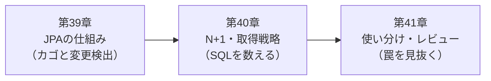

# 第8部 JPAを理解して使い分ける

<!-- part-intro:start -->
<div class="video-card">
  <video controls preload="metadata" poster="../assets/videos/part08-intro.jpg">
    <source src="../assets/videos/part08-intro.mp4" type="video/mp4">
  </video>
  <p class="video-caption">▶ 第8部でやること（約1分）</p>
  <p class="video-credit">音声：VOICEVOX:冥鳴ひまり</p>
</div>

??? note "字幕全文"
    第8部はJPAを理解して使い分ける部です。
    本線とは別の実験で動きを観察します。
    QuickVoteはここまで、JdbcClientとSQLで書いてきました。
    でも現場でよく見るのはJPAのコードです。
    SQLを書かないので、何が実行されているのか見えません。
    第39章はJPAが肩代わりすること。
    永続コンテキストの中で変更すると、saveなしでもUPDATEが出ます。
    第40章はN+1。
    一覧でSQLが101本流れる事故を数えて直します。
    fetch joinやDTOで、SQLを3本以下に減らします。
    LazyInitializationExceptionも、わざと起こして読みます。
    第41章はSQLとJPAの使い分け。
    同じ処理を並べて選び方を決めます。
    AIが書いたJPAコードの罠を5つ見つけます。
    この部が終わると、JPAが何をして何を隠すか説明できます。
    SQLが何本流れるかを数えて確かめられます。
    QuickVote本線は、JdbcClientのままです。
    JPAは発行されるSQLを数えて使う。
<!-- part-intro:end -->

QuickVote の本線は、ここまでずっと JdbcClient と SQL で書いてきました。この部では、日本の現場でいちばんよく出会うもう1つの方式、JPA（Hibernate）を、本線とは別の実験プロジェクト `code/jpa-lab/` で動かして学びます。

目的は JPA に乗り換えることではありません。JPA が何を肩代わりして何を隠すのかを、発行される SQL を数えて理解し、AI が書いた JPA コードを読み、レビューし、直せるようになることです。

## この部でできるようになること

- JPA・Hibernate・Spring Data JPA の関係と、`jakarta.persistence.*` の世代（Jakarta Persistence 3.2／Hibernate ORM 7）を説明できる
- 「永続コンテキスト＝レジのカゴ」の例えで、`save()` を呼ばなくても UPDATE が出る理由と、`@Transactional` がないと変更が消える理由を説明できる
- 一覧APIで SQL が何本流れるかを、ログと Hibernate の統計で数えられる（投票100件で101本）
- fetch join／`@EntityGraph`／DTO射影／バッチフェッチで 101本を1〜3本に減らし、それぞれの注意点を言える
- `LazyInitializationException` と open-in-view（OSIV）の関係、`@Version` による楽観ロックの衝突を、再現して説明できる
- QuickVote の同じユースケースを JdbcClient と JPA で並べ、使い分けの基準を言葉にできる
- MyBatis の「XMLにSQLを書く」形を読める
- AIが生成したJPAコードの典型的な落とし穴5つを、検出する方法（SQL本数・grep・テスト）つきで指摘し、直せる

## アプリの到達状態

QuickVote 本線（`code/quickvote/`）は JdbcClient のままで、この部では変更しません。代わりに、QuickVote の `polls`／`options`／`votes` を簡略化した同じ形のテーブルを使い、JPA 版の実験プロジェクトを動かします。

| | QuickVote 本線 | jpa-lab（この部の実験） |
| --- | --- | --- |
| データアクセス | JdbcClient＋手書きSQL | Spring Data JPA＋Hibernate |
| テーブル | polls, options, votes ほか | polls, options, votes（簡略版） |
| DB・マイグレーション | PostgreSQL 18・Flyway | 同じ（Testcontainers の PostgreSQL 18） |
| 目的 | 守るべき約束を実装する | 同じ処理をJPAで書くと何が起きるかを観測する |

## 各章

<div class="grid cards" markdown>

-   :material-basket-outline: **[第39章 JPAは何を肩代わりするのか](ch39-jpa-basics.md)**

    ---

    Entity、永続コンテキスト（レジのカゴ）、dirty checking、flush。`save()` を呼ばなくてもUPDATEが出ます。

-   :material-waterfall: **[第40章 N+1と取得戦略](ch40-n-plus-one.md)**

    ---

    一覧でSQLが101本流れる事故を数えて直す。LazyInitializationException、OSIV、`@Version`。動画つき。

-   :material-scale-balance: **[第41章 SQLとJPAの使い分けとレビュー](ch41-sql-vs-jpa.md)**

    ---

    同じユースケースを並べて比べる。MyBatisのコラム。罠を5つ仕込んだAI生成風コードのレビュー演習。

</div>

## 第8部の流れ



第39章で JPA が裏で何をしているかを知り、第40章でその裏側が性能事故として表に出る様子を観測します。第41章では、そこで得た知識を判断とレビューに使います。

## 実験コードの置き場

```text
code/jpa-lab/                  第39〜41章の実験プロジェクト（Maven Wrapper つき）
├── src/main/java/com/example/jpalab/
│   ├── poll/                  Entity・Repository・Service（修正後の「良い」コード）
│   ├── web/                   OSIV の観察用 Controller
│   └── traps/                 第41章の演習用「罠入り」コード（使わないこと）
├── src/main/resources/db/migration/V1__create_polls_options_votes.sql
└── src/test/java/com/example/jpalab/
                               各章の実験（SQL本数・ログを検証するテスト）
code/labs/ch41-mybatis/        第41章のコラム用。MyBatis（XMLのSQL）を同じスキーマで動かす
```

実験は `./mvnw test`（Windows は `.\mvnw.cmd test`）で再現できます。実PostgreSQL 18 を Testcontainers で起動するので、Docker Desktop を起動しておいてください。

!!! note "なぜWebを入れたのか"
    open-in-view（第40章）は、Webアプリでしか意味を持たない設定です。そのため jpa-lab には Spring MVC（`spring-boot-starter-webmvc`）を入れてあります。

## 第8部のチェックリスト

第41章を終えたら、次の項目を確かめてください。説明できない項目は、白紙に自分の言葉で書いてみて、書けなければ該当章へ戻ります。目安は「③ 検証できる」です。

- [ ] JPA・Hibernate・Spring Data JPA の違いを説明でき、import が `jakarta.persistence.*` であることを確認できる
- [ ] 永続コンテキスト（レジのカゴ）が何を覚えていて、いつSQLを出すかを説明できる
- [ ] `save()` を呼ばなくても UPDATE が出るコードを読み、その UPDATE がどの時点で出るかを言える
- [ ] `@Transactional` がない更新が黙って捨てられる理由を、カゴの例えで説明できる
- [ ] Entity の4つの状態（new／managed／detached／removed）と、`save()` が新規と既存で何をするかを説明できる
- [ ] 発行されるSQLをログに出し、SQL の本数を数えるテストを書ける
- [ ] N+1 の発生箇所を、コードとSQLログの両方から指摘できる
- [ ] fetch join・`@EntityGraph`・DTO射影・バッチフェッチの違いと、それぞれの注意点（0件の親、ページング）を言える
- [ ] `LazyInitializationException` が起きる理由と、安全な直し方・やってはいけない直し方を言える
- [ ] open-in-view の既定値（true）と警告ログの意味を説明し、接続を握り続ける問題を指摘できる
- [ ] `@Version` が衝突をどう検出するかを説明し、競合時の例外をHTTPの409にする方針を言える
- [ ] 同じユースケースについて、JdbcClient と JPA のどちらで書くかを、理由つきで選べる
- [ ] JPA と JdbcClient を同じトランザクションで混ぜたときの落とし穴（flush・古いEntity）を、再現して説明できる
- [ ] MyBatis のXMLマッパー（`#{}`と`${}`、動的SQL、`resultMap`）を読んで、発行されるSQLを想像できる
- [ ] AIが書いたJPAコードの罠（EAGER、ループ内`findById`、Entity直返し、`toString`循環、`equals/hashCode`）を、検出方法つきで指摘できる

!!! tip "統合課題：自分の言葉でレビューする"
    第41章の「罠入りコード」の解説を見ずに、`code/jpa-lab/src/main/java/com/example/jpalab/traps/` のファイルを読み、テストを1本も実行せずにレビューコメントを書いてください。そのあと `TrapsTest` を実行して、見つけた罠と見つけられなかった罠を照らし合わせます。
