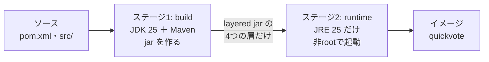
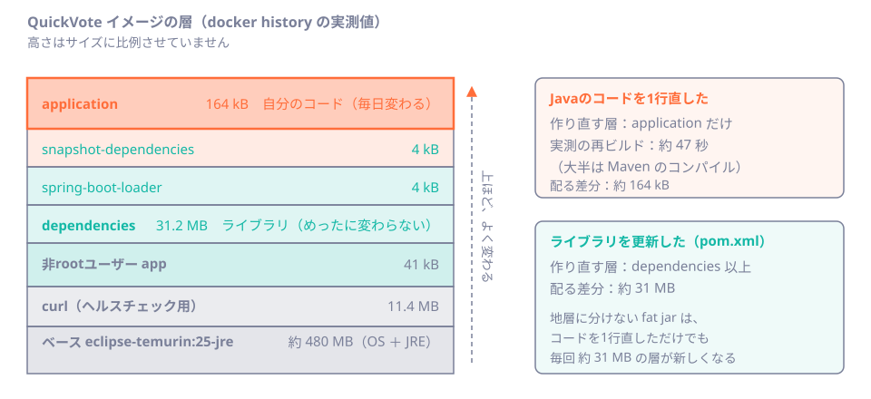

# 第42章 Dockerでパッケージング

<div class="goal-box" markdown>

この章でできるようになること

- マルチステージ・layered jar・非rootの `Dockerfile` を1行ずつ読み、なぜその形なのかを説明できる
- コードを1行直したとき、どの層だけが作り直されるかを `docker history` で確かめられる
- コンテナのメモリ制限が JVM のヒープ上限にどう効くかを `-XX:+PrintFlagsFinal` で確かめ、`MaxRAMPercentage` を決められる
- `compose.app.yaml`（アプリ＋DB）を起動し、ヘルスチェックが「管理ポート 9090 の readiness」を見ていることを確認できる
- メモリ制限で落ちたとき、**Java の例外ではなく OOMKilled（終了コード 137）**で気づける

</div>

## 1. 問いかけ：「自分のPCでは動いた」を、どう渡すか

フロントエンドの成果物は、`npm run build` が作る `dist/` です。静的ファイルなので、置けばブラウザが動かしてくれます。

サーバーは違います。動かすには、**JVM、jar、設定、OS のライブラリ**が揃った環境が要ります。Java のバージョンが1つ違うだけで、動作が変わることもあります。

そこで、**動く環境ごと**箱に詰めて渡します。これが**コンテナイメージ**です。`dist/` の代わりに、**「そのまま起動できる箱」**を配ります。

!!! note "用語：イメージとコンテナ"
    **イメージ**は、アプリと実行環境を固めた**読み取り専用の雛形**です。**コンテナ**は、イメージから起動した**実行中のプロセス**です。1つのイメージから、同じコンテナをいくつでも起動できます。
    仮想マシンと違い、コンテナは OS のカーネルを共有するので、起動が速く軽量です。

この章では、QuickVote のリファレンス実装にある `Dockerfile` と `compose.app.yaml` を、**実際に build して起動し、測りながら**読みます。

## 2. 完成形を先に動かす

`code/quickvote/` で、次を実行します（Docker Desktop を起動しておいてください）。

```bash
docker compose -f compose.app.yaml up --build
```

初回は Maven の依存を取得するので、約1分半かかります（筆者の環境で 86 秒）。起動すると、2つのコンテナが **healthy** になります。

```text
NAME              IMAGE                STATUS                    PORTS
qv42-app-1        qv42-app             Up 23 seconds (healthy)   0.0.0.0:18042->8080/tcp
qv42-postgres-1   postgres:18-alpine   Up 39 seconds (healthy)   0.0.0.0:25442->5432/tcp
```

（筆者は他の作業とポートが衝突しないよう、ホスト側を付け替えています。本文のコマンドは `8080` で読み替えてください。）

!!! example "動かしてみる：中のユーザーと、外から見えるもの"
    ```bash
    docker exec qv42-app-1 id
    curl -s -o /dev/null -w "%{http_code}\n" http://localhost:8080/actuator/health
    curl -s -m 3 -o /dev/null -w "%{http_code}\n" http://localhost:9090/actuator/health
    ```
    ```text
    uid=999(app) gid=999(app) groups=999(app)
    401
    000
    ```
    アプリは `root` ではなく `app`（uid 999）で動いています。公開ポートの Actuator は 401、管理ポート 9090 はホストから**そもそも届きません**（`000` は接続できなかったという意味）。この2つがなぜ大事かは、後の節で説明します。

!!! warning "Windows の Git Bash でつまずく点"
    Git Bash から `docker run ... ls /opt/java/openjdk/bin` のように `/` で始まるパスを渡すと、Git Bash が `D:/Application/Git/opt/...` のような Windows のパスに**書き換えて**しまいます。`MSYS_NO_PATHCONV=1 docker run ...` と付けると防げます。PowerShell では起きません。

## 3. Dockerfile を読む：2つの部屋に分ける

QuickVote の `Dockerfile` は、**2つのステージ**でできています。



- **build ステージ**：JDK（コンパイラ付き）と Maven で、jar を作る。**作業場**であり、出荷物には入らない
- **runtime ステージ**：JRE（実行だけ）の小さなイメージに、**できあがった jar だけ**をコピーする

!!! note "用語：マルチステージビルド"
    `Dockerfile` に `FROM` を複数書き、前のステージの成果物だけを後ろのステージへ `COPY --from=` で渡す方法です。コンパイラやソースコード、Maven のキャッシュを、**最終イメージに持ち込まない**ために使います。

まず build ステージです。

```dockerfile title="Dockerfile（build ステージ）"
FROM eclipse-temurin:25-jdk AS build
WORKDIR /workspace

# 依存の取得だけを先に行う。pom.xml が変わらない限り、この層はキャッシュされる。
COPY .mvn .mvn
COPY mvnw pom.xml ./
RUN chmod +x mvnw && ./mvnw -B -q dependency:go-offline   # (1)!

COPY src src
RUN ./mvnw -B -q -DskipTests package \
 && java -Djarmode=tools -jar target/quickvote.jar extract --layers --destination target/extracted   # (2)!
```

1. `pom.xml` だけを先にコピーして依存を取る。**`src/` はまだコピーしない**。コードを直しても `pom.xml` は変わらないので、この重い手順（依存のダウンロード）は**キャッシュされたまま**になる
2. jar を作り、Spring Boot の `jarmode=tools` で **4つの層のディレクトリに展開**する。テストは CI（第46章）で済んでいる前提で省く

`COPY` を `pom.xml` → `src` の順に分けたのは、「**変わりにくいものを先に**」というキャッシュの基本です。この順序は、次の節で効いてきます。

## 4. layered jar：変わりにくい順に積む地層

Docker のイメージは、`Dockerfile` の命令ごとに作られる**層（レイヤー）**の積み重ねです。ある層を作り直すと、**その上の層は全部**作り直しになります。

そこで、Spring Boot の jar を**変わりにくさで4つに分けて**積みます。



```bash
java -Djarmode=tools -jar target/quickvote.jar list-layers
```

```text
dependencies
spring-boot-loader
snapshot-dependencies
application
```

| 層 | 中身 | 変わる頻度 | 実測サイズ |
| --- | --- | --- | --- |
| `dependencies` | 64個のライブラリ（Spring、Tomcat、PostgreSQL ドライバなど） | ライブラリを更新したとき | **31.2 MB** |
| `spring-boot-loader` | jar を起動するための小さな部品 | ほぼ変わらない | 4 kB |
| `snapshot-dependencies` | `-SNAPSHOT` 版のライブラリ | QuickVote では空 | 4 kB |
| `application` | 自分のコード（`BOOT-INF/classes`）と設定 | **毎日** | **164 kB** |

イメージの中身のうち、**自分のコードは 164 kB**です。ほとんどが外部ライブラリです。ここを分けておけば、コードの変更で作り直す層は、一番上の **164 kB だけ**になります。

!!! tip "フロントエンドで例えると"
    `vendor.js` と `app.js` を分けて出力する、コード分割と同じ考え方です。`node_modules` 由来の巨大なファイルは**ブラウザのキャッシュに残し**、毎回変わる自分のコードだけを取り直してもらいます。Docker では、キャッシュするのがブラウザではなく**ビルド機やレジストリ**に変わります。

### 動かしてみる：コードを1行直して再ビルド

実際に測ります。コードの1行（ログのメッセージ）を直して、再ビルドします。

```text
変更なしで再ビルド     : 3.8 秒（全ステップ CACHED）
Javaコードを1行直す    : 47 秒（#12 COPY src、#13 ./mvnw package だけが実行。
                                  runtime の dependencies の COPY は CACHED）
```

`docker image inspect` で、2つのイメージの層の ID を並べます。違うのは、**最後の1つ**だけです。

```text
元のイメージ      : 5cac300e 5f4be2c3 8edffd8f c0b57412 5f70bf18 7de0b21f ... 5f70bf18 5f70bf18 46526796
コードを直した後  : 5cac300e 5f4be2c3 8edffd8f c0b57412 5f70bf18 7de0b21f ... 5f70bf18 5f70bf18 272bddd5
                                                                                            ↑ 最後の1つ（application）だけ
```

レジストリへ送る（push）ときも、サーバーが取ってくる（pull）ときも、**変わった層だけ**が転送されます。コード変更のたびに動くのは約 164 kB です。

### 比べてみる：地層に分けない fat jar

比較のため、jar をそのまま1つの層に入れる `Dockerfile` を作って、コードを直しながら2回ビルドしました。

```text
COPY quickvote.jar /app/quickvote.jar   → 31.4 MB の層
コードを1行直して再ビルド                → その 31.4 MB の層が、別の層（ID が変わる）になる
```

コードを1行直すたびに、**約 31 MB の層が丸ごと新しく**なります。1日に10回出せば、310 MB です。チームで、複数のサーバーに配るなら、差は大きくなります。

!!! warning "この例え（地層）が外れる点"
    地質の地層は、上の層を削っても下は残ります。Docker の層は**逆の連鎖**です。**下の層を変えると、その上は全部作り直し**になります。だから「変わりにくい順に下から積む」のです。`COPY . .` を最初に書いてしまうと、どのファイルを直しても、その後の層がすべて無効になります。

## 5. 非root：コンテナから抜け出されたときの被害を小さくする

runtime ステージの後半です。

```dockerfile title="Dockerfile（runtime ステージ）"
FROM eclipse-temurin:25-jre AS runtime
RUN apt-get update && apt-get install -y --no-install-recommends curl  && rm -rf /var/lib/apt/lists/*   # (1)!
RUN groupadd --system app && useradd --system --gid app --no-create-home --shell /usr/sbin/nologin app   # (2)!
WORKDIR /app

COPY --from=build /workspace/target/extracted/dependencies/ ./
COPY --from=build /workspace/target/extracted/spring-boot-loader/ ./
COPY --from=build /workspace/target/extracted/snapshot-dependencies/ ./
COPY --from=build /workspace/target/extracted/application/ ./     # (3)!

USER app   # (4)!
EXPOSE 8080
ENV SPRING_PROFILES_ACTIVE=prod
ENV JAVA_TOOL_OPTIONS="-XX:MaxRAMPercentage=75"
ENTRYPOINT ["java", "-jar", "/app/quickvote.jar"]   # (5)!
```

1. JRE のイメージには `curl` が入っていない。ヘルスチェックで使うので追加する。`rm -rf /var/lib/apt/lists/*` は、同じ命令の中で一時ファイルを消して、層を太らせない
2. ログインできない（`nologin`）専用ユーザー `app` を作る
3. **変わりにくい順**に4回 `COPY` する。これが前の節の層になる
4. これ以降の命令と、コンテナの起動は `app` ユーザーで行われる
5. `[...]` の**配列形式**で書く。`java` がコンテナの **PID 1** になり、停止の合図（SIGTERM）が直接届く。シェル形式（`ENTRYPOINT java -jar ...`）だとシェルが PID 1 になり、graceful shutdown（第45章）が働かないことがある

非 root にする理由は、**侵入されたときの被害を小さくする**ためです。アプリに脆弱性があって、攻撃者がコンテナの中でコマンドを実行できたとしても、root でなければ、システムの設定を書き換えたり、ほかのファイルを読んだりしにくくなります。

実測で確かめます。

```bash
docker exec qv42-app-1 ps -o pid,user,args
docker exec qv42-app-1 ls -la /app
```

```text
  PID USER     COMMAND
    1 app      java -jar /app/quickvote.jar        ← java が PID 1。ユーザーは app

drwxr-xr-x 1 root root   4096 Nov  7 17:21 .
drwxr-xr-x 2 root root   4096 Nov  7 17:21 lib
-rw-r--r-- 1 root root 151809 Feb  1  1980 quickvote.jar
```

`/app` の中身の持ち主は **root** で、`app` ユーザーは**読めるが書けません**。アプリのコードを実行中に書き換えられない、という効果もあります。（`quickvote.jar` が 152 kB なのは、層の展開後は**自分のコードと起動情報だけ**の jar になり、ライブラリは `lib/` の 30 MB に出ているからです。）

## 6. JVM のメモリとコンテナの制限

ここが、コンテナで Java を動かすときの**一番の落とし穴**です。

JVM は起動時に、**使えるメモリの量**を調べて、ヒープ（`new` したオブジェクトを置く場所）の上限を決めます。コンテナでは、「使えるメモリ」は2つあります。

- コンテナに付けた**制限**（`docker run -m 512m` や compose の `mem_limit`）
- 制限がなければ、**ホスト（Docker の VM）全体**のメモリ

最近の JVM はコンテナの制限を認識します。**既定では、その25%**がヒープの上限です。

### 動かしてみる：PrintFlagsFinal で確かめる

`-XX:+PrintFlagsFinal` は、JVM が最終的に決めた設定値を全部表示します。メモリ制限を変えながら、ヒープ上限（`MaxHeapSize`）を見ます。

```bash
docker run --rm -m 512m eclipse-temurin:25-jre java -XX:+PrintFlagsFinal -version | grep -E "MaxHeapSize|MaxRAMPercentage|UseG1GC|UseSerialGC"
```

!!! question "予測カード"
    Docker の VM は約15.6 GiB のメモリを持っています。次の4つの条件で、ヒープの上限はいくつになるでしょう。

    1. 制限なし、既定（`MaxRAMPercentage=25`）
    2. `-m 512m`、既定
    3. `-m 512m`、`MaxRAMPercentage=75`
    4. `-m 2g --cpus 2`、`MaxRAMPercentage=75`

| 条件 | `MaxHeapSize` | GC |
| --- | --- | --- |
| 1. 制限なし・既定 25% | 4,181,721,088（約 3.9 GiB） | G1 |
| 2. `-m 512m`・既定 25% | 134,217,728（**128 MiB**） | Serial |
| 3. `-m 512m`・75% | 402,653,184（**384 MiB**） | Serial |
| 4. `-m 2g --cpus 2`・75% | 1,610,612,736（1.5 GiB） | G1 |

答えは表のとおりです。ここから3つのことが分かります。

1. **既定の25%は小さい**。512 MiB のコンテナでヒープが 128 MiB しかない。メモリが余っているのに、`OutOfMemoryError` になる
2. **制限がないと、ホスト全体が基準になる**。QuickVote の `compose.app.yaml` には `mem_limit` がありません。実際に起動中のコンテナで測ると、`MaxRAMPercentage=75` のヒープ上限は **12,549,357,568（約 11.7 GiB）** でした。ほかのコンテナの分まで食べる設定です
3. **GC の種類も、メモリで自動に変わる**。512 MiB のコンテナでは G1 ではなく Serial GC が選ばれた（小さいメモリでは、実行環境が「サーバー向けではない」と判断する）。意図せず変わるので、`PrintFlagsFinal` で見ておく

### なぜ 75% で、100% にしないのか

ヒープは JVM が使うメモリの**一部**です。ヒープの外にも、次のメモリが要ります。

| ヒープの外にあるもの | 例 |
| --- | --- |
| クラスの情報（メタスペース） | Spring、Tomcat、Hibernate Validator など数千クラス |
| スレッドのスタック | Tomcat のリクエストスレッド、配信プール、スケジューラ |
| JIT が作った機械語（コードキャッシュ） | 実行中に最適化されたコード |
| ダイレクトバッファ、GC の作業領域 | ネットワーク I/O、G1 のメタデータ |

`Dockerfile` の `-XX:MaxRAMPercentage=75` は、「ヒープに4分の3、残りの4分の1を、ヒープ以外に残す」という決めです。QuickVote の実測では、`-m 256m` のコンテナで、アイドル時の使用量が約 183 MiB でした。

!!! tip "JAVA_TOOL_OPTIONS とは"
    JVM が起動時に**環境変数**から読む追加オプションです。`Dockerfile` に書いておけば、`ENTRYPOINT` を変えずに設定できます。起動時に `Picked up JAVA_TOOL_OPTIONS: -XX:MaxRAMPercentage=75` と表示されるのは、そのためです。JVM が出す正常な表示で、エラーではありません。

### 壊してみる：メモリを足りなくする

QuickVote を小さな制限で起動して、**落ち方**を観察します。

| `-m` | 結果 |
| --- | --- |
| 256m / 384m / 512m | 起動。使用量は 183〜221 MiB |
| 128m | 起動して、アイドルでは動き続ける |
| **96m** | 起動はしたが、約26秒後に **`OOMKilled=true`、終了コード 137** |
| 64m | 約3秒で `OOMKilled=true` |

```bash
docker inspect -f 'OOMKilled={{.State.OOMKilled}} ExitCode={{.State.ExitCode}}' qv42-mem
```

```text
OOMKilled=true ExitCode=137
```

!!! danger "本番で事故になるパターン：OOMKilled はログに残らない"
    **Java の `OutOfMemoryError`** は、ヒープが足りなくなったとき、**JVM が例外を投げて**、ログに残ります。
    **コンテナの OOMKilled** は、コンテナ全体の使用量が制限を超えたとき、**OS のカーネルが**プロセスを強制終了します（137 = 128 + SIGKILL の 9）。アプリには**書き残す時間がなく**、ログには何も出ません。
    「ログに何もないのにアプリが消えた」ときは、アプリのログではなく `docker inspect` の `OOMKilled` を見ます。

制限は、ヒープだけでなく**全体**に対して決める。この感覚が大事です。実際の値は、第45章の負荷試験で測ってから決めます。

## 7. compose.app.yaml：アプリとDBをまとめて起動する

`compose.app.yaml` は、**複数のコンテナの構成**を1つのファイルに書きます。アプリのサービスの要点だけを読みます。

```yaml title="compose.app.yaml（app サービス）"
  app:
    build: .
    depends_on:
      postgres:
        condition: service_healthy   # (1)!
    environment:
      SPRING_DATASOURCE_URL: jdbc:postgresql://postgres:5432/quickvote   # (2)!
      SPRING_DATASOURCE_USERNAME: quickvote
      SPRING_DATASOURCE_PASSWORD: quickvote
      QUICKVOTE_VISITORCOOKIE_SECURE: 'false'
    ports:
      - '8080:8080'   # (3)!
    healthcheck:
      test: ['CMD-SHELL', 'curl -fsS http://localhost:9090/actuator/health/readiness || exit 1']   # (4)!
      interval: 10s
      timeout: 3s
      retries: 6
      start_period: 30s
    stop_grace_period: 40s   # (5)!
```

1. DB が **healthy になってから**アプリを起動する。DB が起きる前にアプリが接続して失敗する、を避ける
2. 接続先は**環境変数**で渡す。Spring Boot は `SPRING_DATASOURCE_URL` を `spring.datasource.url` として読む（第15章）。イメージには秘密を入れない。この値は**開発用の使い捨て**で、本番は別の仕組みで渡す
3. 公開するのは**利用者向けの 8080 だけ**。管理ポート 9090 は書かない
4. ヘルスチェックは、コンテナの**中から** 9090 の readiness に問い合わせる。外に出さなくても確認できる
5. 停止の合図（SIGTERM）から強制終了（SIGKILL）までの猶予。graceful shutdown（第45章）の待ち時間より長くしておく

### ヘルスチェックを観察する

```bash
docker inspect -f '{{json .Config.Healthcheck}}' qv42-app-1
docker inspect -f '{{.State.Health.Status}}' qv42-app-1
```

```text
{"Test":["CMD-SHELL","curl -fsS http://localhost:9090/actuator/health/readiness || exit 1"],"Interval":10000000000,"Timeout":3000000000,"StartPeriod":30000000000,"Retries":6}
healthy
```

起動直後は、アプリの準備ができるまで `starting` が続きます。`start_period: 30s` の間の失敗は、数えられません。

!!! warning "Docker は unhealthy になっても再起動しない"
    第44章で DB を止める実験をします。そのとき、コンテナは `unhealthy` と表示されますが、**Docker はコンテナを再起動しません**（普通の Docker と Compose の場合）。`unhealthy` は**表示と依存関係の判定**に使われるだけです。自動で再起動するのは、Kubernetes の liveness プローブのような、オーケストレーターの仕事です。
    だからこそ、**何を liveness にし、何を readiness にするか**を慎重に決めます。第44章で扱います。

## 8. 起動時間を測る

```text
初回の起動                  : Started QuickvoteApplication in 17.3 seconds
再起動（2回目以降）          : 7.9 〜 11.4 秒
docker restart → healthy    : 11 秒
compose up -d --build → 両方 healthy : 約 51 秒（DB の起動待ちを含む）
```

初回が遅いのは、Flyway が V1 から始まる全マイグレーションを**適用**するからです（第17章）。2回目以降は「適用済みか」を確認するだけです。

この数字は、運用の判断に使います。

- **起動に10秒以上かかる**。だから `start_period` を設けて、起動中の失敗を数えない
- **デプロイ中は、新旧2つが同時に動く時間がある**。その間 DB は両方から使われる（第46章の expand/contract）
- 起動が遅いと、**障害からの復旧も遅い**。再起動で直る問題でも、10秒は止まる

## 9. 現場ではこうする

| 項目 | 方針 |
| --- | --- |
| ベースイメージのタグ | `eclipse-temurin:25-jre` は**動くタグ**で、中身が更新される（筆者が使ったイメージの作成日は 2026-10-29）。再現性が要るなら、`@sha256:...` のダイジェストで固定し、更新は Dependabot などに任せる |
| 秘密 | `ENV` や `COPY` でイメージに入れない。`docker history` で**誰でも読める**。環境変数や、実行基盤の秘密管理から渡す（第15章） |
| イメージにテストを入れない | `-DskipTests`。テストは CI（第46章）で先に通す |
| `.dockerignore` | `target/`、`.git/`、`.idea/` をビルドの対象から外す。ないと、不要なファイルが毎回ビルド機に送られる |
| メモリ制限 | 必ず付ける。付けないと、ヒープ上限がホスト全体になる。値は負荷試験（第45章）で決める |
| イメージの中身 | `docker history <イメージ>` で、何の層が何MBか見る習慣をつける |
| `latest` タグ | 本番に使わない。どのバージョンか分からなくなり、戻せない（第46章） |

## まとめ：3点セット

!!! abstract "この章の3点セット"
    **① 一言で言うと**
    Spring Boot アプリは、マルチステージビルドで JDK と成果物を分け、layered jar で「変わりにくい順」に層を積み、非 root で起動する。JVM のヒープ上限はコンテナの制限から計算されるので、制限と `MaxRAMPercentage` を明示して `PrintFlagsFinal` で確かめる。

    **② 現場でこう聞かれる**
    「メモリを 512 MiB にしたのに、アプリがヒープ不足になります。なぜですか？」
    → `MaxRAMPercentage` の既定は 25% で、512 MiB だとヒープ上限が 128 MiB になるため。75% などに変え、ヒープ外（メタスペース・スレッド・コードキャッシュ）の分を残す。逆に、制限を付けないと上限がホスト全体になる。

    **③ 自分のサービスならどこに当たるか**
    自分のサービスの `Dockerfile` を `docker history` で調べ、一番大きい層と、毎回作り直される層を1つずつ挙げる。実行ユーザーが root ではないことを `docker exec ... id` で確かめる。

## 演習

??? question "確認問題1：予測と実行"
    `compose.app.yaml` の `app` に `mem_limit: 1g` を足して起動し、`docker exec <app> java -XX:+PrintFlagsFinal -version | grep MaxHeapSize` を実行してください。上限はいくつになると予測しますか。

??? success "解答"
    `Dockerfile` が `JAVA_TOOL_OPTIONS=-XX:MaxRAMPercentage=75` を設定しているので、約 768 MiB（`1g × 75%`）になります。`docker exec` で新しく起動する JVM も、環境変数 `JAVA_TOOL_OPTIONS` を読むので同じ値になります。足す前は約 11.7 GiB だったことと比べてください。制限を付けると、ヒープ上限も一緒に下がります。

??? question "確認問題2：層"
    `Dockerfile` の `COPY src src` を、`COPY mvnw pom.xml ./` の**前**に書くと、コードを1行直したときに何が起きますか。

??? success "解答"
    `COPY src src` の層が変わるので、その後ろの `RUN ./mvnw dependency:go-offline`（依存のダウンロード）も**作り直し**になります。コードを直すたびに、数十秒〜1分の依存取得が毎回走ります。「変わりにくい順」に書く（`pom.xml` → 依存取得 → `src`）理由です。

??? question "応用：ヘルスチェックを足す"
    `Dockerfile` に `HEALTHCHECK` を書く方法もあります。`compose.app.yaml` の `healthcheck` に書くのと比べて、どちらが運用で便利でしょうか。判断の観点を2つ挙げてください。

??? success "解答"
    観点の例：(1) **変更のしやすさ**：間隔・猶予・再試行回数は環境ごとに変えたい値で、`compose.app.yaml` なら再ビルドなしで変えられる。(2) **どこで動かすか**：Kubernetes では `HEALTHCHECK` は使われず、デプロイ設定側のプローブを使う。イメージ側に書くと、実行基盤が変わったときに無駄になる。QuickVote が compose 側に書いているのは、これが理由です。

??? question "説明問題：現場でこう聞かれる"
    「なぜ Docker イメージを非 root で動かすのですか？」200字程度で答えてください。

??? success "解答"
    例：アプリに脆弱性があり、攻撃者がコンテナ内でコマンドを実行できたとしても、root でなければ、システムファイルの書き換えやほかのプロセスへの干渉が難しくなり、被害を小さくできるためです。QuickVote では `useradd` で `nologin` の専用ユーザーを作り、`USER app` で起動します。`/app` の中身は root の持ち物にして、アプリ自身が自分のコードを書き換えられないようにもしています。
