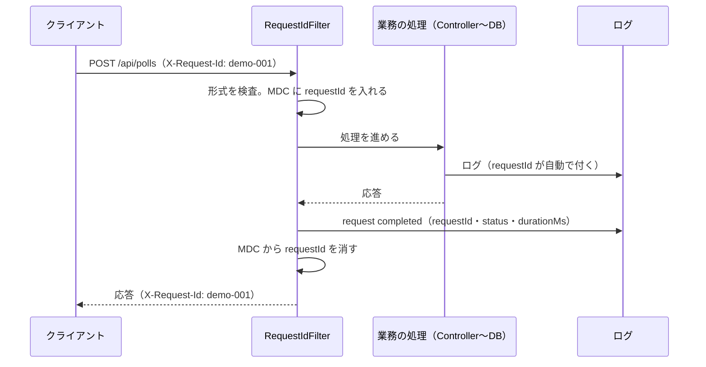

# 第43章 ログ：あとから原因を追えるように

<div class="goal-box" markdown>

この章でできるようになること

- 構造化ログ（ECS の JSON）の1行を読み、相関ID（`requestId`）で1つのリクエストのログだけを抜き出せる
- ログに出してよい項目を許可リストで決め、本文・トークン・参加コード・URL を出さない設計とテストを説明できる
- `log.error("...", ex)` が原因（cause）のメッセージまで出力することを実験で示し、入力値の漏れを `SafeThrowable` で防ぐ理由を説明できる
- 例外をログに出す場所を1か所に決め、「各層で出して投げ直す」を避けられる
- ログレベルを環境変数だけで切り替え、障害時にログの量がどうなるかを見積もれる

</div>

## 1. 問いかけ：夜中の「投票できません」

夜中に、利用者から問い合わせが届きます。「投票ボタンを押しても反応しません。8:12 ごろです」。手元にあるのは、サーバーが出したログだけです。ここで必要になる力は2つあります。何万行ものログから、その1件のリクエストだけを追えること。そして、ログ自体が事故の原因にならないこと、つまり探した先に他人の投票内容やトークンが書いてあってはいけません。

フロントエンドの `console.log` は、自分のブラウザの中にしか出ません。サーバーのログは違います。全利用者の分が1か所に集まって保管され、運用の担当者や外部のログ収集サービスに読まれます。何も考えずに書けば、ログは個人情報の保管庫になってしまいます。

この章では、前半で追えるログ（構造化と相関ID）を作り、後半で漏らさないログ（許可リストと例外の扱い）を作ります。

## 2. 構造化ログ：行ではなくデータにする

QuickVote を起動すると、ログは次のような JSON の1行で出ます。

```bash
docker logs qv42-app-1 | grep '"requestId":"demo-001"'
```

整形すると、こうです（`jq` の代わりに、教材用の `pretty.py` で整形しました）。

```json
{
  "@timestamp": "2026-11-07T23:13:38.068402199Z",
  "log":     { "level": "INFO", "logger": "com.example.quickvote.common.RequestIdFilter" },
  "process": { "pid": 1, "thread": { "name": "http-nio-8080-exec-7" } },
  "service": { "name": "quickvote", "version": "0.0.1-SNAPSHOT" },
  "message": "request completed",
  "requestId": "demo-001",
  "method": "POST",
  "route": "/api/polls",
  "status": 201,
  "durationMs": 44,
  "ecs": { "version": "8.11" }
}
```

!!! note "用語：構造化ログ／ECS"
    構造化ログは、1行の文章ではなく、項目名のついたデータ（ふつうは JSON）で出すログです。検索や集計のときに、正規表現で文字を切り出さずに済みます。
    ECS（Elastic Common Schema）は、`@timestamp` や `log.level` のような項目名の標準で、ログ収集のツールがそのまま読めます。

設定は1行で、Spring Boot が標準で備えている機能です。

```yaml title="src/main/resources/application.yaml（抜粋）"
logging:
  structured:
    format:
      console: ecs
```

| 項目 | 何か |
| --- | --- |
| `@timestamp`、`log.level`、`log.logger` | いつ、どの重大度で、どのクラスが |
| `process.thread.name` | どのスレッドか（`http-nio-8080-exec-7` は Tomcat のリクエストスレッド） |
| `message` | 人間向けの文 |
| `requestId` | MDC の値が、最上位の項目として出る（次の節） |
| `method`・`route`・`status`・`durationMs` | コードの `addKeyValue(...)` で足した項目 |
| `error.type`・`error.message`・`error.stack_trace` | 例外を渡したときだけ付く |

行の文字列に「ユーザーID=123」と混ぜてしまうと、あとから ID が 123 のものだけを取り出すのが面倒です。項目に分けておけば、`status >= 500` や `durationMs > 1000` のような条件で、そのまま絞り込めます。

!!! warning "開発中は読みにくい"
    JSON は機械には扱いやすく、人間には読みにくい形式です。開発中に通常の形式で見たいときは、環境変数で戻せます。再ビルドは要りません（「ログレベル運用」の節で実測します）。
    ```text
    2026-11-07T23:21:34.643Z  INFO 1 --- [quickvote] [   scheduling-2] c.e.quickvote.poll.ExpiredDataCleaner    : 期限切れデータを削除しました: polls=0 ...
    ```

## 3. 相関ID：1つのリクエストを、ログの海から引く

同じ瞬間に、何十ものリクエストが並行して動いています。ログはスレッドごとに交互に出るので、どの行が同じリクエストのものかを示す印が必要です。これが相関IDです。



リファレンス実装の `RequestIdFilter` がこの役を受け持ちます。要点だけを読みます。

```java title="src/main/java/com/example/quickvote/common/RequestIdFilter.java（抜粋）"
private static final Pattern SAFE_ID = Pattern.compile("[A-Za-z0-9._-]{1,64}");

String incoming = request.getHeader(HEADER);
String requestId = incoming != null && SAFE_ID.matcher(incoming).matches()
        ? incoming
        : UUID.randomUUID().toString();                  // (1)!
MDC.put(MDC_KEY, requestId);                             // (2)!
response.setHeader(HEADER, requestId);                   // (3)!
try {
    chain.doFilter(request, response);
} finally {
    // ...ログを1行出す...
    MDC.remove(MDC_KEY);                                 // (4)!
}
```

1. 外から来た値はそのまま信用しない。英数字と `. _ -` の64文字までの形だけを使い、合わなければ UUID を採番する
2. MDC に入れると、このスレッドが出すすべてのログ行に `requestId` が自動で付く
3. 応答ヘッダーにも返す。利用者や呼び出し側が「このIDで調べて」と言える
4. スレッドはプールで使い回されるので、必ず消す。消し忘れると、次のリクエストのログに前のIDが混ざる

!!! note "用語：MDC（Mapped Diagnostic Context）"
    ログ用の、スレッドごとのメモ帳です。キーと値を入れておくと、そのスレッドが出すログに自動で添えられます。Node の `AsyncLocalStorage` に近い役割です。

### 動かしてみる：1件を引く

```bash
curl -X POST http://localhost:8080/api/polls -H "X-Request-Id: demo-001" ...   # 投票を作る
docker logs qv42-app-1 | grep '"requestId":"demo-001"'
```

先ほどの JSON 行（`route: /api/polls`、`status: 201`、`durationMs: 44`）が見つかります。エラー応答の場合は、応答の本文にも相関IDが入ります。

```json
{"detail":"サーバー内部でエラーが発生しました。","instance":"urn:request-id:demo-500","status":500,"code":"INTERNAL_ERROR"}
```

利用者は `instance` の値（`demo-500`）を問い合わせに書き写せるので、開発者はそのIDでログを引けます。リファレンス実装が `instance` にリクエストのパスではなく相関IDを入れているのは、パスに招待トークンが入ることがあり、応答に残したくないからです。

!!! warning "この仕組みが切れる場所"
    MDC はスレッドごとの値なので、リクエストを処理するスレッドを離れた処理には相関IDが付きません。実際に、QuickVote の期限切れ削除（`scheduling-2` スレッド）のログに `requestId` はありません。SSE の配信プールのスレッドも同じです。
    これは仕様として自然な動きですが、非同期処理に相関IDを引き継ぎたいときは、引き継ぐ仕組みを自分で足します（最近の分散トレースは、これを自動で行います。[第48章](../part10/ch48-capstone.md)）。

## 4. 何を出して、何を出さないか：許可リスト

相関ID付きのログは便利ですが、何を書くかを間違えると、役に立たないどころか有害になります。`RequestIdFilter` が、リクエストの終わりに出す1行を見ます。

```java title="src/main/java/com/example/quickvote/common/RequestIdFilter.java（抜粋）"
log.atInfo()
        .addKeyValue("method", request.getMethod())
        .addKeyValue("route", route != null ? route.toString() : "unmatched")
        .addKeyValue("status", response.getStatus())
        .addKeyValue("durationMs", (System.nanoTime() - start) / 1_000_000)
        .log("request completed");
```

出しているのはメソッド・ルート・ステータス・所要時間の4つだけです。むしろ、出していないものの方が重要です。

| 出さないもの | 理由 |
| --- | --- |
| リクエスト本文 | 投票のタイトル・選択肢のラベルなど、利用者が入力した内容 |
| URL 全体（クエリ含む） | `/api/invites/{token}/accept` のトークンがパスに入る。パターン（`route`）だけ出す |
| `Cookie`、`Authorization` ヘッダー | 訪問者トークンそのもの。ログから盗まれれば、なりすませる |
| 参加コード | 8文字のコード。知っていれば投票に参加できる |
| `Idempotency-Key` | 再送を識別する値 |
| DB エラーのメッセージ | 次の節の通り、行の中身が入る |

これが許可リスト（allowlist）の考え方です。「出してはいけないものを消す」拒否リストではなく、出してよいものだけを出すと決めます。拒否リストは、想定していなかった項目が混ざった瞬間に漏れます。許可リストなら、新しい項目が増えても、足さない限り出ません。

!!! tip "フロントエンドで例えると"
    CORS の `Access-Control-Allow-Origin: *` で全部許可し、危険なものを後から除くより、許可するオリジンを列挙する方が安全です。それと同じ判断です。

### テストで固定する：LoggingIT

「出していない」ことは、コードを読むだけでは保証できません。QuickVote は、実際にログを捕まえて秘密の文字列を探すテストを持っています。

```java title="src/test/java/com/example/quickvote/LoggingIT.java（抜粋）"
String logs = output.getAll();

assertThat(logs).contains("request completed"); // アクセスログ相当は出ている
assertThat(logs).doesNotContain(SECRET_LABEL);
assertThat(logs).doesNotContain(poll.joinCode());
assertThat(logs).doesNotContain(inviteToken);
assertThat(logs).doesNotContain(host.token()).doesNotContain(member.token()).doesNotContain(invitee.token());
assertThat(logs).doesNotContain("key-logging"); // Idempotency-Key も出さない
// URLの代わりにルートのパターンが出る（IDやトークンは含まれない）
assertThat(logs).contains("/api/invites/{token}/accept").contains("/api/polls/{pollId}/options");
```

作成から招待の受諾まで、通常の操作と失敗する操作の両方を通したうえで、ログ全体に秘密が1つもないことを確かめます。誰かが後から便利のために `log.info("body={}", body)` を足すと、このテストが落ちます。

## 5. 事故：例外のメッセージに、入力値が入っている

次の話は、QuickVote が実際に経験したものです（シニアレビューの指摘2）。

「自分のメッセージに入力値を連結しなければ、ログに入力値は出ない」。コメントにそう書いて、実装は例外を普通にログへ渡していました。

```java
log.error("想定外のエラーが発生しました", ex);   // メッセージには入力値を入れていない。安全なはず…
```

!!! question "予測カード"
    投票を締め切る処理で、DB の CHECK 制約に違反して例外が起きました。上の1行でログに出た内容に、投票のタイトルと参加コードは含まれるでしょうか。

    1. 含まれない（自分のメッセージに連結していないので）
    2. 含まれる
    3. 例外の型の名前だけが出る

### まず、DB が何と言っているかを見る

PostgreSQL に、わざと CHECK 制約違反を起こさせます。

```text
ERROR:  new row for relation "polls" violates check constraint "demo_never_closed"
DETAIL:  Failing row contains (8, dadcb443-411d-4ce3-91ad-982111a30560, 社外秘のタイトル-T1, CLOSED, EBY3HUEU, t, 2026-11-08 00:13:38+00, ...).
```

`DETAIL: Failing row contains (...)` には、違反した行の中身がすべて入っています。タイトル（`社外秘のタイトル-T1`）も参加コード（`EBY3HUEU`）も丸見えです。JDBC ドライバは、この文章をそのまま例外のメッセージにします。

### 実験：ログに出してみる

その例外をログに渡す実験です（`NaiveLogDemo.java`）。実際の制約（`polls_closes_at_check`）に違反する UPDATE を実行し、2通りでログに出しました。

```text
08:14:24.777 [main] ERROR demo -- 想定外のエラーが発生しました
org.postgresql.util.PSQLException: ERROR: new row for relation "polls" violates check constraint "polls_closes_at_check"
  詳細: Failing row contains (1, 0b7d7b0d-..., lunch, OPEN, 3VUB4EAE, f, ...).
	at org.postgresql.core.v3.QueryExecutorImpl.receiveErrorResponse(QueryExecutorImpl.java:2993)
	...
```

答えは 2 です。メッセージに何も連結していなくても、`log.error("...", ex)` は例外のメッセージも、原因（cause）のメッセージもすべて出力します。タイトル（`lunch`）と参加コード（`3VUB4EAE`）がログに残りました。

!!! danger "本番で事故になるパターン：ログに入力値が残る"
    自分が書いたメッセージに入力値を入れないだけでは足りません。原因側の例外（DB ドライバ、JSON パーサ、バリデーション）が作るメッセージは、自分では制御できないからです。
    しかもログは何か月も保管され、複数の人が読み、外部のサービスに送られることもあります。一度残ると消せないのが、やっかいなところです。

### 直し方：SafeThrowable

QuickVote は、例外を作り替えてからログに渡します。

```java title="src/main/java/com/example/quickvote/common/SafeThrowable.java（抜粋）"
private static Throwable copy(Throwable original, int depth, Map<Throwable, Boolean> seen) {
    StringBuilder description = new StringBuilder(original.getClass().getName());   // (1)!
    if (original instanceof SQLException sql && sql.getSQLState() != null) {
        description.append(" [SQLSTATE=").append(sql.getSQLState()).append(']');    // (2)!
    }
    Redacted copy = new Redacted(description.toString());
    copy.setStackTrace(original.getStackTrace());                                    // (3)!
    // ...原因（cause）も同じように作り替える...
    return copy;
}
```

1. 例外のクラス名だけを使う。元のメッセージは捨てる
2. DB の例外なら SQLSTATE（エラーの種類を表す5文字のコード。`23514` は CHECK 制約違反。値は含まない）を足す
3. スタックのフレームはそのまま残す。どこで起きたかは分かる

使うのは、例外を最終的にログに出す場所（`ProblemDetailAdvice` の500の処理と、定期削除の失敗の処理）です。

```java
log.error("想定外のエラーが発生しました", SafeThrowable.of(ex));
```

実験の2つ目の出力は、こうなりました。

```text
08:14:24.909 [main] ERROR demo -- 想定外のエラーが発生しました
com.example.quickvote.common.SafeThrowable$Redacted: org.postgresql.util.PSQLException [SQLSTATE=23514]
	at org.postgresql.core.v3.QueryExecutorImpl.receiveErrorResponse(QueryExecutorImpl.java:2993)
	...
```

出ているのは型と SQLSTATE とスタックだけで、タイトルも参加コードもありません。

実際のコンテナでも確かめました。制約を足して「締切」を呼ぶと、500 になり、ログの `error` 項目はこうなります。

```json
"error": {
  "type": "com.example.quickvote.common.SafeThrowable$Redacted",
  "message": "org.springframework.dao.DataIntegrityViolationException",
  "stack_trace": "...Caused by: ...SafeThrowable$Redacted: org.postgresql.util.PSQLException [SQLSTATE=23514]..."
}
```

ログ全体をタイトルと参加コードで検索した件数は 0 でした。それでも、何が起きたか（`DataIntegrityViolationException`、SQLSTATE 23514、起きた行）は十分に分かります。値が必要なら、ログではなく DB を、権限のある人が調べます。

この動作は `LoggingIT` が固定しています。時計を作成時刻より前に戻して本物の CHECK 制約違反を起こし、タイトルと参加コードがログに出ないことを確かめます（`SQLSTATE=23514` が出ることも確認します）。

## 6. 例外は1回だけ出す

ログの質を壊す癖がもう1つあります。各層でログに出して、例外を投げ直すことです。

```java
// Repository
catch (RuntimeException e) { log.error("保存に失敗しました", e); throw e; }
// Service
catch (RuntimeException e) { log.error("投票の処理に失敗しました", e); throw e; }
// Controller
catch (RuntimeException e) { log.error("APIが失敗しました", e); throw e; }
```

3層で出したうえで、最後に例外ハンドラがもう1回出します。1回の失敗で何行出るかを実測すると、次のようになりました（`LogOnceDemo.java`）。

| | ERROR の行 | ログの総行数 | スタックのフレーム行 |
| --- | --- | --- | --- |
| 各層で出して投げ直す | 4 | 45 | 36 |
| 投げるだけ。出すのは1か所 | 1 | 10 | 8 |

同じスタックトレースが4回出て、件数も4倍に見えます。「ERROR が毎分4件」というアラートが、実際には1件の失敗で鳴っていることになります。

QuickVote では、次のように決めています。

- 下の層（Repository、Service）は、ログに出さずに例外を投げる
- ログに出すのは、例外を受け止める1か所（`ProblemDetailAdvice`）だけにする
- `LoggingIT` が「ログに 1 回だけ」を確かめる（出現回数が `isEqualTo(1)`）

!!! tip "例外を握る側の判断"
    例外を受け止めて処理を続ける場合（たとえば SSE の1人への送信失敗）は、そこが「受け止める1か所」です。ログに出すなら、そこで1回だけ、重大度（`WARN` など）を決めて出します。受け止めたのに ERROR で出し、さらに上でも出すのが最悪の形です。

## 7. 実測で見つけた穴：SafeThrowable を通らない道

ここまでの仕組みが働くのは、コントローラーの中で起きた例外に対してです。それより手前で起きた例外はどうなるでしょうか。

QuickVote は、リクエストを処理する前に、Security のフィルタが Cookie から訪問者を DB で引きます。DB が止まっていると、この段階で例外が起きます。第44章の実験で DB を止め、ログを数えました。

```text
137 WARN  PollEventListener   LISTEN 接続でエラーが発生しました。再接続します
 35 WARN  DataSourceHealthIndicator   DataSource health check failed
 20 WARN  PoolBase   HikariPool-1 - Failed to validate connection
  3 ERROR [dispatcherServlet]   Servlet.service() for servlet [dispatcherServlet] in context with path [] threw exception
  1 ERROR ProblemDetailAdvice   想定外のエラーが発生しました
```

`[dispatcherServlet]` の ERROR 3件は、これまでの仕組みと3点で違います。

- ログに `requestId` がない（フィルタが MDC を消した後に Tomcat が出すためと考えられます）
- 例外は `SafeThrowable` を通らず、生のまま出る（`error.message` は `Failed to obtain JDBC Connection`）
- 応答は ProblemDetail ではなく、Spring Boot 既定の形式（`{"timestamp":...,"status":500,"error":"Internal Server Error","path":"/api/polls/..."}`）になる

同じ種類の穴は、第46章の実験（稼働中に列を足して、`SELECT *` の結果の形が変わったとき）でも見つかりました。Spring のトランザクション管理（`TransactionInterceptor`、`TransactionTemplate`）が、ロールバック時に ERROR を出し、例外のメッセージをそのまま含めたのです。

```text
ERROR TransactionInterceptor  Application exception overridden by rollback exception
  message: PreparedStatementCallback; uncategorized SQLException for SQL [SELECT * FROM polls WHERE id = ?]; SQL state [0A000]; ... ERROR: cached plan must not change result type
```

このときのメッセージは、SQL 文（値は `?` のまま）とエラーの種類だけでした。ただ、メッセージに何が入るかはフレームワークとドライバ次第で、自分では決められません。同じ失敗が、`ProblemDetailAdvice` の 1 回（SafeThrowable 経由）に加えて、フレームワークの ERROR でも出るので、「1回だけ」も破られています。

どちらの例も、メッセージに行の中身は含まれていませんでした。しかし同じ経路で別の DB エラー（制約違反など）が起きれば、生のメッセージが出ます。許可リストを実装しても、例外がログに届く道が複数あれば、1つの道への対策では足りません。

!!! warning "リファレンス実装の限界"
    この2つの経路（フィルタの中の例外、フレームワークがロールバック時に出す ERROR）は、リファレンス実装の対策の外にあります。直すなら方向は2つです。(a) 最外のフィルタ（`RequestIdFilter`）で例外を捕まえ、`SafeThrowable` を通してログに出し、ProblemDetail で応答する。(b) ログ出力側（Logback）で、例外の出力そのものを許可リストにする。どちらも、実験で漏れを再現してから入れ、`LoggingIT` に足します。レビューでは「例外がログに届く道は、全部で何本あるか」と問います。

## 8. ログレベル運用

ログレベルは、誰がいつ読むかで決めます。

| レベル | 意味 | QuickVote での例 |
| --- | --- | --- |
| `ERROR` | 人が対応する必要がある。1件でも調べる | 想定外の例外（500）、定期削除の失敗 |
| `WARN` | 自動で回復したが、兆候。数が増えたら調べる | LISTEN 接続の再接続、SSE の書き込みが詰まって打ち切り |
| `INFO` | 業務上の節目。普段から残す | 起動、リクエスト1件ごとの `request completed`、定期削除の結果 |
| `DEBUG` | 調査用。普段は出さない | 削除バッチの設定値、SSE の送信失敗の詳細 |

ERROR は安売りしないでください。正常な動作（たとえば利用者がタブを閉じて SSE が切れた）まで ERROR にすると、本当の障害が埋もれます。SSE が終わるたびに `AuthorizationDeniedException` が ERROR で出ていた問題（レビュー指摘18）は、何も悪くないのに ERROR が出る例でした。

### 動かしてみる：再ビルドなしでレベルを変える

Spring Boot は、環境変数でログの設定を上書きできます。再ビルドは要りません（`levels.sh`）。

| 起動時の指定 | 起動後約40秒のログ行数 | 備考 |
| --- | --- | --- |
| （既定）INFO・ECS | 26 行 | 期限切れ削除の結果が10秒ごとに出る設定で実験 |
| `LOGGING_LEVEL_ROOT=WARN` | 1 行 | 起動も `request completed` も消える |
| `LOGGING_LEVEL_COM_EXAMPLE_QUICKVOTE=DEBUG` | 32 行 | 自分のパッケージだけ詳しくする |
| `LOGGING_STRUCTURED_FORMAT_CONSOLE=`（空） | 27 行 | JSON をやめ、人間向けの形式に |

環境変数 `LOGGING_LEVEL_<パッケージ名>` は、`logging.level.<パッケージ名>` と同じ意味です。（残った1行は、JVM が起動時に出す `Picked up JAVA_TOOL_OPTIONS: ...` で、ログの仕組みとは別物です。）

!!! example "障害のときの実践"
    問題を調べるときは、調べたいパッケージだけを一時的に `DEBUG` にして、終わったら戻します。ルートを `DEBUG` にすると、量が桁違いに増え、ディスクとログ収集のコストが跳ね上がります。

### 障害のとき、ログの量はどうなるか

DB を数分止めた実験では、WARN と ERROR が合わせて 240 件ほど出ました（下は主なもの。ほかに `HealthEndpointSupport` の WARN 38 件、`Pool is empty` の WARN 5 件）。`LISTEN` の再接続だけで137件（2秒ごと）です。通常の運用のログ量は、障害時の最大で見積もります。

また、1件の500エラーのログは 19,283 バイトありました。スタックトレースが170行あるためです。500 が毎秒100件出れば、約1.9 MB/秒になります。同じ原因で大量に出る ERROR が、ディスクを埋めて障害をさらに悪化させることがあります。

## 9. 現場ではこうする

| 項目 | 方針 |
| --- | --- |
| 形式 | 構造化ログ（JSON）。標準出力に出し、集める仕事は実行基盤（Docker、Kubernetes）に任せる |
| 相関ID | 入口で採番し、MDC とレスポンスヘッダーに。呼び出し元の値は検査して使う |
| 内容 | 許可した項目だけ。本文・Cookie・トークン・URL・DBエラーのメッセージは出さない |
| 例外 | 渡す前に作り替える（`SafeThrowable`）。出すのは1か所 |
| テスト | 秘密の文字列を使い、ログに出ていないことを確かめる（`LoggingIT`） |
| レベル | ERROR は人が対応するものだけ。DEBUG は普段 OFF、必要なときに環境変数で |
| 保管 | 保管期間を決める。ログも個人情報の保管庫なので、消す期限が要る |
| レビュー | `log.` を grep して、渡している値と、例外の渡し方を見る |

## まとめ：3点セット

!!! abstract "この章の3点セット"
    **① 一言で言うと**
    ログは構造化し、リクエストごとの相関ID（MDC）で追えるようにする。出すのは許可した項目だけにする。例外は、DB ドライバ等の原因メッセージに入力値が含まれうるため、型・SQLSTATE・スタックだけに作り替え、出す場所を1か所に限る。

    **② 現場でこう聞かれる**
    「メッセージにユーザー入力を入れていないので、`log.error("failed", e)` は安全ですよね？」
    → 安全ではない。`e` の原因（cause）のメッセージも出力される。PostgreSQL の制約違反は `Failing row contains (...)` に行の中身を入れる。メッセージを捨てて、型・SQLSTATE・スタックだけにして渡す。

    **③ 自分のサービスならどこに当たるか**
    自分のサービスで「利用者が入力した値」を3つ挙げ、それぞれがログに出る経路（アクセスログ、例外メッセージ、フィルタの例外）を確かめる。ログ全体をその値で検索して、0件であることを確認する。

## 演習

??? question "確認問題1：予測と実行"
    `grep` で `log.` を探すと、次の1行が見つかりました。何が問題で、どう直しますか。
    ```java
    log.info("投票を作成しました: title={}", request.title());
    ```

??? success "解答"
    利用者が入力したタイトルがログに残ります（参加者に見せる内容であっても、ログの読み手に見せてよいとは限りません）。出すのは、`pollId` のような内部の識別子だけにします。タイトルは出さず、必要なら文字数のように、内容を含まない特徴にします。`LoggingIT` と同じ形で、タイトルの文字列が出ていないテストも足します。

??? question "確認問題2：二重のログ"
    ある API が失敗するたびに、`ERROR` が3行出ています。原因の例外は1つです。どこを見て、どう直しますか。

??? success "解答"
    `catch` して `log.error` してから `throw` している層を探します（`grep -n "log.error" -B2 -A2`）。下の層（Repository、Service）のログ出力を消し、例外を投げるだけにします。ログに出すのは `@RestControllerAdvice` のような、受け止める1か所だけにします。

??? question "応用：相関IDを非同期へ"
    `@Async` で別スレッドに投げた処理のログに、`requestId` が付いていません。なぜですか。どんな方法がありますか。

??? success "解答"
    MDC はスレッドごとの値で、別のスレッドには引き継がれないためです。方法の例は次の3つです。(1) 処理を投げる側で `MDC.getCopyOfContextMap()` を取り、投げられた側の先頭で `MDC.setContextMap(...)` する（終わりに必ず消す）。(2) `TaskDecorator` でタスクを包み、自動で引き継ぐ。(3) 分散トレース（OpenTelemetry など）に任せる。いずれの場合も、スレッドプールで使い回されるので、消し忘れないことが要点です。

??? question "説明問題：現場でこう聞かれる"
    「なぜ、出してはいけないものを列挙してログから除くのではなく、出してよいものだけを決める方式にするのですか？」200字程度で答えてください。

??? success "解答"
    例：除外リストは、想定していなかった項目や、例外メッセージのように自分で制御できない文字列が混ざった瞬間に漏れるためです。許可リストなら、新しい項目は足さない限り出ません。QuickVote は、アクセスログに method・route・status・durationMs だけを出し、例外も型・SQLSTATE・スタックだけに作り替えています。漏れていないことは LoggingIT が秘密の文字列で確かめています。
