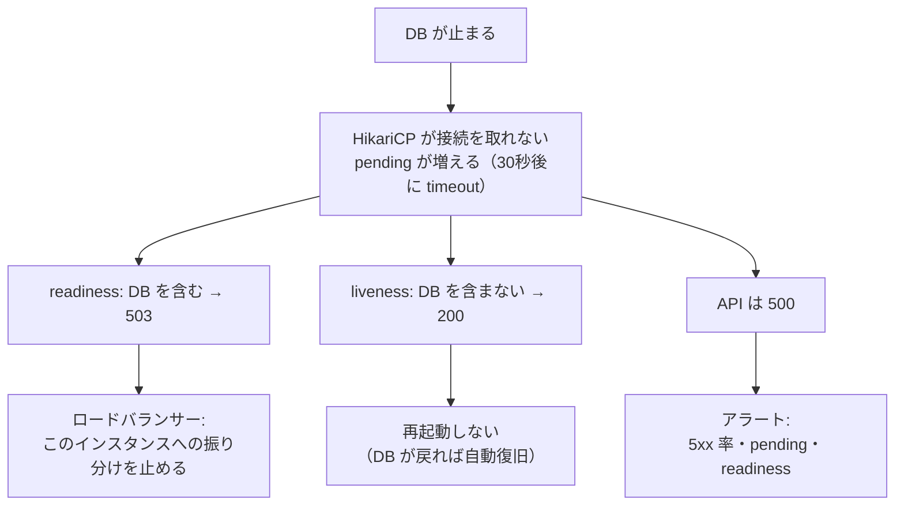
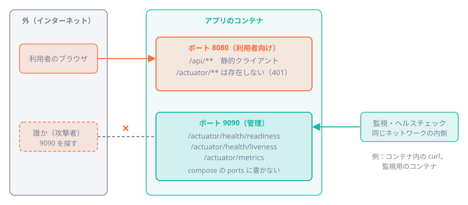

# 第44章 メトリクスとヘルスチェック

<div class="goal-box" markdown>

この章でできるようになること

- Actuator と Micrometer の関係を説明し、`curl` で HikariCP と HTTP の指標を読める
- 指標のタグに入れてはいけない値（ID・URL）と、その理由を**数字で**説明できる
- readiness と liveness の違いを、「DB が止まったとき」の実測で説明できる
- metrics を利用者の届く場所に出さない構成（管理ポートの分離）と、Spring Boot での注意点を説明できる
- 最低限のアラートを5つ挙げ、それぞれが**どの指標の変化で気づけるか**を言える

</div>

## 1. 問いかけ：「遅い」と言われたら、何を見るか

第43章のログは、**起きたこと**の記録でした。「あのリクエストが失敗した」を、あとから追えます。

しかし、運用では別の問いが来ます。**「いま、サービスは健康か？」「だんだん悪くなっていないか？」**。1件ずつのログを読んでも分かりません。必要なのは、**数字の時系列**です。

- 毎秒のリクエスト数、エラーの割合、応答時間
- DB のコネクションプールの空き
- ヒープの使用量

これが**メトリクス（指標）**です。ブラウザで言えば、1回の読み込みを調べる DevTools の Performance タブがログに近く、本番の利用者全員の LCP を継続的に集める Web Vitals の計測がメトリクスに近い関係です。

この章は、QuickVote が出している数字を**実際に読み**、足し方の罠を実験し、**止まったときの挙動**（readiness）を観察します。

## 2. Actuator と Micrometer

!!! note "用語：Actuator／Micrometer"
    **Actuator**は、Spring Boot が提供する**運用向けの HTTP エンドポイント**の集まりです（`/actuator/health`、`/actuator/metrics` など）。
    **Micrometer**は、**指標を計測するための共通の窓口**です。ログに SLF4J という共通の窓口があるように、指標には Micrometer があり、裏側（Prometheus、Datadog など）を差し替えられます。

QuickVote は `spring-boot-starter-actuator` を入れ、公開するエンドポイントを絞っています。

```yaml title="src/main/resources/application.yaml（抜粋）"
management:
  endpoints:
    web:
      exposure:
        include: health,metrics   # (1)!
  endpoint:
    health:
      probes:
        enabled: true             # (2)!
```

1. 公開するのは `health` と `metrics` **だけ**。`env`（設定値）、`beans`、`heapdump`（メモリの中身）は出さない。`ActuatorIT` が、それらが見えないことを確かめている
2. `/actuator/health/liveness` と `/actuator/health/readiness` を有効にする

指標の一覧を、コンテナの中から取ってみます（管理ポートが外に出ていない理由は、第7節で説明します）。

```bash
docker exec qv42-app-1 curl -s http://localhost:9090/actuator/metrics
```

QuickVote には **98 個**の指標があり、そのうち運用で最初に見るのは次の系統です。

| 系統 | 例 | 何が分かるか |
| --- | --- | --- |
| `http.server.requests` | 件数・合計時間・最大時間。`uri`・`status` で絞れる | リクエストの数、エラー、遅さ |
| `hikaricp.connections.*` | `active`、`idle`、`max`、`pending`、`timeout`、`acquire` | DB のコネクションプールの状態（第24章） |
| `jvm.memory.used`、`jvm.threads.live` | 領域（`area:heap`）で絞れる | メモリ、スレッド数 |
| `process.cpu.usage`、`system.cpu.count` | 0〜1 | CPU の使用率 |
| `logback.events` | `level:error` で絞れる | ERROR ログの件数 |
| `executor.*` | `@Scheduled` や配信プールの状況 | 定期処理・SSE 配信のスレッド |

## 3. 実際に読む

まず、HikariCP を読みます。

```bash
curl -s http://localhost:9090/actuator/metrics/hikaricp.connections.active   # コンテナの中から
```

平常時の値は、次のとおりです（`metric.py` で1行に整形しています）。

```text
hikaricp.connections.active  VALUE=0     今、使われている接続
hikaricp.connections.idle    VALUE=10    空いている接続
hikaricp.connections.max     VALUE=10    プールの最大サイズ（既定の10）
hikaricp.connections.pending VALUE=0     接続を待っているスレッド
hikaricp.connections.timeout COUNT=0     接続を取れず、あきらめた回数（累計）
hikaricp.connections.acquire COUNT=231, TOTAL_TIME=0.0744s, MAX=0.0133s    接続を取るのにかかった時間
hikaricp.connections.usage   COUNT=231, TOTAL_TIME=0.687s,  MAX=0.043s     接続を握っていた時間
```

第24章の傘立てに当てはめると、`idle` は空いている傘、`active` は貸し出し中、**`pending` は傘を待っている人**です。`pending` が 0 でない時間が続いたら、プール枯渇の合図です。`usage` の平均（0.687 ÷ 231 ≒ 3 ミリ秒）は、1回の貸し出しが短いことを示します。

次に、HTTP です。

```text
http.server.requests  COUNT=69, TOTAL_TIME=1.49s, MAX=0.062s
```

タグで絞ると、特定の API だけを見られます。

```bash
curl -s "http://localhost:9090/actuator/metrics/http.server.requests?tag=uri:/api/polls/%7BpollId%7D&tag=status:200"
```

```text
詳細の取得（200）  COUNT=8,  TOTAL_TIME=0.199s, MAX=0.062s
詳細の取得（404）  COUNT=15, TOTAL_TIME=0.179s, MAX=0.028s
500 エラー         COUNT=1,  TOTAL_TIME=0.103s
```

!!! warning "`/actuator/metrics` で分かること、分からないこと"
    このエンドポイントが返すのは、**件数・合計時間・最大**です。平均（合計 ÷ 件数）は出せますが、**p95 や p99 は出せません**。「ほとんどの利用者は速いが、100人に1人が10秒待っている」は、平均に現れません。
    パーセンタイルは、監視システムが**ヒストグラム**から計算します。第5節で出力の形を見て、第45章で k6 を使って測ります。

## 4. カーディナリティ：タグの値は、少なく、有限に

指標には**タグ**（`uri=/api/polls`、`status=200` のような属性）を付けられます。タグの組み合わせごとに、**別の時系列**が1本できます。

!!! note "用語：カーディナリティ"
    タグの**値の種類の数**です。`status` は数種類ですが、`userId` は利用者の数だけあります。カーディナリティが高いと、時系列の本数が爆発し、メモリと保存コストと検索の遅さが跳ね上がります。

### QuickVote の `uri` タグは、なぜ爆発しないのか

QuickVote に、存在しない投票IDで **15 種類**の GET と、存在しないページを **10 種類**投げた後、`uri` タグの値を見ます。

```text
uri の値: ['UNKNOWN', '/api/polls', '/api/polls/{pollId}/close', '/api/polls/{pollId}', '/**']
```

25種類の URL を投げたのに、**5 個**しかありません。Spring は `uri` に、実際の URL ではなく**ルートのパターン**（`/api/polls/{pollId}`）を入れるからです。第43章のアクセスログの `route` と同じ考え方です。存在しない URL（`/no-such-page-3`）は、静的ファイルの `/**` にまとまります。

### 実験：タグに投票ID を入れてみる

では、自分で指標を足すとき、投票IDをタグに入れたらどうなるでしょう。実験用の小さなアプリ（`custom-meter`）に、2つのカウンタを用意しました。

```java title="custom-meter: VoteMetricsController.java（抜粋）"
// 良い例：result は changed / same の2通りだけ
Counter.builder("quickvote.votes").tag("result", "changed").register(registry);

// 悪い例：投票ID（UUID）をタグにする
Counter.builder("quickvote.votes.bad").tag("pollId", UUID.randomUUID().toString()).register(registry).increment();
```

悪い例を呼び出して、そのたびにメモリ（ヒープ、`-Xmx512m`）と `/actuator/prometheus` の応答を測りました。

| 悪いタグの累計 | 時系列の本数 | ヒープ使用量 | 応答サイズ | 応答時間 |
| --- | --- | --- | --- | --- |
| 0（開始時） | 0 | 23.5 MiB | 63 KB | 0.08 秒 |
| 1万 | 10,000 | 45.5 MiB | 843 KB | 0.10 秒 |
| 11万 | 110,000 | 146.9 MiB | 8.5 MB | 0.68 秒 |
| 41万 | 410,000 | **307.9 MiB** | **31.6 MB** | **2.25 秒** |

投票IDを41万種類作っただけで、**ヒープが 300 MiB 食われ**、監視システムが1回に取りにくる応答は 31 MB、2.2 秒かかります。Micrometer は作った指標を**メモリに持ち続ける**ので、増えるばかりで、減りません。良い例のほうは、50回呼んでも時系列は **2本のまま**でした。

!!! danger "本番で事故になるパターン：高カーディナリティなタグ"
    タグに入れてはいけない値：**ID（投票・訪問者・参加者）、URL の実物、メールアドレス、例外メッセージ、リクエストIDなど**、種類が無数にある値。
    入れてよい値：HTTP メソッド、ステータスコード、ルートのパターン、成否（`changed`／`same`）のように、**種類が数個〜数十個で、増えないもの**。
    個別の1件を追いたいときの道具は、メトリクスではなく**ログ**（相関ID、第43章）です。

### パーセンタイル用のヒストグラム

この実験アプリでは、`management.metrics.distribution.percentiles-histogram.http.server.requests: true` を設定し、`micrometer-registry-prometheus` を足して `/actuator/prometheus` を出しました。1つの指標（`http.server.requests`）が、**207 行のバケット**（「0.1 秒以下は何件、0.2 秒以下は何件…」）に展開されます。監視システムは、このバケットから p95 や p99 を推定します。便利ですが、**バケット数×タグの組み合わせ**ぶんの時系列が増えるので、必要な指標にだけ付けます。

## 5. Tomcat のスレッド数も見る

QuickVote の `/actuator/metrics` には、Tomcat のスレッドの指標（`tomcat.threads.*`）は**初期状態では出ません**。有効にするには、環境変数で次のように指定して起動します。

```bash
SERVER_TOMCAT_MBEANREGISTRY_ENABLED=true   # application.yaml なら server.tomcat.mbeanregistry.enabled: true
```

```text
tomcat.threads.busy            VALUE=0      処理中のスレッド（第9章のスレッド）
tomcat.threads.current         VALUE=10     今あるスレッド
tomcat.threads.config.max      VALUE=200    上限（既定）
tomcat.connections.current     VALUE=1
tomcat.connections.config.max  VALUE=8192
```

`tomcat.threads.busy` が `config.max`（200）に張り付いたら、リクエストの待ちが発生しています（第45章）。

## 6. readiness と liveness：DB が止まったら、どちらが落ちるべきか

Actuator の `health` には、2つの種類があります。

| | liveness | readiness |
| --- | --- | --- |
| 問い | このプロセスは**生きている**か。**再起動すれば直る**状態か | いま、リクエストを**受けてよい**か |
| NG のとき実行基盤がすること | **再起動**する | 振り分けを**止める**（再起動はしない） |
| DB が止まったとき | 影響を受けるべきでは**ない** | 受けるべき（DOWN） |

!!! note "用語：liveness／readiness（プローブ）"
    実行基盤（Kubernetes やロードバランサー）が、アプリに定期的に問い合わせて、状態を知るための窓口です。liveness が失敗するとプロセスを**再起動**し、readiness が失敗すると、そのインスタンスへの**リクエストの振り分けを止めます**。

DB が止まったときに、liveness が落ちるとどうなるでしょう。アプリを再起動しても、DB は直りません。**全台が再起動を繰り返し**、DB が戻った後も、立ち上がるのに時間がかかります。だから liveness は、DB を**含めません**。

### 設定：probes.enabled だけでは、readiness は DB を見ない

```yaml title="src/main/resources/application.yaml（抜粋）"
management:
  endpoint:
    health:
      probes:
        enabled: true
      group:
        readiness:
          include: readinessState,db   # (1)!
```

1. `probes.enabled: true` だけでは、readiness は `readinessState`（アプリが起動済みで、停止中でないか）しか見ない。**DB に届かないのに「準備完了」と答えない**よう、`db` を含める

これを指摘されたのが、レビューの指摘11です。以前は「probes を有効にした」だけで、DB が止まっても readiness は `UP` のままでした。

### テストで固定する：ReadinessIT

```java title="src/test/java/com/example/quickvote/ReadinessIT.java（抜粋）"
assertThat(get("/actuator/health/readiness").statusCode()).isEqualTo(200);   // DB に届いている間は UP

container.stop();                                                             // DB のコンテナを止める

Awaitility.await().atMost(Duration.ofSeconds(60)).untilAsserted(() -> {
    HttpResponse<String> readiness = get("/actuator/health/readiness");
    assertThat(readiness.statusCode()).isEqualTo(503);                        // readiness は 503（DOWN）
    assertThat(readiness.body()).contains("\"status\":\"DOWN\"").doesNotContain("components");
});
assertThat(get("/actuator/health/liveness").statusCode()).isEqualTo(200);    // liveness は UP のまま
```

テストが本物の PostgreSQL コンテナを**止めて**確かめています。本文でも同じことを、compose のコンテナで観察します。

### 動かしてみる：DB を止める

`db-outage.sh` が、DB コンテナを止めて、readiness・liveness・API（DB を引く GET）・コンテナの health を並べて測ります。

!!! question "予測カード"
    DB を止めたとき、次の4つはどうなるでしょう。
    (a) readiness　(b) liveness　(c) 投票詳細の API　(d) `docker ps` のコンテナの状態

```text
                 readiness              liveness            API (GET /api/polls/..)   container
DB 稼働中        200 (0.008s)           200 (0.006s)        404 (0.04s)               healthy
DB を停止 +33s   503 (30.003s)          200 (0.003s)        500 (30.016s)             healthy
         +65s    503 (30.020s)          200 (0.011s)        500 (30.011s)             healthy
         +98s    503 (30.027s)          200 (0.005s)        500 (30.035s)             unhealthy
DB を起動        200 (4.860s)           200 (0.006s)        404 (5.528s)              unhealthy
         +3s     200 (0.012s)           200 (0.007s)        404 (0.015s)              healthy
```

（404 は、存在しない投票IDを引いて DB が正常に答えた状態です。）

答えと、読み取れることを整理します。

1. **readiness は 503、liveness は 200 のまま**。設計の意図どおりです
2. **readiness の 503 が返るまで、30 秒かかっている**。健康チェックが DB の接続を取ろうとして、HikariCP の `connection-timeout`（既定 30 秒）まで待つからです。API が 500 を返すまでの時間も、同じ 30 秒です
3. **`docker ps` が `unhealthy` になるのに、約 100 秒かかった**。compose のヘルスチェックの `timeout: 3s` に対して、readiness が 30 秒かけて答えるので、毎回タイムアウトで失敗します。6 回失敗（`interval: 10s`、`retries: 6`）した頃に `unhealthy` になりました
4. **DB を戻すと、約 10 秒で自動的に復旧した**。HikariCP が接続を取り直し、readiness も `UP` に戻りました。アプリの再起動は不要でした
5. **`unhealthy` でも、Docker はコンテナを再起動しない**。再起動するのは、Kubernetes の liveness のような仕組みの仕事です

!!! warning "ヘルスチェックの速さも、設計の対象"
    2 と 3 は、設定が噛み合っていない例です。ヘルスチェックの応答に 30 秒かかるのは、**異常を検知するのも遅い**ということです。`spring.datasource.hikari.connection-timeout` を短く（たとえば 3 秒）すれば、readiness も API も早く失敗します。この調整は、第45章の「タイムアウトを全部決める」で行います。

### 失敗の流れを図にする



## 7. 本番で metrics を外に出さない

metrics は、運用には欠かせませんが、**攻撃者にも有益**です。メモリの使用量、スレッド数、リクエスト数と処理時間、DB 接続の状況。負荷をかけてサービスを落とす攻撃の、**効果測定**に使えます。

リファレンス実装は、最初は metrics を本体のポート（8080）で、認証なしで公開していました（レビュー指摘12）。本番では、**別のポート（9090）に分け**、そのポートを外に出さないようにしました。



```yaml title="src/main/resources/application-prod.yaml（抜粋）"
management:
  server:
    port: 9090   # (1)!
```

1. `management.server.port` を設定すると、Actuator が**管理ポートだけ**で提供される

### 実測：どこから何が見えるか

| 場所 | `/actuator/health/readiness` | `/actuator/metrics/...` | `/actuator/env`、`/heapdump` |
| --- | --- | --- | --- |
| 開発（管理ポートなし）の 8080 | 200 | 200 | 401 |
| **本番の 8080**（利用者向け） | **401** | **401** | 401 |
| **本番の 9090**（コンテナの中から） | 200 | 200 | 401 |
| 本番の 9090（**ホストの外から**） | 接続できない | 接続できない | 接続できない |

`ProductionActuatorIT` は、本番のプロファイルで同じことを確かめています。本体のポートでは health も metrics も見えず、管理ポートでも `env` や `heapdump` は見えません。

!!! warning "Spring Boot の注意点：管理ポートを分けると、本体のポートから Actuator が消える"
    `management.server.port` を本体と別にすると、`/actuator/**` は**管理ポートだけ**になります。「本体のポートでは health だけ見せ、metrics は管理ポートだけ」のような使い分けは**できません**（公開するエンドポイントの指定が1つだから）。ロードバランサーやコンテナのヘルスチェックも、9090 に向ける必要があります。QuickVote の `compose.app.yaml` のヘルスチェックが、コンテナ内から 9090 を呼んでいるのは、そのためです。

### なぜ「認証をかける」ではないのか

「metrics にログインを要求すれば、外に出してもよいのでは？」と考えがちです。QuickVote では、これが使えません。**誰でも訪問者の Cookie を取れる**匿名サービスだからです。「認証済み」＝「管理者」にならないので、認証で守れる相手が作れません。

守り方は、**ネットワークで分ける**ことです。9090 に届くのは、同じネットワークの内側（監視システム、コンテナ内の `curl`）だけ。コードにも設定にも、「9090 を公開する」と書かない（compose の `ports` に載せない）。

## 8. 最低限のアラート

メトリクスは、見る人がいないと意味がありません。**人が起きて対応するべき状態**を、自動で知らせるのがアラートです。QuickVote で最低限そろえるのは、次の5つです。

| # | 症状 | 見る指標 | 気づける理由 |
| --- | --- | --- | --- |
| 1 | 準備ができていない | readiness が DOWN（503）の継続 | DB 停止の実測で 503 になった |
| 2 | エラーが増えた | `http.server.requests` の `status` が 5xx の割合 | DB 停止で 500 が出た |
| 3 | DB の接続が足りない | `hikaricp.connections.pending` が 0 でない状態の継続、`timeout` の増加 | 実測で 6 秒後に `pending=15`、40 秒で `timeout` が +16 |
| 4 | 遅い | p99（ヒストグラムから）、`tomcat.threads.busy` が上限付近 | 平均には出ない遅さを拾う |
| 5 | 裏の処理が失敗 | `logback.events` の `level:error`、定期削除の失敗 | 第29章の「失敗してもログ1行」を見逃さない |

DB を止めて 15 本を同時に投げた実験では、次のように指標が動きました。

```text
平常時          active=0   pending=0    timeout(累計)=41
DB 停止 +6s     active=0   pending=15   timeout(累計)=41     ← 15 本が接続待ちで並ぶ
        +20s    active=0   pending=17   timeout(累計)=41
        +40s    active=0   pending=2    timeout(累計)=57     ← 30 秒を過ぎて 16 本があきらめた
```

アラートの書き方は、監視システムごとに違います。Prometheus なら、次の形です（書式の例です。この教材では Prometheus を動かしていません。QuickVote で `/actuator/prometheus` を使うには、`micrometer-registry-prometheus` を足し、公開するエンドポイントに `prometheus` を加えます。実験アプリでは、これで出力されることを確認しました）。

```yaml
groups:
  - name: quickvote
    rules:
      - alert: PoolExhausted
        expr: hikaricp_connections_pending > 0
        for: 1m                # 1 分続いたら
        labels: { severity: page }
        annotations:
          summary: "DB の接続待ちが続いています"
```

!!! tip "アラートの作り方の原則"
    - **症状で鳴らす**（利用者に影響が出ている：エラー率、遅さ）。原因（CPU 80%）では鳴らしすぎる
    - **鳴ったら人が何かする**ものだけにする。何もできないアラートは、**すぐに無視される**
    - しきい値は感覚で決めず、**負荷試験の結果**で決める（第45章）
    - アラートの説明に、**最初に見る場所**（この章の指標、第43章のログ）を書く

## 9. 現場ではこうする

| 項目 | 方針 |
| --- | --- |
| 公開範囲 | 管理ポートを分け、外に出さない。公開するエンドポイントは絞る（`env`・`heapdump` は出さない） |
| readiness／liveness | readiness に DB を含める。liveness は含めない。**応答が速い**ように、タイムアウトを短くする |
| タグ | 値の種類が少なく、増えないものだけ。ID・URL・メッセージは入れない |
| 追加の指標 | 業務の指標（投票数、締切、定期削除の削除件数）を足すと、障害の前兆に気づける |
| ダッシュボード | まず4つ：リクエスト数とエラー率、p99、DB プール、ヒープ |
| 保存 | 指標の保存期間とコストを決める。細かい指標は短く、集計は長く |

## まとめ：3点セット

!!! abstract "この章の3点セット"
    **① 一言で言うと**
    Actuator と Micrometer で HTTP・DB プール・JVM の指標を取り、readiness は DB を含め liveness は含めない。タグは値の種類が少ないものだけにし、metrics は管理ポートに分けて外に出さない。アラートは、利用者に影響する症状で、人が対応するものだけにする。

    **② 現場でこう聞かれる**
    「DB が落ちたら、アプリのヘルスチェックも落とすべきですか？」
    → readiness は落とす（受けてはいけない）。liveness は落とさない（再起動しても直らず、再起動の連鎖になる）。

    **③ 自分のサービスならどこに当たるか**
    自分のサービスの「外から届く場所」を洗い出し、Actuator のエンドポイントがその中に含まれていないことを、外側のポートから `curl` して確かめる。DB を止めて、readiness と liveness の結果を観察する。

## 演習

??? question "確認問題1：予測と実行"
    QuickVote のメトリクスに「投票ごとの票数」を足したいとします。`Counter` のタグに `pollId` を入れてよいでしょうか。理由を数字で答えてください。

??? success "解答"
    入れてはいけません。投票は何万と作られるため、時系列が投票の数だけ増え、しかも作った指標はメモリに残ります。この章の実験では、約41万の時系列で、ヒープが約 300 MiB 増え、1回の取得が 31 MB・2.2 秒になりました。票数が必要なら、投票ごとではなく**集計値**（全投票の票の合計など）を指標にし、個別の投票は DB を調べます。

??? question "確認問題2：liveness に DB を入れると"
    ある人が「DB に届かないなら、そのアプリは壊れているのだから、liveness に DB を入れた方が親切」と言いました。起きる問題を説明してください。

??? success "解答"
    DB が止まると、全台の liveness が失敗し、実行基盤が全台を再起動します。再起動しても DB は直らないので、起動と失敗を繰り返します。起動には 10 秒ほどかかり（第42章）、DB が戻った後も、起動し終えるまで待つことになります。復旧が遅れ、さらに DB に接続の嵐を送ります。DB が原因のときに止めるべきなのは「振り分け」（readiness）であって、「プロセス」（liveness）ではありません。

??? question "応用：readiness を速く失敗させる"
    実測では、DB 停止時の readiness の応答に 30 秒かかりました。短くするには、どの設定を、どの値にしますか。副作用も考えてください。

??? success "解答"
    `spring.datasource.hikari.connection-timeout`（既定 30000 ミリ秒）を、たとえば 3000（3 秒）にします。readiness も API も 3 秒で失敗します。副作用：高負荷で一時的に接続が足りないときにも、3 秒であきらめて 500 になります。短すぎると、混雑時に失敗が増えます。第45章で、負荷試験の結果とあわせて値を決めます。

??? question "説明問題：現場でこう聞かれる"
    「なぜ metrics を管理ポートに分けて、外に出さないのですか？認証をかけるのでは駄目ですか？」200字程度で答えてください。

??? success "解答"
    例：metrics はメモリやスレッド、リクエストの状況が分かり、攻撃の効果測定に使えるためです。QuickVote は誰でも訪問者の Cookie を取れる匿名サービスなので、「認証済み＝管理者」にならず、認証では管理者だけに絞れません。そこで、管理ポートを分けて、compose の ports に載せず、同じネットワークの内側からだけ届くようにしています。ProductionActuatorIT が、本体のポートで見えないことを確かめています。
