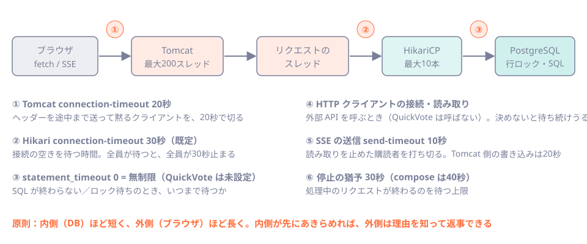
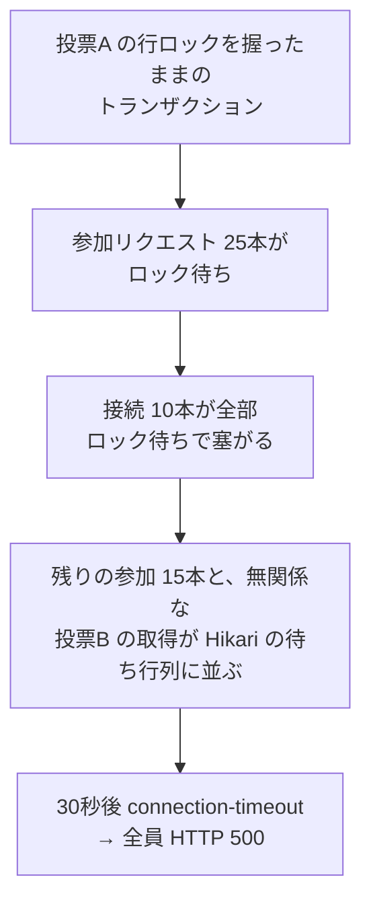

# 第45章 性能と堅牢性：タイムアウト・負荷・停止

<div class="goal-box" markdown>

この章でできるようになること

- p95 / p99 が平均より大事な理由を説明し、k6 で合格ライン（閾値）つきの負荷試験を回せる
- プールを大きくしても速くならない場面を、実測の数字で説明できる
- 「タイムアウトを全部決める」表を作り、決めていないタイムアウトが事故になる様子を再現できる
- ロックを握ったままのトランザクションが全体を止める様子を観察し、`statement_timeout` で止められる
- スレッドダンプを取り、リクエストのスレッドが何を待っているかを読める
- graceful shutdown で、処理中のリクエストが終わるのを待つ様子と、その上限を説明できる

</div>

## 1. 問いかけ：「遅い」は、誰にとって遅いのか

QuickVote の詳細取得 API の平均応答時間が 100 ミリ秒だとします。十分に速く見えます。ところが、100人に1人が 10 秒待たされていたら、どうでしょう。それでも平均はほとんど動きません。

この章では、サービスの限界と壊れ方を先に決めておきます。決めるのは3つです。どれだけの負荷までなら約束した速さで答えられるか（負荷試験）。相手が遅い、あるいは返事をしないとき、いつ待つのをやめるか（タイムアウト）。止めるとき、処理中のリクエストをどう扱うか（graceful shutdown）。

フロントエンドの `fetch` には、標準ではタイムアウトがなく、`AbortController` で自分で付けます。サーバーも同じで、付けなければいつまでも待ちます。しかもサーバーが待つとき、待たされているのはスレッドと DB 接続という、数に限りのある資源です。

## 2. p95 と p99：平均が隠すもの

!!! note "用語：パーセンタイル（p95、p99）"
    リクエストを遅い順に並べたとき、下から95%（99%）の位置の値です。p95 = 300 ms は、「95%のリクエストは300 ms以内に終わる。残り5%はそれより遅い」という意味です。p99 は、さらに遅い1%の入り口です。

実測した例を見ます（次節の負荷試験の結果）。プールを30にした設定の「投票」API です。

| | 平均 | 中央値 | p95 | p99 | 最大 |
| --- | --- | --- | --- | --- | --- |
| 投票（PUT） | 240 ms | 141 ms | 733 ms | 1.43 s | 2.91 s |

平均は 240 ms ですが、100人に1人は 1.4 秒以上待ち、最大は 2.9 秒です。利用者が感じる遅さは尾（p99）に出るので、約束（SLO）も p95 / p99 で決めます。

なお、`/actuator/metrics` では p99 が出せませんでした（第44章）。パーセンタイルは、負荷試験の道具（k6）や、監視システムのヒストグラムから得ます。

## 3. 負荷試験：k6 で50人が投票し続ける

!!! note "用語：負荷試験／k6"
    負荷試験は、本番に近い形のリクエストをたくさん送り、応答時間とエラーを測る試験です。k6 は、JavaScript で書くシナリオを実行できる負荷試験ツールで、Docker で動かせます（`docker run grafana/k6`）。

### シナリオを決める

QuickVote の約束は「参加者50人」です。そこで、最大人数の50人が1つの投票で、休みなく投票と詳細取得を繰り返す状況を試験します。

```javascript title="code/labs/ch45-performance/vote.js（抜粋）"
export const options = {
  noCookiesReset: true,           // (1)!
  vus: 49,
  duration: '30s',
  thresholds: {                   // (2)!
    http_req_failed: ['rate<0.01'],
    'http_req_duration{kind:vote}': ['p(95)<300', 'p(99)<800'],
    'http_req_duration{kind:detail}': ['p(95)<300', 'p(99)<800'],
  },
};
```

1. k6 は既定で、イテレーションごとに Cookie を捨てる。VU（仮想ユーザー）を訪問者1人にするため、捨てないよう指定する。最初に設定し忘れて、投票が全部 403（CSRF）になった
2. 合格ラインを先に書く。超えると、k6 が失敗として終了する。「やってみたら遅かった」ではなく、「300 ms 以内という約束を守れているか」を判定する

49 VU が最初に参加コードで参加します（主催者を合わせて50人）。その後は、投票（`PUT /api/polls/{id}/my-vote`）と詳細取得（`GET /api/polls/{id}`）を繰り返します。

```bash
sh run-k6.sh qv45 49 30s     # 内部で docker run grafana/k6 run vote.js
```

アプリは、第42章で学んだ資源の制限を付けて動かしました（`mem_limit: 768m`、`cpus: 2`）。このときヒープ上限は 576 MiB（768 MiB の75%）、GC は Serial でした。

### 結果：プールの大きさを変える

!!! question "予測カード"
    HikariCP のプールを 3 → 10 → 30 と大きくすると、同じ試験の結果はどうなるでしょう。

    1. スループットも速さも、プールに比例して良くなる
    2. スループットは変わらず、遅さ（p99）の出方だけが変わる
    3. プールが小さいと、エラーが出る

| プール | 毎秒のリクエスト | 詳細 p95 / p99 | 投票 p95 / p99 | 投票の最大 | エラー |
| --- | --- | --- | --- | --- | --- |
| 3 | 313 | 290 / 453 ms | 311 / 614 ms | 0.97 s | 0 |
| 10（既定） | 286 | 268 / 400 ms | 358 / 598 ms | 0.96 s | 0 |
| 30 | 312 | 133 / 214 ms | 733 / 1,430 ms | 2.91 s | 0 |

答えは 2 です。まず、プールを増やしても、スループットは増えません（約300 req/s で同じです）。この実験では CPU（2コア）が 100% 前後まで使われており、もう1つの限界は、次に説明する行ロックでした。

次に、プールを増やすと詳細（読み取り）は速くなりましたが、投票（書き込み）の尾は悪化しました。投票は、投票ごとの行ロック（第25章）を取る処理なので、50人が1つの投票に集まると、書き込みは1つずつしか進めません。接続が増えると、より多くの投票が行ロックの前に並び、待ち時間は DB の外（プールの待ち行列）から DB の中（ロック待ち）に移ります。

したがって、プールの数字そのものは答えになりません。第24章の結論どおり、接続は少なく保ち、握る時間を短くするのが基本です。

HikariCP のサンプル（5秒ごと）は、プール3のとき `active=3, pending=46〜47`、プール10のとき `active=10, pending=38〜40` でした。49人が休まず投げるので、プールに入れなかった人が `pending` に並びます。`pending` が高いのは、プールが小さいからというだけでなく、全体が飽和している印でもあります。

!!! warning "この数字の読み方"
    - 筆者の PC は、ほかの作業も同時に動いています。同じ設定（プール10）の1回目は 170 req/s、2回目は 286 req/s でした。絶対値ではなく、傾向と桁を見てください
    - k6 の VU は、休まず次を投げます（閉ループ）。実際の人は、結果を見て、考えてから次を押します。この試験は「最大負荷」の試験で、「普段の利用」の再現ではありません
    - プールを 2 にすると、アプリが起動しませんでした。Flyway が接続を2本握ったまま3本目を待ち、30 秒で起動に失敗したためです。プールには下限（この構成では3以上）があります。実験をしたから分かった事実です

### 合格ラインに照らす

閾値（p95 < 300 ms、p99 < 800 ms）に照らすと、どの設定も投票の p95 で不合格です。サービスの約束として「300 ms」を掲げるなら、次に取る行動はプールの調整ではありません。投票の経路を軽くする（行ロックの区間を短くする、詳細取得の SQL を減らす）か、約束を見直すことです。負荷試験は、直す場所を決めるための道具です。

## 4. タイムアウトを「全部」決める

負荷試験で、遅さの原因が「待ち」だと分かりました。待ちには、必ず上限を決めます。QuickVote のリクエストの通り道で、待ちが発生する場所に番号を付けました。



| # | 場所 | 設定 | 既定 | QuickVote の現状 | 決め方 |
| --- | --- | --- | --- | --- | --- |
| ① | 遅いクライアントを切る | `server.tomcat.connection-timeout` | （Tomcat 側の既定） | 20s に設定済み。ヘッダーの途中で黙るクライアントは、実測で 20.0 秒後に切られた | 通常のリクエストが届く時間より十分長く、資源を握らせすぎない値 |
| ② | Hikari の接続取得 | `spring.datasource.hikari.connection-timeout` | 30000 ms | 既定のまま。DB 停止時に readiness も API も 30 秒かかった（第44章） | 2〜5 秒。待っている間、利用者もスレッドも握られる |
| ③ | SQL の実行 | PostgreSQL の `statement_timeout` | 0（無制限） | 未設定（この章で決める） | 通常の SQL の最大より長く、人が待てる時間より短く（例：3〜5 秒） |
| ④ | 外部 API の接続・読み取り | `spring.http.clients.connect-timeout`、`read-timeout` | 設定なし | 外部呼び出しがないので不要 | 呼び先の p99 の数倍。リクエスト全体の持ち時間より短く |
| ⑤ | SSE の送信 | `quickvote.sse.send-timeout` | 10s | 設定済み（Tomcat の書き込みは ① の 20s） | 詰まった購読者を早く手放す |
| ⑥ | 停止の猶予 | `spring.lifecycle.timeout-per-shutdown-phase` | 30s | 既定。compose の `stop_grace_period` は 40s | 最長のリクエストより長く、デプロイの許容より短く |

補足が3つあります。

- ④ の `spring.http.clients.*` は、Spring Boot 4 のメタデータで確認したキーです（旧名の `spring.http.client.*` は非推奨）。QuickVote は外部 API を呼ばないため、動作確認はしていません
- JDK の `HttpClient` は、何も決めないと待ち続けます。応答を返さない相手に、タイムアウトなしで呼ぶと、5 秒たっても戻りませんでした。接続 1 秒・全体 2 秒を付けると、`HttpTimeoutException` が 2.0 秒で出ました（`HttpTimeoutDemo.java`）
- PostgreSQL ドライバにも、`connectTimeout` と `socketTimeout` があります。DB のサーバーごと消える（ネットワーク断）ような障害への備えとして検討します（この教材では動かしていません）

!!! tip "原則：内側ほど短く、外側ほど長く"
    リクエストには「持ち時間」があります。たとえばブラウザが10秒で諦めるなら、アプリは10秒より前に、DB は 3 秒で諦めて、理由のわかるエラーを返すべきです。外側の方が先に切れると、内側は誰も待っていない処理を最後まで続け、資源を握り続けます。

## 5. 事故：ロックを握ったままのトランザクション

③ を決めていないと何が起きるかを、再現します。

状況は次のとおりです。誰かが投票Aの行を `SELECT ... FOR UPDATE` でロックしたまま、トランザクションを終わらせません（アプリのバグ、トランザクション中の外部通信の待ち、手で開いた psql の放置などで起きます）。このとき、投票Aに参加する処理は、同じ行のロックを取ろうとして待ちます。

実験の手順（`lock-hold.sh`）：

1. 投票A（ロックされる）と投票B（無関係）を作る
2. psql で投票Aの行を 40 秒ロックする
3. 25人が同時に投票Aへ参加する
4. 5秒後に、無関係な投票Bの詳細を取得する

!!! question "予測カード"
    ロックされているのは投票Aだけです。投票Bの詳細取得は、どうなるでしょう。

    1. すぐ返る（無関係だから）
    2. 少し遅くなる
    3. 30 秒待たされて、失敗する

```text
HikariCP  +5秒:   active=10  pending=17
投票Bの詳細取得:  HTTP 500  30.0 秒
参加リクエスト25本:  HTTP 200 が 9本（約38秒待って成功）、HTTP 500 が 16本（30.0 秒で失敗）
HikariCP  timeout（累計）が 36 → 54（+18）
```

答えは 3 です。ロックされているのは投票Aの1行だけなのに、無関係な投票Bまで失敗しました。



これは、第24章で見た「遅いSQL1本で全員が待つ」と同じ形です。ロックを待つ SQL に上限（③）がなく、待ち続けたことが原因です。

### スレッドダンプで見る

詰まっている最中のアプリで、スレッドダンプを取ります。

!!! note "用語：スレッドダンプ"
    ある瞬間の、全スレッドが何をしているか（どのメソッドの途中か）の一覧です。「遅い・止まっている」ときに、スレッドが何を待っているかが分かります。

JRE のイメージには `jcmd` がありません（`ls /opt/java/openjdk/bin` で `java`・`jfr`・`keytool` などだけ）。次の2つの方法を試しました。

| 方法 | 結果 |
| --- | --- |
| `docker kill -s QUIT <コンテナ>`（SIGQUIT を送る） | 動いた。JVM が標準出力にスレッドダンプを出す。`docker logs` で読める |
| 別の JDK コンテナから `jcmd 1 Thread.print`（`--pid=container:` を共有） | 失敗。`Unable to open socket file /tmp/.java_pid1`（アタッチは `/tmp` のファイルで通信するので、コンテナをまたげない） |

`jcmd` を使いたいなら、デバッグ用に JDK のイメージを使うか、`/tmp` を共有するボリュームを用意します。ただ、まずは SIGQUIT で足ります。

結果は、リクエストを処理する `http-nio-8080-exec-*` スレッド26本の内訳でした。

```text
DB の応答を待っている           9本
Hikari の接続待ち               17本
```

読むのは、スレッドの一番上のフレームと、自分たちのクラスが出てくる行です。

```text
"http-nio-8080-exec-1" #26 ... runnable
	at sun.nio.ch.NioSocketImpl.park(...)                       ← ソケットの読み取りで待機
	at org.postgresql.core.PGStream.receiveChar(PGStream.java:480)   ← PostgreSQL からの返事を待っている
	at com.example.quickvote.poll.PollRepository.lockByJoinCode(PollRepository.java:84)   ← どの SQL か
	at com.example.quickvote.poll.JoinService.join(JoinService.java:44)
	at com.example.quickvote.poll.JoinController.join(JoinController.java:24)

"http-nio-8080-exec-9" #34 ... TIMED_WAITING (parking)
	at com.zaxxer.hikari.util.ConcurrentBag.borrow(ConcurrentBag.java:163)    ← プールの空きを待っている
	at com.zaxxer.hikari.pool.HikariPool.getConnection(HikariPool.java:160)
	at com.example.quickvote.poll.JoinService$$SpringCGLIB$$0.join(<generated>)   ← @Transactional のプロキシ（第23章）
```

スレッドが `PGStream.receiveChar` で止まっていれば DB の返事待ち、`ConcurrentBag.borrow` で止まっていれば接続待ちです。`lockByJoinCode`（`FOR UPDATE`）という自分たちのメソッド名まで出るので、どのロックで詰まっているかも分かります。

!!! tip "スレッドダンプの取り方"
    1回では、たまたま止まっただけか、ずっと止まっているのか分かりません。数秒おきに2〜3回取り、同じスレッドが同じ場所にいるかを比べます。

### ③ を決める

PostgreSQL の接続ごとの設定は、JDBC の URL で渡せます（`options` パラメータ）。

```yaml
SPRING_DATASOURCE_URL: jdbc:postgresql://postgres:5432/quickvote?options=-c%20statement_timeout%3D3000
```

`-c statement_timeout=3000` を URL エンコードした形です。同じ実験を、この設定で繰り返しました。

| | 既定（無制限） | `statement_timeout=3s` |
| --- | --- | --- |
| 無関係な投票Bの詳細 | HTTP 500、30.0 秒 | HTTP 200、0.39 秒 |
| 参加 25本 | 200 が9本、500 が16本（30秒） | すべて 500（3.1〜8.9 秒） |
| Hikari の timeout（累計の増え） | +18 | 0 |
| ログの SQLSTATE | （接続取得の失敗） | 57014（`query_canceled`） |

ロックで待つ 25 本は、どちらの設定でも成功しません。違いは、失敗の早さと、巻き添えの有無です。3 秒で諦めれば接続は 3 秒で戻るので、無関係な投票Bは普通に返りました。

psql でも同じ動作を確認できます。

```text
SET statement_timeout='1s'; SELECT pg_sleep(3);
ERROR:  canceling statement due to statement timeout
```

!!! warning "まだ残る設計の課題"
    実験では、ロックのタイムアウトが HTTP 500（`INTERNAL_ERROR`）として返りました。「混んでいる、あとで試して」は 503（や 409）で返す方が親切です。待ちきれなかったという種類のエラー（SQLSTATE 57014、55P03）を、500 と区別して扱うかどうかは、設計の判断です。

### もう1つの網：ロックを握る側を止める

③ は待つ側の守りです。握る側にも守りがあります。PostgreSQL の `idle_in_transaction_session_timeout` は、トランザクションを開いたまま何もしない接続を、サーバーが切る設定です。

```text
SET idle_in_transaction_session_timeout = '3s';
BEGIN;
SELECT id FROM polls LIMIT 1 FOR UPDATE;     -- ロックを取った。ここから 6 秒、何もしない
SELECT 1;
FATAL:  terminating connection due to idle-in-transaction timeout
```

接続が切られると、ロックも解放されます。「外部通信の待ちでトランザクションを握りっぱなし」というバグの影響を、一定の時間で止められます（`lock_timeout`〔ロックだけの待ち上限〕もありますが、この教材では動かしていません）。

## 6. graceful shutdown：止めるときの約束

デプロイや再起動のたびに、アプリは止まります。そのとき処理中のリクエストをどう扱うかを、決めておきます。

```yaml title="src/main/resources/application.yaml（抜粋）"
server:
  shutdown: graceful    # 停止の合図を受けたら、新しい接続を断り、処理中のリクエストの完了を待つ
```

`graceful` の場合、停止の合図（SIGTERM）を受けると、新しいリクエストは受け付けず、処理中のものが終わるまで待ちます。待つ上限は `spring.lifecycle.timeout-per-shutdown-phase`（既定30秒）で、上限を過ぎると強制的に終了します。

### 実験1：SSE がつながっているとき

SSE は終わらないリクエストです。1本つないだまま `docker stop` しました。

```text
docker stop にかかった時間: 1.27 秒   終了コード: 143
Commencing graceful shutdown. Waiting for active requests to complete
Graceful shutdown complete
```

QuickVote は、停止の開始時に SSE の接続を閉じる（`PollEventListener.stop()` → `closeAll()`）ので、30秒待たされません。この処理がなければ、SSE 1本のために、停止が30秒止まります（`IMPLEMENTATION_NOTES.md` 5 章の 11）。

### 実験2：処理中のリクエストがあるとき

ロック待ちで止まっている参加リクエスト（約10秒後に解放される）を作り、その最中に `docker stop` しました。

```text
00:05:40.109  Commencing graceful shutdown. Waiting for active requests to complete
00:05:48.896  Graceful shutdown complete                    ← 8.8 秒待った
docker stop にかかった時間: 9.46 秒
進行中だった参加リクエストの結果: HTTP 200（11.1 秒）
```

処理中のリクエストは、止められずに完了して、利用者に HTTP 200 が返りました。アプリはその後に終了しました。graceful shutdown の約束が、実測で確かめられたことになります。

この結果から、3つのことが読み取れます。

1. 終了コード 143 は、`128 + 15`（SIGTERM で終わった）で、異常終了ではありません
2. `Commencing graceful shutdown` の行は2回出ます。本体のポート（8080）と、管理ポート（9090）の2つの Web サーバーが、それぞれ止まるためと考えられます
3. `docker stop` は、既定で10秒たつと強制終了（SIGKILL）します。`compose.app.yaml` の `stop_grace_period: 40s` は、アプリの待ち上限（30秒）より長くしてあるので、アプリが自分で諦める前に Docker が殺すことはありません

!!! danger "本番で事故になるパターン：猶予の逆転"
    `stop_grace_period`（実行基盤の猶予）が `timeout-per-shutdown-phase`（アプリの待ち上限）より短いと、アプリが待っている最中に強制終了され、処理中のリクエストが落ちます。③ や ② のタイムアウトで「処理は最長でも数秒」と決めておけば、猶予も短く安全に決められます。タイムアウトの設計は、停止の設計でもあります。

## 7. 現場ではこうする

| 項目 | 方針 |
| --- | --- |
| 約束 | 平均ではなく p95 / p99 で決める。閾値を k6 に書き、CI や定期実行で守る |
| 負荷試験 | 本番に近い制限（メモリ・CPU）で。最大負荷（閉ループ）と、普段の負荷（休みを入れる）の両方 |
| プール | 小さく保つ。増やす前に、握る時間を短くする。下限（Flyway など）も確認 |
| タイムアウト | 表にして全部決める。内側を短く、外側を長く。決めていない項目は無限と思う |
| DB | `statement_timeout`、`idle_in_transaction_session_timeout` を決める |
| 調査 | 遅いときは、メトリクス（第44章）→ スレッドダンプ 2〜3 回 → ログ（相関ID、第43章） |
| 停止 | `graceful` を有効にし、実行基盤の猶予 > アプリの待ち上限にする |

## まとめ：3点セット

!!! abstract "この章の3点セット"
    **① 一言で言うと**
    性能は平均ではなく p95 / p99 で約束し、負荷試験で限界を測る。待ちが発生する場所（HTTP クライアント、Hikari、SQL、SSE、停止）のタイムアウトを全部決め、内側ほど短くする。止めるときは graceful shutdown で処理中のリクエストの完了を待ち、実行基盤の猶予をそれより長くする。

    **② 現場でこう聞かれる**
    「ある投票がロックされているだけなのに、他の投票も全部遅くなりました。なぜですか？」
    → ロック待ちの SQL が接続を握り続け、プールが枯渇して、無関係なリクエストも接続待ちで並ぶため。`statement_timeout` で待ちに上限を付け、スレッドダンプで `PGStream`（DB待ち）と `ConcurrentBag.borrow`（接続待ち）の内訳を確認する。

    **③ 自分のサービスならどこに当たるか**
    自分のサービスのリクエストの通り道を図に描き、待ちが発生する場所を全部書き出す。それぞれに、設定されている値（または「無制限」）を書き、無制限のものを1つ選んで上限を決める。

## 演習

??? question "確認問題1：予測と実行"
    プールを 30 にしたら、詳細取得は速くなったのに、投票の p99 が悪化しました。なぜですか。

??? success "解答"
    投票は、投票ごとの行ロックを取る処理で、同じ投票への書き込みは1つずつしか進めません。接続が増えると、より多くの投票が行ロックの前で待ち、待ちがプールの外（Hikari の待ち行列）から、DB の中（ロック待ち）に移ります。読み取りは行ロックを取らないので、接続が増えた分だけ速くなります。接続を増やして速くなるのは、ボトルネックが接続の数にあるときだけです。

??? question "確認問題2：猶予の設定"
    `spring.lifecycle.timeout-per-shutdown-phase` が 30 秒、compose の `stop_grace_period` が 20 秒です。長い処理（25秒）が走っているときに停止すると、何が起きますか。直し方を挙げてください。

??? success "解答"
    アプリは 30 秒まで待つ設定ですが、20 秒で Docker が SIGKILL で強制終了するため、25 秒かかる処理は途中で落ちます。直し方は、`stop_grace_period` を 40 秒など、アプリの待ち上限より長くすることです。あわせて、処理が長くならないよう `statement_timeout` などで上限を決めておきます。

??? question "応用：QuickVote に statement_timeout を入れる"
    リファレンス実装に `statement_timeout` を入れるとしたら、どこに、いくつで書きますか。注意点を1つ挙げてください。

??? success "解答"
    `application-prod.yaml` の `spring.datasource.url` に `?options=-c%20statement_timeout%3D5000` のように足すか、DB のロールに `ALTER ROLE quickvote SET statement_timeout = '5s'` を設定します（URL に書く方が、アプリ側で見える）。注意点の例として、Flyway のマイグレーションも同じ接続設定で動くので、大きなテーブルへの `CREATE INDEX` や `UPDATE` が、5 秒で打ち切られます。マイグレーション用だけ、タイムアウトを緩める設定が要ります。

??? question "説明問題：現場でこう聞かれる"
    「平均応答時間は100 msなのに、なぜ利用者から『遅い』と言われるのですか？」200字程度で答えてください。

??? success "解答"
    例：平均は少数の極端に遅いリクエストを薄めてしまうためです。100人に1人が数秒待たされていても、平均はほとんど動きません。利用者が体感する遅さは尾（p99）にあるので、約束は p95 / p99 で決めます。QuickVote の実測では、平均 240 ms でも p99 は 1.43 秒、最大は 2.9 秒でした。k6 の閾値に p99 を書いて、守れているかを判定します。
